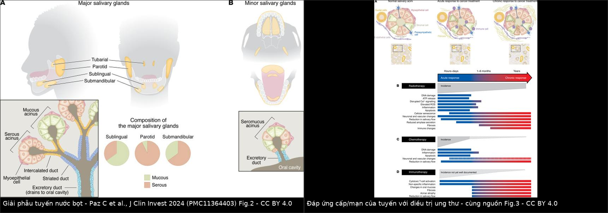
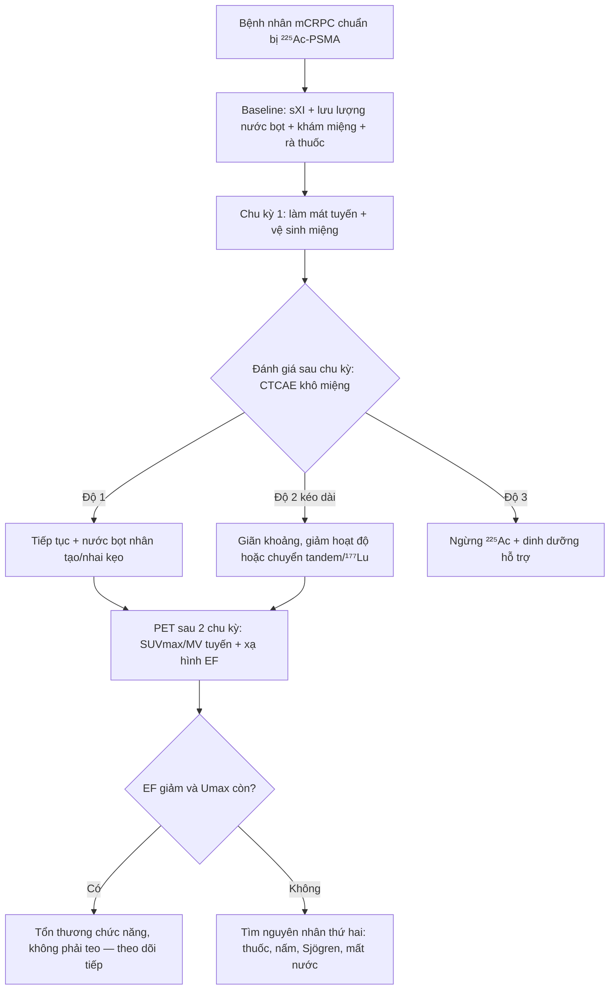
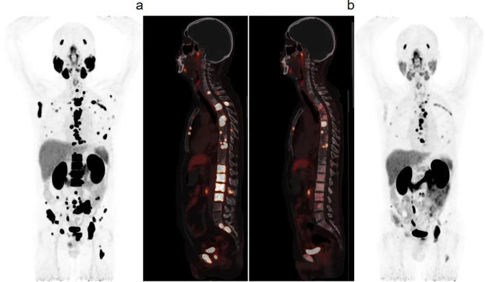
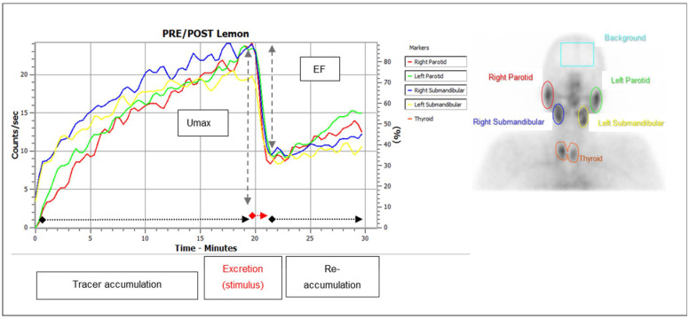
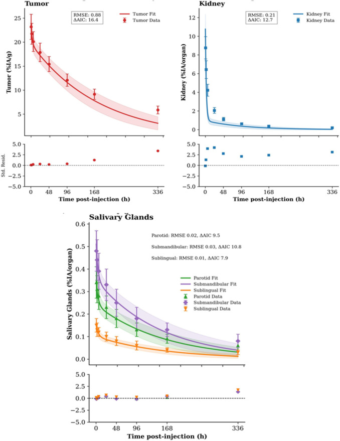

# 1838 — Khô miệng do ²²⁵Ac-PSMA: tuyến nước bọt là cơ quan giới hạn liều / Xerostomia after ²²⁵Ac-PSMA alpha therapy

**Tags:** `pattern:kho-mieng` `pattern:giam-chuc-nang-tuyen` `pattern:giam-phan-suat-bai-tiet` `pattern:teo-tuyen` `vung:tuyen-nuoc-bot` `vung:dauco` `vung:toan-than` `score:CTCAE` `protocol:PSMA-PET-CT` `protocol:xa-hinh-tuyen-nuoc-bot` `protocol:dosimetry` `protocol:do-luu-luong-nuoc-bot` `incidentaloma:hap-thu-tuyen-nuoc-bot`
**Mức chắc chắn (certainty):** tổng hợp y văn (literature synthesis) — nhóm tự biên từ các nguồn mở, đã đối chiếu `authorString`/PMCID: tổng quan cơ chế và độc tính tuyến (CC BY 4.0, PMC12388893), đoàn hệ 29 bệnh nhân ²²⁵Ac-PSMA-617 (CC BY 4.0, PMC11906306), an toàn dài hạn 89 bệnh nhân (CC BY 4.0, PMC11816130), nghiên cứu xạ hình tuyến trước–sau 1 chu kỳ tandem (CC BY 4.0, PMC9406477), mô hình chuột định liều (CC BY 4.0, PMC13106407), tổng quan chiến lược bảo vệ tuyến (CC BY 4.0, PMC13416105), tổng quan chức năng tuyến do điều trị ung thư (CC BY 4.0, PMC11364403), phân tích gộp 1.525 bệnh nhân (CC BY 4.0, PMC13134245), định liều SPECT ²²⁵Ac-PSMA-CY313 (CC BY-NC-ND 4.0, PMC12858698), đoàn hệ 12 bệnh nhân theo dõi PET (CC BY 4.0, PMC13705418). Chỗ nhóm suy luận được ghi rõ "suy luận".

> **Vì sao bài này quan trọng:** bài **1729** đã chốt *độc tính tủy* của ²²⁵Ac-PSMA và bài **1711** đã chốt *cách định liều*; nhưng cơ quan **thực sự chặn liều điều trị** lại là **tuyến nước bọt**. Khô miệng không phải "tác dụng phụ khó chịu" mà là **lý do số một khiến bệnh nhân dừng trị liệu dù u còn đáp ứng** — trong một loạt 26 bệnh nhân, **100% khô miệng độ 1–2 không hồi phục** và **23% bỏ điều trị vì mức độ khô miệng**. Bài này trả lời bốn câu: **vì sao hạt alpha phá tuyến mạnh hơn beta**, **đo tổn thương bằng gì** (xạ hình, PET, lưu lượng nước bọt), **phân độ và ngưỡng xử trí**, và **bảo vệ tuyến trước mỗi chu kỳ bằng cách nào**.

## 1. Tổng quan bệnh học – cơ chế hình ảnh: vì sao tuyến nước bọt là cơ quan giới hạn liều

- **Bệnh học:** PSMA (prostate-specific membrane antigen) **có biểu hiện sinh lý** ở tuyến nước bọt, tuyến lệ, ống lượn gần thận và ruột non — không phải chỉ ở ung thư tuyến tiền liệt. Vì vậy mọi thuốc PSMA gắn đồng vị đều **chiếu xạ tuyến nước bọt**, và mức độ phụ thuộc **loại bức xạ**, không chỉ phụ thuộc hoạt độ.
- **Vật lý — TẠI SAO alpha phá tuyến khác beta (bắt buộc giải thích):**

| Đặc tính | ²²⁵Ac-PSMA | ¹⁷⁷Lu-PSMA |
|---|---|---|
| Loại bức xạ | **4 hạt alpha/chuỗi phân rã**, 5,8–8,4 MeV | hạt beta |
| Đường đi | **47–85 µm** (~vài đường kính tế bào) | **0,7–2,1 mm** |
| LET | **~100 keV/µm** | **~0,2 keV/µm** |
| Chu kỳ bán rã vật lý | **~9,9 ngày** | **~6,7 ngày** |
| Kiểu tổn thương DNA | **chùm đứt sợi đôi dày đặc, khó sửa** | đứt sợi đơn rải rác, còn sửa được |

  Nguồn: PMC12388893. Hệ quả: alpha **giết tế bào trong vài lớp tế bào quanh nơi gắn**, không phụ thuộc chu kỳ tế bào, và **không có "ngưỡng liều an toàn" rõ** như beta — mỗi chu kỳ cộng dồn tổn thương không hồi phục.
- **TẠI SAO tổn thương không hồi phục:** tế bào nang tuyến (acinar cell) **biệt hóa cao, tốc độ thay thế rất chậm**; sau tổn thương DNA chúng không được thay bằng tế bào mới mà **chuyển sang xơ hóa và teo**. Đáp ứng cấp (giờ–ngày: tổn thương DNA, ATP, tín hiệu Ca²⁺, ROS, viêm) chuyển thành đáp ứng mạn (1–6 tháng tới nhiều năm: **giảm lưu lượng, giảm amylase, xơ hóa**) — xem sơ đồ trong ảnh ghép dưới đây.
- **TẠI SAO chức năng mất TRƯỚC khi tuyến teo thấy được:** tuyến còn **bắt thuốc** (Umax trên xạ hình gần như không đổi) nhưng **không bài tiết được** (phân suất bài tiết, EF, giảm rõ) sau chỉ **1 chu kỳ tandem**; thể tích chuyển hóa (MV) trên PSMA PET giảm dần trong theo dõi dài. Vì vậy **đọc "tuyến còn ngấm thuốc" không có nghĩa là tuyến còn chức năng** — đây là cạm bẫy cốt lõi của bài.
- **Ngưỡng định lượng (theo `PROMPT_SYNTHESIZER.md`):**
  - **Tần suất khô miệng ²²⁵Ac-PSMA-617:** **79,3% (23/29)** trong một đoàn hệ (PMC11906306); **100% (26/26) độ 1–2, không hồi phục**, khởi phát **sau chu kỳ đầu** và **nặng dần theo chu kỳ**, **23% bỏ trị liệu** vì khô miệng (dẫn trong PMC11816130).
  - **So sánh beta:** ¹⁷⁷Lu-PSMA-617 trong thử nghiệm VISION gây khô miệng **38,8%** so với **0,5%** ở nhóm chỉ chăm sóc hỗ trợ, và **không có ca độ 3**; ¹⁷⁷Lu đơn trị trong nghiên cứu xạ hình: **24,2% độ 1** ngắn hạn, **40% độ 1–2** dài hạn (PMC11816130, PMC9406477).
  - **Tandem (1 chu kỳ ²²⁵Ac + ¹⁷⁷Lu):** **66,7% (12/18) độ 1–2**, điểm sXI **9,5 → 14,0** (p = 0,005), **EF và MV giảm ở mọi tuyến** (PMC9406477).
  - **Liều hấp thụ (RBE-weighted):** trên người với ²²⁵Ac-PSMA-CY313, **tuyến nước bọt 0,50 ± 0,47 Gy** (hệ số **0,07 ± 0,07 Gy/MBq**), **thận 1,55 ± 0,38 Gy** (**0,23 ± 0,07 Gy/MBq**), tỉ lệ u/tuyến nước bọt **4,96** (PMC12858698). Trên chuột, **tuyến mang tai 0,56 Gy > thận 0,29 Gy** ở cùng 5 kBq, và **bài tiết nước bọt giảm > 60%** kéo dài, tương quan liều–chức năng **ρ = 0,776** (PMC13106407).
  - **Phản biện (bắt buộc):** ở người, **liều hấp thụ tuyến nước bọt thấp hơn thận** nhưng tuyến vẫn là cơ quan giới liều **về mặt chức năng** — vì tuyến nhỏ, không có dự trữ bù và không tái sinh. Kết luận "thận là cơ quan giới hạn" chỉ đúng trên **liều hấp thụ**, sai trên **kết cục lâm sàng**.

## 2. Mẫu hình + chẩn đoán phân biệt theo cơ chế (Gamut)

- **Mẫu hình lõi:** bệnh nhân ung thư tuyến tiền liệt đang/đã trị liệu PSMA **than khô miệng tăng dần theo số chu kỳ**, kèm **khó nuốt thức khô, cần uống nước khi ăn, khàn nhẹ, khô mắt**; khám thấy **niêm mạc miệng khô, ít nước bọt đọng đáy miệng, lưỡi nứt, sâu răng mới**.
- **Gamut theo cơ chế (5 trục, dùng để không bỏ sót nguyên nhân thứ hai):**
  1. **Xạ trị hạt alpha (²²⁵Ac)** — khô miệng **sớm sau chu kỳ 1, nặng dần, không hồi phục**; đây là nguyên nhân chính khi đang dùng ²²⁵Ac.
  2. **Xạ trị hạt beta (¹⁷⁷Lu)** — khô miệng **nhẹ hơn, thường độ 1**, tăng theo số chu kỳ.
  3. **Xạ trị ngoài đầu cổ** (kể cả xạ trị tuyến tiền liệt di căn xương hiếm khi vào tuyến) — khô miệng **theo liều và thể tích tuyến trong trường chiếu**, khởi phát 1–3 tuần, đỉnh 2–3 tháng.
  4. **Thuốc và bệnh nền** — kháng cholinergic (oxybutynin, amitriptyline), opioid, kháng histamine, lợi tiểu; **Sjögren**, đái tháo đường, suy giáp, mất nước, thở miệng khi ngủ.
  5. **Nhiễm trùng và tại chỗ** — **nấm miệng (candida)**, viêm tuyến do tắc ống (sỏi nhầy), xạ trị gây hẹp ống tuyến, khô mắt kèm theo (tuyến lệ cùng cơ chế).
- **Mẫu hình hình ảnh tương ứng:**
  - **PSMA PET/CT:** ngấm thuốc sinh lý **đối xứng** ở tuyến mang tai/dưới hàm; sau điều trị **SUVmax giảm −63,7% và SUVmean giảm −45,5%** sau 2 chu kỳ (PMC13705418) — giảm ngấm là **dấu hiệu tổn thương tuyến**, không phải đáp ứng u.
  - **Xạ hình tuyến nước bọt (⁹⁹ᵐTc-pertechnetate + kích thích chanh):** **Umax** (bắt thuốc) và **EF** (phân suất bài tiết). Sau 1 chu kỳ tandem: **Umax không đổi, EF giảm ở mọi tuyến** (PMC9406477).
  - **MRI (khi cần loại trừ nguyên nhân khác):** tuyến teo, thay mỡ T1, giảm tín hiệu T2 và giảm ngấm thuốc ở thể mạn — **suy luận từ cơ chế xơ hóa**, chưa có ngưỡng số trong các nguồn của bài.

## 3. Bảng so sánh phân biệt (ma trận đối chiếu)

| Thực thể (entity) | Hình ảnh / đặc điểm điển hình | Chốt vào (rule-in) | Chốt loại (rule-out) | Gợi ý xác nhận |
|---|---|---|---|---|
| **Khô miệng do ²²⁵Ac-PSMA (alpha)** | PSMA PET: tuyến ngấm đối xứng, **SUVmax giảm dần** sau các chu kỳ; xạ hình: **EF giảm, Umax còn**; tuyến teo mạn | **Đang/đã ²²⁵Ac + khô miệng khởi phát sau chu kỳ 1 + nặng dần + không hồi phục**; **79,3–100%** ca có triệu chứng | Khô miệng **có từ trước** điều trị, hoặc **đáp ứng với ngừng thuốc kháng cholinergic** → không quy cho alpha | sXI + lưu lượng nước bọt + xạ hình trước/sau 2 chu kỳ |
| **Khô miệng do ¹⁷⁷Lu-PSMA (beta)** | Ngấm tuyến giảm nhẹ; xạ hình: EF giảm ít hơn | **Đang ¹⁷⁷Lu + khô miệng độ 1, tăng theo số chu kỳ**; **24,2% ngắn hạn / 40% dài hạn** | **Độ 3–4 hoặc khởi phát tức thì sau chu kỳ 1** → nghĩ alpha/tandem hoặc nguyên nhân khác | CTCAE + sXI mỗi chu kỳ |
| **Khô miệng do tandem (²²⁵Ac + ¹⁷⁷Lu)** | Sau **1 chu kỳ**: SUVmax và MV giảm, EF giảm, Umax không đổi | **66,7% độ 1–2 sau 1 chu kỳ tandem**, sXI **9,5 → 14,0** | Khô miệng **đơn độc độ 1, không tiến triển qua 2 chu kỳ** → có thể chỉ do beta | xạ hình + sXI trước và sau chu kỳ |
| **Khô miệng do xạ trị ngoài đầu cổ** | Trường chiếu đi qua tuyến; MRI: teo/thay mỡ theo vùng chiếu | **Tiền sử xạ đầu cổ + khô miệng 1–3 tuần sau xạ + viêm niêm mạc cùng lúc** | **Không tiền sử xạ đầu cổ** → loại | Kế hoạch xạ (DVH tuyến), khám miệng |
| **Khô miệng do thuốc** | Tuyến **không teo**, không giảm ngấm thuốc; khô miệng **xuất hiện sau khi thêm thuốc** | **Bắt đầu/ngừng thuốc kháng cholinergic, opioid, kháng histamine → triệu chứng đổi theo** | **Triệu chứng vẫn tiến triển dù đã ngừng thuốc 2–4 tuần** → không phải do thuốc | Rà đơn thuốc, thử ngừng thuốc |
| **Hội chứng Sjögren** | Tuyến teo, **tổn thương dạng nốt/tuyến to không đều**, có thể có tổn thương phổi/tủy | **Khô miệng + khô mắt + kháng SSA/SSB (+), Schirmer ≤ 5 mm/5 phút** | **Kháng thể âm + không khô mắt + toàn cảnh phù hợp trị liệu** → loại | Anti-SSA/SSB, Schirmer, sinh thiết môi |
| **Khô miệng do mất nước/đái tháo đường** | Tuyến bình thường trên hình ảnh; glucose cao, BUN/creatinine tăng | **Glucose huyết tương lúc đói ≥ 126 mg/dL hoặc mất nước có bằng chứng** | **Đường huyết và hydrat hóa bình thường** → loại | Glucose, điện giải, cân nặng |
| **Nấm miệng** | Mảng trắng bong được, đỏ dưới; đau rát | **Mảng trắng + đau rát + đáp ứng kháng nấm trong 1–2 tuần** | **Không mảng trắng, không đau** → loại | Soi tươi/KOH, thử điều trị |

*Trái: vị trí và cấu trúc tuyến mang tai/dưới hàm/dưới lưỡi và tuyến phụ — nơi PSMA biểu hiện sinh lý nên luôn bị chiếu xạ. Phải: đáp ứng cấp (giờ–ngày) chuyển thành mạn (1–6 tháng tới nhiều năm) với giảm lưu lượng, giảm amylase và xơ hóa. Nguồn: Paz C et al., J Clin Invest 2024 (PMC11364403), Fig. 2 + Fig. 3, CC BY 4.0. Ảnh ghép letterbox, không crop.*

## 4. Protocol chụp, phân độ và ngưỡng xử trí

- **Đo trước khi bắt đầu (baseline, bắt buộc):** hỏi khô miệng/khô mắt, **sXI** (xerostomia inventory), **lưu lượng nước bọt toàn phần không kích thích**; ghi lại thuốc kháng cholinergic/opioid; khám miệng (sâu răng, nấm).
- **PSMA PET/CT:** đo **SUVmax, SUVmean và thể tích chuyển hóa (MV)** của 4 tuyến (2 mang tai + 2 dưới hàm) ở baseline và sau **2 chu kỳ**; dùng cùng máy, cùng protocol, cùng cách vẽ VOI để so sánh. Ngưỡng tham khảo: **SUVmax −63,7%, SUVmean −45,5%** sau 2 chu kỳ trong một đoàn hệ 12 bệnh nhân (PMC13705418) — **chưa đủ để làm ngưỡng quyết định**, chỉ dùng để theo dõi xu hướng.
- **Xạ hình tuyến nước bọt (⁹⁹ᵐTc-pertechnetate):** chụp động học 30 phút, **kích thích bằng chanh ở phút 20**; tính **Umax** (đỉnh bắt thuốc) và **EF = (U12–14 − U18–20)/U12–14** (theo cách tính trong hình của PMC9406477). **EF là chỉ số nhạy** — giảm trước khi Umax đổi.
- **Phân độ CTCAE v5.0 (khô miệng):**

| Độ | Triệu chứng | Lưu lượng nước bọt không kích thích |
|---|---|---|
| 1 | Có triệu chứng, **không thay đổi chế độ ăn** | **> 0,2 mL/phút** |
| 2 | Triệu chứng trung bình, **phải uống nhiều nước/chất bôi trơn, ăn thức mềm ẩm** | **0,1–0,2 mL/phút** |
| 3 | **Không ăn uống đủ qua đường miệng**, cần **sonde hoặc nuôi dưỡng tĩnh mạch** | **< 0,1 mL/phút** |
| 4 | Hậu quả đe dọa tính mạng | — |

- **Ngưỡng xử trí thực hành (tổng hợp, có ghi "suy luận" ở phần chưa có thử nghiệm):**
  - **Độ 1:** tiếp tục trị liệu + vệ sinh miệng + nước bọt nhân tạo/nhai kẹo không đường.
  - **Độ 2 kéo dài hoặc tăng sau 2 chu kỳ:** **cân nhắc giãn khoảng chu kỳ, giảm hoạt độ, hoặc chuyển tandem/¹⁷⁷Lu** nếu u còn đáp ứng — quyết định cá thể hóa (chưa có ngưỡng từ thử nghiệm ngẫu nhiên; đây là **suy luận** từ dữ liệu quan sát).
  - **Độ 3:** **ngừng ²²⁵Ac**, chuyển hướng chăm sóc hỗ trợ/dinh dưỡng; đây là mức mà **23% bệnh nhân trong loạt 26 ca đã tự bỏ trị liệu**.
  - **Trước mỗi chu kỳ:** làm mát ngoài vùng tuyến, vệ sinh miệng, kiểm tra thuốc kháng cholinergic; **sialendoscopy bơm rửa + corticoid** và **botulinum toxin** đã được thử nhưng **bằng chứng chỉ ở loạt nhỏ/không ngẫu nhiên** (PMC13416105).
- **Quy trình một chu kỳ (flowchart):**

## 5. Biến thể bình thường và cạm bẫy

- **Ngấm thuốc tuyến nước bọt trên PSMA PET là SINH LÝ**, đối xứng, không phải di căn — đừng gọi "di căn tuyến nước bọt"; bất đối xứng mới cần nghĩ u/tổn thương tại chỗ.
- **"Tuyến còn ngấm thuốc" ≠ "tuyến còn chức năng":** sau 1 chu kỳ tandem, **Umax không đổi nhưng EF đã giảm**; chỉ nhìn Umax sẽ bỏ sót tổn thương.
- **Khô miệng có từ trước:** trong đoàn hệ dài hạn, chỉ **12,7% (9/71)** khô miệng **mới xuất hiện** — nghĩa là phần lớn đã có khô miệng nền. Không ghi baseline thì không thể quy công hay đánh giá tiến triển.
- **Khô miệng chủ quan không kèm giảm lưu lượng:** bệnh nhân có thể **cảm giác khô do thay đổi thành phần nước bọt (sialochemistry)**, không phải giảm thể tích (PMC11364403) — đừng kết luận "không có tổn thương" chỉ vì lưu lượng bình thường.
- **Quy công sai:** thuốc kháng cholinergic/opioid, mất nước do nôn/tiêu chảy, nấm miệng và đái tháo đường đều gây khô miệng; **ngừng thuốc 2–4 tuần** là nghiệm pháp loại trừ đơn giản trước khi giảm liều ²²⁵Ac.
- **Giảm SUVmax tuyến sau điều trị có thể bị đọc nhầm là "đáp ứng u"** — luôn đọc tuyến và u riêng, ghi hai bộ số.
- **Tuyến lệ ít được hỏi:** khô mắt cùng cơ chế, dữ liệu còn hạn chế (PMC11816130) — hỏi khô mắt mỗi lần khám.

## 6. Tự lượng giá — Blind Quiz

**Ca 1 — Nam 68 tuổi, mCRPC đã thất bại ¹⁷⁷Lu, đang ²²⁵Ac-PSMA-617. So sánh hai ảnh PET trước và sau 3 chu kỳ.**

- Gợi ý: bệnh nhân than khô miệng tăng dần từ chu kỳ 1; PSA giảm từ 601,326 ng/mL xuống 7,486 ng/mL.
- Câu hỏi: Ảnh nào là trước, ảnh nào là sau? Ngoài tổn thương u, vùng nào thay đổi? Thay đổi đó nói gì về tuyến nước bọt?

<b>Bấm để hiện đáp án (findings + chẩn đoán)</b>

- Dấu hiệu: (a) trước — nhiều ổ ngấm mạnh ở xương chậu, xương sườn, cột sống; (b) sau 3 chu kỳ — các ổ này **giảm rõ**, đồng thời **ngấm thuốc tuyến mang tai/dưới hàm hai bên cũng giảm** so với (a).
- Chẩn đoán: **đáp ứng u tốt kèm tổn thương tuyến nước bọt do alpha** — vì PSMA biểu hiện sinh lý ở tuyến nên tuyến bị chiếu xạ cùng lúc; giảm ngấm tuyến **không phải** đáp ứng u mà là **dấu hiệu tổn thương/xơ hóa tuyến**, tương ứng khô miệng tăng dần.
- Nguồn: Ma J et al., Front Oncol 2025 (PMC11906306), Fig. 3, CC BY 4.0.

**Ca 2 — Cùng bệnh nhân, xạ hình tuyến nước bọt trước và sau 1 chu kỳ tandem: đọc hai chỉ số.**

- Gợi ý: kích thích bằng chanh ở phút 20; đường cong trên (Umax) và cột dưới (EF).
- Câu hỏi: Umax thay đổi bao nhiêu? EF thay đổi bao nhiêu? Chỉ số nào phản ánh tổn thương sớm hơn?

<b>Bấm để hiện đáp án (findings + chẩn đoán)</b>

- Dấu hiệu: **Umax gần như không đổi** (tuyến vẫn bắt thuốc), nhưng **EF giảm rõ ở cả 4 tuyến** sau 1 chu kỳ tandem.
- Chẩn đoán: **suy chức năng bài tiết sớm của tuyến** — vì tế bào nang còn giữ khả năng bắt thuốc nhưng **bộ máy bài tiết đã hỏng**; EF là chỉ số nhạy, Umax là chỉ số muộn.
- Nguồn: Langbein T et al., Diagnostics 2022 (PMC9406477), Fig. 2, CC BY 4.0.

**Ca 3 — Đồ thị định liều trên chuột: cùng một hoạt độ, so sánh u – thận – tuyến.**

- Gợi ý: trục tung là % hoạt độ/gam cơ quan, trục hoành là giờ sau tiêm.
- Câu hỏi: Cơ quan nào có liều hấp thụ cao nhất trong mô hình này? Vì sao trên người, tuyến nước bọt vẫn là cơ quan giới hạn liều dù liều hấp thụ thấp hơn thận?

<b>Bấm để hiện đáp án (findings + chẩn đoán)</b>

- Dấu hiệu: **tuyến mang tai 0,56 Gy > thận 0,29 Gy** ở cùng 5 kBq; **bài tiết nước bọt giảm > 60%** kéo dài; tương quan liều–chức năng **ρ = 0,776**.
- Chẩn đoán: trong mô hình chuột, **tuyến nước bọt nhận liều cao hơn thận**; trên người, liều tuyến (**0,07 Gy/MBq**) thấp hơn thận (**0,23 Gy/MBq**) nhưng tuyến vẫn **giới hạn liều về chức năng** vì **nhỏ, không có dự trữ bù và không tái sinh** — bài học: **liều hấp thụ không phải toàn bộ câu chuyện**, phải đọc thêm chức năng.
- Nguồn: Cai C et al., Front Pharmacol 2026 (PMC13106407), Fig. 2, CC BY 4.0.

## Bài liên quan chéo
- [1729 – Suy tủy do xạ trị hạt alpha ²²⁵Ac-PSMA: phân độ CTCAE, liều tủy RBE = 5](../1729-suy-tuy-xa-tri-hat-alpha-225ac/lesson.md)
- [1711 – Định liều cá thể hóa ²²⁵Ac: dosimetry, RBE và ngưỡng tạng](../1711-dosimetry-ca-the-hoa-ac225/lesson.md)
- [1695 – ²²⁵Ac-DOTATATE cho PPGL sau ¹⁷⁷Lu](../1695-ac225-dotatate-ppgl-sau-lu177/lesson.md)
- [740 – U tuyến nước bọt: u hỗn hợp, Warthin & ác tính](../740-salivary-gland-tumors/lesson.md)
- [230 – Tuyến giáp & hạch cổ](../230-tuyen-giap-hach-co/lesson.md)

> Không dùng để chẩn đoán độc lập khi chưa có người hướng dẫn.
