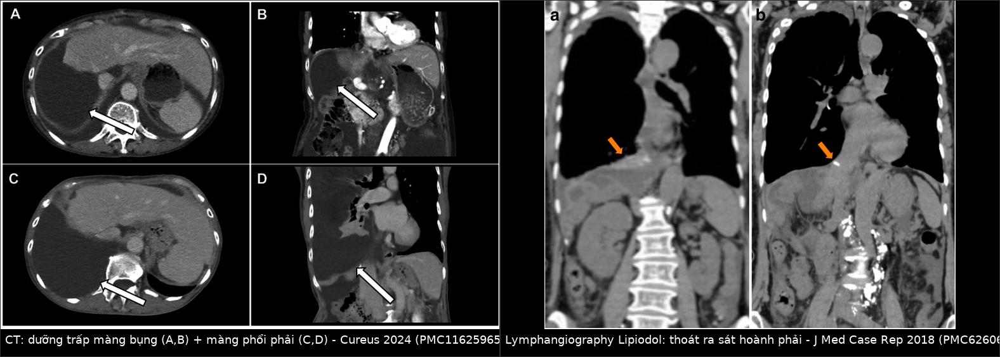
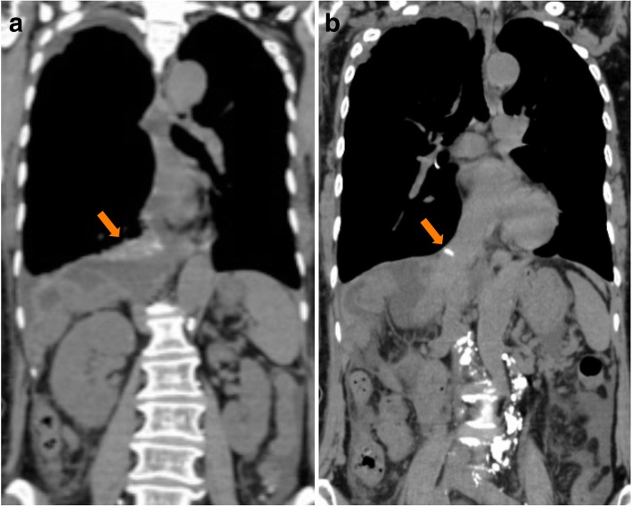
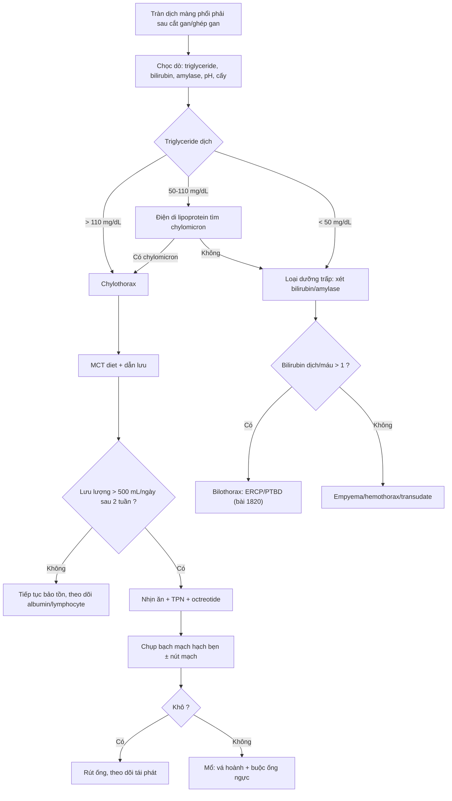
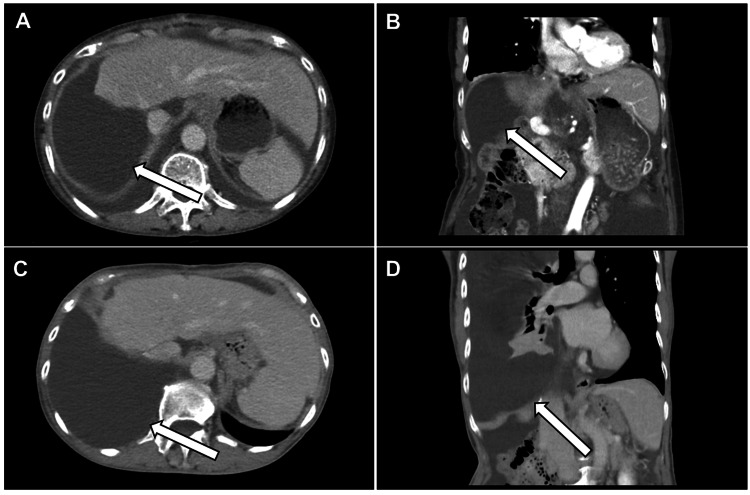
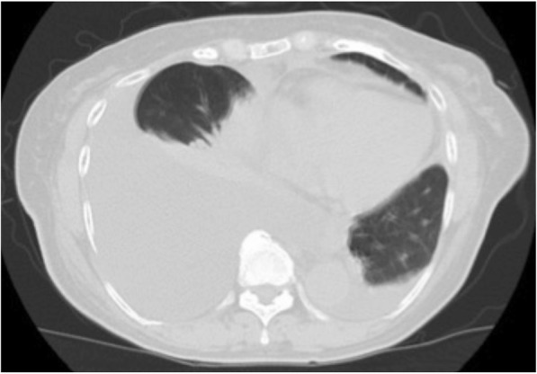

# 1839 — Chylothorax sau cắt gan/ghép gan: phân biệt với bilothorax và ngưỡng triglyceride dịch / Chylothorax after hepatectomy and liver transplantation: separating it from bilothorax

**Tags:** `pattern:chylothorax` `pattern:tran-dich-mang-phoi` `pattern:ro-bach-huyet` `vung:gan` `vung:co-hoanh` `vung:mong-phoi` `score:Light` `protocol:CT-nguc-bung` `protocol:lymphangiography` `protocol:DCMRL` `incidentaloma:chylous-ascites`

**Mức chắc chắn (certainty):** tổng hợp y văn (literature synthesis) — tự biên từ **ca dưỡng trấp màng bụng tiến triển thành chylothorax sau cắt gan phải mở rộng + nạo hạch** (PMC11625965, CC BY 4.0), **ca chylothorax sau cắt gan phải ngày 42** (PMC6260677, CC BY 4.0), **ca chylothorax + chyloperitoneum sau ghép gan kèm tổng quan** (PMC6679892, CC BY 4.0), **đoàn hệ 159 ca phẫu thuật tụy–mật** (PMC6788374, CC BY 4.0) và **10 ca chylous ascites sau mổ bụng được chụp bạch mạch hạch bẹn** (PMC11538909, CC BY-NC-ND 4.0). Chưa gắn một ca nguyên văn đơn lẻ của riêng bài.

> **Bài này là nhánh "bạch mạch" của [1820 – Rò mật–màng phổi (bilothorax)](../1820-ro-mat-mang-phoi/lesson.md).** 1820 đã chốt **tỷ lệ bilirubin dịch/huyết thanh > 1** và **phải vừa dẫn lưu màng phổi vừa giải áp đường mật**. Nhưng cùng một bệnh nhân sau cắt gan, **dịch trắng đục** có thể là **dưỡng trấp** chứ không phải mật — và **hai bệnh cảnh đi ngược nhau**: bilothorax cần **ERCP/PTBD**, chylothorax cần **dinh dưỡng + octreotide + can thiệp bạch mạch**, còn **đặt stent đường mật trong chylothorax là vô ích và làm chậm dinh dưỡng**.

> **Câu chốt:** **Tràn dịch màng phổi phải sau cắt gan là chuyện thường (18,4–54,5%, trong đó 5,3% phải đặt ống — bài 1820), nhưng "dịch trắng đục" là chylothorax cho tới khi triglyceride dịch chứng minh ngược.** Ngưỡng **triglyceride dịch màng phổi > 110 mg/dL (1,24 mmol/L)** là chốt xác định; **50–110 mg/dL là vùng xám** phải tìm **hạt chylomicron**; **< 50 mg/dL gần như loại trừ**. Ca minh họa: **dịch màng bụng triglyceride 1.571 mg/dL**, ba tháng sau **2 L dịch màng phổi sữa với triglyceride 483 mg/dL** (PMC11625965); ca khác **tràn dịch phải ngày 42 sau cắt gan**, tái tích **ngày 57**, chỉ khô sau **chụp bạch mạch ngày 62** (PMC6260677).

## 1. Tổng quan bệnh học – cơ chế hình ảnh

- **Dưỡng trấp (chyle) là gì:** dịch bạch huyết từ ruột non, giàu **triglyceride dạng hạt chylomicron**, **lymphocyte**, **protein** và **immunoglobulin**. Lưu lượng ống ngực **~1,5–2,5 L/ngày** ở người lớn và **tăng nhiều lần sau bữa ăn có mỡ** — đó là lý do **dịch trắng đục xuất hiện/ tăng sau khi ăn**, còn **khi nhịn ăn dịch có thể trong như huyết thanh**.
- **TẠI SAO cắt gan/ghép gan lại làm rò bạch mạch:** chuỗi bạch mạch gan đi theo **cuống gan và dây chằng gan–tá tràng** rồi đổ về **bể dưỡng trấp (cisterna chyli)** và **ống ngực**. Ba thời điểm dễ đứt: **(1) nạo hạch rốn gan / quanh động mạch gan**, **(2) bóc tách tĩnh mạch chủ dưới và vùng sau phúc mạc**, **(3) mặt cắt nhu mô gan**. Khi mổ **cắt gan phải mở rộng + nạo hạch**, tổn thương bạch mạch gần như không tránh được ở mức vi thể.
- **TẠI SAO dưỡng trấp màng bụng lại thành dưỡng trấp màng phổi:** dịch tích trong ổ bụng (**chylous ascites**) làm **tăng áp lực ổ bụng**, rồi đi qua **khiếm khuyết nhỏ của cơ hoành** — vùng **"bare area"** phải nơi cơ hoành **không có phúc mạc che** và nơi cơ hoành mỏng nhất — vào khoang màng phổi. Vì vậy **gần như luôn là bên PHẢI**. Ca minh họa tìm thấy **lỗ thủng cơ hoành** và **dưỡng trấp chảy từ bạch mạch rốn gan** khi nội soi lồng ngực (PMC11625965).
- **TẠI SAO CT một mình KHÔNG gọi tên được bệnh — vật lý HU:** dưỡng trấp có **tỷ trọng 0–20 HU**, gần trùng **dịch thanh mạc, mật, nước tiểu và mủ loãng**. Trên CT, chylothorax chỉ là **"dịch đậm độ dịch"**; cái phân biệt là **màu sữa khi chọc dò** + **sinh hóa dịch**. Ngược lại **máu tụ 35–70 HU** mới tách được bằng đậm độ.
- **TẠI SAO phải phân biệt với bilothorax ngay từ đầu:** sau cắt gan, **cả hai** đều cho **dịch màng phổi phải** và **đều có thể trắng đục/vàng**. Nhưng **bilothorax có bilirubin dịch/huyết thanh > 1** và cần **giải áp đường mật**; **chylothorax có triglyceride rất cao, bilirubin thấp** và cần **bù dinh dưỡng + can thiệp bạch mạch**. Đo **cả triglyceride, bilirubin, amylase** trên cùng một mẫu dịch là cách rẻ nhất để không đi sai đường.
- **TẠI SAO chylothorax nguy hiểm hơn "một ít dịch":** mất **500–1.000 mL/ngày** kéo dài gây **giảm thể tích, giảm albumin, giảm lymphocyte (mất CD4), suy dinh dưỡng, suy giảm miễn dịch và nhiễm trùng**. Ca sau ghép gan được mô tả với **dưỡng trấp màng bụng + màng phổi** và **kéo dài nằm viện** (PMC6679892); ca sau cắt gan phải mở rộng có **albumin 2,4 g/dL** và **tình trạng dinh dưỡng xấu đi rõ** khi chylothorax xuất hiện (PMC11625965).
- **Số phải nhớ — tần suất và thời điểm:** chylothorax sau **mổ ngực < 1%**; sau **mổ bụng "cực kỳ hiếm"**, chủ yếu là ca lẻ (PMC6260677). **Chylous ascites sau ghép gan 0,6–7%** (PMC6679892). Trong **159 ca phẫu thuật tụy–mật**: rò dưỡng trấp **3,6% sau cắt tá tràng–tụy (5/137)** và **4,5% sau nối mật–ruột (1/22)**, lưu lượng trung bình **441 mL/ngày (150–800)**, kéo dài **16,5 ngày (4–35)**, nằm viện **19,1 ngày** (PMC6788374). Thời điểm xuất hiện **rất muộn**: **ngày 5** (ascites) → **ngày 42** (khó thở, tràn dịch phải) → **ngày 57** (tái tích) → **ngày 62** chụp bạch mạch → **ngày 71** khô (PMC6260677); ca khác **1 tháng** sau mổ mới có ascites và **3 tháng** mới có chylothorax (PMC11625965).
- **TẠI SAO muộn như vậy:** rò bạch mạch lưu lượng thấp **tích dần**, không gây viêm màng phổi dữ dội như mật; bệnh nhân chỉ **khó thở khi dịch đã lớn**, và **dịch có thể bị quy cho "tràn dịch sau mổ"** rồi theo dõi. Đây là lý do **mọi tràn dịch phải đặt ống sau cắt gan cần được chọc/đo sinh hóa** chứ không chỉ nhìn siêu âm.

## 2. Mẫu hình + chẩn đoán phân biệt theo bối cảnh (gamut)

- **Bối cảnh 1 — cắt gan phải mở rộng + nạo hạch rốn gan:** thể điển hình nhất; **ascites trước, chylothorax sau** (PMC11625965). Dịch **trắng đục như sữa**, **không mùi**, **không sốt**.
- **Bối cảnh 2 — ghép gan (đặc biệt gan sống cho):** bóc tách cuống gan + tĩnh mạch chủ; có thể **kết hợp chyloperitoneum + chylothorax** (PMC6679892). Tần suất **0,6–7%**.
- **Bối cảnh 3 — phẫu thuật tụy–mật:** cắt tá tràng–tụy, nối mật–ruột; lưu lượng trung bình **441 mL/ngày**, tự khỏi **16,5 ngày** với dinh dưỡng + octreotide (PMC6788374).
- **Bối cảnh 4 — ALPPS/cắt gan hai thì:** diện mổ lớn + hai lần can thiệp → nguy cơ rò bạch mạch tăng; cùng nhóm "diện cắt lớn".
- **Bối cảnh 5 — sau mổ thực quản/ngực:** tổn thương **trực tiếp ống ngực**; chylothorax **thường bên phải** ở ngực dưới, **bên trái** ở ngực trên; xuất hiện **sớm hơn** và lưu lượng lớn hơn.
- **Bối cảnh 6 — xơ gan có "hepatic chylothorax":** tràn dịch dưỡng trấp **do tăng áp cửa**, thường **kèm ascites**, dịch có thể **transudate** và triglyceride **thấp hơn** nhóm sau mổ; không có đường rò khu trú để can thiệp — điều trị **bệnh gan nền + dinh dưỡng**.
- **Bối cảnh 7 — bilothorax:** dịch **vàng–nâu ô liu**, **bilirubin dịch/huyết thanh > 1**, có **biloma dưới hoành**; cần **ERCP/PTBD** (bài 1820).
- **Bối cảnh 8 — rò tụy–màng phổi:** dịch **amylase rất cao** (> 1.000 U/L), thường **bên trái**, kèm **nang giả tụy**; đây là hàng phân biệt của "tràn dịch tái diễn sau mổ bụng trên" (bài 1737).
- **Bối cảnh 9 — empyema/hemothorax:** **sốt, đau ngực, pH thấp**, hoặc **Hct dịch > 50% Hct máu**; không có màu sữa.
- **Gợi nhớ 6 chữ — "C-H-Y-L-E-S":** **C**ontext (cắt gan/ghép/tụy) · **H**ilum (nạo hạch rốn gan) · **Y**ield (lưu lượng mL/ngày) · **L**ight (triglyceride > 110) · **E**xtravasation (lymphangiography) · **S**tep-up (MCT → TPN/octreotide → can thiệp).

## 3. Bảng so sánh phân biệt (ma trận đối chiếu)

| Thực thể (entity) | Hình ảnh / dấu hiệu điển hình | Chốt vào (rule-in) | Chốt loại (rule-out) | Gợi ý xác nhận |
|---|---|---|---|---|
| **Chylothorax sau cắt gan/ghép gan** | Tràn dịch **phải**, **muộn (ngày 5–42)**, dịch **trắng đục như sữa**; có/không kèm **chylous ascites**; CT không thấy bệnh nhu mô phổi | **Triglyceride dịch > 110 mg/dL** + **dịch/máu > 1** + bối cảnh nạo hạch/bóc tách cuống gan | Dịch trong, triglyceride **< 50 mg/dL**, không tăng sau ăn mỡ → không phải dưỡng trấp | Chọc dò + sinh hóa; **lymphangiography** tìm thoát thuốc |
| **Bilothorax** | Tràn dịch **phải**, **vàng–nâu ô liu**, có **biloma dưới hoành** | **Bilirubin dịch/huyết thanh > 1** + biloma sát cơ hoành | Bilirubin dịch thấp, triglyceride rất cao → dưỡng trấp | CT ngực–bụng, HIDA/CE-MRCP, ERCP (bài 1820) |
| **Rò tụy–màng phổi** | Tràn dịch **trái** nhiều, **tái diễn**, kèm **nang giả tụy/giãn ống tụy** | **Amylase dịch rất cao** (hàng nghìn U/L) + hình ảnh tụy | Amylase dịch thấp → loại | CT tụy thì muộn, MRCP (bài 1737) |
| **Tràn dịch màng phổi "đơn thuần" sau cắt gan** | Lượng **ít–vừa**, **tự giảm**, không sốt, không ascites | **Triglyceride < 50 mg/dL, bilirubin ≤ 1, amylase thấp** | Dịch sữa/tăng triglyceride → không đơn thuần | Theo dõi 48–72 giờ; chọc khi không giảm |
| **Empyema** | Dịch **vách, khí trong màng phổi**, màng phổi dày, **sốt cao** | **pH < 7,2, glucose thấp, LDH cao, cấy dương** | Dịch trong, cấy âm, không vách | Dẫn lưu + cấy; đo triglyceride song song |
| **Hemothorax** | Dịch **máu**, thiếu máu, Hct dịch cao | **Hct dịch > 50% Hct máu** | Hct dịch thấp + dịch sữa → không phải máu | CT + chọc dò |
| **Hepatic chylothorax (xơ gan, tăng áp cửa)** | Tràn dịch **phải**, **kèm ascites**, gan xơ, **không có mổ** | **Triglyceride > 110 mg/dL** nhưng **không có đường rò khu trú**, bệnh gan nền rõ | Có bối cảnh mổ + thoát thuốc trên lymphangiography → rò sau mổ | Siêu âm/CT gan, đo áp cửa gián tiếp |
| **Chylous ascites KHÔNG thông màng phổi** | Bụng **căng dịch**, **không tràn dịch** hoặc rất ít | **Triglyceride dịch bụng > 110 mg/dL**, **dịch/máu > 1**, **bạch cầu > 1.000/µL, lymphocyte chiếm ưu thế** | Có tràn dịch phải lượng lớn + lỗ hoành → đã thông | CT ngực–bụng; lymphoscintigraphy |

*Trái: **CT có cản quang** — (A,B) dưỡng trấp màng bụng, (C,D) tràn dưỡng trấp màng phổi phải (mũi tên trắng), sau cắt gan phải mở rộng + nạo hạch. Phải: **chụp bạch mạch bằng Lipiodol** — thuốc thoát ra **sát khoang màng phổi phải trên cơ hoành** (mũi tên) nhưng **không định vị được chính xác lỗ rò**; hình b: Lipiodol tụ quanh **đường đóng mỏm gan phải**. Ảnh ghép letterbox nền đen, không crop/kéo giãn. Nguồn: *Cureus* 2024 (PMC11625965) Figure 2, CC BY 4.0 (trái); *J Med Case Rep* 2018 (PMC6260677) Fig. 5, CC BY 4.0 (phải).*

### Vì sao "dịch sữa" không đủ và "dịch trong" không loại trừ
- **Dịch có thể KHÔNG đục:** bệnh nhân **nhịn ăn/ăn ít mỡ** → dưỡng trấp **trong như huyết thanh**, dễ bị đọc là transudate. Vì vậy **không dựa vào màu**; phải đo triglyceride và **cho ăn mỡ rồi lặp siêu âm/CT** nếu còn nghi.
- **Vùng xám 50–110 mg/dL:** làm **điện di lipoprotein** tìm **hạt chylomicron** (chốt xác định), hoặc **tỷ lệ triglyceride dịch/máu > 1**.
- **Bạch cầu dịch > 1.000/µL với lymphocyte ưu thế** là dấu phụ hữu ích nhưng **không thay** triglyceride (PMC6679892).

## 4. Protocol + phân tầng xử trí

- **Chẩn đoán hình ảnh:** **CT ngực–bụng có cản quang** (thì tĩnh mạch cửa) là bước đầu — trả lời **lượng dịch, vị trí, có ascites, có biloma/nang giả tụy, có lỗ hoành**. CT **không** chứng minh dưỡng trấp.
- **Chọc dò màng phổi — bộ xét nghiệm tối thiểu:** **triglyceride, cholesterol, bilirubin, amylase, LDH, glucose, pH, tế bào (công thức), cấy, tế bào học**; nếu triglyceride **50–110 mg/dL** → **điện di lipoprotein**.
- **Chẩn đoán "đường rò" (không bắt buộc để điều trị bảo tồn, nhưng cần khi định can thiệp):**
  - **Lymphoscintigraphy** (Tc-99m): thấy **rò vào khoang màng phổi/ổ bụng** nhưng **độ phân giải thấp**; ca PMC11625965 cho **âm tính ở ống ngực**, từ đó kết luận nguồn là **bạch mạch rốn gan**.
  - **Chụp bạch mạch hạch bẹn qua siêu âm (intranodal lymphangiography) với Lipiodol:** kim 25–27 G vào **hạch bẹn**, bơm **3,5–7,0 mL** (trung bình **4,5 mL**); trong **10 ca** sau mổ bụng (**9 ca sau mổ gan**), **3 ca thấy thoát thuốc trực tiếp** và **5 ca thấy trên CT sau chụp**; **6/10 ca khỏi chỉ nhờ chụp bạch mạch**, không cần mổ (PMC11538909).
  - **DCMRL** khi có MRI: đánh giá **dòng ống ngực, tắc/nghẽn, dòng ngược** trước khi nút mạch.

*Chụp bạch mạch bằng Lipiodol sau cắt gan phải: (a) thuốc **thoát ra sát khoang màng phổi phải trên cơ hoành** (mũi tên) nhưng **không định vị được chính xác lỗ rò**; (b) Lipiodol **tụ quanh đường đóng mỏm gan phải**. Đây là ví dụ "chụp bạch mạch vừa chẩn đoán vừa điều trị" — dịch khô dần sau thủ thuật dù không thấy lỗ. Nguồn: *J Med Case Rep* 2018 (PMC6260677) Fig. 5, CC BY 4.0.*
- **Phân tầng điều trị (step-up) — không có RCT, bằng chứng chủ yếu là đoàn hệ/ca lẻ:**
  1. **Chế độ ít mỡ / MCT** (thực hành: tổng mỡ < 20 g/ngày) — giảm dòng dưỡng trấp; vẫn đủ năng lượng.
  2. **Nhịn ăn + TPN** khi lưu lượng cao hoặc không giảm sau 1–2 tuần.
  3. **Octreotide (somatostatin analogue)** — được dùng rộng rãi nhưng **liều và thời gian chưa chuẩn hóa**; chính ca PMC11625965 nêu rõ **"không có bằng chứng mức cao và không có guideline"** cho chylous ascites sau mổ.
  4. **Can thiệp bạch mạch:** chụp bạch mạch ± **nút mạch ống ngực/bạch mạch** (thoracic duct embolization) — vừa chẩn đoán vừa điều trị (PMC11538909).
  5. **Mổ:** **vá lỗ hoành** (fibrin glue/miếng vá) + **buộc ống ngực** hoặc **nối bạch huyết–tĩnh mạch** khi thất bại; ca PMC11625965 phải **mổ hai thì** (vá hoành nội soi + xử lý nguồn rốn gan) mới khô.
- **Ngưỡng "thất bại điều trị bảo tồn" dùng trong ca thực tế:** **dẫn lưu > 500 mL/ngày kéo dài 2 tuần** → chuyển can thiệp/mổ (PMC11625965). Đây là **ngưỡng của ca**, không phải chuẩn quốc tế.
- **Theo dõi trong khi dẫn lưu:** **cân nặng, albumin, lymphocyte/CD4, điện giải**; bù **dịch và protein**; **không hút áp lực mạnh** vì làm tăng lưu lượng rò.

## 5. Biến thể bình thường và cạm bẫy

- **"Tràn dịch sau mổ" là chẩn đoán mặc định sai:** tràn dịch phải sau cắt gan gặp **18,4–54,5%**, nhưng **5,3% phải đặt ống** và **rò mật tăng gấp ~3 lần** ở nhóm này (PMC10727470, bài 1820). Trong chylothorax, tỷ lệ còn thấp hơn — nên **chỉ chọc dò mới trả lời**.
- **Cạm bẫy "dịch trong = transudate":** bệnh nhân nhịn ăn → dưỡng trấp trong; **đừng loại trừ** nếu có bối cảnh nạo hạch. Cho **bữa ăn có mỡ** rồi đánh giá lại.
- **Cạm bẫy "triglyceride cao = chylothorax" ở bệnh nhân xơ gan:** **hepatic chylothorax** cũng tăng triglyceride nhưng **không có đường rò khu trú** và **không cần can thiệp bạch mạch** — điều trị bệnh gan nền.
- **Cạm bẫy hai bệnh cùng lúc:** sau cắt gan, **dưỡng trấp và mật có thể cùng rò**. Một mẫu dịch chỉ đo triglyceride sẽ bỏ sót bilothorax (và ngược lại). **Đo cả ba: triglyceride, bilirubin, amylase.**
- **Cạm bẫy hình học trên CT ngang:** phân biệt **dịch màng phổi vs cổ trướng** bằng **dấu crus lệch (displaced crus sign)** và **dấu bare area**; dịch màng phổi nằm **ngoài** cơ hoành, cổ trướng **trong** và đẩy crus vào trong.
- **Cạm bẫy "không thấy lỗ rò":** chụp bạch mạch có thể **không định vị được lỗ** mà chỉ thấy **thoát thuốc vùng lân cận** (PMC6260677) — **không thấy lỗ không loại trừ rò**; quyết định dựa trên lưu lượng + đáp ứng điều trị.
- **Cạm bẫy can thiệp sai thứ tự:** đặt **stent đường mật** ở bệnh nhân chylothorax **không giúp gì**, làm tăng nguy cơ nhiễm trùng đường mật và trì hoãn dinh dưỡng.
- **Biến thể "chyloperitoneum đơn thuần":** chỉ có ascites, **không tràn dịch**; điều trị giống hệt (MCT → TPN/octreotide → can thiệp) nhưng **không cần dẫn lưu màng phổi**.

## 6. Tự lượng giá — Blind Quiz

**Ca 1 — Nữ 73 tuổi, cắt gan phải mở rộng + nạo hạch vì cholangiocarcinoma trong gan. Một tháng sau: bụng căng, chọc ra dịch sữa. Ba tháng sau: khó thở, X-quang/CT có tràn dịch phải lớn. Nhìn CT, mô tả trước khi đọc đáp án.**

- Hỏi: (1) Hai khoang nào có dịch? (2) Dịch màng phổi **trắng đục** — xét nghiệm nào chốt? (3) Vì sao lại là **bên phải**?

<b>Bấm để hiện đáp án</b>

- (A,B) **dưỡng trấp màng bụng**; (C,D) **tràn dưỡng trấp màng phổi phải** — mũi tên trắng. Dịch bụng **triglyceride 1.571 mg/dL**; dịch màng phổi **483 mg/dL**, **2 L dịch sữa**, cấy âm, không tế bào ác tính.
- Chốt: **triglyceride dịch > 110 mg/dL** (ngưỡng Light) + **dịch/máu > 1**; vùng xám 50–110 cần **chylomicron**.
- Bên phải vì dưỡng trấp từ **bạch mạch rốn gan** đi qua **vùng bare area/lỗ nhỏ cơ hoành phải**; nội soi lồng ngực sau đó xác nhận **lỗ hoành + dưỡng trấp từ cuống gan**.
- Diễn biến thật: bảo tồn (nhịn ăn, ít mỡ, octreotide, dẫn lưu ngực) **thất bại** với **> 500 mL/ngày trong 2 tuần** → **mổ hai thì** (vá hoành bằng fibrin glue + xử lý nguồn rốn gan).
- Nguồn: *Cureus* 2024 (PMC11625965) Figure 2, CC BY 4.0.

**Ca 2 — Nữ 74 tuổi, cắt gan phải + cắt thùy đuôi + cắt ống mật ngoài gan + nạo hạch. Ngày 5 có ascites dưỡng trấp, điều trị bảo tồn đỡ. Ngày 42 đột ngột khó thở.**

- Hỏi: chẩn đoán? Bước tiếp theo? Nếu chụp bạch mạch **không thấy lỗ rò** thì sao?

<b>Bấm để hiện đáp án</b>

- **Chylothorax phải muộn sau cắt gan**: tràn dịch lớn, xẹp phổi phải, **ascites còn ít**; dịch sữa, triglyceride cao.
- Bước tiếp: **dẫn lưu màng phổi + TPN + octreotide**; nếu tái tích → **chụp bạch mạch Lipiodol** (vừa chẩn đoán vừa điều trị).
- Trong ca này, chụp bạch mạch **ngày 62** thấy **thoát Lipiodol sát khoang màng phổi phải** nhưng **không xác định được vị trí lỗ**, **không tắc/không giãn ống ngực**; sau chụp + đặt ống ngực, dịch giảm và **khô ngày 71**, ra viện **ngày 72**. Theo dõi **2,5 năm không tái phát**.
- Bài học: **không thấy lỗ rò không loại trừ chylothorax** — chẩn đoán là **sinh hóa dịch**, và chụp bạch mạch có thể **điều trị dù không định vị được lỗ**.
- Nguồn: *J Med Case Rep* 2018 (PMC6260677) Fig. 3, CC BY 4.0.

**Ca 3 — Cùng bệnh nhân sau cắt gan, dịch màng phổi **vàng–nâu**, triglyceride 40 mg/dL, bilirubin dịch 8 mg/dL, bilirubin máu 1,2 mg/dL.**

<b>Bấm để hiện đáp án</b>

- **Bilothorax**, không phải chylothorax: **bilirubin dịch/máu = 6,7 (> 1)**, triglyceride thấp.
- Xử trí: **dẫn lưu màng phổi + giải áp đường mật** (ERCP cắt cơ thắt/stent hoặc PTBD) — chỉ hút màng phổi sẽ rò tiếp (bài 1820).
- Nguồn: nguyên lý từ PMC11959429/PMC13282023 trong bài 1820.

## Bài liên quan chéo
- [1820 – Rò mật–màng phổi (bilothorax): bilirubin dịch/huyết thanh > 1](../1820-ro-mat-mang-phoi/lesson.md) — hàng phân biệt bắt buộc
- [1814 – Rò mật sau cắt gan: phân độ ISGLS, biloma](../1814-ro-mat-sau-cat-gan/lesson.md)
- [1823 – Tràn dưỡng trấp và thuốc ức chế MAPK](../1823-trametinib-di-dang-bach-huyet-ras-mapk/lesson.md) — cùng hệ bạch mạch, hướng điều trị mới
- [1737 – Rò tụy–màng phổi](../1737-ro-tuy-mang-phoi/lesson.md) — amylase dịch rất cao, bên trái
- [040 – Tràn dịch màng phổi](../040-tran-dich-mang-phoi/lesson.md) — tiếp cận dịch màng phổi, dấu crus/bare area
- [118 – Ghép tạng và ức chế calcineurin](../118-doac-ghep-tang-uc-che-calcineurin/lesson.md) — bối cảnh ghép gan

> Không dùng để chẩn đoán độc lập khi chưa có người hướng dẫn.
