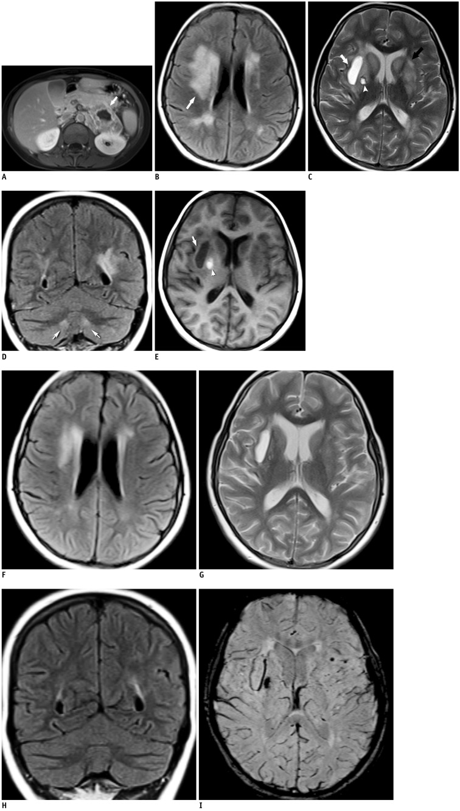
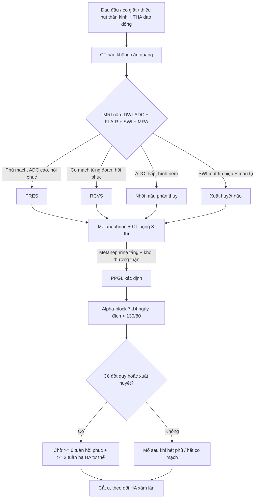
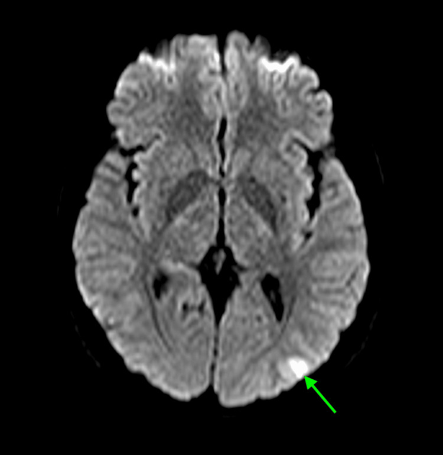
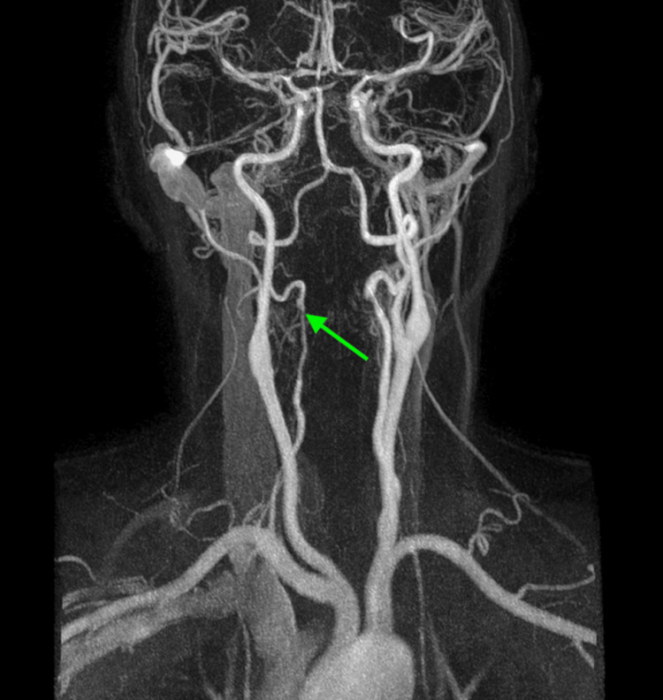
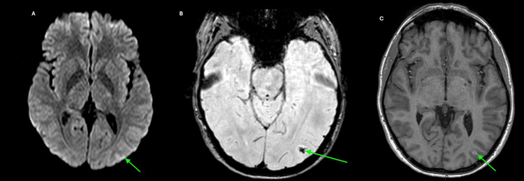
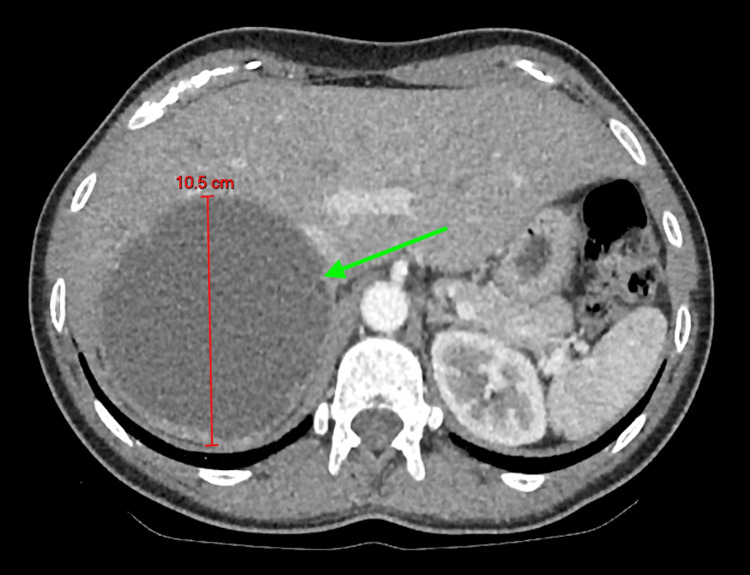
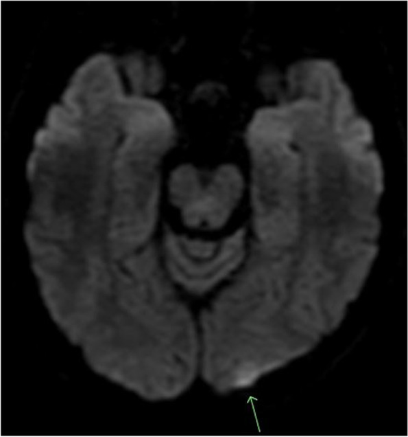

# 184 — Biến chứng thần kinh của u tủy thượng thận – u cận hạch (PPGL): PRES, RCVS, đột quỵ & xuất huyết não / Neurological complications of phaeochromocytoma–paraganglioma

**Tags:** `pattern:phu-nao-mach` `pattern:co-mach-nao` `pattern:xuat-huyet-nao` `vung:nao` `vung:thuong-than` `protocol:MRI-DWI-SWI-MRA` `score:PRES` `incidentaloma:u-thuong-than`

**Mức chắc chắn (certainty):** tổng hợp y văn (literature synthesis) — ghép 3 ca nguyên văn có ảnh (PMC3772271, PMC12794468, PMC9380330) với phần bàn luận về thời điểm mổ sau đột quỵ (PMC11969262) và các ngưỡng đã có trong repo (`155`, `167`, `177`).

> **Câu chốt:** Bệnh nhân **đau đầu dữ dội từng cơn + huyết áp dao động** thì hình ảnh não chỉ là *hệ quả* — chẩn đoán nằm ở **metanephrine và một khối thượng thận**. Ngược lại, khi đã biết có PPGL mà xuất hiện đau đầu, co giật, mù vỏ não hay liệt nửa người, đừng mặc định "đột quỵ do xơ vữa": ba bệnh cảnh của catecholamine là **PRES (phù mạch, hồi phục)**, **RCVS (co mạch, hồi phục ~3 tháng)** và **nhồi máu/xuất huyết (không hồi phục)** — ba bệnh cảnh này **đổi hoàn toàn thái độ điều trị và thời điểm mổ**.

## 1. Tổng quan — catecholamine làm hỏng não theo 4 đường

- **Đường 1 — vỡ tự điều hòa → phù mạch (PRES).** Tiểu động mạch não tự điều hòa theo cơ chế Bayliss: khi huyết áp vượt ngưỡng trên, mạch không co thêm được nữa → **tăng áp lực mao mạch, phá vỡ hàng rào máu–não, thoát huyết tương ra khoang ngoại bào**. Vì là **nước ngoại bào**, T2/FLAIR **sáng**, nhưng **DWI không hạn chế khuếch tán và ADC cao** — đây là điểm phân biệt cốt lõi với nhồi máu (ADC thấp). Phù mạch **hồi phục** khi hạ áp lực tưới máu.
- **Đường 2 — co mạch từng đoạn (RCVS).** Catecholamine kích thích **alpha-1** gây co mạch não; kèm rối loạn chức năng nội mô do stress oxy hóa. Mạch co – giãn không đều tạo hình **"chuỗi hạt" (string of beads)**, tự hết trong **~3 tháng**; trong giai đoạn co mạch có thể gây **nhồi máu vùng phân thủy (watershed)** vì lưu lượng thấp nhất ở vùng tiếp giáp tưới máu.
- **Đường 3 — xuất huyết.** Tăng áp lực đột ngột trên nền **vi mạch đã hyalin hóa do tăng huyết áp mạn** → vỡ mạch nhỏ (nhân bèo, đồi thị, thùy) và **vi chảy máu** rải rác. Huyết sắc tố (hemosiderin) gây **mất tín hiệu trên SWI/T2\*** — chỉ thấy khi chủ động chụp chuỗi này.
- **Đường 4 — vi mạch huyết khối (TMA).** Tăng huyết áp ác tính (≥ 180/120 mmHg + tổn thương cơ quan đích) làm tổn thương nội mô → tan máu vi mạch (schistocyte, LDH tăng, hemoglobin tụt) và **tắc vi mạch não–thận**, giải thích vì sao bệnh nhân vừa mù vỏ não vừa suy thận.

**Ngưỡng & số liệu định lượng:**
- PPGL gây **0,5–2,0%** các ca tăng huyết áp ở trẻ em (PMC3772271).
- Trong một loạt tử thiết, **75%** bệnh nhân PPGL tử vong được phát hiện tình cờ chết vì **nhồi máu cơ tim hoặc tai biến mạch máu não** (Sutton, dẫn lại trong PMC9380330).
- **PRES thể "trung tâm" (central PRES):** thân não **18,4%**, nhân bèo/đuôi **11,8%** (McKinney, dẫn trong PMC3772271) — nghĩa là **thiểu số nhưng không hiếm**, và chính nhóm này dễ bị đọc nhầm.
- **Hạ huyết áp trong PRES:** giảm **20–30%** huyết áp trong **vài giờ đầu**, không hạ nhanh hơn (PMC9380330) — hạ quá tay làm giảm tưới máu vùng co mạch.
- **Sinh hóa của ca RCVS:** normetanephrine **11.652 pmol/L** (bình thường < 1.180), metanephrine **5.627 pmol/L** (< 510) (PMC12794468).
- **Ca trẻ 13 tuổi (PMC3772271):** huyết áp **215/165 mmHg**, mạch **137 lần/phút**, normetanephrine niệu **30.084 µg/24 giờ** (63–402), noradrenalin huyết tương **17.540 pg/mL** (0–400).
- **Hậu quả huyết học của THA ác tính:** hemoglobin tụt từ **> 15 g/dL xuống 9,6 g/dL trong 72 giờ**, schistocyte 3+, troponin 0,35 → 3,2 ng/mL (PMC9380330).
- **Thời điểm mổ sau đột quỵ (quan trọng nhất cho quyết định):** ít nhất **6 tuần** hồi phục sau đột quỵ và **≥ 2 tuần** đạt hạ huyết áp tư thế trước mổ; ca được báo cáo cần **9 tuần** alpha-block và **vẫn có 6 cơn tăng huyết áp nặng trong mổ** (PMC11969262). Chuẩn bị alpha-block thường quy **7–14 ngày** (bài `177`).

## 2. Mẫu hình + chẩn đoán phân biệt theo bệnh cảnh (gamut)

- **A — Đau đầu sét đánh (thunderclap) tái diễn, CT não lần đầu bình thường:** nghĩ **RCVS** (± PRES). Đây là cửa vào hay bị dán nhãn "migraine/cluster" — và **triptan làm co mạch nặng thêm** (PMC12794468).
- **B — Bệnh não + co giật + mù vỏ não hai bên:** nghĩ **PRES**. Điển hình là phù **chẩm–đỉnh**; thể **trung tâm** (hạch nền, thân não, đồi thị, chất trắng quanh não thất) gặp ở tăng huyết áp **mạn** và tiên lượng nặng hơn.
- **C — Khiếm khuyết khu trú (liệt nửa người, thất ngôn):** nghĩ **nhồi máu** — vùng phân thủy do co mạch/tụt áp lực, hoặc thuyên tắc. Ở người trẻ không yếu tố nguy cơ xơ vữa, phải tìm nguyên nhân nội tiết.
- **D — Hôn mê, đau đầu dữ dội, nôn:** nghĩ **xuất huyết não** (nhân bèo/đồi thị/thùy) hoặc **xuất huyết dưới nhện**; đây là nhóm tử vong cao nhất nếu bỏ sót.
- **E — Thiếu máu + vàng da nhẹ + suy thận cấp + mù vỏ não:** nghĩ **THA ác tính + TMA** phối hợp PRES — cần phân biệt với TTP/HUS thật (ADAMTS13) vì hướng điều trị khác.
- **F — Bắt chước (mimic):** đau nửa đầu có aura, **viêm mạch nguyên phát CNS**, **loạn sản cơ xơ (FMD)** và **loạn sản động mạch từng đoạn (SAM)**, PRES do thuốc/urê huyết, hạ đường huyết.
- Gợi nhớ **4 nhóm mạch máu não của catecholamine: P–R–I–H** — **P**RES (phù), **R**CVS (co mạch), **I**nfarct (nhồi máu), **H**emorrhage (xuất huyết). Bốn nhóm có thể **cùng tồn tại trên một bệnh nhân**.

*(A) MRI bụng có cản quang: khối thượng thận trái lớn, ngấm không đồng nhất, hoại tử trung tâm. (B–E) Trước điều trị: FLAIR/T2 tăng tín hiệu đối xứng ở nhân đuôi, nhân bèo, nhân răng và chất trắng quanh não thất; kèm 2 ổ máu tụ (ổ mạn có viền hemosiderin ở bao ngoài phải, ổ bán cấp ở nhân cầu nhạt phải). (F–H) Ngày thứ 10 sau hạ huyết áp: phù mạch **giảm rõ/hoàn toàn**. (I) SWI: nhiều ổ mất tín hiệu milimét ở hạch nền — **chỉ thấy trên SWI**. Nguồn: Serter A et al., *Korean J Radiol* 2013 (PMC3772271), CC BY-NC 3.0, giữ nguyên bản.*

## 3. Bảng so sánh phân biệt (ma trận đối chiếu)

| Thực thể (entity) | Hình ảnh điển hình | Chốt vào (rule-in) | Chốt loại (rule-out) | Gợi ý xác nhận |
|---|---|---|---|---|
| **PRES điển hình** | Phù vỏ–dưới vỏ **chẩm–đỉnh hai bên**, đối xứng; T2/FLAIR sáng, **DWI âm/ADC cao** | **Phù mạch + huyết áp rất cao + hồi phục sau hạ áp lực** | ADC **thấp** + tăng tín hiệu theo lãnh thổ mạch → nhồi máu, không phải PRES | MRI DWI/ADC + FLAIR; chụp lại sau 7–10 ngày |
| **PRES trung tâm** | Phù **hạch nền, đồi thị, thân não, nhân răng, chất trắng quanh não thất**; có thể **không có** phù chẩm–đỉnh | **Phù đối xứng ở hạch nền/thân não ở người THA mạn** | Tổn thương một bên, bờ rõ, ngấm kiểu u → u/viêm | FLAIR + T2, so sánh hai bên, bối cảnh THA kéo dài |
| **RCVS** | MRA/CTA/DSA: co thắt **từng đoạn** nhiều mạch ("chuỗi hạt"), có thể kèm nhồi máu phân thủy nhỏ | **Đau đầu sét đánh lặp lại + co mạch từng đoạn + hồi phục ≤ 3 tháng** | Co mạch **cố định, một đoạn dài, không hồi phục** → xơ vữa/FMD/viêm mạch | MRA lúc cơn + lặp sau 2–4 tuần; DSA khi còn nghi |
| **Nhồi máu vùng phân thủy** | Ổ **hình nêm** ở vùng tiếp giáp (bán cầu–bán cầu, trên/dưới lều), DWI sáng + **ADC thấp** | **ADC thấp + hình nêm + huyết áp dao động** | ADC cao, không theo lãnh thổ → phù mạch (PRES) | DWI/ADC; siêu âm tim/tầm soát nguồn tắc |
| **Xuất huyết não do THA** | Ổ máu tụ **nhân bèo/đồi thị/thùy**, viền hemosiderin; SWI mất tín hiệu mạnh | **SWI/T2\* mất tín hiệu + huyết áp ≥ 180/120** | Không mất tín hiệu, chỉ phù → không phải máu | CT không cản quang cấp + SWI |
| **Viêm mạch nguyên phát CNS** | Hẹp–giãn **nhiều ổ, nhiều mạch**, ngấm thành mạch trên HR-vwMRI, tổn thương não **không hồi phục** | **Ngấm thành mạch đồng tâm + tổn thương não tiến triển** | Hồi phục nhanh sau hạ áp + co mạch tự hết → RCVS | HR-vwMRI, sinh thiết não–màng não (bài `241`, `242`) |
| **FMD/SAM mạch cổ–não** | "Chuỗi hạt" nhưng **thường ở ĐM cảnh/đốt sống đoạn ngoài sọ**, ± phình/bóc tách | **Tổn thương cố định, không hồi phục, ± bóc tách** | Co mạch **hồi phục** sau vài tuần → RCVS | CTA cổ–não, DSA, tầm soát mạch thận |

## 4. Protocol chụp + phân độ + quyết định điều trị

**4.1. Chụp não (làm ngay, đừng chờ metanephrine):**
- **MRI là chuẩn:** DWI + ADC, FLAIR, T2, **SWI/T2\***, **TOF-MRA** (hoặc CTA nếu không chụp MRI được) — tối thiểu 4 chuỗi này, vì mỗi chuỗi trả lời một câu khác nhau (phù? nhồi máu? máu? co mạch?).
- **CT không cản quang** chỉ để loại trừ chảy máu cấp; **CT thường âm tính không loại trừ PRES/RCVS** (cả 3 ca nguồn đều có CT đầu bình thường).
- **Chụp lại 7–10 ngày** (ca PMC3772271 chụp ngày 10): phù mạch giảm là bằng chứng **vàng** của PRES; đồng thời lộ **vi chảy máu trên SWI** mà lần đầu bỏ sót.
- **MRA lặp sau 2–4 tuần** nếu nghi RCVS: co mạch **hồi phục** mới là chốt; "chuỗi hạt" có thể **vắng mặt** ở lần chụp đầu (đúng như ca PMC12794468).

**4.2. Chụp thượng thận & xét nghiệm:**
- **Metanephrine huyết tương/niệu trước mọi can thiệp** (sinh thiết, nút mạch, mổ) — can thiệp khi chưa chặn alpha có thể gây cơn THA/ngừng tim.
- **CT bụng 3 thì + washout** (bài `155`): PPGL thường **> 110–120 HU** ở thì động mạch, nhưng **có thể thải ≥ 60% giả adenoma** — thải thuốc **không loại trừ** pheo.
- **MRI bụng** khi cần đánh giá xâm lấn/huyết khối; **MIBG hoặc DOTATATE PET** khi tìm u ngoài thượng thận/di căn (bài `168`, `177`).

**4.3. Phân độ PRES (McKinney — dùng để quyết định mức theo dõi):**

| Độ | Định nghĩa hình ảnh | Ý nghĩa thực hành |
|---|---|---|
| **Nhẹ** | Phù vỏ–dưới vỏ, **không** xuất huyết, không hiệu ứng khối, ít/không lan tiểu não–thân não–hạch nền | Hạ huyết áp + theo dõi, hồi phục cao |
| **Vừa** | Phù liên tục từ vỏ tới chất trắng sâu **nhưng chưa tới sát não thất**, hoặc tổn thương **2 nhóm** trong (tiểu não/thân não/hạch nền); có thể có xuất huyết nhu mô nhẹ | Nhập ICU, theo dõi tri giác, tránh hạ áp quá nhanh |
| **Nặng** | Phù liên tục **tới sát não thất**, hoặc xuất huyết có hiệu ứng khối/lệch đường giữa/thoát vị; hoặc tổn thương **cả 3 nhóm** | Nguy cơ thoát vị, hội chẩn thần kinh – hồi sức |

**4.4. Điều trị — 5 nguyên tắc:**
1. **Hạ huyết áp có kiểm soát:** giảm **20–30%** trong vài giờ đầu, rồi hạ dần; thuốc giãn mạch tác dụng ngắn (nicardipine, clevidipine) dễ chuẩn độ hơn.
2. **Alpha-block trước, beta sau** — không bao giờ chẹn beta đơn thuần (bài `177`); nếu bệnh nhân đang dùng beta-block đơn thuần thì **ngừng** và chuyển sang alpha-block (đúng như ca PMC9380330).
3. **Kiểm soát co giật** bằng thuốc chống động kinh khi có cơn; **không dùng triptan** khi nghi RCVS.
4. **Mổ cắt u là điều trị triệt căn**, nhưng **thời điểm** phải sau khi não ổn định: **≥ 6 tuần sau đột quỵ** + **≥ 2 tuần đạt hạ huyết áp tư thế** trước mổ (PMC11969262); với PRES/RCVS đơn thuần, nhiều trung tâm mổ sau **2–4 tuần** khi hết phù — *chưa có đồng thuận, ghi rõ "chưa rõ — cần tra"*.
5. **Theo dõi huyết áp xâm lấn trong mổ** vì nguy cơ cơn THA khi chạm u và **tụt áp sau thắt tĩnh mạch thượng thận**.

## 5. Biến thể bình thường và cạm bẫy

- **"Sáng trên DWI" không đồng nghĩa nhồi máu.** Phù mạch của PRES có thể **sáng nhẹ trên DWI do hiệu ứng T2 shine-through**; phải xem **ADC** — ADC cao = phù mạch (hồi phục), ADC thấp = độc tế bào/nhồi máu (di chứng).
- **PRES không nhất thiết ở vùng chẩm–đỉnh.** Thể trung tâm (hạch nền/thân não) gặp tới **18,4%** ở thân não; đừng loại trừ chỉ vì "không đúng vị trí kinh điển".
- **SWI là chuỗi bị bỏ quên nhất.** Vi chảy máu **không thấy** trên FLAIR/T2/CT; nếu không chụp SWI sẽ kết luận "PRES lành tính" trong khi đã có tổn thương không hồi phục.
- **RCVS có thể không có "chuỗi hạt" ở lần chụp đầu**, và MRA độ phân giải thấp dễ âm tính giả; nghi ngờ cao → **DSA**.
- **Đừng chọc dò dịch não tủy khi huyết áp chưa kiểm soát** (nguy cơ cơn THA, thoát vị); nếu đã chọc, kết quả Protein tăng nhẹ không đặc hiệu.
- **Bẫy "migraine/cluster"**: đau đầu từng cơn ở người trẻ được điều trị nhiều tháng bằng triptan — **triptan làm co mạch nặng thêm**; hỏi huyết áp mỗi lần khám.
- **Bẫy "đã cắt pheo là hết chuyện"**: ca PMC3772271 tái phát sau **7 năm** không theo dõi; huyết áp 215/165 khi nhập viện.
- **Satisfaction of search:** thấy ổ nhồi máu trên MRI là dừng, bỏ qua khối thượng thận — vì thế mọi đột quỵ ở người < 40 tuổi **không yếu tố nguy cơ** nên có một câu hỏi về cơn THA/đánh trống ngực.

## 6. Tự lượng giá — Blind Quiz

**Ca 1 — Nữ 13 tuổi, đau đầu dữ dội + vã mồ hôi, huyết áp 215/165 mmHg. Tiền sử cắt u thượng thận phải 7 năm trước, bỏ theo dõi. Nhìn FLAIR trước, mô tả tổn thương.**

- Gợi ý: tổn thương **đối xứng**, ở **hạch nền và nhân răng**, không ở vùng chẩm–đỉnh.
- Câu hỏi: (1) Mô tả 2 kiểu tổn thương trên FLAIR/T2. (2) Vì sao đây là **PRES trung tâm** mà không phải nhồi máu? (3) Chuỗi nào phát hiện thêm tổn thương và tổn thương đó có hồi phục không?

<b>Bấm để hiện đáp án (findings + chẩn đoán)</b>

- **Dấu hiệu:** FLAIR/T2 tăng tín hiệu **đối xứng** ở nhân đuôi, nhân bèo, nhân răng và chất trắng quanh não thất; thêm **2 ổ máu tụ** (ổ mạn có viền hemosiderin ở bao ngoài phải; ổ bán cấp ở nhân cầu nhạt phải). Ngày 10 sau hạ huyết áp: phù **giảm gần hoàn toàn**; **SWI** lộ nhiều ổ mất tín hiệu milimét ở hạch nền/thân não.
- **Chẩn đoán:** **PRES trung tâm (độ nặng) do pheochromocytoma tái phát**, kèm vi xuất huyết — phù mạch **hồi phục**, xuất huyết **không hồi phục**.
- **Vì sao không phải nhồi máu:** phân bố đối xứng, không theo lãnh thổ động mạch, và **hồi phục sau hạ áp** = phù mạch ngoại bào.
- **Nguồn ảnh:** Serter A et al., *Korean J Radiol* 2013;14:849 (PMC3772271), **CC BY-NC 3.0**, giữ nguyên bản.

**Ca 2 — Nữ 35 tuổi, đau đầu sét đánh tái diễn 1 tuần, sau đó thất ngôn + nhìn mờ. CT não 2 lần bình thường. Xem DWI và MRA.**

- Câu hỏi: (1) Ổ trên DWI gợi ý gì, và nó có thực sự là nhồi máu? (2) MRA mô tả tổn thương gì, ở đoạn nào? (3) Chẩn đoán thống nhất cho đau đầu + tổn thương mạch + ổ não?

<b>Bấm để hiện đáp án (findings + chẩn đoán)</b>

- **Dấu hiệu:** DWI tăng tín hiệu vỏ **chẩm–đỉnh trái** (ban đầu bị đọc là nhồi máu hoặc thay đổi do co giật). MRA: **dòng chảy không đều, co thắt từng đoạn ở đoạn V2 động mạch đốt sống phải**, tái thông phía dưới.
- **Diễn tiến:** sau 2 tuần, ổ DWI **gần như mất**, nhưng **SWI còn artifact xu hướng** (hemosiderin) và **T1 sau tiêm có ngấm vỏ** → ổ **xuất huyết vỏ nhỏ**, không phải nhồi máu lớn. MRA còn bất thường nhưng **giảm**.

- **Chẩn đoán:** **RCVS do pheochromocytoma** (khối thượng thận phải 10,5 cm, normetanephrine 11.652 pmol/L). Đau đầu sét đánh + co mạch từng đoạn + hồi phục = bộ ba của RCVS.
- **Bài học:** "chuỗi hạt" **không bắt buộc** phải có; co mạch một đoạn ở ĐM đốt sống vẫn đủ gợi ý khi lâm sàng điển hình.
- **Nguồn ảnh:** Philip K et al., *Cureus* 2025 (PMC12794468), **CC BY 4.0**.

- Khối **10,5 cm**, có thành phần **dịch/HU > 10**, đẩy lệch thận phải và ấn gan — hình ảnh **pheo thể nang thoái hóa**, không điển hình nhưng vẫn là ổ catecholamine.

**Ca 3 — Nữ 27 tuổi (ca trong y văn), mù vỏ não hai bên + huyết áp 219/124 mmHg, hemoglobin tụt nhanh từ 15 xuống 9,6 g/dL trong 72 giờ. Xem DWI.**

- Câu hỏi: (1) Vì sao đây là tổn thương **vùng phân thủy** chứ không phải một lãnh thổ mạch? (2) Cơ chế mù vỏ não? (3) Xét nghiệm máu nào giải thích đồng thời thiếu máu + suy thận?

<b>Bấm để hiện đáp án (findings + chẩn đoán)</b>

- **Dấu hiệu:** ổ tăng tín hiệu vỏ **chẩm trái** ở **vùng phân thủy**, kèm nhiều ổ dưới vỏ hai bên (trái > phải); hình thái **không theo một lãnh thổ động mạch**.
- **Chẩn đoán:** **tổn thương thiếu máu não do THA ác tính**, có thành phần **PRES** (mù vỏ não hai bên) và **TMA do THA ác tính** (schistocyte 3+, hemoglobin 15 → 9,6 g/dL/72 giờ, LDH tăng, tiểu cầu giảm) — không phải TTP nguyên phát.
- **Vì sao mù vỏ não:** tổn thương **vỏ chẩm hai bên** (trung tâm thị giác) — bệnh nhân mù nhưng đồng tử và đáy mắt bình thường.
- **Điều trị:** ngừng beta-block đơn thuần, **phenoxybenzamine** chuẩn độ tới **60 mg × 2/ngày**, hạ huyết áp có kiểm soát; sau mổ thị lực hồi phục dần và hết thiếu máu tan máu.
- **Nguồn ảnh:** Patel SP et al., *BMC Endocr Disord* 2022 (PMC9380330), **CC BY 4.0**, giữ nguyên bản.

## Bài liên quan chéo
- [100 – Tổng quan hệ Bụng](../100-tong-quan-he-bung/lesson.md)
- [155 – Thượng thận tình cờ: 10 HU & washout](../155-thuong-than-tinh-co/lesson.md)
- [167 – Biến chứng tim mạch của pheochromocytoma](../167-bien-chung-tim-mach-pheo-pgl/lesson.md)
- [168 – U tủy thượng thận & u cận hạch](../168-pheo-paraganglioma/lesson.md)
- [169 – PPGL ở trẻ em & trong thai kỳ](../169-ppgl-tre-em-va-thai-ky/lesson.md)
- [177 – Điều trị & theo dõi PPGL](../177-dieu-tri-va-theo-doi-ppgl/lesson.md)
- [241 – Đọc HR-vwMRI thành mạch: viêm mạch vs RCVS](../241-hr-vwmri-doc-ngam-thanh-mach/lesson.md)
- [653 – PRES & RCVS ở trẻ em](../653-pres-rcvs-tre-em/lesson.md)

## Ảnh
- Tên file: `184_ppgl-<nội dung>_<chuỗi xung>_<PMCID>.jpg`; nguồn + giấy phép từng ảnh trong `images/CREDITS.md`.
- Không tải ảnh từ Radiopaedia/AuntMinnie; chỉ dẫn link trong `sources.md`.

> Không dùng để chẩn đoán độc lập khi chưa có người hướng dẫn.
