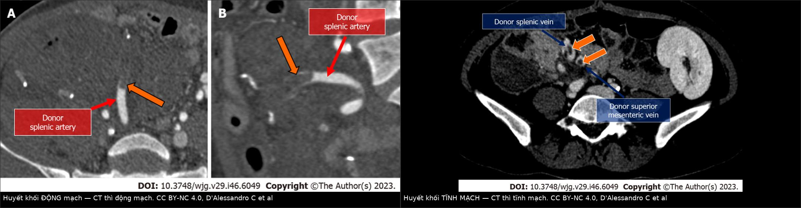
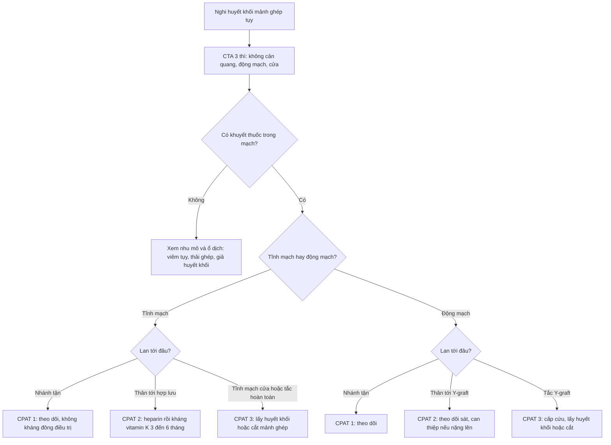
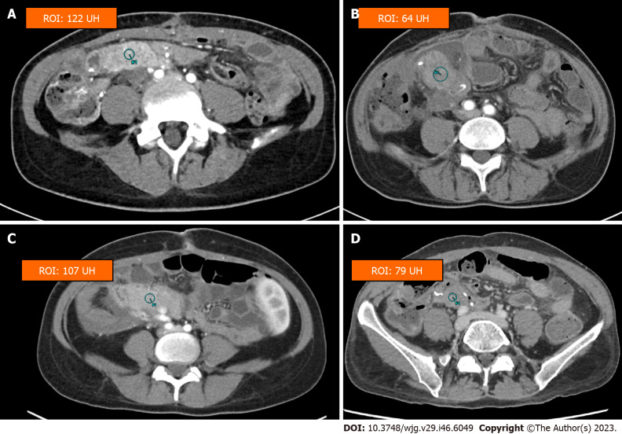
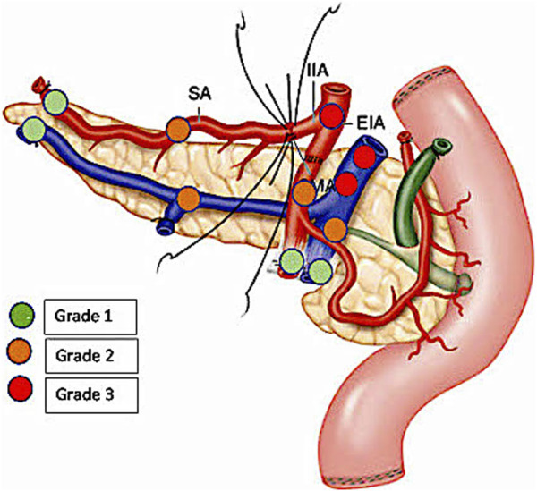

# 1840 — Huyết khối mảnh ghép tụy sau ghép: thang CPAT, mất tưới máu đầu tụy và ngưỡng can thiệp / Pancreas graft thrombosis

**Tags:** `pattern:huyet-khoi` `pattern:khuyet-thuoc-long-mach` `pattern:giam-ngam-thuoc` `pattern:phu-ne` `pattern:hoai-tu` `vung:tuy` `vung:o-bung` `score:CPAT` `protocol:CTA-3-thi` `protocol:sieu-am-Doppler` `protocol:MRA`

**Mức chắc chắn (certainty):** tổng hợp y văn (literature synthesis) — thang **CPAT** từ 103 ca ghép tụy (Am J Transplant 2018, PMC5763322); áp dụng CPAT trên **319 ca đồng thời thận–tụy** có CTA thường quy trong 7 ngày (Transpl Int 2023, PMC10501393); loạt **230 ca** về huyết khối một phần và toàn phần (Transpl Int 2019, PMC7379998); tổng quan hình ảnh CT của biến chứng mổ ghép tụy (World J Gastroenterol 2023, PMC10731157); giải phẫu – hình ảnh thường quy (Br J Radiol 2021, PMC8173685); ca lâm sàng cứu mảnh ghép bằng nong/stent và ca huyết khối muộn sau COVID-19 (Transplant Direct 2022, PMC9605794; Cureus 2023, PMC9946900). Bằng chứng chủ yếu hồi cứu, không có thử nghiệm ngẫu nhiên.

> **Câu chốt:** Huyết khối mảnh ghép tụy là **nguyên nhân hàng đầu mất mảnh ghép sớm không do miễn dịch**, nhưng **không phải mọi huyết khối đều cần điều trị kháng đông**. Việc đọc CTA phải trả lời **ba câu theo thứ tự**: **(1) huyết khối ở tĩnh mạch hay động mạch, và lan tới đâu — còn ở nhánh ngoại vi, tới thân chính, hay đã vào Y-graft/tĩnh mạch cửa? (2) nhu mô còn ngấm thuốc không — mất tưới máu **khu trú ở đầu tụy** hay **toàn mảnh ghép**? (3) có dấu hiệu hoại tử/khí trong nhu mô chưa?** Sai lầm hay gặp: **gọi huyết khối nhánh nhỏ (CPAT 1) là "mất mảnh ghép"** rồi mổ oan, và **bỏ sót huyết khối tĩnh mạch thân chính (CPAT 2–3)** vì nhu mô vẫn còn ngấm thuốc một phần.

## 1. Tổng quan bệnh học – cơ chế hình ảnh

### 1.1 Giải phẫu mảnh ghép: vì sao "đầu tụy" là vùng riêng

- Mảnh ghép tụy được đặt trong **hố chậu phải**, tưới máu qua **Y-graft** làm bằng động mạch chậu của người cho: một nhánh nối **động mạch mạc treo tràng trên của người cho (dSMA)** và một nhánh nối **động mạch lách của người cho (dSA)**, cuống chung nối vào **động mạch chậu của người nhận**.
- **dSMA nuôi đầu tụy, mỏm móc và đoạn tá tràng đi kèm; dSA nuôi thân và đuôi tụy.** Vì vậy huyết khối **nhánh SMA** gây **mất tưới máu đầu tụy/tá tràng** trong khi thân–đuôi vẫn ngấm thuốc bình thường — một **khiếm khuyết theo lãnh thổ**, không phải "mảnh ghép chết toàn bộ".
- **Tĩnh mạch:** tĩnh mạch mạc treo tràng trên của người cho (dSMV) dẫn máu đầu tụy, tĩnh mạch lách (dSV) dẫn thân–đuôi; hai nhánh hợp thành **tĩnh mạch cửa mảnh ghép (dPV)**, nối vào **tĩnh mạch chủ dưới** (dẫn lưu hệ thống) hoặc **tĩnh mạch mạc treo của người nhận** (dẫn lưu qua gan). Kiểu dẫn lưu quyết định **tĩnh mạch nào phải xem trên CTA**.
- **Tá tràng của người cho** nối vào hỗng tràng (hoặc bàng quang). Nhánh **động mạch vị–tá tràng (GDA)** có thể phải tái tạo để bảo đảm tưới máu **đầu tụy và đoạn tá tràng**; thiếu tưới máu này gây **rò/tá tràng hoại tử** dù thân tụy còn tốt.

### 1.2 Vì sao mảnh ghép tụy dễ huyết khối (tam giác Virchow)

- **Ứ trệ tĩnh mạch:** mảnh ghép có lưu lượng tĩnh mạch thấp hơn nhiều so với thận; các nhánh tĩnh mạch nhỏ bị **buộc/thắt** khi lấy tạng; dẫn lưu hệ thống (vào tĩnh mạch chủ) làm mất "hiệu ứng lọc đầu tiên" của gan.
- **Tăng đông:** đái tháo đường, ure máu, tổn thương tái tưới máu, ức chế miễn dịch, nhiễm trùng, và **thải ghép thể dịch (AMR)** — AMR được xác nhận/ngờ ở **6/19** ca huyết khối tĩnh mạch toàn phần trong một loạt.
- **Tổn thương nội mô:** lấy tạng, bảo quản lạnh, tái tưới máu, và phản ứng viêm tại chỗ. Vì vậy **viêm quanh tụy trên CT là yếu tố nguy cơ độc lập** cho huyết khối, chứ không chỉ là "phản ứng sau mổ".

### 1.3 Vật lý hình ảnh: tại sao thấy khuyết thuốc và giảm ngấm thuốc

- **Máu tụ cấp** giàu hemoglobin cô đặc → **50–70 HU** trên CT không cản quang (dấu **tăng đậm độ trong lòng mạch**); sau tiêm, huyết khối là **khuyết thuốc (filling defect)** trong lòng mạch đã ngấm thuốc.
- **Giảm ngấm thuốc nhu mô** tỉ lệ với mức thiếu máu: vùng do nhánh bị tắc sẽ **tối hơn** vùng lành; nếu tắc hoàn toàn + hoại tử, nhu mô **không ngấm** và có thể có **khí trong mô**.
- **Ví dụ định lượng từ một loạt ảnh (chỉ để minh họa, không phải ngưỡng chẩn đoán):** ROI nhu mô bình thường **122 HU**, viêm tụy **64 HU**, huyết khối tĩnh mạch **107 HU**, huyết khối động mạch **79 HU** (PMC10731157 Fig. 7). Các giá trị này chồng lấp và phụ thuộc thì chụp — **quyết định dựa vào khuyết thuốc trong mạch, không dựa vào một con số HU**.

### 1.4 Dịch tễ và tiến trình

| Đại lượng | Con số | Nguồn |
|---|---|---|
| Tần suất huyết khối mảnh ghép | **1–40%** tùy định nghĩa; chiếm **29%** mảnh ghép mất trong 6 tháng đầu | PMC5763322 |
| Mất mảnh ghép do huyết khối | **4–8%** sau ghép đồng thời thận–tụy; **10–12%** sau ghép tụy đơn thuần | PMC5763322 |
| Huyết khối một phần / toàn phần | **25,6%** / **8,2%** (230 ca); mất mảnh ghép sớm **23/230**, trong đó **13 do huyết khối** | PMC7379998 |
| Phân bố CPAT | **106 grade 1 / 85 grade 2 / 24 grade 3** (319 ca) | PMC10501393 |
| Mất mảnh ghép 30 ngày | **14,4%** nhóm có huyết khối vs **2,9%** nhóm không | PMC10501393 |
| Thời điểm mất mảnh ghép do huyết khối | trong **5 ngày** đầu sau ghép | PMC10501393 |
| Huyết khối muộn | sau **3 tháng**, thường gắn với **thải ghép** | PMC10731157; PMC9605794 |

## 2. Mẫu hình + chẩn đoán phân biệt theo vị trí (gamut)

**Theo tổn thương mạch:**

1. **Huyết khối tĩnh mạch ngoại vi (CPAT 1)** — khuyết thuốc ở nhánh nhỏ sát mặt cắt, **không vào thân chính**; thường **không triệu chứng**, phát hiện trên CTA thường quy.
2. **Huyết khối tĩnh mạch trung gian (CPAT 2)** — lan vào **thân dSMV hoặc dSV tới chỗ hợp lưu**, **chưa vào tĩnh mạch cửa**; có thể còn dòng qua một phần.
3. **Huyết khối tĩnh mạch trung tâm (CPAT 3)** — **tắc hoàn toàn**, lan vào **tĩnh mạch cửa/thân tĩnh mạch chủ**; nhu mô giảm ngấm, nguy cơ hoại tử và mất mảnh ghép cao.
4. **Huyết khối động mạch ngoại vi (CPAT 1)** — tổn thương nhỏ ở **nhánh tận dSA/SMA**, không vào thân.
5. **Huyết khối động mạch trung gian (CPAT 2)** — lan tới **thân SMA/lách nhưng chưa vào Y-graft**.
6. **Huyết khối động mạch trung tâm (CPAT 3)** — **tắc Y-graft**, thường kèm **mất ngấm thuốc toàn bộ** hoặc theo lãnh thổ; cấp cứu.

**Theo mô đệm:**

7. **Phù nề + viêm quanh tụy** — viêm tụy mảnh ghép (thường trong **72 giờ** đầu do tái tưới máu), thải ghép, hoặc **hệ quả của huyết khối tĩnh mạch**; ba thực thể này **chồng lấp**.
8. **Khí trong nhu mô** — hoại tử/ nhiễm trùng, dấu hiệu muộn và nặng, thường phải cắt mảnh ghép.
9. **Giả huyết khối tĩnh mạch chậu (pseudothrombosis)** — bất đối xứng ngấm thuốc do **thận ghép** thải thuốc nhanh sang tĩnh mạch chậu cùng bên; **không phải huyết khối thật**.

## 3. Bảng so sánh phân biệt (ma trận đối chiếu)

| Thực thể (entity) | Hình ảnh điển hình | Chốt vào (rule-in) | Chốt loại (rule-out) | Gợi ý xác nhận |
|---|---|---|---|---|
| **CPAT 1 (huyết khối ngoại vi)** | Khuyết thuốc nhỏ ở nhánh tận, sát mặt cắt | **Chỉ một nhánh, không vào thân chính**, nhu mô ngấm đều | Lan vào thân SMV/SV hoặc Y-graft → CPAT 2/3 | CTA thì cửa + MPR; theo dõi |
| **CPAT 2 tĩnh mạch** | Khuyết thuốc trong thân dSMV/dSV tới chỗ hợp lưu, **chưa vào tĩnh mạch cửa** | **Còn dòng một phần**, nhu mô còn ngấm | Tắc hoàn toàn/ lan tĩnh mạch cửa → CPAT 3 | CTA thì cửa; Doppler |
| **CPAT 3 tĩnh mạch** | Tắc hoàn toàn thân tĩnh mạch, có thể lan **tĩnh mạch cửa/chủ**; nhu mô giảm ngấm | **Không thấy cản quang qua đoạn tắc**, tĩnh mạch giãn, huyết khối tăng đậm độ trên phim không cản quang | Còn dòng mỏng quanh huyết khối → CPAT 2 | CTA 3 thì + Doppler; cân nhắc lấy huyết khối |
| **CPAT 2 động mạch** | Khuyết thuốc trong thân **SMA/lách**, **chưa vào Y-graft** | Tổn thương khu trú ở nhánh, nhu mô còn ngấm vùng khác | Tắc Y-graft → CPAT 3 | CTA thì động mạch + MIP |
| **CPAT 3 động mạch** | **Tắc Y-graft**, mất ngấm thuốc theo lãnh thổ | **Không thấy cản quang trong Y-graft**, mất ngấm đầu tụy/thân | Có dòng bàng hệ qua GDA → không phải tắc hoàn toàn | CTA + DSA; mổ/thrombectomy |
| **Viêm tụy mảnh ghép** | Tụy to, phù, **giảm HU**, viêm quanh tụy, dịch | Phù lan tỏa + **không có khuyết thuốc trong mạch** | Có khuyết thuốc → huyết khối kèm theo | CT + amylase (không đặc hiệu) |
| **Thải ghép cấp/AMR** | Tụy to nhẹ, không đồng nhất, dịch quanh tụy, **mạch vẫn thông** | **Mạch thông** + xét nghiệm DSA/C4d/sinh thiết | Có huyết khối → không loại trừ thải ghép (có thể cùng tồn tại) | Sinh thiết; C4d/DSA |
| **Giả huyết khối tĩnh mạch chậu** | Tĩnh mạch chậu cùng bên ngấm thuốc sớm hơn bên đối diện | **Bất đối xứng do thận ghép**, không có khuyết thuốc thật | Có khuyết thuốc lòng mạch → huyết khối thật | So thì, Doppler |
| **Hoại tử/khí trong mô** | Nhu mô không ngấm + **khí**, dịch quanh tụy | **Khí trong nhu mô** + mất ngấm hoàn toàn | Chỉ phù/viêm → chưa hoại tử | CT; thường phải cắt mảnh ghép |

*Trái: huyết khối **động mạch** ở động mạch lách người cho — CT thì động mạch, khuyết thuốc trong lòng mạch (mũi tên). Phải: huyết khối **tĩnh mạch** — CT thì tĩnh mạch, huyết khối trong dSV và dSMV (mũi tên cam). Nguồn: PMC10731157, CC BY-NC 4.0, D'Alessandro C et al. Ảnh ghép letterbox.*

## 4. Protocol chụp + hệ phân độ/điểm chuẩn hóa

### 4.1 Protocol CTA 3 thì

- **Không cản quang:** phát hiện **máu tụ cấp tăng đậm độ** trong lòng mạch, vôi hóa, khí.
- **Thì động mạch:** bolus tracking trên động mạch chủ, chụp **~7 giây sau khi cản quang tới**; **lát 0,6–1 mm**, tái tạo **MPR coronal/curved** và **MIP 3D** dọc **Y-graft**; đánh giá cả **hai nhánh dSMA và dSA**.
- **Thì cửa (50 giây):** đánh giá **dSMV, dSV, dPV**, nhu mô và các ổ dịch; chụp toàn bụng–chậu.
- **Thời điểm:** nhiều trung tâm chụp **thường quy trong 7 ngày đầu** (có nơi trong 24–72 giờ); chụp sớm hơn khi **glucose máu > 10 mmol/L**, đau/tender mảnh ghép, **amylase niệu giảm** (nếu dẫn lưu bàng quang), sốt, hoặc tụt nước tiểu ở thận ghép.
- **Siêu âm Doppler** là bước đầu tại giường: động mạch bình thường có **phổ ba pha, còn dòng tâm trương**; tĩnh mạch có **phổ liên tục**. **Chỉ số trở kháng (RI) không dùng để chẩn đoán thải ghép** ở tụy vì mảnh ghép không có vỏ căng.

### 4.2 Thang CPAT (Cambridge Pancreas Allograft Thrombosis)

| Bậc | Định nghĩa | Thái độ (theo Hakeem 2018) |
|---|---|---|
| **0** | Không huyết khối | Không điều trị |
| **1** | Huyết khối **ngoại vi**: ở nhánh tận, sát mặt cắt, không vào thân chính | **Không cần kháng đông điều trị** (động mạch 1 và tĩnh mạch 1) |
| **2** | **Trung gian, không tắc hoàn toàn**: tĩnh mạch lan tới chỗ hợp lưu nhưng chưa vào tĩnh mạch cửa; động mạch lan tới Y-graft nhưng chưa vào Y-graft | **Động mạch 2: không kháng đông điều trị**; **tĩnh mạch 2: heparin điều trị rồi kháng vitamin K 3–6 tháng** |
| **3** | **Trung tâm, tắc hoàn toàn**: tĩnh mạch vào tĩnh mạch cửa/chủ; động mạch tắc Y-graft | **Lấy huyết khối** (mổ hoặc nội mạch) hoặc **cắt mảnh ghép** nếu đã hoại tử |

> **Phản biện:** khuyến cáo "không kháng đông cho CPAT 1–2 động mạch và CPAT 1 tĩnh mạch" đến từ **một loạt hồi cứu 103 ca**, không phải thử nghiệm ngẫu nhiên; bệnh nhân có **huyết khối tái phát, hội chứng tăng đông, hoặc mảnh ghép đơn độc** vẫn cần cá thể hóa.

### 4.3 Điều trị và theo dõi

- **CPAT 1–2 động mạch, CPAT 1 tĩnh mạch:** theo dõi, kiểm soát đường huyết, không kháng đông điều trị.
- **CPAT 2 tĩnh mạch:** heparin điều trị, chuyển **kháng vitamin K 3–6 tháng**; theo dõi nhu mô và độ lan của huyết khối.
- **CPAT 3:** **lấy huyết khối** (mổ hoặc **tiêu sợi huyết/hút huyết khối qua catheter**) có thể cứu mảnh ghép; **cắt mảnh ghép** khi đã hoại tử, nhiễm trùng, hoặc thất bại tái thông. Trong loạt 319 ca, **14 ca CPAT 3 được lấy huyết khối**, **8 ca phải cắt mảnh ghép**.
- **Hẹp miệng nối** (không tắc) có thể **nong bóng/stent** để cứu mảnh ghép — ca lâm sàng đã báo cáo thành công.
- **Theo dõi sau can thiệp:** glucose, amylase/lipase, C-peptide, Doppler định kỳ; **huyết khối muộn sau 3 tháng** thường gắn với thải ghép nên phải đánh giá miễn dịch song song.

## 5. Biến thể bình thường và cạm bẫy

- **Huyết khối một phần là chuyện thường:** **25,6%** ca có huyết khối một phần trên CT, đa số **không triệu chứng** và **97% giữ được mảnh ghép** khi điều trị kháng đông; đừng đọc thành "mất mảnh ghép".
- **Tĩnh mạch có thể còn dòng:** huyết khối không tắc hoàn toàn vẫn cho cản quang đi qua; phải xem **cả ba thì** và **MPR dọc mạch**, không chỉ một lát axial.
- **Động mạch thường đi sau tĩnh mạch:** trong 19 ca tắc tĩnh mạch toàn phần, **2 ca kèm huyết khối động mạch** nhưng động mạch vẫn thông khi mổ — đừng coi huyết khối động mạch là nguyên phát nếu tĩnh mạch đã tắc.
- **Huyết khối và thải ghép cùng tồn tại:** AMR xác nhận/ngờ ở **6/19** ca tắc tĩnh mạch toàn phần; mạch thông không loại trừ thải ghép và ngược lại.
- **Viêm tụy che huyết khối:** phù nề, giảm HU và viêm quanh tụy có thể do tái tưới máu, thải ghép hoặc chính huyết khối tĩnh mạch — **luôn truy tìm khuyết thuốc trong mạch**.
- **Giả huyết khối tĩnh mạch chậu:** bất đối xứng ngấm thuốc do thận ghép thải thuốc nhanh; đừng đặt kháng đông oan.
- **Chỉ mất tưới máu đầu tụy:** nhánh dSMA tắc → đầu tụy/tá tràng tối, thân–đuôi vẫn sáng; **đừng gọi cả mảnh ghép hoại tử** — kiểm tra Y-graft và GDA.
- **Kiểu dẫn lưu thay đổi giải phẫu:** dẫn lưu hệ thống (dPV → tĩnh mạch chủ) khác dẫn lưu qua gan (dPV → tĩnh mạch mạc treo); tìm đúng tĩnh mạch trước khi kết luận.
- **CTA thường quy âm không loại trừ huyết khối muộn:** huyết khối sau 3 tháng thường do thải ghép, có thể xuất hiện sau một lần chụp bình thường.

## 6. Tự lượng giá — Blind Quiz

**Ca 1 — 4 bệnh nhân sau ghép đồng thời thận–tụy, CT có ROI trong nhu mô tụy**

- Gợi ý lâm sàng: (A) khám định kỳ; (B) đau bụng, tăng amylase; (C) đau bụng, không sốt; (D) đau bụng, tụt huyết áp nhẹ.
- Câu hỏi: (1) Ghép A–D với: bình thường, viêm tụy, giảm ngấm do huyết khối tĩnh mạch, giảm ngấm do huyết khối động mạch. (2) Vì sao không thể dùng một ngưỡng HU để phân biệt? (3) Dấu hiệu nào trên mạch chốt chẩn đoán?

<b>Bấm để hiện đáp án (findings + chẩn đoán)</b>

- **Dấu hiệu:** (A) nhu mô ngấm đều, **ROI 122 HU**; (B) tụy to, phù, **ROI 64 HU**; (C) giảm ngấm **ROI 107 HU**; (D) giảm ngấm rõ **ROI 79 HU**.
- **Chẩn đoán:** A = bình thường; B = viêm tụy mảnh ghép; C = huyết khối **tĩnh mạch**; D = huyết khối **động mạch**.
- **Vì sao không dùng một ngưỡng HU:** giá trị phụ thuộc thì chụp, vị trí ROI, độ pha loãng cản quang và mức thiếu máu; **chốt chẩn đoán là khuyết thuốc trong lòng mạch** tương ứng.
- Nguồn ảnh: *World J Gastroenterol* 2023, PMC10731157, CC BY-NC 4.0, D'Alessandro C et al.

**Ca 2 — 46 tuổi và 35 tuổi, đau bụng sau ghép; hai CT khác nhau**

- Gợi ý lâm sàng: bên trái: những ngày đầu sau mổ, prothrombin giảm; bên phải: đau bụng, không sốt.
- Câu hỏi: (1) Bên nào là huyết khối động mạch, bên nào tĩnh mạch? (2) Thì chụp nào quyết định? (3) Hướng xử trí khác nhau thế nào?

<b>Bấm để hiện đáp án (findings + chẩn đoán)</b>

- **Dấu hiệu:** trái = **khuyết thuốc trong động mạch lách người cho** ở thì động mạch; phải = **huyết khối trong dSV và dSMV** ở thì tĩnh mạch.
- **Chẩn đoán:** trái = **huyết khối động mạch** (mảnh ghép đã phải cắt trong ca gốc); phải = **huyết khối tĩnh mạch**.
- **Xử trí:** động mạch tắc → cấp cứu tái thông/cắt nếu hoại tử; tĩnh mạch không tắc hoàn toàn → kháng đông điều trị, theo dõi; tắc hoàn toàn → lấy huyết khối hoặc cắt.
- Nguồn ảnh: *World J Gastroenterol* 2023, PMC10731157, CC BY-NC 4.0, D'Alessandro C et al (ảnh ghép letterbox Fig. 4 + Fig. 5).

**Ca 3 — 40 tuổi, ghép tụy 5 ngày, glucose tăng, CTA thấy huyết khối trong thân tĩnh mạch lách tới chỗ hợp lưu, chưa vào tĩnh mạch cửa; nhu mô còn ngấm**

- Gợi ý lâm sàng: không sốt, không khí trong mô, mảnh ghép còn ngấm thuốc.
- Câu hỏi: (1) CPAT mấy? (2) Có cần mổ lấy huyết khối ngay không? (3) Theo dõi gì và bao lâu?

<b>Bấm để hiện đáp án (findings + chẩn đoán)</b>

- **Dấu hiệu:** huyết khối **thân dSV tới chỗ hợp lưu, chưa vào tĩnh mạch cửa**, nhu mô còn ngấm → **CPAT 2 tĩnh mạch**.
- **Xử trí:** **không mổ ngay**; heparin điều trị rồi **kháng vitamin K 3–6 tháng**, theo dõi đường huyết, amylase/lipase và CTA/Doppler; mổ khi lan thành CPAT 3, xuất hiện hoại tử/khí, hoặc mảnh ghép mất chức năng.
- **Theo dõi:** sát trong **7–14 ngày** đầu; sau đó theo lịch; huyết khối muộn sau 3 tháng phải tầm soát thải ghép.
- Nguồn ảnh: *Transpl Int* 2023, PMC10501393, CC BY 4.0, Petruzzo P et al.

## Bài liên quan chéo
- [118 – Kháng đông DOAC ở người ghép tạng dùng ức chế calcineurin](../118-doac-ghep-tang-uc-che-calcineurin/lesson.md)
- [117 – Tương tác thuốc và theo dõi tacrolimus](../117-tuong-tac-thuoc-va-theo-doi-tacrolimus/lesson.md)
- [1861 – Hẹp động mạch gan sau ghép gan](../1861-hep-dong-mach-gan-ghep-gan/lesson.md)
- [1827 – Hẹp tĩnh mạch cửa sau ghép gan](../1827-hep-tinh-mach-cua-sau-ghep-gan/lesson.md)

## Ảnh
- `images/1840_huyet-khoi-tuy_SoDo-CPAT_PMC10501393-F1.jpg` — sơ đồ phân độ CPAT theo vị trí.
- `images/1840_huyet-khoi-tuy_CT-PMC10731157-F7.jpg` — bốn mức ngấm thuốc nhu mô.
- `images/1840_huyet-khoi-tuy_CT-PMC10731157-F5.jpg` — huyết khối tĩnh mạch.
- `images/1840_huyet-khoi-tuy_CT-PMC10731157-F4.jpg` — huyết khối động mạch.
- `images/1840_huyet-khoi-tuy_SoDo-GiaiPhau_PMC8173685-F1.jpg` — giải phẫu dSMA/dSA và Y-graft.
- `images/composite_huyet-khoi-tuy-dong-tinh-mach.jpg` — ảnh ghép đối chiếu.
- Nguồn, giấy phép từng ảnh: `images/CREDITS.md` và `sources.md`.

> Không dùng để chẩn đoán độc lập khi chưa có người hướng dẫn.
