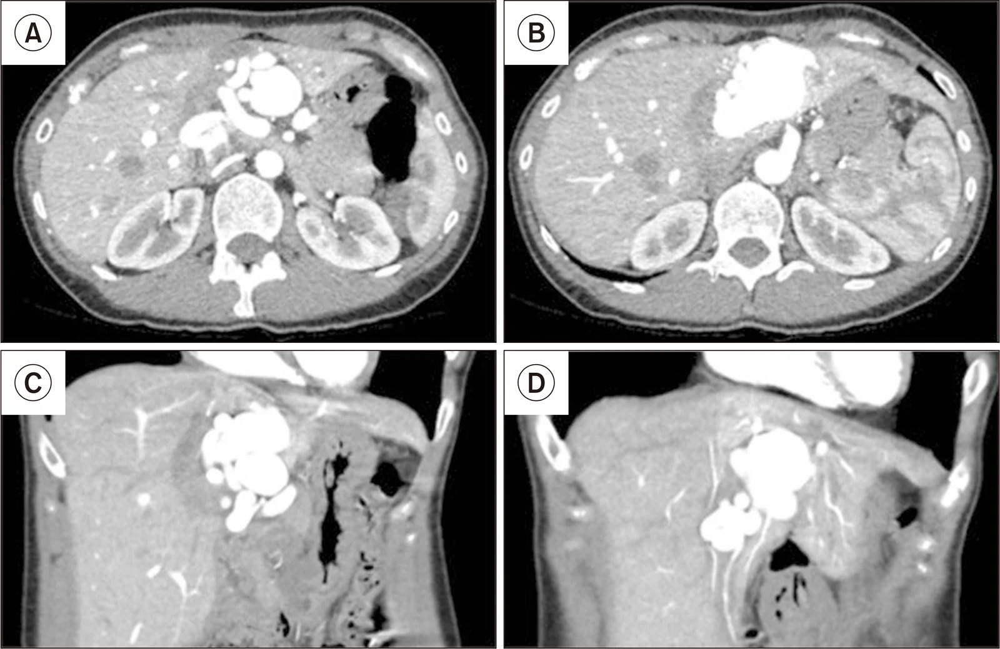
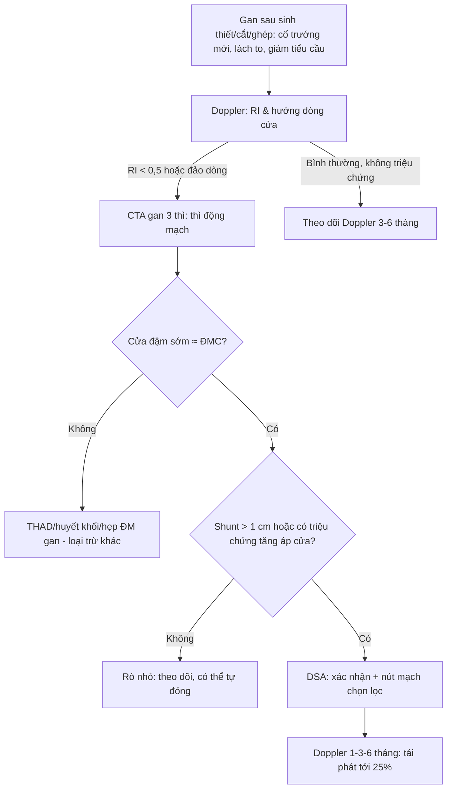
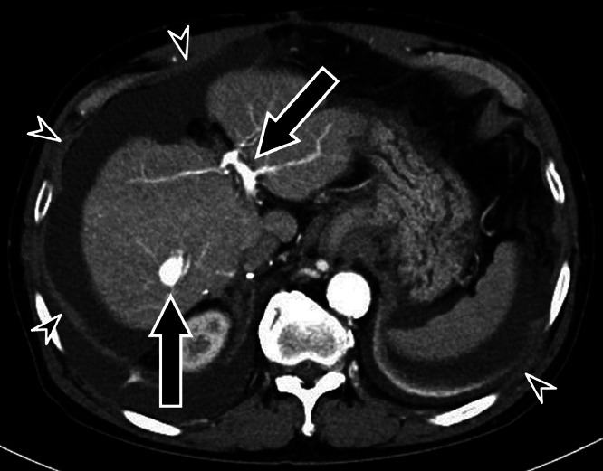
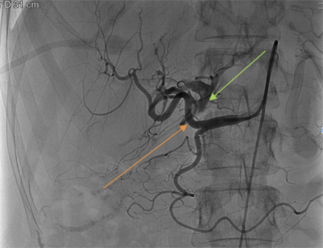

# 1841 — Rò động mạch gan–tĩnh mạch cửa sau sinh thiết/can thiệp gan & sau ghép gan / Hepatic arterioportal fistula (APF)

**Tags:** `pattern:ro-dong-tinh-mach` `pattern:ngam-thuoc-som` `vung:gan` `vung:o-bung` `score:PSV-ratio` `protocol:CTA-3-thi` `protocol:Doppler-sieu-am` `protocol:DSA` `incidentaloma:khong`

**Mức chắc chắn (certainty):** tổng hợp y văn (literature synthesis) — **1 loạt 97 ca người lớn** (*J Clin Transl Hepatol* 2022, PMC9396316, CC BY-NC), **1 loạt nhi 23 bệnh nhân/24 rò sau ghép gan** (*J Clin Med* 2021, PMC8231897, CC BY), **1 tổng quan hình ảnh biến chứng mạch sau ghép gan** (*Insights Imaging* 2019, PMC6694376, CC BY) và **3 ca nguyên văn có ảnh** (PMC10901427 CC BY; PMC13490747 CC BY-NC; PMC10955095 CC BY-NC-ND). Nhóm **không có bệnh nhân của mình**; chỗ nguồn lệch nhau (ngưỡng can thiệp, tỉ lệ tự đóng) được ghi là **mâu thuẫn nguồn**, không chọn bừa.

> **Câu chốt:** rò động mạch gan–tĩnh mạch cửa (arterioportal fistula, APF) là **đường thông trực tiếp giữa động mạch gan áp lực cao và tĩnh mạch cửa áp lực thấp**; vì vậy nó vừa **cướp máu** khỏi nhu mô gan vừa **đẩy áp lực vào hệ cửa**. Ba số phải thuộc: **(1)** trong **97 ca**, **78/97 (80,1%)** rò liên quan HCC, **10/97 (10,3%)** xơ gan, và **81/97** có triệu chứng tăng áp cửa — tức đa số gặp trên gan bệnh, không phải gan lành (PMC9396316); **(2)** ở trẻ sau ghép gan, **20/23 (87%)** là bệnh nhân ghép gan và **16/20** rò do thủ thuật, **13 ca do sinh thiết** (PMC8231897); **(3)** tiêu chuẩn can thiệp thực dụng: **shunt > 1 cm**, **RI < 0,5** hoặc **đảo dòng tĩnh mạch cửa** trên Doppler, hoặc **triệu chứng tăng áp cửa** — rò nhỏ, không triệu chứng thì **theo dõi**, vì **4/12 ca** trong nhóm bảo tồn **tự đóng** (PMC8231897). Nghĩa là: **chẩn đoán bằng thì động mạch, quyết định bằng huyết động + triệu chứng, điều trị bằng nút mạch chọn lọc**.

## 1. Tổng quan bệnh học – cơ chế hình ảnh

### 1.1 Vì sao một lỗ rò nhỏ lại gây tăng áp cửa

- Bình thường **động mạch gan** có áp lực **90–120 mmHg**, còn **tĩnh mạch cửa** chỉ **5–10 mmHg** (chênh **~10–20 lần**). Gan nhận **~75% lưu lượng** từ tĩnh mạch cửa nhưng cửa chỉ mang **~50% oxy**; động mạch gan tuy chỉ **25% lưu lượng** lại mang **50% oxy** và là **nguồn duy nhất** nuôi đường mật.
- Khi có rò, máu động mạch **đổ thẳng vào cửa** theo gradient áp lực. Hệ quả kép: **(a)** áp lực cửa tăng → cổ trướng, giãn tĩnh mạch thực quản, lách to, giảm tiểu cầu; **(b)** dòng cửa bị "pha loãng" bởi máu động mạch và có thể **đảo chiều**, làm giảm tưới máu nhu mô và **teo mô gan** về lâu dài. Ca sau cắt gan của Okuhira: rò giữa **A7 và tĩnh mạch cửa phải** gây **cổ trướng lượng lớn** và suy chức năng gan chỉ **6 tháng** sau mổ; sau nút mạch, cân nặng và vòng bụng **giảm ngay**, albumin và PT tăng, bilirubin giảm trong **22 ngày** (PMC10955095).
- Về mô bệnh, dòng động mạch áp lực cao lâu năm làm **động mạch hóa thành tĩnh mạch cửa**: nội mạc dày xơ–nhầy (fibromyxoid intimal thickening), cơ trơn tăng sinh, mạch nuôi mạch (vasa vasorum) tăng. Ca Florou cho thấy tổn thương **tiến triển 17 năm** sau một lần sinh thiết gan, cuối cùng thành **phình mạch 27 mm** và phải **cắt gan trái** (PMC13490747). Đây là lý do không được coi "rò nhỏ sau sinh thiết" là chuyện vô hại ở mọi bệnh nhân.

### 1.2 TẠI SAO thì động mạch bắt được rò — và vì sao đậm độ lại quan trọng

- **Vật lý thời gian:** thuốc cản quang bơm tĩnh mạch đến **động mạch gan ở 20–30 giây**, đến **tĩnh mạch cửa qua tuần hoàn mạc treo ở 60–70 giây**. Khi có rò, thuốc đi tắt qua lỗ rò và **làm đầy tĩnh mạch cửa ngay trong thì động mạch**, sớm hơn bình thường **30–40 giây**. Vì vậy dấu chốt trên CT là **tĩnh mạch cửa ngấm thuốc ở thì động mạch, đậm độ tiệm cận động mạch chủ** (không phải "hơi tăng nhẹ"), kèm **đoạn cửa trước rò đậm hơn cửa sau rò**.
- **Không có ngưỡng HU được kiểm chứng** cho APF: các bài gốc mô tả định tính "early enhancement of the portal vein", không đưa cut-off HU. Vì vậy trong bài này **không bịa ngưỡng HU**; thay vào đó dùng **3 dấu định lượng có nguồn**: (a) **đậm độ cửa ≈ ĐMC ở thì động mạch**; (b) **đảo dòng/ hai chiều** trên Doppler; (c) **RI < 0,5** ở nhánh cấp máu (PMC8231897).
- **TẠI SAO Doppler thấy RI thấp:** rò là một **đường thoát trở lực rất thấp** nối vào giường mạch; trở lực hạ lưu giảm → **chỉ số trở lực (resistive index, RI) giảm < 0,5**, phổ động mạch trở nên **giảm trở lực, tăng dòng tâm trương**. Khi áp lực cửa vượt áp lực dòng mạc treo, dòng cửa **đảo chiều (hepatofugal)** hoặc **hai chiều** — đây là dấu huyết động mạnh hơn kích thước lỗ rò.
- **Phân loại 3 thể** (dùng trong loạt 97 ca): **type 1** — rò nhỏ ngoại vi trong gan (thường sau sinh thiết); **type 2** — rò lớn trung tâm ở nhánh cửa chính; **type 3** — rò lan tỏa/bẩm sinh. Trong 97 ca: **4 type 1, 91 type 2, 2 type 3** — phản ánh dân số chọn lọc của trung tâm can thiệp, **không phải tỉ lệ ngoài cộng đồng** (PMC9396316).

### 1.3 Nguyên nhân — "iatrogenic trước, bệnh gan sau"

| Nhóm | Nguyên nhân hay gặp | Ghi chú định lượng |
|---|---|---|
| **Do thủ thuật (iatrogenic)** | sinh thiết gan qua da, đặt dẫn lưu mật qua da (PTBD), TACE/TARE, cắt gan, **ghép gan**, đặt stent cửa | Ở trẻ ghép gan: **16/20 rò do thủ thuật, 13 do sinh thiết** (PMC8231897) |
| **Bệnh gan nền** | **HCC** (đặc biệt HCC xâm lấn cửa), xơ gan, u mạch, chấn thương | **78/97 (80,1%)** do HCC; **10/97 (10,3%)** xơ gan (PMC9396316) |
| **Bẩm sinh / hội chứng** | dị dạng mạch, **HHT (Rendu–Osler–Weber)** | APF gặp ở **tới 30%** bệnh nhân HHT (PMC8231897 dẫn y văn) |

- **Sau ghép gan** là bối cảnh đặc biệt: biến chứng mạch gặp **~7%** ở ghép gan người chết não và **~13%** ở ghép gan sống (PMC6694376); hẹp tĩnh mạch cửa riêng ở trẻ **7,6% (67/884)** (bài [1827](../1827-hep-tinh-mach-cua-sau-ghep-gan/lesson.md)). APF sau ghép thường **do sinh thiết theo dõi** hoặc do miệng nối; vì vậy mọi **tăng áp cửa mới** sau ghép phải loại trừ APF trước khi quy cho thải ghép.
- **Thời điểm:** có thể **sớm vài tuần** hoặc **rất muộn**. Ca nguyên văn ghi nhận **17 năm** sau sinh thiết (PMC13490747) và **6 tháng** sau cắt gan (PMC10955095). Vì vậy "sinh thiết cách đây nhiều năm" **không loại trừ** APF.

## 2. Mẫu hình + chẩn đoán phân biệt theo vị trí (gamut)

- **Rò ngoại vi (type 1, sau sinh thiết):** ổ ngấm thuốc nhỏ ở **ranh giới gan–bao gan**, thường **< 1 cm**, có thể chỉ thấy **một nhánh cửa nhỏ** đậm lên thì động mạch. Đa số **không triệu chứng**; một phần **tự đóng** (4/12 ca bảo tồn — PMC8231897). Vị trí hay gặp: **hạ phân thùy VI/VII sát bao gan** (đường kim).
- **Rò trung tâm lớn (type 2):** ổ rò ở **rốn gan/nhánh cửa chính**, thường có **phình mạch nuôi**; gây **tăng áp cửa rõ**, cổ trướng, giãn TMTQ; đây là nhóm **phải can thiệp**. Trong loạt 97 ca, **91/97 là type 2** (PMC9396316).
- **Rò lan tỏa/bẩm sinh (type 3):** nhiều ổ, thường kèm **HHT**, suy tim cung lượng cao, tím; can thiệp khó, cần **đánh giá toàn thân** và có thể phải **ghép gan**.
- **Theo vị trí giải phẫu:** **(a) trong gan** (phần lớn, sau sinh thiết/cắt gan); **(b) rốn gan** (sau PTBD/phẫu thuật); **(c) quanh miệng nối** sau ghép; **(d) lách–cửa** (rò động mạch lách–tĩnh mạch lách, hiếm, sau chấn thương/phẫu thuật).
- **Bắt chước quan trọng nhất — THAD (transient hepatic attenuation difference):** vùng gan **tăng đậm độ hình nêm** ở thì động mạch do **thay đổi tưới máu**, **không có đường thông thật**; tĩnh mạch cửa **không đậm sớm** và **không đảo dòng**. Đây là lý do **không được gọi APF chỉ vì "có vùng tăng đậm độ thì động mạch"**.
- **Bắt chước khác:** **shunt trong HCC** (u + huyết khối cửa), **huyết khối cửa mạn** với động mạch bù trừ, **giả phình động mạch gan** (không có cửa đậm sớm), **u mạch máu** (ngấm hướng tâm, không đảo dòng), **dị dạng động–tĩnh mạch gan**.

## 3. Bảng so sánh phân biệt (ma trận đối chiếu)

| Thực thể (entity) | Hình ảnh điển hình (CTA/Doppler/DSA) | Chốt vào (rule-in) | Chốt loại (rule-out) | Gợi ý xác nhận |
|---|---|---|---|---|
| **APF ngoại vi type 1 (sau sinh thiết)** | Ổ nhỏ < 1 cm sát bao gan; một nhánh cửa ngoại vi đậm thì động mạch; Doppler RI thấp tại nhánh nuôi | **Ổ rò + cửa ngoại vi đậm sớm + tiền sử sinh thiết đúng vị trí** | Cửa chỉ đậm thì cửa, không đảo dòng → không phải rò | Doppler 3–6 tháng; DSA chỉ khi có huyết động bất thường |
| **APF trung tâm type 2** | Ổ rò lớn ở rốn gan, **phình mạch nuôi**, cửa chính đậm sớm; cổ trướng/lách to | **Cửa chính đậm thì động mạch + đảo dòng + tăng áp cửa** | Chỉ giãn cửa do huyết khối, không có ổ rò → không phải APF | CTA 3 thì + DSA; đo áp lực cửa nếu cần |
| **THAD (giả tổn thương tưới máu)** | Vùng hình nêm tăng đậm độ thì động mạch, **mờ dần thì cửa**, không có mạch máu bất thường | **Hình nêm + mất dần + không đảo dòng cửa** | Cửa đậm sớm + ổ rò thấy trên DSA → APF thật | So sánh thì động mạch/cửa; Doppler bình thường |
| **HCC có shunt động–cửa** | Khối ngấm mạnh thì động mạch + thải thuốc; nhánh cửa trong u đậm sớm; có thể huyết khối cửa | **Khối HCC + washout + shunt trong u** | Nhu mô gan lành, không khối, không washout → APF đơn thuần | MRI gan (Primovist), AFP, sinh thiết nếu mơ hồ |
| **Giả phình động mạch gan** | Túi ngấm thuốc thì động mạch, **giữ hình thì cửa**, không có cửa đậm sớm | **Túi giữ thuốc + không thấy cửa sớm** | Cửa đậm sớm + đảo dòng → có kèm rò | CTA/DSA; theo dõi vỡ |
| **Rò lách–cửa / HHT** | Nhiều ổ, lách to, dòng cửa tăng; bệnh sử chảy máu mũi, telangiectasia | **Nhiều ổ + tổn thương HHT ngoài gan (phổi, mũi)** | Một ổ đơn độc sau thủ thuật → type 1/2 | CT/MR toàn thân, gen ENG/ACVRL1 nếu nghi HHT |
| **Huyết khối tĩnh mạch cửa** | Khuyết lòng cửa; động mạch gan tăng đường kính, tăng lưu lượng bù trừ; **không có ổ rò** | **Khuyết lòng + cavernoma + không ổ rò** | Cửa đậm sớm + ổ rò → APF | Doppler + CTA; đánh giá tăng áp cửa |

*Rò sau sinh thiết tiến triển 17 năm: (A–B) axial và (C–D) coronal — túi phình mạch nuôi **27 mm** ở thùy trái, tĩnh mạch cửa đậm sớm thì động mạch. Nguồn: Florou E và cs, *Ann Hepatobiliary Pancreat Surg* 2026, Fig. 1 — PMC13490747, CC BY-NC. Ảnh nguyên bản, không crop.*

## 4. Protocol chụp + hệ phân độ/điểm chuẩn hóa

### 4.1 CTA gan 3 thì — "thì động mạch là thì chẩn đoán"

- **Chuẩn bị:** nhịn ăn 4–6 giờ; đặt kim 18–20 G; bơm **4–5 mL/s**, tổng **1,5–2 mL/kg** (tối đa ~150 mL), theo dõi bolus tại **ĐMC bụng**.
- **Ba thì:** **động mạch 25–35 giây** (bắt đầu khi ĐMC đạt ngưỡng 100–150 HU), **cửa 60–70 giây**, **muộn 3–5 phút**. Không được bỏ thì động mạch — **bỏ thì này là bỏ chẩn đoán**.
- **Cửa sổ đọc:** đặt ROI **trong lòng tĩnh mạch cửa** (cách chỗ rò 1–2 cm) và **ĐMC**; ghi nhận **cửa ≈ ĐMC** ở thì động mạch. Đo **đường kính ổ rò**, **đường kính phình mạch nuôi**, **đường kính cửa trước/sau rò**.
- **Liều:** CT bụng 3 thì ~**8–15 mSv** ở người lớn; ở trẻ dùng **ALARA**, giảm kVp theo cân nặng, **lặp lại ít nhất** (xem bài [937](../937-lieu-ct-tre-ssde-drl/lesson.md)).

### 4.2 Doppler siêu âm — công cụ sàng lọc sau ghép

- Lịch chuẩn sau ghép gan: **24–48 giờ, ngày 7, tháng 1 và tháng 3** (PMC6694376). Tại mỗi lần: đo **RI** ở động mạch gan, **vận tốc và hướng dòng** tĩnh mạch cửa.
- **Ngưỡng can thiệp thực dụng** (theo protocol nhi — PMC8231897): **RI < 0,5**; **đảo dòng cửa** ở phân thùy có rò; **rò > 1 cm**; hoặc **triệu chứng tăng áp cửa** (cổ trướng, giãn TMTQ, lách to, giảm tiểu cầu). Rò nhỏ, không đủ các tiêu chuẩn → **theo dõi Doppler 3–6 tháng**.
- **Bẫy Doppler:** RI thấp cũng gặp trong **hẹp động mạch gan** (bài [1913](../1913-hep-huyet-khoi-hep-dong-mach-gan-sau-ghep/lesson.md)), **cướp máu lách**, **nhiễm trùng**, **thuốc vận mạch**; vì vậy **RI thấp một mình không chốt APF** — phải thấy **ổ rò/bất thường cửa**.

### 4.3 DSA — tiêu chuẩn vàng và điều trị trong cùng một thì

- Bơm **động mạch gan chọn lọc**; chẩn đoán khi **tĩnh mạch cửa hiện hình trong 2–3 giây** sau bơm (bình thường không thấy cửa ở thì động mạch).
- **Kỹ thuật nút:** coil/glue/PVA/Amplatzer; với rò lưu lượng cao dùng **bóng chèn dòng (balloon-assisted)** để tránh coil trôi vào cửa; với rò có nhiều nhánh nuôi, nút **"sandwich"** cả nhánh vào và ra.
- **Kết quả có nguồn:** trong 97 ca, **63 (64,9%)** nút mạch, **13 (13,4%)** mổ cắt, **2 (2,1%)** ghép gan, **19 (19,6%)** bảo tồn; PVA, lipiodol + gelatin, và coil cho hiệu quả **tương đương** trong loạt này (PMC9396316). Ở trẻ: **thành công kỹ thuật 12/16 (75%)**, **thành công lâm sàng 8/11 (73%)**, **3 thất bại** dẫn tới **1 tử vong và 2 ca phải ghép gan** (PMC8231897).
- **Tái phát:** cần **nút lại tới 25%** trường hợp do nhiều nhánh nuôi/tuần hoàn bàng hệ (PMC8231897 dẫn y văn). Vì vậy sau nút vẫn phải **Doppler 1–3–6 tháng**.

## 5. Biến thể bình thường và cạm bẫy

- **THAD sau ăn/uống rượu/thuốc:** vùng tăng đậm độ hình nêm, **mất dần ở thì cửa**, **không có ổ rò** — đừng can thiệp. Đây là cạm bẫy số 1.
- **"Cửa đậm sớm" do bơm thuốc quá nhanh/đặt ROI sai:** kiểm tra bằng **đậm độ ĐMC** và **thời điểm bắt đầu thì**; nếu cả nhu mô gan đậm đều thì nghĩ **thì động mạch quá sớm**, không phải rò.
- **Rò nhỏ sau sinh thiết có thể tự đóng:** trong nhóm bảo tồn, **4/12 tự đóng**, **6 ổn định**, **1 giảm**, **1 tăng nhẹ** (PMC8231897). Vì vậy **không nút mạch hàng loạt** các rò nhỏ không triệu chứng — nhưng phải **theo dõi**, vì ca 17 năm cho thấy có thể tiến triển.
- **Rò + giả phình:** nếu chỉ nút phần rò mà bỏ túi giả phình, túi có thể vỡ; luôn **nút cả túi và cổ rò** hoặc dùng stent-graft che cổ.
- **Sau ghép gan, đừng quy mọi bất thường cho thải ghép:** APF, hẹp cửa (1827), hẹp động mạch (1913), huyết khối, và **thải ghép** có thể cùng tồn tại; CTA 3 thì + Doppler + (khi cần) sinh thiết.
- **Coil artifact trên CT:** sau nút mạch, vệt giả ảnh kim loại có thể che ổ rò còn lại; đánh giá bằng **Doppler** và **DSA** thay vì chỉ CT.
- **Trẻ em:** liều thuốc cản quang theo cân nặng, **tránh lặp CT**; ưu tiên **Doppler** và **DSA một thì điều trị**.

## 6. Tự lượng giá — Blind Quiz (ảnh trơn ngoài, đáp án trong)

**Ca 1 — Nam 71 tuổi, cắt gan S7+S8 và S5 vì HCC; 6 tháng sau bụng to nhanh. Nhìn CT thì động mạch, mô tả trước.**

- Gợi ý: bệnh nhân đã cắt gan, hiện cổ trướng lượng lớn; không sốt, không đau.
- Câu hỏi: (1) Cấu trúc nào đậm bất thường ở thì động mạch? (2) Ba chẩn đoán phân biệt? (3) Dấu nào chốt APF?

<b>Bấm để hiện đáp án (findings + chẩn đoán)</b>

- **Dấu hiệu:** tĩnh mạch cửa (mũi tên đen) **đậm sớm ở thì động mạch**, đậm độ gần ĐMC; **cổ trướng lượng lớn** (đầu mũi tên trắng); ổ rò giữa **A7 và tĩnh mạch cửa phải**.
- **Chẩn đoán:** **APF lưu lượng cao sau cắt gan** → tăng áp cửa → cổ trướng. Chốt bằng **cửa đậm sớm thì động mạch + ổ rò trên DSA**.
- **Xử trí:** nút coil dưới kiểm soát bóng → hết shunt, dòng cửa hướng gan trở lại, cổ trướng giảm trong **11 ngày**, chức năng gan cải thiện (PMC10955095).
- **Nguồn ảnh:** Okuhira R và cs, *Radiol Case Rep* 2024, Fig. 1 — PMC10955095, CC BY-NC-ND.

**Ca 2 — Nữ 49 tuổi, khối vùng thượng vị đập theo mạch, tiền sử sinh thiết gan 17 năm trước.**

- Câu hỏi: (1) Tổn thương nằm ở đâu, kích thước? (2) Vì sao không nút mạch? (3) Khi nào phải cắt gan?

<b>Bấm để hiện đáp án</b>

- **Dấu hiệu:** tổn thương mạch **phình 27 mm** ở thùy trái, ngấm thuốc thì động mạch, **tĩnh mạch cửa trái đậm sớm**; giải phẫu phức tạp, nhiều nhánh nuôi.
- **Chẩn đoán:** **APF do sinh thiết, tiến triển 17 năm, thoái hóa phình mạch**.
- **Vì sao cắt gan:** nút mạch không khả thi vì **nguy cơ mất tưới máu cửa** và giải phẫu phức tạp; cắt gan trái kiểm soát triệt để. Bài học: rò nhỏ sau sinh thiết **có thể tiến triển** — cần theo dõi dài.
- **Nguồn ảnh:** Florou E và cs, *Ann Hepatobiliary Pancreat Surg* 2026, Fig. 1 — PMC13490747, CC BY-NC.

**Ca 3 — Bệnh nhân sau sinh thiết gan, DSA động mạch gan.**

- Câu hỏi: (1) Mũi tên cam và xanh chỉ gì? (2) Chẩn đoán? (3) Một thì DSA đủ chưa?

<b>Bấm để hiện đáp án</b>

- **Dấu hiệu:** bơm **động mạch gan** (mũi tên cam) nhưng **tĩnh mạch cửa trái** (mũi tên xanh) hiện hình **ngay thì động mạch** — đường thông trực tiếp.
- **Chẩn đoán:** **APF trong gan**. DSA là tiêu chuẩn vàng và cho phép **nút mạch ngay trong cùng thì**.
- **Lưu ý:** một thì DSA đủ để chốt **hướng dòng**, nhưng cần **chụp chọn lọc từng nhánh** trước khi nút để không bỏ sót nhánh nuôi thứ hai (tái phát tới 25%).
- **Nguồn ảnh:** Dawkins M và cs, *ACG Case Rep J* 2024, Fig. 1 — PMC10901427, CC BY.

## Bài liên quan chéo
- [100 – Tổng quan hệ Bụng](../100-tong-quan-he-bung/lesson.md)
- [179 – Biến chứng đường mật sau can thiệp u gan](../179-bien-chung-duong-mat-sau-can-thiep-u-gan/lesson.md)
- [1827 – Hẹp tĩnh mạch cửa sau ghép gan](../1827-hep-tinh-mach-cua-sau-ghep-gan/lesson.md)
- [1913 – Hẹp & huyết khối động mạch gan sau ghép](../1913-hep-huyet-khoi-hep-dong-mach-gan-sau-ghep/lesson.md)
- [1906 – Hẹp dòng ra tĩnh mạch gan sau ghép](../1906-hep-dong-ra-tm-gan-sau-ghep-gan/lesson.md)
- [171 – Bóc tách động mạch chủ bụng và IMH](../171-boc-tach-dong-mach-chu-bung-va-IMH/lesson.md)
- [930 – Gan can thiệp: TACE, đốt & LR-TR](../930-hepatic-oncology-tace-rfa/lesson.md)

## Ảnh
- Tên file: `1841_ro-dong-cua_<Modality>_PMC<id>-F<n>.jpg`; nguồn + giấy phép từng ảnh trong `images/CREDITS.md`.
- **Không có composite** vì một ảnh là **CC BY-NC-ND** (không được tạo tác phẩm phái sinh).

> Không dùng để chẩn đoán độc lập khi chưa có người hướng dẫn.
