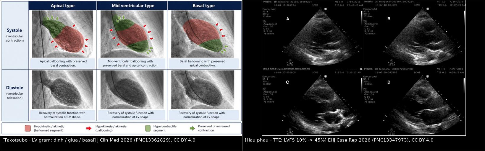
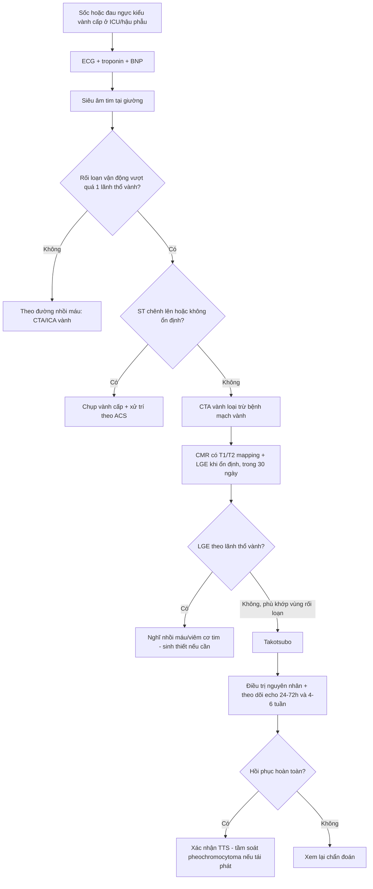
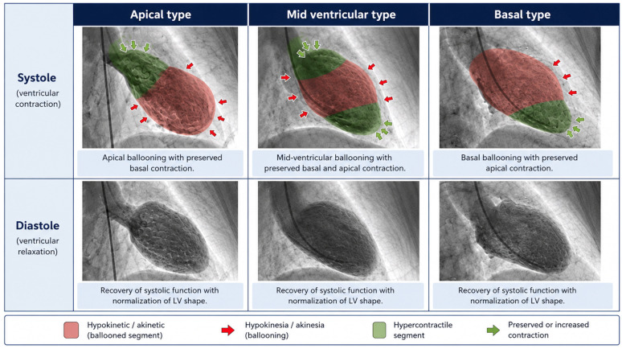
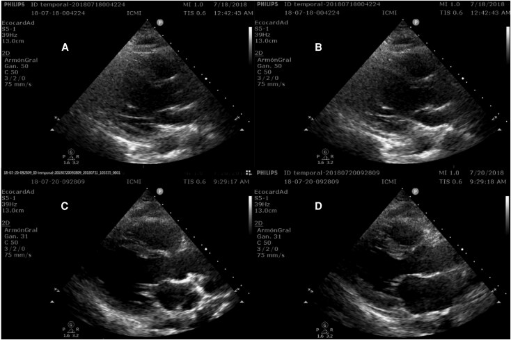

# 1842 — Bệnh cơ tim do stress (takotsubo) ở ICU và hậu phẫu: khi tim "choáng" vì catecholamine / Takotsubo syndrome in the ICU and postoperative patient

**Tags:** `pattern:roi-loan-van-dong-vung` `pattern:phu-co` `pattern:ballooning` `vung:cotim` `score:InterTAK` `protocol:MRI-tim` `protocol:sieut-am-tim` `protocol:CTA-vanh`
**Mức chắc chắn (certainty):** tổng hợp y văn (literature synthesis) — biên từ tổng quan chẩn đoán TTS (J Clin Med 2026, PMC13362829, CC BY 4.0), nghiên cứu T2 mapping tiên lượng **110 ca** (Eur Heart J Cardiovasc Imaging 2026, PMC13721763, CC BY 4.0), loạt **4 ca hậu phẫu thẩm mỹ** cần VA-ECMO (Eur Heart J Case Rep 2026, PMC13347973, CC BY 4.0) và ca hậu phẫu ở người trẻ (Clin Case Rep 2026, PMC13500994, CC BY 4.0). Số liệu lấy từ toàn văn/bảng, không viết từ abstract gián tiếp.

## 1. Tổng quan — vì sao tim đang bình thường bỗng "phình" ra và hồi phục

### 1.1. Cơ chế: bão catecholamine + chuyển tín hiệu thụ thể

- Takotsubo (TTS, stress cardiomyopathy) là **rối loạn vận động vùng thất trái thoáng qua, không giải thích được bằng một nhánh động mạch vành** (PMC13362829). Cơ chế không chỉ là "catecholamine cao" đơn thuần mà là **phối hợp 3 tầng**: catecholamine trực tiếp gây độc tế bào cơ tim, **rối loạn chức năng vi mạch** và **loạn điều hòa thần kinh–tự chủ** (PMC13362829).
- **TẠI SAO đỉnh thất lại "chết" trước:** mật độ thụ thể β ở đỉnh thất cao hơn, và nồng độ epinephrine rất cao làm thụ thể β₂ **chuyển từ tín hiệu Gs (co bóp) sang Gi (ức chế)** — cơ chế "epinephrine switch". Đỉnh thất bị **ức chế co bóp**, trong khi nền thất còn đáp ứng catecholamine và **tăng co bóp bù trừ**. Đây là lý do hình ảnh kinh điển: **đỉnh thất giãn – nền thất co mạnh** (apical ballooning với basal hyperkinesia).
- Viêm cũng đóng vai trò tiên lượng: trong đăng ký **385 ca TTS**, **CRP > 19 mg/L lúc xuất viện** gắn với **hồi phục thất trái không hoàn toàn** và **tăng tử vong tim mạch/nhập viện vì suy tim dài hạn** (PMC13362829). Tức là một bệnh "thoáng qua" về cơ học vẫn có **di chứng viêm**.

### 1.2. Vì sao hình ảnh trông như vậy — vật lý của phù và LGE

- **Siêu âm/LV gram:** vùng **rối loạn vận động khu trú vượt quá một lãnh thổ vành** (thường đỉnh + giữa thất) cạnh vùng **co bóp mạnh bù trừ** ở nền. Trên LV gram, hình dạng tâm thu giống **"bình bát" (takotsubo)** — đáy hẹp, thân giãn.
- **Phù cơ tim trên MRI (T2):** phù = **nước tự do ngoại bào tăng** → thời gian **T2 kéo dài** → tín hiệu sáng trên T2W/STIR và **T2 mapping tăng**. Phù **khớp đúng vùng rối loạn vận động**, không theo lãnh thổ vành.
- **LGE:** gadolinium ứ lại ở chỗ **mất tế bào/tăng khoảng ngoại bào** (hoại tử, xơ). TTS **không gây hoại tử lan rộng**, nên LGE **thường vắng hoặc chỉ là vệt mờ thoáng qua** — khác nhồi máu (LGE dưới nội tâm mạc/xuyên thành theo lãnh thổ). Câu chốt: **TTS = phù có hồi phục mà không mất tế bào** (PMC13362829).
- Vì phù là nước, **không phải mô chết**, nên cơ tim **hồi phục hoàn toàn về hình thái** khi phù rút: ảnh LV gram hàng dưới cho thấy thì tâm trương **trở lại hình dạng bình thường** ở cả 3 kiểu hình.

### 1.3. Con số phải nhớ

| Chỉ số | Giá trị | Nguồn |
|---|---|---|
| Tuổi trung vị / tỷ lệ nữ (110 ca có CMR + mapping trong 30 ngày) | **68 tuổi (91% nữ)** | PMC13721763 |
| T2 toàn cơ tim trung vị | **56 ms (IQR 53–60)** | PMC13721763 |
| Ngưỡng T2 dự báo MACE 1 năm | **≥ 63 ms: AUC 0,671 · Se 56% · Sp 89%** | PMC13721763 |
| Biến cố MACE (theo dõi trung vị **763 ngày**) | **15,5%** (17/110) | PMC13721763 |
| Ca hậu phẫu thẩm mỹ, 27–34 tuổi, sốc tim kháng trị | **4/4 cần VA-ECMO, LVFS 10% → 45%, sống 100%** | PMC13347973 |
| Viêm tồn dư (CRP > 19 mg/L lúc ra viện, 385 ca) | hồi phục thất trái kém + tăng tử vong/nhập viện dài hạn | PMC13362829 |

## 2. Mẫu hình + chẩn đoán phân biệt theo kiểu hình và bối cảnh (Gamut)

### 2.1. Gamut theo kiểu hình — không chỉ có "đỉnh thất"

- **Đỉnh thất (apical, kinh điển, thường gặp nhất):** rối loạn vận động đỉnh + giữa thất, nền tăng co bóp. Dễ nhận nhất, nhưng **không phải tiêu chuẩn bắt buộc**.
- **Giữa thất (mid-ventricular):** đỉnh còn co bóp, phần giữa giãn — dễ bị đọc thành bệnh mạch vành hoặc bệnh cơ tim khác.
- **Nền thất (basal/"reverse"):** nền giãn, đỉnh co bóp mạnh; hay gặp trong **bệnh cảnh thần kinh cấp (SAH, động kinh)** và ở người trẻ hơn.
- **Ổ khu trú (focal) và toàn bộ (global):** focal bắt chước **nhồi máu khu trú**; global bắt chước **suy tim cấp do bất kỳ nguyên nhân**.
- **Hai thất (biventricular):** thêm rối loạn vận động thất phải → sốc, thở máy kéo dài, tiên lượng nặng hơn.
- Nguyên tắc: **chẩn đoán dựa vào "rối loạn vận động vùng vượt quá một lãnh thổ vành + hồi phục"**, không dựa vào sự hiện diện của ballooning đỉnh (PMC13362829).

### 2.2. Gamut theo bối cảnh ICU/hậu phẫu — vì sao dễ bỏ sót

- **TTS do thể chất (physical TTS) bị nhận diện thiếu và nặng hơn TTS do cảm xúc**: nhiều biến chứng hơn, tiên lượng xấu hơn (PMC13362829). Hậu phẫu, nhiễm khuẩn huyết, suy hô hấp, bệnh thần kinh cấp, ung thư đều là **yếu tố khởi phát thứ phát** (PMC13362829).
- **Trong phòng mổ/ICU bệnh nhân không "kể" được đau ngực**: dấu hiệu khởi phát thường là **tụt áp khi khởi mê, khó cai máy thở, loạn nhịp, phù phổi cấp** — tức là **sốc không rõ nguyên nhân** chứ không phải "hội chứng vành cấp điển hình".
- **Khi bệnh nhân đã có sốc nhiễm khuẩn**, TTS và **bệnh cơ tim do nhiễm khuẩn (septic cardiomyopathy)** chồng lấp nhau: cả hai đều giảm co bóp toàn bộ, nhưng TTS có **vùng điển hình + hồi phục nhanh**.
- Loạt 4 ca hậu phẫu thẩm mỹ (27–34 tuổi) cho thấy **người trẻ hoàn toàn khỏe mạnh vẫn có thể sốc tim kháng trị trong phòng mổ**: TEE thấy ballooning, LVFS 10%, cần VA-ECMO, và **hồi phục hoàn toàn** (PMC13347973). Đây là lý do **không được mặc định "trẻ + sốc = sốc phản vệ"**.

## 3. Bảng so sánh phân biệt (ma trận đối chiếu)

| Thực thể (entity) | Hình ảnh điển hình | Chốt vào (rule-in) | Chốt loại (rule-out) | Gợi ý xác nhận |
|---|---|---|---|---|
| **Takotsubo** | Ballooning đỉnh/giữa thất + **nền tăng co bóp**; T2 phù khớp vùng rối loạn; **LGE vắng/mờ** | **Rối loạn vận động vượt quá 1 lãnh thổ vành + hồi phục** trong ngày–tuần; trigger rõ (mổ, sepsis, stress) | LGE **dưới nội tâm mạc theo lãnh thổ vành** + troponin rất cao → nhồi máu | Echo sớm + lặp lại; CMR có mapping; chụp vành loại trừ |
| **Nhồi máu cơ tim / MINOCA có tổn thương** | Rối loạn vận động **đúng một lãnh thổ**; LGE dưới nội tâm mạc/xuyên thành | Tắc/mảng thủ phạm trên CTA/ICA; LGE theo lãnh thổ | Phù lan **ngoài lãnh thổ** + hồi phục nhanh → nghĩ TTS | ICA/CTA vành, troponin, LGE |
| **Viêm cơ tim do ICI** ([6162](../6162-viem-co-tim-do-ici/lesson.md)) | Rối loạn vận động lan tỏa/không lãnh thổ; **LGE giữa thành/vách**; T1/T2 map tăng | Bệnh sử ICI 2–12 tuần; LGE vách; troponin tăng kéo dài | Phù **khớp vùng rối loạn + hồi phục** không LGE → TTS | CMR mapping, troponin, ngừng ICI |
| **Viêm cơ tim tăng bạch cầu ái toan (DRESS)** ([943](../943-viem-co-tim-do-dress/lesson.md)) | LGE **dưới nội tâm mạc đa ổ** + tràn dịch màng ngoài tim; T2 map tăng | Ban + tăng bạch cầu ái toan + men gan; LGE lan | Ballooning điển hình + hồi phục nhanh → TTS | Công thức máu, LGE, sinh thiết |
| **Stunned cơ tim do thần kinh (SAH, động kinh)** | Ballooning **nền thất** hoặc đỉnh; T2 phù | Bệnh cảnh thần kinh cấp + ECG QTc dài | Không có tổn thương thần kinh → TTS "tự phát" | CT/MRI sọ, ECG |
| **Bệnh cơ tim do nhiễm khuẩn** | Giảm co bóp **toàn bộ**, buồng tim giãn; không vùng điển hình | Sốc nhiễm khuẩn + lactate cao + đáp ứng vận mạch | **Vùng rối loạn khu trú + hồi phục** → TTS | Echo lặp lại sau 24–72 giờ |
| **U tủy thượng thận (pheochromocytoma)** | TTS kiểu nền/reverse, có thể tái phát nhiều lần | Tăng huyết áp từng cơn + metanephrine; hồi phục **rất nhanh** | Không có cơn tăng huyết áp, không khối tuyến thượng thận | Metanephrine, CT bụng |
| **Stunning sau thiếu máu tái tưới máu** | Vùng rối loạn **đúng lãnh thổ đã can thiệp** | Tiền sử PCI/tắc mạch + thời điểm khớp | Rối loạn **ngoài lãnh thổ** + nền tăng co bóp | So với phim can thiệp, LGE |

### 3.1. Ba câu hỏi đọc ảnh theo thứ tự

1. **Vùng rối loạn có nằm gọn trong một lãnh thổ vành không?** Nếu **vượt** ranh giới → nghĩ TTS/viêm, không nghĩ nhồi máu.
2. **Có vùng co bóp tăng bù trừ ở nền không?** Có → gợi ý mạnh TTS.
3. **T2/LGE nói gì?** Phù khớp vùng rối loạn + LGE vắng = **phù không hoại tử** → TTS; LGE rõ theo vùng = mất tế bào.

## 4. Protocol chụp + hệ phân độ/điểm chuẩn hóa

### 4.1. Ai chụp gì, khi nào

- **Siêu âm tim tại giường (TTE/TEE) — ngay khi nghi ngờ**, kể cả trong phòng mổ: trả lời 3 câu — EF, vùng rối loạn, có **LVOTO/SAM, hở van hai lá, huyết khối, tràn dịch** không (PMC13362829).
- **Loại trừ bệnh mạch vành:** CTA vành khi bệnh nhân đủ điều kiện và **không cần can thiệp ngay**; chụp vành xâm lấn khi có ST chênh lên/không ổn định. CTA vành còn giúp thấy **huyết khối đỉnh, thuyên tắc phổi, bóc tách ĐMC** — các bệnh cảnh hay bị nhầm trong ICU (PMC13362829).
- **MRI tim có mapping** (T1, T2, ECV, LGE): nên làm **khi đã ổn định, trong vòng 30 ngày** như thiết kế của nghiên cứu tiên lượng (PMC13721763) — mục đích là **đo phù (T2) + loại trừ LGE theo lãnh thổ** và **tiên lượng** (T2 ≥ 63 ms).
- **Theo dõi hồi phục:** echo lặp lại sau **24–72 giờ** nếu đang sốc, và **4–6 tuần** để xác nhận hồi phục hoàn toàn — đây là **tiêu chuẩn chẩn đoán**, không phải tùy chọn.

### 4.2. InterTAK — xác suất trước khi chụp

- Bộ tiêu chuẩn hiện hành (InterTAK 2018) thay thế dần tiêu chuẩn Mayo: công nhận **yếu tố khởi phát cảm xúc – thể chất – thần kinh – nội tiết**, **kiểu hình không điển hình**, **thất phải tham gia**, và cho phép **cùng tồn tại bệnh mạch vành** (PMC13362829).
- **InterTAK Diagnostic Score 0–100 điểm**: nữ (25), yếu tố cảm xúc (24), yếu tố thể chất (13), **không có ST chênh xuống (12)**, tiền sử tâm thần (11), tiền sử thần kinh (9), QTc kéo dài (6). **≥ 70 điểm = xác suất cao**; **≤ 30 điểm = thấp**. Điểm chỉ dùng để **định hướng**, không thay chụp vành/echo.

### 4.3. Điều trị — phần ảnh hưởng trực tiếp tới hình ảnh và theo dõi

- **Điều trị nguyên nhân khởi phát** (ổ nhiễm, đau, thiếu oxy, ngừng thuốc/vận mạch gây giải phóng catecholamine).
- **Sốc tim:** hỗ trợ tuần hoàn; loạt 4 ca hậu phẫu cho thấy **VA-ECMO** cứu được bệnh nhân sốc kháng trị và **tim hồi phục hoàn toàn** (PMC13347973).
- **LVOTO + SAM:** **tránh inotrope và lợi tiểu mạnh** — cả hai làm tăng chênh áp đường ra và làm sốc nặng hơn (PMC13362829); dùng thể tích/dãn mạch và thuốc chẹn β khi mạch cho phép.
- **Huyết khối đỉnh thất:** cân nhắc kháng đông vì nguy cơ **thuyên tắc hệ thống** (PMC13362829).
- **Tái phát:** có thể **cùng hoặc khác kiểu hình**; tái phát nhiều lần/nặng bất thường phải **tầm soát pheochromocytoma** (PMC13362829).

## 5. Biến thể bình thường và cạm bẫy

- **Tăng co bóp nền thất sinh lý** (đặc biệt ở người trẻ, sau vận mạch) có thể bị đọc thành "basal hyperkinesia của TTS" khi **không có vùng giãn đỉnh tương ứng** — luôn so **hai thì** và **hai mặt cắt**.
- **ECG hồi phục chậm hơn cơ học:** bệnh nhân có thể **EF về bình thường nhưng T đảo vẫn còn** nhiều tuần; ca hậu phẫu ở người trẻ ghi rõ **"hồi phục cơ học có thể đi trước bình thường hóa điện học"** (PMC13500994) — đừng vì ECG còn bất thường mà kết luận "chưa hồi phục/không phải TTS".
- **T2 tăng ≠ nhồi máu:** phù T2 tăng là **nước**, không phải mô chết; chỉ **LGE** mới nói mất tế bào. Gọi "nhồi máu" chỉ vì T2 sáng là lỗi hay gặp.
- **Nhầm kiểu hình giữa thất/nền với bệnh mạch vành hoặc viêm cơ tim** — lý do phải mô tả **vùng rối loạn so với lãnh thổ vành**, không chỉ "có ballooning hay không" (PMC13362829).
- **Satisfaction of search trong ICU:** đã tìm ra ổ nhiễm khuẩn rồi thì dễ quy toàn bộ tụt áp cho nhiễm khuẩn và bỏ qua TTS — **siêu âm tim vẫn phải làm** khi huyết động không giải thích được.
- **Bẫy "bình thường" ở người trẻ:** 4 ca 27–34 tuổi khỏe mạnh, sốc ngay trong mổ — tuổi trẻ **không loại trừ** TTS (PMC13347973).

## 6. Tự lượng giá — Blind Quiz

**Ca 1 — Nữ 68 tuổi, khó thở và tụt áp sau mổ cắt ruột thừa, ECG có T đảo trước bên, troponin tăng nhẹ.**

- Gợi ý lâm sàng: không đau ngực điển hình, BNP tăng nhiều so với troponin, không có ST chênh lên.
- Câu hỏi: Ba kiểu hình trên LV gram khác nhau ở vùng nào? Dấu hiệu nào cho biết đây **không phải** tắc một nhánh vành? Vì sao hàng dưới (tâm trương) lại quan trọng?

<b>Bấm để hiện đáp án (findings + chẩn đoán)</b>

- Dấu hiệu: hàng trên (thì tâm thu) — **vùng giãn/akinetic (đỏ) ở đỉnh (apical), giữa thất (mid-ventricular) hoặc nền (basal)**, phần còn lại **tăng co bóp (xanh)**; hàng dưới (tâm trương) — **hình dạng thất trở lại bình thường**.
- Chẩn đoán: **takotsubo** — vùng rối loạn **vượt quá một lãnh thổ vành** và **hồi phục**, kèm nền thất tăng co bóp bù trừ.
- Vì sao: catecholamine làm thụ thể β₂ chuyển sang tín hiệu ức chế ở vùng giàu thụ thể → giãn khu trú, không có mô chết nên hồi phục.
- Lưu ý: ảnh là **hình minh họa kiểu hình** (tổng hợp từ tổng quan), không phải ca của bệnh nhân trong câu chuyện.
- Nguồn ảnh: *J Clin Med* 2026 (PMC13362829), Fig. 1, **CC BY 4.0**.

**Ca 2 — Nữ 31 tuổi, khỏe mạnh, tụt áp trong phòng mổ sau phẫu thuật thẩm mỹ kéo dài.**

- Gợi ý: không có bệnh tim trước đó; không đáp ứng vận mạch; TEE thấy giãn vùng giữa–đỉnh.
- Câu hỏi: Hai cặp ảnh A/B và C/D khác nhau ở đâu? Con số nào trên ảnh chứng minh hồi phục? Chẩn đoán phân biệt nào phải loại trừ **trước khi** kết luận TTS?

<b>Bấm để hiện đáp án</b>

- Dấu hiệu: A/B — thì tâm trương và tâm thu **gần như không khác nhau**, thành thất dày lên rất ít (**LVFS 10%**); C/D — cùng bệnh nhân sau đó, **thành thất co bóp rõ (LVFS 45%)**.
- Chẩn đoán: **takotsubo hậu phẫu, sốc tim kháng trị** — 4/4 ca trong loạt này cần **VA-ECMO**, tất cả hồi phục chức năng thất và **sống 100%**.
- Vì sao phải loại trừ trước: **sốc phản vệ, sốc nhiễm khuẩn, thuyên tắc phổi, nhồi máu cấp** đều gây tụt áp trong mổ; TTS chỉ được chẩn đoán khi có **rối loạn vận động vùng điển hình + loại trừ tắc mạch vành**.
- Nguồn ảnh: *Eur Heart J Case Rep* 2026 (PMC13347973), Fig. 1, **CC BY 4.0**.

**Ca 3 — Nam 70 tuổi, suy hô hấp nặng, sốc nhiễm khuẩn; siêu âm tim thấy giảm co bóp toàn bộ, không vùng điển hình.**

- Gợi ý: lactate cao, cần noradrenaline liều tăng dần, có ổ nhiễm khuẩn rõ.
- Câu hỏi: Khi nào nghĩ **bệnh cơ tim do nhiễm khuẩn** thay vì TTS? Xét nghiệm/hình ảnh nào phân biệt? Có nên chụp MRI tim ngay không?

<b>Bấm để hiện đáp án</b>

- Dấu hiệu: giảm co bóp **lan tỏa**, không có vùng tăng co bóp bù trừ rõ, không có ballooning.
- Chẩn đoán: **bệnh cơ tim do nhiễm khuẩn (septic cardiomyopathy)** — nhưng phải **lặp echo sau 24–72 giờ** vì TTS có thể xuất hiện thứ phát trên nền nhiễm khuẩn.
- Phân biệt: TTS có **vùng rối loạn khu trú + hồi phục nhanh** và BNP/troponin **lệch về BNP**; septic cardiomyopathy hồi phục theo kiểm soát ổ nhiễm.
- MRI tim: **không cấp cứu**, làm khi ổn định (trong 30 ngày) để đo T2/LGE và tiên lượng.
- Nguồn số liệu: PMC13362829 (physical TTS nặng hơn, hồi phục nhanh sau khi xử lý nguyên nhân).

## Bài liên quan chéo
- [6162 — Viêm cơ tim do thuốc ức chế điểm kiểm soát miễn dịch (ICI)](../6162-viem-co-tim-do-ici/lesson.md)
- [943 — Viêm cơ tim do DRESS](../943-viem-co-tim-do-dress/lesson.md)
- [820 — MRI tim: LGE và mapping](../820-cardiac-mri-lge-mapping/lesson.md)
- [810 — CTA vành và CAD-RADS](../810-coronary-cta-cadrads/lesson.md)
- [800 — Tổng quan Tim mạch](../800-cardiovascular-overview/lesson.md)
- [085 — Độc tính miễn dịch quanh mổ ung thư phổi](../085-doc-tinh-mien-dich-quanh-mo-ung-thu-phoi/lesson.md)

## Ảnh
- `1842_takotsubo-balon-dinh_LVgram_PMC13362829.jpg` — LV gram 3 kiểu hình (đỉnh/giữa/nền), thì tâm thu và tâm trương.
- `1842_takotsubo-hau-phau_TTE_PMC13347973.jpg` — TTE 4 ca hậu phẫu: cấp (LVFS 10%) và hồi phục (LVFS 45%).
- `composite_1842_takotsubo-kieu-hinh-va-hoi-phuc.jpg` — ghép đối chiếu, letterbox giữ nguyên tỷ lệ.
- Nguồn + giấy phép từng ảnh: `images/CREDITS.md`.

> Không dùng để chẩn đoán độc lập khi chưa có người hướng dẫn.
