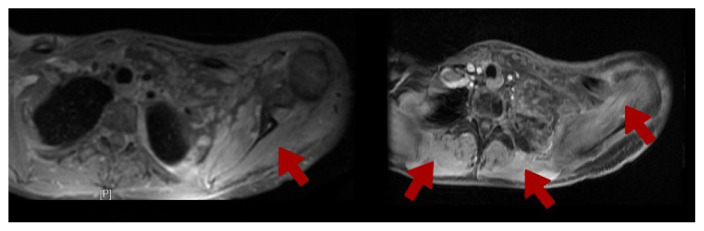
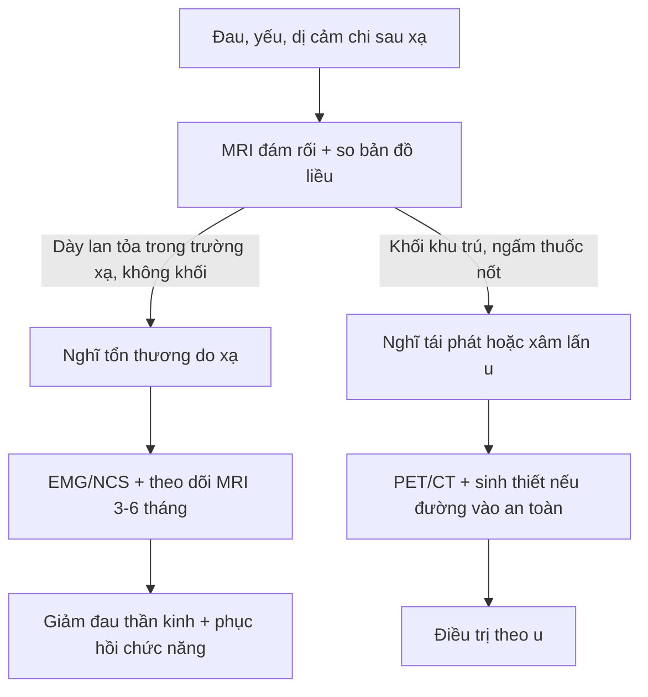
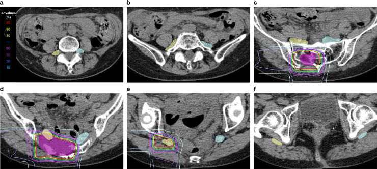
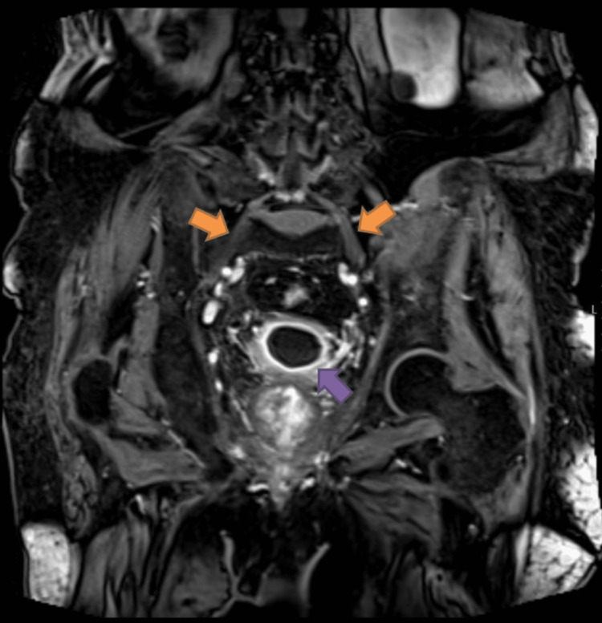

# 1843 — Bệnh rễ và đám rối thần kinh do xạ (radiation-induced radiculopathy / plexopathy)

**Tags:** `pattern:day-dam-roi` `pattern:tang-t2` `pattern:phu-co-mat-than-kinh` `pattern:ton-thuong-trong-truong-chieu` `vung:dam-roi-canh-tay` `vung:dam-roi` `anatomy:dam-roi` `protocol:MRI-dam-roi` `protocol:lap-ke-hoach-xa-tri` `score:EQD2` `score:CTCAE`

**Mức chắc chắn (certainty):** tổng hợp y văn (literature synthesis) — số liệu liều–dung nạp từ **1 phân tích gộp 37 đoàn hệ** (PMC6606964), ngưỡng đám rối thắt lưng–cùng từ **1 đoàn hệ 50 bệnh nhân IMRT cổ tử cung** (PMC4278780) và **1 nghiên cứu carbon-ion 20 bệnh nhân/40 đám rối** (PMC11850167); hình ảnh từ **2 ca nguyên văn** (PMC13167009 — đám rối cánh tay; PMC10140806 — đám rối thắt lưng–cùng) và **1 atlas contouring** (PMC11850167). Không có thử nghiệm ngẫu nhiên; ngưỡng liều đều là mô hình hồi cứu, chỗ suy luận được ghi rõ.

> **Câu chốt:** sau xạ, **đau – yếu – dị cảm một chi** là câu hỏi số một: **tái phát/xâm lấn u** hay **tổn thương do xạ**? Hai bên **điều trị ngược nhau** (xạ lại/hóa trị vs giảm đau thần kinh và phục hồi chức năng). Ba số phải nhớ: dung nạp đám rối cánh tay **Dmax 60–66 Gy** (phân liều thường quy), **mỗi +1 Gy Dmax làm tăng nguy cơ 11%** (RR 1,11; 95% CI 1,07–1,15), và tổn thương do xạ **nằm gọn trong trường chiếu, lan tỏa, không có khối** — còn u tái phát là **khối khu trú, ngấm thuốc nốt, ra ngoài trường chiếu**.

## 1. Tổng quan bệnh học – cơ chế hình ảnh (TẠI SAO)

### 1.1 Cơ chế: ba tầng tổn thương chồng lên nhau

- **Tầng mạch máu:** tia xạ làm tổn thương nội mô của **vasa nervorum** → huyết khối vi mạch, thiếu máu cục bộ dây thần kinh. Đây là lý do tổn thương **tiến triển chậm** và **không hồi phục hoàn toàn**.
- **Tầng mô đệm quanh thần kinh:** **xơ hóa (fibrosis)** mô liên kết quanh đám rối → dính, co kéo, chèn ép dây thần kinh. Mô xơ trưởng thành nghèo nước nên **T2 trung bình/thấp** và **co thể tích**; giai đoạn sớm còn phù nên **T2 cao**.
- **Tầng sợi trục/myelin:** mất myelin và thoái hóa sợi trục trực tiếp → yếu cơ, teo cơ, mất phản xạ. Thời gian tiềm tàng dài vì myelin và sợi trục chỉ biểu hiện tổn thương sau nhiều tháng.

### 1.2 Vì sao MRI là hình ảnh của đám rối, và mỗi chuỗi xung trả lời câu gì

- **T2/STIR (fat-sat):** phù (nước tự do) làm **T2 dài → tăng tín hiệu**; đây là dấu hiệu **sớm nhất** và nhạy nhất, nhưng **không đặc hiệu** (viêm, u, phù sau mổ đều tăng T2).
- **T1 không cản quang:** mất các lớp mỡ mạc quanh đám rối (dấu gián tiếp của **xơ hóa/dính**), và **teo cơ** (giảm thể tích, sau đó **thay mỡ → T1 tăng tín hiệu**). Mỡ thay cơ bị **triệt tín hiệu trên T1 fat-sat** — đây là cách phân biệt mỡ với máu/melanin.
- **T1 sau gadolinium + fat-sat:** tổn thương nội mô → **vỡ hàng rào máu–thần kinh** → thuốc rò ra khoảng kẽ → **ngấm thuốc mờ, lan tỏa**. Ngấm thuốc **có thể vắng** ở thể xơ hóa mạn, nên **không ngấm không loại trừ**.
- **DWI/ADC:** phù và viêm làm **ADC cao** (khuếch tán dễ); u đặc thường **ADC thấp**. Giá trị phân biệt hạn chế vì đám rối nhỏ, dễ nhiễu; không dùng DWI một mình để chốt.
- **Phù cơ do mất thần kinh (denervation edema):** cơ do rễ/đám rối chi phối mất tín hiệu thần kinh → **phù cơ, T2/STIR tăng tín hiệu**, sau nhiều tháng **teo + thay mỡ**. Dấu này giúp **định khu rễ/đám rối bị tổn thương** và là **dấu sớm trước khi thấy bất thường dây thần kinh**.

### 1.3 Ngưỡng định lượng trụ cột

**a) Đám rối cánh tay — dung nạp liều** (tổng hợp 37 đoàn hệ, PMC6606964):

| Mốc | Giá trị | Ý nghĩa |
|---|---|---|
| Dung nạp kinh điển Emami (nguy cơ 5% sau 5 năm) | **60–62 Gy** tùy thể tích (toàn bộ / 2/3 / 1/3 đám rối) | ngưỡng cũ, vẫn dùng làm mốc |
| Ràng buộc RTOG hiện hành | **Dmax 60–66 Gy** | thực hành hiện nay |
| Nguy cơ theo liều | **RR 1,11 mỗi +1 Gy Dmax** (95% CI 1,07–1,15) | không có "ngưỡng an toàn tuyệt đối" |
| Tỷ lệ mắc trong các đoàn hệ | **≤ 5%** ở 17/37 đoàn hệ; 6 đoàn hệ vẫn ≤ 5% dù **vượt 60 Gy** | 60–66 Gy là an toàn ở mức quần thể |

- **Thời gian tiềm tàng:** từ **vài tháng đến nhiều năm**; **trung vị 7–10 tháng** tùy nhóm đoàn hệ, khoảng tứ phân vị trải **0,5–31 tháng** (PMC6606964), nhưng y văn ghi nhận khởi phát **tới 20 năm**. Vì vậy **không được loại trừ tổn thương do xạ chỉ vì đã qua 10 năm**.

**b) Đám rối thắt lưng–cùng — dung nạp và liều** (PMC4278780, 50 bệnh nhân IMRT + brachy cổ tử cung):

- **8%** (4/50) có **RILSP độ 2–3** sau **60 tháng** theo dõi.
- **Dmax đám rối trung bình 59,6 Gy** ở nhóm có RILSP so với **53,9 Gy** ở nhóm không có (**p = 0,04**).
- **V40 61,8% vs 52,8%** ở hai nhóm — thể tích nhận liều trung bình cao cũng quan trọng, không chỉ Dmax.

**c) Carbon-ion (CIRT) — ngưỡng riêng, KHÔNG cộng với photon** (PMC11850167):

- **73,6 Gy (RBE)/16 lần**; **22,5%** (9/40 đám rối) có RILSP độ 1–2, **10%** độ 2, **không ca độ ≥ 3**.
- Ngưỡng dự báo: **D2cm³ ≥ 73,82 Gy (RBE)** và **V50 Gy (RBE) ≥ 33,2%**.
- **Cảnh báo quy ước:** Gy (RBE) của ion nặng **không tương đương** Gy photon; không được đem so trực tiếp với ngưỡng 60–66 Gy.

## 2. Mẫu hình + chẩn đoán phân biệt theo vị trí (Gamut)

- **Đám rối cánh tay (C5–T1, giữa cơ bậc thang và nách):** tổn thương do xạ (vú, phổi đỉnh, hạch trung thất, đầu cổ) · xâm lấn/tái phát u vú hoặc u đỉnh phổi (Pancoast) · di căn hạch nách · **hội chứng Parsonage–Turner** (viêm đám rối cánh tay) · bệnh lý rễ cổ do thoái hóa · đám rối do tư thế/thoracic outlet.
- **Đám rối thắt lưng–cùng (L1–S4, sau phúc mạc và hố chậu):** tổn thương do xạ (cổ tử cung, trực tràng, tiền liệt tuyến, sarcoma) · xâm lấn u hố chậu · **di căn màng não** · **bệnh thần kinh đám rối thắt lưng–cùng do đái tháo đường (DLRPN)** · máu tụ sau phúc mạc · thoát vị đĩa đệm/tủy hẹp.
- **Rễ thần kinh đơn thuần (radiculopathy):** tổn thương do xạ (SBRT cột sống, xạ vùng đỉnh phổi) · chèn ép do di căn đốt sống/mô mềm · **viêm rễ sau xạ** (trong vài tuần đầu) · herpes zoster · rễ bị kéo do biến dạng cột sống sau xạ.
- Mẫu hình gợi ý **do xạ**: **lan tỏa, đối xứng hoặc theo hình dạng trường chiếu**, **không có khối**, **không phá xương**, **trong giới hạn liều đã cho**, **khởi phát sau 3–6 tháng** và **tiến triển chậm**.

## 3. Bảng so sánh phân biệt (ma trận đối chiếu)

| Thực thể (entity) | Hình ảnh điển hình | Chốt vào (rule-in) | Chốt loại (rule-out) | Gợi ý xác nhận |
|---|---|---|---|---|
| **Tổn thương đám rối do xạ** | Dày lan tỏa, **T2/STIR tăng**, ngấm thuốc mờ, **phù cơ do mất thần kinh** cùng vùng; không khối | **Nằm gọn trong trường chiếu + không khối + phù cơ theo rễ** | Khối khu trú, ngấm thuốc nốt, xâm lấn ngoài trường xạ → không phải do xạ | So **bản đồ liều** + MRI 3–6 tháng sau; EMG |
| **Xâm lấn/tái phát u** (vú, Pancoast, hố chậu) | **Khối khu trú**, mất cấu trúc bó sợi, ngấm thuốc **nốt/không đều**, có thể phá xương, lan **ra ngoài trường xạ** | **Khối + ngấm thuốc nốt + tiến triển nhanh + đau dữ dội** | Tổn thương lan tỏa đối xứng, không khối → nghĩ do xạ | PET/CT, sinh thiết nếu đường vào an toàn |
| **Parsonage–Turner** (viêm đám rối cánh tay) | Đám rối **dày, T2 tăng**, ngấm thuốc; teo cơ nhanh; **không tiền sử xạ** | **Khởi phát đau dữ dội đột ngột rồi yếu teo nhanh**, một bên | Tiền sử xạ đúng vùng + tiến triển chậm → nghĩ do xạ | EMG (mất phân bố nhiều rễ), MRI, loại trừ khối |
| **Radiculopathy do thoái hóa** | Thoát vị đĩa đệm, hẹp lỗ ghép, phì đại khớp; tín hiệu rễ có thể bình thường | **Tương ứng đốt–rễ trên MRI cột sống + đau theo dermatome** | Tổn thương đám rối ngoài cột sống, nhiều rễ → không do đĩa đệm | MRI cột sống, EMG |
| **DLRPN** (đái tháo đường) | Đám rối thắt lưng–cùng T2 tăng/ngấm thuốc **hai bên**, teo cơ đùi | **Đái tháo đường + đau–yếu hai bên, sụt cân** | Trường xạ hố chậu đúng vùng → nghĩ do xạ trước | Đường huyết/HbA1c, EMG, MRI |
| **Di căn màng não** | **Ngấm thuốc màng não dạng nốt/đường**, dày rễ thần kinh, não úng thủy | **Nốt màng não + tế bào ác tính trong dịch não tủy** | Chỉ dày đám rối đơn thuần, màng não bình thường | MRI toàn trục + dịch não tủy |

*Axial T1 hai lát: phù cơ bậc thang, cơ delta, trên/dưới gai và dưới vai (mũi tên) chèn ép các nhánh đám rối cánh tay trái; bệnh nhân có đột biến ATM đồng hợp và chỉ nhận 45 Gy/20 lần. Nguồn: Gil A, Bochenek-Cibor J; Rep Pract Oncol Radiother 2026; Fig. 1 — PMC13167009, CC BY-NC-ND (nguyên bản, không crop).*

## 4. Protocol chụp + hệ phân độ/ngưỡng xử trí

### 4.1 MRI đám rối — giao thức tối thiểu

| Vị trí | Chuỗi xung bắt buộc | Thông số / mẹo |
|---|---|---|
| Đám rối cánh tay | Axial T1, **T2/STIR fat-sat**, DWI, **T1 sau gad + fat-sat**; coronal STIR | Lát **3 mm**, FOV từ **C4 đến T2**, coil bề mặt; đặt bệnh nhân tay xuống để giảm căng đám rối |
| Đám rối thắt lưng–cùng | Axial + coronal T1, **T2 fat-sat**, **T1 sau gad + fat-sat** | Lát **3–4 mm**, FOV **L1–dưới xương cùng**; luôn chụp **hai bên** để so sánh |
| Chung | **So sánh với bản đồ liều xạ** (Dmax, D1cc, D0,1cc của đám rối) | Không có bản đồ liều thì không thể nói "trong/ngoài trường xạ" |

- **Thời điểm:** chụp khi có triệu chứng; lặp lại **3–6 tháng** nếu chưa phân định. Tổn thương do xạ **thay đổi chậm** (teo/xơ tăng dần), u **to lên**.
- **EMG/NCS:** xác nhận tổn thương **sau hạch** (đám rối) và mức độ; có thể thấy **myokymia** — gợi ý mạnh tổn thương do xạ, nhưng **không đặc hiệu tuyệt đối**.
- **PET/CT:** chỉ dùng khi MRI còn nghi ngờ; u thường **ngấm FDG khu trú, mạnh**; tổn thương do xạ có thể **ngấm nhẹ–vừa, lan tỏa**, và **dương tính giả trong 6 tháng đầu sau xạ** (PMC7201434).

### 4.2 Ngưỡng liều khi lập kế hoạch (dùng để phòng, không phải để chẩn đoán)

- **Đám rối cánh tay:** giữ **Dmax ≤ 60–66 Gy** (phân liều 1,8–2 Gy/lần); nếu bắt buộc vượt, ghi rõ **Dmax, D1cc, D0,1cc** và cảnh báo nguy cơ.
- **Đám rối thắt lưng–cùng:** tham chiếu **Dmax ~54–60 Gy**, **V40 thấp**; với CIRT dùng ngưỡng riêng **D2cm³ < 73,82 Gy (RBE), V50 < 33,2%**.
- **Bệnh nhân nhạy cảm xạ (ATM biallelic/đồng hợp, các hội chứng sửa chữa DNA):** ngưỡng quần thể **không bảo vệ được** — ca nguyên văn dưới đây chỉ nhận **Dmax 47,68 Gy** mà vẫn tổn thương sau **3 tháng**.

### 4.3 Phân độ và xử trí

- Dùng **CTCAE v5** cho độc tính thần kinh ngoại biên (độ 1: triệu chứng nhẹ; độ 2: hạn chế hoạt động; độ 3: hạn chế tự chăm sóc; độ 4: đe dọa tính mạng).
- Không có thuốc đặc hiệu phục hồi; điều trị **triệu chứng**: gabapentin/pregabalin, amitriptyline, vật lý trị liệu, phòng teo cơ. **Corticoid/anti-VEGF** chỉ có dữ liệu ca nhỏ, chưa thành chuẩn (PMC13240267).

*Sáu lát từ L5 đến S5: đường liều và thể tích đám rối hai bên. Đây là cách "nhìn thấy" nguy cơ trước khi nó thành triệu chứng — vẽ đúng đám rối và ghi D2cm³/V50 là bắt buộc khi xạ hố chậu. Nguồn: Kumazawa T et al.; Adv Radiat Oncol 2025; Fig. 1 — PMC11850167, CC BY-NC-ND (nguyên bản).*

## 5. Biến thể bình thường và cạm bẫy

- **Đám rối "dày nhẹ" sau xạ nhưng không triệu chứng:** có thể gặp; **không chẩn đoán bệnh do xạ nếu không có lâm sàng**. Ngược lại, **MRI bình thường không loại trừ** tổn thương vi mô.
- **Phù cơ do mất thần kinh bị đọc thành viêm cơ/nhiễm trùng:** phù cơ **theo phân bố rễ**, không sốt, không tăng CRP mạnh, không ổ áp-xe — đừng dẫn lưu.
- **Ngấm thuốc mờ bị đọc thành u:** tổn thương do xạ ngấm **lan tỏa, đồng nhất, theo trục đám rối**; u ngấm **nốt, lệch một bên dây thần kinh**.
- **Bỏ sót tái phát vì "đã có tổn thương do xạ"** (satisfaction of search): luôn soát **toàn bộ trường chiếu** và **so phim cũ**; khối mới trong nền xơ là dấu báo động.
- **Dùng ngưỡng photon cho CIRT:** sai đơn vị (Gy vs Gy RBE) → đánh giá nguy cơ lệch.
- **PET dương tính giả sau xạ:** tránh chụp PET trong **6 tháng đầu** nếu chỉ để phân biệt tái phát, trừ khi lâm sàng bắt buộc.
- **Tổn thương do xạ có thể xuất hiện muộn tới 20 năm** — tiền sử xạ xa không loại trừ.

## 6. Tự lượng giá — Blind Quiz

**Ca 1 — Nữ 39 tuổi, ung thư vú trái, xạ thành ngực 45 Gy/20 lần. Ba tháng sau: đau vai trái tăng dần rồi yếu tay, dị cảm. Nhìn hai lát axial T1 dưới đây.**

- Câu hỏi: (1) Mô tả bất thường ngoài dây thần kinh? (2) Ba chẩn đoán phân biệt? (3) Dấu hiệu nào khiến bạn nghĩ **do xạ** dù liều dưới ngưỡng?

<b>Bấm để hiện đáp án (findings + chẩn đoán)</b>

- **Findings:** phù cơ bậc thang, cơ delta, trên/dưới gai, dưới vai (mũi tên) — phù cơ do **mất thần kinh**; các nhánh đám rối bị chèn ép, không thấy khối khu trú. Bệnh nhân có **đột biến ATM đồng hợp** (c.8147T>C).
- **Chẩn đoán:** **bệnh đám rối cánh tay do xạ** — xuất hiện sau **3 tháng**, dù **Dmax đám rối chỉ 47,68 Gy, D1cc 46,01 Gy, D0,1cc 47,01 Gy** (dưới ràng buộc bộ môn Dmax ≤ 58 Gy). Bài học: ngưỡng 60–66 Gy là **ngưỡng quần thể**, không bảo vệ bệnh nhân nhạy cảm xạ.
- **Nguồn ảnh:** Gil A, Bochenek-Cibor J; *Rep Pract Oncol Radiother* 2026; Fig. 1 — PMC13167009, CC BY-NC-ND.

**Ca 2 — Nam 78 tuổi, ung thư tiền liệt tuyến xạ IMRT 5 năm trước, hiện yếu hai chân tăng dần, dị cảm, tiểu không tự chủ. MRI hố chậu coronal T1 sau gad + fat-sat:**

- Câu hỏi: (1) Mũi tên cam chỉ gì? (2) Vì sao **hai bên** lại quan trọng? (3) Cần loại trừ gì trước khi kết luận?

<b>Bấm để hiện đáp án</b>

- **Findings:** **dày và phù thần kinh (neurogenic edema) đám rối thắt lưng–cùng hai bên** (mũi tên cam); thành bàng quang dày, ngấm thuốc lan tỏa (mũi tên tím) — **viêm bàng quang do xạ** đi kèm cùng trường chiếu.
- **Chẩn đoán:** **bệnh đám rối thắt lưng–cùng do xạ** (RILSP). Tổn thương **hai bên, lan tỏa, không khối**, xuất hiện **5 năm sau xạ** — đúng phân bố trường chiếu hố chậu. Phải loại trừ **xâm lấn u hố chậu** (khối, phá xương), **di căn màng não** (MRI toàn trục + dịch não tủy) và **DLRPN** (đường huyết).
- **Nguồn ảnh:** Almeida LR et al.; *Cureus* 2023; Fig. 3 — PMC10140806, CC BY.

**Ca 3 — Atlas contouring dưới đây là của một kế hoạch xạ hố chậu. Không có bệnh nhân cụ thể.**

- Câu hỏi: (1) Màu tím, vàng, xanh là gì? (2) Vì sao phải vẽ **cả hai bên**? (3) Nếu D2cm³ đám rối là 75 Gy (RBE) thì bạn làm gì?

<b>Bấm để hiện đáp án</b>

- **Findings:** **tím = CTV**, **vàng = đám rối phải**, **xanh = đám rối trái**; các đường liều 10–100% của **73,6 Gy (RBE)** (đỏ 95%, vàng 90%, xanh lá 80%...).
- **Vì sao hai bên:** đám rối thắt lưng–cùng chạy **sát thành chậu hai bên**; tổn thương do xạ có thể **một bên hoặc hai bên**, và so sánh hai bên giúp phát hiện dày bất đối xứng.
- **Ngưỡng:** **D2cm³ ≥ 73,82 Gy (RBE)** và **V50 ≥ 33,2%** là ngưỡng dự báo RILSP của CIRT → **giảm liều/đổi hướng chùm**, không "chấp nhận rồi theo dõi".
- **Nguồn ảnh:** Kumazawa T et al.; *Adv Radiat Oncol* 2025; Fig. 1 — PMC11850167, CC BY-NC-ND.

## Bài liên quan chéo
- [269 – Xạ lại tủy sống: tổng liều EQD2 trên DVH](../269-xa-lai-tuy-song/lesson.md) (cùng nguyên lý "gom liều cộng dồn")
- [268 – Bệnh tủy do xạ trị](../268-benh-tuy-do-xa-tri/lesson.md) (tổn thương thần kinh trung ương do xạ)
- [260 – Hẹp động mạch cảnh do xạ](../260-hep-dong-mach-canh-do-xa/lesson.md) (mạch máu trong cùng trường xạ)
- [261 – Bệnh não chất trắng do xạ trị](../261-benh-nao-chat-trang-do-xa-tri/lesson.md)
- [1844 – Rò và hoại tử thực quản do xạ](../1844-ro-hoai-tu-thuc-quan-do-xa/lesson.md) (cơ quan khác trong cùng trường xạ)
- [301 – Protocol MSK](../301-protocol-msk/lesson.md) (giao thức MRI cơ–xương–khớp)

> Không dùng để chẩn đoán độc lập khi chưa có người hướng dẫn.
