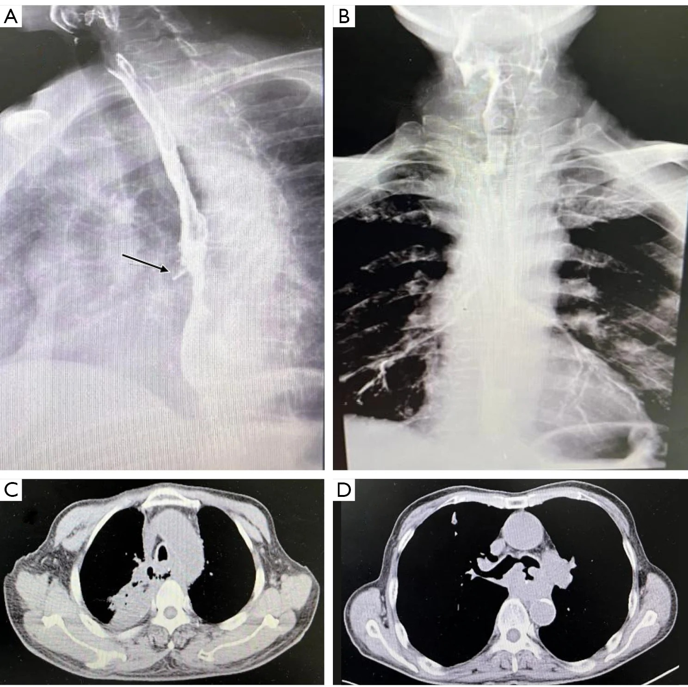
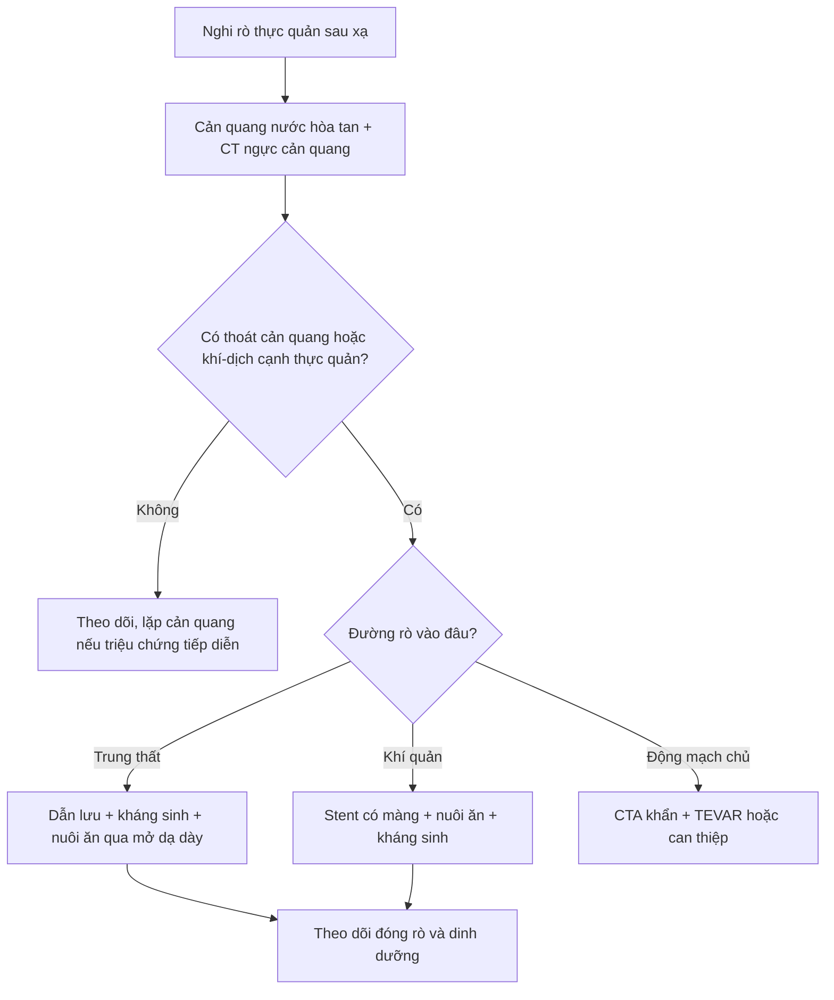
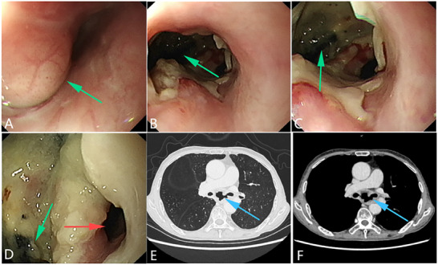
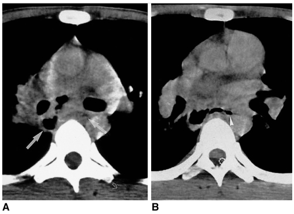

# 1844 — Rò và hoại tử thực quản do xạ (radiation-induced esophageal perforation / fistula)

**Tags:** `pattern:ro-thuc-quan` `pattern:khi-trung-that` `pattern:o-khi-dich-trung-that` `pattern:ton-thuong-trong-truong-chieu` `vung:trung-that` `vung:thuc-quan` `protocol:chup-can-quang-thuc-quan` `protocol:CT-nguc-cang-quang` `protocol:noi-soi-thuc-quan` `score:CTCAE` `score:BED`

**Mức chắc chắn (certainty):** tổng hợp y văn (literature synthesis) — **1 đoàn hệ 91 bệnh nhân rò thực quản sau xạ** (PMC13655807, có ảnh cản quang + CT của rò trung thất và rò khí–thực quản), **1 đoàn hệ 171 bệnh nhân VMAT** (PMC11662626), **1 đoàn hệ 21 ca xạ lại SBRT** (PMC11139739 — ngưỡng liều thực quản), **1 tổng quan TEF** (PMC12499430, CC BY) và **1 loạt ca hình ảnh** (PMC2713885). Không có thử nghiệm ngẫu nhiên; mọi ngưỡng liều là dữ liệu hồi cứu.

> **Câu chốt:** rò thực quản sau hóa–xạ là **cấp cứu nhiễm khuẩn trung thất**, không phải "viêm thực quản nặng". Ba số phải thuộc: **5,8–30,1%** bệnh nhân ung thư thực quản hóa–xạ có rò; **trung vị sống sau rò chỉ 3,1 tháng** (sống 3 tháng **51,6%**, 6 tháng **18,7%**, 12 tháng **5,5%**); và **xạ lại là yếu tố tiên lượng xấu độc lập** (HR **2,39**; 95% CI 1,33–4,29). Câu hỏi hình ảnh không phải "có viêm không" mà là **"cản quang/khí có thoát ra ngoài lòng thực quản không, và thoát vào đâu"**.

## 1. Tổng quan bệnh học – cơ chế hình ảnh (TẠI SAO)

### 1.1 Cơ chế: u teo đi nhanh hơn mô lành kịp sửa

- Hóa–xạ diệt tế bào u **nhanh**, nhưng **mô lành (niêm mạc, dưới niêm, cơ) không kịp tái tạo** → vùng u cũ trở thành **chỗ yếu nhất của thành thực quản**. Khi u co lại, thành mỏng đi và **thủng** — thường **trong hoặc ngay sau đợt xạ**, tại nơi nhận liều cao nhất.
- **Thiếu máu vi mạch do xạ** làm giảm khả năng lành: nội mô tổn thương → huyết khối nhỏ → thành thực quản **hoại tử từng phần**, niêm mạc loét, viêm trung thất. Đây là lý do rò có thể xuất hiện **muộn, sau khi u đã đáp ứng hoàn toàn**.
- **Vị trí hay gặp:** đoạn thực quản **ngang mức u và liều cao nhất**, sát **khí quản/phế quản gốc** (→ rò khí–thực quản, TEF) hoặc **trung thất** (→ rò thực quản–trung thất, EMF); nếu sát động mạch chủ → **rò thực quản–động mạch chủ**, thường tử vong.
- **Phân loại theo đường rò:** **EMF** (esophagomediastinal fistula — thực quản ↔ trung thất) và **TEF** (tracheoesophageal fistula — thực quản ↔ khí quản/phế quản). TEF gây **sặc, viêm phổi hít sặc, suy hô hấp**; EMF gây **viêm trung thất, áp-xe, nhiễm khuẩn huyết**.

### 1.2 Vì sao hình ảnh phải "nhìn thấy thuốc đi sai đường"

- **Cản quang thực quản (esophagogram):** dùng **thuốc cản quang tan trong nước** (Gastrografin/iodine) — nếu có rò, thuốc **thoát ra ngoài lòng** thành **đường rò (tract)** hoặc **ổ trong trung thất**. Đây là **chuẩn vàng tại giường** vì trực tiếp chứng minh lỗ thông; độ nhạy cao với rò **đủ lớn**.
- **CT ngực có cản quang tĩnh mạch + uống cản quang:** thấy **khí trong trung thất**, **ổ khí–dịch cạnh thực quản**, **dày thành thực quản**, **tràn dịch/tràn khí màng phổi**, **đông đặc phổi do hít sặc**, và **mất liên tục thành thực quản**. CT cũng cho biết **u còn hay không**, **stent**, và **tương quan với động mạch chủ** — điều mà cản quang đơn thuần không trả lời.
- **Nội soi thực quản:** thấy **lỗ rò, niêm mạc trắng bợt/hoại tử**, lấy mô loại trừ u; nhưng **bơm hơi có thể làm rò to hơn hoặc gây tràn khí áp lực** → dùng **CO₂**, bơm tối thiểu, chỉ khi đã có kế hoạch xử trí.
- **TẠI SAO khí trung thất không đặc hiệu:** khí có thể từ **nội soi, thở máy, chấn thương, barotrauma**; chỉ có giá trị khi **kèm cản quang thoát ra** hoặc **ổ khí–dịch sát thực quản** ở đúng vùng xạ.

### 1.3 Ngưỡng định lượng trụ cột

**a) Dịch tễ và tiên lượng** (PMC13655807 — 91 bệnh nhân rò sau xạ):

| Biến số | Số liệu |
|---|---|
| Tỷ lệ rò sau hóa–xạ ung thư thực quản | **5,8–30,1%** |
| Trung vị sống sau rò | **3,1 tháng** |
| Sống 3 / 6 / 12 tháng | **51,6% / 18,7% / 5,5%** |
| Xạ lại (có vs không) — đa biến | **HR 2,39** (95% CI 1,33–4,29), p = 0,004 |
| Rò không đóng (persistent fistula) | yếu tố tiên lượng xấu độc lập |
| Hemoglobin < 120 g/L | yếu tố tiên lượng xấu độc lập |
| Dinh dưỡng: mở dạ dày/jejunostomy | sống sau rò **tốt nhất** (3 tháng **83,3%**, 6 tháng **41,7%**, 12 tháng **25,0%**) |

- **Liều xạ:** trong đoàn hệ, tổng liều **5,4–70 Gy** ở nhóm rò sau xạ lần đầu; **79,8–120 Gy** ở nhóm rò sau **xạ lại**. Liều **≥ 60 Gy** có xu hướng tăng nguy cơ (HR 1,45; 95% CI 0,92–2,28 — chưa đạt ý nghĩa thống kê trong mô hình đa biến).

**b) Yếu tố nguy cơ trên 171 bệnh nhân VMAT** (PMC11662626):

- Rò thực quản **12,87%** (22/171).
- Yếu tố độc lập: **giới, tuổi, đái tháo đường, T4, tổng liều xạ**; mô hình dự báo **AUC 0,876** (95% CI 0,807–0,946).
- **T4** là yếu tố giải phẫu mạnh: u xâm lấn trung thất/khí quản thì thành thực quản đã mỏng trước khi xạ.

**c) Ngưỡng liều thực quản khi lập kế hoạch:**

- **Ràng buộc chung** (CORSAIR 2022, PMC9600677): **Dmean < 34 Gy; V35 Gy < 50%; V50 Gy < 40%; V70 Gy < 20%**.
- **Xạ lại SBRT cột sống** (PMC11139739): cộng dồn theo **BED Gy3** — **Dmax < 203**, **D0,035cc < 187**, **D1cc < 167**; vượt ngưỡng này đã có **1 ca tử vong do rò thực quản**.
- **Liều xạ triệt căn ung thư thực quản** thường **50,4 Gy** (ESMO); tăng liều không cải thiện sống sót (RTOG 90-12) nhưng **tăng độc tính**.

## 2. Mẫu hình + chẩn đoán phân biệt theo vị trí (Gamut)

- **Rò vào trung thất (EMF):** khí + dịch trung thất sau, **ổ khí–dịch sát thực quản**, tràn dịch màng phổi, sốt–đau ngực–khó thở sau ăn. Gamut: rò do xạ · thủng do u · Boerhaave · thủng do nội soi/stent · rò do lao/áp-xe trung thất.
- **Rò vào khí quản/phế quản (TEF):** **sặc khi uống**, ho ra nước/ thức ăn, viêm phổi hít sặc tái diễn, **khí trong thực quản** và **cản quang vào cây khí phế quản**. Gamut: rò do xạ · xâm lấn u · rò do ống nội khí quản/bóng cuff · rò sau mổ · rò bẩm sinh ở trẻ.
- **Rò vào động mạch chủ (aortoesophageal):** **"herald bleed"** — nôn ra máu nhỏ rồi chảy máu ồ ạt; CTA thấy **giả phình/loét xuyên thành động mạch chủ** sát thực quản. Đây là **tối cấp cứu**, không chờ nội soi.
- **Hình dạng gợi ý do xạ:** vị trí **trong trường chiếu**, **ngang mức u/liều cao**, xuất hiện **trong hoặc 1–6 tháng sau hóa–xạ**, kèm **hẹp/lan tỏa thành thực quản**; không có khối mới xâm lấn.

## 3. Bảng so sánh phân biệt (ma trận đối chiếu)

| Thực thể (entity) | Hình ảnh điển hình | Chốt vào (rule-in) | Chốt loại (rule-out) | Gợi ý xác nhận |
|---|---|---|---|---|
| **Rò thực quản–trung thất do xạ (EMF)** | Cản quang **thoát ra trung thất**; **khí + ổ dịch cạnh thực quản**; tràn dịch màng phổi; thành thực quản dày, không khối mới | **Cản quang ngoài lòng + vị trí trong trường xạ + không khối u mới** | Khối u xâm lấn rõ, phá xương/khí quản → nghĩ u | Cản quang nước hòa tan + CT ngực có cản quang |
| **Rò khí–thực quản (TEF)** | **Cản quang vào khí quản/phế quản**, khí trong thực quản, đông đặc phổi do sặc; CT thấy **đường thông** | **Sặc khi uống + cản quang/khí vào cây khí phế quản** | Không thấy đường thông, chỉ viêm phổi một thùy → chưa chốt | Nội soi khí–thực quản, CT lát mỏng |
| **U xâm lấn gây rò** | **Khối u lớn, bờ không đều**, hẹp lòng, hạch hoại tử; rò ở **bờ u** | **Khối u còn rõ + hạch + rò tại chỗ u** | Niêm mạc trắng bợt lan tỏa, không khối → nghĩ xạ | Nội soi + sinh thiết (cẩn thận), PET/CT |
| **Rò sau mổ thực quản** | Rò tại **miệng nối**, sau mổ 5–10 ngày; ổ dịch/miệng nối | **Tiền sử mổ + rò tại miệng nối** | Không mổ, rò ngang mức u đã xạ → nghĩ xạ | Cản quang cạnh miệng nối, CT |
| **Boerhaave (vỡ tự phát)** | Vỡ **thành trái đoạn 1/3 dưới**, tràn khí–dịch trung thất, **dấu Macklin** | **Nôn dữ dội rồi đau ngực đột ngột + tràn khí trung thất** | Tiền sử xạ, không nôn → nghĩ rò do xạ/u | CT ngực cấp cứu, cản quang |
| **Rò thực quản–động mạch chủ** | **Giả phình/loét xuyên thành ĐMC** sát thực quản; máu trong trung thất | **Herald bleed + CTA có tổn thương ĐMC** | Không có tổn thương ĐMC → loại trừ | CTA ngực khẩn |
| **Rò do lao/áp-xe trung thất** | Hạch trung thất hoại tử có khí, **khí trong hạch thông với thực quản** | **Hạch hoại tử + khí trong hạch + bối cảnh lao/HIV** | Trường xạ đúng vùng, không hạch hoại tử → nghĩ xạ | CT, xét nghiệm lao, nội soi |

*(A) Cản quang: thuốc thoát qua đường rò vào trung thất (mũi tên). (B) Cản quang: rò vào khí quản. (C) CT: khí/dịch trung thất cạnh thực quản. (D) CT: khí trong trung thất và đường thông về phía khí quản. Nguồn: J Thorac Dis 2026; Fig. 1 — PMC13655807, CC BY-NC-ND (nguyên bản, không crop).*

## 4. Protocol chụp + hệ phân độ/ngưỡng xử trí

### 4.1 Thứ tự chẩn đoán (quan trọng hơn thông số)

1. **Cản quang thực quản bằng thuốc tan trong nước** trước — chứng minh rò và đường thoát. **Không dùng barium đầu tiên** nếu nghi rò: barium trong trung thất gây **viêm trung thất hóa học** và rất khó rửa.
2. **CT ngực có cản quang tĩnh mạch + uống cản quang**, lát **1–1,5 mm**, cửa sổ trung thất + phổi: đánh giá **ổ khí–dịch, trung thất, màng phổi, phổi, động mạch chủ, stent**.
3. **Nội soi** khi cần xác định vị trí/kích thước, lấy mô, đặt stent — dùng **CO₂**, bơm tối thiểu.
4. **CTA ngực** ngay nếu có **ho ra máu/herald bleed** hoặc tổn thương sát động mạch chủ.

### 4.2 Phân độ và xử trí

- **CTCAE v5:** viêm thực quản độ 3 (nuốt đau, không ăn được), độ 4 (đe dọa tính mạng), **rò thực quản xếp độ 4–5**.
- **Nguyên tắc xử trí:** **dinh dưỡng trước tiên** (mở dạ dày/jejunostomy được ưu tiên vì sống sau rò tốt nhất trong đoàn hệ), kháng sinh phổ rộng, **dẫn lưu ổ trung thất/màng phổi** khi có mủ, **stent có màng** che lỗ rò (TEF) để giảm sặc, **mổ** chỉ ở ca chọn lọc (u còn kiểm soát, rò lớn, thất bại nội soi). **Xạ lại** làm tiên lượng xấu hơn rõ rệt.

### 4.3 Theo dõi sau rò

- **Cản quang kiểm tra** sau 7–14 ngày nếu đã can thiệp; **CT** nếu sốt dai dẳng (áp-xe tồn dư).
- Theo dõi **cân nặng, albumin, hemoglobin** (Hb < 120 g/L là yếu tố tiên lượng xấu); **không rút stent** trước khi kiểm tra đóng rò.

*(A) Trước xạ: u phổi chèn ép, niêm mạc còn nguyên. (B–D) 2,5 tháng sau xạ: lỗ rò (mũi tên xanh), niêm mạc trắng bợt. (E–F) CT: đường thông giữa thực quản và khí quản. Nguồn: Li G et al.; Adv Sci 2025; Fig. 5 — PMC12499430, CC BY.*

## 5. Biến thể bình thường và cạm bẫy

- **Khí trung thất sau nội soi/thở máy** không phải rò — đừng chẩn đoán nếu không có cản quang thoát ra hoặc ổ dịch sát thực quản.
- **Barium đầu tiên** khi nghi rò là sai lầm: gây viêm trung thất hóa học, khó lấy — **luôn bắt đầu bằng thuốc tan trong nước**.
- **Viêm thực quản do xạ** (niêm mạc phù, loét nông, hẹp) có thể **bắt chước rò** trên CT; cần cản quang/nội soi.
- **Rò nhỏ bị bỏ sót trên CT** (không thấy đường thông): nếu lâm sàng mạnh (sặc, sốt, tràn khí tái diễn) → **lặp cản quang + nội soi**, không loại trừ bằng một CT âm.
- **"Satisfaction of search":** thấy viêm phổi hít sặc rồi dừng, bỏ qua **đường rò** và **ổ trung thất**.
- **Stent có màng** có thể gây **loét/ăn mòn** và tạo rò mới hoặc làm rò ác tính nặng hơn — theo dõi nội soi định kỳ.
- **Herald bleed** ở bệnh nhân xạ thực quản là **rò–động mạch chủ cho đến khi loại trừ** — không chờ nội soi thường quy.
- **Rò do lao/áp-xe trung thất** (ảnh dưới) là bắt chước kinh điển: hạch hoại tử có khí thông với thực quản, không có tiền sử xạ.

*CT trung thất: hạch dưới carina hoại tử chứa khí bất thường (mũi tên), thông với khí trong thực quản (đầu mũi tên) — rò thực quản–trung thất do lao, không do xạ. Nguồn: Jang KM et al.; Korean J Radiol 2002; Fig. 6 — PMC2713885, CC BY-NC.*

## 6. Tự lượng giá — Blind Quiz

**Ca 1 — Nam 63 tuổi, ung thư thực quản giữa, hóa–xạ 50,4 Gy. Sốt, đau ngực sau ăn, tràn dịch màng phổi trái. Nhìn 4 ô ảnh dưới đây.**

- Câu hỏi: (1) Ô A và B khác nhau thế nào? (2) Ô C và D xác nhận gì? (3) Việc đầu tiên cần làm?

<b>Bấm để hiện đáp án (findings + chẩn đoán)</b>

- **Findings:** (A) cản quang thoát ra **trung thất** qua đường rò (mũi tên) → **EMF**; (B) cản quang vào **khí quản** → **TEF**; (C) CT có **khí/dịch trung thất cạnh thực quản**; (D) CT có **khí trung thất và đường thông**.
- **Chẩn đoán:** **rò thực quản do xạ** — EMF (A, C) và TEF (B, D). Xử trí: **nhịn ăn, nuôi ăn qua mở dạ dày/jejunostomy, kháng sinh phổ rộng, dẫn lưu ổ trung thất/màng phổi, stent có màng nếu TEF**.
- **Nguồn ảnh:** *J Thorac Dis* 2026; Fig. 1 — PMC13655807, CC BY-NC-ND (tên tác giả không ghi vì bài không cung cấp authorString).

**Ca 2 — Nữ 58 tuổi, ung thư phổi được xạ triệt căn. 2,5 tháng sau: sặc khi uống, ho ra thức ăn, viêm phổi tái diễn. Nội soi + CT:**

- Câu hỏi: (1) Mũi tên xanh chỉ gì? (2) CT (E–F) cho thấy đường gì? (3) Vì sao **không bơm hơi mạnh** khi nội soi?

<b>Bấm để hiện đáp án</b>

- **Findings:** (A) trước xạ — u chèn ép, niêm mạc nguyên; (B–D) sau xạ 2,5 tháng — **lỗ rò lớn, niêm mạc trắng bợt hoại tử**; (E–F) CT — **đường thông giữa thực quản và khí quản**.
- **Chẩn đoán:** **TEF do xạ**. Bơm hơi mạnh có thể **làm rò to hơn, gây tràn khí trung thất áp lực** và đẩy dịch vào phổi → dùng **CO₂**, bơm tối thiểu.
- **Nguồn ảnh:** Li G et al.; *Adv Sci* 2025; Fig. 5 — PMC12499430, CC BY.

**Ca 3 — Nam 27 tuổi, AIDS, sốt kéo dài, nuốt đau, không tiền sử xạ. CT trung thất:**

- Câu hỏi: (1) Mô tả bất thường? (2) Chẩn đoán khác rò do xạ ở điểm nào? (3) Cần làm gì tiếp?

<b>Bấm để hiện đáp án</b>

- **Findings:** hạch **dưới carina hoại tử, chứa khí bất thường** (mũi tên), **thông với khí trong thực quản** (đầu mũi tên).
- **Chẩn đoán:** **rò thực quản–trung thất do lao hạch** — không có tiền sử xạ, có hạch hoại tử đặc trưng. Xử trí: **kháng lao + dẫn lưu/kháng sinh**; không đặt stent che rò trước khi kiểm soát nhiễm.
- **Nguồn ảnh:** Jang KM et al.; *Korean J Radiol* 2002; Fig. 6 — PMC2713885, CC BY-NC.

## Bài liên quan chéo
- [269 – Xạ lại tủy sống: ngưỡng liều thực quản cộng dồn](../269-xa-lai-tuy-song/lesson.md) (BED3 Dmax < 203)
- [061 – Tràn khí trung thất](../061-tran-khi-trung-that/lesson.md) (chẩn đoán phân biệt khí trung thất)
- [085 – Độc tính miễn dịch quanh mổ ung thư phổi](../085-doc-tinh-mien-dich-quanh-mo-ung-thu-phoi/lesson.md)
- [090 – Bỏng hít đường thở](../090-bong-hit-duong-tho-o-tre/lesson.md) (tổn thương đường thở do nhiệt/hóa chất)
- [093 – Hội chứng tĩnh mạch chủ trên](../093-hoi-chung-tinh-mach-chu-tren/lesson.md) (biến chứng trung thất khác sau xạ/u)
- [1843 – Bệnh rễ và đám rối thần kinh do xạ](../1843-benh-re-dam-roi-than-kinh-do-xa/lesson.md) (cơ quan khác trong cùng trường xạ)

> Không dùng để chẩn đoán độc lập khi chưa có người hướng dẫn.
