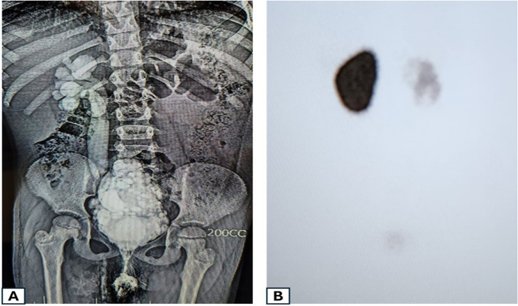
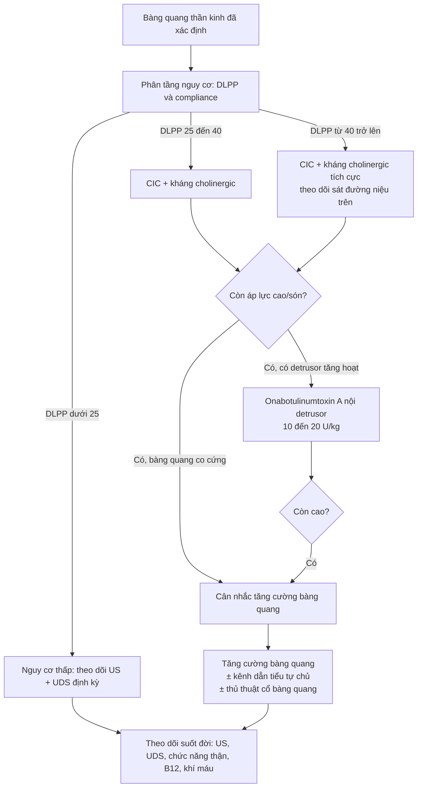
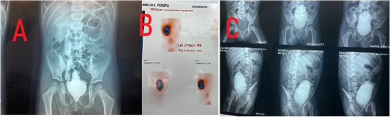

# 1845 — Bàng quang thần kinh ở trẻ dị tật tủy sống: hình dạng bàng quang, DLPP và bậc thang bảo vệ thận

**Tags:** `pattern:bang-quang-day` `pattern:bang-quang-cay-thong` `pattern:trao-nguoc-nieu-quan` `pattern:u-nuoc-than` `pattern:seo-than` `vung:bang-quang` `vung:nieu-quan` `vung:than` `protocol:VCUG` `protocol:VUDS` `protocol:SA-bung` `protocol:DMSA` `score:VUR-quoc-te` `score:UMPIRE`
**Mức chắc chắn (certainty):** tổng hợp y văn (literature synthesis) — **hướng dẫn EAU-ESPU-ERN 2026** (PMC13136771), **đoàn hệ 417 trẻ** đối chiếu hình dạng bàng quang với áp lực đổ đầy (PMC12550354), **nghiên cứu 61 trẻ** về compliance/áp lực rò (PMID 2231938), cùng **2 ca nguyên văn có ảnh** (PMC12933896; PMC11984603). Chỗ suy luận được ghi **[suy luận]**.

> **Câu chốt:** ở trẻ dị tật tủy sống, thứ **giết thận không phải "nước tiểu ứ" mà là ÁP LỰC**. Ba con số định vị toàn bộ bài: **(1)** áp lực cuối đổ đầy hoặc **DLPP > 40 cmH₂O** là yếu tố dự báo độc lập hư hại đường niệu trên; **< 25 cmH₂O** là nhóm nguy cơ thấp (UMPIRE) (PMC13136771); **(2)** nhóm đã hư hại đường niệu trên có compliance **4,5 vs 11,3 mL/cmH₂O** và áp lực rò **42,3 vs 26,1 cmH₂O** so với nhóm thận bình thường (PMID 2231938); **(3)** dù theo dõi, **25% trẻ có sẹo thận trong 10 năm** (PMC13136771) — và **không tăng cường bàng quang thì sau 10 năm 30% phải mổ tăng cường, > 50% đường niệu trên xấu đi, 20% suy thận mạn** (PMC13136771). Vì vậy **hình dạng bàng quang trên VCUG là dấu hiệu áp lực**, không phải "kiểu cho đẹp".

## 1. Tổng quan bệnh học – cơ chế hình ảnh

- **Bệnh học:** tổn thương tủy cùng/rễ cùng (thoát vị màng não tủy, bất sản xương cùng, tủy bám thấp, chấn thương) cắt mất **vòng điều hòa cầu não–tủy cùng**. Kết quả là hai thành phần **bàng quang (detrusor)** và **cơ thắt ngoài** mất phối hợp, mỗi thành phần có thể **tăng hoạt hoặc giảm hoạt** → **4 kiểu chức năng**: bàng quang tăng hoạt + cơ thắt tăng hoạt; bàng quang giảm hoạt + cơ thắt tăng hoạt; bàng quang tăng hoạt + cơ thắt giảm hoạt; cả hai giảm hoạt (PMC13136771).
- **TẠI SAO áp lực cao phá thận:** bàng quang là **bình chứa áp lực thấp**; khi **compliance thấp** (bàng quang "cứng"), mỗi mL nước tiểu làm áp lực tăng vọt. Áp lực **> 40 cmH₂O** vượt áp lực đóng của lỗ niệu quản → **trào ngược thứ phát**, ứ nước, nhiễm trùng, **sẹo nhu mô** và cuối cùng **suy thận**. Vì thế **đo áp lực** (niệu động học) quan trọng hơn **đo thể tích**.
- **TẠI SAO bàng quang thành dày — "cây thông":** detrusor co bóp chống lại cơ thắt đóng kín trong nhiều năm → **phì đại bó cơ** (trabeculation) và **túi lồi (diverticula)** giữa các bó; khi đổ đầy dưới áp lực cao, bàng quang bị **đẩy lên trên và hẹp dần ở đáy** → hình **"cây thông" (Christmas tree)** hoặc **"quả thông"** trên phim nghiêng/fluoroscopy. Đây là **dấu hiệu mạn tính của áp lực cao**, không phải bẩm sinh.
- **Số liệu định lượng cốt lõi:**
  - **Ngưỡng áp lực:** DLPP/áp lực cuối đổ đầy **> 40 cmH₂O** = nguy cơ cao; UMPIRE: **< 25 cmH₂O** nguy cơ thấp, **≥ 40 cmH₂O** nguy cơ cao (PMC13136771).
  - **Đối chiếu áp lực – thận (n = 61):** hư hại đường niệu trên ↔ compliance **4,5 vs 11,3 mL/cmH₂O** (p = 0,001) và áp lực rò **42,3 vs 26,1 cmH₂O** (p = 0,019) (PMID 2231938).
  - **Hậu quả dài hạn:** **25%** sẹo thận trong **10 năm**; **VUR thứ phát tới 30%**; ở người lớn **~50% còn són**, **15–25% suy giảm chức năng thận**, **~1% suy thận giai đoạn cuối** (PMC13136771).
  - **Hiệu quả can thiệp sớm:** CIC giảm nhiễm trùng tiểu từ **60% xuống 20% sau 12 tháng**; CIC + kháng cholinergic sớm giảm hư hại thận và **giảm nhu cầu tăng cường bàng quang** (PMC13136771).
  - **Hình dạng bàng quang (n = 417 trẻ, tuổi trung vị 2,6):** tròn nhẵn **74%**, tròn có trabeculation **10%**, bầu dục nhẵn **9%**, **"cây thông" 4%**, bầu dục trabeculation **3%**; bàng quang trabeculation/"cây thông" có áp lực đổ đầy **cao hơn 14–21 cmH₂O**; áp lực lúc rò **43–49 cmH₂O** so với **35–39 cmH₂O** ở các hình khác; rò ở **26% dung tích** so với **54–65%** (PMC12550354).
  - **Liên quan hình dạng – biến chứng:** VUR **41–46% vs 10%**, ứ nước **29% vs 7%**, rối loạn phối hợp detrusor–cơ thắt **67% vs 16%** (nhóm "cây thông"/bầu dục trabeculation so với tròn nhẵn) (PMC12550354).
  - **Botulinum toxin:** ca bất sản xương cùng **3 tuổi** dùng **20 U/kg** onabotulinumtoxin A vào detrusor + **~100 U** vào cơ thắt ngoài, trào ngược độ cao **hết** sau điều trị (PMC11984603); hướng dẫn xếp BoNT-A là **điều trị bậc 2** sau kháng cholinergic, hiệu quả nhất khi có **detrusor tăng hoạt**, kém hiệu quả ở bàng quang **kém compliance/không co** (PMC13136771).

## 2. Mẫu hình + chẩn đoán phân biệt theo vị trí (gamut)

**Mẫu hình chốt:** trẻ **đã vá thoát vị màng não tủy/bất sản xương cùng**, tiểu không tự chủ hoặc nhiễm trùng tiểu tái diễn; siêu âm thấy **ứ nước**; VCUG thấy **bàng quang thành dày, trabeculation, "cây thông", VUR**; DMSA thấy **khiếm khuyết nhu mô**.

- **Theo hình dạng bàng quang (VCUG):**
  - **Tròn nhẵn:** áp lực thấp, tiên lượng tốt.
  - **Trabeculation/túi lồi:** áp lực cao mạn, nguy cơ VUR.
  - **"Cây thông"/"quả thông":** áp lực cao nhất, rò sớm ở dung tích nhỏ, VUR và ứ nước nhiều nhất.
  - **Bàng quang khổng lồ, thành mỏng, không co:** thể **giảm hoạt** — khác cơ chế, dễ ứ nước do **tồn lưu**, không do áp lực lúc đổ đầy.
- **Theo vị trí tổn thương trên hình ảnh:**
  - **Thận:** ứ nước (độ theo SFU/UTD), sẹo (DMSA), teo nhu mô.
  - **Niệu quản:** trào ngược (độ I–V), niệu quản giãn không trào ngược.
  - **Bàng quang:** thành dày, trabeculation, túi lồi, cổ bàng quang mở/hep.
  - **Cột sống:** mức dị tật, tủy bám thấp, não úng thủy/Chiari II (phối hợp).
- **Gamut "bàng quang thành dày ở trẻ":** bàng quang thần kinh – **van niệu đạo sau (PUV)** – viêm bàng quang (kể cả eosinophilic) – bàng quang tăng hoạt không do thần kinh – **hẹp niệu đạo** – sau tăng cường bàng quang (ruột).
- **Gamut "ứ nước một bên ở trẻ có dị tật tủy":** VUR – **khớp niệu quản–bể thận hẹp** – niệu quản đôi lạc chỗ – bàng quang thần kinh gây áp lực cao – sỏi/sa lắng.

## 3. Bảng so sánh phân biệt (ma trận đối chiếu)

| Thực thể (entity) | Hình ảnh điển hình | Chốt vào (rule-in) | Chốt loại (rule-out) | Gợi ý xác nhận |
|---|---|---|---|---|
| **Bàng quang thần kinh do dị tật tủy** | Thành dày, trabeculation, "cây thông"; VUR; ứ nước; **áp lực đổ đầy cao** | **Tiền sử thoát vị màng não tủy/bất sản xương cùng + hình dạng bàng quang + DLPP ≥ 40 cmH₂O** | Bàng quang nhẵn, DLPP **< 25 cmH₂O**, không có tổn thương thần kinh → nghĩ nguyên nhân khác | Niệu động học + VCUG + MRI tủy |
| **Van niệu đạo sau (PUV)** | **Bàng quang thành dày + dấu "keyhole"** ở niệu đạo sau, ứ nước hai bên, **bé trai** | **Dấu keyhole + thành bàng quang dày ở bé trai sơ sinh** | **Bàng quang "cây thông" không có keyhole**, dị tật tủy rõ → nghĩ thần kinh | VCUG thì đi tiểu + siêu âm |
| **Bàng quang tăng hoạt không do thần kinh** | Thành dày nhẹ, không VUR độ cao, không ứ nước; **không có tổn thương tủy** | **Tiểu gấp, són ngày, áp lực bình thường khi đổ đầy** | **DLPP ≥ 40 cmH₂O + ứ nước/sẹo** → nghĩ thần kinh | Niệu động học; MRI tủy khi nghi ngờ |
| **Viêm bàng quang (kể cả eosinophilic)** | Thành dày **lan tỏa**, niêm mạc phù, có thể giả u | **Đái máu, đau, thành dày nhưng áp lực bình thường, hết sau điều trị** | **Hình dạng "cây thông" cố định nhiều năm + áp lực cao** → thần kinh | Siêu âm theo dõi; sinh thiết khi nghi u |
| **Tăng cường bàng quang bằng ruột (biến chứng)** | Túi lớn, thành mỏng, có thể sỏi/vỡ; **nhiễm toan chuyển hóa** | **Tiền sử tăng cường + sỏi/thủng/thiếu B12** | Bàng quang nguyên bản, chưa mổ | CT/US + khí máu + B12 |

*Bé gái 8 tuổi sau vá thoát vị màng não tủy: (A) VCUG — bàng quang hình "cây thông", trào ngược niệu quản độ 5 bên phải; (B) DMSA — thận phải mất chức năng. Nguồn: Mansy M et al., BMC Surg 2026, CC BY 4.0 (PMC12933896).*

### Ba dấu hiệu đọc đúng trên phim
- **Trabeculation:** bờ trong **không đều, dày từng bó**, giữa các bó là **túi lồi nhỏ** — khác **nếp gấp** (mảnh, thay đổi theo độ căng) và khác **bóng catheter** (hình ống, di động).
- **"Cây thông":** bàng quang **hẹp ở đáy, rộng ở đỉnh, bờ có răng cưa**, thường kèm **cổ bàng quang mở** và **rò sớm khi dung tích còn nhỏ** (26% dung tích so với 54–65%) (PMC12550354).
- **VUR độ 5:** niệu quản và **đài bể thận giãn ngoằn ngoèo**, mất nhú thận — đối chiếu ngay **DMSA** để biết còn nhu mô chức năng hay không.

## 4. Protocol chụp + bậc thang điều trị

- **Siêu âm bụng–tiết niệu:** đo **thể tích bàng quang trước và sau khi thải/CIC**, **độ dày thành** (đo khi bàng quang đầy **≥ 50%** dung tích ước tính), đánh giá **ứ nước theo UTD/SFU**, **bề dày nhu mô thận** và chiều dài thận.
- **VCUG/VUDS:** đổ thuốc bằng bơm với tốc độ **4% dung tích ước tính mỗi phút**, ghi **áp lực đổ đầy, DLPP, compliance, VUR, hình dạng bàng quang**; VUDS = niệu động học **kèm fluoroscopy** (tiêu chuẩn "vàng" ở trung tâm chuyên khoa) (PMC12550354; PMC13136771).
- **DMSA (Tc-99m):** đánh giá **nhu mô/sẹo**, thực hiện **trong năm đầu đời** làm mốc, lặp lại khi có bệnh cảnh nhiễm trùng/ứ nước (PMC13136771).
- **MRI tủy** khi có **thay đổi thần kinh mới**, nghi **tủy bám thấp** hoặc trước khi kết luận "bàng quang thần kinh không rõ nguyên nhân"; cũng đánh giá **não úng thủy/Chiari II** (PMC13136771).
- **Bậc thang điều trị (mục tiêu: áp lực thấp – dung tích đủ – khô):**

- **Theo dõi suốt đời (kể cả sau tăng cường):** siêu âm + chức năng thận + **khí máu** + **vitamin B12** (nếu dùng đoạn ruột), khám lâm sàng định kỳ vì **nguy cơ ung thư muộn** ở bàng quang tăng cường (PMC13136771).

## 5. Biến thể bình thường và cạm bẫy

- **Biến thể bình thường:** **bàng quang "cây thông" nhẹ** khi bàng quang **căng tối đa** hoặc khi **bé gồng** — luôn đọc **ở nửa dung tích** và đối chiếu **áp lực**; **trabeculation thoáng qua** khi nhiễm trùng; **ứ nước nhẹ thoáng qua** khi bàng quang quá căng, hết sau CIC.
- **Cạm bẫy 1 — chẩn đoán "bàng quang thần kinh" chỉ bằng hình dạng:** hình dạng **không đủ** phân biệt mức độ rối loạn; trong 417 trẻ, **rối loạn nặng có ở mọi hình dạng** (4–19%) nên **không dùng hình dạng để thay niệu động học** (PMC12550354).
- **Cạm bẫy 2 — VCUG bơm quá nhanh/quá căng:** áp lực giả tạo → **VUR giả** và **rò giả**; chuẩn là **4% dung tích ước tính/phút** (PMC12550354).
- **Cạm bẫy 3 — DMSA quá sớm sau nhiễm trùng:** khiếm khuyết do **viêm bể thận cấp** có thể hồi phục; nên chụp **sau 6 tháng** hoặc khi hết viêm để không gọi nhầm "sẹo vĩnh viễn" **[suy luận]**.
- **Cạm bẫy 4 — bỏ sót tủy bám thấp:** trẻ đã vá thoát vị **thay đổi kiểu tiểu** (đang khô lại són, tăng áp lực) → phải **MRI tủy**, không chỉ tăng liều thuốc (PMC13136771).
- **Cạm bẫy 5 — quên thận sau khi đã "ổn định":** **25%** có sẹo thận trong 10 năm dù theo dõi; ứ nước có thể **tiến triển âm thầm** khi trẻ không còn són — theo dõi **siêu âm + chức năng thận** mới là mục tiêu, không phải "khô tã".
- **Cạm bẫy 6 — botulinum toxin ở bàng quang co cứng:** BoNT-A hiệu quả khi có **detrusor tăng hoạt**, **kém hiệu quả** ở bàng quang **kém compliance/không co** — tiêm sai nhóm là tiền vô ích và trì hoãn tăng cường bàng quang (PMC13136771).

## 6. Tự lượng giá — Blind Quiz ngay trên trang tĩnh

**Ca 1 — Bàng quang "cây thông" và thận mất chức năng**

- Gợi ý lâm sàng: bé gái **8 tuổi**, đã vá thoát vị màng não tủy, tiểu không tự chủ, nhiễm trùng tiểu tái diễn.
- Câu hỏi: (1) Mô tả hình dạng bàng quang và bất thường bên phải trên phim A. (2) Phim B trả lời câu hỏi gì? (3) Vì sao "khô tã" chưa đủ là mục tiêu?

<b>Bấm để hiện đáp án (findings + chẩn đoán)</b>

- Dấu hiệu: **(A)** bàng quang **hẹp đáy, rộng đỉnh, bờ răng cưa** = hình **"cây thông"**; **trào ngược độ 5 bên phải** với niệu quản–đài bể thận giãn ngoằn ngoèo. **(B)** DMSA: **thận phải gần như không bắt xạ** = mất chức năng.
- Chẩn đoán: **bàng quang thần kinh sau vá thoát vị màng não tủy**, áp lực cao mạn → **VUR thứ phát + teo nhu mô thận phải**.
- Vì sao: hình "cây thông" = **phì đại detrusor chống cơ thắt**; thận đã mất là **hậu quả không hồi phục** — nên mục tiêu là **bảo vệ thận còn lại**, không phải chỉ giữ khô.
- Nguồn ảnh: Mansy M et al., BMC Surg 2026, **CC BY 4.0** (PMC12933896).

**Ca 2 — Trước và sau botulinum toxin**

- Gợi ý lâm sàng: bé trai **3 tuổi**, **bất sản xương cùng**, bàng quang thần kinh, trào ngược độ cao, creatinin tăng nhẹ.
- Câu hỏi: (1) Phim A và C khác nhau ở đâu? (2) Phim B cho biết gì? (3) Liều BoNT-A trong ca này và vì sao tiêm cả **detrusor** lẫn **cơ thắt ngoài**?

<b>Bấm để hiện đáp án (findings + chẩn đoán)</b>

- Dấu hiệu: **(A)** bàng quang nhỏ, thành dày, trào ngược; **(C)** sau điều trị — bàng quang **dung tích lớn hơn, bờ mềm hơn**, **trào ngược phải hết**; **(B)** DMSA — **thận trái 31% / phải 69%**, còn nhu mô cả hai bên.
- Chẩn đoán: **bàng quang thần kinh do bất sản xương cùng**, điều trị **onabotulinumtoxin A 20 U/kg** vào detrusor + **~100 U** vào cơ thắt ngoài (3, 9, 6 giờ); creatinin giảm, trào ngược hết.
- Vì sao: tiêm **detrusor** giảm áp lực đổ đầy; tiêm **cơ thắt** giảm lực cản khi thải — phối hợp khi có cả **tăng hoạt detrusor và cơ thắt tăng trương lực**.
- Nguồn ảnh: Saberi N, Jandaghi FS, Urol Case Rep 2025, **CC BY-NC-ND** (PMC11984603).

**Ca 3 — Chỉ có con số niệu động học**

- Gợi ý lâm sàng: bé gái **5 tuổi** dị tật tủy, đang CIC 5 lần/ngày + oxybutynin; không còn són nhưng siêu âm mới thấy **ứ nước độ 2 bên trái**.
- Số liệu: dung tích đạt **180 mL** (ước tính 220 mL); áp lực cuối đổ đầy **46 cmH₂O**; compliance **5,8 mL/cmH₂O**; DLPP **52 cmH₂O**; không có trào ngược trên VCUG.
- Câu hỏi: (1) Bệnh nhân thuộc nhóm nguy cơ nào? (2) Vì sao "không són" mà vẫn ứ nước? (3) Ba bước xử trí tiếp theo.

<b>Bấm để hiện đáp án (findings + chẩn đoán)</b>

- Phân tầng: **nguy cơ cao** — DLPP **52 cmH₂O** và áp lực cuối đổ đầy **46 cmH₂O** đều **> 40 cmH₂O**, compliance **5,8 mL/cmH₂O** (nhóm hư hại thận trong nghiên cứu 61 trẻ có compliance **4,5** so với **11,3 mL/cmH₂O**) (PMID 2231938; PMC13136771).
- Vì sao không són mà vẫn ứ nước: **"khô" nhờ CIC + thuốc nhưng bàng quang vẫn cứng**; áp lực cao truyền ngược lên niệu quản dù không có trào ngược trên VCUG (trào ngược có thể **ngắt quãng**, chỉ xuất hiện khi áp lực đỉnh).
- Xử trí: **(1)** tối ưu kháng cholinergic/kiểm tra tuân thủ và kỹ thuật CIC; **(2)** **BoNT-A nội detrusor** nếu còn detrusor tăng hoạt; **(3)** nếu áp lực vẫn ≥ 40 cmH₂O → **cân nhắc tăng cường bàng quang**, đồng thời theo dõi siêu âm/chức năng thận.
- Lưu ý: ca này là **suy luận từ ngưỡng** trong hướng dẫn, không phải ca nguyên văn.

## Bài liên quan chéo
- [1749 — Hội chứng nhân đôi đuôi / caudal duplication](../1749-hoi-chung-nhan-doi-duoi-caudal-duplication/lesson.md)
- [1719 — Bàng quang đôi, vách bàng quang và nang niệu rốn ở trẻ](../1719-bang-quang-doi-va-nang-nieu-ron/lesson.md)
- [635 — Dị tật tiết niệu nhi: SFU, VUR, PUV](../635-di-tat-tiet-nieu-nhi-SFU-VUR-PUV/lesson.md)
- [3086 — Nhiễm trùng niệu do sonde (CAUTI) ở trẻ và cai sonde](../3086-cauti-o-tre/lesson.md)
- [3089 — Thiếu B12 sau tăng dung tích bàng quang](../3089-thieu-b12-sau-tang-dung-tich-bang-quang/lesson.md)

> Không dùng để chẩn đoán độc lập khi chưa có người hướng dẫn.
