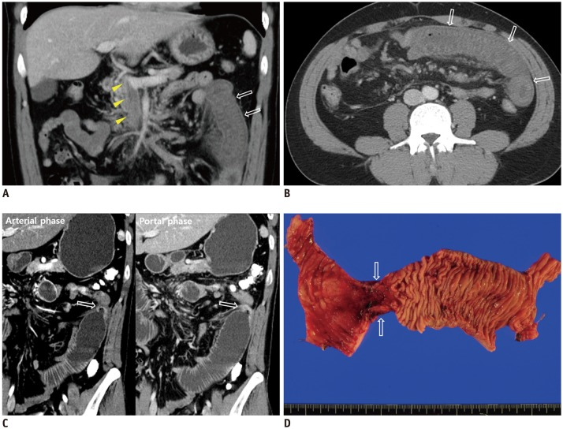
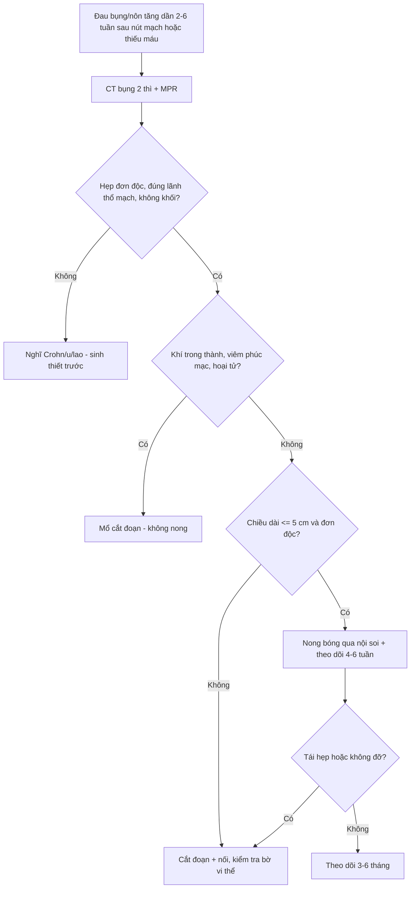
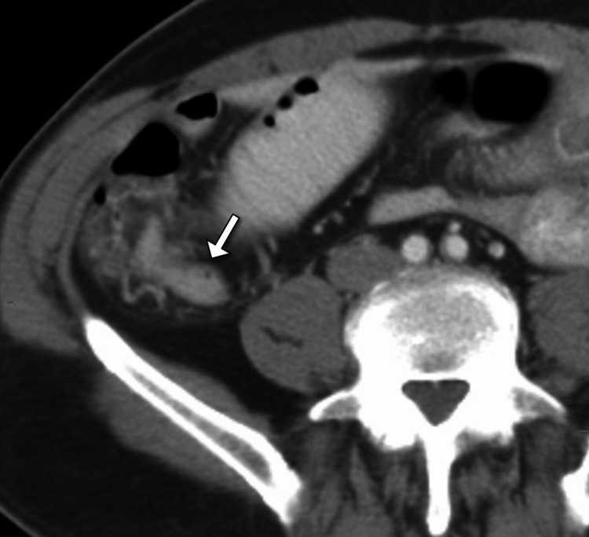
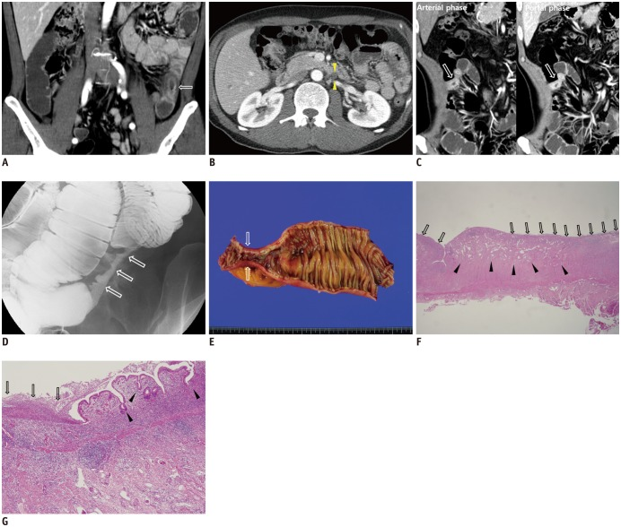

# 1847 — Hẹp ruột do thiếu máu sau nút mạch mạc treo: chẩn đoán CT và chọn nong bóng hay cắt nối / Post-ischemic bowel stricture

**Tags:** `pattern:hep-ruot` `pattern:day-thanh-ruot` `pattern:giam-ngam-thanh` `pattern:thieu-mau-ruot` `pattern:tac-ruot` `vung:ruot-non` `vung:dai-trang` `vung:o-bung` `protocol:CT-bung-co-tuong-phan` `protocol:noi-soi-ruot-non`
**Mức chắc chắn (certainty):** tổng hợp y văn (literature synthesis) — ghép **1 loạt 8 ca có mô bệnh** về đặc điểm CT của hẹp sau thiếu máu (*Korean J Radiol* 2017, PMC5639159, CC BY-NC 4.0), **1 ca hẹp hồi tràng tận sau đặt stent động mạch mạc treo tràng trên** (*Cureus* 2026, PMC12930115, CC BY 4.0), **1 ca hẹp hỗng tràng 3 cm sau huyết khối tĩnh mạch cửa–mạc treo** (*Case Rep Gastroenterol* 2025, PMC12245150, CC BY-NC 4.0) và nền thiếu máu ruột của bài 1835. Không có thử nghiệm nào so sánh nong bóng với cắt nối → mục 4 là tổng hợp thực hành.

> **Câu chốt:** hẹp do thiếu máu hình thành **trung bình 57 ngày** sau biến cố (khoảng **14–144 ngày**, trung vị **48 ngày**), **chỉ MỘT ổ** ở **8/8 ca**, dài trung bình **7,4 cm**, thành **dày chu vi ngấm vừa**, **bắt thuốc thì tĩnh mạch mạnh hơn thì động mạch (66,7%)**, **mạch thẳng mạc treo nổi**; ở đại tràng **luôn nằm ở vùng bản lề mạch (watershed)**. Đây là chẩn đoán **nhờ bối cảnh + hình thái**, không nhờ mô bệnh: **không có loét dọc từng đoạn kiểu Crohn, không có khối, không có hạch hoại tử**.

## 1. Tổng quan bệnh học – cơ chế hình ảnh

### 1.1 Từ thiếu máu niêm mạc đến vòng xơ co

- **Chuỗi mô bệnh** (đối chiếu 5 ca có bệnh phẩm): thiếu máu niêm mạc → **loét sâu** → **xơ hóa dưới niêm mạc và dưới thanh mạc** → **viêm mạn xuyên thành** → mô xơ co rút tạo **vòng hẹp chu vi** (PMC5639159). Vì vậy hẹp thiếu máu là **tổn thương xơ**, không phải viêm hoạt động: niêm mạc trên vòng xơ thường **nhẵn, không loét rải rác**.
- **Vì sao chỉ một ổ:** ruột non và đại tràng được nuôi bằng **mạch tận theo từng đoạn**; đợt thiếu máu thường chỉ vượt ngưỡng ở **một lãnh thổ hẹp nhất** — nơi tưới máu biên thấp nhất. Loạt 8 ca ghi **8/8 chỉ có một ổ hẹp** (PMC5639159).
- **Vì sao đại tràng luôn ở vùng bản lề:** ba **điểm phân thủy** — **góc hồi–manh tràng**, **góc lách (điểm Griffiths)**, **góc trực–sigma (điểm Sudeck)** — là nơi hai nguồn máu gặp nhau nên **áp lực tưới máu thấp nhất**; cả **2/2 ca hẹp đại tràng** trong loạt đều rơi vào đây.
- **Vì sao thành dày chu vi mà lòng hẹp:** xơ dưới niêm mạc làm **dày thành**; vòng xơ co làm **giảm đường kính**; lớp cơ bị thay một phần bằng collagen nên **nhu động giảm** và ruột phía trên **giãn bù** (8/8 ca có tắc nghẽn mức độ thấp hoặc cao).

### 1.2 TẠI SAO ngấm thuốc thì tĩnh mạch mạnh hơn thì động mạch

- Đây là điểm **ngược với u**: u ngấm **mạnh thì động mạch rồi thải**; hẹp thiếu máu ngấm **vừa và tăng dần tới thì tĩnh mạch**.
- **Lý do vật lý:** mô xơ–viêm mạn có **mao mạch giãn, dòng chảy chậm, khoảng kẽ rộng**; iod cần thời gian khuếch tán vào khoảng kẽ nên **đỉnh ngấm trễ**. Thì động mạch (15–25 giây) chỉ kịp thấy **niêm mạc** — đúng như loạt ca ghi **ngấm niêm mạc 50%**, còn thì tĩnh mạch (72 giây) thấy **ngấm vừa đồng nhất**.
- **Ngưỡng định nghĩa "ngấm thì tĩnh mạch mạnh hơn":** thành ngấm **cao hơn ≥ 15 HU** ở thì tĩnh mạch so với thì động mạch — **66,7% (4/6 ca đo được)** trong loạt 8 ca (PMC5639159).

### 1.3 Ngưỡng định lượng nằm lòng

| Đại lượng | Số liệu | Nguồn |
|---|---|---|
| Thời gian từ biến cố thiếu máu đến hẹp | trung bình **57 ngày**; khoảng **14–144 ngày**; trung vị **48 ngày** | PMC5639159 |
| Số ổ hẹp | **1 ổ duy nhất 8/8 (100%)** | PMC5639159 |
| Vị trí | **hồi tràng 5/8**, **đại tràng 2/8** (đều ở watershed), **hỗng tràng 1/8** | PMC5639159 |
| Chiều dài ổ hẹp | trung bình **7,4 cm** (hẹp "trung bình"); ca sau huyết khối TM: **3 cm** | PMC5639159; PMC12245150 |
| Hình thái thành | **dày chu vi 87,5%**; ngấm **vừa 87,5%**; ngấm **niêm mạc 50%**; **thì TM > thì ĐM 66,7%** | PMC5639159 |
| Tắc nghẽn | **8/8 có tắc nghẽn** (thấp hoặc cao); nhưng **có ca KHÔNG giãn ruột phía trên** | PMC5639159; PMC12930115 |
| Triệu chứng khi đã hẹp | **đau bụng 6/8 (75%)**, nôn, chướng; 1 ca tụt áp do mất dịch | PMC5639159 |
| Loại thiếu máu dẫn tới hẹp | **tắc tĩnh mạch 3/8**, **không tắc mạch (NOMI/ischemic colitis) 4/8**, **tắc động mạch 1/8** | PMC5639159 |
| Xử trí trong loạt | **cắt nối 5/8**, **nong bóng 1/8**, nội khoa 2/8 | PMC5639159 |

> **Phản biện nguồn (quan trọng):** loạt 8 ca **loại trừ đúng nhóm bệnh nhân của bài này** — tiêu chí loại là *"can thiệp mạch ruột (intestinal vessel embolization)"*, thủ thuật, hoặc chấn thương bụng (PMC5639159). Vì vậy **con số CT ở trên là của hẹp thiếu máu nói chung**, không phải của riêng hẹp sau nút mạch; áp dụng cho sau nút mạch là **suy luận hợp lý theo cùng cơ chế**, không phải bằng chứng trực tiếp. Bài ghi rõ để không gán sai độ mạnh bằng chứng.

## 2. Mẫu hình + chẩn đoán phân biệt theo vị trí (Gamut)

**Mẫu hình chung:** một **đoạn ruột hẹp đơn độc, dày thành chu vi, ngấm vừa–tăng dần tới thì tĩnh mạch**, bờ ngoài nhẵn, **không khối**, **không loét rải rác**, **mạch thẳng mạc treo nổi**, ruột phía trên giãn ± mức nước–hơi.

- **Hồi tràng (vị trí hay nhất — 5/8):** sau **huyết khối tĩnh mạch mạc treo** (bài 163) hoặc **tắc/hẹp động mạch mạc treo đã tái thông**; hình ảnh là **hẹp ngắn cố định** ở hồi tràng tận, dễ bị gọi nhầm **bệnh Crohn** (PMC12930115).
- **Hỗng tràng:** sau huyết khối TM cửa–mạc treo lan rộng; ca điển hình **hẹp 3 cm** kèm **dính rất nhiều** và **tăng áp cửa** (PMC12245150).
- **Đại tràng:** **luôn ở vùng bản lề** (góc lách, góc trực–sigma); đây là di chứng muộn của **viêm đại tràng thiếu máu** (bài 1911), thường **hẹp dài** và có thể **giả polyp/giả u**.
- **Bối cảnh "đã nút mạch":** hẹp nằm **đúng lãnh thổ nhánh đã nút**; thời điểm **2–6 tuần sau thủ thuật**; bệnh nhân **đau tăng dần** thay vì đỡ như hội chứng sau nút mạch (bài 1834) — đây là **cửa sổ vàng** để không bỏ sót.

## 3. Bảng so sánh phân biệt (ma trận đối chiếu)

| Thực thể (entity) | Hình ảnh điển hình | Chốt vào (rule-in) | Chốt loại (rule-out) | Gợi ý xác nhận |
|---|---|---|---|---|
| **Hẹp do thiếu máu (sau nút mạch/thiếu máu mạc treo)** | **1 ổ**, dày chu vi, dài **trung bình 7,4 cm**, ngấm **vừa**, **thì TM > thì ĐM ≥ 15 HU**, mạch thẳng nổi, bờ ngoài nhẵn | **Tiền sử thiếu máu/nút mạch + hẹp đúng lãnh thổ + 1 ổ + 14–144 ngày** | **Nhiều ổ + loét dọc + hạch + rò** → Crohn; **khối + hạch hoại tử** → u/lao | CT 2 thì + MPR; nội soi ruột non (DBE) để loại u; so phim trước |
| **Crohn** | **Nhiều ổ nhảy cách (skip lesions)**, loét dọc, **cobblestone**, **hẹp dài**, ngấm **mạnh**, hạch, rò/hang | **Loét dọc + cobblestone + tổn thương ngoài ruột (rò, áp-xe)** | **1 ổ đơn độc, không loét, bờ nhẵn, đúng lãnh thổ mạch** | MRE/CTE; calprotectin; mô bệnh |
| **Bệnh ruột do NSAID / CMUSE** | Hẹp **ngắn, nhiều ổ**, loét nông, màng ngăn (diaphragm-like) | **Tiền sử NSAID + nhiều màng ngăn hẹp ngắn** | **1 ổ dài + bối cảnh thiếu máu** | Nội soi ruột non; ngừng NSAID |
| **Lao ruột** | Hẹp **hồi tràng tận** + **dày thành + hạch hoại tử vôi hóa** + **phúc mạc "bánh mì"** | **Hạch hoại tử/vôi + tổn thương phổi + phúc mạc dày** | **Không hạch, không phúc mạc, không tổn thương phổi** | PCR lao, mô bệnh, CT ngực |
| **U ruột non** | Khối **không đối xứng**, bờ **không đều**, hạch, lồng ruột, ngấm **không đồng nhất** | **Khối lệch tâm + hạch mạc treo + lồng ruột** | **Dày chu vi đều, không khối, tái kiểm tra ổn định** | DBE + sinh thiết; CTE |
| **Hẹp do dính / sau xạ / miệng nối** | Hẹp **góc gấp**, kéo lệch quai, **không dày thành**, không ngấm | **Tiền sử mổ/xạ + góc gấp + thành không dày** | **Thành dày + ngấm tăng dần + đúng lãnh thổ mạch** | So phim cũ; mổ thăm dò nếu tắc |

*Bệnh nhân 29 tuổi (ca #8 của loạt 8 ca): (A, B) lúc chẩn đoán — **huyết khối tĩnh mạch mạc treo trên** (đầu mũi tên) và **ngấm thành hỗng tràng kiểu lớp** (mũi tên); (C) sau 54 ngày — **hẹp chu vi một đoạn** (mũi tên), **ngấm mạnh hơn ở thì tĩnh mạch**, ruột phía trên giãn; (D) bệnh phẩm — vòng hẹp ~2 cm. Nguồn: Korean J Radiol 2017, PMC5639159, CC BY-NC 4.0, nguyên bản.*

### Dấu hiệu đọc đúng thứ tự thời gian (sau nút mạch)

- **0–72 giờ:** thành **mỏng, giảm ngấm** (bài 1835) — đây là thiếu máu cấp, **chưa phải hẹp**.
- **1–3 tuần:** thành **dày lên, ngấm trở lại** do viêm–tái tưới máu; đau có thể **giảm rồi tăng lại** — điểm mốc dễ đọc nhầm thành "hội chứng sau nút mạch kéo dài".
- **2–6 tuần (14–144 ngày):** **vòng xơ co**, hẹp lòng, ruột trên giãn — lúc này CT mới có hình thái "hẹp".

## 4. Protocol chụp + ngưỡng xử trí

### 4.1 CT bụng–khung chậu có cản quang: protocol tối thiểu

- **Hai thì bắt buộc** (đây là điều kiện để thấy dấu hiệu chốt): **động mạch 15–25 giây** (bolus-tracking) + **tĩnh mạch 72 giây** (PMC5639159); cản quang **2–2,5 mL/kg, 2–3 mL/s**.
- **Lát cắt 3 mm + MPR coronal/sagittal**: chiều dài ổ hẹp **chỉ đo đúng trên mặt phẳng song song trục ruột**; đo trên ảnh axial là nguồn sai số lớn nhất.
- **Làm căng lòng ruột** bằng **1–1,5 L nước trung tính** (hoặc sorbitol 3%) khi cần phân biệt hẹp thật với co thắt; **không dùng barium**.
- **Đo và ghi 4 con số:** chiều dài ổ hẹp (cm), độ dày thành một bên (mm), **chênh ngấm thì TM − thì ĐM (HU)**, đường kính ruột trên chỗ hẹp (cm).
- **Tìm 4 dấu hiệu phụ:** mạch thẳng mạc treo nổi, dịch quanh ruột, **khí trong thành** (nếu có → đang hoại tử, không phải hẹp đơn thuần), hạch.

### 4.2 Nội soi ruột non — chỉ định và cạm bẫy

- **Capsule nội soi: chống chỉ định khi đã biết/có nghi hẹp** (nguy cơ kẹt viên nang); nếu cần, dùng **capsule "patency"** trước.
- **Double-balloon enteroscopy (DBE)** vừa để **nhìn – sinh thiết – nong bóng**: đây là cách loại u và là cách điều trị ít xâm lấn cho hẹp ngắn.

### 4.3 Chọn nong bóng hay cắt nối

- **Nong bóng:** hợp lý cho **hẹp ngắn, đơn độc, không loét hoạt động**; trong loạt 8 ca, **1 ca được nong** và không phải mổ (PMC5639159). **Giới hạn bằng chứng:** không có loạt nào báo **tỉ lệ tái hẹp sau nong ở hẹp thiếu máu** → **chưa rõ**, phải theo dõi bằng triệu chứng + CT.
- **Cắt nối:** chỉ định khi **hẹp dài (≈ > 5 cm), nhiều ổ, loét sâu, nghi u, hoặc nong thất bại/tái hẹp**; **5/8 ca** trong loạt phải cắt (PMC5639159), ca hẹp 3 cm sau huyết khối TM cũng phải cắt vì **dính và tắc nghẽn** (PMC12245150).
- **Không mổ "dự phòng"** một ổ hẹp không triệu chứng, không giãn ruột: hẹp xơ **có thể ổn định**; theo dõi bằng cân nặng + triệu chứng + CT 3–6 tháng.
- **Sau nút mạch, hẹp là biến chứng muộn của chính thủ thuật** — ghi vào phiếu theo dõi 6 tuần để bệnh nhân được chụp lại đúng lúc, thay vì chờ đến khi tắc ruột.

## 5. Biến thể bình thường và cạm bẫy

- **Co thắt sinh lý giả hẹp:** quai ruột rỗng, chưa căng đủ, co lại thành "hẹp" — luôn **làm căng lòng** và **so sánh đoạn bệnh/đoạn lành**; hẹp thật **dày thành + ngấm tăng dần**, co thắt thì **không dày**.
- **Không có giãn ruột phía trên KHÔNG loại trừ hẹp:** ca sau stent động mạch mạc treo có **hẹp cố định mà không giãn** (PMC12930115). Đòi hỏi "phải có mức nước–hơi" là bỏ sót.
- **Hẹp thiếu máu có thể rò và giống Crohn:** ca *post-ischemic enteritis* tiến triển **rò ruột–ruột phức tạp**, mô bệnh chỉ là **viêm mạn + xơ** (PMC13721017). Vì vậy **rò không loại trừ thiếu máu** — bối cảnh mạch quyết định.
- **Đo chiều dài trên ảnh axial** làm hẹp "dài hơn thực" và dễ đẩy bệnh nhân vào mổ: bắt buộc **MPR**.
- **Sau nút mạch, "khí trong tổn thương đã nút" là bình thường** (bài 1834) nhưng **khí trong thành ruột** thì không — hai chữ "khí" khác hẳn nhau.
- **Ở trẻ:** hẹp sau **viêm ruột hoại tử (NEC)** là bệnh cảnh riêng (thường đại tràng trái, sau giai đoạn cấp) — không đồng nhất với hẹp sau nút mạch ở người lớn.

## 6. Tự lượng giá — Blind Quiz

**Ca 1 — Nam 29 tuổi, không bệnh nền, đau bụng 3 ngày. CT lần 1 có huyết khối tĩnh mạch mạc treo; 54 ngày sau đau lại + nôn.**

- Hỏi: (1) hình A–B mô tả gì? (2) hình C là tổn thương gì và **vì sao nó ngấm mạnh hơn ở thì tĩnh mạch**? (3) vì sao phải cắt đoạn?

<b>Bấm để hiện đáp án (findings + chẩn đoán)</b>

- **A–B:** huyết khối **tĩnh mạch mạc treo trên** (đầu mũi tên); thành hỗng tràng **dày, ngấm kiểu lớp** = thiếu máu tĩnh mạch.
- **C:** **hẹp chu vi một đoạn** sau 54 ngày, **ngấm vừa và mạnh hơn ở thì tĩnh mạch**, ruột phía trên giãn (tắc nghẽn cao). Cơ chế ngấm trễ: mô **xơ + mao mạch giãn, dòng chậm** → iod vào khoảng kẽ chậm, đỉnh ở thì tĩnh mạch; ngược với u (ngấm sớm rồi thải).
- **D:** bệnh phẩm — vòng hẹp ~2 cm, xơ.
- **Xử trí:** **cắt đoạn + nối** vì hẹp đã gây tắc nghẽn cao và có vòng xơ dày; nong bóng không giải quyết được đoạn xơ dài.
- **Chẩn đoán:** hẹp ruột do thiếu máu sau huyết khối tĩnh mạch mạc treo.
- Nguồn ảnh: Korean J Radiol 2017, PMC5639159, CC BY-NC 4.0.

**Ca 2 — Nam 68 tuổi, hẹp động mạch mạc treo tràng trên được đặt stent. Vài tuần sau đau hố chậu phải tái diễn.**

- Hỏi: chẩn đoán? Dấu hiệu nào trên CT? Vì sao **không thấy giãn ruột** mà vẫn là hẹp thật?

<b>Bấm để hiện đáp án (findings + chẩn đoán)</b>

- **Dấu hiệu:** **dày thành chu vi + hẹp lòng hồi tràng tận** (mũi tên), bờ ngoài nhẵn, không khối, **không giãn ruột phía trên**.
- **Chẩn đoán:** **hẹp hồi tràng tận do thiếu máu mạn** — hậu quả của **giảm tưới máu kéo dài TRƯỚC khi tái thông**; xơ hóa hình thành dần sau đó (PMC12930115).
- **Vì sao không giãn:** lòng còn đi qua được + ruột non dung nạp; **thiếu giãn không loại trừ hẹp**.
- **Xác nhận:** chụp baryt ruột non thấy **hẹp đoạn ngắn cố định**; cần **nội soi + sinh thiết** để loại Crohn/u.
- Nguồn ảnh: Cureus 2026, PMC12930115, CC BY 4.0.

**Ca 3 — Nam 55 tuổi, đau bụng 2 tuần. Ảnh A–B lúc nhập viện, C–G là diễn tiến.**

- Hỏi: (1) vì sao nói **thiếu máu tĩnh mạch** ở A–B? (2) hình C khác A–B ở điểm nào? (3) mô bệnh F–G giải thích hình ảnh ra sao?

<b>Bấm để hiện đáp án (findings + chẩn đoán)</b>

- **A–B:** thành **hồi tràng dày, giảm ngấm** + **huyết khối tĩnh mạch mạc treo dưới** (đầu mũi tên) → **thiếu máu tĩnh mạch**.
- **C:** sau **98 ngày** — **hẹp chu vi**, **ngấm mạnh hơn ở thì tĩnh mạch** (mũi tên); **D** baryt: hẹp đoạn ngắn; **E** đại thể: vòng xơ.
- **F–G (mô bệnh):** **loét sâu** (mũi tên) + **xơ hóa dưới niêm mạc/dưới thanh mạc** + **viêm mạn xuyên thành** → giải thích **dày thành**, **ngấm trễ** và **co rút**.
- **Chẩn đoán:** thiếu máu tĩnh mạch → hẹp sau thiếu máu (diễn tiến 98 ngày).
- Nguồn ảnh: Korean J Radiol 2017, PMC5639159, CC BY-NC 4.0.

## Bài liên quan chéo
- [1835 – Thiếu máu ruột sau nút mạch mạc treo: vùng nào không được nút](../1835-thieu-mau-ruot-sau-nut-mach/lesson.md) (thiếu máu **cấp**, cùng nguồn gốc)
- [1834 – Hội chứng sau nút mạch: phân biệt viêm lành tính với nhiễm trùng/áp-xe](../1834-hoi-chung-sau-nut-mach/lesson.md) (đau tăng sau nút: PES hay thiếu máu?)
- [1911 – Viêm đại tràng thiếu máu](../1911-viem-dai-trang-thieu-mau/lesson.md) (di chứng hẹp ở vùng bản lề)
- [1908 – Thiếu máu mạc treo cấp–mạn & bóc tách động mạch tạng](../1908-thieu-mau-mac-treo-va-boc-tach-dong-mach-tang/lesson.md)
- [163 – Pylephlebitis & huyết khối tĩnh mạch mạc treo](../163-pylephlebitis-huyet-khoi-tm-mac-treo/lesson.md) (nguyên nhân thường gặp của hẹp ở hồi tràng)
- [162 – Tắc ruột](../162-tac-ruot/lesson.md) · [160 – Bụng cấp tiêu hóa](../160-bung-cap-GI/lesson.md)
- [920 – Nút mạch trong chảy máu tiêu hóa](../920-vascular-embolization-gi-bleed/lesson.md)

> Không dùng để chẩn đoán độc lập khi chưa có người hướng dẫn.
