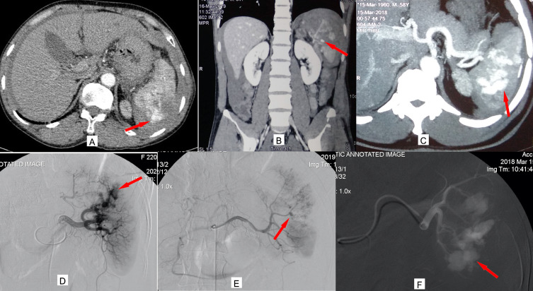
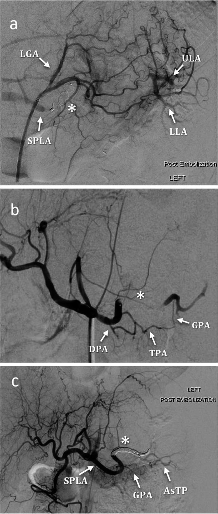
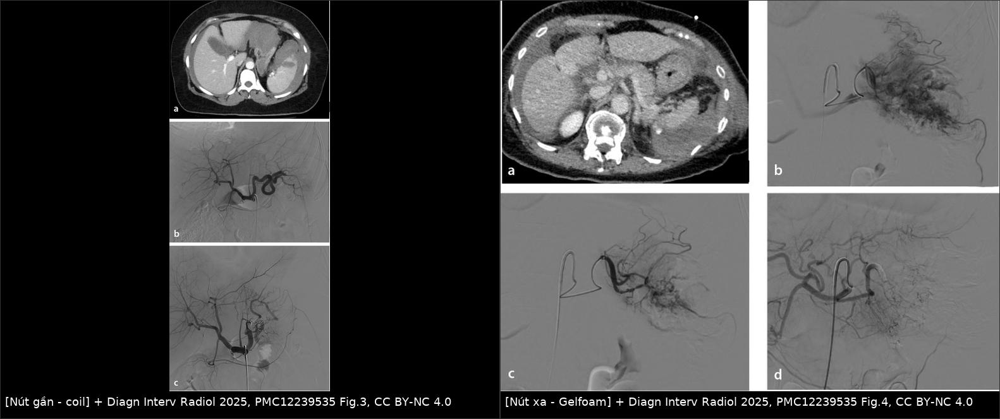
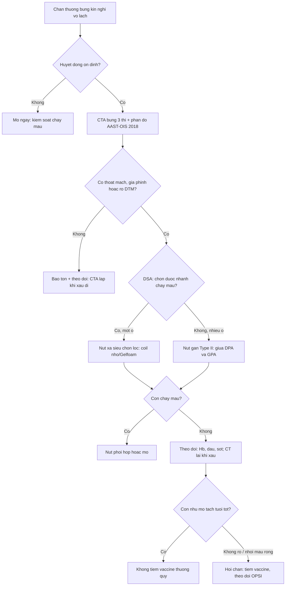
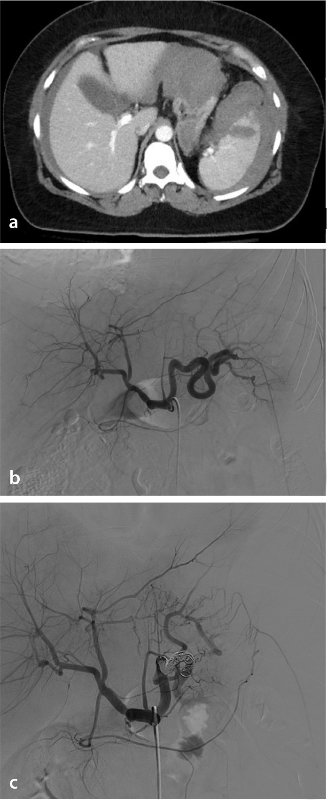
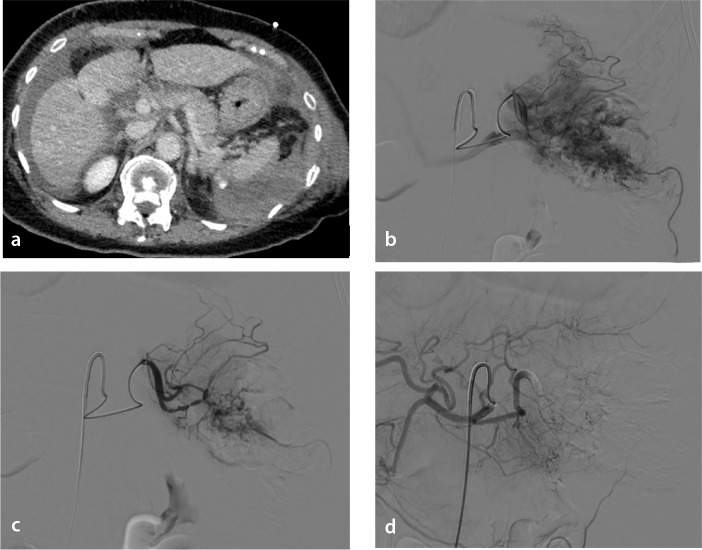

# 1848 — Nút mạch lách trong chấn thương: gần hay xa, khi nào cắt lách / Splenic artery embolization in blunt trauma

**Tags:** `pattern:thoat-mach` `pattern:gia-phinh` `pattern:ro-dong-tinh-mach` `pattern:tu-mau` `pattern:vo-tang` `vung:lach` `vung:o-bung` `protocol:CTA-bung` `protocol:DSA-nut-mach` `score:AAST-OIS`
**Mức chắc chắn (certainty):** tổng hợp y văn (literature synthesis) — số liệu từ 1 đoàn hệ 281 ca đa trung tâm Ý (PMC12470969), 1 loạt 72 ca một trung tâm cấp 1 (PMC12239535), 1 nghiên cứu 58 ca/59 lần nút gần theo **vị trí tắc** (PMC9391208), 1 loạt 50 ca phân độ lại theo AAST-OIS 2018 (PMC10178903), 1 phân tích ghép cặp 377 cặp nút mạch so với mổ (PMC11021531), 1 đoàn hệ quốc gia 8.195 ca theo dõi dài hạn (PMC11997966) và 1 tổng quan (PMC11703699). Phần nào là **suy luận thực hành** được ghi rõ.

## 1. Tổng quan bệnh học – cơ chế hình ảnh

- **Chấn thương lách kín** gây vỡ nhu mô và **tổn thương mạch trong nhu mô**: máu động mạch thoát ra ngoài lòng mạch nhưng còn trong bao lách → **tụ máu dưới bao**, hoặc thoát vào ổ bụng → **tràn máu phúc mạc**. Ba kiểu tổn thương mạch quyết định chỉ định nút mạch (PMC10178903):
  1. **Thoát mạch hoạt động (active extravasation)** — thuốc cản quang **cùng đậm độ động mạch chủ**, lan rộng dần ở thì muộn, hình dạng thay đổi.
  2. **Giả phình (pseudoaneurysm)** — túi tròn, đậm độ bằng động mạch, **giữ nguyên hình dạng** ở mọi thì; nguy cơ **vỡ muộn** ("second hit") nếu không nút.
  3. **Rò động–tĩnh mạch (AV fistula)** — tĩnh mạch lách/ cửa **ngấm sớm** ngay thì động mạch.
- **Vì sao nút gần vẫn cứu được lách:** thắt/nút **động mạch lách thân chính** làm **giảm áp lực tưới máu** toàn lách, nhưng nhu mô vẫn sống nhờ tuần hoàn bàng hệ: **động mạch vành vị ngắn (từ động mạch vị trái)**, **động mạch vị mạc nối trái**, các nhánh **tụy–lách**. Đây là "giảm áp, không phải cắt máu" — nguyên lý khác hoàn toàn nút tạng đặc không có bàng hệ.
- **Vì sao nút xa (siêu chọn lọc) lại dễ nhồi máu hơn:** nút tại **nhánh tận** cắt luôn đường vào của đoạn nhu mô đó, không còn bàng hệ; đổi lại chỉ mất một phần nhu mô. Trên lâm sàng, tỉ lệ nhồi máu **không khác nhau có ý nghĩa** giữa hai kỹ thuật trong loạt 72 ca (17,6% nút gần bằng coil so với 20% nút xa bằng Gelfoam; p > 0,05) (PMC12239535).
- **Vị trí "lý tưởng" của nút gần:** **giữa động mạch tụy lưng (dorsal pancreatic artery, DPA) và động mạch tụy lớn (great pancreatic artery, GPA)** — gọi là **Type II**. Nút **gần hơn DPA (Type I)** hoặc **xa hơn GPA (Type III)** cho kết quả khác: trong 59 lần nút gần, **thành công lâm sàng 100% ở Type I/II** so với **88% ở Type III** (p = 0,02); tưới máu lách còn lại **100% (Type I/II) vs 94% (Type III)**; **không ca viêm tụy nào** (PMC9391208).
- **Số liệu nằm lòng:**
  - **Cứu lách sau nút mạch: 90,3% (65/72)** ở trung tâm cấp 1 (PMC12239535); **100% thành công kỹ thuật, 9,6% phải cắt lách sau nút, biến chứng 24,9%** trong 281 ca đa trung tâm (nhồi máu lách **5,7%**, chảy máu lại **3,2%**) (PMC12470969).
  - **Nút gần 46,6%, nút xa 28,8%, phối hợp 24,6%** trong thực hành đa trung tâm (PMC12470969).
  - **AAST-OIS 2018 nâng độ so với 1994**: trong 50 ca, **27 ca tăng độ** (2 ca độ II → IV; 15 ca III → IV; 4 ca IV → V) và **toàn bộ 50 ca nút mạch thành công, không ca nào phải nút lại hay cắt lách** (PMC10178903). Đây là lý do phải phân độ lại trước khi quyết định.
  - **Nút mạch so với mổ**: cứu lách **87,1% vs 32,1%** (aRR 2,84; 95% CI 2,29–3,51; p < 0,001); tử vong **11,6% vs 11,2%** (aRR 0,64; 95% CI 0,38–1,09) — tức **không tăng tử vong, tăng mạnh khả năng giữ lách** (377 cặp ghép) (PMC11021531).
  - **Theo dõi dài hạn** 8.195 ca: nút mạch và điều trị bảo tồn có **nguy cơ nhiễm khuẩn và huyết khối thấp hơn cắt lách**; cắt lách cũng có nguy cơ ung thư cao hơn điều trị bảo tồn (PMC11997966).
- **Vì sao chụp CT đúng thì quan trọng:** giả phình và rò động–tĩnh mạch có thể **chỉ thấy ở thì động mạch**, còn thoát mạch hoạt động **rõ hơn ở thì muộn**. Chụp một thì duy nhất là lý do hay bỏ sót tổn thương mạch.

## 2. Mẫu hình + chẩn đoán phân biệt theo hình ảnh (Gamut)

**Trả lời 3 câu hỏi trên CTA trước khi gọi can thiệp:**
1. **Có tổn thương mạch không?** (thoát mạch / giả phình / rò ĐTM)
2. **Máu còn trong bao lách hay đã vào ổ bụng?** (tụ máu dưới bao vs tràn máu phúc mạc)
3. **Bệnh nhân còn ổn định huyết động không?** — mất ổn định là chỉ định mổ, không phải nút mạch.

**Gamut theo mẫu hình:**
- **Nhu mô:** đường vỡ (laceration) nông/sâu, **vỡ nát lách (shattered spleen)**, **nhồi máu do mạch bị đứt**.
- **Mạch:** thoát mạch hoạt động, giả phình, rò động–tĩnh mạch, huyết khối nhánh.
- **Quanh lách:** tụ máu dưới bao, máu quanh lách, **máu trong phúc mạc** (kèm dịch quanh gan, túi cùng).
- **Tổn thương phối hợp dễ bỏ sót:** **đuôi tụy**, **thận trái**, **cơ hoành trái**, **xương sườn dưới** — nằm cùng cửa sổ chấn thương.

## 3. Bảng so sánh phân biệt (ma trận đối chiếu)

### 3a. Ba kiểu tổn thương mạch trên CTA

| Thực thể (entity) | Hình ảnh điển hình | Chốt vào (rule-in) | Chốt loại (rule-out) | Gợi ý xác nhận |
|---|---|---|---|---|
| **Thoát mạch hoạt động** | Ổ cản quang **bằng đậm độ ĐMC**, bờ không rõ, **lan rộng và đổi hình** ở thì muộn | **Đậm độ = ĐMC + to ra ở thì muộn** | Ổ **giữ nguyên** hình và đậm độ → giả phình | CTA 3 thì; DSA xác nhận |
| **Giả phình** | Túi **tròn, bờ rõ**, đậm độ bằng động mạch, **không đổi** giữa các thì | **Bờ rõ + đậm độ mạch + cố định** | Lan rộng/đổi hình → thoát mạch | CTA + DSA; theo dõi vỡ muộn |
| **Rò động–tĩnh mạch** | **Tĩnh mạch ngấm sớm** ngay thì động mạch; tĩnh mạch lách/cửa giãn | **Ngấm sớm thì tĩnh mạch** | Ngấm tĩnh mạch đúng thì cửa → bình thường | DSA thì động mạch; đo áp lực nếu cần |
| **Tụ máu dưới bao** | Hình thấu kính sát bờ lách, **không ngấm cản quang** | **Không ngấm + ép nhu mô** | Có ổ ngấm trong khối → nghĩ mạch | CTA; theo dõi kích thước |
| **Vỡ nát lách** | Nhu mô **không còn cấu trúc**, nhiều đường vỡ, máu quanh lách nhiều | **Mất cấu trúc nhu mô + máu ổ bụng nhiều** | Còn nhu mô nguyên → không phải | CTA; hội chẩn mổ |

### 3b. Chọn kỹ thuật (so sánh trực tiếp)

| Kỹ thuật | Chỉ định điển hình | Chốt vào (rule-in) | Chốt loại (rule-out) | Theo dõi |
|---|---|---|---|---|
| **Nút gần (proximal SAE)** | Chấn thương **độ III–V** có tổn thương mạch, nhiều ổ chảy máu, không chọn được nhánh | **Nhiều nhánh/ổ, hoặc không đưa được catheter siêu chọn lọc** | **Một nhánh rõ, siêu chọn lọc được** → cân nhắc nút xa | Tưới máu lách 94–100%; coil thường dùng |
| **Nút xa (distal/superselective)** | **Một nhánh** hoặc một vùng nhu mô tổn thương | **Catheter vào được nhánh chảy máu, thấy ổ khu trú** | Nhiều ổ rải rác → nút gần/phối hợp | Nhồi máu ổ khu trú; Gelfoam/coil nhỏ |
| **Nút phối hợp** | Tổn thương phức tạp, vừa thân vừa nhánh | **Còn chảy máu sau nút gần, hoặc tổn thương hai vùng** | Chảy máu đã cầm → dừng | Theo dõi sát; tỉ lệ dùng 24,6% |
| **Cắt lách** | **Mất ổn định huyết động**, vỡ nát lách, nút mạch thất bại | **Tụt áp không đáp ứng hồi sức + máu ổ bụng nhiều** | Ổn định + tổn thương mạch khu trú → nút mạch | Vaccine sau cắt lách |
| **Bảo tồn không can thiệp** | Độ I–II, không tổn thương mạch, ổn định | **Không thoát mạch/giả phình + ổn định** | Có tổn thương mạch → nút mạch | CTA lặp nếu đau tăng/tụt Hb |

*Trên: (A) thoát mạch hoạt động, (B) giả phình, (C) rò động–tĩnh mạch trên MDCT. Dưới: (D–F) hình chụp mạch tương ứng. Nguồn: Int J Gen Med 2023 (PMC10178903) Fig. 1, CC BY-NC 4.0.*

*Ba kiểu nút gần: (a) Type I — gần hơn DPA; (b) Type II — giữa DPA và GPA (vị trí lý tưởng); (c) Type III — xa hơn GPA. Chú thích: LGA = động mạch vị trái, SPLA = động mạch lách, DPA = động mạch tụy lưng, GPA = động mạch tụy lớn, TPA = động mạch tụy ngang. Nguồn: CVIR Endovasc 2022 (PMC9391208) Fig. 2, CC BY 4.0.*

*Trái: nút **gần** bằng coil ở nữ 49 tuổi sau tai nạn xe — (a) CT đường vỡ độ III, (b) chụp mạch, (c) coil ở thân động mạch lách. Phải: nút **xa** bằng Gelfoam ở nữ 75 tuổi — (a) nhiều đường vỡ, (b–d) bơm chọn lọc và kiểm tra. Ảnh ghép letterbox, giữ nguyên tỷ lệ. Nguồn: Diagn Interv Radiol 2025 (PMC12239535) Fig. 3–4, CC BY-NC 4.0.*

## 4. Protocol chụp – can thiệp – theo dõi

- **CTA bụng–chậu:** thì **động mạch** (bắt tổn thương mạch) + **tĩnh mạch cửa** (đánh giá nhu mô, máu ổ bụng), ± thì muộn; lát **1–1,5 mm**, dựng MPR. Phân độ **AAST-OIS 2018** ngay trên CTA — nhớ rằng bản 2018 **nâng độ** so với 1994 ở phần lớn ca có tổn thương mạch (27/50 ca trong PMC10178903).
- **Chỉ định nút mạch:** bệnh nhân **huyết động ổn định** (hoặc ổn định sau hồi sức) + **thoát mạch hoạt động, giả phình, rò ĐTM** trên CTA; thực hành rộng rãi cho **độ III–V** có các dấu hiệu trên. **Không** chờ "độ cao" mới nút: độ thấp nhưng có giả phình vẫn là chỉ định.
- **DSA:** chụp thân tạng → động mạch lách; xác định **DPA và GPA** trước khi chọn vị trí. Nút gần: **coil** (hoặc vascular plug với mạch lớn — xem bài 1833); nút xa: **coil nhỏ/Gelfoam** siêu chọn lọc tại ổ chảy máu. Mục tiêu nút gần: **Type II (giữa DPA và GPA)**.
- **Sau nút:** theo dõi Hb, đau, sốt, nôn; **đau + sốt sau nút** thường là **hội chứng sau nút mạch** (bài 1834) — phân biệt với áp-xe/nhồi máu bội nhiễm. Chụp CT lại khi đau tăng, sốt cao kéo dài, Hb tụt, hoặc nghi nhồi máu lan rộng (*suy luận thực hành*).
- **Chức năng lách và vaccine:** **sau cắt lách** phải tiêm phế cầu, não mô cầu, Haemophilus influenzae type b theo lịch; **sau nút mạch, nếu còn nhu mô lách tưới máu tốt thì không tiêm thường quy** (PMC11703699). **Chưa có ngưỡng % nhồi máu thống nhất** để quyết định tiêm sau nút mạch — nhiều trung tâm tiêm khi nhồi máu lan rộng hoặc phải cắt lách bổ sung; ghi rõ **chưa rõ ngưỡng**.
- **Theo dõi dài hạn:** nút mạch giữ được chức năng lách và có **nguy cơ nhiễm khuẩn/huyết khối thấp hơn cắt lách** trong 8.195 ca (PMC11997966); vẫn cần tư vấn triệu chứng nhiễm khuẩn nặng và báo khi sốt cao không rõ nguồn.

## 5. Biến thể bình thường và cạm bẫy

- **"Blush" thoáng qua vs thoát mạch thật:** ổ ngấm nhỏ, **mất đi ở thì muộn và không đổi hình** thường là bình thường/giả ảnh; thoát mạch thật **to ra, đổi hình**. Đừng nút chỉ vì một đốm sáng.
- **Giả phình chỉ thấy ở thì muộn:** nếu chỉ chụp thì động mạch, một số giả phình nhỏ có thể bị bỏ qua; ngược lại, chụp **quá sớm** có thể bỏ sót thoát mạch chậm. Luôn đọc **cả 3 thì**.
- **CT âm nhưng vẫn có chỉ định chụp mạch?** Trong 281 ca, **14,2% được chụp mạch dù CT âm**, và **10% nhóm này phải cắt lách** (PMC12470969) — nhưng đây là thực hành của trung tâm, **không phải khuyến cáo nút mạch khi CT âm**; quyết định theo lâm sàng + Hb + huyết động.
- **Nhồi máu lách sau nút:** gặp **5,7%** (đa trung tâm) đến **17,6–20%** (loạt một trung tâm, có chụp kiểm tra); biểu hiện đau nhiều, sốt, tăng men gan/CRP — dễ nhầm **áp-xe** hoặc **hội chứng sau nút**. Đừng dẫn lưu vô ích một ổ nhồi máu vô khuẩn.
- **Nút gần quá cao (Type I) hoặc quá thấp (Type III):** Type III có **thành công lâm sàng 88%** so với 100% Type I/II, và tưới máu còn lại 94% (PMC9391208) — vị trí đặt coil **quyết định kết quả**, không phải "nút gần là xong".
- **Viêm tụy sau nút:** hiếm trong loạt 59 ca (0 ca), nhưng nút quá gần các nhánh tụy hoặc tắc nhầm nhánh tụy vẫn có thể xảy ra — kiểm tra lại giải phẫu biến thể (DPA xuất phát từ thân tạng) trước khi thả coil (PMC9391208).
- **Bỏ sót tổn thương phối hợp:** đuôi tụy, thận trái, cơ hoành — "satisfaction of search" sau khi thấy máu quanh lách.

## 6. Tự lượng giá — Blind Quiz

**Ca 1 — Nam 30 tuổi, tai nạn xe máy, huyết động ổn định sau hồi sức. CTA bụng có 3 ổ bất thường trong lách.**

- Câu hỏi: Gọi tên 3 kiểu tổn thương (A–C). Kiểu nào nguy cơ vỡ muộn? Có phải tất cả đều cần nút mạch?

<b>Bấm để hiện đáp án (findings + chẩn đoán)</b>

- Findings: **(A)** thoát mạch hoạt động — ổ cản quang lan rộng, đổi hình; **(B)** giả phình — túi tròn, bờ rõ, giữ nguyên; **(C)** rò động–tĩnh mạch — tĩnh mạch ngấm sớm thì động mạch.
- Nguy cơ vỡ muộn: **giả phình** (và rò ĐTM lớn) — cần nút dù bệnh nhân đang ổn định.
- Không phải mọi ổ đều cần nút: ổ ngấm nhỏ **mất ở thì muộn** có thể chỉ là giả ảnh; nhưng cả 3 kiểu trong hình đều là tổn thương mạch thật → **chỉ định nút mạch**.
- Nguồn ảnh: Int J Gen Med 2023 (PMC10178903) Fig. 1, CC BY-NC 4.0.

**Ca 2 — Nữ 49 tuổi, đụng xe, CTA: đường vỡ độ III + nhiều ổ chảy máu nhỏ. Chụp mạch: không siêu chọn được từng nhánh.**

- Câu hỏi: Chọn nút gần hay xa? Đặt coil ở đâu để giữ tưới máu lách và tránh nhánh tụy?

<b>Bấm để hiện đáp án</b>

- Findings: (a) đường vỡ độ III; (b) động mạch lách; (c) **coil ở thân động mạch lách** — nút gần.
- Chọn **nút gần** vì nhiều ổ, không siêu chọn được; mục tiêu **Type II: giữa DPA và GPA** để giữ nhánh tụy và tuần hoàn bàng hệ.
- Cứu lách của kỹ thuật nút gần bằng coil trong loạt này **94,1%**, nhồi máu **17,6%** (PMC12239535).
- Nguồn ảnh: Diagn Interv Radiol 2025 (PMC12239535) Fig. 3, CC BY-NC 4.0.

**Ca 3 — Nữ 75 tuổi, nhiều đường vỡ lách, một ổ chảy máu khu trú ở cực dưới. Catheter vào được nhánh nuôi ổ đó.**

- Câu hỏi: Kỹ thuật nào? Vì sao không nút thân chính? Nguy cơ cần theo dõi?

<b>Bấm để hiện đáp án</b>

- Findings: (a) nhiều đường vỡ; (b–d) bơm chọn lọc vào nhánh nuôi ổ chảy máu và kiểm tra sau nút — **nút xa bằng Gelfoam**.
- Vì sao: ổ khu trú, siêu chọn được → giữ tối đa nhu mô; nút thân chính không cần thiết.
- Nguy cơ: **nhồi máu ổ khu trú** (20% trong nhóm nút xa Gelfoam), đau/sốt sau nút; theo dõi Hb, CT lại nếu xấu đi.
- Nguồn ảnh: Diagn Interv Radiol 2025 (PMC12239535) Fig. 4, CC BY-NC 4.0.

## Bài liên quan chéo
- [1833 – Vascular plug trong nút mạch tạng](../1833-vascular-plug-nut-mach-tang/lesson.md)
- [1834 – Hội chứng sau nút mạch: viêm lành tính vs nhiễm trùng/áp-xe](../1834-hoi-chung-sau-nut-mach/lesson.md)
- [1835 – Thiếu máu ruột sau nút mạch mạc treo](../1835-thieu-mau-ruot-sau-nut-mach/lesson.md)
- [1836 – Rò động–tĩnh mạch tạng sau chấn thương](../1836-ro-dong-tinh-mach-tang/lesson.md)
- [101 – Protocol đa thì bụng](../101-protocol-bung/lesson.md)
- [140 – Lách tăng đậm độ](../140-lach-tang-dac/lesson.md)
- [146 – Huyết khối tĩnh mạch lách và nhồi máu lách](../146-huyet-khoi-tm-lach-va-nhoi-mau-lach/lesson.md)
- [192 – Splenosis và lách phụ sau cắt lách](../192-splenosis-va-lach-phu-sau-cat-lach/lesson.md)

## Ảnh
- 4 ảnh gốc + 1 ảnh ghép (`composite_proximal-vs-distal.jpg`, tạo bằng `tools/make_composite.py`, letterbox giữ tỷ lệ). Giấy phép từng file trong `images/CREDITS.md`.

> Không dùng để chẩn đoán độc lập khi chưa có người hướng dẫn.
