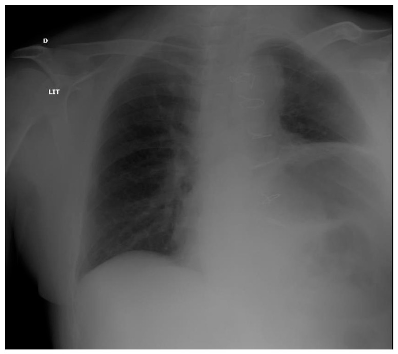
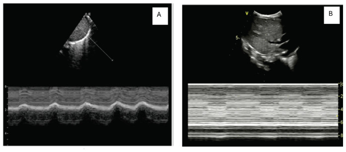
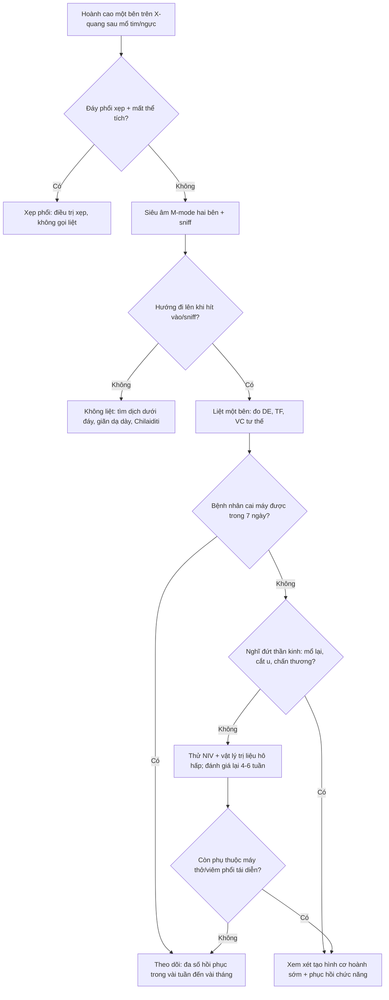
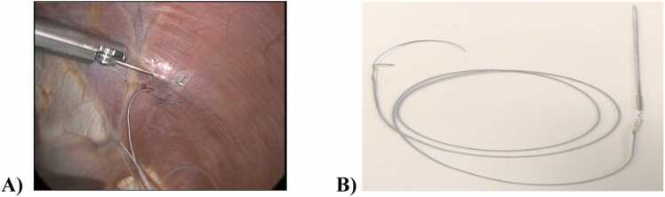
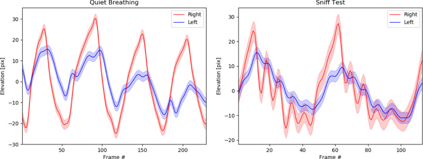

# 1849 — Liệt cơ hoành một bên sau mổ tim/ngực / Unilateral diaphragmatic paralysis after cardiac and thoracic surgery

**Tags:** `pattern:nang-cao-nua-hoanh` `pattern:van-dong-nghich-thuong` `pattern:giam-do-day` `pattern:xepphoi-day` `pattern:giam-bien-do` `vung:co-hoanh` `vung:phoi` `score:DE-TF` `protocol:SA-co-hoanh` `protocol:sniff-test` `protocol:Xquang-nguc` `incidentaloma:khong`

**Mức chắc chắn (certainty):** tổng hợp y văn (literature synthesis) — số liệu từ **một đoàn hệ 1.316 ca mổ tim** (X-quang, PMC12135679), **một đoàn hệ 177 ca siêu âm sớm** (PMC11496164), **một đoàn hệ tiền cứu 122 ca** (PMC9747253), **một nghiên cứu điện sinh lý 78 ca** (PMC320489), **một loạt 2.280 ca mổ tim trẻ em** (PMC13142676), **một loạt 23 ca tạo hình cơ hoành** (PMC12603488) và **một tổng quan** (PMC8779362). Phần **điều trị/thời điểm can thiệp** là **suy luận thực hành** (không có thử nghiệm ngẫu nhiên), được ghi rõ.

> **Câu chốt:** sau mổ tim, **thần kinh hoành bị lạnh/kéo/cắt** là chuyện thường — **40,7%** bệnh nhân có rối loạn chức năng cơ hoành trên siêu âm trong tuần đầu (PMC11496164), nhưng **đa số hồi phục**: **65%** ca nâng cao hoành mới trên X-quang hồi phục khi theo dõi (PMC12135679), và chỉ **8%** còn rối loạn sau ngày thứ 7 (PMC9747253). Điều đáng sợ không phải cái "hoành cao" mà là **nhóm không hồi phục**: ở nhóm này **đặt lại nội khí quản 40% so với 0,9% (RR 45)**, **viêm phổi 40% so với 6%**, **nằm ICU 8 so với 4 ngày** — nên câu hỏi đúng là **"hoành có co không, và có hồi phục không"**, không phải "hoành có cao không".

## 1. Tổng quan bệnh học – cơ chế hình ảnh

### 1.1 Giải phẫu quyết định kiểu tổn thương

- **Thần kinh hoành** xuất phát **C3–C5**, đi xuống trên **cơ bậc thang trước (anterior scalene)**, vào lồng ngực **trước rốn phổi**, rồi **ôm mặt ngoài màng tim** xuống cơ hoành. Vì vậy nó **nằm ngay trong trường mổ**: hai bên sát **màng tim – cơ tim**, bên trái sát **động mạch vú trong (internal mammary artery, IMA)** và **mỏm tim**.
- **Đá lạnh (ice slush)** đổ quanh tim để bảo vệ cơ tim trong tuần hoàn ngoài cơ thể (cardiopulmonary bypass, CPB) chính là **dung dịch 0–4 °C tiếp xúc trực tiếp thần kinh hoành**; **móc/harvest IMA** kéo căng nhánh thần kinh; **cautery** gây tổn thương nhiệt. Đây là ba cơ chế chính (PMC8779362).
- **Bằng chứng định lượng:** trong 78 bệnh nhân đo điện sinh lý **trước và 3 tuần sau mổ**, **5/49 (10,2%)** ca mổ tim có CPB + hạ nhiệt + đá lạnh mất chức năng **thần kinh hoành TRÁI**; **0/29** ca mổ không CPB (off-pump) hoặc mổ mạch ngoại vi bị tổn thương (PMC320489). Tức **tổn thương do lạnh/CPB**, không phải do "mở ngực" nói chung.

### 1.2 Vì sao nửa hoành bị liệt lại **lên cao** — và vì sao đáy phổi xẹp

- Cơ hoành liệt **không tạo được lực hút**; khi hít vào, **áp lực âm trong lồng ngực** vẫn được tạo bởi nửa hoành lành và các cơ liên sườn → **hút tạng bụng lên phía ngực**, làm nửa hoành liệt **đi lên (nghịch thường, paradoxical)** thay vì đi xuống.
- Hệ quả: **xẹp đáy phổi (basal atelectasis)** cùng bên, **giảm dung tích sống**, và trên phim **nâng cao nửa hoành**. Vì vậy trên X-quang ta thấy **hai dấu hiệu cùng lúc**: hoành cao **và** đáy phổi mờ/xẹp — cạm bẫy là chỉ đọc "hoành cao" mà bỏ đáy phổi.

### 1.3 Phục hồi: tổn thương **myelin** hồi phục được, tổn thương **sợi trục** thì không

- Tổn thương lạnh/kéo căng chủ yếu gây **block dẫn truyền do mất myelin** → hồi phục trong **vài tuần đến vài tháng**; đây là lý do **65%** ca nâng cao hoành mới hồi phục (PMC12135679) và **chỉ 8%** còn rối loạn sau ngày 7 (PMC9747253).
- Cắt/đứt thần kinh (vd. cắt u trung thất, mổ lại) → **mất chức năng vĩnh viễn**; đây là nhóm cần **can thiệp**, không phải "chờ".
- **TẠI SAO siêu âm phân biệt được:** trên M-mode, đầu dò ghi **vị trí vòm hoành theo thời gian**; nửa hoành bình thường **đi xuống khi hít vào** (đường đi xuống), nửa hoành liệt **đi lên** hoặc **phẳng** — hướng đi mới là dấu chốt, **không phải độ dày**. Độ dày (Tdi) ở ca liệt một bên **thường bình thường** vì cơ chưa teo; đo Tdi một mình dễ bỏ sót.

### 1.4 Số liệu nền (bắt buộc thuộc)

| Chỉ số | Số | Nguồn |
|---|---|---|
| Tổn thương điện sinh lý thần kinh hoành khi CPB + hạ nhiệt + đá lạnh | **10,2%** (5/49) | PMC320489 |
| Nâng cao hoành **mới** sau mổ tim (X-quang, 1.316 ca) | **27%** (351/1.316) | PMC12135679 |
| Hồi phục nâng cao hoành khi theo dõi | **65%** | PMC12135679 |
| Rối loạn chức năng cơ hoành **sớm** (siêu âm, 177 ca) | **40,7%** | PMC11496164 |
| Rối loạn **kéo dài** sau ngày 7 (122 ca) | **8%** | PMC9747253 |
| Liệt hoành sau mổ tim **trẻ em** (2.280 ca) | **4,7%** (thể một phần 2,9%, hoàn toàn 1,8%) | PMC13142676 |
| Tần suất trong tổng quan | tới **75%** | PMC8779362 |

## 2. Mẫu hình + chẩn đoán phân biệt theo cơ chế (gamut)

- **Mẫu hình chung:** **nâng cao một nửa hoành** (thường trái sau mổ tim) ± **đáy phổi xẹp** ± **vận động nghịch thường** khi hít mạnh/sniff.
- **Gamut theo cơ chế:**
  1. **Thần kinh (neurogenic):** tổn thương thần kinh hoành sau mổ tim/ngực, **hội chứng Parsonage–Turner** (đau vai rồi liệt), chèn ép do **u trung thất/hạch**, **hẹp ống sống cổ**, bệnh thần kinh–cơ (ALS, Guillain–Barré).
  2. **Cơ (myopathic):** **giãn cơ hoành (eventration)** — cơ mỏng bẩm sinh, không có tổn thương thần kinh; loạn dưỡng cơ.
  3. **Cơ học (mechanical):** **tràn dịch dưới đáy phổi (subpulmonic effusion)**, xẹp phổi thùy dưới, **giãn dạ dày/liệt ruột**, **Chilaiditi** (đại tràng chen giữa gan–hoành), thoát vị hoành–thực quản lớn.
  4. **Sau mổ/phẫu thuật:** **cắt thùy/phổi** (hoành bị kéo lên do mất thể tích), **vá thành ngực**, dẫn lưu ngực hút mạnh.
- **Gợi nhớ 5 nhóm:** **N**eurogenic – **M**yopathic (eventration) – **M**echanical (dịch/xẹp/giãn) – **S**urgical (cắt phổi/mổ lại) – **C**entral (giảm drive do an thần).

## 3. Bảng so sánh phân biệt (ma trận đối chiếu)

| Thực thể (entity) | Hình ảnh điển hình (X-quang/SA/CT) | Chốt vào (rule-in) | Chốt loại (rule-out) | Gợi ý xác nhận |
|---|---|---|---|---|
| **Liệt hoành một bên do tổn thương thần kinh** | Hoành cao **một bên**, đáy phổi xẹp; M-mode **đi lên khi hít vào**; DE **< 10 mm (nam)/< 9 mm (nữ)**, sniff **< 18/16 mm** | **Vận động nghịch thường một bên + bối cảnh mổ tim/ngực** | Hoành cao nhưng **vẫn đi xuống khi sniff** → không phải liệt | Siêu âm M-mode + sniff; điện sinh lý thần kinh hoành |
| **Giãn cơ hoành (eventration)** | Hoành cao **nhẵn, liên tục**, không đáy phổi xẹp rõ; **không có mốc mổ** | **Hoành cao nhẵn bẩm sinh + không nghịch thường rõ** | Nghịch thường rõ + mổ tim gần đây → liệt thần kinh | So phim cũ; CT; điện sinh lý nếu cần |
| **Tràn dịch dưới đáy phổi (subpulmonic effusion)** | Đỉnh hoành **lệch ra ngoài (peak sign)**, khoảng cách hoành–bóng vị **tăng**, **không nghịch thường** | **Đỉnh hoành lệch bên + thay đổi theo tư thế** | Vận động nghịch thường thật + hoành cao đều → liệt | Siêu âm màng phổi, CT, chọc dịch |
| **Xẹp phổi thùy dưới** | Hoành cao + **dấu thể tích** (khe/trung thất kéo về), đông đặc đáy | **Mất thể tích + phế quản hơi trong vùng xẹp** | Không mất thể tích, không đông đặc → không xẹp | CT ngực |
| **Rối loạn cơ hoành hai bên (VIDD/liệt hai bên)** | **Hai bên** DE/TF thấp, khó cai máy, **khó thở khi nằm ngửa** | **Hai bên giảm + thở máy kéo dài/orthopnea** | Chỉ một bên bất thường → không phải hai bên | Siêu âm hai bên (bài 1776) |
| **Giảm drive trung ương/an thần** | Hoành **không nghịch thường**, TF thấp, **hết khi giảm an thần** | **Cải thiện sau giảm an thần/thức tỉnh** | Không cải thiện, nghịch thường → tổn thương thần kinh | Đáp ứng lâm sàng, EEG nếu cần |

*X-quang ngực thẳng ở bệnh nhân **sau mổ tim**: **nửa hoành trái nâng cao**, đáy phổi trái mờ do xẹp; có **dây thép xương ức**. Đây là hình ảnh "hoành cao" điển hình — nhưng **X-quang không chứng minh liệt**, phải xem **hướng vận động**. Nguồn: **Medicines (Basel) 2022, PMC8779362**, CC BY 4.0.*

### 3.1 Ba dấu hiệu định vị trên X-quang (đọc đúng thứ tự)

- **So độ cao hai bên:** bình thường **hoành phải cao hơn trái 1,5–2,5 cm**; trong nghiên cứu Radboud, **hoành phải cao hơn trái > 3,0 cm** hoặc **hoành trái ngang/cao hơn phải (chênh < 0,5 cm)** được coi là nâng cao bất thường (PMC12135679). Đừng áp "phải cao hơn trái" cho mọi bệnh nhân — **hoành trái cao hơn phải là bất thường**.
- **Đáy phổi:** tìm **mờ/xẹp đáy** cùng bên; nếu có **dấu thể tích** (khe liên thùy, trung thất kéo về) thì nguyên nhân là **xẹp**, không phải liệt.
- **Bóng vị/dạ dày:** hoành cao **đẩy bóng vị lên**; nếu bóng hơi **nằm trong lồng ngực** và **mất liên tục cơ hoành** → nghĩ **thoát vị hoành**, không phải liệt.

## 4. Protocol chụp + ngưỡng + thuật toán

### 4.1 Trình tự chẩn đoán (không nhảy cóc)

1. **X-quang ngực thẳng, phim hít vào, đứng** (nếu được): xác định **nửa hoành nào cao**, tìm **đáy phổi xẹp**, loại trừ **thoát vị/tràn dịch**.
2. **Siêu âm tại giường (đầu tay):** M-mode đo **hướng và biên độ** hai nửa hoành; B-mode đo **Tdi** và tính **TF**; làm **sniff** (hít mạnh qua mũi) để tăng độ nhạy.
3. **Sniff test huỳnh quang** khi siêu âm không kết luận hoặc cần bằng chứng khách quan: nửa hoành liệt **đi lên** khi sniff.
4. **Điện sinh lý thần kinh hoành** (nếu có): đo **thời tiềm (latency)** và **biên độ** hai bên, phân biệt **block dẫn truyền** (có thể hồi phục) với **đứt** (không hồi phục).
5. **CT/MRI** khi: không có bối cảnh mổ, nghi **u/chèn ép trung thất**, **bệnh thần kinh–cơ**, hoặc cần đánh giá **di căn/u trung thất**.

### 4.2 Ngưỡng định lượng (dùng đúng đơn vị)

| Chỉ số | Bình thường | Bất thường |
|---|---|---|
| **DE (biên độ) khi thở yên lặng** | **10–20 mm** (người lớn) | **< 10 mm (nam), < 9 mm (nữ)** = rối loạn (PMC9747253) |
| **DE khi sniff** | **> 18 mm (nam), > 16 mm (nữ)** | **< 18/16 mm** = rối loạn (PMC9747253) |
| **Tdi cuối thì thở ra** | **1,5–3 mm** | **< 2 mm** gợi ý teo (bài 1776) |
| **TF = (Tdi hít vào − Tdi thở ra)/Tdi thở ra** | **20–40%** | **< 20%** = paresis/paralysis (PMC8779362) |
| **Dung tích sống (VC) tư thế** | giảm **< 10%** khi nằm ngửa | **giảm ≥ 10–20%** khi nằm ngửa gợi ý liệt một bên có ý nghĩa (suy luận từ PMC12603488: **71,2% → 59%**, P = 0,002) |

*M-mode qua vòm hoành: **(A)** nửa hoành bình thường có **đường đi xuống rõ khi hít vào**; **(B)** nửa hoành liệt **gần như phẳng**, mất biên độ. Chú ý: bề dày cơ (Tdi) ở ca một bên **có thể bình thường** — **hướng đi** mới là dấu chốt. Nguồn: **J Saudi Heart Assoc 2026, PMC13142676**, CC BY-NC-ND 4.0 (giữ nguyên ảnh gốc).*

### 4.3 Thuật toán "hoành cao sau mổ"

### 4.4 Điều trị — bậc thang và bằng chứng

- **Theo dõi + phục hồi chức năng** là bước đầu: **65%** hồi phục (PMC12135679), phần lớn trong vài tuần–vài tháng; **không có thuốc** đặc hiệu.
- **Hỗ trợ hô hấp:** **NIV** khi khó thở/giảm oxy; nhóm rối loạn kéo dài dùng NIV **8 giờ (0–34)** so với **0 giờ** ở nhóm hồi phục (PMC9747253). Tập cơ hít vào, vỗ rung dẫn lưu, kiểm soát đau để bệnh nhân dám thở sâu.
- **Tạo hình cơ hoành (diaphragmatic plication):** chỉ định khi **không cai được máy thở**, **viêm phổi tái diễn**, **khó thở khi nằm ngửa**, hoặc **VC giảm nhiều khi nằm ngửa**. Kết quả ở 23 ca người lớn: **VC 71,2% → 88,1% dự đoán** (P = 0,03), **khoảng cách đỉnh phổi–hoành 12 → 19 cm sau 6 tháng** (P = 0,001), **không tử vong chu phẫu**, nằm viện **7,7 ± 5 ngày** (PMC12603488). Ở trẻ, tạo hình giúp cai máy nhưng để lại **hạn chế thông khí** và **giảm bão hòa khi gắng sức** sau **5 năm** (PMC12490969) — phải tư vấn trước.
- **Kích thích thần kinh hoành/tạo nhịp hoành (diaphragm pacing):** chỉ khi **thần kinh hoành còn nguyên phía dưới tổn thương**; loạt 900 ca ghép tim/LVAD có **10 ca** dùng, **8 ca mạn tính hồi phục 87%**, không biến cố (PMC12166398). Đây là lựa chọn chọn lọc, không phải thường quy.
- **Thời điểm tạo hình:** không có thử nghiệm ngẫu nhiên; **suy luận thực hành** — chờ **4–6 tuần** nếu còn khả năng hồi phục, nhưng **không chờ** khi nghi **đứt thần kinh** hoặc bệnh nhân phụ thuộc máy thở kéo dài.

*Điện cực tạo nhịp hoành: **(A)** đặt vào cơ hoành qua nội soi ổ bụng; **(B)** điện cực và dây dẫn. Chỉ dùng khi **thần kinh hoành còn dẫn truyền** — đứt thần kinh thì tạo nhịp vô ích. Nguồn: **JHLT Open 2025, PMC12166398**, CC BY 4.0.*

## 5. Biến thể bình thường và cạm bẫy

- **"Hoành cao" không phải "hoành liệt":** nâng cao hoành mới gặp ở **27%** ca mổ tim nhưng **65%** hồi phục và **không** làm tăng biến chứng trong đoàn hệ đó (PMC12135679) — đừng gắn nhãn "liệt" chỉ vì phim.
- **Hoành phải cao hơn trái là bình thường** (1,5–2,5 cm); ngược lại, **hoành trái cao hơn phải** là dấu hiệu cần giải thích.
- **Tràn dịch dưới đáy phổi** làm hoành "cao" giả: tìm **peak sign** (đỉnh hoành lệch ra ngoài), **khoảng cách hoành–bóng vị tăng**, và **không có nghịch thường**.
- **Chilaiditi** (đại tràng giữa gan và hoành) tạo **bóng hơi dưới hoành** giả thoát vị — đọc kỹ **bờ cơ hoành liên tục**, không có quai ruột trong ngực.
- **Siêu âm: đo Tdi một mình dễ bỏ sót** — trong liệt một bên, **Tdi hai bên thường bình thường**; phải đo **hướng** và **so sánh hai bên**.
- **Sniff huỳnh quang là hình chiếu 2D của mặt cong 3D**, dễ **gọi nghịch thường quá mức**: một ca được báo "nghịch thường nhẹ" nhưng khi **mô hình hóa quỹ đạo** thì **không có nghịch thường có ý nghĩa** (PMC8958460). Đừng quyết định tạo hình chỉ dựa trên một lần đọc mắt.
- **Đau sau mổ/guarding** làm bệnh nhân **không dám hít sâu** → DE thấp giả tạo; đo lại khi đau giảm hoặc dùng sniff.
- **Tổn thương hai bên** dễ bỏ sót: bệnh nhân **khó thở khi nằm ngửa**, thở nhanh nông, cai máy thất bại — luôn đo **cả hai bên**, không chỉ bên cao.

*Quỹ đạo nửa hoành phải (đỏ) và trái (xanh) theo thời gian: bên trái **biên độ thấp hơn** ở cả thở yên lặng và sniff. Bài học: **đọc mắt trên fluoroscopy dễ sai**; **đo định lượng** (biên độ, tương quan theo thời gian) giúp tránh gọi nghịch thường oan. Đơn vị ở đây là **pixel**, không phải mm — chỉ dùng để so sánh tương đối. Nguồn: **Radiology Case Reports 2022, PMC8958460**, CC BY 4.0.*

## 6. Tự lượng giá — Blind Quiz

**Ca 1 — Nam 68 tuổi, mổ CABG 5 ngày, khó thở khi nằm ngửa, X-quang thấy nửa hoành trái cao. Nhìn phim trước, mô tả 3 dấu hiệu.**

- Hỏi: nửa hoành nào cao? Có dấu hiệu mất thể tích không? Dấu hiệu nào trên phim **không** đủ để gọi liệt?

<b>Bấm để hiện đáp án (findings + chẩn đoán)</b>

- **Findings:** **nửa hoành trái nâng cao**, đáy phổi trái mờ (xẹp đáy), **dây thép xương ức**; không có dấu thể tích mạnh (khe/trung thất kéo về) để quy hoàn toàn cho xẹp.
- **Chẩn đoán:** nghĩ **liệt cơ hoành trái do tổn thương thần kinh hoành sau mổ tim**; **nhưng X-quang chỉ gợi ý** — phải siêu âm M-mode/sniff để xác nhận **hướng vận động nghịch thường** và đo **DE** (ngưỡng **< 9 mm** ở nữ, **< 10 mm** ở nam).
- **Vì sao khó thở khi nằm ngửa:** nửa hoành liệt không giữ được tạng bụng khi nằm → **giảm VC tư thế** (ca tạo hình: **71,2% → 59%**, P = 0,002).
- **Nguồn ảnh:** Medicines (Basel) 2022, PMC8779362, CC BY 4.0.

**Ca 2 — Bệnh nhân cai máy thất bại 3 lần sau mổ van. M-mode dưới đây là của bên nào và nói gì?**

- Hỏi: **(A)** và **(B)** khác nhau ở đâu? Nếu **(B)** là bên liệt, **Tdi** có nhất thiết giảm không? Bước tiếp theo?

<b>Bấm để hiện đáp án</b>

- **Findings:** **(A)** đường M-mode **đi xuống rõ** khi hít vào (biên độ tốt); **(B)** gần như **phẳng**, mất biên độ.
- **Chẩn đoán:** **(B)** phù hợp **liệt/paresis**; **Tdi có thể bình thường** vì chưa teo → **không loại trừ** bằng độ dày.
- **Bước tiếp theo:** đo **DE** hai bên (ngưỡng **10 mm nam / 9 mm nữ**), **sniff** (**18/16 mm**), **TF** (< 20% = paresis); đánh giá **cai máy**, **VC tư thế**, và **NIV**; nếu phụ thuộc máy thở kéo dài → cân nhắc **tạo hình**.
- **Nguồn ảnh:** J Saudi Heart Assoc 2026, PMC13142676, CC BY-NC-ND 4.0.

**Ca 3 — Bệnh nhân hoành cao, fluoroscopy báo "nghịch thường nhẹ". Đồ thị dưới đây dạy điều gì?**

- Hỏi: đường đỏ và xanh là gì? Vì sao **không nên** quyết định tạo hình chỉ dựa vào một lần đọc fluoroscopy?

<b>Bấm để hiện đáp án</b>

- **Findings:** **đỏ = hoành phải**, **xanh = hoành trái**; bên trái **biên độ thấp hơn** ở cả hai điều kiện, nhưng **không có nghịch thường rõ** khi phân tích quỹ đạo.
- **Chẩn đoán:** **yếu cơ hoành trái**, chưa chắc **liệt hoàn toàn**; quyết định can thiệp cần **siêu âm + VC tư thế + triệu chứng**, không chỉ hình huỳnh quang.
- **Bài học:** huỳnh quang là **2D**, đọc mắt dễ **overcall**; đo định lượng giúp tránh **mổ oan**.
- **Nguồn ảnh:** Radiology Case Reports 2022, PMC8958460, CC BY 4.0.

## Bài liên quan chéo
- [1776 – Bệnh cơ hoành do thở máy (VIDD): Tdi/TF/DE, teo 6%/ngày](../1776-benh-co-hoanh-do-tho-may/lesson.md)
- [045 – Thành ngực & hoành](../045-thanh-nguc-hoanh/lesson.md)
- [098 – Barotrauma & tràn khí màng phổi áp lực ở bệnh nhân thở máy](../098-barotrauma-tran-khi-ap-luc-tho-may/lesson.md)
- [1850 – Siêu âm cơ hoành dự báo cai máy ở trẻ sơ sinh/trẻ nhỏ](../1850-sieu-am-co-hoanh-cai-may-tre-so-sinh/lesson.md)
- [1885 – Viêm màng ngoài tim co thắt](../1885-viem-mang-ngoai-tim-co-that/lesson.md)

> Không dùng để chẩn đoán độc lập khi chưa có người hướng dẫn.
