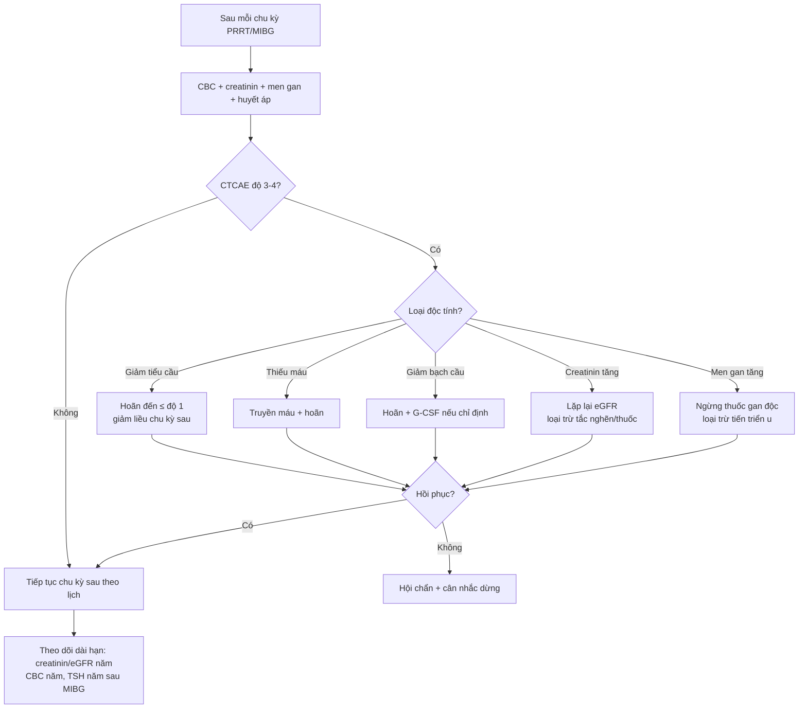
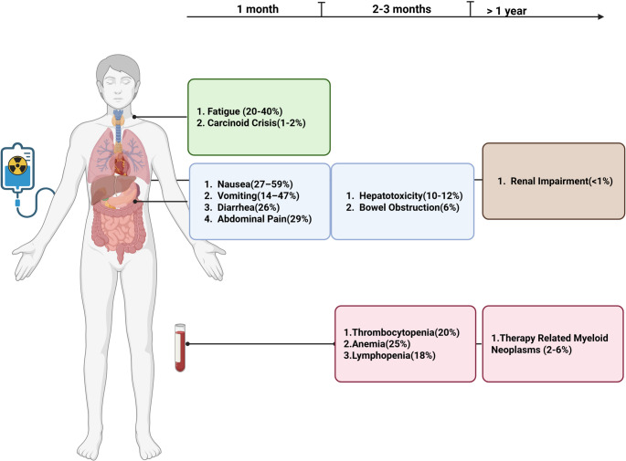
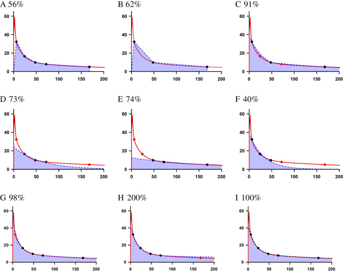
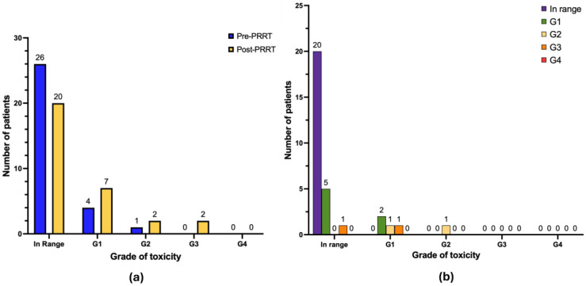

# 185 — Độc tính & theo dõi sau PRRT/¹³¹I-MIBG ở PPGL: suy tủy, độc thận, cơn catecholamine & ung thư thứ phát / Toxicity and surveillance after PRRT/¹³¹I-MIBG in pheochromocytoma–paraganglioma

**Tags:** `pattern:doc-tinh-sau-xa-tri` `pattern:paraganglioma` `vung:thuong-than` `vung:paraganglia` `score:CTCAE` `protocol:PRRT-MIBG` `protocol:dosimetry` `incidentaloma:u-thuong-than`

**Mức chắc chắn (certainty):** tổng hợp y văn (literature synthesis) — review độc tính PRRT 2026, review phóng xạ trị liệu PPGL 2026, pha II ¹⁷⁷Lu-DOTATATE ở PPGL 2025, khuyến cáo liều hấp thụ EANM 2022 và nghiên cứu độc tính dài hạn; số liệu lấy trực tiếp từ bài gốc, phần chưa có bằng chứng được ghi rõ "chưa rõ".

> **Câu chốt:** PRRT và ¹³¹I-MIBG không phải "xạ trị nhẹ" — chúng gây độc **theo ba đồng hồ khác nhau**: cấp tính (buồn nôn, **cơn catecholamine**), bán cấp (suy tủy 4–6 tuần), và mạn tính (thận, **tMN/MDS–AML** sau nhiều năm). Ở PPGL, nguy cơ cấp tính đặc thù là **giải phóng catecholamine do tan u**, gặp ở **17–18%** bệnh nhân với độ ≥ 3 — cao hơn nhiều so với "carcinoid crisis 1–2%" của NET nói chung.

## 1. Tổng quan — vì sao hạt β của ¹⁷⁷Lu đánh vào thận và tủy, và vì sao PPGL có thêm "đồng hồ catecholamine"

- **Vật lý – tại sao thận và tủy là cơ quan giới hạn liều:** ¹⁷⁷Lu phát hạt β có quãng chạy trong mô mềm **0,28 mm (trung bình) đến 1,8 mm (tối đa)** — rất ngắn, nên năng lượng gần như lắng tại chỗ. Phức hợp DOTATATE được lọc qua cầu thận rồi **tái hấp thu ở ống lượn gần** qua megalin/cubilin, nên **vỏ thận nhận liều cao nhất**. Tủy xương nhận **0,1–0,4 Gy cho mỗi lần truyền 7,4 GBq** — thấp mỗi chu kỳ nhưng **cộng dồn** qua 4 chu kỳ và các liệu trình sau.
- **Ngưỡng liều kinh điển:** **thận ≤ 23 Gy tích lũy** (lấy từ xạ trị ngoài, có thể không hoàn toàn tương đương với β), **tủy < 2 Gy mỗi chu kỳ**; với chất đối kháng SSTR, liều thận thường **< 0,6 Gy/GBq**. Đây là các **trần dosimetry**, không phải "liều cố định cho mọi người" — cùng 7,4 GBq có thể cho liều u và liều thận rất khác nhau.
- **Tại sao PPGL khác NET:** u tiết catecholamine có thể **bùng phát giải phóng catecholamine** khi truyền thuốc (tan u, phản ứng với somatostatin analog), gây **cơn tăng huyết áp, loạn nhịp, phù phổi, nhồi máu**. Trong pha II ¹⁷⁷Lu-DOTATATE ở PPGL (n = 36), **17%** có **hội chứng giải phóng catecholamine (CRS) độ ≥ 3**, và **huyết áp tâm thu > 200 mmHg dù đã dùng thuốc** là tiêu chuẩn chuyển ICU. Vì vậy "chuẩn bị trước truyền" ở PPGL nặng hơn NET: **chẹn alpha đủ sâu + bù thể tích + theo dõi huyết áp sát**.
- **¹³¹I-MIBG khác PRRT ở đâu:** MIBG vào tế bào ưa crôm qua **hệ vận chuyển norepinephrine (NET)**, phát β + γ; **tuyến giáp** bắt iod tự do → phải **phong bế giáp**, và bệnh nhân cần **cách ly phóng xạ nội trú** sau liều cao. Độc tính chính vẫn là **suy tủy**, cộng thêm **cơn tăng huyết áp, suy giáp, độc gan, hạ huyết áp thế đứng**.

## 2. Mẫu hình độc tính theo thời gian (gamut) — ba "đồng hồ" phải khám cùng lúc

- **Cấp tính (≤ 48 giờ đến 1 tuần):**
  - **Buồn nôn 27–59%**, **nôn 14–47%**, tiêu chảy **26%**, đau bụng **29%**, mệt **20–40%** — phần lớn do **dịch truyền acid amin ưu trương** (lysine/arginine) hơn là bản thân phóng xạ.
  - **Cơn catecholamine / carcinoid crisis:** NET nói chung **1–2%**, nhưng **PPGL độ ≥ 3 tới 17–18%**; có thể biểu hiện **THA kịch phát, nhịp nhanh, loạn nhịp thất, phù phổi, tăng đường huyết**.
  - **Phản ứng truyền, đỏ bừng, đau đầu**; **hạ kali** do acid amin.
- **Bán cấp (4–6 tuần sau truyền):**
  - **Thiếu máu 14–20%**, **giảm tiểu cầu 17–25%**, **giảm lympho 10–18%**, **giảm toàn dòng 1%**; độ 3/4 chung **5–10%** trong thử nghiệm lớn.
  - **Độc gan 10–12%** (thường độ 1–2, hồi phục), **tắc ruột 6%** ở nhóm u ruột/ổ bụng lớn.
  - Ở PPGL cụ thể: **giảm lympho độ ≥ 3 61,5%**, **giảm bạch cầu 7,7%**, **thiếu máu 15,4%**, **giảm tiểu cầu 0%** (pha II, n = 36); **creatinin tăng mọi độ 20,5%** nhưng **không có độ ≥ 3**.
- **Mạn tính (> 1 năm):**
  - **tMN/MDS–AML 2–6%** trong thử nghiệm có theo dõi 68–72 tháng; **8–11%** trong dữ liệu thực hành; gộp phân tích **≈ 2,6% (0–20%)**. Yếu tố nhiễu lớn: **temozolomide/alkylator trước đó** và xạ trị cũ.
  - **Suy thận mạn 1–2%** (NETTER-1 không ghi nhận; NETTER-2 **2% vs 1%** ở nhánh PRRT so với octreotide); thực hành thực tế **0,7% độ 3/4**.
  - **Suy giáp** sau ¹³¹I-MIBG (nếu phong bế giáp không đủ), **khô miệng/viêm tuyến mang tai**, **suy tủy muộn**, **ung thư thứ hai** (hiếm, nhưng là lý do theo dõi dài hạn).
- **Sinh sản & tình dục (dữ liệu còn mỏng):** ảnh hưởng của PRRT lên sinh sản **chưa được định lượng rõ**. Hướng dẫn khuyến cáo **tư vấn trước điều trị**: nam **trữ tinh trùng** (tổn thương tế bào Sertoli thoáng qua), **tránh thai 4–6 tháng** sau điều trị; nữ có thể đánh giá **AMH/FSH/LH/AFC** và thảo luận **trữ noãn/mô buồng trứng**. **Thai là chống chỉ định tuyệt đối** với PRRT; cho con bú là chống chỉ định tương đối. Có ca sinh con khỏe mạnh sau 4 chu kỳ PRRT, nhưng không đủ để hứa hẹn — cần tư vấn trung thực.

## 3. Bảng so sánh phân biệt — "bất thường sau PRRT" không đồng nghĩa "do PRRT"

| Bất thường sau điều trị | Bối cảnh / hình ảnh – xét nghiệm điển hình | Chốt vào (rule-in) | Chốt loại (rule-out) | Xác nhận |
|---|---|---|---|---|
| **Giảm tiểu cầu** | PRRT/MIBG; giảm dần qua các chu kỳ; có thể xuất huyết chấm | **Giảm sau mỗi chu kỳ, hồi phục 4–6 tuần, không có ổ tủy thay thế** | **Di căn tủy xương, cường lách, DIC, thuốc (heparin, vancomycin), EBV/CMV** → không quy hết cho PRRT | CBC + phết máu; nếu lệch → MRI/CT tủy, siêu âm lách, đông máu |
| **Creatinin tăng** | Sau truyền acid amin, có thể thoáng qua; bệnh nhân ĐTĐ/tăng huyết áp | **Tăng dần theo số chu kỳ, eGFR giảm, không có tắc nghẽn** | **Mất nước, thuốc cản quang, thuốc độc thận, tắc niệu quản do u, nhiễm trùng** | eGFR lặp lại sau 48–72 giờ; siêu âm thận; ngừng thuốc độc thận; chỉ chụp cản quang khi thật cần |
| **THA kịch phát khi truyền** | Đau, lo lắng, acid amin ưu trương; PPGL đã chẹn alpha | **THA kèm nhịp nhanh, vã mồ hôi, đau đầu, tăng đường huyết; xuất hiện ngay sau bắt đầu truyền** | **THA do đau/lo lắng, bàng quang đầy, ngừng thuốc hạ áp, cơn THA do MIBG** (khởi phát muộn hơn, có thể sau 24–72 giờ) | Đo HA mỗi 15 phút trong truyền; metanephrine/máu nếu chẩn đoán còn mơ hồ; chuẩn bị phentolamine/nicardipine |
| **Men gan tăng** | Sau chu kỳ, thường độ 1–2; có di căn gan > 50% | **Tăng thoáng qua, không tăng bilirubin, không tắc mật** | **Tiến triển di căn gan, tắc mật do u, viêm gan do thuốc/vi rút, huyết khối tĩnh mạch cửa** | ALT/AST, ALP, bilirubin, siêu âm/MRI gan; ngừng thuốc gan độc |
| **Mệt** | Sau truyền, kéo dài vài ngày đến vài tuần | **Kèm thiếu máu hoặc suy giáp sau MIBG, không kèm tiến triển u** | **Tiến triển bệnh, suy thượng thận, trầm cảm, mất ngủ, thiếu dinh dưỡng** | CBC, TSH/fT4, cortisol sáng, đánh giá triệu chứng |
| **tMN/MDS–AML** | Nhiều năm sau PRRT; có thể sau alkylator | **Loạn sản dòng tủy trên tủy đồ, cytopenia không hồi phục, NST đồ bất thường** | **Tái phát u trong tủy, thiếu B12/folate, suy tủy do thuốc khác** | Tủy đồ + sinh thiết tủy + di truyền tế bào; chuyển huyết học |

## 4. Protocol theo dõi + phân độ CTCAE + dosimetry

- **Trước liệu trình (baseline):** CBC có công thức, creatinin/eGFR, điện giải, AST/ALT/ALP/bilirubin/albumin, **TSH** (nếu MIBG), chromogranin A và **metanephrine tự do huyết tương/nước tiểu**, thử thai; đánh giá chẹn alpha (phenoxybenzamine hoặc doxazosin) + **bù thể tích 1–2 tuần** trước truyền.
- **Trước mỗi chu kỳ:** CBC, creatinin/eGFR, men gan, điện giải, huyết áp; **xác nhận chẹn alpha đủ**; truyền **lysine/arginine** trước và trong khi truyền phóng xạ; chống nôn (5-HT3 ± NK-1 ± steroid).
- **Trong truyền:** theo dõi HA/nhịp tim **mỗi 15 phút**; ngưỡng chuyển ICU: **HA tâm thu > 200 mmHg dù đã điều trị**; sẵn sàng phentolamine/nicardipine; theo dõi đường huyết.
- **Sau chu kỳ:** CBC **mỗi 2–4 tuần** đến khi hồi phục; men gan mỗi chu kỳ; creatinin/eGFR lúc 3–6 tháng rồi **hằng năm**; **TSH hằng năm** sau MIBG; theo dõi huyết áp tại nhà.
- **Phân độ CTCAE v5.0 (ngưỡng hành động thực dụng):**
  - **Giảm tiểu cầu:** độ 3 = **< 50 đến 25 G/L**; độ 4 = **< 25 G/L**. Độ 3 → **hoãn** đến khi hồi phục ≤ độ 1, **giảm liều chu kỳ sau** (mức giảm cụ thể chưa thống nhất); độ 4 hoặc chảy máu → **cân nhắc dừng**.
  - **Thiếu máu:** độ 3 = **Hgb < 8,0 g/dL** → truyền máu/hoãn; độ 4 → dừng và xử trí cấp cứu.
  - **Giảm bạch cầu trung tính:** độ 3 = **< 1,0 đến 0,5 G/L**; độ 4 = **< 0,5 G/L** → hoãn, G-CSF theo chỉ định, kháng sinh dự phòng nếu sốt.
  - **Creatinin:** độ 2 = **1,5–3,0 × ULN** → lặp lại, loại trừ nguyên nhân khác; độ 3 = **3,0–6,0 × ULN** → dừng PRRT, hội chẩn thận.
- **Dosimetry (khi có điều kiện):** đo hoạt độ máu/SPECT ở các mốc **5, 24, 48, 72 và 168 giờ**; tính **TIA** và liều hấp thụ; giữ **thận ≤ 23 Gy tích lũy**, **tủy < 2 Gy/chu kỳ**. Hình TAC bên dưới cho thấy chỉ lấy **một điểm muộn** có thể sai **40–200%** so với đường cong đầy đủ — đây là lý do không "đoán liều" bằng một lần chụp.
- **¹³¹I-MIBG (HSA iobenguane):** hai liều cách nhau **≥ 90 ngày**, **500 mCi (18,5 GBq)** nếu > 62,5 kg hoặc **8 mCi/kg** nếu ≤ 62,5 kg; **phong bế giáp** trước; **cách ly nội trú**; theo dõi CBC và **TSH hằng năm**. Lưu ý thực tế: sản phẩm HSA ¹³¹I-MIBG (Azedra) **đã ngừng sản xuất**, phần lớn kinh nghiệm hiện nay là MIBG hoạt độ thấp (off-label).

*Ba đồng hồ của PRRT: cấp tính (buồn nôn, cơn carcinoid), bán cấp (suy tủy 4–6 tuần, độc gan, tắc ruột) và mạn tính (suy thận, tMN). Tỷ lệ trong ngoặc là của NET nói chung — ở PPGL, cơn catecholamine độ ≥ 3 cao hơn nhiều (17–18%). Nguồn: Mohindroo C et al., Curr Treat Options Oncol 2026, PMC12811300 Fig. 1, CC BY 4.0.*

## 5. Biến thể bình thường và cạm bẫy

- **"Tụt tiểu cầu = độc tủy do PRRT" là cạm bẫy:** di căn tủy xương ở PPGL/SDHB, cường lách, nhiễm trùng, thuốc (heparin, vancomycin, sulfonamide) đều gây giảm tiểu cầu. **Đừng giảm liều oan** khi chưa loại trừ — nhất là khi tiểu cầu giảm **trước** chu kỳ đầu.
- **Creatinin tăng sau truyền acid amin** có thể do **mất nước/thẩm thấu**, không phải độc thận thật; lặp lại sau 48–72 giờ, tính eGFR, và **không chụp cản quang ngay** nếu không cần.
- **Cơn catecholamine có thể xảy ra dù đã chẹn alpha** — đặc biệt u lớn, hoại tử, hoặc dùng octreotide trước truyền. Không dùng octreotide "để phòng" ngay trước PRRT; nếu cần kiểm soát triệu chứng, dùng **chẹn alpha + metyrosine** theo phác đồ.
- **tMN đến muộn:** không loại trừ vì "PRRT cách đây 5 năm"; CBC hằng năm, và **chuyển huyết học** nếu cytopenia không giải thích được.
- **MIBG không phải "không độc":** phong bế giáp không đủ → suy giáp; cách ly không đúng → phơi nhiễm gia đình; cơn THA có thể xuất hiện **muộn 24–72 giờ**, không chỉ lúc truyền.
- **Đừng quy mọi mệt mỏi cho bệnh:** sau MIBG, **suy giáp** là nguyên nhân điều trị được; kiểm TSH trước khi tăng liều giảm đau/steroid.

## 6. Tự lượng giá — Blind Quiz

**Ca 1 — BN PPGL di căn, 3 tháng sau chu kỳ 4 ¹⁷⁷Lu-DOTATATE. Nhìn hình, độc tính nào cần tầm soát ở mốc > 1 năm?**

- Gợi ý: bệnh nhân hỏi "sau này tôi cần xét nghiệm gì?".
- Câu hỏi: hai cơ quan nào là đích muộn? Xét nghiệm nào ở mỗi mốc?

<b>Bấm để hiện đáp án</b>

- **Muộn (> 1 năm):** **thận** (creatinin/eGFR hằng năm) và **tủy xương** (CBC hằng năm, tìm **tMN/MDS–AML**).
- **Vì sao:** ¹⁷⁷Lu có quãng chạy ngắn, thận nhận liều do tái hấp thu ống lượn gần; tủy nhận 0,1–0,4 Gy/7,4 GBq nhưng cộng dồn. tMN **2–6%** trong thử nghiệm, **8–11%** thực hành.
- Nguồn ảnh: Mohindroo C et al., Curr Treat Options Oncol 2026, PMC12811300 Fig. 1, CC BY 4.0.

**Ca 2 — Vì sao không thể tính liều thận từ một lần chụp 96 giờ?**

- Gợi ý: 9 panel là 9 cách lấy mẫu khác nhau trên cùng một đường cong.
- Câu hỏi: panel nào sai nhiều nhất, và sai bao nhiêu %?

<b>Bấm để hiện đáp án</b>

- **Panel H (200%)** và **panel F (40%)** cho sai số lớn nhất khi chỉ lấy **một điểm muộn**; các panel lấy nhiều điểm (5, 24, 48, 72, 168 giờ) bám đường cong thật.
- **Kết luận:** phải lấy **nhiều mốc** để tính TIA; một điểm 96 giờ có thể sai **40–200%** — đủ để vượt trần **23 Gy** thận mà không biết.
- Nguồn ảnh: Sjögreen Gleisner K et al., Eur J Nucl Med Mol Imaging 2022, PMC9015994 Fig. 2, CC BY 4.0.

**Ca 3 — BN NEN sau PRRT, creatinin tăng nhẹ. Hai biểu đồ nói gì?**

- Gợi ý: cột xanh = trước PRRT, cột vàng = sau PRRT.
- Câu hỏi: bao nhiêu bệnh nhân chuyển từ "trong giới hạn" sang độ 1–3? Đây có phải "suy thận do PRRT" ở mọi ca?

<b>Bấm để hiện đáp án</b>

- Trước điều trị **26** bệnh nhân trong giới hạn; sau điều trị còn **20** — tức **6 người** chuyển sang độ 1–3 (chủ yếu độ 1). Panel (b) cho thấy phần lớn vẫn trong giới hạn, chỉ **1** ca độ 2 và **1** ca độ 3.
- **Không phải mọi ca đều do PRRT:** cần loại trừ **mất nước, cản quang, thuốc, tắc nghẽn, ĐTĐ/THA**. Chỉ tăng tiến triển theo số chu kỳ + không có nguyên nhân khác mới quy cho độc thận do phóng xạ.
- Nguồn ảnh: Perrone M et al., Cancers 2025, PMC12468063 Fig. 6, CC BY 4.0 (nhóm NEN điều trị TANDEM ²²⁵Ac/¹⁷⁷Lu — dùng làm ví dụ theo dõi độc thận, không phải PPGL thuần).

## Bài liên quan chéo
- [177 – Điều trị & theo dõi PPGL: alpha-block, phẫu thuật, PRRT/MIBG](../177-dieu-tri-va-theo-doi-ppgl/lesson.md)
- [168 – U tủy thượng thận & u cận hạch](../168-pheo-paraganglioma/lesson.md)
- [184 – Biến chứng thần kinh của PPGL](../184-bien-chung-than-kinh-ppgl/lesson.md)
- [100 – Tổng quan hệ Bụng](../100-tong-quan-he-bung/lesson.md)

> Không dùng để chẩn đoán độc lập khi chưa có người hướng dẫn.
