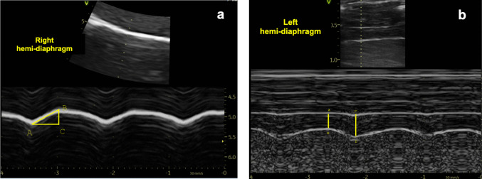
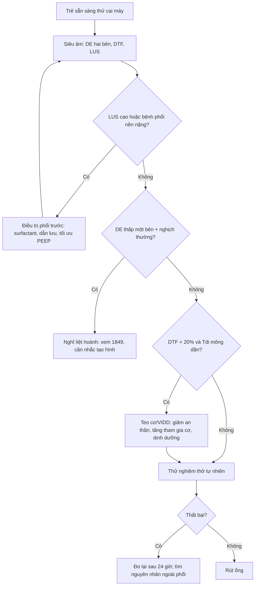
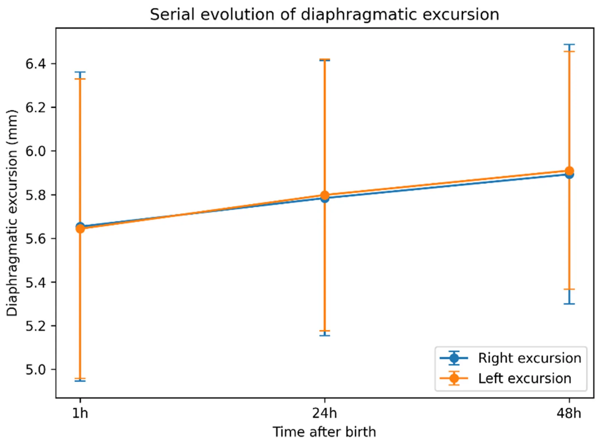
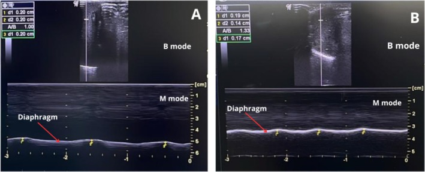

# 1850 — Siêu âm cơ hoành dự báo cai máy ở trẻ sơ sinh/trẻ nhỏ / Diaphragm ultrasound for weaning in neonates and infants

**Tags:** `pattern:giam-bien-do-hoanh` `pattern:giam-phan-suat-day` `pattern:teo-co-hoanh` `pattern:cai-may-that-bai` `pattern:giam-thong-khi-day-phoi` `vung:co-hoanh` `vung:phoi` `score:DTF` `score:DE` `protocol:SA-co-hoanh-so-sinh` `protocol:cai-may` `incidentaloma:khong`

**Mức chắc chắn (certainty):** tổng hợp y văn (literature synthesis) — số liệu từ **một đoàn hệ 112 trẻ đủ tháng khỏe** (PMC13565314), **một nghiên cứu 20 trẻ đủ tháng** (PMC13005841), **một nghiên cứu trẻ sinh non RDS thở máy** (PMC12397845), **một phân tích gộp 14 nghiên cứu/657 trẻ** (PMC12927438), **một phân tích gộp 11 nghiên cứu/828 nhũ nhi** (PMC10511769), **một đoàn hệ 53 trẻ có kết quả âm tính** (PMC10081691) và **một tổng quan kỹ thuật** (PMC13418936). Chỗ **chưa có ngưỡng chuẩn** được ghi rõ là **chưa rõ — cần tra**, không suy ra số.

> **Câu chốt:** **đừng bê ngưỡng người lớn sang trẻ sơ sinh.** Ở **112 trẻ đủ tháng khỏe**, biên độ cơ hoành (diaphragmatic excursion, DE) chỉ **5,65 mm lúc 1 giờ → 5,91 mm lúc 48 giờ** (PMC13565314) — nếu áp ngưỡng người lớn **DE < 10 mm = bất thường**, **toàn bộ trẻ sơ sinh sẽ bị gọi là suy cơ hoành**. Giá trị thật của siêu âm cơ hoành ở trẻ không nằm ở một con số tuyệt đối, mà ở **xu hướng theo thời gian**, **so hai bên**, và **kết hợp với siêu âm phổi (LUS)** — vì trong phân tích gộp, **LUS dự báo cai máy tốt hơn** (Se **0,88**/Sp **0,81**; PMC10511769) và **DTF chỉ có AUC 0,63 ở trẻ nói chung**, dù **0,82 ở nhũ nhi** (PMC12927438).

## 1. Tổng quan bệnh học – cơ chế hình ảnh

### 1.1 Vì sao cơ hoành trẻ sơ sinh "khác về lượng" chứ không khác về nguyên lý

- Cơ hoành vẫn là **cơ hô hấp chính**, co thì **hạ thấp và dẹt vòm** → tạo áp lực âm. Nhưng ở trẻ sơ sinh: **lồng ngực nhỏ, thành ngực mềm, phổi dễ xẹp**, tần số thở cao → **cơ hoành làm việc gần ngưỡng mỏi**, và **mọi bất thường cơ học đều biểu hiện nhanh**.
- Vì vậy **cùng một bệnh cảnh "cai máy thất bại"** có thể do: **teo cơ do thở máy (VIDD)**, **liệt thần kinh hoành sau mổ tim**, **ứ khí/BPD**, **tràn dịch – chướng bụng**, hoặc **giảm drive do an thần**. Siêu âm giúp **phân tầng cơ chế**, không chỉ "đo cho có".

### 1.2 Vật lý: siêu âm thấy gì và **tại sao** thấy được

- **B-mode tần số cao (10–15 MHz, đầu dò linear/hockey stick):** cơ hoành là **dải giảm âm** kẹp giữa **màng phổi (tăng âm)** và **màng bụng (tăng âm)**; đo **Tdi** ở **vùng áp thành**, nơi cơ áp sát thành ngực/bụng.
- **M-mode:** ghi **vị trí vòm hoành theo thời gian** → đo **DE** (mm) và **hướng** đi. Vì M-mode lấy mẫu rất nhanh theo một đường, nó **bắt được chuyển động nhanh** của trẻ sơ sinh — điều B-mode 2D dễ bỏ sót.
- **DTF (diaphragmatic thickening fraction)** = **(Tdi hít vào − Tdi thở ra)/Tdi thở ra × 100**. **TẠI SAO DTF phản ánh chức năng:** khi cơ co, các sợi cơ **ngắn lại nhưng dày lên** (thể tích cơ gần như không đổi) → **độ dày tỷ lệ với lực co**. Nhưng DTF **phụ thuộc tải và gắng sức**: trẻ **gắng mạnh** có DTF cao dù cơ teo; trẻ **an thần/PEEP cao** có DTF thấp dù cơ bình thường.
- **Giới hạn vật lý:** DE đo trên **một đường M-mode** — nếu đầu dò **không vuông góc** với vòm hoành hoặc trẻ **vặn mình**, số đo **thấp giả**. Đây là lý do **tư thế và hợp tác** quan trọng hơn ở người lớn.

### 1.3 Số liệu nền (bắt buộc thuộc)

| Chỉ số | Số | Nguồn |
|---|---|---|
| DE ở trẻ **đủ tháng khỏe** (112 trẻ) | **5,65 → 5,91 mm** (1 → 48 giờ) | PMC13565314 |
| DE ở trẻ **đủ tháng khỏe** (20 trẻ), ngày 1 so ngày 3 | **ổn định**, không khác biệt; **mổ đẻ thấp hơn ngày 1**, bằng nhau ngày 3 | PMC13005841 |
| Độ tin cậy trong cùng người đo | **ICC > 0,90** với hầu hết chỉ số | PMC13005841 |
| Trẻ **sinh non RDS thở máy** | **Tdi, DTF, DE giảm có ý nghĩa** trong thời gian thở máy (p < 0,0001; p = 0,01; p = 0,02) | PMC12397845 |
| DTF tương quan với thời gian thở máy / nằm viện / nguy cơ đặt lại ống | **R = 0,62 / 0,52 / 0,55** | PMC12397845 |
| Phân tích gộp **trẻ em** (14 nghiên cứu, 657 trẻ) | **DTF AUC 0,63**; **nhũ nhi 0,82**; **DE AUC 0,72**; **thất bại cai máy 26,9%** | PMC12927438 |
| Phân tích gộp **nhũ nhi** (11 nghiên cứu, 828 trẻ) | **LUS Se 0,88/Sp 0,81**; **DE DOR 13,17**; **DTF AUROC 0,86** | PMC10511769 |
| Đoàn hệ **âm tính** (53 trẻ) | **DTF trước cai máy 15,2%**, **không liên quan thành công** (OR 0,33; 0,06–1,86); **teo cơ 17/53** | PMC10081691 |

## 2. Mẫu hình + chẩn đoán phân biệt theo cơ chế (gamut)

- **Mẫu hình:** **DE thấp và/hoặc DTF thấp** ở trẻ đang được xem xét cai máy, thường kèm **thở nhanh nông**, **co kéo**, **không cai được máy**.
- **Gamut theo cơ chế:**
  1. **Teo do bất động (VIDD):** thở máy kiểm soát kéo dài, an thần sâu, giãn cơ; **Tdi/DTF giảm dần**, **hai bên**; xem **bài 1776**.
  2. **Liệt thần kinh hoành:** sau **mổ tim bẩm sinh** (**4,7%** trong 2.280 ca; PMC13142676), chấn thương ngực, u trung thất; **một bên**, **nghịch thường**; xem **bài 1849**.
  3. **BPD/ứ khí:** phổi ứ khí, hoành **dẹt**, **DE thấp nhưng DTF có thể bảo tồn** — không phải teo cơ; xem **bài 606**.
  4. **Cơ học:** **tràn dịch màng phổi**, **chướng bụng/ascites**, **PEEP cao** → DE thấp **giả tạo**.
  5. **Giảm drive trung ương/an thần:** DTF thấp, **cải thiện khi giảm an thần**.
  6. **Bất thường cấu trúc:** **giãn cơ hoành (eventration)**, **thoát vị hoành bẩm sinh (CDH)** đã mổ; xem **bài 608**.
- **Gợi nhớ:** **A-B-C-D-E** — **A**trophy (VIDD), **B**ronchopulmonary dysplasia, **C**entral drive, **D**iaphragm palsy, **E**ffusion/abdomen.

## 3. Bảng so sánh phân biệt (ma trận đối chiếu)

| Thực thể (entity) | Hình ảnh điển hình (SA/CT) | Chốt vào (rule-in) | Chốt loại (rule-out) | Gợi ý xác nhận |
|---|---|---|---|---|
| **VIDD/teo do thở máy** | **Tdi mỏng dần**, **DTF thấp**, DE giảm, **hai bên**; không nghịch thường | **Tdi giảm > 10% so với nền hoặc DTF < 20% sau nhiều ngày thở máy** | DE/DTF bình thường hoặc chỉ một bên → không phải VIDD | Siêu âm lặp lại, so ngày đầu (bài 1776) |
| **Liệt thần kinh hoành** | **Một bên** DE thấp, **nghịch thường**, bên lành bù; **Tdi có thể bình thường** | **Nghịch thường khi hít vào/sniff + bối cảnh mổ tim** | Hai bên đều giảm, không nghịch thường → VIDD | M-mode + sniff; điện sinh lý (bài 1849) |
| **BPD/ứ khí** | Hoành **dẹt**, DE thấp, **DTF bảo tồn**, phổi ứ khí | **DTF ≥ 20% + hình ảnh BPD** | DTF rất thấp + Tdi mỏng → teo cơ | X-quang/CT, LUS (bài 606) |
| **Tràn dịch/chướng bụng** | DE **giảm giả tạo**, DTF **bình thường**, dịch màng phổi/ổ bụng | **DTF bình thường + lượng dịch lớn** | DTF < 20% + Tdi mỏng → bệnh cơ thật | Siêu âm màng phổi/ổ bụng |
| **Giảm drive/an thần** | DE thấp, DTF thấp, **không nghịch thường** | **Cải thiện ngay sau giảm an thần/thức** | Không cải thiện → nguyên nhân cơ/ thần kinh | Đáp ứng lâm sàng, EEG nếu nghi |
| **Giãn cơ hoành/CDH sau mổ** | Hoành **cao nhẵn**, mất cấu trúc cơ, **không nghịch thường rõ** | **Bất thường cấu trúc trên X-quang/CT** | Cơ liên tục, nghịch thường → liệt thần kinh | X-quang, CT, so phim cũ (bài 608) |

*Cách đo ở trẻ đủ tháng: **(a)** M-mode qua **nửa hoành phải** (cửa sổ gan): **DE = BC**, thời gian hít vào = AC; **(b)** B-mode **vùng áp thành** nửa hoành trái: **Tdi cuối thở ra (AB)** và **cuối hít vào**, từ đó tính **DTF**. Lưu ý biên độ rất nhỏ (vài mm) — cần phóng to và đo 3 lần. Nguồn: **Eur J Pediatr 2026, PMC13005841**, CC BY 4.0.*

## 4. Protocol siêu âm + ngưỡng + thuật toán cai máy

### 4.1 Kỹ thuật (làm đúng mới có số đúng)

- **Đầu dò:** linear **10–15 MHz** (trẻ sơ sinh) hoặc hockey stick; **B-mode** đo độ dày, **M-mode** đo DE.
- **Cửa sổ:** **phải** qua **gan** (dễ nhất), **trái** qua **lách**; đặt đầu dò **dọc**, **vuông góc** với vòm hoành, ở **đường nách giữa–trước**.
- **Thời điểm:** trẻ **thở tự nhiên** (CPAP/ống T, hoặc qua ống mở khí quản nếu đang tự thở), **không khóc**, **PEEP thấp nhất có thể**; ghi rõ **mức hỗ trợ** lúc đo.
- **Đo:** **DE** từ **đáy thì thở ra đến đỉnh thì hít vào**; **Tdi** ở **cuối thở ra** và **cuối hít vào**; **3 lần lấy trung bình**; **so hai bên**.
- **Kết hợp:** luôn đo **LUS** cùng lúc — vì **LUS dự báo cai máy tốt hơn** ở nhũ nhi (PMC10511769), và **bệnh phổi nền** là yếu tố gây nhiễu lớn nhất.

### 4.2 Ngưỡng định lượng — và chỗ **chưa có ngưỡng**

| Chỉ số | Giá trị tham chiếu | Ghi chú |
|---|---|---|
| **DE trẻ đủ tháng khỏe** | **~5–6 mm** (5,65 → 5,91 mm) | **Không dùng ngưỡng người lớn 10 mm** (PMC13565314) |
| **DE — chênh lệch thành công/thất bại ở nhũ nhi** | **~2,2 mm** | Chênh lệch nhỏ → đo phải chuẩn (PMC12927438) |
| **DTF** | **20–40%** là vùng tham chiếu ở người lớn/trẻ lớn | **Chưa có ngưỡng chuẩn cho sơ sinh** — PMC13418936 |
| **DTF trước cai máy (đoàn hệ trẻ em)** | trung vị **15,2%** | Có ca **15% vẫn cai máy thành công** → không dùng một mình (PMC10081691) |
| **LUS** | **0–3 điểm/vùng**, tổng theo số vùng | LUS cao → **thất bại cai máy** (bài 605) |
| **Thất bại cai máy (nền)** | **26,9%** | Con số để tư vấn trước khi cai (PMC12927438) |

### 4.3 Thuật toán cai máy có siêu âm

### 4.4 Điều trị và theo dõi

- **Không có thuốc đặc hiệu**; xử lý theo cơ chế: **giảm an thần**, **tránh giãn cơ kéo dài**, **tối ưu PEEP**, **dinh dưỡng**, **vật lý trị liệu hô hấp**.
- **Hỗ trợ không xâm lấn (NIV/CPAP)** khi còn yếu cơ nhưng đã đủ điều kiện rút ống; **theo dõi lại DE/DTF** sau 24–48 giờ.
- **Liệt hoành sau mổ tim:** xem **bài 1849** — đa số hồi phục, tạo hình khi phụ thuộc máy thở/viêm phổi tái diễn.
- **Trẻ có ống mở khí quản:** có thể đo khi trẻ **thở tự nhiên qua ống**, nhưng **không áp dụng khi HFOV/PEEP cao**, và **chưa có giá trị chuẩn** cho nhóm này (PMC13418936) — **suy luận thực hành**, cần theo dõi xu hướng.

*DE hai bên ở **112 trẻ đủ tháng khỏe**: **5,65 mm (1 giờ) → 5,91 mm (48 giờ)**, thay đổi **rất nhỏ** (Kendall's W 0,03). Bài học: **giá trị nền của trẻ sơ sinh thấp hơn người lớn nhiều lần** — dùng ngưỡng người lớn sẽ **dương tính giả hàng loạt**. Nguồn: **Diagnostics (Basel) 2026, PMC13565314**, CC BY 4.0.*

## 5. Biến thể bình thường và cạm bẫy

- **Ngưỡng người lớn là cạm bẫy số 1:** DE **10–20 mm** ở người lớn, nhưng **5–6 mm** ở trẻ đủ tháng khỏe (PMC13565314) — **không** gọi suy cơ hoành ở trẻ chỉ vì DE < 10 mm.
- **DE thay đổi theo cân nặng/tuổi thai:** trẻ **sinh non** có giá trị tuyệt đối thấp hơn; luôn **so với nền và so hai bên**, không so với trẻ khác.
- **Khóc/vặn mình** làm **DE và DTF tăng hoặc giảm thất thường**; đo khi **ngủ yên/thở đều**.
- **PEEP cao, tràn dịch, chướng bụng** làm **DE thấp giả tạo**; **DTF** ít bị ảnh hưởng hơn nhưng vẫn **phụ thuộc tải**.
- **Đo ở vòm hoành thay vì vùng áp thành** → không thấy hai đường màng, số đo vô nghĩa.
- **Chỉ đo một bên:** phân tích gộp ghi nhận **đánh giá bên trái còn hạn chế** (PMC12927438) — bên trái khó hơn, dễ sai; nên đo cả hai.
- **DTF không phải "chìa khóa vạn năng":** đoàn hệ 53 trẻ cho thấy **không liên quan với thành công cai máy** (OR 0,33; PMC10081691) — **không dùng một mình**, phải kết hợp **LUS + lâm sàng**.
- **Sai số người đo:** ICC tốt (**> 0,90**) chỉ khi **cùng người đo lặp lại** (PMC13005841); giữa các trung tâm **khác nhau đáng kể** → cần **chuẩn hóa protocol** (PMC13418936).

*Trẻ **sinh non RDS** thở máy: M-mode cho thấy **DE giảm** trong thời gian thở máy (p = 0,02); **Tdi và DTF cũng giảm** (p < 0,0001; p = 0,01). Đây là **bằng chứng teo cơ do bất động** ở trẻ non tháng — không phải "chỉ là non tháng". Nguồn: **J Paediatr Child Health 2025, PMC12397845**, CC BY 4.0.*

## 6. Tự lượng giá — Blind Quiz

**Ca 1 — Sơ sinh 34 tuần, RDS, thở máy 5 ngày, cai máy thất bại 1 lần. Siêu âm dưới đây đo gì?**

- Hỏi: **(a)** và **(b)** đo chỉ số nào? Vì sao **không** dùng ngưỡng DE < 10 mm của người lớn? Cần đo thêm gì trước khi kết luận?

<b>Bấm để hiện đáp án (findings + chẩn đoán)</b>

- **Findings:** **(a)** M-mode đo **DE** (biên độ) nửa hoành phải qua gan; **(b)** B-mode đo **Tdi** ở vùng áp thành để tính **DTF**.
- **Chẩn đoán:** ở trẻ sơ sinh, DE bình thường **~5–6 mm**; dùng ngưỡng người lớn **10 mm** sẽ **gọi bất thường oan**.
- **Cần thêm:** **DTF**, **so hai bên**, **LUS** (bệnh phổi nền), mức **PEEP/hỗ trợ**, và **diễn tiến theo ngày** — vì **LUS dự báo cai máy tốt hơn** ở nhũ nhi.
- **Nguồn ảnh:** Eur J Pediatr 2026, PMC13005841, CC BY 4.0.

**Ca 2 — Trẻ 3 tháng tuổi, thở máy 7 ngày sau viêm phổi. Đồ thị DE của trẻ đủ tháng khỏe nói gì về "ngưỡng"?**

- Hỏi: DE thay đổi bao nhiêu trong 48 giờ? Nếu bệnh nhi của bạn có DE **6 mm**, đó là bất thường hay bình thường?

<b>Bấm để hiện đáp án</b>

- **Findings:** DE **5,65 → 5,91 mm** từ 1 đến 48 giờ; thay đổi **rất nhỏ**, không có ý nghĩa lâm sàng lớn.
- **Chẩn đoán:** **DE 6 mm nằm trong khoảng tham chiếu của trẻ đủ tháng khỏe** — không đủ để gọi suy cơ hoành; phải xem **DTF, xu hướng, LUS và lâm sàng**.
- **Bài học:** ngưỡng tuyệt đối **không chuyển được** từ người lớn sang sơ sinh.
- **Nguồn ảnh:** Diagnostics (Basel) 2026, PMC13565314, CC BY 4.0.

**Ca 3 — Trẻ sinh non 28 tuần, RDS, thở máy 10 ngày. M-mode cho thấy DE thấp dần. Cơ chế nào?**

- Hỏi: DE/Tdi/DTF thay đổi thế nào trong thời gian thở máy? Điều đó gợi ý gì về cách thở máy?

<b>Bấm để hiện đáp án</b>

- **Findings:** **DE, Tdi và DTF đều giảm** trong thời gian thở máy (p = 0,02; p < 0,0001; p = 0,01); **DTF tương quan với thời gian thở máy (R = 0,62)** và **nguy cơ đặt lại ống (R = 0,55)**.
- **Chẩn đoán:** **teo cơ hoành do bất động (VIDD)** — không phải "chỉ non tháng"; giữ **một phần hoạt động cơ hoành** (giảm an thần, hỗ trợ vừa phải, NAVA khi phù hợp) là mục tiêu.
- **Lưu ý:** DTF **không dự báo cai máy một mình** ở trẻ em (OR 0,33; PMC10081691) — dùng cùng **LUS** và đánh giá lâm sàng.
- **Nguồn ảnh:** J Paediatr Child Health 2025, PMC12397845, CC BY 4.0.

## Bài liên quan chéo
- [1776 – Bệnh cơ hoành do thở máy (VIDD): Tdi/TF/DE, teo 6%/ngày](../1776-benh-co-hoanh-do-tho-may/lesson.md)
- [1849 – Liệt cơ hoành một bên sau mổ tim/ngực](../1849-liet-co-hoanh-mot-ben-sau-mo-tim-nguc/lesson.md)
- [605 – Siêu âm phổi có điểm (LUS) ở sơ sinh: ngưỡng surfactant, cai máy & BPD](../605-sieu-am-phoi-diem-so-sinh/lesson.md)
- [606 – BPD: bệnh phổi mạn tính ở trẻ sinh non](../606-bpd-tre-sinh-non/lesson.md)
- [608 – Theo dõi sau mổ thoát vị hoành bẩm sinh (CDH)](../608-theo-doi-sau-mo-thoat-vi-hoanh-bam-sinh/lesson.md)
- [6100 – Chăm sóc và cai ống mở khí quản ở trẻ](../6100-cham-soc-va-cai-ong-mo-khi-quan-tre/lesson.md)

> Không dùng để chẩn đoán độc lập khi chưa có người hướng dẫn.
