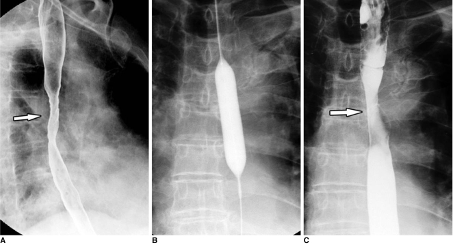
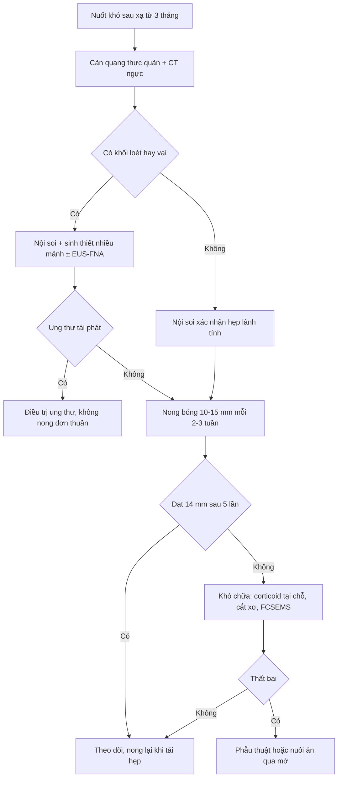
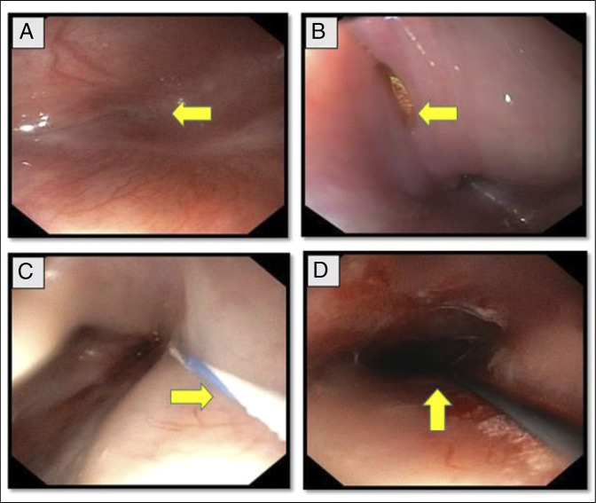
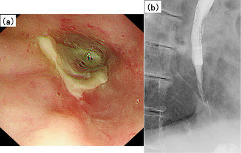

# 1851 — Hẹp thực quản lành tính sau xạ (radiation-induced esophageal stricture)

**Tags:** `pattern:hep-long` `pattern:hep-thuc-quan` `pattern:xo-hoa` `pattern:ton-thuong-trong-truong-chieu` `vung:trung-that` `vung:thuc-quan` `protocol:chup-can-quang-thuc-quan` `protocol:CT-nguc-cang-quang` `protocol:noi-soi-thuc-quan` `protocol:nong-bong` `score:CTCAE` `score:Emami`

**Mức chắc chắn (certainty):** tổng hợp y văn (literature synthesis) — số liệu lấy từ 1 tổng quan về viêm thực quản do xạ (Lung Cancer 2016, PMC5310706), 1 đoàn hệ 55 bệnh nhân ung thư thực quản nông được xạ/hóa–xạ (Cancers 2022, PMC9322572), 1 tổng quan can thiệp hẹp lành tính có **ảnh cản quang của hẹp do xạ** (Korean J Radiol 2010, PMC2930157), 1 loạt ca hẹp loét sau hóa–xạ (DEN Open 2025, PMC11779736) và 1 loạt ca tắc hoàn toàn sau xạ (ACG Case Rep J 2026, PMC13183003). **Không có thử nghiệm ngẫu nhiên riêng cho hẹp do xạ**; mọi ngưỡng nong/stent là dữ liệu quan sát.

> **Câu chốt:** hẹp do xạ là **hẹp "sạch" về hình ảnh nhưng bẩn về sinh học** — bờ nhẵn, đối xứng, đoạn dài, nhưng mô xơ **không lành** và **dễ tái hẹp**. Ba số phải thuộc: **~3%** bệnh nhân xạ triệt căn cần nong vì hẹp; hẹp muộn gặp **27,3% độ 1–2 và 10,9% độ 3** ở ung thư thực quản nông sau xạ (trung vị 50,4 Gy); và **43–46%** hẹp do xạ phải nong lặp lại, với **48% (12/25) lần nong có rách thành** (chủ yếu nông) — nên **mỗi lần nong là một quyết định có ngưỡng**, không phải thủ thuật "làm cho chắc".

## 1. Tổng quan bệnh học – cơ chế hình ảnh (TẠI SAO)

### 1.1 Từ viêm cấp đến xơ hóa: ba tầng tổn thương

- **Tầng mạch máu:** xạ gây tổn thương nội mô → **viêm nội mạc tắc nghẽn tiến triển (obliterative endarteritis)** → thiếu máu nuôi thành thực quản. Đây là lý do tổn thương **không hồi phục** và **tiếp tục tiến triển sau khi tia đã ngừng**.
- **Tầng niêm mạc:** giảm sinh tế bào gốc + loét → **niêm mạc trắng bợt, dễ loét lại**, đau và khó nuốt cấp.
- **Tầng dưới niêm mạc – cơ:** nguyên bào sợi tăng sinh, **collagen lắng đọng** → **co rút vòng** quanh chu vi thực quản. Vì xơ hóa **lan đều theo chu vi và theo chiều dài đoạn chiếu**, hẹp do xạ điển hình **nhẵn, đối xứng, đoạn dài > 2 cm**, khác hẳn ung thư (phát triển lệch tâm, loét, bờ vai).
- **TẠI SAO trên cản quang là "hẹp nhẵn hình nón":** lòng thực quản bị siết bởi một vòng xơ đồng tâm → cột cản quang thuôn đều hai đầu (tapered), không có **bờ vai (shoulder)** hay **ổ loét lệch tâm** của u.

### 1.2 Ngưỡng định lượng trụ cột

| Đại lượng | Con số | Nguồn |
|---|---|---|
| Hẹp cần nong sau xạ triệt căn | **~3%** | PMC5310706 |
| Hẹp muộn độ 1–2 / độ 3 sau xạ ung thư thực quản nông (n = 55; liều trung vị **50,4 Gy**; theo dõi **51 tháng**) | **27,3% / 10,9%** | PMC9322572 |
| Hẹp muộn độ 1–2 theo nhóm: phẫu thuật nội soi cắt niêm mạc + xạ/hóa–xạ vs xạ/hóa–xạ đơn thuần | **38,9% vs 21,6%** (độ 3: **11,1% vs 10,8%**) | PMC9322572 |
| Thời điểm khởi phát tổn thương muộn | trung vị **6 tháng**; có ca **≥ 1 năm** | PMC5310706 |
| Hẹp do xạ phải nong lặp lại | **43–46%** | PMC2930157 |
| Rách thành thực quản (độ 1–2, chủ yếu nông) khi nong hẹp do xạ | **48% (12/25 lần nong)** | PMC2930157 |
| Ngưỡng liều Emami: nguy cơ **5% hẹp/thủng trong 5 năm** | **60 Gy** khi chiếu **1/3** chiều dài · **58 Gy** khi **2/3** · **55 Gy** khi **toàn bộ** thực quản | PMC5310706 |
| Hẹp "phức tạp" (complex) | dài **> 2 cm**, cong queo, hoặc **không qua được ống soi cỡ thường (~9–10 mm)** | PMC2930157 |
| Nong hẹp không do miệng nối: đường kính tối đa an toàn | **15 mm** (bóng **> 15 mm** tăng nguy cơ thủng) | PMC2930157 |
| Hẹp khó chữa (refractory) | không đạt **14 mm** sau **5 lần nong**, mỗi **2–3 tuần** | PMC12620873 |

- **Điểm cần nhớ:** "3%" là con số **trung bình toàn bộ bệnh nhân xạ**, còn trong nhóm **ung thư thực quản được xạ triệt căn** tỷ lệ hẹp có triệu chứng **cao hơn nhiều** (27,3% độ 1–2; 10,9% độ 3) — vì thực quản nhận liều gần tối đa trên cả đoạn dài. Đừng dùng con số 3% để trấn an bệnh nhân ung thư thực quản.

### 1.3 Hẹp do xạ khác hẹp do u ở đâu?

- **Vị trí:** đúng **đoạn u cũ/đoạn liều cao nhất**, thường **ngang hoặc ngay dưới u**, kéo dài theo chiều dài trường chiếu.
- **Thời gian:** sau xạ **≥ 3 tháng** (muộn), trung vị **6 tháng**; có thể **nhiều năm**.
- **Hình thái:** **nhẵn, đối xứng, thuôn đều**, không khối, không loét lệch tâm; thành dày **đều** trên CT.
- **Đáp ứng nong:** hẹp co giãn được nhưng **tái hẹp nhanh** (xơ thiếu máu) — khác hẹp do u (nong chỉ tạm thời, thường cần stent).

## 2. Mẫu hình + chẩn đoán phân biệt theo vị trí (Gamut)

### 2.1 Theo vị trí

- **Thực quản cổ/cận thanh quản (sau xạ đầu cổ):** hẹp sát **cơ nhẫn hầu (UES)**, dễ **tắc hoàn toàn**, nội soi khó qua, nguy cơ sặc cao; phân biệt với **hẹp do u hầu họng**, **co thắt cơ nhẫn hầu**, **hẹp miệng nối sau mổ**.
- **Thực quản giữa (ngực, ngang u/liều cao):** vị trí phổ biến nhất; phân biệt với **tái phát u tại chỗ**, **rò thực quản–trung thất/động mạch chủ** (bài 1844), **hẹp do lao trung thất**.
- **Thực quản dưới:** phân biệt **hẹp do trào ngược (peptic)**, **vòng Schatzki**, **co thắt tâm vị (achalasia)**, **hẹp sau bó mạch giãn**.

### 2.2 Theo hình thái (quyết định cách nong)

- **Hẹp đơn giản (simple):** ngắn, thẳng, đường kính còn cho ống soi thường qua → **1–3 lần nong** là đủ.
- **Hẹp phức tạp (complex):** **> 2 cm**, cong queo, hoặc **không qua ống soi** → cần **nhiều lần nong**, **dẫn đường soi/fluoroscopy**, nguy cơ thủng cao; hẹp do xạ **mặc định xếp vào nhóm phức tạp**.
- **Gợi nhớ nguyên nhân hẹp lành tính "R-A-D-I-O":** **R**adiation (xạ) · **A**nastomotic (miệng nối) · **D**rug-induced (viên thuốc: NSAID, bisphosphonate, KCl) · **I**diopathic/eosinophilic (EoE) · **O**ther (peptic, corrosive, infectious).

## 3. Bảng so sánh phân biệt (ma trận đối chiếu)

| Thực thể (entity) | Hình ảnh điển hình | Chốt vào (rule-in) | Chốt loại (rule-out) | Gợi ý xác nhận |
|---|---|---|---|---|
| **Hẹp do xạ** | Hẹp **nhẵn, đối xứng, thuôn đều**, đoạn **> 2 cm**, đúng **trường chiếu**; thành dày đều; không khối | **Tiền sử xạ đúng vùng + hẹp nhẵn đoạn dài + niêm mạc không khối** | Khối lệch tâm, loét bờ vai, hạch mới → nghĩ u | Cản quang + CT + sinh thiết nhiều mảnh |
| **Tái phát u tại chỗ** | **Khối lệch tâm**, bờ không đều, **vai (shoulder)**, loét, hẹp ngắn; hạch mới | **Khối + loét + hạch mới trong trường chiếu** | Niêm mạc phẳng, hẹp đối xứng, không hạch → nghĩ xạ | Nội soi + sinh thiết; **EUS-FNA** nếu niêm mạc nhẵn |
| **Hẹp miệng nối** | Hẹp **ngay miệng nối**, ngắn (**< 1 cm**), đối xứng; sau mổ 1–3 tháng | **Tiền sử mổ + hẹp đúng miệng nối + ngắn** | Hẹp dài, nhiều cm dưới miệng nối → nghĩ xạ | Cản quang, nội soi; nong thường đáp ứng |
| **Hẹp do trào ngược (peptic)** | Hẹp **đoạn dưới**, ngắn, kèm **thoát vị hoành**, loét trợt; trào ngược lâu năm | **Hẹp dưới + thoát vị hoành + bệnh sử GERD** | Hẹp giữa, không thoát vị → nghĩ xạ/u | pH–impedance, thử PPI |
| **Viêm thực quản tăng bạch cầu ái toan (EoE)** | **Vòng đồng tâm ("khí quản hóa")**, rãnh dọc, hẹp lan tỏa; đáp ứng corticoid | **Vòng đồng tâm + rãnh dọc + tiền sử dị ứng** | Hẹp một đoạn đúng trường xạ → nghĩ xạ | Sinh thiết **≥ 15 BCAT/HPF** |
| **Hẹp do bỏng hóa chất** | Hẹp **dài, cong queo, nhiều ổ**, tiền sử uống chất ăn mòn | **Tiền sử uống chất ăn mòn + hẹp dài nhiều đoạn** | Không tiền sử, hẹp đúng trường xạ | Cản quang + nội soi (nguy cơ thủng cao) |
| **Vòng Schatzki** | **Màng mỏng đối xứng** ở **ranh giới thực quản–dạ dày**, đường kính nhỏ | **Màng mỏng + đúng chỗ nối + nuốt nghẹn từng cơn** | Đoạn dài, không màng → nghĩ xạ | Cản quang ngụm đầy, nội soi |
| **Co thắt tâm vị (achalasia)** | **Cổ chai (bird-beak)** đối xứng, giãn thực quản phía trên, **mất nhu động** | **Giãn + mất nhu động + cổ chai nhẵn** | Có nhu động, hẹp đúng trường xạ → nghĩ xạ | Manometry (chuẩn vàng) |

*(A) Cản quang: cột thuốc hẹp nhẵn, đối xứng, đoạn dài ~5 cm giữa thực quản (mũi tên). (B) Bóng 15 mm nong dưới fluoroscopy — eo bóng biến mất khi nong đủ. (C) Sau nong: lòng rộng hơn nhưng còn eo. Nguồn: Kim JH et al.; Korean J Radiol 2010; Fig. 1 — PMC2930157, CC BY-NC.*

### 3.1 Dấu hiệu "chốt" trên từng phương thức

- **Cản quang thực quản (esophagogram):** đo **chiều dài hẹp** và **đường kính tối thiểu**; tìm **vai**, **loét**, **lỗ rò** (thuốc ra ngoài). Hẹp **> 2 cm** + bờ nhẵn = hướng xạ/lành tính; **vai + loét** = hướng u.
- **CT ngực có cản quang:** thành dày **đều, đối xứng** trong trường xạ; **không hạch mới**, **không khối ngoài thành**; giúp loại trừ **u xâm lấn**, **rò trung thất**, và đánh giá **liên quan động mạch chủ** (nếu hẹp sát ĐMC, cảnh giác rò — bài 1852).
- **Nội soi + sinh thiết:** bắt buộc để loại u; nếu niêm mạc nhẵn mà vẫn nghi, **EUS-FNA** chẩn đoán được **98% (49/50)** hẹp "nhẵn" do ung thư (PMC9264049).
- **PET-CT:** **không dùng để chốt tái phát trong 3–6 tháng đầu sau xạ** — viêm/xơ do xạ ngấm FDG; PET dương không đủ, PET âm không loại trừ.

## 4. Protocol chụp + hệ phân độ/ngưỡng xử trí

### 4.1 Trình tự chẩn đoán

1. **Cản quang thực quản bằng barium** (không nghi rò): đo chiều dài, đường kính, bờ; phim ngụm đầy + phim liên tục.
2. **CT ngực có cản quang tĩnh mạch**, lát **1–1,5 mm**: thành, hạch, trung thất, động mạch chủ; **không cần uống cản quang** nếu đã có cản quang thực quản.
3. **Nội soi thực quản** + sinh thiết **≥ 4–6 mảnh** quanh hẹp (kể cả niêm mạc nhẵn); **EUS-FNA** nếu nghi u dưới niêm mạc/ngoài thành.
4. **Đo dinh dưỡng** (cân nặng, albumin, prealbumin) trước khi quyết định nong/stent.

### 4.2 Nong: liều "vừa đủ", không "cố cho rộng"

- **Bóng khởi đầu 10–12 mm**, tăng dần; hẹp **không do miệng nối tối đa 15 mm** — bóng **> 15 mm** làm tăng thủng rõ rệt (PMC2930157).
- **Quy tắc 3 (rule of 3):** không quá **3 lần nong/buổi**, tăng **≤ 3 mm/lần** — hữu ích như **giới hạn an toàn**, nhưng **không phải luật tuyệt đối**; hẹp do xạ nên tăng chậm hơn (1–2 mm/lần).
- **Khoảng cách 2–3 tuần** giữa các lần; đánh giá lại triệu chứng và cân nặng.
- **Dẫn đường fluoroscopy** cho hẹp cong queo/không qua ống soi; dùng **dây dẫn (guidewire)** luôn.
- **Sau nong:** cho ăn lỏng 24 giờ, theo dõi **đau ngực – sốt – tràn khí trung thất** (thủng muộn).

### 4.3 Hẹp khó chữa (refractory/recurrent) — định nghĩa và lựa chọn

- **Refractory:** không đạt **14 mm** sau **5 lần nong** cách nhau **2–3 tuần**; **recurrent:** tái hẹp **< 4 tuần** sau khi đã nong đủ.
- **Tiêm corticoid trong tổn thương:** triamcinolone **40 mg/mL pha 1:1** vào 4 điểm quanh hẹp, kèm nong — hợp với hẹp xơ ngắn.
- **Cắt xơ bằng dao điện (radial incision and cutting):** tốt cho **hẹp ngắn < 1 cm** (vòng Schatzki, miệng nối); **không** cho hẹp dài do xạ.
- **Stent toàn bộ có màng (FCSEMS):** dành cho **thất bại nong**; gộp 18 nghiên cứu: **thành công 40,1%**, **di trú 31,5%**, **biến cố 21,9%**; stent **tự tiêu (BDS)** di trú thấp hơn (**15,3%**) nhưng thành công **32,9%** (PMC12620873). Lưu **4–8 tuần**; hẹp **> 5 cm/thiếu máu** có thể cần **8–16 tuần**.
- **Phẫu thuật (cắt thực quản/thay bằng đại tràng):** ca **tắc hoàn toàn** hoặc thất bại mọi biện pháp nội soi, bệnh nhân còn chỉ định; **không** mổ sớm khi còn nong được.
- **Dinh dưỡng:** **PEG/jejunostomy** khi không nuốt được; đây là yếu tố sống còn ở hẹp do xạ vì bệnh nhân thường đã suy dinh dưỡng từ trước.

### 4.4 Phân độ độc tính

- **CTCAE v5 — hẹp thực quản:** độ 1 (có triệu chứng, ăn được thức ăn mềm), độ 2 (ăn được nhưng cần nong/mở rộng), độ 3 (không nuốt được, cần can thiệp/PEG), độ 4 (đe dọa tính mạng: thủng, rò), độ 5 (tử vong).
- **Ghi lại:** số lần nong, đường kính đạt được (mm), khoảng cách giữa các lần, cân nặng — để phát hiện **refractory** sớm.

## 5. Biến thể bình thường và cạm bẫy

- **Hẹp nhẵn KHÔNG loại trừ ung thư:** 98% hẹp "nhẵn" do ung thư được chẩn đoán bằng **EUS-FNA** (PMC9264049) — nếu bệnh sử và hình ảnh không khớp, **phải lấy mô**, không kết luận "lành tính do xạ".
- **PET dương sau xạ:** viêm/xơ ngấm FDG trong **3–6 tháng** (có thể lâu hơn) — **không** chốt tái phát chỉ bằng PET; cần nội soi + sinh thiết.
- **Nong quá tay:** bóng **> 15 mm** ở hẹp không miệng nối làm tăng thủng; hẹp do xạ **48% có rách thành** khi nong — dùng bóng nhỏ, tăng chậm, dừng khi đau nhiều.
- **Bỏ sót rò:** hẹp do xạ đi kèm **rò trung thất/khí quản/động mạch chủ** (bài 1844) — nếu sốt, đau ngực, khí trung thất, máu: **ngừng nong**, chụp cản quang nước hòa tan + CTA.
- **Gọi nhầm tắc hoàn toàn là achalasia:** tắc hoàn toàn sau xạ **không có giãn thực quản + mất nhu động** điển hình; cần **nội soi 2 chiều (antegrade + retrograde qua PEG)** để nối lòng (PMC13183003).
- **Stent ở bệnh nhân còn sống dài:** di trú 31,5%, loét, hẹp mới do mô hạt — chỉ đặt khi **thất bại nong**, và **lấy ra đúng hạn**.
- **"Satisfaction of search":** thấy hẹp rồi dừng, bỏ qua **hạch mới**, **khối ngoài thành**, **di căn** — luôn đọc toàn bộ trường chiếu và trung thất.

*(A) Tắc hoàn toàn, không thấy lòng. (B) Ánh sáng từ ống soi ngược qua lỗ PEG xuyên qua mô xơ. (C) Dây dẫn đi qua chỗ tắc. (D) Lòng thực quản được nối lại sau nong kết hợp 2 chiều. Nguồn: Siyal M et al.; ACG Case Rep J 2026; Fig. 1 — PMC13183003, CC BY.*

## 6. Tự lượng giá — Blind Quiz

**Ca 1 — Nam 64 tuổi, ung thư phổi trái, xạ triệt căn 60 Gy cách 8 tháng. Nuốt nghẹn thức ăn đặc tăng dần. Cản quang:**

- Câu hỏi: (1) Mô tả hình dạng và chiều dài hẹp? (2) Ba chẩn đoán phân biệt? (3) Bước tiếp theo để loại ung thư?

<b>Bấm để hiện đáp án (findings + chẩn đoán)</b>

- **Findings:** hẹp **nhẵn, đối xứng, thuôn đều**, dài **~5 cm** ở thực quản giữa (mũi tên) — không vai, không loét.
- **Chẩn đoán:** **hẹp do xạ** (đúng trường chiếu, 8 tháng sau xạ). Phân biệt: **tái phát u**, **hẹp do trào ngược**, **hẹp lành tính khác**.
- **Bước tiếp:** **nội soi + sinh thiết nhiều mảnh**; nếu niêm mạc nhẵn mà nghi ngờ → **EUS-FNA**. Nong bóng **10–15 mm**, cách **2–3 tuần**, theo dõi rách thành.
- **Nguồn ảnh:** Kim JH et al.; *Korean J Radiol* 2010; Fig. 1 — PMC2930157, CC BY-NC.

**Ca 2 — Nữ 58 tuổi, ung thư thực quản giữa, hóa–xạ 50,4 Gy. 3 tháng sau: nuốt đau, sụt 6 kg, nội soi không qua được hẹp.**

- Câu hỏi: (1) Hình (a) cho thấy gì? (2) Hình (b) tại sao quan trọng? (3) Có nên nong ngay không?

<b>Bấm để hiện đáp án</b>

- **Findings:** (a) **loét + hẹp xơ** chít hẹp lòng, niêm mạc trắng bợt; (b) cản quang: đoạn hẹp **không cho ống soi qua**, không thấy khối lệch tâm.
- **Chẩn đoán:** **hẹp loét do xạ** — cần **sinh thiết loại u** trước khi nong; nong khi còn **loét hoạt động** dễ thủng/rò hơn.
- **Xử trí:** nuôi ăn, PPI, kháng sinh nếu nhiễm; **nong bóng nhỏ (10–12 mm)** sau khi loại u; nếu loét không lành → cân nhắc **oxy cao áp** (ca báo cáo), theo dõi sát.
- **Nguồn ảnh:** Tateda T et al.; *DEN Open* 2025; Fig. 3 — PMC11779736, CC BY.

**Ca 3 — Nam 70 tuổi, xạ trị ung thư hạ họng 4 năm trước. Không nuốt được cả nước bọt, nội soi thấy tắc hoàn toàn ở 16 cm.**

- Câu hỏi: (1) Vì sao không thể nong thường quy? (2) Kỹ thuật nào giúp nối lòng? (3) Nguy cơ cần cảnh báo?

<b>Bấm để hiện đáp án</b>

- **Findings:** (A) tắc hoàn toàn không thấy lòng; (B) **ánh sáng xuyên qua** từ ống soi ngược (qua lỗ PEG); (C) dây dẫn qua chỗ tắc; (D) lòng được mở.
- **Chẩn đoán:** **tắc hoàn toàn do xạ** — nong mù một chiều có nguy cơ **tạo đường giả/thủng trung thất**. Kỹ thuật: **nối lòng 2 chiều (combined antegrade-retrograde, CARD)** với 2 ống soi mảnh + fluoroscopy, sau đó nong có dây dẫn.
- **Nguy cơ:** thủng, rò trung thất, tái hẹp; cần **PEG nuôi ăn** trong lúc chờ, theo dõi sát 24–48 giờ.
- **Nguồn ảnh:** Siyal M et al.; *ACG Case Rep J* 2026; Fig. 1 — PMC13183003, CC BY.

## Bài liên quan chéo
- [1844 – Rò và hoại tử thực quản do xạ](../1844-ro-hoai-tu-thuc-quan-do-xa/lesson.md) (hẹp + rò: cùng trường xạ, khác mức độ)
- [1684 – Nuốt khó sau xạ trị đầu cổ](../1684-nuot-kho-sau-xa-tri-dau-co/lesson.md) (xơ hóa cơ nuốt + hẹp cổ)
- [1869 – Vỡ thực quản tự phát (Boerhaave)](../1869-vo-thuc-quan-tu-phat/lesson.md) (đau ngực + tràn khí sau nôn)
- [269 – Xạ lại tủy sống: ngưỡng liều thực quản cộng dồn](../269-xa-lai-tuy-song/lesson.md) (BED3 và giới hạn liều)
- [1852 – Rò động mạch chủ–thực quản](../1852-ro-dong-mach-chu-thuc-quan/lesson.md) (biến chứng chết người của cùng vùng xạ)

> Không dùng để chẩn đoán độc lập khi chưa có người hướng dẫn.
