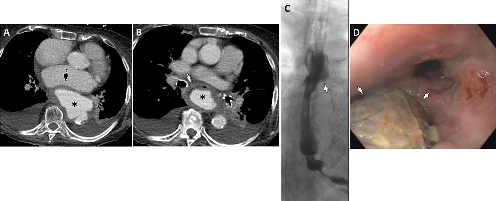
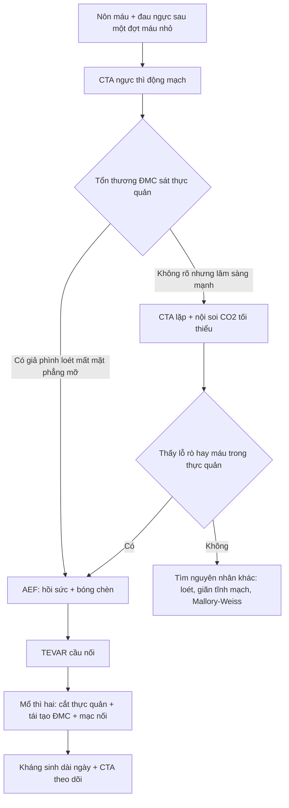
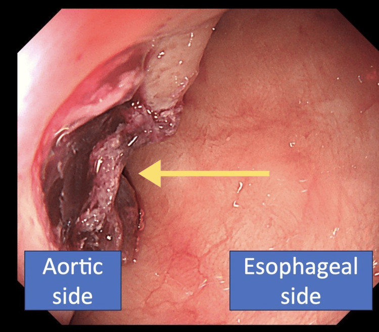
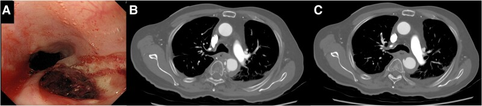
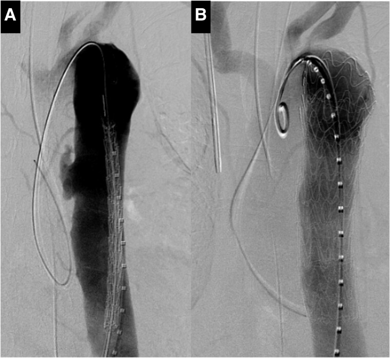
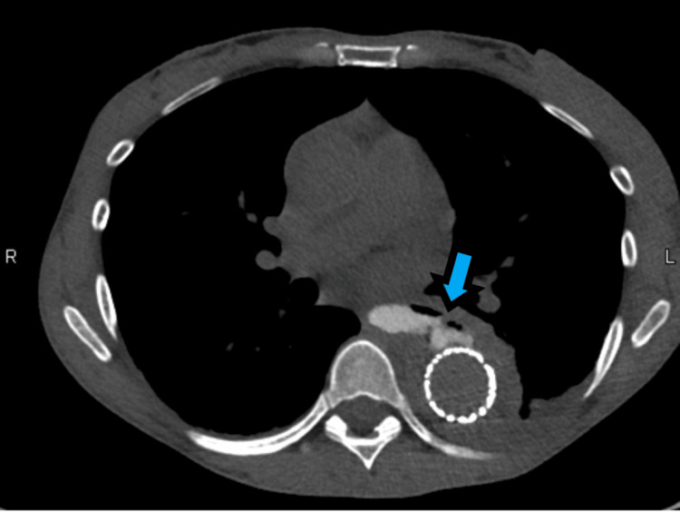

# 1852 — Rò động mạch chủ–thực quản (aortoesophageal fistula)

**Tags:** `pattern:ro-mach-tieu-hoa` `pattern:gia-phinh-dong-mach-chu` `pattern:xuat-huyet-tieu-hoa` `pattern:ton-thuong-trong-truong-chieu` `vung:trung-that` `vung:thuc-quan` `protocol:CTA-nguc` `protocol:noi-soi-thuc-quan` `protocol:TEVAR` `score:Chiari` `score:CTCAE`

**Mức chắc chắn (certainty):** tổng hợp y văn (literature synthesis) — số liệu từ 1 tổng quan hình ảnh rò động mạch chủ (Abdom Radiol 2026, PMC13672455), 1 đoàn hệ 21 ca mổ mở (JTCVS Tech 2026, PMC13673975), 1 đoàn hệ 17 ca quản lý đa chuyên khoa (JTCVS Tech 2025, PMC12683045), 1 loạt ca + tổng quan 272 ca (Cureus 2025, PMC12010216) và 3 ca nguyên văn có ảnh (PMC11630008, PMC12303019, PMC13518038). **Không có thử nghiệm ngẫu nhiên**; mọi con số sống còn là dữ liệu hồi cứu/đăng ký.

> **Câu chốt:** AEF là **"máu nhỏ rồi máu lớn"** — **herald bleed** chỉ là màn dạo, **khoảng yên lặng** ngắn, rồi **ồ ạt tử vong**. Ba số phải thuộc: **0,27%** ca mổ động mạch chủ và **0,15%** ca xuất huyết tiêu hóa trên; **tam chứng Chiari đầy đủ chỉ 18,1%** (nên đừng chờ đủ bộ); và **điều trị "bảo tồn" gần 100% tử vong**, trong khi **TEVAR đơn thuần tử vong 6 tháng 48,8%** so với **TEVAR + mổ thì hai 20,5%**. Câu hỏi hình ảnh không phải "có máu trong dạ dày không" mà là **"ĐMC có giả phình/loét sát thực quản và mất mặt phẳng mỡ không"** — **CTA trước, nội soi sau (nếu cần)**.

## 1. Tổng quan bệnh học – cơ chế hình ảnh (TẠI SAO)

### 1.1 Cơ chế: ĐMC "ăn" vào thực quản theo ba thì

- **Thì 1 — thành ĐMC bị phá:** phình ĐMC ngực, loét xuyên thành, nhiễm khuẩn mảnh ghép/stent-graft, chấn thương, dị vật, hoặc u/xạ. Thành ĐMC mỏng dần, **viêm và hoại tử**; nếu có nhiễm khuẩn, ổ mủ **ăn mòn** cả hai lớp.
- **Thì 2 — thực quản bị chèn và thiếu máu:** ĐMC giãn đập vào thực quản giữa (nơi ĐMC **sát thực quản nhất**, không có mô đệm), gây **thiếu máu thành** rồi **hoại tử** → dính và thủng. Vì vậy **vị trí điển hình là thực quản giữa, ngang quai/ĐMC xuống**.
- **Thì 3 — máu vào lòng thực quản:** lỗ rò nhỏ bị **cục máu đông bít tạm** → **herald bleed** (nôn máu nhỏ, ỉa phân đen); khi cục đông **bong** hoặc lỗ rò mở rộng → **nôn máu ồ ạt, sốc, tử vong trong vài phút**. Đây là lý do bệnh nhân "ổn định" có thể chết đột ngột trên giường.
- **TẠI SAO CTA thấy được:** lòng ĐMC ngấm thuốc mạnh, tổn thương thành (giả phình, loét, mất liên tục) **tương phản rõ** với mô trung thất; dấu gián tiếp quan trọng nhất là **mất mặt phẳng mỡ giữa ĐMC và thực quản** + **dày thành thực quản/khi quản cạnh ĐMC**. Dấu trực tiếp (thuốc từ ĐMC vào thực quản) chỉ thấy khi lỗ rò đang mở — **CTA âm không loại trừ**.

### 1.2 Ngưỡng định lượng trụ cột

| Đại lượng | Con số | Nguồn |
|---|---|---|
| Tần suất trong **mọi ca mổ động mạch chủ** (cơ sở dữ liệu toàn quốc Nhật) | **0,27%** | PMC13673975 |
| Tần suất trong **xuất huyết tiêu hóa trên** | **0,15%** | PMC13673975 |
| AEF **thứ phát** (sau can thiệp/mổ ĐMC) trong nhóm xuất huyết tiêu hóa | **~2%** | PMC13673975 |
| **Tam chứng Chiari đầy đủ** (đau ngực + herald bleed + nôn máu ồ ạt) | **18,1% (48/265)** | PMC12010216 |
| Triệu chứng chính | **nôn máu 83% (226/272)**; **sốc 45,5% (122/268)**; đau ngực/bụng/lưng **37,9%**; sốt **25,1%** | PMC12010216 |
| Nguyên nhân (60 ca): dị vật · TEVAR · phình ĐMC · ung thư thực quản | **23,3% · 21,7% · 18,3% · 10%** | PMC12010216 |
| Tử vong không can thiệp | **76%** (tổng quan); "bảo tồn" **~100%** | PMC13672455; PMC12683045 |
| **TEVAR đơn thuần** — tử vong 6 tháng | **48,8%** (so với **20,5%** nếu TEVAR + mổ thì hai) | PMC12683045 |
| **Chỉ đặt stent thực quản** — sống 1 năm | **17%** | PMC12683045 |
| Mổ mở triệt để — tử vong trong viện | **19,0% (4/21)**; sống 10 năm **38,4%**; không tái nhiễm **89,7%** | PMC13673975 |
| Nhóm quản lý đa chuyên khoa (17 ca, 12 ca mổ) — tử vong trong viện | **8%** | PMC12683045 |
| **30%** ca nôn máu nhỏ ban đầu | tiến triển **nôn máu ồ ạt tử vong trong 6 giờ** nếu chẩn đoán chậm | PMC12010216 |
| Độ nhạy chẩn đoán | **CTA tới 93%**; **nội soi 25–80%** | PMC12010216 |
| PET-CT cho nhiễm mảnh ghép ĐMC | độ nhạy **95%**, độ đặc hiệu **80%** | PMC13672455 |

### 1.3 Vì sao "herald bleed" bị bỏ sót

- Máu nhỏ, tự cầm, bệnh nhân tỉnh táo → chẩn đoán hay bị quy cho **loét dạ dày, Mallory–Weiss, vỡ mạch máu nhỏ**; nội soi có thể chỉ thấy **vết loét/khối dưới niêm mạc** ở thực quản (dạng **SET-like**) — dễ sinh thiết hoặc bỏ qua.
- **Khoảng yên lặng** trung bình **vài giờ đến vài ngày** — không có "dấu hiệu vàng" nào báo trước cơn chảy máu chết người ngoài **tổn thương ĐMC trên CTA**.

## 2. Mẫu hình + chẩn đoán phân biệt theo vị trí (Gamut)

### 2.1 Theo bối cảnh

- **Nguyên phát (không có can thiệp ĐMC trước):** phình ĐMC ngực/loét xuyên thành (người già, tăng huyết áp), **dị vật** (xương cá, pin cúc áo, dị vật kim loại), **ung thư thực quản** xâm lấn, **lao/nhiễm khuẩn** (phình nhiễm khuẩn), **xạ trị** (AEF có thể xuất hiện **19 năm** sau xạ — PMC11630008).
- **Thứ phát:** sau **TEVAR/mổ ghép ĐMC**, **nhiễm mảnh ghép**; sau **đốt điện tim (catheter ablation)**; sau **đặt stent thực quản** (stent ăn mòn vào ĐMC); sau **mổ thực quản** (rò miệng nối → nhiễm trung thất → ăn mòn ĐMC).
- **Vị trí:** thực quản **giữa** (quai/ĐMC xuống) là điển hình; tổn thương ở **thực quản cổ** gợi ý dị vật/ung thư; ở **thực quản dưới** gợi ý phình hoành/loét.

### 2.2 Mẫu hình hình ảnh

- **Giả phình/loét xuyên thành ĐMC** sát thực quản, **mất mặt phẳng mỡ** giữa hai cấu trúc, **thành thực quản dày** hoặc **khuyết thành**.
- **Khí quanh ĐMC/mảnh ghép** (nhiễm mảnh ghép), **máu tụ trung thất**, **tràn dịch màng phổi trái**.
- **Cản quang uống thoát vào ĐMC** (dấu trực tiếp, hiếm): chỉ thấy khi lỗ rò lớn; **không** dùng barium khi nghi rò.
- **Nội soi:** **vết loét/khối dưới niêm mạc** ở thực quản giữa, có **cục máu đông**, **mạch đập thấy qua** hoặc **lưới stent-graft lộ trong lòng** — **không sinh thiết, không bơm hơi mạnh**.

## 3. Bảng so sánh phân biệt (ma trận đối chiếu)

| Thực thể (entity) | Hình ảnh điển hình | Chốt vào (rule-in) | Chốt loại (rule-out) | Gợi ý xác nhận |
|---|---|---|---|---|
| **Rò ĐMC–thực quản (AEF)** | **Giả phình/loét xuyên thành** sát thực quản, **mất mặt phẳng mỡ**, thành thực quản dày/khuyết; máu tụ trung thất | **Herald bleed + tổn thương ĐMC sát thực quản trên CTA** | ĐMC bình thường, không mất mặt phẳng mỡ → **chưa loại trừ** nếu lỗ rò bị bít | CTA ngực khẩn; nội soi có kiểm soát |
| **Vỡ phình ĐMC vào trung thất (không rò thực quản)** | Máu tụ trung thất lớn, **tràn máu màng phổi**, không có máu trong lòng thực quản | **Sốc + đau lưng + máu tụ trung thất** | **Nôn máu** tươi lượng lớn, nội soi thấy máu trong thực quản → nghĩ AEF | CTA; nội soi thận trọng |
| **Rò ĐMC–phế quản (ABF)** | **Khí quanh mảnh ghép**, phế quản ngoại vi giãn, **ho ra máu** | **Ho ra máu tái diễn + tiền sử mổ/xạ ĐMC** | **Nôn máu** (tiêu hóa) → nghĩ AEF | CTA + nội soi phế quản |
| **Loét/Dieulafoy thực quản–dạ dày** | Ổ loét nông, mạch máu lộ, không tổn thương ĐMC | **Nội soi thấy mạch máu/ổ loét + CTA ĐMC bình thường** | **Tổn thương ĐMC sát thực quản** → nghĩ AEF | Nội soi + CTA |
| **Giãn tĩnh mạch thực quản** | Nhiều búi giãn dọc thực quản, xơ gan, tăng áp cửa | **Xơ gan + búi giãn + nôn máu** | Không giãn tĩnh mạch, có tổn thương ĐMC → nghĩ AEF | Nội soi; CTA nếu nghi |
| **Mallory–Weiss** | **Rách dọc** tại ranh giới thực quản–dạ dày sau nôn | **Nôn dữ dội rồi nôn máu + rách dọc** | Tổn thương ĐMC + máu đỏ tươi ồ ạt không do nôn → nghĩ AEF | Nội soi |
| **Ung thư thực quản chảy máu** | Khối loét lớn, hẹp lòng, hạch; **không giả phình ĐMC** | **Khối u + hạch + không tổn thương ĐMC** | **Giả phình/loét ĐMC** → nghĩ AEF | Nội soi + sinh thiết (nếu không nghi AEF) + CTA |
| **Thủng thực quản (Boerhaave) có máu tụ** | Khí–dịch trung thất, tràn khí màng phổi, **không tổn thương ĐMC** | **Nôn dữ dội + khí trung thất + sốt** | Có giả phình ĐMC + máu ồ ạt → nghĩ AEF | Cản quang nước + CT |

*(A, B) CTA ngực: phình dạng túi lớn của ĐMC ngực xuống (**\***), chèn ép nhĩ trái (mũi tên chấm) và thực quản (mũi tên trắng), **mất mặt phẳng mỡ** giữa ĐMC và thực quản; tràn dịch màng phổi hai bên ít. (C) Cản quang sau đặt **stent ĐMC + stent thực quản**: thuốc vẫn thoát ra tại lỗ rò (mũi tên). (D) Nội soi sau rút stent thực quản: **lỗ rò còn**, thấy **lưới stent ĐMC** trong lòng. Nguồn: Agarwal D et al.; Abdom Radiol 2026; Fig. 7 — PMC13672455, CC BY.*

### 3.1 Đọc CTA theo thứ tự "3 lớp"

1. **Lòng ĐMC:** giả phình, loét xuyên thành, huyết khối trong lòng, **mất liên tục thành**; đo đường kính túi phình và vị trí so với thực quản.
2. **Khoảng giữa ĐMC–thực quản:** **mặt phẳng mỡ còn hay mất**, dày mô mềm, **khí** (nhiễm), máu tụ.
3. **Thực quản và trung thất:** thành dày/khuyết, **khí trong trung thất**, tràn dịch/tràn khí màng phổi, đông đặc phổi do hít máu.

## 4. Protocol chụp + ngưỡng xử trí

### 4.1 Chẩn đoán: CTA là cửa đầu tiên

- **CTA ngực–bụng thì động mạch**, lát **0,6–1 mm**, **ECG-gating** nếu tổn thương ở gốc/quai; **tái dựng MPR cong** dọc ĐMC và **MPR vuông góc** tại điểm sát thực quản.
- **Không dùng barium** khi nghi rò — nếu cần cản quang thực quản, dùng **thuốc tan trong nước**.
- **Nội soi:** chỉ khi **đã có CTA** và **có kế hoạch can thiệp**; dùng **CO₂**, bơm tối thiểu, **không sinh thiết**, **không nong**; chuẩn bị sẵn **bóng chèn (Sengstaken–Blakemore)** và phương án chuyển mổ.
- **PET-CT:** chỉ để đánh giá **nhiễm mảnh ghép** (Se **95%**, Sp **80%**), không dùng cấp cứu.

### 4.2 Cấp cứu và chiến lược điều trị

- **Hồi sức:** 2 đường truyền lớn, **truyền máu khối lượng lớn (MTP)**, PPI, tránh hạ huyết áp; đặt nội khí quản nếu cần bảo vệ đường thở.
- **Cầm máu tạm:** **bóng chèn thực quản (Sengstaken–Blakemore)** hoặc bóng chèn dạ dày–thực quản — cầu nối, **không phải điều trị triệt để**.
- **TEVAR (stent-graft phủ) thì cấp:** cầm máu nhanh, **cầu nối**; nhưng **không xử lý ổ nhiễm** → nếu chỉ TEVAR, **tử vong 6 tháng 48,8%**.
- **Mổ triệt để thì hai:** **cắt thực quản + tái tạo ĐMC (in-situ graft/extra-anatomic bypass) + quấn mạc nối lớn**, kháng sinh dài ngày; tử vong trong viện **19%** ở trung tâm chuyên sâu, **không tái nhiễm 89,7%** ở 10 năm.
- **Stent thực quản đơn thuần:** **không đủ** — sống 1 năm **17%**; chỉ dùng che rò tạm/palliative khi không mổ được.
- **Theo dõi sau can thiệp:** CTA **1 tháng**, sau đó **3–6 tháng/lần** trong năm đầu; **PET-CT** nếu sốt dai dẳng; nội soi khi nuốt khó (hẹp/stent di trú).

### 4.3 Phân tầng và tiên lượng

- **Không can thiệp:** gần **100%** tử vong — **không có "theo dõi bảo tồn"** ở bệnh nhân còn chỉ định can thiệp.
- **Chỉ TEVAR:** cầm máu được nhưng **ổ nhiễm còn** → tái phát/giả phình nhiễm; tử vong 6 tháng **48,8%**.
- **TEVAR + mổ thì hai:** tử vong 6 tháng **20,5%** — **chiến lược ưu tiên** ở bệnh nhân đủ sức mổ.
- **Chỉ stent thực quản/palliative:** sống 1 năm **17%** — dành cho ca không mổ được.

## 5. Biến thể bình thường và cạm bẫy

- **Herald bleed bị quy cho loét/Mallory–Weiss:** nôn máu nhỏ + đau ngực/lưng ở người có phình ĐMC = **AEF cho đến khi loại trừ**; **30%** tiến triển tử vong trong **6 giờ**.
- **Nội soi bình thường không loại trừ:** độ nhạy chỉ **25–80%**; tổn thương có thể là **khối dưới niêm mạc (SET-like)** — **không sinh thiết** khi nghi AEF.
- **Bơm hơi khi nội soi** có thể **bong cục đông** và gây chảy máu ồ ạt tại bàn soi — dùng **CO₂**, bơm tối thiểu, có bóng chèn sẵn.
- **CTA âm không loại trừ:** cục đông bít lỗ rò; nếu lâm sàng mạnh → **CTA lặp thì muộn** hoặc **nội soi có kiểm soát**.
- **AEF muộn sau TEVAR/xạ:** có thể **nhiều năm** (ca **19 năm** sau xạ — PMC11630008); sốt + nuốt đau + máu nhỏ ở người có stent-graft = **nhiễm mảnh ghép/rò** cho đến khi loại trừ.
- **Nhầm với ABF:** **ho ra máu** = rò ĐMC–phế quản (bài 086); **nôn máu** = rò ĐMC–thực quản — cùng cơ chế, khác đường thoát.
- **"Stent thực quản là xong":** che được lỗ rò nhưng **không xử lý ổ nhiễm**, có thể **ăn mòn thêm vào ĐMC**; sống 1 năm chỉ **17%**.
- **Bỏ sót tổn thương ĐMC trên CT không cản quang:** luôn chụp **CTA** khi nghi, không dùng CT thường/X-quang để loại trừ.

*Nội soi thực quản: vết rách niêm mạc kèm **cục máu đông** và **lỗ nghi rò** (bên phải là lòng thực quản, bên trái sát ĐMC) — hình ảnh "bắt chước" một vết loét đơn thuần; chẩn đoán xác định bằng CTA. Nguồn: Kobayashi M et al.; Cureus 2025; Fig. 3 — PMC12010216, CC BY.*

## 6. Tự lượng giá — Blind Quiz

**Ca 1 — Nữ 89 tuổi, nuốt khó + xuất huyết tiêu hóa trên. CTA, cản quang sau can thiệp và nội soi:**

- Câu hỏi: (1) Dấu hiệu nào trên CTA gợi AEF? (2) Vì sao vẫn còn thoát cản quang sau đặt stent? (3) Bước tiếp theo?

<b>Bấm để hiện đáp án (findings + chẩn đoán)</b>

- **Findings:** (A, B) **phình dạng túi lớn** ĐMC ngực xuống, **chèn ép thực quản**, **mất mặt phẳng mỡ** giữa ĐMC và thực quản, tràn dịch màng phổi ít. (C) Sau **stent ĐMC + stent thực quản**, cản quang vẫn **thoát ra tại lỗ rò**. (D) Nội soi sau rút stent: **lỗ rò còn**, thấy **lưới stent-graft ĐMC**.
- **Chẩn đoán:** **AEF** do phình ĐMC. Đặt stent thực quản **không bịt kín** và không xử lý ổ nhiễm → cần **TEVAR + mổ triệt để thì hai** (cắt thực quản + tái tạo ĐMC + mạc nối), kháng sinh dài ngày.
- **Nguồn ảnh:** Agarwal D et al.; *Abdom Radiol* 2026; Fig. 7 — PMC13672455, CC BY.

**Ca 2 — Nam 84 tuổi, nôn máu ồ ạt, tiền sử xạ ung thư thực quản 19 năm trước. Nội soi + CT, rồi chụp mạch trước/sau TEVAR:**

- Câu hỏi: (1) Ổ loét ở thực quản giữa gợi ý gì khi ĐMC nằm sát? (2) Vì sao **không sinh thiết** ổ loét? (3) Hình mạch máu cho thấy gì?

<b>Bấm để hiện đáp án</b>

- **Findings:** (A) nội soi: **ổ loét** thực quản giữa; (B, C) CT: **cùng vùng thực quản nằm sát ĐMC ngực**, thành dày, mất mặt phẳng mỡ. Chụp mạch: (A) **bất thường/bờ nham nhở của ĐMC xuống** tại lỗ rò; (B) sau TEVAR **không còn thoát thuốc** (không endoleak).
- **Chẩn đoán:** **AEF muộn sau xạ** (19 năm). **Không sinh thiết** vì có thể **mở lỗ rò** và gây chảy máu không cầm được; xác định bằng CTA/chụp mạch.
- **Xử trí:** TEVAR cầm máu thì cấp → đánh giá mổ triệt để (cắt thực quản + tái tạo ĐMC); theo dõi nhiễm stent-graft (sốt, khí quanh stent).
- **Nguồn ảnh:** Sakakibara S, Marumoto A; *Eur Heart J Case Rep* 2024; Fig. 1 & 2 — PMC11630008, CC BY.

**Ca 3 — Nam 49 tuổi, bóc tách ĐMC type B, đã TEVAR; sốt, nôn máu. CT cản quang thực quản:**

- Câu hỏi: (1) Thuốc cản quang đi đâu? (2) Chẩn đoán? (3) Vì sao "chỉ theo dõi" là sai?

<b>Bấm để hiện đáp án</b>

- **Findings:** cản quang trong lòng thực quản **thông với lòng giả (false lumen)** của ĐMC ngực sau TEVAR — **lỗ rò thực quản–ĐMC**.
- **Chẩn đoán:** **AEF thứ phát sau TEVAR** (trên nền bóc tách type B). Đây là biến chứng **nhiễm trung thất + rò** — không tự lành.
- **Vì sao sai:** "bảo tồn" gần **100% tử vong**; TEVAR đơn thuần 6 tháng **48,8%**; cần **chiến lược thì hai** (cầm máu + cắt thực quản/tái tạo ĐMC) và kháng sinh dài.
- **Nguồn ảnh:** Gordon RS et al.; *Cureus* 2025; Fig. 3 — PMC12303019, CC BY.

## Bài liên quan chéo
- [1844 – Rò và hoại tử thực quản do xạ](../1844-ro-hoai-tu-thuc-quan-do-xa/lesson.md) (cùng trường xạ; rò trung thất/khí quản)
- [086 – Rò động mạch chủ–phế quản](../086-ro-dong-mach-chu-phe-quan/lesson.md) (cùng cơ chế, biểu hiện ho ra máu)
- [938 – Rò động mạch chủ–ruột](../938-ro-dong-mach-chu-ruot/lesson.md) (AEF ở tầng bụng, biểu hiện ỉa máu)
- [091 – Ho ra máu ồ ạt & nút mạch động mạch phế quản](../091-ho-ra-mau-oat-nut-mach-dong-mach-phe-quan/lesson.md) (xử trí chảy máu ồ ạt)
- [1851 – Hẹp thực quản lành tính sau xạ](../1851-hep-thuc-quan-lanh-tinh-sau-xa/lesson.md) (biến chứng muộn cùng vùng)

> Không dùng để chẩn đoán độc lập khi chưa có người hướng dẫn.
