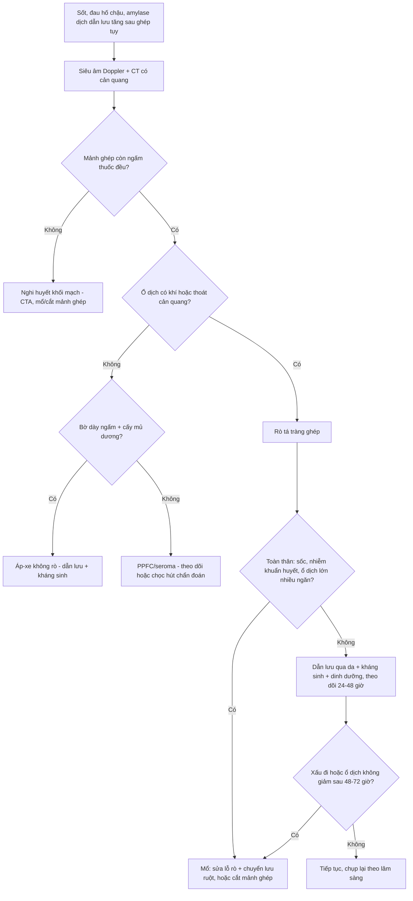
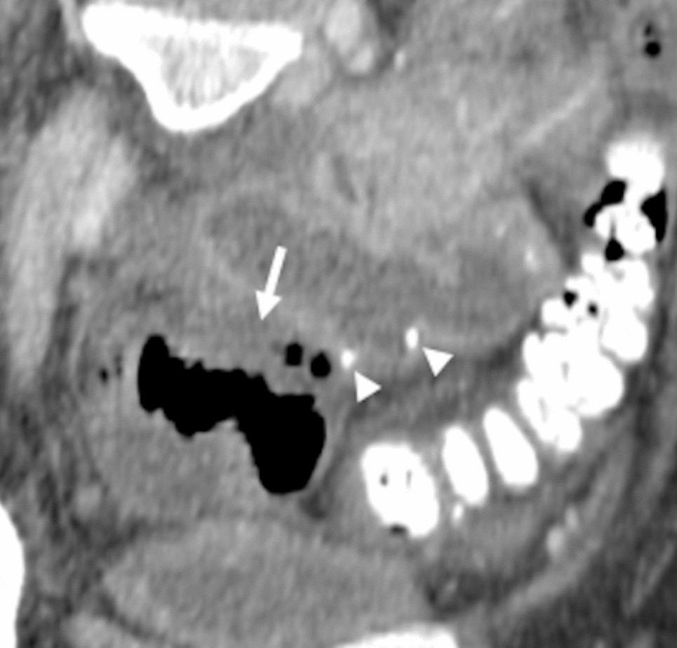
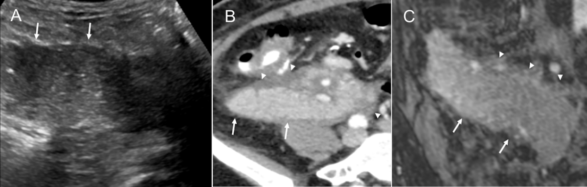
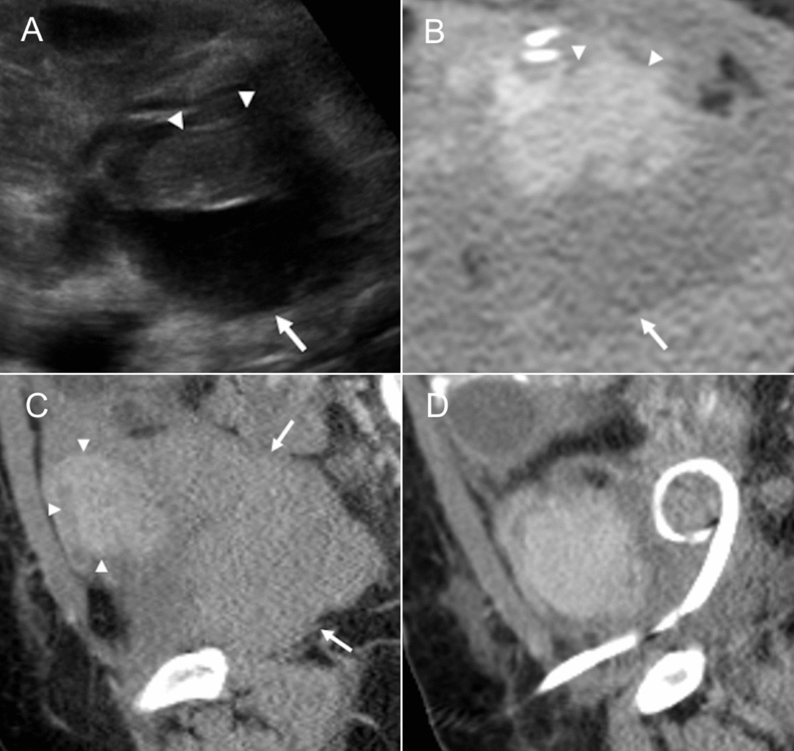

# 1853 — Rò – hoại tử tá tràng mảnh ghép sau ghép tụy: mủ có khí cạnh miệng nối, và cửa sổ để cứu mảnh ghép / Graft duodenal leak after pancreas transplantation

**Tags:** `pattern:ro-miem-noi` `pattern:o-dich-co-khi` `pattern:hoai-tu` `pattern:nhim-trung-o-bung` `vung:bung` `vung:manh-ghep-tuy` `vung:ta-trang` `protocol:CT-bung` `protocol:Doppler-manh-ghep` `protocol:choc-hut-dan-luu` `score:ISGPS` `score:Clavien-Dindo` `incidentaloma:khong`

**Mức chắc chắn (certainty):** tổng hợp y văn (literature synthesis) — ghép **284 ca ghép tụy có phân tích yếu tố nguy cơ rò tá tràng** (*Transpl Int* 2015, **PMID 25647150**), **223 ca đồng thời thận–tụy (SPK) có ổ dịch quanh tụy** (*Transplantation* 2013, **PMID 23507700**), **241 ca so sánh hai kiểu dẫn lưu ngoại tiết** (*Transpl Int* 2014, **PMID 24750305**), **198 ca cắt mảnh ghép sớm có đọc lại mô bệnh** (*Clin Transplant* 2019, **PMID 31452273**), **118 ca mở bụng lại** (*Transplant Proc* 2009, **PMID 19715955**), **78 ca SPK định nghĩa rò tụy theo ISGPS** (**PMID 36220755**), **tổng quan hình ảnh–can thiệp 2025** (*Abdom Radiol*, **PMC12602581**, CC BY 4.0) và **khuyến cáo nhiễm khuẩn ổ bụng của AST** (**PMID 31102546**). Nhóm **không có bệnh nhân của mình**.

> **Câu chốt:** tá tràng ghép **không có nguồn máu riêng** — nó sống bằng **cung mạch tá tụy trên/dưới của chính mảnh ghép**, mà **mỏm tá tràng và bờ đối mạc treo là vùng tận cùng** của cung đó. Vì vậy rò tá tràng sau ghép tụy **không phải "hở chỉ khâu" đơn thuần**: đó là **thiếu máu/hoại tử đầu tụy–tá tràng** (hoặc **thải ghép cấp không nhận ra**, gặp ở **9/15** ca rò được đọc lại mô bệnh — **PMID 31452273**). Trên CT, dấu hiệu **mạnh nhất không phải ổ dịch, mà là KHÍ nằm trong ổ dịch sát miệng nối**; và **không có khí không loại trừ**.

## 1. Tổng quan bệnh học – cơ chế hình ảnh (TẠI SAO)

### 1.1 Vì sao mỏm tá tràng ghép là điểm yếu nhất

- Trong ghép tụy, **tá tràng của người cho được giữ lại thành một "cổ tá tràng" (duodenal cuff)** để **dẫn lưu ngoại tiết** (vào ruột non qua **tá tràng–hỗng tràng** hoặc vào **tá tràng–tá tràng**, hoặc vào bàng quang). Mỏm này nuôi bằng **cung tá tụy trên (từ động mạch dạ dày–tá tràng, nhánh của SMA mảnh ghép)** và **cung tá tụy dưới** — **không có nhánh trực tiếp từ thành bụng hay mạc treo chủ**.
- **Vùng tận cùng của cung** là **bờ đối mạc treo và mỏm tá tràng** — nơi áp lực tưới máu thấp nhất. Đây là lý do **rò thường ở đúng đường khâu mỏm**, không ở giữa thân mảnh ghép.
- **Ba cơ chế cộng dồn làm mỏm hoại tử:** (1) **tổn thương bảo quản–tái tưới máu** (thể hiện bằng **amylase đỉnh sau mổ** — yếu tố nguy cơ rò trong nhóm SPK, **PMID 25647150**); (2) **xơ vữa/giảm tưới máu người nhận** (**can thiệp tim mạch trước ghép** cũng là yếu tố nguy cơ, **PMID 25647150**); (3) **thải ghép cấp** — **9/15** ca cắt mảnh ghép sớm vì "rò/thu thập dịch tái phát" có **thải ghép cấp chưa được nhận ra** trên mô bệnh (**PMID 31452273**).
- **TẠI SAO thải ghép lại gây rò:** thải ghép tấn công **vi mạch và niêm mạc** tá tràng ghép → **thiếu máu niêm mạc → loét → thủng đường khâu**, trong khi **siêu âm và CT chỉ thấy "dịch quanh mảnh ghép"**. Vì vậy một ổ dịch "không giải thích được" ở bệnh nhân ghép tụy **phải nghĩ đến thải ghép**, không chỉ "biến chứng kỹ thuật".

### 1.2 Vì sao mủ + dịch tụy lại nguy hiểm gấp bội

- Dịch rò là **hỗn hợp dịch tụy (enzyme tiêu protein/ mỡ) + vi khuẩn đường ruột**. Enzym hoạt hóa **tự tiêu mô mỡ và thành mạch** → **viêm tụy quanh mảnh ghép, áp-xe đa ổ, giả phình động mạch (mycotic), xuất huyết tiêu hóa**.
- **Vi khuẩn đa loài** khiến **áp-xe quanh mảnh ghép** khó diệt bằng kháng sinh đơn thuần: khuyến cáo AST nhấn mạnh **kiểm soát nguồn (source control)** là nền tảng, vì rò tá tràng ghép "**có thể dẫn tới mất mảnh ghép và tử vong**" (**PMID 31102546**).
- **Hệ quả lên mảnh ghép:** viêm/áp-xe quanh tụy → **huyết khối tĩnh mạch và động mạch mảnh ghép** → mất mảnh ghép. Chuỗi này giải thích vì sao **mở bụng lại** sau ghép tụy có **tỉ lệ cắt mảnh ghép rất cao** (52,5% trong loạt 118 ca, **PMID 19715955**).

### 1.3 Vật lý hình ảnh: đọc CT thế nào cho đúng

- **Ổ dịch sau ghép tụy là "dịch hỗn hợp":** báng thanh dịch, lymphocele, seroma, **máu**, **mủ** — tất cả **0–30 HU**, **chồng lấp hoàn toàn**. **Đậm độ không phân biệt được**; thứ phân biệt là **khí, viền ngấm, đậm độ mỡ quanh, và bối cảnh ngày hậu phẫu**.
- **Khí trong ổ dịch (≈ −1000 HU)** = dấu hiệu **mạnh** của **rò/thủng/nhiễm kỵ khí**. Nhưng: **khí tự do trong ổ bụng là bình thường vài ngày đầu sau mổ bụng**; khí **khu trú trong một ổ dịch cạnh miệng nối, xuất hiện muộn hơn, hoặc tăng lên** thì mới là bất thường.
- **Cản quang đường uống** (nước uống hoặc cản quang tan trong nước): **thoát cản quang ra ngoài lòng ruột tại miệng nối là chẩn đoán xác định** — nhưng chỉ dương tính khi **rò còn hoạt động và cản quang tới được chỗ rò**; **âm tính không loại trừ**.
- **CT có cản quang tĩnh mạch** còn trả lời câu hỏi **quan trọng hơn**: mảnh ghép **còn ngấm thuốc đồng nhất** không? **mất ngấm khu trú ở đầu tụy** = **thiếu máu vùng dSMA** (nối **1840**), **mất ngấm toàn bộ** = huyết khối mạch → **cắt mảnh ghép**, không phải dẫn lưu.
- **Giả phình/hoại tử thành mạch:** ổ dịch + **máu trong ổ dịch (HU cao không đồng nhất)** + **"sentinel bleed"** → **CTA trước khi chọc**, vì chọc vào giả phình nhiễm có thể gây **chảy máu tử vong**.

### 1.4 Số liệu định lượng nằm lòng

| Đại lượng | Số liệu | Nguồn |
|---|---|---|
| Tỉ lệ rò tá tràng ghép (DL) | **18/284 = 6,3%**; **12/18 = 67%** trong **100 ngày đầu** | PMID 25647150 |
| Yếu tố nguy cơ | **PAK (ghép tụy sau thận): OR 3,526** (p = 0,008); **ức chế miễn dịch trước ghép: OR 3,328** (p = 0,012); trong SPK: **amylase đỉnh sau mổ** và **can thiệp tim mạch trước ghép** | PMID 25647150 |
| Cứu được mảnh ghép | **6/18 = 33%** nhờ **cắt đoạn tá tràng** | PMID 25647150 |
| Rò theo kiểu dẫn lưu | **tá tràng–tá tràng 2/125 = 1,6%** vs **tá tràng–hỗng tràng 8/116 = 7%** (p = 0,052); xuất huyết tiêu hóa **11% vs 3%** (p = 0,026) | PMID 24750305 |
| Ổ dịch quanh tụy có ý nghĩa lâm sàng (PPFC) | **36/223 = 16%**, **100% trong 3 tháng đầu**; **dẫn lưu qua da chỉ giải quyết 2/36 = 6%**, **34 ca phải mở bụng** | PMID 23507700 |
| PPFC gắn với gì | **viêm tụy ghép sớm 50%**, **rò tụy 56% (9 ca rò mỏm tá tràng rõ)**, **nhiễm khuẩn ổ dịch 56%** | PMID 23507700 |
| Sống còn mảnh ghép khi có PPFC | **68% vs 85%** lúc 5 năm; nhiễm khuẩn **75% vs 46%** | PMID 23507700 |
| Mở bụng lại | **40/118 = 33,9%**; do **rò mỏm tá tràng 7/118 = 5,9%**; **cắt mảnh ghép 52,5%** các ca mở lại; tử vong sau mở lại **3,38%** | PMID 19715955 |
| Cắt mảnh ghép sớm | **23/198 = 11,6%**; **9/15** ca rò/thu thập dịch tái phát có **thải ghép cấp** trên mô bệnh | PMID 31452273 |
| Rò **muộn** (sau 3 tháng) | trung bình **20,5 tháng** (3,5–74); **92% ở mảnh ghép dẫn lưu bàng quang**; trước đó: **thải ghép 16%**, **chấn thương bụng kín 12%**, **CMV 8%** | PMID 15740558 |
| Rò tụy sinh hóa theo ISGPS (SPK) | **56,6%** (44/78) nhưng **"gánh nặng lâm sàng thấp"**; biến chứng nặng **39,7%**; tử vong 90 ngày **2,6%** | PMID 36220755 |

> **Đọc số cho đúng:** **56,6% rò tụy sinh hóa** (amylase dịch dẫn lưu cao) **không** đồng nghĩa 56,6% bệnh nhân có rò tá tràng cần mổ — đa số chỉ cần **dẫn lưu kín + dinh dưỡng**. Ngược lại, **rò thật có ổ dịch nhiễm** rất nặng: chỉ **6%** đáp ứng dẫn lưu qua da trong loạt 223 ca (**PMID 23507700**). Hai con số này **không mâu thuẫn**: chúng đo **hai mức độ khác nhau của cùng phổ**.

## 2. Mẫu hình + chẩn đoán phân biệt theo vị trí (Gamut)

- **Mẫu hình kinh điển:** ổ dịch **giữa mảnh ghép tụy và miệng nối tá tràng–ruột**, **bờ dày ngấm thuốc**, **khí trong ổ**, **đậm độ mỡ quanh tăng**, có/không **mức dịch–khí**; mảnh ghép **còn ngấm thuốc**; bụng chướng, sốt, đau hố chậu phải, **tăng amylase dịch dẫn lưu**.
- **Theo vị trí ổ dịch (gamut):**
  - **Sát miệng nối tá tràng–ruột (hố chậu phải):** **rò tá tràng** (chính), **áp-xe không rò**, **viêm tụy ghép**, **huyết khối mảnh ghép**.
  - **Quanh đuôi tụy/dưới thận ghép:** **PPFC/seroma/lymphocele**, **áp-xe**, **giả phình động mạch**.
  - **Rãnh gan–thận, quanh lách:** **rò miệng nối tĩnh mạch cửa**, **huyết khối**, **áp-xe dưới hoành**.
  - **Tiền phúc mạc/đường mổ:** **nhiễm vết mổ**, **hoại tử cân**, **rò tiêu hóa ra da**.
- **Theo thời điểm:** **sớm < 100 ngày** (67% ca rò; chủ yếu thiếu máu/kỹ thuật/thải ghép) vs **muộn** (trung bình 20,5 tháng; thường **dẫn lưu bàng quang**, sau thải ghép/CMV/chấn thương — **PMID 15740558**).
- **Ba câu hỏi trước khi gọi "rò":** (1) **Mảnh ghép còn ngấm thuốc đều không?** (2) **Khí nằm trong ổ dịch hay khí tự do lan tỏa?** (3) **Có giả phình/máu trong ổ dịch không?**

## 3. Bảng so sánh phân biệt (ma trận đối chiếu)

| Thực thể (entity) | Hình ảnh điển hình (CT có cản quang / Doppler) | Chốt vào (rule-in) | Chốt loại (rule-out) | Gợi ý xác nhận |
|---|---|---|---|---|
| **Rò tá tràng ghép** | **Ổ dịch sát miệng nối + khí trong ổ**, viền ngấm, đậm độ mỡ quanh tăng; **thoát cản quang đường uống** | **Khí khu trú trong ổ dịch cạnh miệng nối**; **thoát cản quang**; amylase dịch dẫn lưu cao | Mảnh ghép **mất ngấm toàn bộ** → huyết khối (không phải rò đơn thuần) | CT + cản quang uống; cấy + amylase dịch dẫn lưu |
| **Viêm tụy ghép cấp** | Mảnh ghép **to, phù, ngấm không đều**, dịch quanh **lan tỏa không khu trú**, **không khí** | **Dịch quanh lan tỏa + amylase máu cao + không có ổ khí khu trú** | Khí trong ổ khu trú + viền dày → rò/áp-xe | Doppler (mạch còn), amylase/lipase, sinh thiết nếu nghi thải ghép |
| **Áp-xe quanh mảnh ghép (không rò)** | Ổ dịch **bờ dày ngấm**, có/không khí, **không thấy đường thông** | **Ổ dịch nhiễm khuẩn khu trú, cấy mủ dương** | Thấy khí + thoát cản quang → có rò | Chọc hút: cấy + amylase; dẫn lưu |
| **PPFC (seroma/lymphocele)** | Ổ dịch **thành mỏng, đồng nhất, không khí, không viền dày**, **không sốt** | **Dịch trong, amylase thấp, không khí, không viền** | Viền dày + khí + sốt → áp-xe/rò | Chọc hút chẩn đoán; theo dõi |
| **Huyết khối mạch mảnh ghép** (nối 1840) | **Mất ngấm thuốc** mảnh ghép/đoạn; Doppler **mất phổ**, **RI > 0,8** hoặc đảo dòng | **Mất ngấm + mất phổ + amylase tăng vọt** | Mảnh ghép ngấm đều → không phải tắc | CTA; **mổ/cắt sớm**, không chờ |
| **Giả phình nhiễm (mycotic)** | Ổ **ngấm thuốc song hành động mạch** trong ổ dịch, **máu trong ổ**, có thể vỡ | **Cấu trúc ngấm thuốc hình túi trong ổ dịch + xuất huyết** | Ổ dịch không ngấm, không máu → không phải giả phình | **CTA trước mọi chọc hút**; nút mạch/stent |
| **Thải ghép cấp (APR)** | Mảnh ghép **to, phù**, dịch quanh, **không đặc hiệu**; có thể kèm ổ dịch tái phát | **Dịch tái phát nhiều lần + amylase tăng + đáp ứng corticoid** | Không có mô bệnh → **không loại trừ được** | **Sinh thiết mảnh ghép** (9/15 ca rò có APR — PMID 31452273) |

- **Ảnh đối chiếu:** **`images/1853_ro-ta-trang_CT_PMC12602581-Fig14.jpg`** (ổ dịch **có khí** sát miệng nối tá tràng–ruột — dấu hiệu chốt) đặt cạnh **`images/1853_vim-tuy-ghep_CT_PMC12602581-Fig16.png`** (viêm tụy ghép: dịch quanh **lan tỏa, không khí**, mảnh ghép to).

### Dấu hiệu đọc theo thứ tự (4 bước trên một lát CT qua mảnh ghép)

1. **Mảnh ghép có ngấm thuốc đồng nhất không?** (mất ngấm = mạch, ưu tiên mổ hơn dẫn lưu)
2. **Khí ở đâu?** trong **ổ dịch khu trú cạnh miệng nối** → rò; **lan tỏa tự do** → có thể còn tồn dư hơi sau mổ.
3. **Có máu/giả phình trong ổ dịch không?** (HU cao không đồng nhất, cấu trúc ngấm hình túi)
4. **Đo ổ dịch + ghi vị trí tương quan miệng nối** — quyết định **đường vào dẫn lưu an toàn** (tránh mạch mảnh ghép và quai ruột).

## 4. Protocol chụp + hệ phân độ/điểm chuẩn hóa

### 4.1 Protocol

- **Siêu âm Doppler mảnh ghép là bước 0** (đầu giường, không bức xạ): vị trí, kích thước, **tưới máu**, **RI**, dịch quanh; **không phân biệt được mủ với dịch** nhưng **phát hiện mất phổ** nhanh.
- **CT bụng–chậu có cản quang tĩnh mạch** là chuẩn: **thì động mạch muộn/tĩnh mạch cửa 40–60 giây**, lát **1–2 mm**, **MPR trục + tránh + đứng dọc**, **cửa sổ mô mềm và xương**; **cho uống nước hoặc cản quang tan trong nước 30–60 phút trước chụp** khi nghi rò (giúp thấy **thoát cản quang**).
- **CTA thì mạch** khi có **máu trong ổ dịch, "sentinel bleed", hoặc giảm Hb** — **trước** khi đặt dẫn lưu.
- **MRI/MRCP** khi **suy thận** (không dùng được cản quang) hoặc cần đánh giá **ống tụy/miệng nối**; **không thay CTA** khi nghi mạch.
- **Xét nghiệm dịch dẫn lưu là một phần của "protocol":** **amylase/lipase + cấy + đếm tế bào** — amylase dịch **cao hơn nhiều lần amylase máu** gợi ý **rò tụy/tá tràng**; **cấy dương** xác định **nhiễm ổ dịch**.
- **Không dùng X-quang bụng thường quy** để loại trừ rò; **không chọc hút ổ dịch quanh mảnh ghép mà chưa có CTA** khi có dấu hiệu xuất huyết.

### 4.2 Phân độ + ngưỡng xử trí

- **Phân loại thời điểm:** rò **sớm < 100 ngày** (67%) vs **muộn** (trung bình **20,5 tháng**, chủ yếu mảnh ghép **dẫn lưu bàng quang** — **PMID 15740558**) — khác **cơ chế** và **cách xử trí**.
- **Rò tụy theo ISGPS** (dùng cho cả ghép tụy): **amylase dịch dẫn lưu > 3 × giới hạn trên amylase máu, từ ngày hậu phẫu 3**; phân **grade B/C** theo **ảnh hưởng lâm sàng** (B: đổi xử trí/keo dẫn lưu kéo dài; C: can thiệp lại, suy tạng). Trong 78 ca SPK: **rò sinh hóa 56,6%**, nhưng **biến chứng nặng 39,7%**, tử vong 90 ngày **2,6%** (**PMID 36220755**).
- **Clavien–Dindo** để mô tả biến chứng (IIIa = can thiệp không gây mê; IIIb = gây mê; IV = suy tạng) — dùng khi báo cáo, **không thay quyết định lâm sàng**.

| Tình huống | Ngưỡng / hành động | Nguồn số |
|---|---|---|
| Rò nhỏ, bệnh nhân ổn định, ổ dịch một ngăn | **Dẫn lưu qua da + kháng sinh + dinh dưỡng**, đánh giá lại **48–72 giờ** | PMID 23507700, PMC12602581 |
| Ổ dịch nhiễm nhiều ngăn / sốc nhiễm khuẩn | **Mở bụng**: sửa lỗ rò + **chuyển lưu ruột (Roux-en-Y)**, hoặc **cắt đoạn tá tràng** | PMID 25647150, PMID 31616610 |
| Mảnh ghép mất ngấm / hoại tử | **Cắt mảnh ghép** — không dẫn lưu đơn thuần | PMID 19715955 |
| Rò tái phát nhiều lần, không rõ nguyên nhân | **Sinh thiết mảnh ghép** tìm **thải ghép cấp** (9/15 ca) | PMID 31452273 |
| Có máu trong ổ dịch / sentinel bleed | **CTA + nút mạch/stent trước khi chọc** | PMC12602581 |
| Dẫn lưu qua da thất bại | **6%** thành công trong loạt 223 ca → **ngưỡng chuyển mổ thấp** | PMID 23507700 |

## 5. Biến thể bình thường và cạm bẫy

- **Khí sau mổ là bình thường trong vài ngày đầu:** **khí tự do** sớm sau mở bụng **không** đồng nghĩa thủng; **khí trong một ổ dịch khu trú cạnh miệng nối**, **xuất hiện muộn** hoặc **tăng lên** mới đáng lo.
- **"Không có khí" không loại trừ rò:** nhiều ổ mủ **không có khí**; cần **cản quang đường uống**, **amylase dịch dẫn lưu** và **diễn tiến lâm sàng**.
- **Amylase dịch dẫn lưu cao là chuyện thường:** **56,6%** ca SPK đạt tiêu chuẩn rò sinh hóa nhưng **gánh nặng lâm sàng thấp** (**PMID 36220755**) — **không** đẩy mọi bệnh nhân vào mổ.
- **Dịch quanh mảnh ghép "vô khuẩn" vẫn có thể là rò:** **9 ca rò mỏm tá tràng** nằm trong nhóm **PPFC** với **56% nhiễm khuẩn ổ dịch** (**PMID 23507700**) — cấy âm một lần **không loại trừ**.
- **Bẫy "biến chứng kỹ thuật":** gán mọi rò cho **tay nghề phẫu thuật** mà bỏ **thải ghép cấp** — **9/15** ca cắt mảnh ghép sớm có **APR chưa nhận ra** (**PMID 31452273**), và điều trị khác hẳn (tăng ức chế miễn dịch, không chỉ mổ).
- **Rò muộn sau nhiều năm:** trung bình **20,5 tháng**, **92% ở mảnh ghép dẫn lưu bàng quang** (**PMID 15740558**) — bệnh nhân ghép tụy **đến muộn với đau bụng** vẫn phải nghĩ rò tá tràng, không chỉ "viêm tụy".
- **Chọc hút ổ dịch = hành vi có thể gây chết người** nếu ổ dịch chứa **giả phình nhiễm**: luôn **CTA** khi có **máu, đau nhói, Hb giảm**.
- **Nhầm mảnh ghép tụy với quai ruột/áp-xe đơn thuần:** mảnh ghép **nằm trong phúc mạc/hố chậu phải**, hình **dài, ngấm thuốc như tụy**; nếu báo cáo "ổ dịch hố chậu" mà **không nhắc mảnh ghép**, phẫu thuật viên sẽ **dẫn lưu sai**.
- **Không đọc đơn độc một thì:** huyết khối tĩnh mạch có thể **chỉ thấy ở thì muộn** (ngấm thuế không đều) — luôn xem **đủ thì + Doppler**.

## 6. Tự lượng giá — Blind Quiz

**Ca 1 — Nam 52 tuổi, ghép tụy sau ghép thận, ngày hậu phẫu 8: sốt, đau hố chậu phải, bạch cầu tăng.**

- Gợi ý: dịch dẫn lưu ra **đục**, amylase dịch **cao**; không nôn, không tiêu chảy máu.
- Câu hỏi: (1) Dấu hiệu nào **chốt** rò tá tràng? (2) Vì sao **không** gọi đây là "áp-xe đơn thuần"? (3) Hai lựa chọn điều trị và tiêu chí chọn?

<b>Bấm để hiện đáp án (findings + chẩn đoán)</b>

- **Dấu hiệu:** **ổ dịch khu trú, bờ không đều, có foci khí** sát **miệng nối tá tràng–ruột** (mũi tên), **đậm độ mỡ quanh tăng**; mảnh ghép **còn ngấm thuốc**.
- **Chẩn đoán:** **rò miệng nối tá tràng–ruột (duodenoenteric anastomotic leak)** — ổ dịch nhiễm khuẩn thứ phát.
- **Vì sao:** khí **trong ổ dịch sát miệng nối** = mất tính toàn vẹn thành ruột; dịch tụy + vi khuẩn gây viêm mô mỡ quanh → **áp-xe**.
- **Xử trí trong ca gốc:** **đặt dẫn lưu qua da** + kháng sinh; theo dõi sát vì tỉ lệ **thất bại dẫn lưu qua da 94%** trong loạt lớn (**PMID 23507700**) → **ngưỡng chuyển mổ thấp** nếu không giảm sau 48–72 giờ.
- Nguồn ảnh: *Abdom Radiol* 2025, **PMC12602581**, Fig. 14 (**CC BY 4.0**); nguyên bản, không crop/ghép.

**Ca 2 — Nữ 35 tuổi, ghép tụy đơn thuần, ngày 12: đường huyết tăng dai dẳng, đau bụng nhẹ, không sốt.**

- Gợi ý: amylase máu tăng; dịch quanh **không khu trú**, **không khí**; mảnh ghép **ngấm thuốc đều**.
- Câu hỏi: (1) Chẩn đoán hình ảnh là gì? (2) Vì sao **không** mổ ngay? (3) Chẩn đoán nào **không phân biệt được** trên hình ảnh và cần gì để loại?

<b>Bấm để hiện đáp án</b>

- **Dấu hiệu:** (A) mảnh ghép **to, echo không đồng nhất**; (B) **dịch đậm độ thấp quanh mảnh ghép, không khu trú, không khí**; (C) MRI: mảnh ghép **to + phù quanh**.
- **Chẩn đoán:** **viêm tụy mảnh ghép cấp** — điều trị **nội khoa** (nhịn ăn/dinh dưỡng, theo dõi), **không dẫn lưu** vì không có ổ dịch khu trú nhiễm.
- **Không phân biệt được với:** **thải ghép cấp** — hình ảnh **giống hệt**; phân biệt bằng **sinh thiết** (và đáp ứng corticoid), không bằng CT (**PMC12602581** caption: "Rejection can have similar findings and is differentiated with biopsy").
- **Vì sao quan trọng:** gọi nhầm viêm tụy/thải ghép thành "rò" → **mổ/dẫn lưu oan**; gọi nhầm thải ghép thành viêm tụy → **mất mảnh ghép**.
- Nguồn ảnh: *Abdom Radiol* 2025, **PMC12602581**, Fig. 16 (**CC BY 4.0**); nguyên bản, không crop/ghép.

**Ca 3 — Nam 31 tuổi, ghép tụy sau ghép thận, ngày 14: chỉ hơi đau bụng, không sốt, siêu âm thấy dịch cạnh mảnh ghép.**

- Gợi ý: bạch cầu bình thường, amylase dịch dẫn lưu **thấp**, cấy **âm**.
- Câu hỏi: (1) Đây là ổ dịch gì? (2) Dấu hiệu nào **loại** áp-xe/rò? (3) Xử trí: theo dõi hay dẫn lưu?

<b>Bấm để hiện đáp án</b>

- **Dấu hiệu:** (A) **dịch trống âm đơn thuần**; (B–C) **ổ dịch đồng nhất, đậm độ thấp, không ngấm, không khí, thành mỏng**, nằm cạnh mảnh ghép; (D trong bài gốc) **giảm rõ sau đặt dẫn lưu**.
- **Chẩn đoán:** **ổ dịch quanh tụy đơn thuần (PPFC/seroma)** — không nhiễm, không rò.
- **Loại áp-xe/rò nhờ:** **không khí + thành mỏng không ngấm + cấy âm + amylase dịch thấp**; nhưng nhớ **16%** ca ghép SPK có **PPFC "có ý nghĩa lâm sàng"** và **56%** trong số đó **nhiễm khuẩn** (**PMID 23507700**) → **theo dõi, chọc hút khi có triệu chứng**.
- Nguồn ảnh: *Abdom Radiol* 2025, **PMC12602581**, Fig. 13 (**CC BY 4.0**); nguyên bản, không crop/ghép.

## Bài liên quan chéo
- [100 – Tổng quan hệ Bụng](../100-tong-quan-he-bung/lesson.md)
- [1840 – Huyết khối mảnh ghép tụy: CPAT, dSMA và vùng tưới máu đầu tụy](../1840-huyet-khoi-manh-ghep-tuy/lesson.md)
- [1913 – Hẹp & huyết khối động mạch gan sau ghép gan](../1913-hep-huyet-khoi-hep-dong-mach-gan-sau-ghep/lesson.md)
- [1861 – Hẹp động mạch gan sau ghép gan](../1861-hep-dong-mach-gan-ghep-gan/lesson.md)
- [163 – Huyết khối tĩnh mạch mạc treo (pylephlebitis)](../163-pylephlebitis-huyet-khoi-tm-mac-treo/lesson.md)
- [118 – Độc thận do ức chế calcineurin](../118-doac-ghep-tang-uc-che-calcineurin/lesson.md)
- [1839 – Tràn dưỡng chấp sau cắt gan](../1839-chylothorax-sau-cat-gan/lesson.md)

## Ảnh
- `1853_ro-ta-trang_CT_PMC12602581-Fig14.jpg` — CT có cản quang: ổ dịch **có khí** sát miệng nối tá tràng–ruột (*Abdom Radiol* 2025, **PMC12602581**, **CC BY 4.0**).
- `1853_vim-tuy-ghep_CT_PMC12602581-Fig16.png` — siêu âm + CT + MRI: viêm tụy mảnh ghép cấp, dịch quanh lan tỏa (*Abdom Radiol* 2025, **PMC12602581**, **CC BY 4.0**).
- `1853_dich-quanh-tuy_CT_PMC12602581-Fig13.jpg` — ổ dịch quanh tụy đơn thuần (PPFC/seroma) trước và sau dẫn lưu (*Abdom Radiol* 2025, **PMC12602581**, **CC BY 4.0**).
- Nguồn + giấy phép từng ảnh: `images/CREDITS.md`. Không tạo ảnh ghép: các hình gốc đã là **panel nhiều ô** với tỷ lệ rất khác nhau (965 × 923 vs 1200 × 385), ghép sẽ **thu nhỏ mất chi tiết và cắt attribution**.

> **Không dùng để chẩn đoán độc lập khi chưa có người hướng dẫn.**
