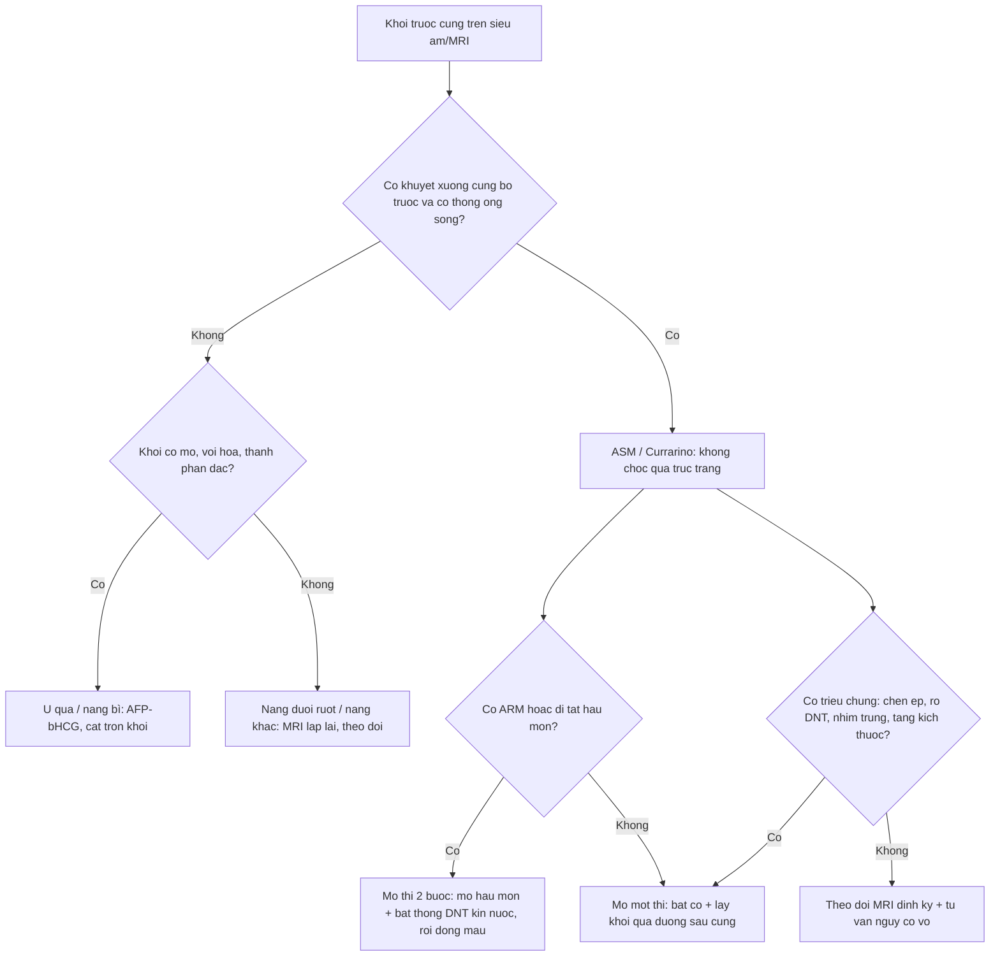
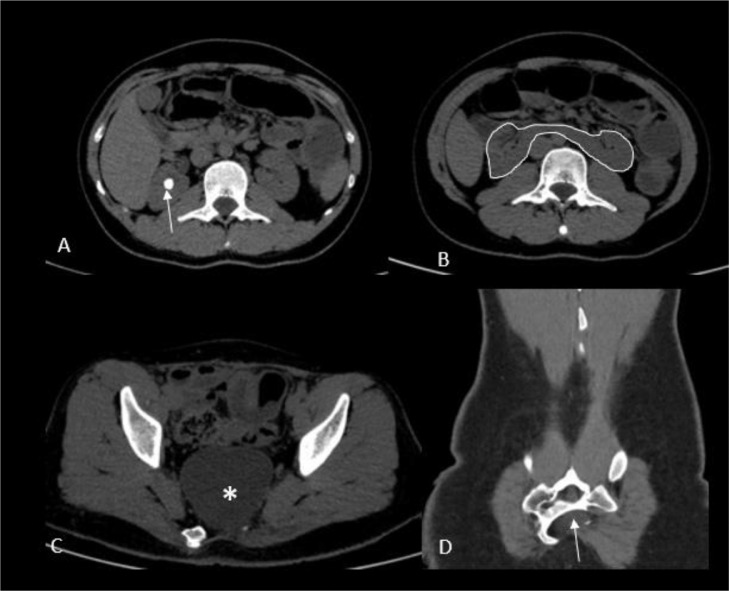
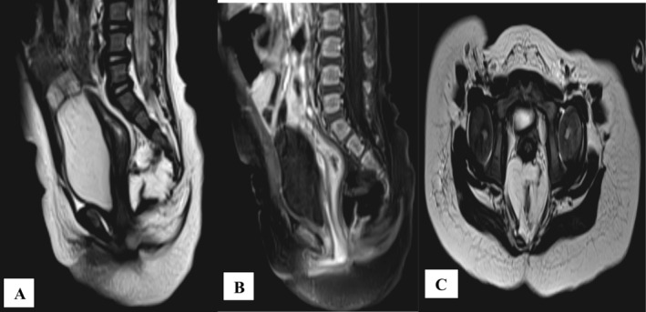
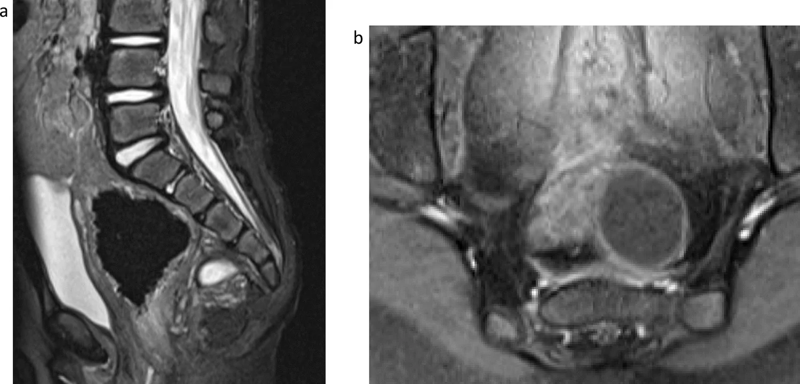

# 1854 — Màng não tủy trước cùng & tam chứng Currarino ở trẻ / Anterior sacral meningocele & Currarino syndrome

**Tags:** `pattern:khoi-truoc-cung` `pattern:nang-dich` `pattern:di-tat-hau-mon` `pattern:khuyet-xuong-cung` `pattern:bat-san-xuong-cung` `vung:mong-cung-cut` `vung:chau` `vung:tuy-song` `vung:hau-mon-truc-trang` `protocol:MRI-chau` `protocol:MRI-tuy-song` `protocol:CT-xuong` `protocol:CT-tuy-myelo` `score:Rintala` `score:Krickenbeck`

**Mức chắc chắn (certainty):** tổng hợp y văn (literature synthesis) — **một tổng quan di truyền hệ thống** (Orphanet J Rare Dis 2021, PMC8034116), **một đoàn hệ 15 trẻ + gộp 89 bệnh nhân** về kết cục chức năng (Transl Pediatr 2026, PMC13263440), **ba ca nguyên văn có ảnh** (PMC9218298; PMC13415978; PMC13658381), **hai ca/series phẫu thuật** (PMC13201954; PMC13658381) và **một tổng quan ca** về hội chứng (PMC13221596). Không có thử nghiệm ngẫu nhiên; các ngưỡng mổ/theo dõi là **thực hành đồng thuận**, chỗ suy luận được ghi rõ.

> **Câu chốt:** khối **trước xương cùng** ở trẻ + **khuyết xương cùng hình lưỡi liềm** + **dị tật hậu môn–trực tràng (ARM)** = **tam chứng Currarino**; nhưng **tam chứng đầy đủ chỉ ở một phần bệnh nhân** — tới **một nửa** có biểu hiện không đầy đủ và dễ bị chẩn đoán muộn tới tuổi vị thành niên/người lớn (PMC13415978). Ba số quyết định: **(1)** **khối trước cùng gặp 60–80%** ca Currarino, hay nhất là **màng não tủy trước cùng (ASM)** (PMC13415978); **(2)** **MNX1 (7q36.3)** dương ở **~92% thể gia đình** và **~32% thể lẻ tẻ** (không phát hiện đột biến ở **7,7%** gia đình và **68%** lẻ tẻ) (PMC8034116); **(3)** **túi thông với ống sống** — **chọc hút/sinh thiết qua trực tràng hoặc âm đạo có thể gây viêm màng não**, và mục tiêu mổ là **bịt thông dịch não tủy bằng khâu kín nước** (PMC13201954; PMC13415978).

## 1. Tổng quan bệnh học – cơ chế hình ảnh (TẠI SAO)

### 1.1 Phôi thai học: vì sao ba dị tật đi cùng nhau

- **Chồi đuôi (caudal eminence) và dây sống (notochord)** phát triển trong **tuần 4–7**, đồng thời tách **ống thần kinh** khỏi **ruột sau (hindgut)**. Rối loạn **mô hình hóa lưng–bụng (dorsal–ventral patterning)** ở vùng này làm **không tách hoàn toàn** nội bì và ngoại bì thần kinh → cùng lúc sai **xương cùng, ống sống cuối, và hậu môn–trực tràng** (PMC8034116; PMC13221596).
- **Gen chính: MNX1 (HLXB9) tại 7q36.3** — yếu tố phiên mã cần cho **tế bào thần kinh vận động và tụy**, và cho **đóng ống thần kinh sau + phân vùng ruột sau**. Đột biến MNX1 **di truyền trội trên nhiễm sắc thể thường, độ thấm không hoàn toàn, biểu hiện biến thiên** — nên **cùng một gia đình có người chỉ táo bón, người có tam chứng đầy đủ, người hoàn toàn không triệu chứng** (PMC8034116).
- **Vì sao xương cùng hình lưỡi liềm ("scimitar sacrum")**: thiếu **một bên** thân/ cuống đốt cùng ở đoạn dưới tạo bờ cong lệch một bên trên phim thẳng — khác **bất sản toàn bộ dưới S2** ở thể nặng (PMC8034116). Trên CT, đây là **khuyết xương bờ trước** của ống cùng, đúng chỗ túi màng não thoát ra.
- **Vì sao có màng não tủy trước cùng:** ống cùng **không đóng hoàn toàn ở phía trước** → **màng cứng và nhện** lồi qua khuyết xương vào khoảng trước cùng, **thành mỏng, chứa dịch não tủy**, và **thường còn thông với khoảng dưới nhện**. Chính **sự thông này** quyết định toàn bộ biến chứng: nhiễm trùng đi ngược lên màng não, rò dịch, đau đầu do hạ áp lực nội sọ.

### 1.2 Phân loại khối trước cùng — vì sao phải phân biệt trước khi chọc

- **Màng não tủy trước cùng (ASM):** hay gặp nhất, **tín hiệu dịch não tủy đồng nhất** trên mọi chuỗi xung (T1 tối, T2 rất sáng, FLAIR tối), **thành mỏng không ngấm thuốc**, **có cổ thông qua khuyết xương**.
- **U quái trưởng thành (mature teratoma):** **hỗn hợp mỡ (T1 sáng, mất tín hiệu trên fat-sat) + nang + vôi hóa + mô đặc ngấm thuốc**; chiếm tỉ lệ đáng kể sau ASM (PMC13415978).
- **Nang ruột (enteric cyst) / nang đuôi ruột (tailgut cyst) / nang bì–biểu bì:** tín hiệu dịch **không đồng nhất**, có thể **tăng đậm độ trên T1 do protein/máu**, **không thông ống sống**.
- **Điểm mấu chốt:** **không có dấu hiệu nào trên siêu âm đủ để loại trừ thông ống sống** — phải **MRI** và, khi cần, **CT tủy (CT myelography)** để chứng minh cổ thông (PMC13201954; PMC13415978).
- **Vì sao nguy hiểm:** khối nằm **sát trực tràng/âm đạo**, thành mỏng, **nhiễm khuẩn từ lòng ruột/âm đạo đi thẳng vào khoảng dưới nhện**. Tổng quan 2026 ghi **chỉ 6 ca vỡ màng não tủy trước cùng** trong y văn nhưng **vỡ thường gây viêm màng não và có thể tử vong**, và **nguy cơ tăng rõ khi chọc hút/sinh thiết qua trực tràng hoặc âm đạo** (PMC13201954).

### 1.3 Dịch tễ và di truyền — con số để tư vấn

- **Tần suất ước tính 1–9/100.000** (PMC13263440); trước 2020 **< 250 ca được báo cáo** (PMC7341113, 2020) — tức đây là bệnh **cực hiếm nhưng không phải "không gặp"**.
- **Giới:** gộp dữ liệu > 60 nghiên cứu cho **nữ:nam 1,39:1** (PMC8034116); thể **không gia đình** có thể tới **3:1** (PMC13221596).
- **MNX1:** phân tích đột biến **thành công ở 57,4%** tổng số bệnh nhân được xét nghiệm; **không tìm thấy đột biến ở 7,7% thể gia đình** và **68% thể lẻ tẻ** (PMC8034116) → **MNX1 âm không loại trừ Currarino**, và còn **gen/ vùng điều hòa khác** chưa biết.
- **Dị tật Müllerian đi kèm tới 15%** (PMC13221596; PMC8034116) — tử cung đôi, vách âm đạo, bất sản tử cung/âm đạo; ở bé gái có ARM **phải chủ động tìm**.
- **Dị tật ống thần kinh được đề nghị coi là "thành phần thứ tư"**: **dây chằng tận (filum) dày, tủy bám thấp (tethered cord), mỡ tủy, nang thần kinh–ruột** (PMC8034116) — giải thích vì sao **bắt buộc MRI toàn bộ ống sống**, không chỉ vùng cùng.
- **Nguy cơ ác tính của u quái:** trong u quái trước cùng của Currarino, **sống không ác tính 2 năm 100%** so với **58%** ở u quái cùng–cụt thông thường (Dirix, dẫn qua PMC8034116) — **nguy cơ thấp hơn nhưng không bằng 0**, có ca **ác hóa cả ở trẻ em**.

## 2. Mẫu hình + chẩn đoán phân biệt theo vị trí (gamut)

- **Khối dịch trước xương cùng + khuyết xương cùng bờ trước + ARM:** **Currarino/ASM** — gamut chính; hỏi thêm **táo bón mạn, tiểu khó, đau đầu tư thế**.
- **Khối trước cùng có mỡ/vôi hóa:** **u quái trưởng thành**, **nang bì**, **nang đuôi ruột**; phân biệt với **u quái cùng–cụt** (thường **ra ngoài da**, không có khuyết xương bờ trước).
- **Khối dịch trước cùng ở bé gái:** phân biệt **nang buồng trứng**, **nang cạnh buồng trứng**, **áp-xe túi cùng**, **nang niệu rốn** (ở **trước** bàng quang, không phải sau trực tràng), **thận lạc chỗ**.
- **Bất sản xương cùng đơn thuần:** phân biệt **hội chứng thoái triển đuôi (caudal regression)** — thường kèm **đái tháo đường mẹ**, **dị tật chi dưới, niệu–sinh dục**, **không có khối trước cùng**; **VACTERL** — không có khối trước cùng đặc trưng.
- **Khối vùng chậu + đau đầu tư thế:** nghĩ **ASM đã vỡ/rò dịch não tủy** — cấp cứu, phân biệt **hạ áp lực nội sọ tự phát** và **rò dịch não tủy sau chấn thương**.
- **Gợi nhớ "CURRA":** **C**audal (bất sản xương cùng), **U**nderlying MNX1, **R**ectal malformation, **R**etrorectal/presacral mass, **A**ssociated tethered cord + Müllerian anomaly.

## 3. Bảng so sánh phân biệt (ma trận đối chiếu)

| Thực thể (entity) | Hình ảnh điển hình | Chốt vào (rule-in) | Chốt loại (rule-out) | Gợi ý xác nhận |
|---|---|---|---|---|
| **Màng não tủy trước cùng (ASM)** | Nang **tín hiệu dịch não tủy đồng nhất**, thành mỏng, **cổ xuyên khuyết xương cùng bờ trước** | **Cổ thông với khoảng dưới nhện** (MRI/CT tủy) + khuyết xương bờ trước | Thành dày ngấm thuốc, không có cổ → nghĩ u/nang khác | MRI T2 sagittal + CT tủy khi cổ không rõ |
| **U quái trưởng thành** | **Mỡ (T1 sáng) + nang + vôi hóa + mô đặc**, có thể **thành phần ngấm thuốc** | **Mỡ/vôi hóa trong khối** + AFP/β-hCG bình thường | Nang thuần dịch đồng nhất, không mỡ/vôi → ASM | MRI ± CT; **AFP, β-hCG**; mô bệnh sau cắt |
| **Nang đuôi ruột (tailgut cyst)** | Nang **đa thùy**, tín hiệu **không đồng nhất** (protein/máu), không mỡ | **Vị trí trước cùng + không thông ống sống + không mỡ** | Có **mỡ/vôi hóa** → u quái; có **cổ thông** → ASM | MRI; mô bệnh (không chọc qua trực tràng) |
| **Nang bì/ biểu bì** | Nang **T1 tăng do keratin**, có thể vôi hóa, **không mỡ** | **Keratin T1 sáng + không ngấm thuốc** | **Mỡ thật (mất tín hiệu fat-sat)** → u quái | MRI fat-sat; mô bệnh |
| **Nang buồng trứng** | Nang **xuất phát từ buồng trứng**, đẩy trực tràng ra sau | **Có mô buồng trứng bình thường cùng bên, không dính xương cùng** | **Khuyết xương cùng + cổ thông** → ASM | Siêu âm + MRI; theo dõi chu kỳ |
| **U quái cùng–cụt** | Khối **cùng–cụt, thường có phần ngoài da**, **không khuyết xương bờ trước** | **Khối ngoài da + xương cùng nguyên vẹn** | **Khuyết xương + khối trong khoang trước cùng** → Currarino | X-quang/CT xương cùng; AFP |
| **Thoái triển đuôi (caudal regression)** | **Bất sản xương cùng**, **không có khối trước cùng**, hay kèm dị tật chi/niệu | **Bất sản xương + mẹ đái tháo đường + dị tật đa cơ quan** | **Có khối trước cùng** → Currarino | X-quang/CT; MRI tủy; siêu âm thận |
| **Rò/ vỡ ASM (biến chứng)** | Nang **xẹp, dịch quanh**, **đau đầu tư thế**, có thể **viêm màng não** | **Đau đầu tăng khi đứng + dịch não tủy quanh khối + sốt/cứng gáy** | Nang căng, không triệu chứng tư thế → chưa vỡ | MRI + DNT; **không chọc qua trực tràng** |

### Dấu hiệu lâm sàng – hình ảnh phối hợp

- **Táo bón mạn là triệu chứng hay gặp nhất**, có thể **là biểu hiện duy nhất** ở trẻ nhỏ → **khối trước cùng chèn trực tràng** (PMC13221596; PMC13263440).
- **Tiểu khó, tiểu không tự chủ, ứ nước thận** do **chèn niệu quản/bàng quang** hoặc **bàng quang thần kinh do tủy bám thấp**.
- **Đau đầu tư thế (tăng khi đứng, giảm khi nằm)** = **hạ áp lực nội sọ do rò dịch** — dấu hiệu **cấp cứu**, không phải "đau đầu do táo bón".
- **Khám da vùng cùng–cụt:** hốc lõm, chùm lông, mỡ dưới da, lỗ rò — **dấu hiệu thoát vị tủy–màng não ẩn**; **khám hậu môn–sinh dục** tìm **lỗ hậu môn lạc chỗ, rò tiền đình/đáy chậu**.

## 4. Protocol chụp + quyết định mổ/theo dõi

### 4.1 Protocol

- **Siêu âm** (sàng lọc, trẻ nhỏ): khối dịch **trước xương cùng**, đo kích thước, xem **có thành phần đặc/mỡ**; **giới hạn**: không thấy cổ thông và **không loại trừ** ASM.
- **MRI vùng cùng–chậu + toàn bộ ống sống** (chuẩn): **T2 sagittal + axial**, **T1**, **T1 fat-sat**, **T1 sau tiêm**, **DWI**; bắt buộc đánh giá **tủy bám thấp, filum dày, mỡ tủy, giãn ống trung tâm**, và **mối liên tục giữa khối và ống sống**. MRI là yếu tố **quyết định kế hoạch mổ** (PMC13415978).
- **CT xương cùng lát ≤ 1 mm:** xác định **khuyết bờ trước, mức bất sản (dưới S2), hình lưỡi liềm**, và **vôi hóa** trong khối.
- **CT tủy (hoặc tủy đồ cản quang)** khi MRI **không chứng minh được cổ thông** mà vẫn nghi ASM (PMC13201954).
- **Xét nghiệm:** **AFP và β-hCG** trước mổ (u quái/ác tính); **siêu âm thận – đường niệu**; **đánh giá cột sống và chi dưới**; **di truyền MNX1** và **tầm soát gia đình** khi có thể.
- **Cấm tuyệt đối:** **chọc hút hoặc sinh thiết qua trực tràng/âm đạo** khối trước cùng **chưa loại trừ ASM** — nguy cơ **viêm màng não** (PMC13201954).

### 4.2 Quyết định (flowchart)

- **Mục tiêu mổ (không thương lượng):** **(1)** **bịt thông giữa túi và khoảng dưới nhện** (khâu kín nước màng cứng, có thể dùng mảnh ghép cân/màng não), **(2)** **giải ép trực tràng/bàng quang**, **(3)** **cắt khối u kèm mô bệnh**. **Khâu kín nước là yếu tố quan trọng nhất** để tránh rò dịch não tủy, nang giả, nhiễm trùng (PMC13415978).
- **Đường vào:** **sau cùng (posterior sagittal)** — thuận lợi khi có ARM để **một thì vừa tạo hình hậu môn vừa lấy khối**; **bụng/trước cùng** — khối lớn lan lên cao; **kết hợp** — khối khổng lồ. Lựa chọn theo **kích thước, lan lên, quan hệ trực tràng–mạch máu** (PMC13415978; PMC13658381).
- **Thể phức tạp (ARM nặng + khối lớn + tủy bám thấp):** **mổ theo thì** — **đầu tiên hậu môn nhân tạo giải áp**, sau đó **PSARP + cắt khối + sửa màng cứng**, cuối cùng **đóng hậu môn nhân tạo** sau khi hậu môn mới đủ rộng (ca nguyên văn, PMC13415978).
- **Theo dõi sau mổ:** **MRI 3–6 tháng** rồi **hằng năm** nếu còn nguy cơ; **AFP/β-hCG** nếu u quái; **đánh giá chức năng** bằng **Rintala** (táo bón/són) và **DVSS** (tiểu), theo dõi **tăng trưởng** vì **Z-score cân nặng −0,42, chiều cao −0,28, BMI −0,46** và **giảm dần theo tuổi** (PMC13263440).
- **Kết cục chức năng tham chiếu:** **Rintala 16,3 ± 3,0**, **DVSS trung vị 0**, và **tạo hình hậu môn trong năm đầu đời** liên quan **ít rối loạn đại tiện hơn** (gộp **89 bệnh nhân**, p = 0,03) (PMC13263440).
- **Khi nào chỉ theo dõi:** khối **nhỏ, không triệu chứng, không thông ống sống (hoặc cổ đã được xác định kín)** — nhưng phải **giải thích rõ** nguy cơ **vỡ/nhiễm trùng/ác hóa**, và **nhiều tác giả đề nghị cắt cả khối không triệu chứng** để phòng các biến cố này (PMC8034116). Đây là **vùng tranh luận**, không có thử nghiệm.

## 5. Biến thể bình thường và cạm bẫy

- **"Nang buồng trứng" ở bé gái có táo bón mạn:** bẫy kinh điển — ASM bị chẩn đoán nhầm là nang buồng trứng và **bị chọc hút** → **viêm màng não**. Luôn **nhìn xương cùng** trên mọi phim chậu và **hỏi tiền sử ARM/ táo bón từ nhỏ**.
- **Xương cùng "bình thường" trên phim thẳng:** **hình lưỡi liềm** dễ bị bỏ qua vì khuyết **một bên, bờ cong mềm**; cần **nhìn kỹ bờ trước trên CT** và **đếm đốt cùng** (bất sản dưới S2).
- **Siêu âm thấy "nang đơn thuần" ≠ không thông ống sống:** không có dấu hiệu siêu âm nào loại trừ cổ thông; **MRI là bắt buộc**.
- **Bỏ sót tủy bám thấp:** nếu chỉ chụp khung chậu mà **không chụp toàn bộ ống sống**, sẽ bỏ **filum dày/ tủy bám thấp** — nguyên nhân **rối loạn tiểu và đau lưng tiến triển** sau mổ.
- **Coi mọi khối là "u quái":** cắt khối mà **không bịt cổ màng não** → **rò dịch não tủy, nang giả, viêm màng não**; ngược lại, coi mọi khối là ASM mà **không gửi mô bệnh** → bỏ **u quái ác hóa** (đã có ca u thần kinh–nội tiết trong u quái; PMC13658381).
- **Không tầm soát gia đình:** bố/mẹ/anh chị em có **táo bón mạn, bất thường xương cùng, hoặc tiền sử mổ ARM** cần **MRI + tư vấn di truyền** — độ thấm không hoàn toàn khiến **người mang gen không triệu chứng** vẫn truyền bệnh (PMC8034116).
- **Bỏ sót dị tật Müllerian:** ở bé gái, **MRI khung chậu** phải đọc cả **tử cung/âm đạo**; dị tật gặp tới **15%** và ảnh hưởng **sinh sản** sau này (PMC13221596).
- **Đau đầu sau mổ:** phân biệt **đau đầu do hạ áp lực (rò dịch)** với **đau đầu do dẫn lưu quá mức** — cả hai đều cần **MRI + đánh giá vết mổ**, không chỉ giảm đau.

## 6. Tự lượng giá — Blind Quiz

**Ca 1 — Bé gái 11 tháng, táo bón từ lúc sinh, chất phân ra qua tiền đình âm đạo; CT bụng–chậu không cản quang.**

- Gợi ý: hậu môn không đúng vị trí; bụng chướng, chậm tăng cân.
- Câu hỏi: Ổ dịch nằm ở khoang nào? Dấu hiệu xương nào chốt chẩn đoán? Bước hình ảnh tiếp theo bắt buộc là gì?

<b>Bấm để hiện đáp án (findings + chẩn đoán)</b>

- **Findings:** (C) **khối dịch lớn trước xương cùng** (dấu \*) đẩy trực tràng ra sau; (D) **khuyết bờ trước xương cùng/ bất sản đốt cùng dưới** (mũi tên) — bất sản xương cùng hình lưỡi liềm. (A, B) là các lát khác trong cùng khảo sát (sỏi thận phải, thận móng ngựa ở ca gốc).
- **Chẩn đoán:** **tam chứng Currarino** — ARM (rò tiền đình) + khuyết xương cùng + khối trước cùng (nghĩ **màng não tủy trước cùng**).
- **Tiếp theo:** **MRI vùng cùng–chậu + toàn bộ ống sống** (T2/T1/fat-sat/sau tiêm) để **chứng minh cổ thông ống sống**, tìm **tủy bám thấp**; **CT xương lát mỏng** nếu cần; **AFP/β-hCG**. **Không chọc hút qua trực tràng/âm đạo**.
- Nguồn: Radiol Case Rep 2022, **PMC9218298**, Fig. 1 — CC BY.

**Ca 2 — Bé gái 11 tháng (ca khác), MRI khung chậu vì "khối trước cùng" trên siêu âm.**

- Câu hỏi: Chuỗi xung nào chứng minh **tín hiệu dịch não tủy**? Vì sao thành mỏng + cổ thông lại đổi hoàn toàn kế hoạch mổ?

<b>Bấm để hiện đáp án</b>

- **Findings:** (A) **T2 sagittal: khối tăng tín hiệu rất mạnh, đồng nhất** trước xương cùng, đè trực tràng; (B) T1 sagittal: **tín hiệu thấp**; (C) axial: khối dịch, thành mỏng. Không có mỡ hay vôi hóa trong khối.
- **Chẩn đoán:** **màng não tủy trước cùng** trong **Currarino** — tín hiệu **trùng với dịch não tủy** ở mọi chuỗi xung, thành mỏng, không ngấm thuốc.
- **Vì sao đổi kế hoạch:** nếu **thông ống sống**, mổ phải do **phẫu thuật thần kinh** thực hiện **khâu kín nước màng cứng trước**, rồi mới cắt khối; **chọc hút/sinh thiết trước** có thể gây **viêm màng não**. Ca gốc được mổ **2 thì** (hậu môn nhân tạo → PSARP + cắt khối + sửa màng cứng → đóng hậu môn nhân tạo), hậu môn mới hiệu chỉnh **15 mm**.
- Nguồn: Clin Case Rep 2026, **PMC13415978**, Fig. 3 — CC BY 4.0.

**Ca 3 — Bé gái 34 tháng, anh trai sinh đôi có Currarino; MRI sàng lọc vì tiền sử gia đình.**

- Câu hỏi: Vì sao **không có ARM** vẫn phải chụp? Thành phần nào trong khối gợi **u quái** chứ không phải ASM thuần? Nguy cơ nào phải nói trước mổ?

<b>Bấm để hiện đáp án</b>

- **Findings:** (a) **T2 sagittal**: khối trước cùng **hỗn hợp nang + mỡ + mô đặc**, kèm **tủy bám thấp** xuống qua khuyết xương cùng; (b) **T1 sau tiêm**: phần **mô đặc ngấm thuốc** trong khối.
- **Chẩn đoán:** **Currarino thể không đầy đủ** (không ARM) với **khối trước cùng hỗn hợp** — mô bệnh là **u quái trưởng thành + myxopapillary ependymoma** (ca 1 của series). **Không có ARM không loại trừ Currarino**, nhất là khi có **tiền sử gia đình** (MNX1 trội, thấm không hoàn toàn).
- **Nguy cơ trước mổ:** **rò dịch não tủy/viêm màng não** nếu không khâu kín nước màng cứng; **tổn thương rễ S2–S4** gây **rối loạn tiểu–đại tiện**; **tái phát/ác hóa** nếu cắt không trọn. Ca gốc được **gỡ tủy + bịt màng não + cắt khối qua đường sau**, hồi phục tốt.
- Nguồn: Childs Nerv Syst 2026, **PMC13658381**, Fig. 1 — CC BY 4.0.

## Bài liên quan chéo
- [1749 – Hội chứng nhân đôi đuôi (caudal duplication)](../1749-hoi-chung-nhan-doi-duoi-caudal-duplication/lesson.md) (khối/ dị tật vùng cùng–cụt)
- [3075 – Dị tật hậu môn–trực tràng ở sơ sinh](../3075-di-tat-hau-mon-truc-trang-so-sinh/lesson.md) (phân loại ARM, PSARP)
- [220 – Ống sống tủy](../220-ong-song-tuy/lesson.md) (tủy bám thấp, đóng ống thần kinh)
- [600 – Tổng quan Nhi](../600-tong-quan-nhi-khoa/lesson.md)
- [200 – Tổng quan Thần kinh](../200-tong-quan-he-than-kinh/lesson.md)

## Ảnh
- Tên file: `1854_currarino_{Modality}_{PMCID}.{ext}`. Nguồn + giấy phép từng ảnh: `images/CREDITS.md`.
- Cả 3 ảnh là **nguyên bản** (không crop, không ghép), **CC BY / CC BY 4.0**.

> Không dùng để chẩn đoán độc lập khi chưa có người hướng dẫn.
