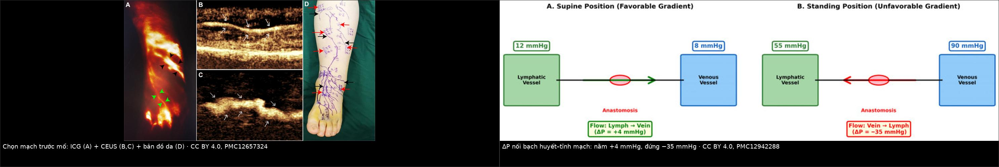
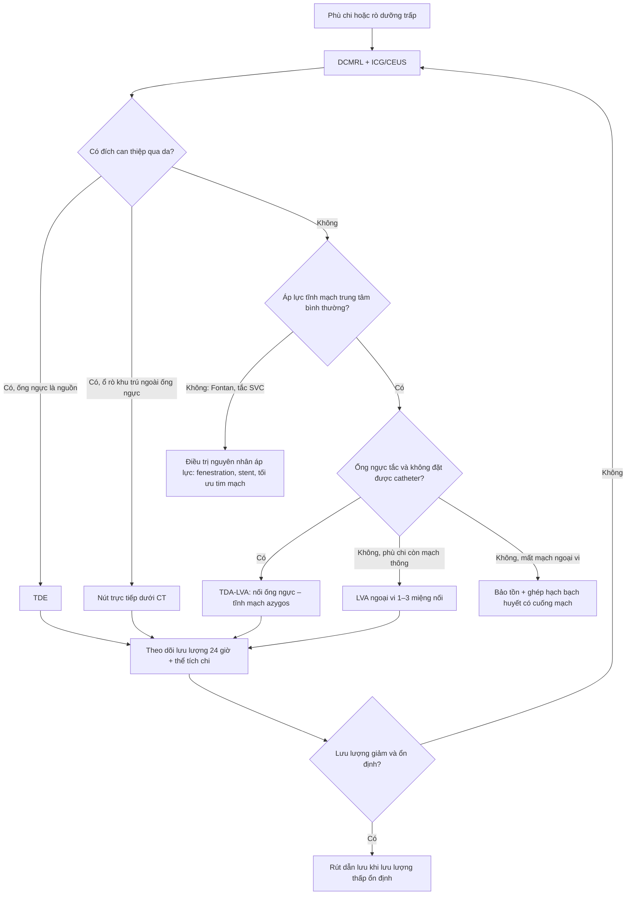
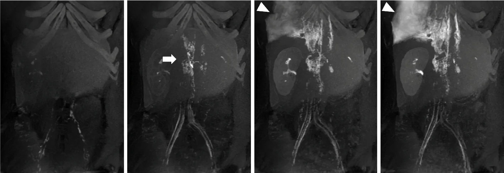
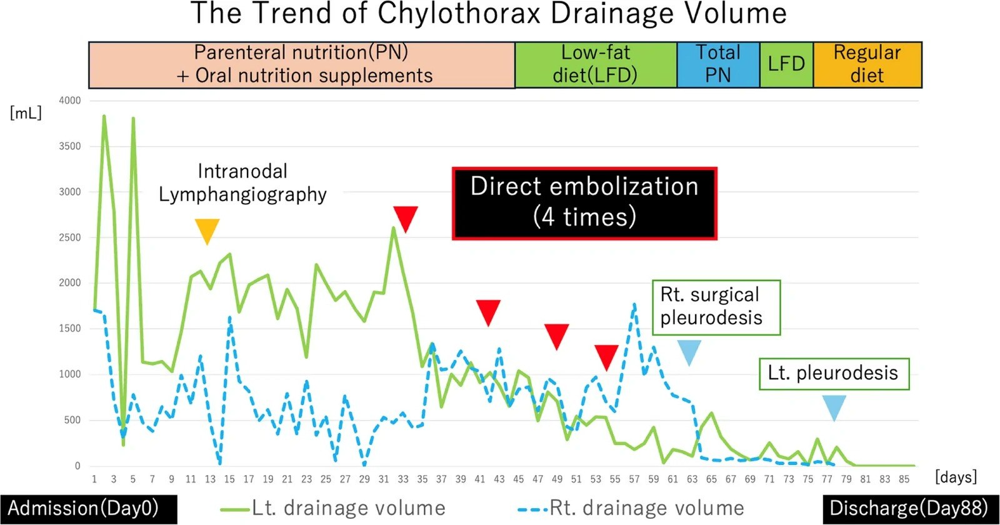
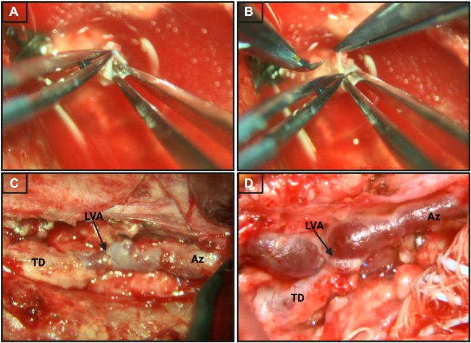

# 1855 — Khi DCMRL không có đích để nút: nối bạch huyết–tĩnh mạch (LVA) và chuyển hướng dòng ống ngực / Lymphovenous anastomosis and thoracic duct flow diversion after a non-targetable DCMRL

**Tags:** `pattern:phu-bach-huyet` `pattern:ro-bach-huyet` `pattern:chylothorax` `vung:ong-nguc` `vung:chi-duoi` `anatomy:ong-nguc` `anatomy:cisterna-chyli` `protocol:ICG-lymphography` `protocol:lymphoscintigraphy` `protocol:CEUS` `protocol:DCMRL` `protocol:LVA` `score:ISL` `score:MDACC-ICG`

**Mức chắc chắn (certainty):** tổng hợp y văn (literature synthesis) — tự biên từ **tổng quan can thiệp bạch huyết 2 phần** (PMC9892216, PMC9892215; CC BY-NC 4.0), **tái thẩm định huyết động học của LVA chi dưới** (PMC12942288, CC BY 4.0), **nghiên cứu ICG + CEUS trước LVA ở 42 bệnh nhân** (PMC12657324, CC BY 4.0), **ca chylothorax do lymphoma thất bại với nút ống ngực rồi khỏi nhờ nút trực tiếp** (PMC13627481, CC BY 4.0), **loạt 8 trẻ nối ống ngực–tĩnh mạch azygos** (PMC13100813, CC BY-NC-ND 4.0) và **thuật toán điều trị phù bạch huyết sau ung thư vú** (PMC13604093, CC BY 4.0). Không gắn một ca nguyên văn duy nhất của riêng bài.

> **Bài này là "nhánh B" của [1822 – DCMRL](../1822-dcmrl-bach-huyet/lesson.md).** 1822 trả lời *rò ở đâu và có nút được không*: trong **70 ca**, chỉ **47,7%** có giải phẫu can thiệp được qua da, và **90,3%** trong số đó điều trị thành công, còn nhóm không thuận lợi chỉ đạt **62,5%** (PMC11473261). Vậy **52,3% còn lại làm gì?** Bài này trả lời đúng câu đó: **nối bạch huyết–tĩnh mạch (lymphovenous anastomosis, LVA)**, **nối ống ngực–tĩnh mạch azygos (thoracic duct-to-azygous LVA, TDA-LVA)**, **nút trực tiếp ổ rò dưới CT** khi ống ngực không phải nguồn, hoặc **điều trị nguyên nhân áp lực** — mỗi lựa chọn có **điều kiện huyết động riêng**, và chọn sai thì **phù nặng hơn hoặc rò tăng gấp đôi**.

> **Câu chốt:** **LVA không phải "cái van một chiều" — nó là một miệng nối không có van, đặt giữa hai khoang có áp lực đổi dấu theo tư thế.** Nằm: bạch huyết **12 mmHg** > tĩnh mạch **8 mmHg**, dòng chảy đúng chiều (ΔP **+4 mmHg**). Đứng: tĩnh mạch mắt cá **90 mmHg** > bạch huyết **55 mmHg**, ΔP **−35 mmHg** — dòng **đảo chiều**, máu tĩnh mạch chảy ngược vào mạch bạch huyết (PMC12942288). Đây là lý do **hở miệng nối 64% sau 2 năm** và **75% → 36%** từ 12 đến 24 tháng, dù **70–80% bệnh nhân vẫn cải thiện lâm sàng**. Và với ống ngực: **nối vào azygos chỉ cứu được người có áp lực tĩnh mạch trung tâm bình thường** — ở Fontan hay tắc tĩnh mạch chủ trên, azygos cũng là hệ áp lực cao, nối vào **không giải áp được gì** (PMC13100813).

## 1. Tổng quan bệnh học – cơ chế hình ảnh

- **Hệ bạch huyết là hệ "trả nước" của cơ thể:** mỗi ngày **8–12 L dịch kẽ** được đưa trở lại tuần hoàn, phần lớn qua ống ngực (PMC9892216). Khi **lưu lượng sinh ra > khả năng dẫn lưu** (tắc ống ngực, suy bơm bạch huyết, áp lực tĩnh mạch trung tâm cao), dịch ứ ở mô kẽ (**phù**) hoặc thoát ra khoang thanh mạc (**rò dưỡng trấp** — chylothorax, chylous ascites).
- **Vì sao chọn ICG để "nhìn" mạch:** indocyanine green gắn albumin, tiêm dưới da rồi chụp huỳnh quang hồng ngoại — protein–thuốc bị giữ lại trong lòng mạch bạch huyết nên mạch sáng thành đường. **Giới hạn vật lý quan trọng: độ xuyên sâu chỉ 5–10 mm** (cá biệt tới 2 cm), nên ở chi dày/xơ hóa, ICG **không thấy mạch nằm sâu** — đó là lý do phải thêm **siêu âm cản quang (contrast-enhanced ultrasound, CEUS)** với vi bọt khí: trong 42 bệnh nhân, CEUS định vị được mạch **95%**, và ca mổ **ngắn hơn 78 phút** (320 ± 124 vs 398 ± 93 phút, p < 0,001) (PMC12657324).
- **Vì sao DCMRL thấy rò mà ICG không thấy:** gadolinium pha loãng tiêm vào hạch bẹn rút ngắn **T1** của nước trong bạch huyết → mạch **tăng tín hiệu trên T1 3D fat-sat**, chụp lặp mỗi 30–60 giây cho **bản đồ dòng theo thời gian**; mỡ bị dập nên dịch bạch huyết nổi bật. Đây là chuỗi **động**, không phải T2 hình thái — chỉ chuỗi động mới trả lời "thuốc thoát ra chỗ nào" (1822).
- **TẠI SAO LVA chạy được — và tại sao nó hay hỏng:** miệng nối bạch huyết–tĩnh mạch **không có van**, nên chiều dòng do **chênh áp** quyết định. Cột thủy tĩnh từ mắt cá tới tim cao **~120 cm**, tạo áp lực tĩnh mạch mắt cá **80–100 mmHg** khi đứng; áp lực bạch huyết chỉ tăng tới **~55 mmHg** vì dòng bị chia đốt bởi van. Kết quả: **nằm ΔP +4 mmHg (lymph → vein), đứng ΔP −35 mmHg (vein → lymph)** (PMC12942288). Đây là **cơ chế vật lý của "hở muộn"**, không phải lỗi kỹ thuật đơn thuần.
- **Ngưỡng định lượng của kết cục LVA:** thành công lâm sàng **70–80%** ở trung tâm lớn; nhưng **hở miệng nối 64% sau 2 năm**, thông **75% ở 12 tháng → 36% ở 24 tháng**; giảm thể tích chi **600 ± 969 mL** (còn thông) vs **420 ± 874 mL** (đã tắc) — **khác biệt không có ý nghĩa** (PMC12942288). Nghĩa là: **đừng hứa với bệnh nhân dựa vào "miệng nối còn thông"**; hãy theo dõi **thể tích chi, số đợt viêm mô tế bào, chất lượng sống**.
- **TẠI SAO nối ống ngực vào azygos lại khác nối chi:** ống ngực bị **tắc** làm áp lực trong hệ bạch huyết tăng, gây **anasarca, tràn dịch, suy hô hấp**. Nối ống ngực xuống **tĩnh mạch azygos** tạo một **cửa thoát dự phòng** — nhưng azygos đổ vào **tĩnh mạch chủ trên**, nên nếu áp lực trung tâm đã cao (Fontan, hẹp/tắc SVC) thì "cửa thoát" này **cũng bị chặn** (PMC13100813).

## 2. Mẫu hình + chẩn đoán phân biệt theo vị trí (gamut)

- **Phù chi (lymphedema) — theo giai đoạn ISL:** **I** phù mềm, nâng chi là hết; **II** phù không hết khi nâng chi; **III** xơ–mỡ, thay đổi nuôi dưỡng da (PMC13604093). LVA chỉ có ý nghĩa khi **còn mạch bạch huyết ngoại vi để nối** — trên phân độ **MD Anderson bằng ICG (0–5)**, **giai đoạn 3** đã "ít mạch thông + trào ngược da lan rộng", **giai đoạn 5** là **không còn mạch, không di chuyển thuốc, không co bóp** → nối vào đâu?
- **Rò dưỡng trấp trung tâm (chylothorax, chylous ascites, chylopericardium):** tìm **điểm rò** trên DCMRL/chụp bạch huyết; nếu ống ngực là nguồn → **nút ống ngực (thoracic duct embolization, TDE)**; nếu ổ rò **không nằm ở ống ngực** (u lymphoma co nhỏ để lại sẹo rò, dị dạng bạch huyết khu trú) → **nút trực tiếp dưới CT**.
- **Rối loạn dòng bạch huyết trung tâm (central conducting lymphatic anomaly, CCLA):** dòng **ngược chiều, ứ trong ngực/bụng**, thường kèm tràn dịch nhiều khoang; nhóm này là **"đất" của TDA-LVA và của điều trị nguyên nhân áp lực**, không phải của LVA chi.
- **Gamut theo "không có đích để nút" — 4 khả năng, đừng gộp làm một:** (1) **không có đường vào ống ngực** (kỹ thuật thất bại 37% — PMC9892215); (2) **rò ngoài ống ngực** (đa ổ, do u, do dị dạng); (3) **rò dưới hoành** (chylous ascites — nút ống ngực làm **nặng hơn**); (4) **nguyên nhân là áp lực tĩnh mạch trung tâm cao** (Fontan, SVC) — can thiệp bạch huyết đơn thuần **không chữa được**.
- **Mnemonic "Lymph–Vein chạy được khi 3 điều kiện":** **L**ưu lượng còn (mạch còn thông), **V**enous pressure thấp (không tăng áp trung tâm), **C**hênh áp đúng chiều (nằm là chính).

## 3. Bảng so sánh phân biệt (ma trận đối chiếu)

| Thực thể (entity) | Hình ảnh điển hình | Chốt vào (rule-in) | Chốt loại (rule-out) | Gợi ý xác nhận |
|---|---|---|---|---|
| **LVA ngoại vi** (lymphaticovenous anastomosis) | ICG thấy **mạch tuyến tính liên tục** tới gần chỗ nối; CEUS thấy lòng mạch **≥ 0,5 mm** và đo được độ sâu | **Còn mạch thông ngoại vi (ICG/CEUS) + phù ISL I–II + chưa xơ hóa** | **MD Anderson ICG 4–5** (không mạch, không co bóp) hoặc chi đã xơ cứng → nối sẽ tắc ngay | ICG + CEUS trước mổ; đo thể tích chi làm mốc |
| **TDA-LVA** (nối ống ngực – tĩnh mạch azygos) | Ống ngực **tắc/không đổ được vào góc tĩnh mạch**; DCMRL thấy ứ trung tâm, không có đường thoát | **Tắc ống ngực + áp lực tĩnh mạch trung tâm BÌNH THƯỜNG + thất bại/không khả thi TDE** | **Fontan, hẹp/tắc SVC, tăng áp phổi nặng** → azygos cũng áp lực cao, nối vô ích (PMC13100813) | Siêu âm tim/áp lực CVP trước mổ; chụp bạch huyết kiểm tra sau mổ |
| **TDE** (nút ống ngực) | Ống ngực giãn, **thoát thuốc trực tiếp** vào khoang màng phổi; ống ngực là nguồn duy nhất | **Rò dưỡng trấp ngực + ống ngực là nguồn + đặt được catheter** | **Rò dưới hoành (chylous ascites)** → nút làm nặng cổ trướng; **không định vị được chỗ rò** → nút mù làm nặng rò | Chụp bạch huyết qua hạch bẹn; DCMRL; đo lưu lượng dẫn lưu 24 giờ |
| **Nút trực tiếp ổ rò dưới CT** (direct embolization) | DCMRL thấy **một ổ rò khu trú** từ khối u/sẹo; ống ngực bình thường hoặc đã nút thất bại | **Ổ rò khu trú nhìn thấy + tiếp cận được bằng kim dưới CT** | Rò lan tỏa nhiều ổ, không thấy đích → không có gì để bơm | CT dẫn đường + NBCA:iodized oil **1:2** (PMC13627481) |
| **Điều trị bảo tồn / nguyên nhân** (LFD, MCT, TPN, octreotide; fenestration) | Không có hình ảnh đặc hiệu; **lưu lượng dẫn lưu giảm dần** theo ngày | **Lưu lượng thấp, ổn định, bệnh nhân chịu được** — và **luôn là bước đầu** | Lưu lượng **không giảm sau 1–2 tuần** hoặc **tăng** → phải can thiệp | Bảng lưu lượng 24 giờ; albumin, điện giải, lymphocyte |

*Trái (A–D): ICG huỳnh quang, CEUS mặt cắt dọc mạch, và bản đồ da đánh dấu hai phương thức. Phải: áp lực hai bên miệng nối ở tư thế nằm (ΔP +4 mmHg) và đứng (ΔP −35 mmHg). Nguồn: PMC12657324 và PMC12942288, CC BY 4.0; ghép letterbox, không crop.*

### Ba con số quyết định "nối hay không nối"
- **63,1%:** tỷ lệ đặt được catheter vào ống ngực trong các loạt TDE; khi đã đặt được, **thành công lâm sàng 90–92%** (PMC9892215). Nói cách khác: **thất bại kỹ thuật là chuyện thường, không phải biến cố** — phải có phương án B.
- **47,7% → 62,5%:** tỷ lệ ca DCMRL có giải phẫu can thiệp được, và tỷ lệ thành công khi giải phẫu **không thuận lợi** (PMC11473261 qua 1822). Nhóm 62,5% này chính là **chỉ định của LVA/TDA-LVA**.
- **75% → 36%:** thông miệng nối LVA chi dưới từ 12 đến 24 tháng (PMC12942288) — dùng để **tư vấn trước mổ**, không dùng để đánh giá thành công.

## 4. Protocol + hệ phân độ / điểm chuẩn hóa

- **Bước 1 — xác định "có đích hay không":** DCMRL (tiêm gadolinium pha loãng vào hạch bẹn hai bên, chuỗi 3D T1 fat-sat lặp mỗi 30–60 giây, theo 1822). Trả lời 3 câu: **ống ngực có hiện hình? rò ở đoạn nào? có đường qua da không?**
- **Bước 2 — đo lưu lượng trước khi can thiệp:** đặt dẫn lưu, ghi **mL/24 giờ** mỗi ngày. Đây là **biến số theo dõi chính**; một ca dưỡng trấp hai bên dao động **3.800 mL/ngày** xuống **0 mL** trong **88 ngày** (PMC13627481).
- **Bước 3 — chọn kỹ thuật theo bảng:** TDE nếu ống ngực là nguồn; **nút trực tiếp dưới CT** nếu ổ rò khu trú; **TDA-LVA** nếu ống ngực tắc và CVP bình thường; **LVA chi** nếu phù ngoại vi còn mạch thông.
- **Bước 4 — chuẩn bị mổ LVA:** **ICG + CEUS** (không chỉ ICG), đánh dấu **vị trí và độ sâu** mạch; dự kiến **1–3 miệng nối**; dự phòng **78 phút** chênh lệch thời gian mổ nếu chỉ dùng ICG (PMC12657324).
- **Bước 5 — theo dõi sau nối:** lưu lượng dẫn lưu (ngực/bụng/chi), **thể tích chi**, số đợt **viêm mô tế bào**, albumin/điện giải; siêu âm tim/áp lực CVP nếu nghi tăng áp trung tâm. **Không có ngưỡng "khô" được đồng thuận** — trong loạt TDA-LVA ở trẻ, lưu lượng ống ngực tuần đầu sau mổ là **15 mL/ngày (IQR 9–37)** và đó là mốc thực dụng để cân nhắc rút dẫn lưu (PMC13100813).
- **Hệ phân độ dùng trong bài:** **ISL I–III** cho phù chi; **MD Anderson ICG 0–5** cho mức còn mạch; **CCLA** cho rối loạn dòng trung tâm (1822).

## 5. Biến thể bình thường và cạm bẫy

- **Nút ống ngực khi chưa xác định được chỗ rò = làm bệnh nặng hơn.** Ca nguyên văn: nam **53 tuổi**, lymphoma B độ ác thấp, **chylothorax hai bên** ở chu kỳ 2 bendamustine; chụp bạch huyết qua hạch **2 lần không thấy chỗ rò**, vẫn nút ống ngực bằng NBCA qua góc tĩnh mạch trái ở tuyến trước → **tràn dưỡng trấp nặng lên rõ rệt**, phải dẫn lưu hai bên; DCMRL sau đó mới thấy **rò từ sẹo u đã co nhỏ**; **4 lần nút trực tiếp dưới CT** + pleurodesis hai bên → khô, ra viện **ngày 88** (PMC13627481). Cơ chế: nút ống ngực **tăng áp lực ngược dòng** trong khi ổ rò vẫn mở.
- **Nút ống ngực trong chylous ascites "làm nặng cổ trướng"** vì ống ngực là **đường thoát duy nhất của dịch dưới hoành**; tương tự, **nút ống ngực ở người rò dưới cơ hoành** có thể đẩy dịch lên ngực. Luôn hỏi: **rò ở trên hay dưới cơ hoành?** (PMC9892215).
- **Đo "miệng nối còn thông" khi bệnh nhân nằm** là đo trong điều kiện **thuận lợi nhất** — ICG kiểm tra thông thường được làm ở tư thế nằm, nơi ΔP **+4 mmHg**; đứng lên ΔP **−35 mmHg**. Đừng đồng nhất "thông trên bàn" với "hoạt động được cả ngày" (PMC12942288).
- **Nhầm phù do tim/thận với phù bạch huyết:** phù bạch huyết thường **một bên, không đau, mu bàn chân dày (dấu Stemmer)**, không lõm; phù tim/thận **hai bên, lõm, kèm triệu chứng toàn thân**. LVA ở bệnh nhân phù do tim là **can thiệp sai đích**.
- **TDA-LVA ở trẻ Fontan/suy tim một thất:** nối vào azygos **không hạ được áp lực hệ thống**; nhóm này cần **giảm áp lực tĩnh mạch** (fenestration, stent, tối ưu huyết động), không phải thêm miệng nối. Đây là **chốt loại** mạnh nhất trong ma trận (PMC13100813).
- **Cạm bẫy "rò đã khô" khi bệnh nhân nhịn ăn:** lưu lượng giảm vì **không có mỡ vào ruột**, không phải vì rò đã liền; phải đánh giá lại **sau khi ăn lại chất béo** trước khi rút dẫn lưu.

## 6. Tự lượng giá — Blind Quiz

**Ca 1 — Nam 53 tuổi, lymphoma B, tràn dưỡng trấp hai bên, đã nút ống ngực ở nơi khác và nặng hơn. Nhìn 4 khung DCMRL theo thời gian.**

- Gợi ý: không có khối u lớn, chỉ còn **sẹo lymphoma đã co**; ống ngực đã bị nút bằng NBCA.
- Câu hỏi: (1) ổ rò nằm ở đâu? (2) Vì sao nút ống ngực **không** giải quyết được? (3) Bước tiếp theo là gì?

<b>Bấm để hiện đáp án (findings + chẩn đoán)</b>

- **Findings:** các khung MIP thì sớm cho thấy thuốc tập trung ở **bạch mạch thắt lưng/cạnh động mạch chủ**, sau đó **thoát thành dòng lớn vào khoang màng phổi phải** từ vùng **sẹo u lymphoma** (mũi tên tam giác) — tức ổ rò **không nằm ở ống ngực** mà ở **bạch mạch quanh u**.
- **Chẩn đoán:** **rò dưỡng trấp từ sẹo u lymphoma**, đa ổ/khó định vị; nút ống ngực chỉ chặn đường thoát chính, **tăng áp lực ngược dòng** và làm rò nặng thêm.
- **Xử trí:** DCMRL định vị → **nút trực tiếp ổ rò dưới CT** bằng **NBCA:iodized oil 1:2**, lặp **4 lần**, kèm **pleurodesis** hai bên; lưu lượng về 0, ra viện ngày 88.
- **Nguồn:** *CVIR Endovasc* 2026 (PMC13627481), CC BY 4.0.

**Ca 2 — Cùng bệnh nhân. Đọc biểu đồ lưu lượng dẫn lưu 88 ngày.**

- Gợi ý: trục dọc là **mL/ngày**, trục ngang là **ngày**; mũi tên đỏ là các lần nút trực tiếp.
- Câu hỏi: (1) Lưu lượng đỉnh là bao nhiêu? (2) Dấu hiệu nào chứng minh **TDE thất bại**? (3) Khi nào có thể nói "khô"?

<b>Bấm để hiện đáp án (findings + chẩn đoán)</b>

- **Findings:** đỉnh **~3.800 mL/ngày** ở cả hai bên trong tuần đầu; sau nút ống ngực **không giảm** (đường xanh vẫn 2.000–2.600 mL/ngày); **4 lần nút trực tiếp** (mũi tên đỏ, ngày 37–55) tạo **bậc thang giảm** rõ; sau pleurodesis phải (ngày 63) và trái (ngày 77), lưu lượng về **0** quanh ngày 80.
- **Chẩn đoán:** **rò dưỡng trấp kháng trị do lymphoma**, đáp ứng với **nút trực tiếp + pleurodesis**, không đáp ứng TDE.
- **Nguyên tắc:** "khô" = **lưu lượng thấp ổn định qua nhiều ngày sau khi ăn lại**, không phải một ngày lẻ tụt xuống; phải xem **xu hướng** chứ không xem một con số.
- **Nguồn:** *CVIR Endovasc* 2026 (PMC13627481), CC BY 4.0.

**Ca 3 — Sơ đồ mổ: ống ngực (TD) nối tận–bên vào tĩnh mạch azygos (Az).**

- Gợi ý: bệnh nhi nằm viện dài ngày, phù toàn thân, thở máy, ống ngực tắc không đặt được catheter.
- Câu hỏi: (1) Miệng nối này giải áp theo đường nào? (2) Bệnh nhân nào **không** được hưởng lợi? (3) Kết quả sớm của loạt này?

<b>Bấm để hiện đáp án (findings + chẩn đoán)</b>

- **Cơ chế:** đưa bạch huyết từ ống ngực **xuống tĩnh mạch azygos**, rồi về **tĩnh mạch chủ trên** — tạo "van xả" khi ống ngực bị tắc.
- **Không được hưởng lợi:** người có **áp lực tĩnh mạch trung tâm cao** (Fontan/suy tim một thất, hẹp–tắc SVC) vì azygos cũng nằm trong hệ áp lực cao; nối vào **không hạ được áp lực**.
- **Kết quả:** **8 trẻ sơ sinh/nhũ nhi**, tạo được miệng nối **100%**, **6/8 (75%)** thành công lâm sàng, **thông miệng nối 62,5%** (5/8) sau **> 2 tháng**; lưu lượng ống ngực tuần đầu **15 mL/ngày (9–37)**; thời gian mổ trung vị **318 phút**; **1/8** phải rửa khoang màng phổi.
- **Nguồn:** *Ann Thorac Surg Short Rep* 2026 (PMC13100813), CC BY-NC-ND 4.0 — ảnh nguyên bản, không crop/ghép.

## Bài liên quan chéo
- [1822 – DCMRL: kỹ thuật, cách đọc và khi nào nút ống ngực](../1822-dcmrl-bach-huyet/lesson.md) — "nhánh A": tìm đích can thiệp
- [1858 – VLNT khi LVA không còn mạch: chọn vùng cho/nhận & bản đồ ngược](../1858-ghep-hach-bach-huyet-vlnt/lesson.md) — "nhánh B": cấy hạch khi hết kênh
- [1839 – Chylothorax sau cắt/ghép gan](../1839-chylothorax-sau-cat-gan/lesson.md) — ngưỡng triglyceride dịch và bước điều trị
- [1823 – Trametinib trong bất thường dẫn lưu bạch huyết trung tâm](../1823-trametinib-di-dang-bach-huyet-ras-mapk/lesson.md) — điều trị nội khoa CCLA
- [1808 – Sirolimus trong dị dạng bạch huyết](../1808-sirolymus-di-dang-bach-huyet-theo-doi-ngung-thuoc/lesson.md)
- [077 – Gorham–Stout / GLA](../077-loat-san-mach-bach-huyet-gla-gorham-stout/lesson.md) và [076 – Chyluria](../076-duong-trap-nieu-chyluria/lesson.md)
- [901 – Tổng quan can thiệp: an toàn và đáp ứng](../901-ir-overview/lesson.md)

> Không dùng để chẩn đoán độc lập khi chưa có người hướng dẫn.
