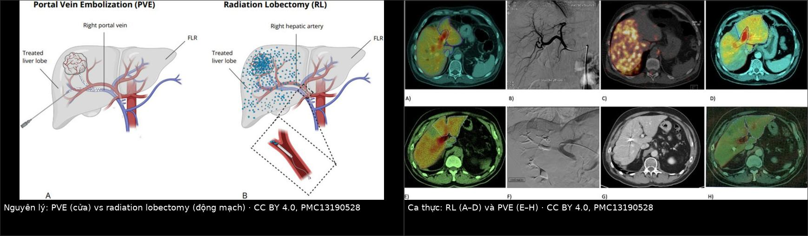
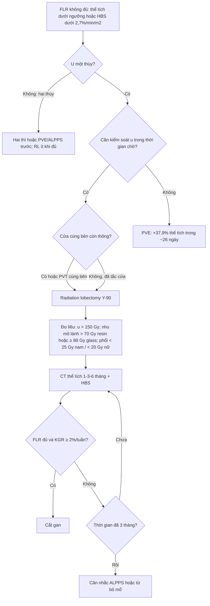
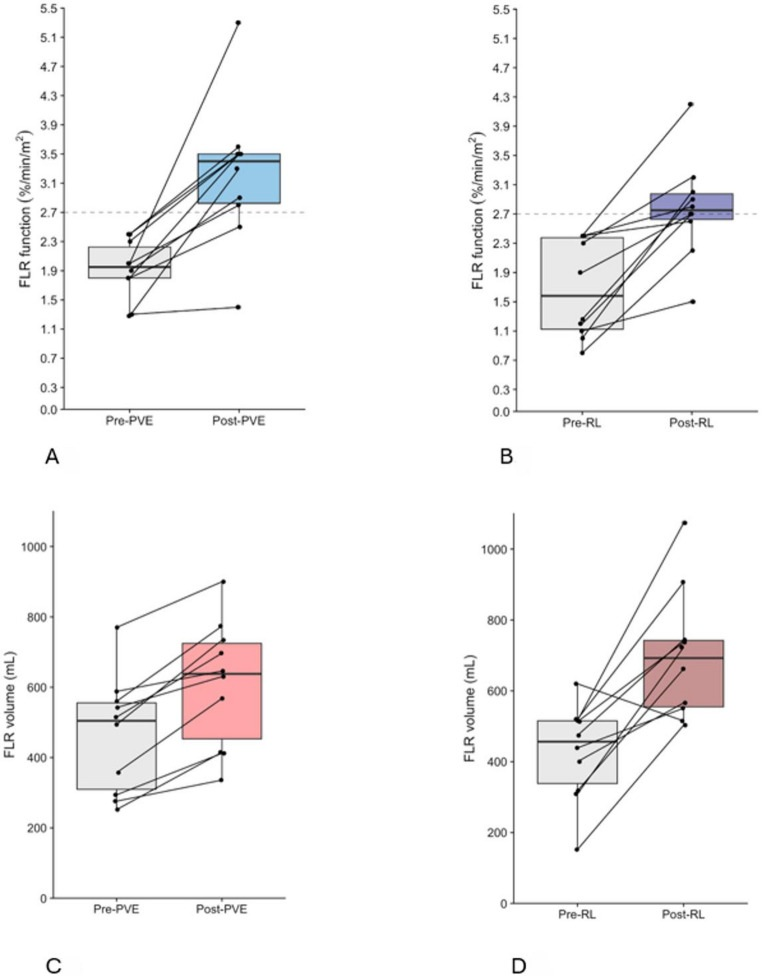
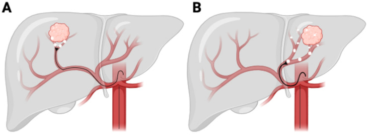
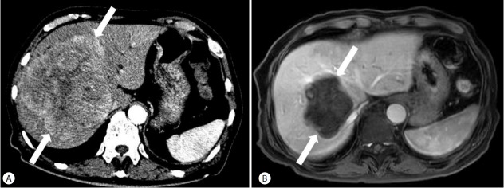

# 1856 — Radiation lobectomy bằng Y-90: tăng thể tích gan còn lại trước cắt gan lớn / Radiation lobectomy with Y-90 for future liver remnant hypertrophy

**Tags:** `pattern:phi-dai-bu-tru` `pattern:teo-thuy-gan` `vung:gan` `vung:duong-mat-trong-gan` `anatomy:FLR` `protocol:CT-volumetry` `protocol:Y90-radioembolization` `protocol:HBS-mebrofenin` `score:FLR` `score:KGR` `incidentaloma:u-gan`

**Mức chắc chắn (certainty):** tổng hợp y văn (literature synthesis) — tự biên từ **so sánh trực tiếp PVE vs radiation lobectomy ở 20 bệnh nhân ung thư đại trực tràng di căn gan** (PMC13190528, CC BY 4.0), **tổng quan Y-90 trong HCC** (PMC12071032, CC BY 4.0), **nghiên cứu đo liều PET/CT sau Y-90 dự đoán phì đại thùy đối diện** (PMC12568765, CC BY-NC 4.0), **ca HCC 13 cm teo u còn 7 cm + phì đại thùy trái sau 2 lần TARE** (PMC5497664, CC BY-NC 4.0) và **nghiên cứu mô bệnh học về tổn thương bạch mạch quanh u sau radiation lobectomy** (PMC10827593, CC BY 4.0). Không gắn một ca nguyên văn duy nhất của riêng bài.

> **Bài này là lựa chọn thứ tư trong nhóm "làm to gan trước khi cắt" của [1821 – Suy gan sau cắt gan (PHLF)](../1821-suy-gan-sau-cat-gan/lesson.md).** 1821 đã chốt **sFLR tối thiểu 20% (gan lành) / 30% (sau hóa trị) / 40% (xơ gan)**, **KGR ≥ 2%/tuần**, và so **PVE – LVD – ALPPS**. Nhưng cả ba đều **chỉ làm to gan**: khối u trong thùy bị chiếu xạ **vẫn tiếp tục phát triển trong 3–6 tuần chờ**. **Radiation lobectomy (RL)** khác ở chỗ **vừa tiêu u vừa làm teo thùy mang u**, trong **một lần can thiệp**.

> **Câu chốt:** **RL dùng chính hiệu ứng "teo – phì đại" (atrophy–hypertrophy complex) mà bất kỳ thùy gan nào bị cắt máu/chiếu xạ đều tạo ra.** Đưa vi cầu Y-90 qua **động mạch gan** vào thùy mang u → **u nhận 80–100% máu từ động mạch** nên bị chiếu liều diệt, nhu mô lành quanh u teo dần, **thùy đối diện phì đại bù trừ**: **26–45%** thể tích trong **44 ngày – 9 tháng** (PMC13190528); **~85%** bệnh nhân có phì đại đáng kể, **trung vị +40%**, và **~70%** người trước đó không đủ điều kiện mổ **đã được mổ** (PMC12071032). Cái giá: RL **chậm hơn PVE** — đủ chức năng sau **75 ngày (64–85)** so với **31 ngày (28–54)** của PVE — nên phải chọn bệnh nhân **chịu được thời gian chờ** và **cần kiểm soát u đồng thời**.

## 1. Tổng quan bệnh học – cơ chế hình ảnh

- **TẠI SAO vi cầu vào được u mà không vào nhu mô lành:** gan có **cấp máu kép** — **75% tĩnh mạch cửa, 25% động mạch gan**; nhu mô lành sống nhờ cửa. U gan (HCC, di căn) **tân mạch hóa từ động mạch**, và với di căn **> 3 mm** thì **80–100%** dòng nuôi là động mạch (PMC13714070). Bơm vi cầu **20–60 µm** vào động mạch gan → kẹt ở tiểu động mạch quanh u → **liều xạ β tại chỗ rất cao**, nhu mô lành chỉ nhận phần xạ "đi nhờ".
- **TẠI SAO thùy đối diện to ra:** khi một thùy **mất dòng cửa** (PVE) hoặc **bị chiếu xạ liều cao** (RL), thùy đó **teo**; dòng máu và yếu tố tăng trưởng dồn sang thùy còn lại → **phì đại bù trừ**. Với PVE, cơ chế là **chuyển dòng cửa tức thì**: thể tích FLR tăng **trung bình 37,9%** trong **25,9 ngày**, rồi **chững lại** (PMC13190528). Với RL, cơ chế **qua đường động mạch** và **đến nay chưa được hiểu đầy đủ**, nhưng phì đại **tiếp tục nhiều tháng** — đó là lý do kết quả phụ thuộc **thời điểm đo**.
- **Vật lý quyết định thời gian:** Y-90 là **bức xạ β** (bán rã **64,1 giờ**, đường đi trong mô **~2,5 mm**) — tức **liều cục bộ, không "xuyên" sang thùy bên kia**. Phì đại thùy lành là **phản ứng sinh học với teo thùy bị chiếu**, không phải do xạ trực tiếp. Vì vậy **phải bảo vệ thùy lành khỏi liều**: nếu FLR nhận liều cao, nó **không phì đại mà còn bị tổn thương**.
- **Ngưỡng liều đã dùng trong thực hành (nhu mô không u):** **> 70 Gy với vi cầu nhựa (resin)** và **≥ 88 Gy với vi cầu thủy tinh (glass)**; **liều u > 150 Gy**; **liều phổi < 25 Gy (nam) / < 20 Gy (nữ)**; liều trung bình toàn gan trong một loạt là **82,8 Gy** (PMC12568765). Đây là các **ngưỡng của y văn, chưa phải đồng thuận tuyệt đối** — mỗi trung tâm dùng mô hình phân vùng (partition model) hoặc đo liều theo voxel khác nhau.
- **TẠI SAO RL "đọc" khó trên hình ảnh:** sau RL, thùy được chiếu **teo + hoại tử + xơ**, bờ ngấm thuốc **có thể giả dạng u tiến triển**; ngược lại **u lành hóa thành vùng giảm tưới máu** có thể bị đọc là "hoại tử hoàn toàn" khi còn tế bào sống. Đây là lý do **không được đánh giá đáp ứng chỉ bằng một lần CT ở 1 tháng**.
- **Tác dụng phụ "ẩn" đáng biết:** RL làm **tổn thương bạch mạch quanh u** — trên 10 ca CRLM + 9 ca HCC, mạch bạch huyết sau chiếu **ngoằn ngoèo, lòng giãn rộng**, dẫn lưu về hạch quanh gan **giảm** so với chứng (PMC10827593). Hệ quả thực hành: **đừng kỳ vọng "đường bạch huyết sạch" sau RL**, và cảnh giác hơn khi bệnh nhân có tràn dịch/xơ hóa quanh gan sau điều trị.

## 2. Mẫu hình + chẩn đoán phân biệt theo vị trí (gamut)

- **"FLR không đủ" là bài toán thể tích – chức năng, không phải bài toán u.** Ngưỡng thể tích: **20% gan lành, 30% sau hóa trị tân bổ trợ, 40% khi xơ gan** (1821); ngưỡng chức năng: **FLR < 2,7%/min/m²** trên xạ hình mebrofenin (HBS) là **không đủ** (PMC13190528). Hai ngưỡng **không luôn đi cùng chiều**.
- **Gamut theo phân bố u:** **một thùy (unilobar) + u lớn** → RL hấp dẫn nhất (chiếu cả thùy, kiểm soát u + tạo phì đại); **hai thùy (bilobar)** → cần **hai thì** hoặc PVE/ALPPS trước, RL ít khi đủ; **u nhỏ khu trú** → **radiation segmentectomy** (chiếu phân thùy, giữ nhu mô) chứ không phải lobectomy.
- **Gamut theo mạch:** **huyết khối tĩnh mạch cửa (PVT) cùng bên** → PVE **không làm được** (đã tắc sẵn), còn RL **vẫn làm được** và có thể vừa kiểm soát u vừa tạo phì đại, miễn **tĩnh mạch cửa đối diện thông** (PMC12071032). Đây là **chỉ định đặc hiệu của RL** so với PVE.
- **Gamut "gan đã bị can thiệp trước":** sau TACE nhiều lần, sau PVE thất bại, sau xạ trị ngoài — RL có thể dùng nhưng **phải đánh giá lại mạch nuôi và liều cộng dồn**.
- **Mnemonic "RADIO-LOBE":** **R**emnant < ngưỡng, **A**rterial-only supply của u, **D**ominant unilobar disease, **I**psilateral PVT (RL vẫn làm được), **O**ne-session control + hypertrophy, **L**ung shunt thấp, **O**ne lobe only, **B**aseline function đủ cho thời gian chờ, **E**valuate by volumetry + HBS.

## 3. Bảng so sánh phân biệt (ma trận đối chiếu)

| Thực thể (entity) | Hình ảnh điển hình | Chốt vào (rule-in) | Chốt loại (rule-out) | Gợi ý xác nhận |
|---|---|---|---|---|
| **Radiation lobectomy (Y-90)** | Thùy được chiếu **teo dần**, u **giảm ngấm + hoại tử**, thùy đối diện **to ra**; HBS chức năng FLR tăng | **U một thùy + FLR dưới ngưỡng + cần kiểm soát u đồng thời + chịu được chờ 2–3 tháng** | **Không đặt được catheter chọn lọc** hoặc **shunt phổi lớn** hoặc **Child–Pugh C** → không an toàn | CTA + 99mTc-MAA; liều nhu mô lành **> 70 Gy (resin) / ≥ 88 Gy (glass)** |
| **PVE** (portal vein embolization) | Thùy bị nút cửa **teo**, FLR **to nhanh** trong **3 tuần** rồi chững | **FLR thấp + u KHÔNG cần kiểm soát gấp + cửa cùng bên còn thông** | **PVT cùng bên** (không còn cửa để nút) hoặc u tiến triển nhanh trong thời gian chờ | CT thể tích trước/4 tuần; **+37,9%** trong **25,9 ngày** |
| **ALPPS** (hai thì + tách nhu mô) | Thì 1 tách nhu mô + buộc cửa; thì 2 cắt sau **7–14 ngày** | **FLR quá thấp, không chờ được**, u cần cắt sớm | **Xơ gan/Child B–C**, viêm nhiễm, suy gan → biến chứng nặng | Thể tích giữa hai thì; theo dõi suy gan |
| **Radiation segmentectomy** | Chỉ **một phân thùy** bị chiếu; nhu mô quanh giữ nguyên | **U nhỏ khu trú, FLR đã đủ** — mục tiêu là **diệt u**, không phải làm to gan | U lan cả thùy hoặc cần phì đại → phải lobectomy/PVE | Liều phân thùy; CT 1–3–6 tháng |
| **U tiến triển trong thời gian chờ** (không phải phì đại) | Tổn thương **to lên, ngấm thuốc mới, nốt mới trong FLR**; thể tích FLR **không tăng** | **Nốt mới / ngấm thuốc tăng ở thì động mạch** trong/tháng chờ | Teo + hoại tử **trong thùy đã chiếu** là **đáp ứng**, không phải tiến triển | So sánh nhiều mốc; AFP/PET nếu cần |

*Trái: PVE làm teo thùy mang u bằng cách chặn dòng cửa; RL đưa vi cầu Y-90 qua động mạch gan vào thùy mang u, tạo teo + phì đại đối diện. Phải: hình ảnh thực của hai chiến lược (HBS, chụp mạch, phân bố liều). Nguồn: PMC13190528, CC BY 4.0; ghép letterbox, không crop.*

### Đọc "phì đại" cho đúng: 3 con số
- **26–45% / 44 ngày – 9 tháng:** biên độ và thời gian phì đại sau RL (PMC13190528) — **đừng đo quá sớm rồi kết luận thất bại**.
- **75 ngày vs 31 ngày:** thời gian trung vị đạt **chức năng** FLR đủ sau RL và sau PVE (PMC13190528). Chênh **44 ngày** là **chi phí thời gian** của việc chọn RL.
- **+58,6% vs +51,1%:** mức tăng **chức năng** FLR (p = 0,94) — RL **không thua** PVE về đích cuối, chỉ **chậm hơn**.

## 4. Protocol + hệ phân độ / điểm chuẩn hóa

- **Trước can thiệp:** CTA động mạch gan (biến thể giải phẫu, nhánh nuôi u, nhánh nguy hiểm), **99mTc-MAA** để tính **shunt phổi** và mô phỏng phân bố, **HBS mebrofenin** để đo **chức năng FLR** (ngưỡng đủ **≥ 2,7%/min/m²**), **CT thể tích** để tính FLR/TELV. Loại trừ: **Child–Pugh C**, shunt phổi lớn, suy thận/gan nặng, bệnh ngoài gan lan rộng (PMC12071032).
- **Chọn kỹ thuật:** **radiation segmentectomy** nếu u khu trú và FLR đã đủ; **radiation lobectomy** nếu cần **phì đại đối diện**; **PVE** nếu không cần kiểm soát u gấp; **ALPPS** nếu không thể chờ.
- **Liều:** u **> 150 Gy**; nhu mô không u **> 70 Gy (resin) / ≥ 88 Gy (glass)**; phổi **< 25 Gy (nam) / < 20 Gy (nữ)**; dùng **partition model** hoặc **đo liều theo voxel**; ghi rõ **liều FLR** vào hồ sơ (PMC12568765).
- **Theo dõi thể tích:** CT **1 tháng, 3 tháng, 6 tháng**; đo **FLR/TELV** cùng mặt phẳng; tính **KGR (%/tuần)** thay vì chỉ so sánh hai lần đo; đánh giá **chức năng** bằng HBS khi thể tích "đủ" nhưng lâm sàng chưa chắc.
- **Ngưỡng xử trí:** FLR **< 20/30/40%** (theo nhu mô) hoặc **KGR < 2%/tuần** → **không cắt**, cân nhắc can thiệp thêm (1821). Sau cắt: theo dõi **PHLF** bằng **tiêu chuẩn 50-50** (bilirubin và PT) — tử vong do PHLF có thể tới **21%** (PMC13190528).
- **Biến chứng cần dò:** **RILD** (vàng da + cổ trướng trong **4–8 tuần**, không do u tiến triển; **< 5%** trong các loạt hiện đại), **loét dạ dày–tá tràng do bắn nhầm**, **viêm phổi do xạ** khi shunt phổi cao (PMC12071032).

*Cột A/B: chức năng FLR trước và sau PVE/RL, đường chấm là ngưỡng **2,7%/min/m²**. Cột C/D: thể tích FLR. Nguồn: PMC13190528, CC BY 4.0.*

*Chọn **segmentectomy** khi u khu trú và FLR đã đủ; chọn **lobectomy** khi cần phì đại thùy đối diện. Nguồn: PMC12071032, CC BY 4.0.*

## 5. Biến thể bình thường và cạm bẫy

- **"Thể tích tăng" không đồng nghĩa "chức năng tăng".** Trong loạt so sánh, **chức năng có thể tăng nhanh hơn thể tích**, và ở một số bệnh nhân **chức năng giảm sớm ở thùy bị chiếu rồi hồi phục sau ~6 tháng** — đo thể tích đơn thuần **đánh giá quá cao** sự hồi phục (PMC13190528). Luôn đo **cả hai** khi quyết định mổ.
- **Đọc teo thùy đã chiếu là "u tiến triển".** Sau RL, thùy mang u **teo + xơ + hoại tử**; bờ ngấm thuốc mới quanh vùng chiếu có thể là **viêm/xơ**, không phải u sống. Chốt bằng **ngấm thuốc thì động mạch**, **kích thước theo RECIST**, và **so nhiều mốc** — không kết luận từ một CT 1 tháng.
- **RILD trông giống "u tiến triển" hoặc "suy gan do hóa trị".** Vàng da + cổ trướng xuất hiện **4–8 tuần** sau Y-90, không có tắc mật hay u mới, **bilirubin/ALP tăng** — yếu tố nguy cơ: **liều trung bình nhu mô lành cao, chiếu toàn gan, xơ gan, albumin thấp**. Phòng bằng **chia liều theo phân vùng** (PMC12071032).
- **Bắn nhầm vi cầu vào động mạch dạ dày–tá tràng, động mạch vị trái, động mạch hoành** → **loét/viêm tụy**; phải **chụp mạch và đặt coil bảo vệ** trước khi bơm, và **kiểm tra bằng Angio-CT** sau bơm. Cùng nhóm: **shunt phổi cao** → **viêm phổi do xạ**.
- **PVE và RL không hoán đổi cho nhau về thời gian:** PVE **nhanh nhưng chững sau 3 tuần** và **u có thể tiến triển** trong lúc chờ; RL **chậm hơn (75 ngày)** nhưng **vừa kiểm soát u**. Chọn sai = hoặc **mất cửa sổ mổ** vì u to, hoặc **mổ quá sớm** khi FLR chưa đủ.
- **Sau RL, bạch mạch quanh u bị tổn thương** (ngoằn ngoèo, giãn lòng, dẫn lưu giảm — PMC10827593): đừng ngạc nhiên khi có **dịch quanh gan/xơ hóa** nhiều hơn dự kiến; và đừng dùng RL như "bước chuẩn bị làm sạch bạch huyết" trước mổ.

## 6. Tự lượng giá — Blind Quiz

**Ca 1 — Nam 78 tuổi, HCC 13 cm thùy phải, Child–Pugh A5, AFP 769 ng/mL. Ảnh A trước điều trị, ảnh B sau 2 lần TARE 1 tháng.**

- Gợi ý: chú ý **kích thước u** và **thể tích thùy trái** giữa hai ảnh.
- Câu hỏi: (1) Hai dấu hiệu chính trên ảnh B? (2) Đây là đáp ứng hay tiến triển? (3) Vì sao thùy trái to lên?

<b>Bấm để hiện đáp án (findings + chẩn đoán)</b>

- **Findings:** (A) khối **13 cm** ngấm mạnh thì động mạch ở **S4/8**, chiếm gần cả thùy phải; (B) sau 2 lần TARE, khối **co còn ~7 cm**, **mất ngấm thuốc** (hoại tử), và **thùy trái phì đại** rõ.
- **Chẩn đoán:** **đáp ứng hoàn toàn về hình ảnh + phì đại bù trừ thùy đối diện** sau radiation lobectomy.
- **Cơ chế:** u nhận máu động mạch → vi cầu Y-90 kẹt tại tiểu động mạch nuôi u → hoại tử; nhu mô thùy phải teo → thùy trái tăng thể tích.
- **Nguồn:** *Clin Mol Hepatol* 2017 (PMC5497664), CC BY-NC 4.0 — ảnh nguyên bản, không crop/ghép.

**Ca 2 — Bảng/đồ thị đáp ứng FLR: đường chấm nằm ngang ở 2,7%/min/m².**

- Gợi ý: mỗi chấm là một bệnh nhân; đường nối là **cùng một người** trước và sau.
- Câu hỏi: (1) Sau PVE, bao nhiêu ca vượt ngưỡng chức năng? (2) RL có kém hơn PVE không? (3) Vì sao một số ca **không** vượt ngưỡng dù thể tích tăng?

<b>Bấm để hiện đáp án (findings + chẩn đoán)</b>

- **Findings:** sau PVE **9/10** vượt **2,7%/min/m²**; sau RL **8/10** vượt; mức tăng chức năng trung vị **+51,1% (PVE)** và **+58,6% (RL)**, **p = 0,94** → **không khác biệt**. Thể tích tăng ở **cả hai**, nhưng **thời gian** đạt đủ chức năng: **31 ngày (PVE)** vs **75 ngày (RL)**.
- **Chẩn đoán:** RL **tương đương về đích**, **chậm hơn về thời gian**; một số ca thể tích tăng nhưng chức năng chưa đạt → **phải đo HBS**, không chỉ CT.
- **Cơ chế:** RL cần thời gian cho teo thùy bị chiếu; PVE chuyển dòng cửa tức thì nhưng chững sau ~3 tuần.
- **Nguồn:** *Angiogenesis* 2026 (PMC13190528), CC BY 4.0.

**Ca 3 — Bệnh nhân HCC thùy phải, FLR 22% trên gan xơ, có huyết khối nhánh cửa phải. Bàn chọn PVE hay RL.**

<b>Bấm để hiện đáp án (findings + chẩn đoán)</b>

- **Vấn đề:** FLR **22% < 40%** (ngưỡng cho gan xơ) → **không đủ**; **PVT cùng bên** làm **PVE không khả thi** (không còn cửa để nút) và làm **u có nguy cơ tiến triển nhanh** trong thời gian chờ.
- **Chọn:** **radiation lobectomy** — vừa chiếu u **và** tạo phì đại thùy trái, miễn **cửa trái thông** và **shunt phổi thấp**. Đo lại **CT + HBS ở 1 và 3 tháng**; kỳ vọng đủ chức năng sau **~75 ngày**, không phải 4 tuần.
- **Bẫy:** nếu chỉ nhìn thể tích tăng ở 4 tuần mà mổ → **FLR chức năng chưa đủ** → nguy cơ **PHLF**.
- **Nguồn tổng hợp:** PMC13190528, PMC12071032, PMC12568765 (CC BY / CC BY-NC 4.0).

## Bài liên quan chéo
- [1821 – Suy gan sau cắt gan (PHLF): sFLR 20/30/40%, KGR, PVE–LVD–ALPPS](../1821-suy-gan-sau-cat-gan/lesson.md)
- [1825 – Hội chứng gan nhỏ sau ghép](../1825-hoi-chung-gan-nho/lesson.md)
- [1814 – Rò mật sau cắt gan](../1814-ro-mat-sau-cat-gan/lesson.md)
- [930 – TACE/RFA và ung thư gan](../930-hepatic-oncology-tace-rfa/lesson.md)
- [134 – U nhầy ruột thừa chưa vỡ](../134-u-nhay-ruot-thua-chua-vo/lesson.md) — bối cảnh di căn phúc mạc/gan
- [901 – Tổng quan can thiệp: an toàn và đáp ứng](../901-ir-overview/lesson.md)

> Không dùng để chẩn đoán độc lập khi chưa có người hướng dẫn.
