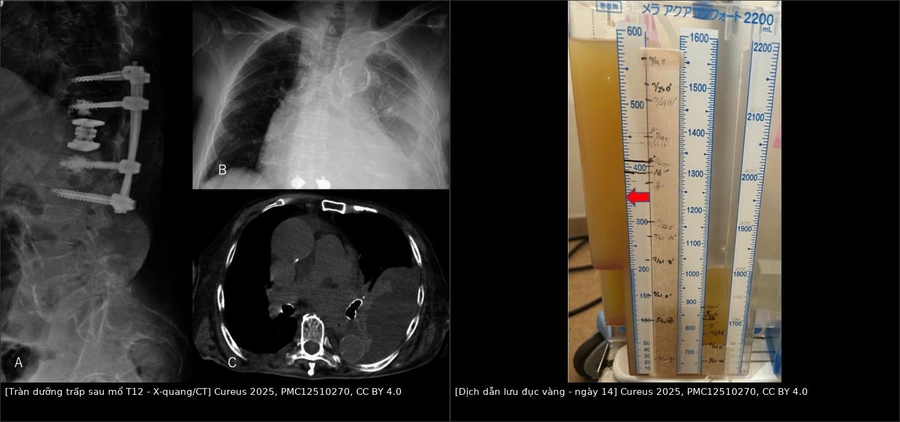
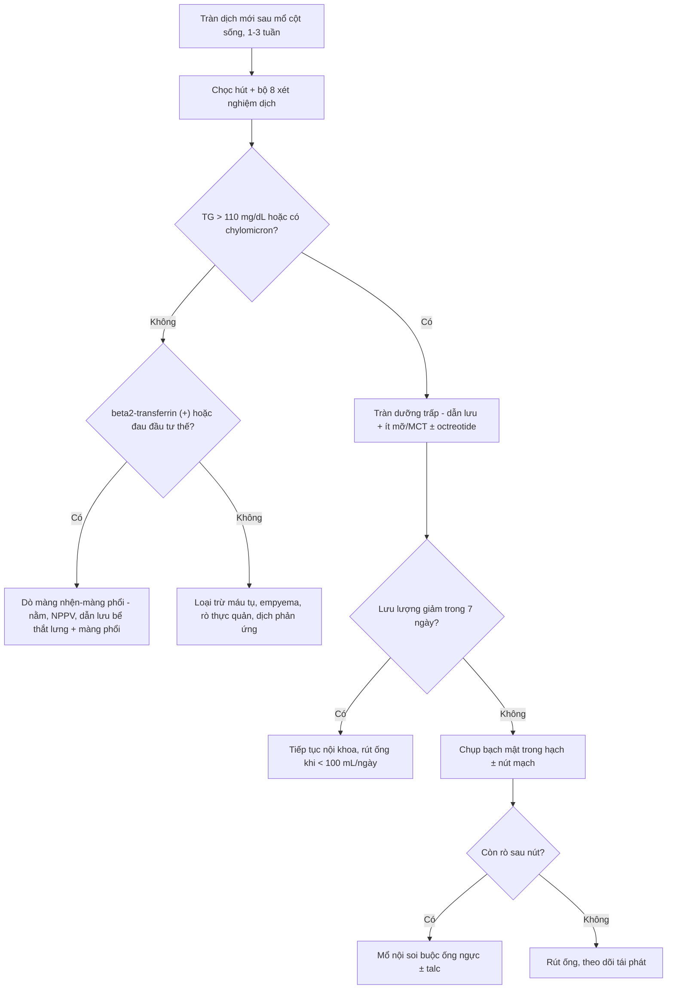
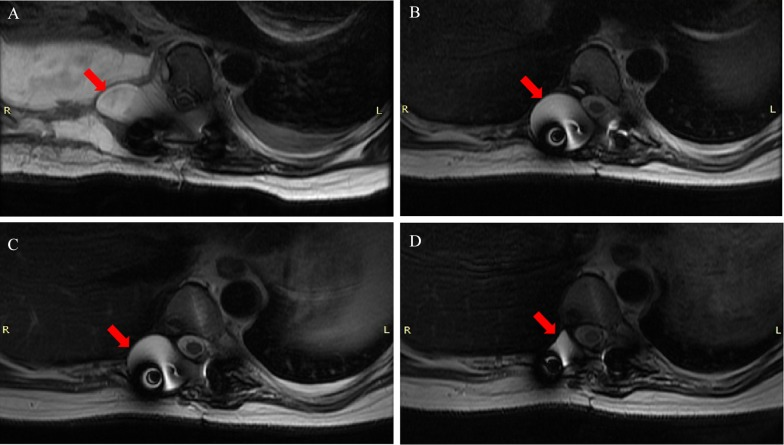
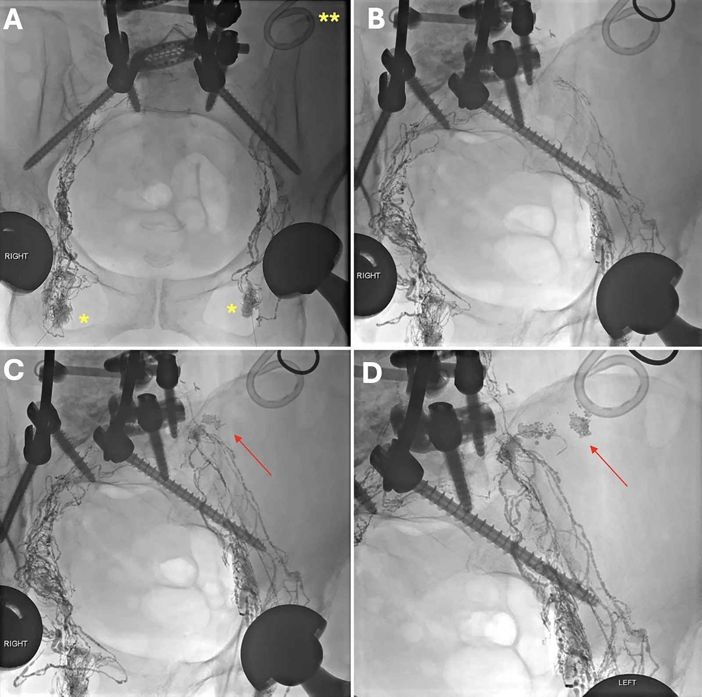

# 1857 — Tràn dưỡng trấp màng phổi sau mổ cột sống ngực–thắt lưng / Chylothorax after thoracolumbar spine surgery

**Tags:** `pattern:chylothorax` `pattern:tran-dich-mang-phoi` `pattern:ro-bach-huyet` `pattern:ro-dich-nao-tuy` `vung:mong-phoi` `vung:trung-that` `vung:cot-song-nguc` `vung:sau-phuc-mac` `protocol:CT-nguc` `protocol:MRI-cot-song` `protocol:chup-bach-huyet` `score:TG-dich`

**Mức chắc chắn (certainty):** tổng hợp y văn (literature synthesis) — biên từ **3 ca rò bạch huyết sau mổ cột sống** (*J Neurosurg Case Lessons* 2026, **PMC13659017**), **ca tràn dưỡng trấp trái sau thay thân đốt T12 đường sau màng phổi** (*Cureus* 2025, **PMC12510270**, CC BY 4.0), **9 ca dò màng nhện–màng phổi (SPF) sau mổ cột sống ngực + tổng quan 74 ca** (*J Orthop Surg Res* 2025, **PMC12574069**). Nhóm **không có bệnh nhân của mình**.

> **Câu chốt:** mổ cột sống **không đi vào trung thất** vẫn có thể làm rách **ống ngực, bể dưỡng trấp hoặc nhánh bạch huyết** — tràn dịch xuất hiện **muộn 1–3 tuần**, thường **sau khi đã rút ống dẫn lưu**, nên bị đọc là "tràn dịch tồn dư/xẹp phổi". Có **hai bệnh hoàn toàn khác nhau** cùng nằm trong gamut này và **chỉ xét nghiệm dịch mới phân biệt được**: **dưỡng trấp (triglyceride dịch > 110 mg/dL)** và **dịch não tủy qua dò màng nhện–màng phổi (β2-transferrin)**, mà dò dịch não tủy lại **thường gặp hơn** sau mổ cột sống ngực (6,7% so với < 0,5% của tràn dưỡng trấp).

## 1. Tổng quan bệnh học – cơ chế hình ảnh (TẠI SAO)

### 1.1 Ba đường mổ, ba cấu trúc bạch huyết nằm ngay dưới dao

- **Bể dưỡng trấp (cisterna chyli)** nằm **trước thân đốt L1–L2**, ngay trong hành lang sau phúc mạc mà **OLIF/ALIF** đi qua; **ống ngực (thoracic duct)** đi lên **bên phải cột sống** trong trung thất sau rồi **bắt chéo sang trái ở ngang T4–T6** trước khi đổ vào **góc tĩnh mạch cảnh trong – dưới đòn trái**; các **nhánh bạch huyết trung thất** chạy sát **góc sườn–đốt sống (costovertebral junction)** — đúng nơi phẫu thuật viên lấy **chỏm sườn và mỏm ngang** khi mổ cột sống ngực (**PMC13659017**).
- Vì vậy **vị trí mổ quyết định bên và tạng dịch**: tổn thương **dưới mốc bắt chéo T4–T6 → tràn dưỡng trấp bên PHẢI**; **trên mốc → bên TRÁI**; **ngang mốc → hai bên**. **Biến thể ống ngực là quy luật, không phải ngoại lệ** (nhiều nhánh, đổ vào TM cảnh trong/TM dưới đòn/TM cánh tay đầu) — vì thế **buộc "một ống ngực" có thể thất bại vì còn nhánh thứ hai** (**PMC13659017**).
- **Ba bối cảnh thực hành:** (1) **đường sau/bên ngực T2–T12** (corpectomy, costotransversectomy, cắt chỏm sườn) → **chylothorax**; (2) **đường sau phúc mạc L1–L4** (OLIF/lateral) → **rò bạch huyết sau phúc mạc (chylous retroperitoneal collection)**, có thể **không bao giờ vào màng phổi**; (3) **rách màng não + rách màng phổi cùng lúc** → **dò màng nhện–màng phổi**, dịch là **CSF chứ không phải dưỡng trấp**.

### 1.2 TẠI SAO tràn dịch xuất hiện MUỘN (1–3 tuần) — và TẠI SAO lại đúng lúc rút ống

- **Lưu lượng thấp so với máu:** ống ngực dẫn **~2.500 mL/ngày** ở người lớn nhưng rò qua một lỗ nhỏ chỉ vài chục–vài trăm mL/ngày; khoang màng phổi chứa được **1,5–2 L** trước khi bệnh nhân khó thở. Ca điển hình: **rút dẫn lưu sau màng phổi ngày 7**, **tràn dịch tiến triển ngày 8–14**, **chọc dẫn lưu lại ngày 14** (**PMC12510270**).
- **Ống dẫn lưu là "van che" chứ không phải "phát hiện":** khi ống còn lưu, dịch ra ngoài theo đường ống (và ống hút áp lực âm còn **kéo dính màng phổi quanh lỗ rò**); rút ống → dịch **tích lại trong khoang** mới gây triệu chứng. Trong loạt 3 ca, ca đầu **xuất viện ngày 4 với X-quang ngực bình thường**, **3 tuần sau** mới quay lại vì **toác vết mổ + tràn dịch phải** (**PMC13659017**).
- **Yếu tố làm tăng lưu lượng sau mổ:** ăn lại **mỡ chuỗi dài (long-chain triglyceride)** sau khi hết nhịn ăn → dưỡng trấp **tăng gấp nhiều lần** trong **3 giờ sau ăn**. Vì thế "tràn dịch xuất hiện sau khi bệnh nhân ăn lại" là mẫu hình gợi ý, không phải trùng hợp.

### 1.3 Vật lý hình ảnh: vì sao CT không gọi được tên, và vì sao phải đo triglyceride

- **CT:** dưỡng trấp có **đậm độ gần nước (khoảng 0–20 HU)**, **không ngấm thuốc**, **trùng hoàn toàn** với **dịch thanh mạc, seroma sau mổ, dịch tồn dư, nước tiểu, dịch não tủy**. Trên CT, tất cả chỉ là **"dịch đậm độ dịch"** — cái tách được bằng HU là **máu tụ cấp 35–70 HU** và **mỡ −40 đến −120 HU**.
- **Vì sao "trắng sữa":** dưỡng trấp đục do **tán xạ ánh sáng của hạt chylomicron** (đường kính µm), **không phải do mỡ tự do** — nên **bệnh nhân đang nhịn ăn/nuôi tĩnh mạch hoàn toàn có thể ra dịch vàng trong mà vẫn là dưỡng trấp**. Ca T12: dịch **"đục vàng" (turbid yellow)**, không trắng sữa, nhưng **TG 117 mg/dL** (**PMC12510270**).
- **Ngưỡng sinh hóa:** **TG dịch > 110 mg/dL (1,24 mmol/L)** → xác định tràn dưỡng trấp; **50–110 mg/dL là vùng xám**, phải tìm **chylomicron bằng điện di lipoprotein**; **TG < 50 mg/dL** và **dịch trong** → **rò bạch huyết thường (lymphorrhea)**, không phải dưỡng trấp. **Cạm bẫy đã gặp:** ổ dịch sau phúc mạc có **TG chỉ 157 mg/dL nhưng có chylomicron** — vì dịch bị **pha loãng** trong khoang sau phúc mạc rộng; **không được loại trừ chỉ vì TG "chưa cao"** (**PMC13659017**).
- **Dịch não tủy thì ngược lại:** **trong, glucose ≈ glucose huyết thanh**, và **β2-transferrin** là dấu hiệu chốt (**độ nhạy 90–94%, độ đặc hiệu 98–100%**); trên **MRI T2 nặng** thấy **đường thông giữa ổ dịch ngoài màng cứng và khoang màng phổi**, trên **CT tủy (myelography)** thấy **thuốc cản quang thoát ra màng phổi** (**PMC12574069**).

### 1.4 Số phải nhớ (dịch tễ, lưu lượng, kết cục)

- **Tần suất tràn dưỡng trấp sau mổ cột sống: < 0,5%** toàn bộ các mổ cột sống; phần lớn ca đã báo là **đường vào cổ bên trái** (góc TM cảnh trong–dưới đòn), còn **đường sau ngực là cực hiếm** (**PMC12510270**, **PMC13659017**).
- **Dò màng nhện–màng phổi (SPF) lại KHÔNG hiếm:** **6,7% (9/135)** sau **mổ cột sống ngực đường sau có cắt 3 cột**, trong đó **9/9 có rách màng não + rách màng phổi**, **9/9 có tràn dịch dai dẳng**, **5/9 khó thở**, **4/9 đau đầu tư thế**; triệu chứng xuất hiện **ngày 1–10 sau mổ**; **9/9 khỏi bằng điều trị bảo tồn** (nằm nghỉ, **NPPV**, **dẫn lưu bể thắt lưng 11 ngày**, **dẫn lưu màng phổi 11,6 ngày**), theo dõi **31,6 tháng**. Tổng quan **74 ca** trong y văn: **tràn dịch 91,9%**, **đau đầu 25,7%**, **khí nội sọ 18,9%**; **66,2% phải mổ vá**, **28,4% khỏi bảo tồn**, **5,4% tử vong** (**PMC12574069**).
- **Lưu lượng quyết định điều trị (chưa thống nhất giữa các nguồn — ghi rõ mâu thuẫn):** **< 500 mL/ngày** → tiếp tục nội khoa; **500–1.000 mL/ngày** → thử nội khoa **có thời hạn 24–48 giờ**; **> 1.000 mL/ngày** hoặc **không giảm sau 7–14 ngày** → can thiệp. Ca T12 chỉ **100–250 mL/ngày** nên theo hướng nội khoa (**PMC12510270**); ca T2–3 sau chụp bạch mật vẫn còn **~200 mL/ngày** nên **mổ nội soi buộc ống ngực** (**PMC13659017**).
- **Điều trị nội khoa có bằng chứng trong chính bối cảnh cột sống:** **octreotide 100 µg tiêm dưới da × 3 lần/ngày**, dịch **ngừng hẳn sau 3 ngày** (ngày 30 → ngày 33), rút ống ngày 41, **không tái phát sau 6 tháng**; chế độ **ít mỡ ± MCT** làm giảm dịch ở ổ dịch sau phúc mạc và rút ống sau **7–10 ngày** (**PMC12510270**, **PMC13659017**).
- **Chụp bạch mật trong hạch (intranodal lymphangiography) vừa chẩn đoán vừa điều trị:** kim **22 G** vào **hạch bẹn hai bên** dưới siêu âm, bơm **Lipiodol** chậm dưới chiếu huỳnh quang → hiện hình **bể dưỡng trấp và ống ngực**, thấy **điểm thoát thuốc**; có thể chọc tiếp **bể dưỡng trấp bằng kim 21 G** để **đặt microcatheter** và **nút bằng coil + keo NBCA**. Trong 3 ca: **1 ca nút đơn thuần thất bại (còn 200 mL/ngày) phải mổ**, **1 ca nút keo khỏi, rút ống sau 7 ngày** (**PMC13659017**).

## 2. Mẫu hình + chẩn đoán phân biệt theo vị trí và bối cảnh (Gamut)

- **A — Tràn dịch MỘT BÊN, xuất hiện 1–3 tuần sau mổ cột sống ngực, bệnh nhân đã ăn lại:** gamut hẹp — **(1) rò ống ngực/nhánh trung thất (dưỡng trấp)**, **(2) dò màng nhện–màng phổi (CSF)**, **(3) tràn dịch phản ứng/xẹp phổi**, **(4) máu tụ/màng phổi**, **(5) rò thực quản–màng phổi (nếu mổ có can thiệp trước)**, **(6) empyema**. Bốn câu hỏi bắt buộc: **dịch đục hay trong? có đau đầu tư thế không? lưu lượng bao nhiêu mL/ngày? triglyceride và glucose dịch bằng bao nhiêu?**
- **B — Ổ dịch SAU PHÚC MẠC (không có tràn màng phổi):** **rò bể dưỡng trấp/nhánh thắt lưng** sau OLIF/lateral; gamut: **lymphocele**, **máu tụ**, **nước tiểu (rách niệu quản)**, **dịch tụy (nếu mổ bụng kèm)**, **áp-xe**. CT chỉ thấy **ổ dịch đậm độ dịch**; **chọc hút + TG + chylomicron** mới phân biệt.
- **C — Tràn dịch hai bên hoặc đổi bên:** nghĩ **tổn thương ngang mốc T4–T6** hoặc **biến thể ống ngực nhiều nhánh**; nếu đã buộc ống ngực mà vẫn rò → **còn nhánh phụ** hoặc **dưỡng trấp từ ổ bụng lên qua lỗ hoành** (bài [1887](../1887-ro-duong-trap-sau-cat-thuc-quan/lesson.md)).
- **D — "Tràn dịch tái lập nhanh sau rút ống" ở bệnh nhân có đau đầu khi ngồi:** chuyển hướng chẩn đoán sang **SPF**; thêm **khí nội sọ** trên CT sọ là dấu phụ (**18,9%** trong tổng quan 74 ca).

## 3. Bảng so sánh phân biệt (ma trận đối chiếu)

| Thực thể (entity) | Hình ảnh điển hình | Chốt vào (rule-in) | Chốt loại (rule-out) | Gợi ý xác nhận |
|---|---|---|---|---|
| **Tràn dưỡng trấp sau mổ cột sống** | Tràn dịch **một bên**, **0–20 HU**, xuất hiện **1–3 tuần**, đáy phổi, không vách; đinh/vít cạnh cột sống | **TG dịch > 110 mg/dL**, **có chylomicron**, **dịch tăng sau bữa ăn mỡ**, lưu lượng tăng dần | Glucose dịch ≈ huyết thanh + **β2-transferrin (+)**, đau đầu tư thế → là **CSF**; Hct dịch ≈ Hct máu → máu | Chọc hút: TG, cholesterol, protein, LDH, glucose, amylase, tế bào; điện di lipoprotein; đếm mL/ngày |
| **Dò màng nhện–màng phổi (SPF)** | Tràn dịch **dai dẳng** cùng bên mổ; **MRI T2 nặng** thấy đường thông ổ ngoài màng cứng ↔ màng phổi; **CT tủy** thuốc thoát ra | **β2-transferrin (+)** (nhạy **90–94%**, đặc hiệu **98–100%**); **đau đầu tư thế**; **glucose dịch cao**; khí nội sọ | TG cao/chylomicron (+) → dưỡng trấp; cấy mủ (+) → empyema | MRI cột sống T2 nặng + CT tủy; β2-transferrin; hội chẩn thần kinh–lồng ngực |
| **Rò bạch huyết sau phúc mạc** | Ổ dịch **sau phúc mạc** cùng bên đường mổ, đậm độ dịch; có thể lan cạnh cơ thắt lưng | **TG 157–288 mg/dL** (có thể **pha loãng thấp**) **+ chylomicron (+)**; chọc dưới siêu âm ra dịch sữa/vàng | Dịch tiểu (creatinine dịch cao), máu tụ (**35–70 HU**), áp-xe (vách, khí) | Chọc hút + TG/chylomicron/creatinine; chụp bạch mật trong hạch |
| **Máu tụ màng phổi** | Mờ đáy, có thể mức ngang; **35–70 HU**, tăng đậm độ theo thời gian | **Hct dịch ≈ Hct máu**, đông cục, thiếu máu | Dịch không đông, Hct thấp, TG cao → dưỡng trấp | Hct dịch + Hb máu; siêu âm đầu giường |
| **Empyema** | Dịch **khu trú/vách**, màng phổi dày, **khí trong khoang** | Sốt, **pH < 7,2**, glucose thấp, LDH rất cao, **cấy (+)** | Dịch trong, cấy (−), lympho ưu thế → dưỡng trấp | Cấy + tế bào + pH dịch |
| **Tràn dịch phản ứng/xẹp phổi sau mổ** | Lượng **ít**, một bên, đáy phổi, **ổn định** | **Không tăng sau 24–72 giờ**, tự hết, không tái lập sau rút ống | **Tái lập nhanh**, tăng dần, đục dần → rò | So X-quang/CT cũ–mới; siêu âm |
| **Rò thực quản–màng phổi** | Dịch + **khí trung thất**, mức khí–dịch, thâm nhiễm trung thất | **Amylase dịch rất cao**, uống thuốc cản quang thấy rò | Amylase thấp, TG cao → dưỡng trấp | Amylase dịch; CT/uống cản quang |

Ảnh ghép đối chiếu (trái: X-quang/CT sau thay thân đốt T12 + tràn dịch trái; phải: dịch dẫn lưu **đục vàng** ngày 14 — lý do **không được dựa vào màu sữa** để chẩn đoán):

## 4. Protocol chụp + hệ phân độ theo lưu lượng

### 4.1 Trình tự hình ảnh (chọn theo câu hỏi, không chụp tràn lan)

1. **X-quang ngực thẳng ± nghiêng:** phát hiện tràn dịch, so với phim ngay sau mổ; **không phân biệt được bản chất dịch**.
2. **CT ngực có cản quang, lát ≤ 1 mm:** đánh giá **lượng/khu trú/vách**, **dày màng phổi**, **khí trong khoang**, **vị trí đinh–nẹp–lồng ngực nhân tạo**, **ổ dịch trung thất kèm theo**, và **tổn thương phổi–màng phổi bên dưới**. Không cần thì **không lặp CT chỉ để "xem dịch còn không"** — siêu âm đầu giường đủ.
3. **Siêu âm màng phổi đầu giường:** hướng dẫn chọc hút, phát hiện **vách/khu trú**, theo dõi thể tích hằng ngày (không bức xạ).
4. **MRI cột sống T2 nặng (heavily T2-weighted) + không cản quang:** câu hỏi **"có đường thông dịch ngoài màng cứng ↔ màng phổi không?"** — dấu hiệu của **SPF**; kèm **giãn não thất/khí nội sọ** trên hình sọ nếu có đau đầu.
5. **CT tủy (CT myelography):** khi nghi **SPF** mà MRI chưa rõ; thấy **thuốc cản quang thoát ra khoang màng phổi**.
6. **Chụp bạch mật trong hạch (intranodal lymphangiography) ± nút mạch:** khi **đã xác định dưỡng trấp** và **lưu lượng cao/không giảm**; đồng thời là **điều trị**.

### 4.2 Xét nghiệm dịch — "bộ 8" tối thiểu, làm ngay lần chọc đầu

**Triglyceride, cholesterol, protein, LDH, glucose, amylase, tế bào học/đếm tế bào, cấy** + **(nếu nghi CSF) β2-transferrin**. Cặp đối chiếu bắt buộc: **glucose dịch/glucose máu** và **LDH dịch/LDH máu**; nghi dưỡng trấp thì thêm **điện di lipoprotein tìm chylomicron**; nghi dò tiết niệu (sau phúc mạc) thì **creatinine dịch**.

### 4.3 Phân độ theo lưu lượng và ngưỡng xử trí

| Mức | Lưu lượng | Hướng xử trí |
|---|---|---|
| Thấp | **< 500 mL/ngày** | Dẫn lưu + **ít mỡ/MCT**, dinh dưỡng; cân nhắc **octreotide 100 µg × 3/ngày**; theo dõi 5–7 ngày |
| Cao | **500–1.000 mL/ngày** | Thử nội khoa **có thời hạn 24–48 giờ**, chuẩn bị can thiệp |
| Rất cao | **> 1.000 mL/ngày** hoặc **không giảm sau 7–14 ngày** | **Chụp bạch mật + nút mạch (coil/NBCA)**; nếu thất bại → **mổ nội soi buộc ống ngực ± talc** |

## 5. Biến thể bình thường và cạm bẫy

- **"Dịch trắng sữa trong mổ" có thể là tràn dịch màng phổi do rách màng phổi thành**, không phải dưỡng trấp: trong ca T2–3, dịch trắng sữa xuất hiện ngay khi lấy chỏm sườn nhưng **không tìm được điểm rò**, và **X-quang sau mổ không có tràn dịch** — chẩn đoán chỉ đặt ra **3 tuần sau** khi tràn dịch phải tái diễn và **TG dịch màng phổi 427 mg/dL** (**PMC13659017**).
- **Cạm bẫy "dịch đục vàng = mủ/thanh mạc":** màu không có giá trị; ca T12 ra dịch **đục vàng** với **lympho 64,3%**, **protein 2,3 g/dL**, **LDH 159 U/L** (dịch tiết) nhưng **TG 117 mg/dL** — chẩn đoán là dưỡng trấp (**PMC12510270**).
- **Cạm bẫy "TG thấp = loại trừ":** trong khoang rộng, dưỡng trấp bị **pha loãng**; **TG 157 mg/dL kèm chylomicron** vẫn là rò bạch huyết thật (**PMC13659017**).
- **Bỏ sót dò dịch não tủy vì "chỉ là tràn dịch sau mổ":** **6,7%** sau mổ 3 cột là con số **lớn hơn nhiều** so với tràn dưỡng trấp; **đau đầu khi ngồi dậy** và **dịch trong** là hai dấu hiệu rẻ tiền nhất; đừng chờ "dịch đục" mới nghĩ dưỡng trấp.
- **Đinh vít và lồng ngực nhân tạo gây giả ảnh trên CT/MRI:** đọc **cửa sổ mô mềm** và **cửa sổ xương riêng**, dùng **MRI T2 nặng** thay vì T1 sau tiêm khi cần thấy đường thông dịch.
- **Đừng "thử rút ống rồi chụp lại" ở bệnh nhân lưu lượng cao:** mỗi lần rút–đặt lại làm tăng nguy cơ **nhiễm trùng khoang màng phổi** và **mất dấu vết lỗ rò** khi chụp bạch mật.

## 6. Tự lượng giá — Blind Quiz ngay trên trang tĩnh

**Ca 1 — nữ 84 tuổi, thay thân đốt T12 đường sau màng phổi trái**

- Gợi ý lâm sàng: mổ T12 vì gãy xẹp; ống dẫn lưu sau màng phổi **rút ngày 7**; **ngày 10–14** ho, khó thở tăng dần.
- Câu hỏi: (1) Bên nào có dịch, và vì sao **bên đó**? (2) Màu dịch **đục vàng** có loại trừ dưỡng trấp không? (3) Ngưỡng sinh hóa nào chốt chẩn đoán?

<b>Bấm để hiện đáp án (findings + chẩn đoán)</b>

- Dấu hiệu: **A** — X-quang nghiêng: thay thân đốt T12 + cọc vít sau; **B** — X-quang ngực: **mờ đáy phổi TRÁI**; **C** — CT ngang: **tràn dịch trái lượng lớn, đậm độ dịch**, phổi trái xẹp một phần; **phải** — túi dẫn lưu có **dịch đục vàng**, không trắng sữa.
- Chẩn đoán: **tràn dưỡng trấp trái sau mổ T12 đường sau màng phổi** — tổn thương **nhánh ống ngực/biến thể ống ngực ở ngang thắt lưng–ngực thấp**, nơi ống ngực còn đi **bên phải** nhưng các **nhánh và bể dưỡng trấp** nằm sát đường vào; TG dịch **117 mg/dL**, lympho **64,3%**, protein **2,3 g/dL**. **Màu không loại trừ** vì bệnh nhân ăn ít mỡ/đang hồi phục → ít chylomicron.
- Điều trị trong ca: **octreotide 100 µg dưới da × 3/ngày** từ ngày 30, **ngừng dịch ngày 33**, rút ống ngày 41, **không tái phát sau 6 tháng**.
- Nguồn ảnh: *Cureus* 2025, Fig. 2–3, **PMC12510270**, CC BY 4.0 (ghép bằng `tools/make_composite.py`).

**Ca 2 — bệnh nhân trong loạt dò màng nhện–màng phổi, đau đầu khi ngồi dậy sau mổ cột sống ngực**

- Gợi ý lâm sàng (một ca trong loạt 9 ca, 17–67 tuổi): mổ cột sống ngực đường sau có **cắt xương sườn + rách màng phổi**; **ngày 1–10** sau mổ **tràn dịch dai dẳng**, **đau đầu tăng khi ngồi**.
- Câu hỏi: (1) Đường bất thường trên MRI là gì? (2) Xét nghiệm nào chốt bản chất dịch? (3) Vì sao **không** đặt stent/van?

<b>Bấm để hiện đáp án (findings + chẩn đoán)</b>

- Dấu hiệu: các lát **T2 nặng** cạnh sống ngực — **ổ dịch ngoài màng cứng** thông với **khoang màng phổi** (mũi tên đỏ), còn thấy rõ ở các thời điểm khác nhau của diễn tiến (A→D); dịch màng phổi cùng bên.
- Chẩn đoán: **dò màng nhện–màng phổi (subarachnoid–pleural fistula)** sau mổ cột sống ngực — **β2-transferrin (+)** khẳng định (nhạy 90–94%, đặc hiệu 98–100%); **glucose dịch ≈ huyết thanh**, **dịch trong**.
- Điều trị: **bảo tồn** — nằm nghỉ, **NPPV**, **dẫn lưu bể thắt lưng 11 ngày**, **dẫn lưu màng phổi 11,6 ngày**; 9/9 ca khỏi, không cần vá màng não; chỉ mổ khi thất bại hoặc rách màng não **mặt bụng** không vá được.
- Nguồn ảnh: *J Orthop Surg Res* 2025, Fig. 1, **PMC12574069**, CC BY-NC-ND 4.0 (nguyên bản, không chỉnh sửa).

**Ca 3 — nam 66 tuổi, tràn dịch phải tái diễn sau lấy chỏm sườn T2–T3**

- Gợi ý lâm sàng: **TG dịch màng phổi 427 mg/dL**; đã nút ống ngực bằng coil + keo nhưng **vẫn 200 mL/ngày**; bước tiếp theo?
- Câu hỏi: (1) Ảnh A–D cho thấy gì? (2) Vì sao nút mạch thất bại? (3) Can thiệp nào đã giải quyết?

<b>Bấm để hiện đáp án (findings + chẩn đoán)</b>

- Dấu hiệu: **A** — chọc **hạch bẹn hai bên** (dấu \*) và đặt catheter dẫn lưu màng phổi (dấu \*\*); **B** — Lipiodol lên **bể dưỡng trấp và ống ngực**; **C, D** — **cụm coil/keo** ở vùng **bể dưỡng trấp–ống ngực** (mũi tên đỏ), **không thấy điểm rò khu trú**; catheter màng phổi vẫn còn.
- Chẩn đoán: **rò nhánh ống ngực/trung thất** không khu trú được → nút **theo kinh nghiệm** thất bại vì **còn nhánh phụ**; xử trí tiếp: **mổ nội soi lồng ngực**, mở màng phổi cạnh **tĩnh mạch azygos**, **buộc cả vùng ống ngực** + **talc pleurodesis** → dịch giảm dần, khỏi.
- Bài học: **nút mạch không phải điểm kết thúc**; **không thấy điểm rò trên chụp bạch mật** là yếu tố dự báo thất bại.
- Nguồn ảnh: *J Neurosurg Case Lessons* 2026, Fig. 4, **PMC13659017**, CC BY-NC-ND 4.0 (nguyên bản).

## Bài liên quan chéo
- [1881 – Tràn dưỡng trấp màng phổi sau chấn thương ngực kín](../1881-tran-duong-trap-mang-phoi-chan-thuong-kin/lesson.md)
- [1887 – Rò dưỡng trấp sau cắt thực quản](../1887-ro-duong-trap-sau-cat-thuc-quan/lesson.md)
- [1839 – Chylothorax sau cắt gan](../1839-chylothorax-sau-cat-gan/lesson.md)
- [1855 – LVA chuyển hướng ống ngực](../1855-lva-chuyen-huong-dong-ong-nguc/lesson.md)
- [6161 – Chylothorax sau mổ tim ở trẻ](../6161-chylothorax-sau-mo-tim-o-tre/lesson.md)
- [040 – Tràn dịch màng phổi](../040-tran-dich-mang-phoi/lesson.md)

## Ảnh
- `1857_tran-duong-trap-sau-mo-cot-song_XQ-CT-PMC12510270.jpg`, `..._DICH-PMC12510270.jpg` — *Cureus* 2025, Fig. 2–3, **PMC12510270**, **CC BY 4.0**.
- `1857_tran-duong-trap-sau-mo-cot-song_MRI-PMC12574069.jpg` — *J Orthop Surg Res* 2025, Fig. 1, **PMC12574069**, **CC BY-NC-ND 4.0**.
- `1857_tran-duong-trap-sau-mo-cot-song_LYMPHANGIO-PMC13659017.jpg`, `..._SODO-PMC13659017.jpg` — *J Neurosurg Case Lessons* 2026, Fig. 4–5, **PMC13659017**, **CC BY-NC-ND 4.0**.
- `composite_tran-dich-nuoc-tieu-hoa.jpg` — ghép từ **2 ảnh CC BY 4.0** của **PMC12510270** (letterbox, không crop/kéo giãn).
- Nguồn + giấy phép từng file: `images/CREDITS.md`.

> Không dùng để chẩn đoán độc lập khi chưa có người hướng dẫn.
