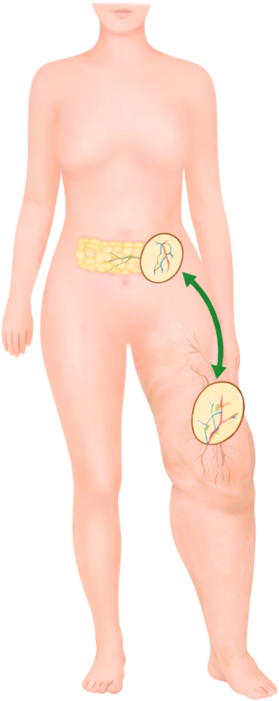
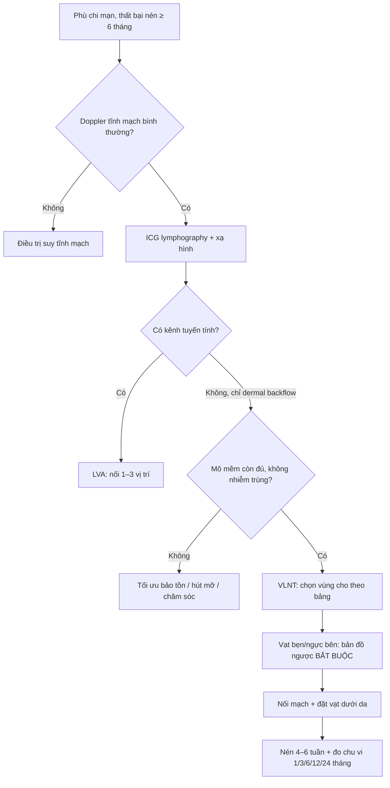
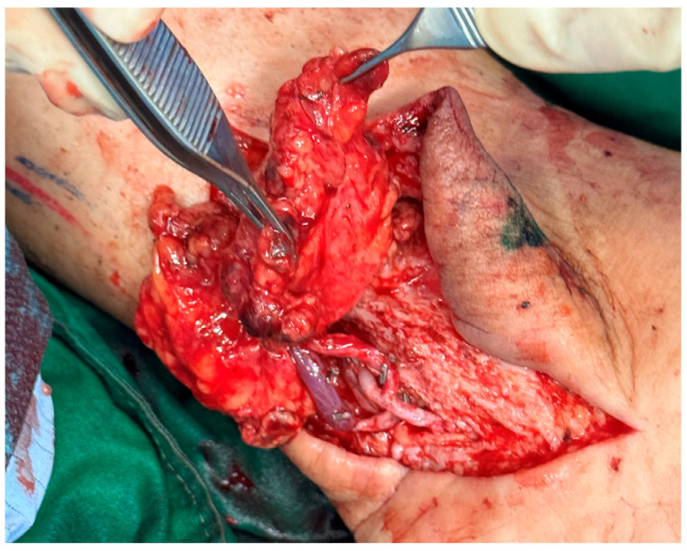
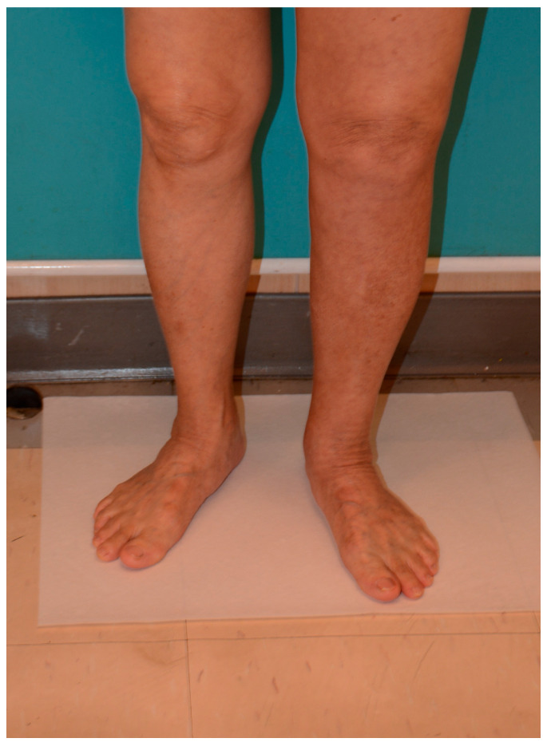
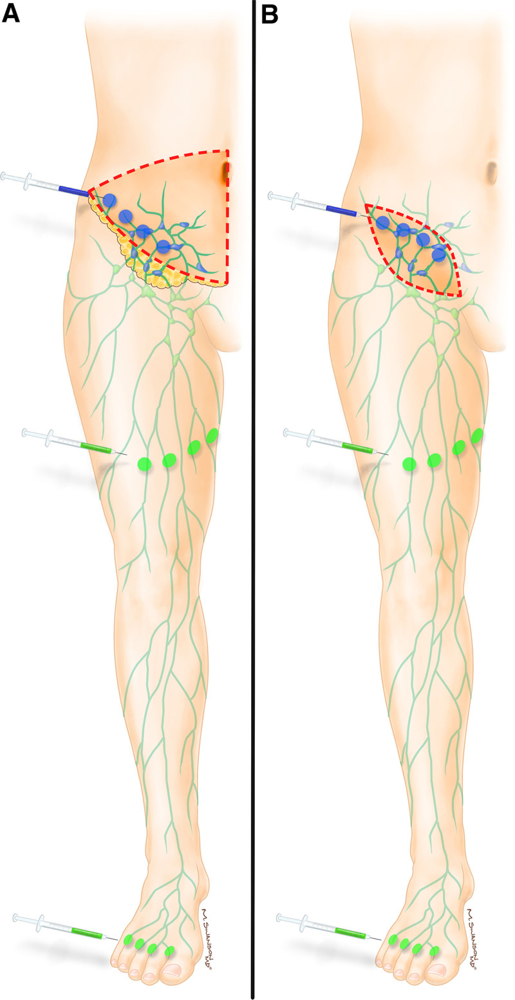

# 1858 — Ghép hạch bạch huyết có cuống mạch (VLNT) khi LVA không còn mạch: chọn vùng cho – vùng nhận, bản đồ ngược & kết cục

**Tags:** `pattern:phu-chi` `vung:chi-duoi` `vung:chi-tren` `anatomy:hach-bach-huyet` `protocol:ICG-lymphography` `protocol:lymphoscintigraphy` `protocol:CTA` `score:ISL` `score:Clavien-Dindo`

**Mức chắc chắn (certainty):** tổng hợp y văn (literature synthesis) — tự biên từ **phân tích gộp 395 bệnh nhân/25 nghiên cứu VLNT chi dưới** (*J Plast Reconstr Aesthet Surg* 2026, PMC13384956, CC BY-NC-ND), **phân tích gộp 52 nghiên cứu so LVA – VLNT – phối hợp** (*Microsurgery* 2025, PMC11895410, CC BY), **đoàn hệ 161 bệnh nhân chọn vùng cho/vùng nhận** (*Plast Reconstr Surg Glob Open* 2026, PMC13061529, CC BY-NC-ND), **53 bệnh nhân vạt hạch mạch vị mạc nối** (*Medicina* 2025, PMC11944203, CC BY) và **25 bệnh nhân bản đồ bạch huyết ngược hai chất đánh dấu** (*Plast Reconstr Surg Glob Open* 2022, PMC9278919, CC BY-NC-ND). Không gắn một ca nguyên văn duy nhất của riêng bài.

> **Bài này là "nấc thứ hai" của nhóm can thiệp bạch huyết, nối tiếp [1855 – LVA & chuyển hướng dòng ống ngực](../1855-lva-chuyen-huong-dong-ong-nguc/lesson.md).** 1855 đã chốt điều kiện để **nối bạch mạch – tĩnh mạch (LVA)**: phải còn **kênh bạch huyết tuyến tính, còn dòng chảy, còn đường thoát**. Nhưng ở **giai đoạn muộn**, hình ảnh học chỉ còn **dermal backflow ("stardust", "splash")** — **không có kênh nào để nối**. Khi đó lựa chọn không phải là "hết cách" mà là **mang một đơn vị hạch có cuống mạch đến** (VLNT).

> **Câu chốt:** **LVA sửa "đường ống" đã có; VLNT cấy thêm "máy bơm" mới.** VLNT đưa **2–4 hạch kèm cuống động – tĩnh mạch** vào vùng phù; hạch ghép vừa **hút dịch** vừa **kích thích tạo mạch bạch huyết mới** (VEGF-C) nối vào hệ bạch huyết nhận. Kết cục gộp trên **395 bệnh nhân chi dưới**: giảm chu vi **24,79% trên gối / 29,50% dưới gối**, giảm thể tích chi **25,32%**, **giảm rõ số đợt viêm mô tế bào** (p < 0,001), biến cố bất lợi **12,22–16,3%** (PMC13384956). So với LVA, mức cải thiện lâm sàng của VLNT cao hơn: **41,66% vs 29,44%** ở chi trên và **39,53% vs 31,87%** ở chi dưới (PMC11895410).

## 1. Tổng quan bệnh học – cơ chế hình ảnh

- **Phù bạch huyết là bệnh của "lưu lượng > khả năng vận chuyển", không phải bệnh của áp lực tĩnh mạch.** Dịch kẽ giàu protein được đẩy về tuần hoàn qua **mao mạch bạch huyết → mạch góp → hạch → ống ngực**. Khi hạch bị lấy/xạ (ung thư vú, ung thư phụ khoa, melanoma) hoặc bẩm sinh, **khả năng vận chuyển giảm**; protein ứ lại kéo nước theo → **phù mềm, ấn lõm (pitting) lúc đầu**, rồi **xơ hóa + mô mỡ tăng sinh** → **phù cứng, không lõm (non-pitting)**. Dấu **Stemmer** (không nhấc được nếp da mu chân) dương khi đã xơ hóa.
- **Vì sao VLNT có tác dụng — hai cơ chế song song, chưa tách bạch được trên người:**
  1. **"Bể hút" (sink):** hạch ghép được nối vào **động – tĩnh mạch tại chỗ** nên tạo ra **gradient áp lực** hút dịch kẽ vào mao mạch hạch ghép rồi về tuần hoàn.
  2. **Tạo mạch bạch huyết (lymphangiogenesis):** hạch ghép **được cho là** tiết **VEGF-C/VEGF-D**, kích thích **mọc kênh bạch huyết mới** nối vào hệ nhận. Bằng chứng gián tiếp: **xạ hình bạch huyết sau ghép thấy đường dẫn lưu mới** và giảm **dermal backflow**, trong khi số hạch ghép chỉ **2–4** — quá ít để giải thích toàn bộ 25–30% giảm chu vi nếu chỉ bằng "hút".
- **TẠI SAO hình ảnh quyết định lựa chọn phẫu thuật:** **LVA cần "đường ống"** — trên **ICG lymphography** phải thấy **kênh tuyến tính (linear pattern)** chạy qua vùng phù; nếu chỉ thấy **dermal backflow** (dạng **splash → stardust → diffuse**) thì **không có lòng mạch để nối**, và đây là **chỉ định của VLNT**. Đây là lý do **không được chỉ định mổ bằng cảm nhận "phù lâu năm"**.
- **Vật lý của ICG:** huỳnh quang **hồng ngoại gần ~800 nm**, xuyên mô **chỉ 1,5–2 cm** (PMC9278919) → **chỉ thấy bạch huyết nông**; hạch sâu/vùng bẹn dày mỡ **không thấy** → phải phối hợp **xạ hình hạt keo (lymphoscintigraphy)** và **siêu âm/CTA**. **Xạ hình 99mTc-nanocolloid** cho **định lượng vận chuyển** (thời gian xuất hiện hạch, transport index, dermal backflow) nhưng **độ phân giải thấp** — hai kỹ thuật **bổ sung**, không thay thế.
- **Vì sao phải đo bằng chu vi ở nhiều mốc:** phù bạch huyết **không đều theo trục chi**; đo **mỗi 10 cm từ gót lên** và tính **thể tích chi** (perometry/volumetry). Trong phân tích gộp, **giảm chu vi trên gối (24,79%) khác dưới gối (29,50%)** — nếu chỉ đo một mốc sẽ **đánh giá sai kết quả** (PMC13384956).
- **Con số nền của bệnh nhân trong các nghiên cứu:** thời gian phù trước mổ **6,60 ± 2,84 năm**, BMI **26,6 ± 1,49 kg/m²**, theo dõi trung bình **26,1 ± 13,1 tháng** (PMC13384956) — tức đây là nhóm **phù đã xơ hóa, thất bại điều trị bảo tồn**, không phải phù cấp.

## 2. Mẫu hình + chẩn đoán phân biệt theo vị trí (gamut)

**Mẫu hình cần nhận ra:** **phù một chi, không đau, không lõm (giai đoạn muộn), nặng dần nhiều năm, có tiền sử lấy hạch/xạ**, **ICG chỉ có dermal backflow** hoặc **xạ hình thấy ứ trệ/không thấy hạch vùng** → **không còn kênh cho LVA** → cân nhắc **VLNT**.

- **Theo hình ảnh bạch huyết (quyết định kỹ thuật):**
  - **Kênh tuyến tính còn thông** → **LVA** (nối 1–3 chỗ).
  - **Dermal backflow lan tỏa, không kênh tuyến tính** → **VLNT**.
  - **Không thấy hạch/không có đường dẫn lưu + xơ hóa dày** → **VLNT ± hút mỡ (SAL)**; đôi khi cần **nối bắc cầu ống ngực** nếu tổn thương trung tâm (bài 1855/1822).
- **Theo nguyên nhân:** **sau điều trị ung thư vú** (chi trên, bài [593](../593-phu-bach-mach-chi-tren-sau-dieu-tri-ung-thu-vu/lesson.md)); **sau ung thư phụ khoa/melanoma bẹn** (chi dưới); **nguyên phát** (thiểu sản/hypoplasia); **do ký sinh trùng (filaria)**; **béo phì – suy tĩnh mạch** (thể phối hợp).
- **Theo vị trí vùng nhận (có số liệu):**
  - **Chi trên:** đặt **nách** cho kết quả **nhanh và nhiều hơn** đặt **cẳng tay xa** (nách **94,7%** số ca chi trên trong đoàn hệ 161 bệnh nhân) (PMC13061529).
  - **Chi dưới:** đặt **cẳng chân** tốt hơn **bẹn** (**62,1% vs 31,0%** vị trí trong đoàn hệ) (PMC13061529); trong phân tích gộp, **81,6%** vạt được đặt ở **cổ chân/chi dưới xa** (PMC13384956).
- **Theo vùng cho (đánh đổi):**
  - **Mạc nối – vị mạc nối (gastroepiploic):** cuống dài, sẹo giấu trong ổ bụng, **kết cục chu vi tốt nhất** trong phân tích gộp (p = 0,002 trên gối; p < 0,001 dưới gối), nhưng cần **nội soi ổ bụng** và có nguy cơ **rò dưỡng chấp/xoắn dạ dày** (PMC13384956, PMC11944203).
  - **Dưới cằm (submental):** hạch nhỏ, sẹo vùng cổ, **nguy cơ tổn thương nhánh hàm mép thần kinh mặt**; chiếm **55,0%** vùng cho trong phân tích gộp chi dưới.
  - **Bẹn (groin/SCIA):** dễ lấy, nhưng **nguy cơ phù chi cho** — đây là vùng cho **phải làm bản đồ ngược**.
  - **Ngực bên (lateral thoracic)/thượng đòn:** nguy cơ **phù tay cho**, **tràn khí màng phổi**, tổn thương đám rối.

## 3. Bảng so sánh phân biệt (ma trận đối chiếu)

| Thực thể (entity) | Hình ảnh điển hình | Chốt vào (rule-in) | Chốt loại (rule-out) | Gợi ý xác nhận |
|---|---|---|---|---|
| **VLNT (ghép hạch có cuống mạch)** | **Dermal backflow lan tỏa**, không kênh tuyến tính; chi phù cứng; sau ghép thấy đường dẫn lưu mới | **Không còn kênh cho LVA + thất bại ≥ 6 tháng điều trị bảo tồn + còn mô mềm mềm để đặt vạt** | **Nhiễm trùng cấp/loét đang hoạt động**, huyết khối tĩnh mạch sâu, **tái phát u chèn ép**, chi **đã xơ hóa – loét** không còn chỗ nhận | ICG + xạ hình; CTA mạch nhận; đo chu vi/thể tích trước mổ |
| **LVA (nối bạch mạch – tĩnh mạch)** | **Kênh tuyến tính** rõ, chảy chậm, đường kính **0,3–0,8 mm** | **Còn ≥ 1 kênh tuyến tính có dòng chảy** + chênh lệch chu vi còn đo được | Chỉ có **dermal backflow** ("stardust") → không nối được | ICG: đánh dấu đường rạch theo kênh; siêu âm 20–50 MHz |
| **Hút mỡ (suction-assisted lipectomy, SAL)** | Chi **to do mô mỡ**, phù không lõm, **không đau**; mỡ dưới da dày trên MRI | **Thể tích mỡ chiếm ưu thế** sau khi kiểm soát phù | Phù **còn ướt, còn lõm**, chưa ổn định → hút mỡ sẽ tái phù | MRI/CT đo mỡ; cân nhắc **SAL + VLNT** cùng thì |
| **Điều trị bảo tồn (CDT: nén – dẫn lưu – tập)** | Không có tổn thương mạch; phù giảm khi nén | **Bắt buộc trước mọi phẫu thuật**; đáp ứng = chu vi giảm/ổn định | Không dung nạp nén, nhiễm trùng da → xử lý trước | Đo chu vi trước/sau 4–6 tuần |
| **Lipedema** | **Hai chi dưới đối xứng**, **bàn chân KHÔNG phù**, đau khi ấn, dễ bầm | **Phù đối xứng + bàn chân bình thường + đau** | Phù một bên, có tiền sử lấy hạch → nghĩ bạch huyết | Siêu âm mô mỡ; không đáp ứng phẫu thuật bạch huyết |
| **Phù tĩnh mạch mạn** | Phù mềm, **có lõm**, giảm khi kê cao, da **nâu – xơ – loét** quanh cổ chân | **Suy tĩnh mạch trên siêu âm Doppler + hồi lưu** | Stemmer âm, ICG có kênh bình thường → không phải bạch huyết | Doppler tĩnh mạch, đo áp lực tĩnh mạch |
| **Tái phát u chèn ép** | Khối vùng chậu/bẹn, **phù tiến triển nhanh**, đau, có thể giãn mạch | **Khối + hạch mới + phù tăng nhanh trong vài tuần** | Phù nhiều năm, không khối → bạch huyết nguyên phát/thứ phát | CT/MRI/PET; **không mổ bạch huyết trước khi loại trừ** |

*Sơ đồ nguyên lý: vạt **hạch mạch vị mạc nối** (gastroepiploic) lấy qua nội soi, đưa xuống chi phù; ô tròn phóng to = bó mạch nuôi hạch. Nguồn: PMC13384956, CC BY-NC-ND 4.0 (nguyên bản, không crop/ghép).*

### Ba con số quyết định tư vấn
- **24,79% / 29,50%:** giảm chu vi trung bình **trên gối / dưới gối** sau VLNT chi dưới (395 bệnh nhân) — kỳ vọng thực tế, **không phải "hết phù"** (PMC13384956).
- **41,66% vs 29,44% (chi trên) và 39,53% vs 31,87% (chi dưới):** mức cải thiện lâm sàng gộp của **VLNT vs LVA** — VLNT **không kém** LVA về kết cục, nhưng **khác chỉ định** (PMC11895410).
- **1,6%:** tỉ lệ **phù chi cho** khi lấy vạt bẹn (24 nghiên cứu) — và **0/25** khi có **bản đồ ngược hai chất đánh dấu**; đây là lý do bản đồ ngược là **bắt buộc**, không phải "tùy chọn" (PMC9278919).

## 4. Protocol + hệ phân độ/điểm chuẩn hóa

- **Bước 1 — xác nhận phù bạch huyết (không phải phù tĩnh mạch/mỡ):** hỏi tiền sử **lấy hạch, xạ trị, nhiễm trùng, du lịch vùng giun chỉ**; khám **Stemmer**, đo chu vi mỗi **10 cm**, đo thể tích; **siêu âm Doppler tĩnh mạch** để loại phù tĩnh mạch; **xét nghiệm/tầm soát tái phát u** nếu phù tiến triển nhanh.
- **Bước 2 — chọn kỹ thuật bằng hình ảnh:**
  - **ICG lymphography:** tiêm **0,1–0,2 mL** ICG **nội bì** ở kẽ ngón/khoảng gian đốt; chụp **hồng ngoại gần** sau **10–30 phút**; ghi **pattern tuyến tính / splash / stardust / diffuse** và **dermal backflow**. **Có kênh tuyến tính → LVA**; **chỉ dermal backflow → VLNT**.
  - **Xạ hình bạch huyết (99mTc-nanocolloid):** đánh giá **vận chuyển và ứ trệ**, phát hiện **dermal backflow**, so sánh hai chi; hữu ích khi ICG không thấy vì mô mỡ dày.
  - **DCMRL** khi nghi tổn thương **trung tâm/ống ngực** (bài [1822](../1822-dcmrl-bach-huyet/lesson.md)).
- **Bước 3 — chọn vùng cho:** ưu tiên **hạch mạch vị mạc nối** nếu có kinh nghiệm nội soi (kết cục chu vi tốt nhất, sẹo giấu) — nhưng phải loại trừ **bệnh dạ dày, dính ổ bụng, béo phì nặng**; **dưới cằm** cho chi trên; **bẹn** chỉ khi **làm bản đồ ngược** và **không có phù chi cho**.
- **Bước 4 — bản đồ ngược (reverse lymphatic mapping), bắt buộc với vạt bẹn/ngực bên:** tiêm **ICG + xanh methylene (hoặc isosulfan)** ở **ngón chân/bàn chân** để nhuộm **đường dẫn lưu của CHI**; chỉ lấy **hạch của vùng thân mình**, **giữ lại hạch của chi**. Kết quả: **0/25 phù chi cho**, **92% vết mổ liền tốt**, **1 ca hoại tử da do xanh methylene** (1,25% nguy cơ chung) (PMC9278919).
- **Bước 5 — phẫu thuật:** lấy **2–4 hạch** kèm cuống; nối **động mạch 1,0–1,5 mm** và **tĩnh mạch**; đặt vạt **dưới da, không căng**, hướng **trục chi**; **không đặt trên khớp** nếu có thể. Với **chi dưới**, vị trí nhận **cẳng chân/cổ chân** cho kết quả tốt hơn **bẹn** (PMC13061529).
- **Bước 6 — theo dõi:** **nén 4–6 tuần**, tập phục hồi, đo chu vi/thể tích tại **1, 3, 6, 12, 24 tháng**, đếm **số đợt viêm mô tế bào/năm**, chụp **xạ hình/ICG lại 6–12 tháng**; phân độ biến chứng theo **Clavien–Dindo**; **không có ngưỡng "đáp ứng" đồng thuận** — dùng **giảm ≥ 10% chu vi** làm mốc báo cáo nội bộ, không phải tiêu chuẩn quốc tế.

## 5. Biến thể bình thường và cạm bẫy

- **Cạm bẫy 1 — "phù lâu năm = phải VLNT":** sai. **Phù tĩnh mạch mạn** và **lipedema** cũng phù nhiều năm; VLNT **không có chỉ định** và có thể **làm nặng hơn** (phù do tăng áp tĩnh mạch, không do thiếu vận chuyển). Luôn **Doppler** + **Stemmer** + hình ảnh bạch huyết trước.
- **Cạm bẫy 2 — bỏ qua bản đồ ngược:** lấy hạch bẹn "đại diện" mà không nhuộm đường dẫn lưu của chi → **phù chi cho**. Tỉ lệ phù chi cho **1,6%** trên y văn, nhưng **0%** khi có bản đồ ngược; đánh đổi này **không đáng** để tiết kiệm 15 phút mổ (PMC9278919).
- **Cạm bẫy 3 — tưởng VLNT thay thế nén:** không. VLNT **không chữa xơ hóa/mỡ**; sau mổ vẫn cần **nén và physio**. Ở chi đã xơ hóa nặng, **hút mỡ (SAL)** hoặc **SAL + VLNT** cho kết quả thể tích tốt hơn VLNT đơn thuần (PMC11944203).
- **Cạm bẫy 4 — vạt mạc nối ở bệnh nhân bụng đã mổ:** dính, **không lấy được cuống đủ dài**; nguy cơ **xoắn dạ dày**, **rò dưỡng chấp**. Phải có **CTA mạch** và **nội soi** đánh giá trước.
- **Cạm bẫy 5 — đọc ICG sai:** ICG chỉ xuyên **1,5–2 cm**; ở chi dày mỡ, **không thấy kênh** **không đồng nghĩa không có kênh**. Nếu ICG âm nhưng xạ hình còn vận chuyển, **đừng vội kết luận "hết mạch"** — siêu âm tần số cao/khám lại.
- **Cạm bẫy 6 — viêm mô tế bào quanh vạt:** đỏ – nóng – đau sau mổ có thể là **nhiễm trùng vạt** (bài [1689](../1689-nhiem-trung-va-hoai-tu-vat-tu-than-sau-tai-tao-vu/lesson.md)), **huyết khối tĩnh mạch vạt** (7,44% trong phân tích gộp) hoặc **viêm mô tế bào của bệnh lý nền**; **không dùng kháng sinh mù** mà **siêu âm Doppler vạt + đánh dấu vùng đỏ**.
- **Biến thể bình thường:** hạch bẹn **to, đau thoáng qua** sau lao động/chấn thương; **đường bạch huyết bắt màu ICG kéo dài** ở người gầy; **phù nhẹ cổ chân hai bên** ở người đứng lâu — **không phải** chỉ định mổ.

## 6. Tự lượng giá — Blind Quiz ngay trên trang tĩnh

**Ca 1 — Nữ 56 tuổi, ung thư cổ tử cung mổ + xạ 5 năm trước, phù chân trái 3 năm, đã nén 8 tháng không giảm. Nhìn ảnh mổ, mô tả trước.**

- Gợi ý: ICG chỉ thấy **dermal backflow**, không có kênh tuyến tính; xạ hình ứ trệ.
- Câu hỏi: Vì sao chọn VLNT thay vì LVA? Vạt được đặt ở đâu và vì sao? Ba biến chứng sớm cần nghĩ?

<b>Bấm để hiện đáp án (findings + chẩn đoán)</b>

- **Chẩn đoán:** phù bạch huyết chi dưới sau điều trị ung thư phụ khoa, **không còn kênh cho LVA** → **VLNT vạt hạch mạch vị mạc nối**, đặt ở **cổ chân**.
- **Vì sao:** LVA cần **kênh tuyến tính**; ở đây chỉ có **dermal backflow** → không có lòng mạch để nối. Đặt **cẳng chân/cổ chân** cho kết quả tốt hơn **bẹn** (**62,1% vs 31,0%** vị trí trong đoàn hệ 161 bệnh nhân; **81,6%** vạt trong phân tích gộp đặt ở chi dưới xa).
- **Biến chứng sớm:** **huyết khối/ứ máu tĩnh mạch vạt** (7,44% trong gộp), **tụ máu** (1,77%), **mất vạt** (2,12%); muộn: **phù chi cho** nếu lấy vạt bẹn không bản đồ ngược (1,6%).
- Nguồn ảnh: *Medicina* 2025 (PMC11944203), CC BY 4.0.

**Ca 2 — Cùng bệnh nhân, 1 năm sau mổ:**

- Câu hỏi: Kết quả này là "thành công" hay "thất bại"? Đo bằng gì? Vì sao không được hứa "hết phù"?

<b>Bấm để hiện đáp án</b>

- **Findings:** chênh lệch còn **2,6 cm ở giữa đùi, 2,1 cm ở giữa cẳng chân, 1,8 cm ở cổ chân, 1,2 cm ở bàn chân** — tức **giảm nhưng không hết**.
- **Đánh giá:** VLNT giảm chu vi trung bình **24,79% trên gối / 29,50% dưới gối**, giảm thể tích **25,32%**; **giảm số đợt viêm mô tế bào** (p < 0,001). Đây là **kết cục điển hình**, không phải thất bại.
- **Vì sao không hứa hết phù:** phẫu thuật **không loại bỏ mô xơ/mỡ** đã hình thành; mục tiêu là **giảm thể tích, giảm nhiễm trùng, cải thiện chức năng**, không phải "chi bình thường".
- Nguồn ảnh: *Medicina* 2025 (PMC11944203), CC BY 4.0 (nguyên bản).

**Ca 3 — Bản đồ ngược: tại sao phải tiêm hai chất ở hai vị trí?**

- Câu hỏi: Chất xanh và chất huỳnh quang được tiêm ở đâu, để làm gì? Nếu bỏ bước này, biến chứng gì?

<b>Bấm để hiện đáp án</b>

- **Nguyên lý:** tiêm **ICG ở ngón/bàn chân** để nhuộm **đường dẫn lưu của CHI** (cần giữ lại); tiêm **xanh methylene/isosulfan ở thân mình** để nhuộm **hạch của vùng cho** (có thể lấy). Nhờ đó **giữ hạch của chi, lấy hạch của thân**.
- **Nếu bỏ:** lấy nhầm hạch dẫn lưu chi → **phù chi cho** (1,6% trên y văn); có bản đồ ngược: **0/25** ca phù, **92%** vết mổ liền tốt.
- **Cạm bẫy:** **xanh methylene** có thể gây **hoại tử da (1,25%)**; **isosulfan** gây **dị ứng 1,5–3%** — hỏi tiền sử dị ứng trước.
- Nguồn ảnh: *Plast Reconstr Surg Glob Open* 2022 (PMC9278919), CC BY-NC-ND 4.0 (nguyên bản).

## Bài liên quan chéo
- [1855 – LVA & chuyển hướng dòng ống ngực khi DCMRL không có đích](../1855-lva-chuyen-huong-dong-ong-nguc/lesson.md) — nấc **trước** VLNT
- [1822 – DCMRL (chụp bạch huyết bằng MRI động)](../1822-dcmrl-bach-huyet/lesson.md) — hình ảnh trung tâm
- [593 – Phù bạch mạch chi trên sau điều trị ung thư vú](../593-phu-bach-mach-chi-tren-sau-dieu-tri-ung-thu-vu/lesson.md) — bối cảnh chi trên
- [1767 – Phù bạch mạch đầu cổ sau xạ](../1767-phu-bach-mach-dau-co-sau-xa/lesson.md) — vùng đầu cổ
- [1689 – Nhiễm trùng và hoại tử vạt tự thân sau tái tạo vú](../1689-nhiem-trung-va-hoai-tu-vat-tu-than-sau-tai-tao-vu/lesson.md) — biến chứng vạt
- [901 – Tổng quan can thiệp IR](../901-ir-overview/lesson.md)

## Ảnh
- `images/1858_so-do-vlnt_Schematic_PMC13384956.jpg` — sơ đồ vạt hạch mạch vị mạc nối, **CC BY-NC-ND 4.0**, nguyên bản.
- `images/1858_mat-noi-mach_Intraop_PMC11944203.jpg` — vạt nối ở cổ chân, **CC BY 4.0**.
- `images/1858_sau-1-nam_Clinical_PMC11944203.jpg` — kết quả 1 năm, **CC BY 4.0**.
- `images/1858-ban-do-nguoc_Schematic_PMC9278919.jpg` — bản đồ ngược hai chất, **CC BY-NC-ND 4.0**, nguyên bản.
- Nguồn + giấy phép từng ảnh: `images/CREDITS.md`; nguồn bài: `sources.md`.

> Không dùng để chẩn đoán độc lập khi chưa có người hướng dẫn.
