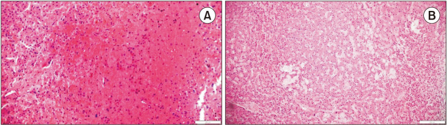
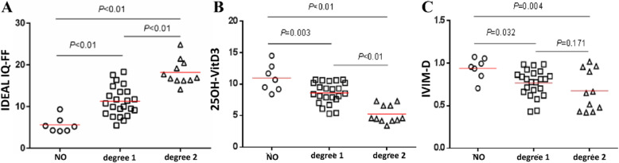
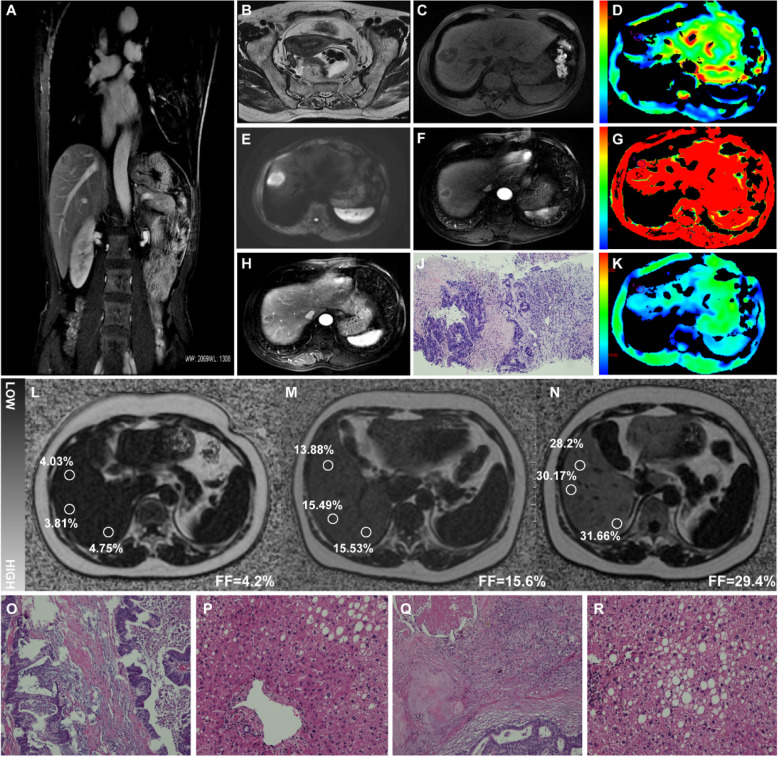
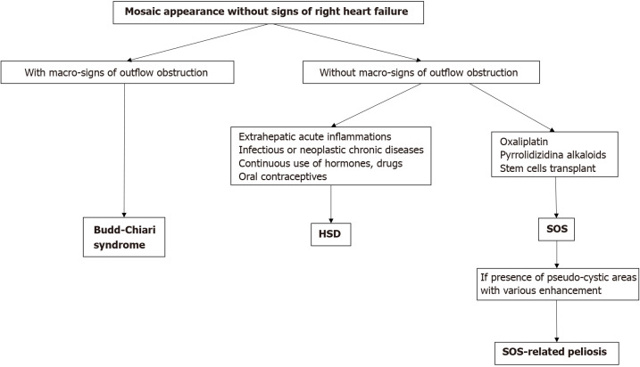
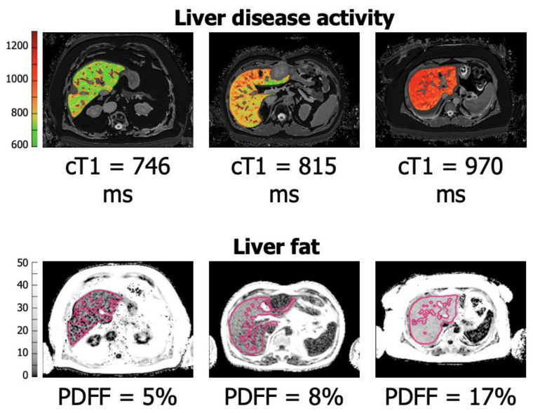
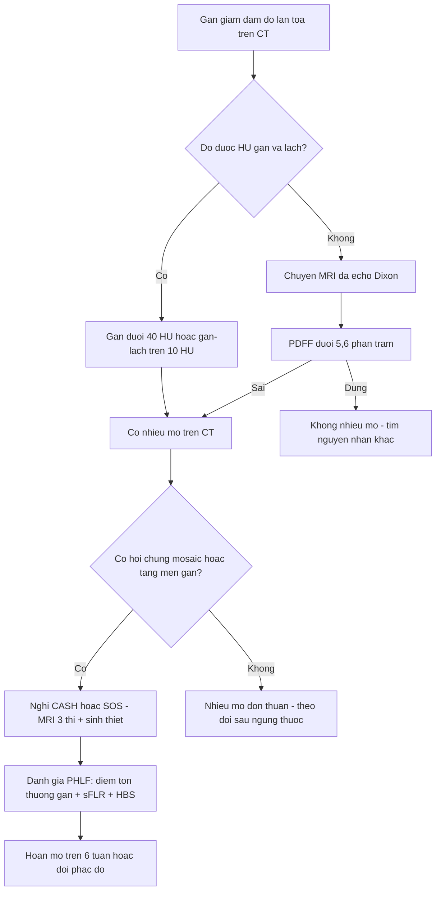
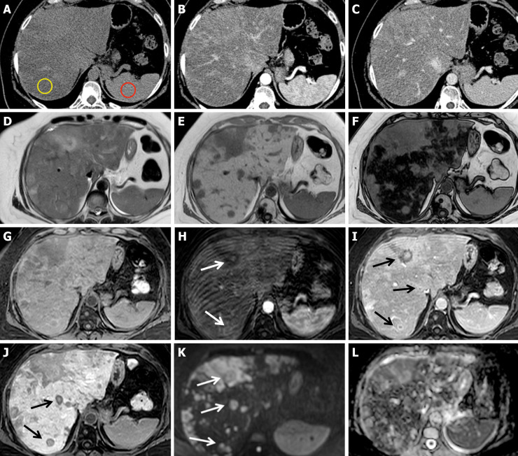

# 1859 — Gan nhiễm mỡ do hóa trị (CASH) và ngưỡng mỡ trước cắt gan: PDFF, HU và cái bẫy "CT bình thường" / Chemotherapy-associated steatohepatitis

**Tags:** `pattern:giam-dam-do` `pattern:lan-toa` `pattern:mo-gan` `vung:gan` `score:PDFF` `protocol:MRI-Dixon` `protocol:CT-bung` `incidentaloma:gan-nhiem-mo`

**Mức chắc chắn (certainty):** tổng hợp y văn (literature synthesis) — ghép **tổng quan tổn thương gan do hóa trị** (*Ther Adv Gastroenterol* 2020, **PMC7249601**), **đoàn hệ 122 ca có mô học** (*eGastroenterology* 2025, **PMC11911809**), **63 ca CASH/SOS có MRI định lượng** (*BMC Cancer* 2020, **PMC7429712**), **tổng quan hình ảnh "gan vàng – gan xanh"** (*World J Gastroenterol* 2021, **PMC8678821**), **175 ca cắt gan sau hóa trị có mô học SOS** (*Ann Surg Treat Res* 2024, **PMC11634394**), **tổng quan LiverMultiScan** (*Cancers* 2023, **PMC10571783**), **203 ca cắt gan có điểm tổn thương gan** (*BMC Surg* 2026, **PMC13729593**) và **tổng quan chuẩn hình ảnh MASLD** (*Diabetologia* 2026, **PMC13627209**). Nhóm **không có bệnh nhân của mình**; tỷ lệ dưới đây là của từng loạt, không phải ước lượng chắc chắn.

> **Câu chốt:** ba tổn thương gan do hóa trị **không phải một bệnh**: **nhiễm mỡ đơn thuần** (5-FU), **viêm gan nhiễm mỡ do hóa trị (CASH)** (irinotecan, **20,2% vs 4,4%** không hóa trị) và **hội chứng tắc xoang gan (SOS, "gan xanh")** (oxaliplatin). Trên **CT không cản quang**, nhiễm mỡ chỉ lộ ra khi đủ nặng (**gan < 40 HU**, **gan thấp hơn lách > 10 HU**) — ngưỡng **48 HU chỉ có độ nhạy 57%**; còn **CASH và SOS thường "CT bình thường"** vì viêm/ứ máu bù lại phần mỡ đã mất. Vì vậy câu hỏi "gan có sạch để cắt không" phải trả lời bằng **PDFF trên MRI** (bình thường **< 5,6%**, có ý nghĩa lâm sàng **≥ 10%**) ± **điểm tổn thương gan tổng hợp**, không bằng cảm giác "gan hơi tối".

## 1. Tổng quan bệnh học – cơ chế hình ảnh (TẠI SAO)

### 1.1 Ba tổn thương, ba cơ chế
- **Nhiễm mỡ đơn thuần (simple steatosis):** triglycerid tích trong bào tương tế bào gan, chủ yếu do **5-FU/capecitabine** và **corticoid**; hồi phục sau khi ngừng thuốc.
- **CASH (chemotherapy-associated steatohepatitis):** mỡ + **phồng bào tương (ballooning)**, viêm tiểu thùy, có thể xơ hóa; gắn chặt với **irinotecan** (và các phác đồ có corticoid). Đây là tổn thương **có mỡ + có nước/viêm**, nên mật độ CT **không giảm tương ứng** với lượng mỡ.
- **SOS / "gan xanh" (blue liver):** tổn thương **tế bào nội mô xoang**, xoang giãn và ứ máu, teo dải tế bào gan quanh tiểu thùy trung tâm; gắn với **oxaliplatin**. Không có mỡ → **mật độ gan bình thường**, nhưng tưới máu gan **không đồng nhất**.
- **Vì sao ba tổn thương này quan trọng với bác sĩ CĐHA:** quyết định **cắt gan ngay hay hoãn/không cắt**. Trong 175 ca cắt gan sau hóa trị, nhóm **SOS (+) có mất máu 889,1 ± 1.126,6 mL vs 555,3 ± 566,7 mL** (p = 0,012), **truyền máu 46,6% vs 25,3%** (p = 0,003), **biến chứng riêng của mổ gan 40,9% vs 26,4%** (p = 0,043) và **sống 5 năm 46,0% vs 33,9%** (p = 0,014) — nhóm SOS kém hơn (PMC11634394).

*H&E: (A) ổ teo dải tế bào gan kèm **giãn xoang và ứ hồng cầu**; (B) vùng xoang giãn rộng, mất cấu trúc dải — tổn thương **thuần mạch**, không có mỡ, nên mật độ CT không đổi. Woo Y et al., Ann Surg Treat Res 2024 (PMC11634394), Fig. 2, **CC BY-NC 4.0** — nguyên bản.*

### 1.2 Vật lý: tại sao MRI đo được mỡ còn CT thì "đoán"
- **PDFF trên MRI (chemical-shift encoded, đa echo):** proton của triglycerid và proton của nước **tiến động khác tần số** (chênh **~3,4 ppm**). Chuỗi đa echo tách hai thành phần, **hiệu chỉnh T2\*** (nhờ bản đồ R2\*) rồi tính **PDFF = mỡ / (mỡ + nước)** theo **nồng độ proton**, không theo T1/T2. Vì thế PDFF **không bị ảnh hưởng bởi từ trường, cuộn thu, hay sắt** (sắt ảnh hưởng T2\*, đã được hiệu chỉnh) — đây là lý do nó dùng được để **theo dõi từng cá nhân** qua nhiều đợt hóa trị.
- **Ngưỡng PDFF:** phân tích **1H-MRS dân số** đặt **giới hạn trên bình thường ~5,6%**; **PDFF ≥ 10%** được coi là **nhiễm mỡ có ý nghĩa lâm sàng** và là biến số làm thay đổi tiên lượng (PMC13627209, PMC13452995).
- **CT không cản quang:** mỡ **−40 đến −120 HU** kéo đậm độ nhu mô xuống. Bình thường gan **đậm hơn lách ~5–10 HU**; nhiễm mỡ khi **gan < 40 HU** hoặc **gan thấp hơn lách > 10 HU** (PMC12865115). Vấn đề: **ngưỡng 48 HU chỉ có độ nhạy 57%, độ đặc hiệu 88%** — nghĩa là **gần một nửa ca nhiễm mỡ nhẹ–vừa sẽ lọt** (PMC12865115).
- **TẠI SAO CASH khó thấy trên CT:** mỡ làm giảm HU, nhưng **phù bào tương + thâm nhiễm viêm + sung huyết** làm tăng HU → hai hiệu ứng **triệt tiêu**. Trong 63 ca có mô học, chỉ số sinh hóa (ALT, AST, ALP, GGT, bilirubin) phân loại độ tổn thương rất kém (**kappa = 0,246**), trong khi **hệ số khuếch tán D, phân suất mỡ FF và 25OH-VitD3** đều có **AUC > 0,8**; phối hợp ba chỉ số cho **độ nhạy 85,29% / độ đặc hiệu 93,13%** (PMC7429712).
- **TẠI SAO SOS nhìn bằng "màu" chứ không bằng HU:** tổn thương là **rối loạn tưới máu xoang** → thì động mạch gan có **mảng tăng đậm không đồng nhất kiểu "khảm" (mosaic)**, thì cửa các mảng đó **thoát nhanh**; kèm **gan to, phù thành túi mật, dịch ổ bụng, tĩnh mạch gan nhỏ lại** (PMC8678821). Mật độ nhu mô **không đổi** vì không có mỡ — nên "đo HU gan" không trả lời được câu hỏi SOS.

### 1.3 Số liệu trụ cột (bắt buộc nhớ)

| Chỉ số | Số liệu | Nguồn |
|---|---|---|
| CASH với irinotecan | **20,2% vs 4,4%** (không hóa trị); oxaliplatin **không** làm tăng CASH | PMC7249601 |
| Tử vong 90 ngày khi có viêm gan nhiễm mỡ | **14,7% vs 1,6%** | PMC11911809 (dẫn Vauthey) |
| Tỷ lệ thực tế trong đoàn hệ đương đại (n = 122) | **CASH 1,6%; SOS 3,3%** (57,3% dùng oxaliplatin) | PMC11911809 |
| SOS (+) sau cắt gan (n = 175) | mất máu **889 vs 555 mL**; truyền máu **46,6% vs 25,3%**; biến chứng **40,9% vs 26,4%** | PMC11634394 |
| Gan nhiễm mỡ trên CT | **< 40 HU** hoặc **gan–lách > 10 HU**; **48 HU: Se 57% / Sp 88%** | PMC12865115 |
| PDFF | bình thường **< 5,6%**; có ý nghĩa lâm sàng **≥ 10%** | PMC13627209, PMC13452995 |
| FF + D + 25OH-VitD3 phân loại tổn thương | **AUC > 0,8**; phối hợp **Se 85,29% / Sp 93,13%** | PMC7429712 |
| Điểm tổn thương gan tổng hợp (HVS) và PHLF | **21,0% → 33,8% → 42,4%** theo mức điểm (p = 0,033) | PMC13729593 |
| Gan nhiễm mỡ nặng theo CAP (> 292 dB/m) | tăng đỉnh ALT/AST sau cắt gan | PMC13474231 |

*Ba chỉ số tách được **độ 0 / độ 1 / độ 2** trong khi men gan thì không: (A) **FF tăng dần** (p < 0,01), (B) **25OH-VitD3 giảm dần**, (C) **D (hệ số khuếch tán) giảm**. Wang Q et al., BMC Cancer 2020 (PMC7429712), Fig. 3, **CC BY 4.0** — nguyên bản.*

*Cùng một chuỗi IDEAL-IQ: hàng dưới (L–N) là **bản đồ FF** với ROI đo **4,03–4,75% (FF 4,2%)**, **13,88–15,53% (FF 15,6%)**, **28,2–31,66% (FF 29,4%)**; hàng O–R là mô học tương ứng — mức mỡ tăng dần từ gan gần như bình thường đến **thoái hóa mỡ lan tỏa**. Wang Q et al., BMC Cancer 2020 (PMC7429712), Fig. 4, **CC BY 4.0** — nguyên bản.*

## 2. Mẫu hình + chẩn đoán phân biệt theo vị trí (Gamut)

- **Khuôn 1 — Gan giảm đậm độ LAN TỎA, mạch máu nổi rõ như "phim âm bản".** Gamut: **nhiễm mỡ do hóa trị** (5-FU/capecitabine/corticoid) · **MASLD nền** · **nhiễm mỡ do thuốc khác** (amiodarone, methotrexate, tamoxifen) · **suy dinh dưỡng/thai kỳ** · **bệnh dự trữ glycogen**. Chốt bằng **PDFF** hoặc **gan–lách > 10 HU**, không bằng "nhìn tối".
- **Khuôn 2 — Vùng mỡ KHU TRÚ (focal/geographic) cạnh ổ di căn hoặc dưới bao.** Gamut: **mỡ khu trú quanh u** (do chèn ép tĩnh mạch cửa) · **di căn gan** · **HCC xâm lấn** · **FNH/FNH-like** · **vùng lành trong gan nhiễm mỡ toàn bộ** (focal sparing, hay ở **hố túi mật, quanh dây chằng tròn, đầu thùy trái — nơi có dòng máu "thứ ba"**).
- **Khuôn 3 — Gan to + thì động mạch có mảng "khảm" không đồng nhất, không có dấu hiệu tắc dòng ra lớn.** Gamut theo sơ đồ của WJG 2021: **có dấu hiệu tắc dòng ra** → **hội chứng Budd–Chiari**; **không tắc dòng ra + bối cảnh viêm/nhiễm/hormone/thuốc** → **giãn xoang gan (HSD)**; **không tắc dòng ra + oxaliplatin / alkaloid pyrrolizidine / ghép tế bào gốc** → **SOS**; thêm **ổ giả nang ngấm thuốc** → **peliosis liên quan SOS** (PMC8678821).
- **Khuôn 4 — Bờ gan nốt + teo thùy phải, không có u mới.** Gamut: **giả xơ gan (pseudocirrhosis)** do hóa trị (hay gặp trong ung thư vú di căn gan), **xơ gan thật**, **gan sung huyết**, **hạch rốn gan giả u**.

*Sơ đồ của WJG 2021: "mosaic" **kèm** dấu hiệu tắc dòng ra → Budd–Chiari; **không** tắc dòng ra → HSD (viêm/nhiễm/hormone/thuốc) hoặc **SOS** (oxaliplatin, alkaloid pyrrolizidine, ghép tế bào gốc); SOS kèm ổ giả nang ngấm thuốc → **peliosis**. *World J Gastroenterol* 2021 (PMC8678821), Fig. 11, **CC BY-NC 4.0** — nguyên bản.*

## 3. Bảng so sánh phân biệt (ma trận đối chiếu)

| Thực thể (entity) | Hình ảnh điển hình | Chốt vào (rule-in) | Chốt loại (rule-out) | Gợi ý xác nhận |
|---|---|---|---|---|
| **Nhiễm mỡ đơn thuần do hóa trị** | Giảm đậm độ lan tỏa; **mạch máu tương phản**; **không** gan to nhiều, không dịch | **Gan < 40 HU / gan–lách > 10 HU / PDFF 5,6–20%**; hồi phục sau ngừng thuốc | **HU bình thường không loại trừ** mức mỡ nhẹ (Se 57% ở 48 HU) | **PDFF MRI** ± so sánh CT trước–sau hóa trị |
| **CASH (viêm gan nhiễm mỡ)** | Giống nhiễm mỡ nhưng **HU có thể bình thường**; mô học có ballooning + viêm | **PDFF tăng + D giảm + 25OH-VitD3 giảm** (phối hợp Se 85%/Sp 93%) | **CT bình thường KHÔNG loại trừ CASH**; sinh hóa **không** phân loại được (kappa 0,246) | **Sinh thiết** (chuẩn vàng); MRI định lượng để theo dõi |
| **SOS / gan xanh** | Gan to; **mosaic thì động mạch**, thoát nhanh thì cửa; **phù thành túi mật**; dịch ổ bụng; TM gan nhỏ | **Mosaic + bối cảnh oxaliplatin**; **mất máu/truyền máu tăng** khi mổ | **HU gan bình thường không loại trừ** (đây là bệnh mạch, không phải mỡ) | Cân nhắc hoãn mổ **> 6 tuần** sau hóa trị; sinh thiết khi quyết định quan trọng |
| **Mỡ khu trú / focal sparing** | Vùng hình địa lý, bờ thẳng, **không đẩy mạch**, đậm độ mỡ **âm** | **Không hiệu ứng khối; mạch xuyên qua; đậm độ mỡ (−40 đến −120 HU)** | **Bờ gai + đẩy mạch + ngấm thuốc** → không phải mỡ | MRI in/opposed phase hoặc **PDFF**; PET âm |
| **Di căn gan** | Nốt **bờ gai**, ngấm thuốc vòng, **đẩy mạch**, có thể hoại tử | **Ngấm thuốc + bờ gai + đẩy mạch**; DWI sáng, ADC thấp | **Không ngấm thuốc + đậm độ mỡ + giữ nguyên qua các đợt** | MRI gan có DWI; PET-CT |
| **FNH-like sau hóa trị** | Nốt **tăng đậm thì động mạch**, đồng tỷ trọng thì cửa, có thể nhiều nốt | **Tăng đậm đồng nhất, không washout, không vỏ**; ổn định qua nhiều năm | **Washout + vỏ ngấm + DWI sáng** → nghĩ HCC/di căn | MRI **Primovist** (gan giai đoạn muộn) |
| **Giả xơ gan (pseudocirrhosis)** | **Bờ gan nốt + teo thùy phải**, không có u mới, không tăng áp cửa thật | **Bờ nốt mới xuất hiện sau hóa trị + bệnh ổn định** | **Giãn tĩnh mạch thực quản + lách to + dịch** → nghĩ xơ gan thật | So sánh chuỗi CT; đàn hồi gan (LSM) hỗ trợ |

- **Ba con số phân biệt hữu ích:** (1) **PDFF < 5,6% = gan "sạch mỡ"**; **≥ 10% = có ý nghĩa**; (2) **CT 48 HU: Se 57%** — đừng dùng một ngưỡng HU để trấn an; (3) **truyền máu 46,6% vs 25,3%** khi có SOS — dấu hiệu hình ảnh "mosaic" có giá trị tiên lượng mổ, không chỉ để mô tả.

## 4. Protocol chụp + phân độ/điểm chuẩn hóa

- **MRI gan định lượng (ưu tiên khi có):** **đa echo Dixon/IDEAL-IQ** (6 echo, TE ngắn–dài) → **PDFF (%) + R2\* (ms)**; ROI **thùy phải, tránh mạch > 5 mm và ổ di căn**, 3 ROI đường kính **≥ 2 cm**, lấy trung bình; ghi **số ROI, vị trí, và PDFF từng ROI** để so sánh lần sau. Trên 3T dùng chuỗi có **hiệu chỉnh B1**; bệnh nhân **ứ sắt** phải đọc R2\* trước khi tin PDFF.
- **CT gan (khi không có MRI):** **không cản quang** là chuỗi để đo mật độ; ROI **gan phải 3 vùng + lách 1 vùng**, đường kính **≥ 1–2 cm**, tránh mạch/ống mật; báo **HU gan, HU lách, hiệu gan–lách**. Nếu chỉ có CT có cản quang: đo **thì cửa** (tương quan tốt hơn thì động mạch) và nói rõ hạn chế.
- **Đánh giá tưới máu (SOS):** **CT/MRI 3 thì** (động mạch muộn 35–40 giây, cửa 70–80 giây, muộn 3 phút) để thấy **mosaic** và **thoát nhanh**; ghi thêm **kích thước gan, thành túi mật, dịch ổ bụng, đường kính tĩnh mạch gan**.
- **Phân độ và ngưỡng xử trí:**
  - **PDFF:** **< 5,6%** bình thường · **5,6–9,9%** nhiễm mỡ nhẹ · **≥ 10%** có ý nghĩa lâm sàng · **≥ 20%** cân nhắc hoãn mổ/thay phác đồ (ngưỡng tham chiếu, chưa có RCT).
  - **CT:** **< 40 HU** hoặc **gan–lách > 10 HU** = nhiễm mỡ vừa–nặng theo tiêu chuẩn đã dùng; **48 HU** chỉ là ngưỡng sàng lọc yếu.
  - **Nguy cơ sau cắt gan:** dùng **điểm tổn thương gan tổng hợp** (bilirubin + xơ + mỡ) → PHLF **21,0% / 33,8% / 42,4%** theo 3 mức (PMC13729593); phối hợp với **sFLR** (bài 1821) và **chức năng gan (HBS)**.
- **Thời điểm:** hội chẩn **trước khi bắt đầu hóa trị** để có "gan nền"; chụp lại **trước mổ 4–6 tuần**; **hoãn mổ > 6 tuần** sau hóa trị làm giảm biến chứng ở nhóm nguy cơ (bằng chứng quan sát).

*Hình mẫu của LiverMultiScan: **cT1** (ms) phản ánh **nước/xơ/viêm**, **PDFF** (%) phản ánh **mỡ** — hai trục khác nhau, nên một bệnh nhân có thể **PDFF 5% mà cT1 970 ms** (viêm/xơ) hoặc **PDFF 17% mà cT1 746 ms** (mỡ đơn thuần). Đọc cả hai mới trả lời được "gan có lành để cắt". Chouari T et al., Cancers 2023 (PMC10571783), Fig. 1, **CC BY 4.0** — nguyên bản.*

## 5. Biến thể bình thường và cạm bẫy

- **Biến thể bình thường:** **mỡ khu trú** ở hố túi mật, quanh dây chằng tròn, đầu thùy trái — bờ thẳng, không đẩy mạch; **vùng lành** trong gan nhiễm mỡ toàn bộ trông "tăng đậm" giả tạo và dễ bị gọi là nốt.
- **Cạm bẫy 1 — "CT bình thường = gan sạch":** sai với **CASH** (mỡ + viêm triệt tiêu) và **SOS** (bệnh xoang, không mỡ). Đây là lý do tồn tại của **PDFF** và của việc mô tả **mosaic**.
- **Cạm bẫy 2 — sắt và thuốc:** **ứ sắt** làm giảm cả gan và lách → hiệu gan–lách "bình thường"; **amiodarone** làm gan **tăng** đậm độ; **glycogen** (bệnh dự trữ, corticoid) cũng tăng đậm độ. Luôn đọc **R2\*/ferritin** trước khi kết luận.
- **Cạm bẫy 3 — mỡ "biến mất" sau khi ngừng hóa trị:** nhiễm mỡ có thể **hồi phục một phần trong vài tháng**; một phim "sạch" sau 3 tháng không chứng minh gan đã sạch trong suốt đợt điều trị — phải đối chiếu **thời điểm chụp với từng chu kỳ**.
- **Cạm bẫy 4 — nhầm "mosaic" của SOS với HCC xâm lấn:** HCC xâm lấn có **huyết khối tĩnh mạch cửa**, bờ gan bất thường, **washout thật**; SOS **không có huyết khối**, các mảng **thoát nhanh nhưng không "đen" như washout**, và có bối cảnh oxaliplatin.
- **Cạm bẫy 5 — thỏa mãn tìm kiếm:** thấy ổ di căn rồi bỏ qua **nhu mô lành** — chính nhu mô lành quyết định mổ được hay không. Ghi **PDFF/HU nhu mô lành** trong mọi báo cáo trước cắt gan.

## 6. Tự lượng giá — Blind Quiz

**Ca 1 — Bệnh nhân ung thư đại tràng di căn gan, sau 6 đợt FOLFIRI. Xem bản đồ phân suất mỡ trước, đừng đọc chẩn đoán.**

- Gợi ý lâm sàng: không có triệu chứng gan; men gan bình thường.
- Hỏi: (1) Ba mức FF là bao nhiêu và tương ứng mô học gì? (2) Vì sao men gan bình thường không loại trừ tổn thương? (3) Ngưỡng FF nào làm bạn phải hội chẩn trước mổ?

<b>Bấm để hiện đáp án (findings + chẩn đoán)</b>

- **Findings:** ROI cho **FF 4,2%** (mô học gần bình thường), **FF 15,6%** (thoái hóa mỡ vừa), **FF 29,4%** (thoái hóa mỡ lan tỏa, mô học nhiều không bào mỡ lớn).
- **Chẩn đoán:** **nhiễm mỡ gan do hóa trị, mức tăng dần** — trên nền điều trị irinotecan phải nghĩ thêm **CASH**.
- **Vì sao men gan bình thường:** trong 63 ca có mô học, tương hợp giữa sinh hóa và mô học rất kém (**kappa = 0,246**); chỉ **D, FF và 25OH-VitD3** phân loại được (AUC > 0,8).
- **Ngưỡng hành động:** **PDFF ≥ 10%** = có ý nghĩa; **≥ 20%** + FLR sát ngưỡng → hội chẩn hoãn mổ/thay phác đồ.
- **Nguồn ảnh:** Wang Q et al., *BMC Cancer* 2020 (PMC7429712), Fig. 4, **CC BY 4.0** — nguyên bản, không crop.

**Ca 2 — Bệnh nhân 58 tuổi, ung thư đại tràng di căn gan, 6 tháng sau bắt đầu FOLFIRI. CT không cản quang (A) và các chuỗi MRI (D–L).**

- Hỏi: (1) Đậm độ gan so với lách trên CT nói gì? (2) Chuỗi MRI nào chứng minh đây là mỡ chứ không phải nước? (3) Có cần sinh thiết không?

<b>Bấm để hiện đáp án</b>

- **Findings:** (A–C) CT không cản quang: **gan giảm đậm độ lan tỏa**, thấp hơn lách, mạch máu nổi rõ; (D–F) MRI in/opposed phase: **mất tín hiệu trên ảnh opposed-phase** = mỡ; (G–L) các chuỗi định lượng và tổn thương kèm theo.
- **Chẩn đoán:** **nhiễm mỡ gan lan tỏa do hóa trị (5-FU + folinic acid + irinotecan)** — hình chụp 6 tháng sau bắt đầu hóa trị.
- **Cơ chế:** mỡ (proton béo) làm giảm đậm độ CT; **opposed-phase mất tín hiệu** vì proton mỡ–nước triệt tiêu khi TE ≈ 2,3 ms ở 1,5T.
- **Sinh thiết:** không bắt buộc nếu chỉ có mỡ đơn thuần và FLR đủ; **cần** khi nghi **CASH/SOS** và kết quả sẽ đổi quyết định mổ.
- **Nguồn ảnh:** *World J Gastroenterol* 2021 (PMC8678821), Fig. 4, **CC BY-NC 4.0** — nguyên bản.

**Ca 3 — Cùng bối cảnh oxaliplatin, gan to, men gan tăng nhẹ, không có huyết khối. Trước khi mở đáp án, hãy chọn nhánh trong sơ đồ.**

- Hỏi: (1) "Mosaic không kèm dấu hiệu tắc dòng ra" chia thành mấy nhánh? (2) Bối cảnh nào đưa về SOS? (3) Một tổn thương giả nang ngấm thuốc trong SOS nghĩ đến gì?

<b>Bấm để hiện đáp án</b>

- **Findings:** sơ đồ chia **hai nhánh lớn**: **có** dấu hiệu tắc dòng ra (→ Budd–Chiari) và **không** có; nhánh sau chia tiếp **HSD** (viêm/nhiễm/hormone/thuốc) và **SOS** (**oxaliplatin**, alkaloid pyrrolizidine, ghép tế bào gốc).
- **Chẩn đoán trong ca này:** **SOS do oxaliplatin** — và đây là lý do **không** được dùng HU gan để loại trừ.
- **Giả nang ngấm thuốc trong SOS:** nghĩ **peliosis liên quan SOS** (ổ máu có thành ngấm thuốc), không phải di căn.
- **Ý nghĩa xử trí:** SOS làm **tăng mất máu và truyền máu** khi cắt gan (46,6% vs 25,3%) → cân nhắc **hoãn mổ**, chuẩn bị máu, và hội chẩn gây mê trước.
- **Nguồn ảnh:** *World J Gastroenterol* 2021 (PMC8678821), Fig. 11, **CC BY-NC 4.0** — nguyên bản.

## Bài liên quan chéo
- [100 – Tổng quan hệ Bụng](../100-tong-quan-he-bung/lesson.md) (bản đồ hệ, bảng DDx gan)
- [1821 – Thể tích gan còn lại (FLR) trước cắt gan lớn](../1821-suy-gan-sau-cat-gan/lesson.md) (sFLR, PVE)
- [1856 – Radiation lobectomy Y-90 tăng FLR](../1856-radiation-lobectomy-y90-tang-flr/lesson.md) (liều nhu mô lành, RILD)
- [1910 – Hội chứng tắc xoang gan (SOS) & FNH-like sau hóa trị](../1910-hoi-chung-tac-xoang-gan-sos/lesson.md) (mosaic, chẩn đoán phân biệt)
- [1733 – Tổn thương gan do oxaliplatin & bevacizumab](../1733-not-tai-tao-fnh-like-sau-hoa-tri/lesson.md) (cơ chế mạch)
- [1648 – Di căn gan ở ung thư vú](../1648-di-can-gan-ung-thu-vu/lesson.md) (CT đồng tỷ trọng, giả xơ gan)
- [122 – Gan nhiễm mỡ & bệnh gan nhiễm mỡ không do rượu](../122-u-lanh-gan/lesson.md) (nền MASLD)

## Ảnh
- `1859_crclm-sau-hoa-tri_MRI_PMC7429712-Fig4.jpg` — MRI IDEAL-IQ ba mức FF + mô học, **CC BY 4.0**.
- `1859_pdff-theo-do-nang_Chart_PMC7429712-Fig3.jpg` — FF/25OH-VitD3/D theo độ tổn thương, **CC BY 4.0**.
- `1859_sos-mo-hoc_Histo_PMC11634394-Fig2.jpg` — mô học SOS (H&E), **CC BY-NC 4.0**.
- `1859_livermultiscan_Chart_PMC10571783-Fig1.jpg` — sơ đồ cT1 & PDFF, **CC BY 4.0**.
- `1859_nhiem-mo-lan-toa_CT_PMC8678821-Fig4.jpg` — CT/MRI nhiễm mỡ lan tỏa, **CC BY-NC 4.0**.
- `1859_mosaic-diagram_Chart_PMC8678821-Fig11.jpg` — sơ đồ "mosaic", **CC BY-NC 4.0**.
- Nguồn + giấy phép từng ảnh: `images/CREDITS.md`.

> Không dùng để chẩn đoán độc lập khi chưa có người hướng dẫn.
