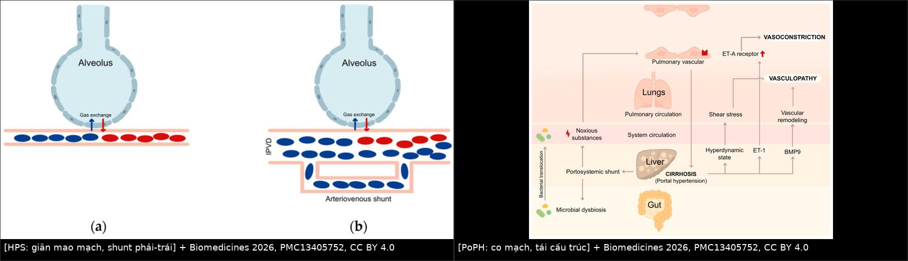
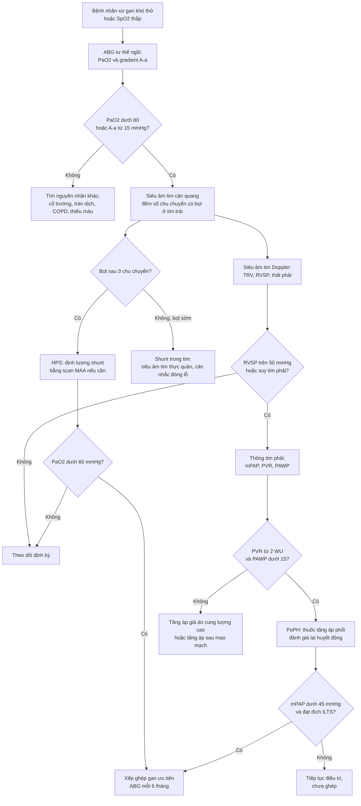
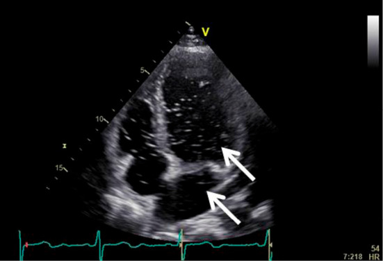
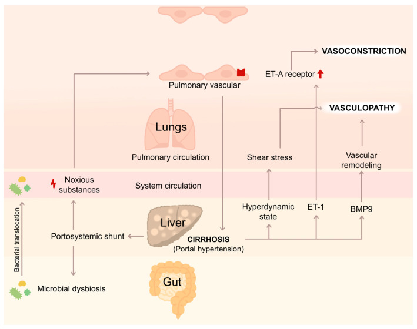

# 186 — Hội chứng gan–phổi (HPS) & tăng áp phổi do tăng áp cửa (PoPH): hai mặt đối lập của cùng một tăng áp cửa / Hepatopulmonary syndrome & portopulmonary hypertension

**Tags:** `pattern:gian-mach-trong-phoi` `pattern:shunt-phai-trai` `pattern:gia-tang-ap-phoi` `vung:gan` `vung:phoi` `score:HPS` `score:ILTS` `protocol:SA-tim-tuong-phan` `protocol:thong-tim-phai`
**Mức chắc chắn (certainty):** tổng hợp y văn (literature synthesis) — số liệu lấy nguyên từ 2 bài tổng quan mở (Biomedicines 2026, PMC13405752, CC BY 4.0; J Clin Med 2025, PMC12786689, CC BY 4.0), 1 ca HPS có ảnh siêu âm tim cản quang (Intern Med 2025, PMC12393917) và 1 ca PoPH điều trị sotatercept dẫn tới ghép gan (Commun Med 2026, PMC13039743).

> **Câu hỏi gốc của bài:** bệnh nhân **xơ gan/tăng áp cửa** than **khó thở, giảm oxy máu** — đó là **HPS (giãn mạch trong phổi → shunt phải–trái)** hay **PoPH (co mạch/tái cấu trúc tiểu động mạch phổi → tăng áp phổi)**? Hai bệnh **cùng nền, ngược cơ chế**, và câu trả lời **đảo ngược chỉ định ghép gan và TIPS**: một bên **không có thuốc đặc hiệu, ghép gan là cách chữa duy nhất**; bên kia **có thuốc giãn mạch phổi, nhưng áp lực phổi cao lại là chống chỉ định ghép**.
> **Điểm tựa:** **HPS = giãn mạch + shunt** (khí không tới được máu); **PoPH = co mạch + tái cấu trúc** (máu không qua được phổi). Vì vậy **hình ảnh/phép đo cũng khác nhau**: HPS chẩn đoán bằng **bong bóng (microbubble) trong tim trái** và **scan MAA**, PoPH chẩn đoán bằng **siêu âm tim ước tính áp lực + thông tim phải**.

## 1. Tổng quan bệnh học – cơ chế hình ảnh

**A. HPS — giãn mạch trong phổi (intrapulmonary vascular dilatation, IPVD):**
- **Cơ chế:** xơ gan → **loạn khuẩn ruột + chuyển vị vi khuẩn** → cytokin viêm và **NO (eNOS/iNOS), CO (HO-1)** tăng; **ET-1 tác động thụ thể ET-B** trên nội mô cũng làm tăng NO → **giãn mao mạch trước và trong phổi**, kèm **tăng sinh mạch (angiogenesis)** (PMC13405752).
- **Hậu quả sinh lý — 3 tầng, theo thứ tự nặng dần:**
  1. **Bất tương xứng thông khí–tưới máu (V/Q mismatch):** tưới máu tăng, thông khí không tăng.
  2. **Rối loạn khuếch tán:** khoảng cách khí–hồng cầu tăng vì mao mạch giãn; cộng với **thời gian tiếp xúc mao mạch ngắn** trong trạng thái tuần hoàn tăng động → **gradient A–a tăng**.
  3. **Shunt phải–trái thật** qua **dị dạng động–tĩnh mạch phổi** → giảm oxy **đáp ứng kém với oxy liệu pháp**.
- **Vì sao hình ảnh trông như vậy (vật lý của "bong bóng"):** mao mạch phổi bình thường **8–15 µm**, hồng cầu ~7 µm; **vi bọt khí > 10 µm** bị giữ lại ở mao mạch. Trong HPS mao mạch có thể giãn tới **500 µm** → bọt khí **đi qua** vào tim trái. Vì vậy **thấy bọt ở tim trái sau ≥ 3 chu chuyển tim = shunt TRONG PHỔI**; xuất hiện **< 3 chu chuyển = shunt TRONG TIM** (PFO/ASD) (PMC13405752).
- **Ngưỡng định lượng nằm lòng:**
  - **Tiêu chuẩn chẩn đoán (đủ cả 4):** (1) bệnh gan mạn/tăng áp cửa; (2) **PaO₂ < 80 mmHg** và **gradient A–a ≥ 15 mmHg** (≥ 20 mmHg nếu > 64 tuổi) **ở tư thế ngồi/đứng**; (3) **bằng chứng IPVD** (siêu âm tim cản quang hoặc scan MAA); (4) **loại trừ nguyên nhân giảm oxy khác** (PMC12786689).
  - **Phân độ theo PaO₂ (khi thở khí trời):** **nhẹ > 80 mmHg**; **trung bình 60–79**; **nặng 50–59**; **rất nặng < 50 mmHg** (PMC12786689; PMC13405752 gộp "trung bình 60–<80" và "nặng < 60" cho phần chỉ định ghép).
  - **Scan MAA (⁹⁹ᵐTc-macroaggregated albumin):** hạt bị giữ ở mao mạch phổi; nếu **lượng hạt lên não > 6%** → **shunt nội phổi dương tính** (PMC13405752). Hạn chế: **định lượng được nhưng không phân biệt trong tim hay trong phổi**.
  - **Dịch tễ:** **IPVD có ở 13–56%** bệnh gan mạn tiến triển; **HPS 10–30%** ở xơ gan/tăng áp cửa tiến triển, chiếm **5–10%** ca ghép gan (nhóm được **MELD exception**) (PMC13405752, PMC12786689).
  - **Dấu hiệu lâm sàng đặc hiệu nhưng HIẾM:** **khó thở tăng khi ngồi dậy (platypnea)** và **giảm oxy khi đứng (orthodeoxia, PaO₂ giảm ≥ 5% hoặc ≥ 4 mmHg)** chỉ gặp **~18–20%** ca.
  - **CT ngực KHÔNG phân biệt được HPS với bệnh gan khác** (PMC4934684) — đừng "chẩn đoán HPS trên CT".

**B. PoPH — co mạch và tái cấu trúc tiểu động mạch phổi:**
- **Cơ chế:** tuần hoàn tăng động + **tăng cung lượng phổi** → **lực cắt (shear stress)** trên nội mô; **ET-1 qua thụ thể ET-A** gây co mạch; **BMP9** và các yếu tố tăng sinh → **tái cấu trúc thành mạch, tăng sức cản** (PMC13405752).
- **Định nghĩa huyết động (bắt buộc thông tim phải):** **mPAP > 20 mmHg**, **PVR ≥ 2 Wood units**, **PAWP ≤ 15 mmHg** (loại tăng áp phổi sau mao mạch) (PMC12786689).
- **Phân độ:** **nhẹ mPAP 20–35 mmHg & PVR < 3 WU**; **trung bình 35–50 & PVR 3–5 WU**; **nặng > 50 mmHg & PVR > 5 WU** (PMC12786689).
- **Dịch tễ:** **2–6%** bệnh nhân tăng áp cửa/ứng viên ghép gan; chiếm **5–15%** ca tăng áp phổi nhóm 1 (PMC13405752).
- **Vì sao siêu âm tim có thể SAI:** trong xơ gan, cung lượng cao và tuần hoàn tăng động làm **vận tốc hở ba lá (TRV) tăng giả tạo** → **RVSP ước tính cao hơn thật**. Trong nghiên cứu của Krowka, **~1/3** ứng viên ghép gan có **RVSP > 50 mmHg nhưng PVR bình thường** khi thông tim (PMC13405752).

**C. Hai bệnh có thể CÙNG TỒN TẠI:** ca sotatercept (PMC13039743) có **shunt phải–trái trên siêu âm tim cản quang** nhưng **SpO₂ bình thường**, trong khi vẫn có PoPH nặng (mPAP 65 mmHg) — tức **shunt nội phổi không triệu chứng** nằm dưới bệnh cảnh tăng áp phổi.

## 2. Mẫu hình + chẩn đoán phân biệt theo vị trí (Gamut)

**A. "Khó thở/giảm oxy ở bệnh nhân xơ gan" — gamut chính:**
- **HPS:** giảm oxy **kín đáo, tăng khi gắng sức**, **không đáp ứng tốt với oxy** khi đã có shunt lớn; bọt khí ở tim trái sau ≥ 3 chu chuyển; MAA não > 6%.
- **PoPH:** khó thở gắng sức, **ngất, đau ngực, phù**, P2 mạnh, suy tim phải; **RVSP cao** trên siêu âm; xác định bằng thông tim.
- **Tràn dịch màng phổi do gan (hepatic hydrothorax):** thường **bên phải**, lượng lớn, tái phát; **giảm oxy do hạn chế thông khí**, không có shunt.
- **Cổ trướng lượng lớn:** hạn chế cơ hoành → khó thở; **không có giảm oxy khi đứng**.
- **Thuyên tắc phổi (bài 070):** khởi phát **đột ngột**, D-dimer/CTA dương; **nhưng bệnh nhân xơ gan có tăng đông** nên không được bỏ qua.
- **Shunt trong tim (PFO/ASD):** bọt xuất hiện **< 3 chu chuyển**; có thể kèm **hội chứng platypnea–orthodeoxia** không do gan.
- **Dị dạng cửa–chủ bẩm sinh (Abernethy):** **không có xơ gan vẫn có HPS**; CT thấy **tĩnh mạch cửa đổ trực tiếp vào tĩnh mạch chủ/gan**; trẻ em + giảm oxy là dấu gợi ý.
- **Thiếu máu nặng, COPD/giãn phế quản, bệnh mô kẽ:** loại trừ bằng huyết học, PFT, HRCT.

**B. Mẫu hình hình ảnh/phép đo:**
- **Siêu âm tim cản quang (bubble study):** dương tính **muộn** = trong phổi; dương tính **sớm** = trong tim.
- **Siêu âm tim Doppler:** **RVSP/TRV cao, giãn thất phải, vách liên thất đẩy sang trái** → gợi ý PoPH, **không chẩn đoán được**.
- **CT ngực:** giãn động mạch phổi, giãn buồng tim phải ở PoPH; **không có cục máu đông** (khác thuyên tắc); **không phân biệt được HPS**.
- **Thông tim phải:** **chuẩn vàng** cho PoPH (mPAP, PVR, PAWP, cung lượng tim).

**C. Ba câu hỏi lọc trước khi kết luận:**
1. **Giảm oxy có shunt nội phổi không?** (bubble muộn/MAA) → **HPS**.
2. **Áp lực phổi có tăng thật không?** (thông tim, không chỉ siêu âm) → **PoPH**.
3. **Có chống chỉ định ghép/TIPS vì phổi không?** (PaO₂ < 60; mPAP ≥ 45) → **đổi chiến lược**.

## 3. Bảng so sánh phân biệt (ma trận đối chiếu)

| Thực thể (entity) | Hình ảnh / phép đo điển hình | Chốt vào (rule-in) | Chốt loại (rule-out) | Gợi ý xác nhận |
|---|---|---|---|---|
| **HPS** | Bọt khí ở **tim trái sau ≥ 3 chu chuyển**; MAA **não > 6%**; CT ngực **không đặc hiệu** | **Bệnh gan + PaO₂ < 80 + A–a ≥ 15 (≥ 20 nếu > 64 tuổi) + IPVD** | **Bọt xuất hiện < 3 chu chuyển** → shunt trong tim, không phải HPS | ABG tư thế ngồi; siêu âm tim cản quang; MAA |
| **PoPH** | **RVSP/TRV cao**, giãn thất phải; CT giãn ĐM phổi; **không có huyết khối** | **mPAP > 20 + PVR ≥ 2 WU + PAWP ≤ 15** trên thông tim | **PVR bình thường dù RVSP > 50** → tăng áp giả do cung lượng cao | **Thông tim phải bắt buộc**; BNP; ECG |
| **Tràn dịch màng phổi do gan** | Dịch **bên phải**, không kèm giảm đậm độ nhu mô; **không có bọt ở tim trái** | **Dịch transudate + bệnh gan + không có shunt** | **Bọt muộn dương tính** → có HPS kèm theo | Siêu âm/CT; chọc dò (SAAG) |
| **Thuyên tắc phổi** | **Cục máu đông trong ĐM phổi** trên CTA; giãn thất phải cấp | **CTA dương + khởi phát đột ngột** | **Không có cục máu đông** → không phải | CTA ngực; D-dimer; xem bài 070 |
| **Shunt trong tim (PFO/ASD)** | Bọt ở tim trái **< 3 chu chuyển**; có thể thấy dòng chảy qua vách trên siêu âm tim | **Bọt sớm + thăm dò vách liên nhĩ** | **Bọt muộn ≥ 3 chu chuyển** → trong phổi | Siêu âm tim thực quản/3D; test đóng bằng bóng |
| **Abernethy (shunt cửa–chủ bẩm sinh)** | **Tĩnh mạch cửa đổ trực tiếp vào TM chủ/gan**, gan teo, nốt tăng sản; **HPS không cần xơ gan** | **Shunt lớn + HPS ở trẻ/người trẻ, gan không xơ** | **Không thấy shunt cửa–chủ** → HPS do xơ gan | CT 3 thì; siêu âm Doppler; xem bài 166/157 |
| **COPD / bệnh mô kẽ** | Giãn phổi, khí thũng, xơ kẽ trên HRCT | **Rối loạn thông khí trên PFT + HRCT bệnh lý** | **PFT/HRCT bình thường** → tìm nguyên nhân mạch máu | PFT, HRCT, DLCO |
| **HPS + PoPH đồng thời** | **Vừa bọt muộn dương tính vừa mPAP > 20/PVR ≥ 2**; có thể **SpO₂ bình thường** | **Hai bộ tiêu chuẩn cùng thoả** | Chỉ thoả một bộ → một bệnh | Làm đủ **cả** bubble study **và** thông tim |

*Trái (HPS): mao mạch phổi giãn, hồng cầu đi qua vùng khí–máu với khoảng khuếch tán tăng; khi giãn nặng hình thành **shunt động–tĩnh mạch** — máu tĩnh mạch trộn vào máu động mạch. Phải (PoPH): từ xơ gan/tăng áp cửa, **chuyển vị vi khuẩn + tuần hoàn tăng động + ET-1 + BMP9** dẫn tới **co mạch (thụ thể ET-A tăng) và tái cấu trúc mạch** → tăng sức cản phổi. Nguồn: Biomedicines 2026, PMC13405752, Fig. 2 và Fig. 3, CC BY 4.0; ảnh ghép letterbox.*

### Đọc chuẩn xác: "giảm oxy do shunt" khác "tăng áp phổi"
- **Shunt lớn → oxy liệu pháp kém hiệu quả:** oxy thêm vào phế nang không tiếp xúc được máu mao mạch đã đi tắt → PaO₂ tăng ít. Đây là dấu gợi ý **HPS nặng**.
- **PoPH → giảm oxy do cung lượng thấp/gắng sức**, không nhất thiết có shunt; **thở oxy ít cải thiện vì lý do khác** (giảm cung lượng, tăng áp).
- **Đo được — nên ghi vào báo cáo:** **PaO₂ + A–a gradient (tư thế ngồi)**, **thời điểm bọt xuất hiện (số chu chuyển)**, **% hạt MAA lên não**, **RVSP/TRV trên siêu âm**, và nếu có thông tim: **mPAP, PVR, PAWP, cung lượng tim**.

## 4. Protocol chụp/đo + tiêu chuẩn ghép gan

**Protocol sàng lọc – chẩn đoán:**
- **Bước 1 — lâm sàng:** bệnh nhân xơ gan **khó thở/gắng sức giảm dần**, **SpO₂ thấp**, **ngón tay dùi trống, cyanosis, sao mạch**; đo **SpO₂ khí trời** và **khi đứng 3–5 phút** (tìm orthodeoxia).
- **Bước 2 — khí máu động mạch (ABG) tư thế ngồi:** tính **gradient A–a**; ngưỡng **≥ 15 mmHg** (≥ 20 nếu > 64 tuổi); PaO₂ < 80 mmHg là bất thường.
- **Bước 3 — siêu âm tim cản quang (agitated saline):** bơm **vi bọt > 10 µm** vào tĩnh mạch ngoại vi; ghi **số chu chuyển** đến khi bọt vào tim trái: **≥ 3 = trong phổi**, **< 3 = trong tim**.
- **Bước 4 — scan MAA** khi siêu âm không kết luận hoặc cần **định lượng shunt** (não **> 6%** = dương).
- **Bước 5 — siêu âm tim Doppler** cho mọi bệnh nhân: **TRV/RVSP**, kích thước thất phải, chức năng thất phải; **RVSP > 50 mmHg hoặc có dấu suy tim phải → thông tim phải**.
- **Bước 6 — thông tim phải (chuẩn vàng PoPH):** mPAP, PVR, PAWP, cung lượng tim; loại **tăng áp sau mao mạch** (PAWP > 15) và **tăng cung lượng đơn thuần**.
- **Theo dõi:** **ABG mỗi 6 tháng** ở HPS nặng để xếp hạng ghép; siêu âm tim định kỳ ở PoPH đang điều trị.

**Tiêu chuẩn định lượng quyết định điều trị/ghép (theo nguồn đã đọc):**

| Tình huống | Ngưỡng | Hệ quả |
|---|---|---|
| HPS trung bình | PaO₂ **60–79 mmHg** | Theo dõi sát, cân nhắc xếp ghép |
| HPS nặng | PaO₂ **< 60 mmHg** | **Ưu tiên ghép gan sớm**, có thể được **MELD exception** |
| HPS rất nặng | PaO₂ **< 50 mmHg** | **Tăng tử vong sau ghép** → theo dõi ABG mỗi 6 tháng, xếp ưu tiên |
| PoPH nhẹ | mPAP **20–35**, PVR **< 3 WU** | Điều trị/ theo dõi; đánh giá ghép |
| PoPH trung bình – nặng | mPAP **35–50**, PVR **3–5 WU** | **Điều trị thuốc giãn mạch phổi**; ghép chỉ khi huyết động đạt đích |
| Đích huyết động trước ghép (ILTS) | **mPAP < 35 + PVR < 5 WU**, hoặc **mPAP ≥ 35 + PVR < 3 WU** | Nhóm thứ hai **nguy cơ chu phẫu cao hơn** |
| Chống chỉ định ghép tuyệt đối | **mPAP ≥ 45 mmHg** | **Không ghép** (ILTS) |
| RVSP trên siêu âm | **> 50 mmHg** | **Phải thông tim** — ~1/3 có PVR bình thường |

**Điều trị (khung):**
- **HPS:** **không có thuốc đặc hiệu** chứng minh kéo dài hiệu quả; **oxy liệu pháp** hỗ trợ; **TIPS không được khuyến cáo** (có thể làm nặng tuần hoàn tăng động); **ghép gan là cách chữa duy nhất** — giải quyết phần lớn bất thường trao đổi khí (PMC13405752).
- **PoPH:** dùng **thuốc tăng áp phổi đặc hiệu** (PDE5i, đối kháng thụ thể endothelin, prostacyclin) theo nguyên tắc của PAH nhóm 1, đặc biệt khi **mPAP ≥ 35 mmHg**; cohort **637 ca** (2020) đa số **Child–Pugh A, MELD trung vị 11**, chủ yếu **đơn trị PDE5i hoặc ERA**, cải thiện chức năng và 6MWD sau **trung vị 4,5 tháng** (PMC13405752).
- **Sotatercept (ức chế activin) — dữ liệu mới ở mức ca:** bệnh nhân 44 tuổi, **mPAP 65 mmHg, PVR 10,4 WU**; sau trị liệu phối hợp còn **52/3,7**, sau **9 tháng sotatercept 0,3 mg/kg** còn **mPAP 35 mmHg, PVR 2,08 WU** → **được ghép gan** (mPAP 35, PVR 1,5 trong mổ). **Cảnh báo:** xuất hiện **shunt phải–trái trên siêu âm tim** và **giảm oxy** có thể liên quan sotatercept (PMC13039743) — thuốc giãn mạch phổi có thể **làm lộ/ làm nặng shunt của HPS**.

## 5. Biến thể bình thường và cạm bẫy

- **Siêu âm tim ước tính CAO hơn thật ở xơ gan:** tuần hoàn tăng động làm TRV tăng; **~1/3 ca RVSP > 50 mmHg có PVR bình thường** → **không đặt máy tạo nhịp chẩn đoán PoPH chỉ bằng siêu âm**, phải thông tim.
- **SpO₂ bình thường KHÔNG loại trừ HPS:** bệnh nhân có thể **giảm oxy chỉ khi gắng sức/đứng**; ca sotatercept có shunt phải–trái nhưng **SpO₂ bình thường cả khi gắng sức**.
- **Bọt muộn có thể do kỹ thuật:** bơm ít, bơm chậm, tư thế bệnh nhân, shunt nhỏ → **âm tính giả**; nếu nghi cao, lặp lại hoặc làm **MAA**.
- **Bọt sớm (< 3 chu chuyển) là shunt TRONG TIM:** đừng gọi là HPS; tìm **PFO/ASD**, đặc biệt khi có **hội chứng platypnea–orthodeoxia**.
- **CT ngực bình thường không loại trừ HPS:** CT **không phân biệt** HPS với bệnh gan khác (PMC4934684); đừng báo "không có bệnh phổi" rồi bỏ qua khí máu.
- **Oxy liệu pháp "không hiệu quả" không phải thất bại điều trị:** trong shunt lớn, **oxy không sửa được shunt** — mục tiêu là **ghép gan**, không phải tăng FiO₂ vô hạn.
- **TIPS ở HPS:** có thể **làm nặng tuần hoàn tăng động và giãn mạch phổi**; **không dùng TIPS để điều trị HPS** (PMC13405752). Ngược lại, **đánh giá PoPH là bắt buộc trước TIPS** vì tăng áp phổi nặng làm tăng nguy cơ suy tim sau mở shunt.
- **PoPH có thể xuất hiện MUỘN sau ghép gan:** không loại trừ vì "đã ghép"; theo dõi siêu âm tim khi có triệu chứng.
- **Hai bệnh cùng lúc:** dùng thuốc giãn mạch phổi ở bệnh nhân có shunt nội phổi **có thể làm tăng shunt và giảm oxy** (ca sotatercept); cần theo dõi SpO₂/ABG sau mỗi lần lên liều.
- **Abernethy: HPS không cần xơ gan.** Trẻ/người trẻ giảm oxy + gan không xơ + tĩnh mạch cửa giãn bất thường → tìm **shunt cửa–chủ bẩm sinh**.

## 6. Tự lượng giá — Blind Quiz

**Ca 1 — Nam 32 tuổi, xơ gan do thiếu hormone (sau mổ u sọ hầu), SpO₂ 84% khí trời nhưng "không thấy khó thở". Khí máu: PaO₂ 50,4 mmHg, gradient A–a 58,8 mmHg. Siêu âm tim cản quang với nước muối lắc:**

- Câu hỏi: (1) Vi bọt ở đâu và xuất hiện sau bao nhiêu chu chuyển tim? (2) Phân độ HPS theo PaO₂? (3) Vì sao bệnh nhân không khó thở dù PaO₂ rất thấp, và điều này ảnh hưởng gì tới sàng lọc?

<b>Bấm để hiện đáp án (findings + chẩn đoán)</b>

- **Dấu hiệu:** **vi bọt xuất hiện ở buồng tim trái sau 5 chu chuyển tim (mũi tên)** → **shunt TRONG PHỔI**, không phải shunt trong tim.
- **Chẩn đoán/phân độ:** đủ 4 tiêu chuẩn HPS (bệnh gan + PaO₂ < 80 + A–a ≥ 15 + IPVD) và **PaO₂ 50,4 mmHg → HPS NẶNG (50–59 mmHg)**.
- **Vì sao không khó thở:** giảm oxy phát triển **từ từ**, bệnh nhân **thích nghi** — đây là lý do phải **sàng lọc bằng SpO₂/ABG** chứ không chờ triệu chứng; ca gốc được **oxy tại nhà + điều trị hormone**, đang **chờ ghép gan**.
- Nguồn ảnh: Tadokoro T, Tani J, Sato Y, et al. Intern Med 2025;64(15):2307–2311, **PMC12393917**, Fig. 2, **CC BY-NC-ND 4.0 (nguyên bản, không chỉnh sửa)**.

**Ca 2 — Nam 44 tuổi, xơ gan cryptogenic, khó thở khi gắng sức 1 năm. Siêu âm tim: TRV 4,4 m/s. Thông tim phải: mPAP 65 mmHg, PAWP 8 mmHg, cung lượng tim 5,5 L/phút. Cơ chế bệnh sinh của tình trạng này:**

- Câu hỏi: (1) Tính PVR và phân độ PoPH? (2) Vì sao TRV cao chưa đủ để chẩn đoán? (3) Đích huyết động nào cần đạt trước khi ghép gan?

<b>Bấm để hiện đáp án</b>

- **PVR:** (mPAP − PAWP)/cung lượng tim = (65 − 8)/5,5 ≈ **10,4 Wood units** → **PoPH NẶNG (mPAP > 50, PVR > 5)**.
- **Vì sao cần thông tim:** xơ gan gây **tuần hoàn tăng động**, TRV/RVSP có thể **cao giả tạo**; chỉ thông tim mới tách được **tăng áp trước mao mạch thật** (PAWP ≤ 15, PVR ≥ 2) khỏi **tăng cung lượng**.
- **Đích trước ghép (ILTS):** **mPAP < 35 + PVR < 5 WU**, hoặc **mPAP ≥ 35 + PVR < 3 WU** (nguy cơ cao hơn); **mPAP ≥ 45 là chống chỉ định tuyệt đối**. Ca gốc: trị liệu phối hợp → sotatercept đưa **mPAP 65 → 35, PVR 10,4 → 2,08**, sau đó **được ghép gan** (trong mổ mPAP 35, PVR 1,5).
- **Cơ chế (theo sơ đồ):** xơ gan → **tuần hoàn tăng động (shear stress)**, **ET-1 qua ET-A**, **BMP9** → **co mạch + tái cấu trúc** thành tiểu động mạch phổi.
- Nguồn ảnh: Vivatvakin S, Werawatganon D. Biomedicines 2026;14(7):1499, **PMC13405752**, Fig. 3, CC BY 4.0. Số liệu ca: Jose A, Zacharias W, Fernandes S, et al. Commun Med 2026;6:179, **PMC13039743**.

**Ca 3 — Bệnh nhân xơ gan, khó thở tăng khi ngồi dậy; PaO₂ ngồi 68 mmHg, nằm 74 mmHg. Bong bóng trong tim trái xuất hiện sau 2 chu chuyển. Chẩn đoán nào đúng?**

- Câu hỏi: (1) Bọt sau 2 chu chuyển gợi ý gì? (2) Có phải HPS không? (3) Cần làm gì tiếp?

<b>Bấm để hiện đáp án</b>

- **Bọt sau 2 chu chuyển = shunt TRONG TIM** (ngưỡng phân biệt là **3 chu chuyển**): nghĩ **PFO/ASD** — có thể gây **hội chứng platypnea–orthodeoxia** (PaO₂ giảm khi đứng: 74 → 68 mmHg, giảm 6 mmHg ≥ ngưỡng 4 mmHg).
- **Không kết luận HPS** chỉ vì có bọt; HPS cần **bọt MUỘN ≥ 3 chu chuyển** hoặc **MAA não > 6%**.
- **Tiếp theo:** siêu âm tim **thực quản/3D** tìm lỗ thông, **đo bóng** (balloon occlusion test) nếu cân nhắc đóng; **vẫn phải làm ABG + MAA** vì HPS và shunt trong tim **có thể cùng tồn tại** ở bệnh nhân xơ gan.

> **Phản biện (critique):** phần lớn ngưỡng trong bài đến từ **hai bài tổng quan** (PMC13405752, PMC12786689) tổng hợp y văn, **không phải thử nghiệm ngẫu nhiên**; ngưỡng ghép **mPAP < 35/PVR < 5** là **đồng thuận ILTS**, không phải kết quả RCT. Dữ liệu **sotatercept ở PoPH chỉ là một ca** (PMC13039743) — không dùng để phổ quát chỉ định. Ca HPS (PMC12393917) là ca **thứ phát sau suy tuyến yên**, không đại diện cho HPS do rượu/virus.

## Bài liên quan chéo
- [100 – Tổng quan hệ Bụng](../100-tong-quan-he-bung/lesson.md)
- [127 – Gan tim (cardiac hepatopathy) & tăng áp cửa do tắc nghẽn dòng ra](../127-gan-tim-suy-tim-phai/lesson.md)
- [149 – Tăng áp cửa không do xơ gan (PSVD, sán máng, huyết khối cửa mạn)](../149-tang-ap-cua-khong-xo-gan/lesson.md)
- [166 – Tăng áp cửa trong xơ hóa gan bẩm sinh (CHF) & bệnh Caroli](../166-tang-ap-luc-cua-xo-gan-bam-sinh-caroli/lesson.md)
- [176 – TIPS/DIPS: chỉ định, kỹ thuật & theo dõi shunt](../176-tips-dips-theo-doi-shunt/lesson.md)
- [182 – Biến chứng sớm sau TIPS](../182-bien-chung-som-sau-tips/lesson.md)
- [183 – Giảm đường kính shunt & HE kháng trị sau TIPS](../183-giam-duong-kinh-shunt-va-HE-khang-tri-sau-tips/lesson.md)
- [070 – Thuyên tắc phổi và huyết khối tĩnh mạch sâu cấp](../070-thuyen-tac-phoi-dmc-cap/lesson.md)
- [040 – Tràn dịch màng phổi](../040-tran-dich-mang-phoi/lesson.md) (tràn dịch do gan)

> Không dùng để chẩn đoán độc lập khi chưa có người hướng dẫn.
