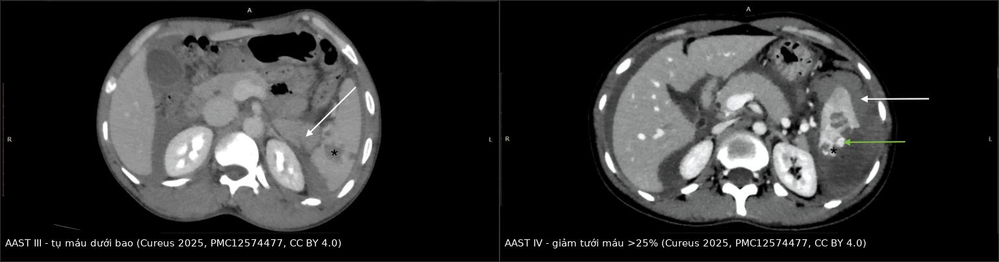
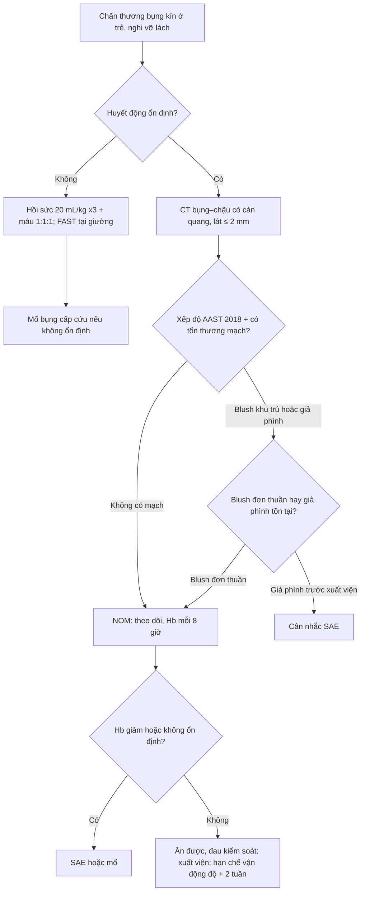
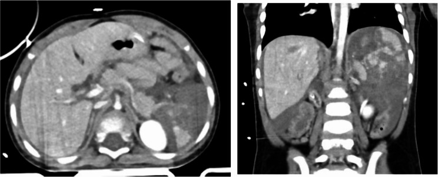
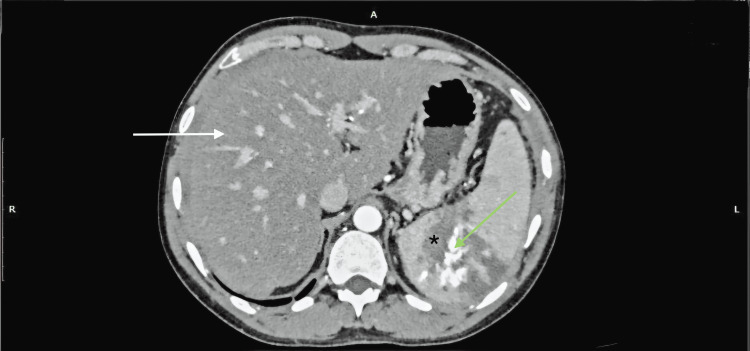

# 1860 — Chấn thương lách ở trẻ em: theo dõi, nút mạch hay mổ / Pediatric blunt splenic injury

**Tags:** `pattern:vo-tang` `pattern:tu-mau` `pattern:thoat-mach` `pattern:gia-phinh` `vung:lach` `vung:o-bung` `protocol:CT-bung-co-can-quang` `score:AAST-OIS` `incidentaloma:khong`

**Mức chắc chắn (certainty):** tổng hợp y văn (literature synthesis) — dựa trên **hướng dẫn WSES 2017** (PMC5562999) và **đồng thuận WSES 2022** về theo dõi sau điều trị nội (PMC9560023), **tổng quan hệ thống APSA 2019** (PMID 30773395), **phân độ AAST-OIS 2018** (Kozar 2018, PMID 30462622), **đoàn hệ quốc gia Nhật 230 ca** (PMID 32800601), **mô hình dự báo giả phình muộn trên 434 ca nhi** (PMC12249224), **1.043 ca chấn thương tạng đặc nhi** (PMC13459630), và **loạt 107 trẻ có thoát cản quang** (PMID 15185236). Các câu "nên làm" không có thử nghiệm ngẫu nhiên được ghi rõ là **suy luận thực hành**.

> **Câu chốt:** Ở trẻ, **độ AAST KHÔNG quyết định mổ — huyết động mới quyết định**. Ba con số cần nhớ: **(1)** điều trị nội (non-operative management, NOM) thành công **95–100%** ở trung tâm nhi, thất bại chỉ **2–5%** và **72,5% thất bại xảy ra trong tuần đầu** (50% trong **3–5 ngày**); **(2)** **thoát cản quang (contrast blush) ở trẻ không phải chỉ định mổ/nút mạch** — chỉ **9,7%** trẻ có blush, **4/5 ca theo dõi thành công**, không có vỡ lách muộn (PMID 15185236); **(3)** giả phình ĐM lách **xuất hiện muộn ở 9,4%** (41/434 ca nhi) nên **chụp lại trước xuất viện** có giá trị hơn chụp ngay.

## 1. Tổng quan bệnh học – cơ chế hình ảnh (TẠI SAO)

### 1.1 Vì sao lách trẻ dễ vỡ nhưng cũng dễ cứu

- Lách là **tạng đặc bị thương thường gặp nhất** trong chấn thương bụng kín ở trẻ: **25–30%** các tổn thương tạng đặc (WSES 2017, PMC5562999).
- **Lồng ngực trẻ đàn hồi** nên lực tác động **truyền thẳng vào ổ bụng** mà **không cần gãy xương sườn**: trẻ có thể vỡ lách nặng với X-quang ngực bình thường. Đây là lý do **cơ chế té ngã/tai nạn xe đạp** ở trẻ nhỏ hay gây rách nhu mô hơn là vỡ xương sườn.
- **Vì sao trẻ cứu lách tốt hơn người lớn:** bao lách dày hơn, tỷ lệ **tế bào cơ biểu mô (myoepithelial cell)** cao hơn, và **động mạch trong lách co thắt – rút lại** hiệu quả hơn → cầm máu tự nhiên tốt hơn (WSES 2017). Vì vậy **cắt lách ở trẻ ổn định là sai lầm**: trẻ đã cắt lách mất chức năng miễn dịch suốt đời.
- **Thể tích máu nhỏ là con dao hai lưỡi:** trẻ có **~80 mL/kg** (non tháng **95**, đủ tháng **85**, nhũ nhi **80**, trẻ lớn **70**) → trẻ 20 kg chỉ có **~1.600 mL**. Mất **300 mL** đã là **~19%** thể tích tuần hoàn. Nhưng vì **mạch co bù trừ tốt**, huyết áp chỉ tụt khi đã mất **> 45%** thể tích tuần hoàn (WSES 2017) — nên **huyết áp bình thường không loại trừ mất máu nặng**.
- **Ngưỡng huyết áp theo tuổi (ATLS):** giới hạn dưới huyết áp tâm thu = **70 + 2 × tuổi** (mmHg) ở trẻ 1–10 tuổi; trẻ > 10 tuổi dùng ngưỡng **90 mmHg**. Trẻ 5 tuổi: **80 mmHg** là giới hạn dưới.
- **Nhịp tim nhanh là dấu sớm, tụt huyết áp là dấu muộn.** Trong chấn thương sọ não kèm theo, **nhịp tim và huyết áp đều là dấu hiệu kém tin cậy** của sốc mất máu (WSES 2017) — phải dựa vào **thời gian làm đầy mao mạch, tri giác, nước tiểu, lactate**.

### 1.2 Vì sao tổn thương trông như vậy trên CT (vật lý HU)

- **Nhu mô lách ngấm thuốc thì tĩnh mạch cửa: ~90–120 HU.** Dịch/máu trong đường rách **10–30 HU** → đường rách hiện là **dải giảm đậm độ** cắt qua nhu mô sáng.
- **Tụ máu dưới bao (subcapsular hematoma):** máu đông **50–80 HU**, dạng **liềm (crescent)** ép nhu mô vào trong, **bờ ngoài ôm sát bao lách** — khác dịch tự do quanh lách (meniscus, không ép nhu mô).
- **Thoát cản quang hoạt động (active extravasation):** ổ **≥ 90–130 HU**, gần bằng **độ đậm động mạch kề bên**, **to ra hoặc giữ nguyên ở thì muộn**. Đây là máu đang chảy ra khỏi lòng mạch, không phải cục máu đông.
- **Giả phình (pseudoaneurysm) / rò động–tĩnh mạch (AV fistula):** ổ tròn ngấm thuốc **song song với động mạch** ở thì động mạch, **không nhỏ đi ở thì muộn**; giả phình có thể **huyết khối tự phát** rồi tái thông.
- **Dấu cục máu lính gác (sentinel clot sign):** cục máu đông sát nguồn chảy có đậm độ **cao nhất (~60–90 HU)** so với máu loãng trong ổ bụng (**~30–45 HU**) → giúp **truy nguồn chảy** khi có máu ở nhiều khoang. Nguyên lý: hemoglobin càng cô đặc thì càng cản tia.
- **Vì sao tổn thương mạch nâng độ:** từ **AAST-OIS 2018**, **bất kỳ tổn thương mạch lách nào** (giả phình, rò ĐTM, chảy máu khu trú trong bao) đã là **độ IV**; chảy máu **lan ra phúc mạc** là **độ V**. Lý do: nhóm này có nguy cơ can thiệp (nút mạch/cắt lách) cao hơn hẳn.

### 1.3 Diễn tiến tự nhiên: khi nào thất bại, khi nào giả phình

- **NOM thất bại 2–5%**; tỷ lệ thất bại **đạt đỉnh ở giờ thứ 4** rồi **giảm dần đến giờ 36**; **72,5%** ca thất bại xảy ra **trong tuần đầu**, **50% trong 3–5 ngày** (WSES 2017).
- **Vỡ lách muộn 0,2%** và **nang giả sau chấn thương 0,3%**, hầu hết **trong 3 tuần đầu** (WSES 2017) — đây là cơ sở cho hạn chế vận động, không phải cho nằm bất động kéo dài.
- **Giả phình muộn:** trong **434 ca nhi** điều trị nội, **9,4% (41 ca)** hình thành giả phình **không thấy trên CT nhập viện**, phát hiện **≥ 24 giờ** sau vào viện; mô hình dự báo gồm **tuổi, giới, ISS, độ AAST, thoát cản quang, tổn thương phối hợp, liều cryoprecipitate** đạt **AUC 0,805–0,828** (PMC12249224). Ý nghĩa: **một CT nhập viện âm tính không kết thúc câu chuyện**.
- **Thất bại NOM không phải vì bệnh nhân "đi lại sớm"**: vận động sớm **không làm tăng thất bại** ở cả độ thấp và cao; thất bại chủ yếu do **giả phình/rò ĐTM tiến triển** (đồng thuận WSES 2022, PMC9560023).

## 2. Mẫu hình + chẩn đoán phân biệt theo vị trí (gamut)

### 2.1 Năm mẫu hình phải gọi tên trên CT

1. **Liềm tụ máu dưới bao** — dải giảm đậm độ ôm mặt ngoài, ép nhu mô; **không có đường rách xuyên nhu mô**.
2. **Tụ máu trong nhu mô** — ổ tròn/oval giảm đậm độ **trong** lách, bờ không đều; đo **đường kính lớn nhất** (< 5 cm = độ II; ≥ 5 cm = độ III).
3. **Đường rách (laceration)** — dải giảm đậm độ **tuyến tính** xuyên nhu mô; đo **độ sâu**: < 1 cm (I), 1–3 cm (II), > 3 cm (III).
4. **Tổn thương mạch** — **blush** khu trú trong bao (IV); **giả phình/rò ĐTM** (IV); **blush lan ra phúc mạc** (V).
5. **Lách vỡ nát (shattered spleen)** — nhu mô mất liên tục nhiều mảnh, không còn hình lách (V).

### 2.2 Gamut theo vị trí và bối cảnh

- **Dịch quanh lách ở trẻ có chấn thương:** máu (đậm độ cao, **30–45 HU** với máu loãng, **60–90 HU** với cục) là chính; nhưng phải loại **dịch cổ trướng sẵn có** (xơ gan, thận nhiễm mỡ) và **nước tiểu/dịch tụy** (đậm độ thấp, bối cảnh khác).
- **Đau hạ sườn trái + khối:** vỡ lách · **tụ máu thận trái** · **tổn thương đuôi tụy** · **vỡ cơ hoành trái** · **tụ máu tuyến thượng thận** (sơ sinh) · **nhồi máu lách** (bệnh hồng cầu hình liềm, EBV, sốt rét) · **xoắn lách lạc chỗ (wandering spleen)**.
- **Theo tuổi — thay đổi ngưỡng nghi ngờ:**
  - **Sơ sinh:** chấn thương sinh (đẻ khó, hút giác) → **tụ máu thượng thận** và **vỡ lách** có thể chỉ biểu hiện **sốc + bụng chướng**; siêu âm đầu tay.
  - **Nhũ nhi – mẫu giáo:** té ngã trong nhà; **luôn cân nhắc chấn thương do hành hạ (non-accidental trauma)** khi cơ chế không khớp tổn thương, tổn thương tạng đặc + vết bầm cũ.
  - **Trẻ lớn – vị thành niên:** xe đạp (tay lái đâm hạ sườn trái), thể thao, tai nạn giao thông. **Trên 15 tuổi xử trí theo phác đồ người lớn** (WSES).
- **Tổn thương phối hợp phải chủ động tìm:** **đuôi tụy** (amylase/lipase, đau tăng sau 24–48 giờ), **thận trái**, **ruột non/mạc treo** (CT có thể bỏ sót), **xương sườn dưới**, **cột sống ngực–thắt lưng**.

## 3. Bảng so sánh phân biệt (ma trận đối chiếu)

| Thực thể (entity) | Hình ảnh điển hình (CT có cản quang) | Chốt vào (rule-in) | Chốt loại (rule-out) | Gợi ý xác nhận |
|---|---|---|---|---|
| **AAST I–II** (tổn thương nhu mô nhẹ) | Liềm dưới bao **< 10%** hoặc **10–50%** diện tích; tụ máu trong nhu mô **< 5 cm**; rách **< 1 cm** hoặc **1–3 cm** | **Rách nông, không có mạch, không blush** | **Có giả phình/blush khu trú → tự động ≥ IV** (AAST 2018) | Đo độ sâu rách (mm), đo đường kính tụ máu |
| **AAST III** (nhu mô nặng, chưa tổn thương mạch) | Tụ máu dưới bao **> 50%** hoặc **vỡ bao**; tụ máu trong nhu mô **≥ 5 cm**; rách **> 3 cm** | **Rách > 3 cm / tụ máu ≥ 5 cm mà KHÔNG có mạch** | **Có giảm tưới máu > 25% hoặc mạch → IV** | Đo trên thì tĩnh mạch cửa; dựng MPR |
| **AAST IV** (tổn thương mạch khu trú) | **Giả phình**, **rò ĐTM**, **blush trong bao lách**, hoặc **giảm tưới máu > 25%** | **Bất kỳ tổn thương mạch nào khu trú trong lách** | **Blush lan ra phúc mạc → V**; **không thấy mạch nhưng tụ máu lớn đơn thuần → III** | CTA/CT thì muộn 60–90 giây; theo dõi giả phình muộn |
| **AAST V** (vỡ nát / chảy máu tự do) | **Lách vỡ nhiều mảnh**, mất hình lách; **blush lan vào phúc mạc**; **đứt cuống mạch** | **Nhu mô không còn liên tục + máu tự do** | **Còn nhu mô lành chiếm ưu thế → IV** | Không cần phân độ thêm: xử trí theo huyết động |
| **Tụ máu dưới bao đơn thuần** | Liềm giảm đậm độ **ép nhu mô**, bờ ngoài sát bao | **Liềm + ép nhu mô + không có dịch quanh lách** | **Dịch quanh lách không ép nhu mô = máu tự do** | Đo độ dày liềm; so thì trước/sau |
| **Khe lách (splenic cleft) — biến thể** | Đường **giảm đậm độ bờ nhẵn**, chạy **từ rốn lách**, **mạch máu đi qua**, **không có máu quanh lách** | **Bờ nhẵn + mạch xuyên qua + không dịch quanh lách** | **Bờ nham nhở + máu quanh lách + đau khu trú = rách thật** | So phim cũ nếu có; siêu âm Doppler |
| **Nhồi máu lách** (không chấn thương) | Vùng **hình nêm** giảm ngấm thuốc ở ngoại vi, **không có đường rách**, không máu quanh lách | **Hình nêm + bệnh nền (hồng cầu hình liềm, EBV, thuyên tắc) + không máu quanh lách** | **Có máu quanh lách + cơ chế chấn thương = vỡ lách** | Siêu âm Doppler; CT thì muộn |
| **Tổn thương thận trái / đuôi tụy** | Ổ giảm đậm độ **trong thận** hoặc **trước thận**, lách nguyên | **Tổn thương nằm ngoài bao lách, lách ngấm thuốc đều** | **Đường rách xuyên nhu mô lách = tổn thương lách** | Amylase/lipase; CT thì muộn; MRCP nếu nghi tụy |

*Trái: **AAST III** — tụ máu dưới bao lớn (mũi tên trắng), nhu mô còn ngấm thuốc, **không có tổn thương mạch**. Phải: **AAST IV** — vùng nhu mô **giảm tưới máu** (mũi tên trắng) kèm **ổ tăng đậm độ trong vùng rách** (mũi tên xanh), tức tổn thương mạch. Cả hai là **người lớn** (35 tuổi và 31 tuổi) — dùng để học phân độ, không đại diện cho trẻ. Nguồn: *Cureus* 2025 (PMC12574477), **CC BY 4.0**; ghép bằng `tools/make_composite.py` (letterbox, không crop/kéo giãn).*

## 4. Protocol chụp + hệ phân độ và thuật toán xử trí

### 4.1 Chụp gì, khi nào

- **CT bụng–chậu có cản quang là tiêu chuẩn vàng** ở trẻ **huyết động ổn định** (WSES GoR 1A); trẻ phải **hợp tác hoặc được an thần**.
- **Thì chụp:** thì **động mạch + tĩnh mạch cửa** (hoặc **split-bolus** gộp hai thì) để thấy mạch và nhu mô; **thì muộn 60–90 giây** khi nghi **blush/giả phình**. Lát **≤ 1–2 mm**, dựng MPR coronal/sagittal để đo độ sâu rách.
- **Liều:** dùng protocol **liều thấp 3–6 mSv** thay vì **11–24 mSv** (WSES 2017) — trẻ nhạy cảm bức xạ hơn người lớn nhiều lần; chi tiết liều ở bài **937**.
- **Siêu âm (FAST):** độ nhạy chỉ **~66%** (dao động **50–92%**) trong meta-analysis → **FAST âm không loại trừ**; FAST dương ở trẻ ổn định **phải chuyển CT** (GoR 1B). FAST có giá trị nhất ở trẻ **không chụp CT được vì huyết động không ổn**.
- **X-quang ngực:** theo ATLS; tìm tràn khí/tràn máu màng phổi, gãy sườn (nhưng **thiếu gãy sườn không loại trừ vỡ lách**).

### 4.2 Phân độ AAST-OIS 2018 (Kozar 2018)

| Độ | Tiêu chuẩn hình ảnh |
|---|---|
| **I** | Tụ máu dưới bao **< 10%** diện tích; **rách < 1 cm**; rách bao |
| **II** | Tụ máu dưới bao **10–50%**; tụ máu trong nhu mô **< 5 cm**; **rách 1–3 cm** |
| **III** | Tụ máu dưới bao **> 50%** hoặc đang lan; tụ máu trong nhu mô **≥ 5 cm**; **rách > 3 cm** |
| **IV** | **Tổn thương mạch lách** (giả phình, rò ĐTM) hoặc **chảy máu khu trú trong bao**; **rách mạch phân thùy/rốn gây giảm tưới máu > 25%** |
| **V** | **Lách vỡ nát**; **tổn thương mạch rốn làm mất tưới máu lách**; **chảy máu lan vào phúc mạc** |

> **Quy tắc 2018:** có **nhiều tổn thương riêng biệt** thì **tăng 1 độ**, nhưng **không vượt quá độ III** (trừ khi có tổn thương mạch — khi đó đã là IV).

### 4.3 Xử trí: huyết động trước, độ AAST sau

- **NOM là lựa chọn đầu tay** cho trẻ chấn thương lách kín **huyết động ổn định, bất kể độ AAST** (WSES GoR 2A; EAST). **Không cắt lách ở trẻ ổn định có tổn thương lách đơn độc** (GoR 1A).
- **Chống chỉ định NOM:** viêm phúc mạc, ruột lòi, vật xuyên còn lại, hoặc chỉ định mở bụng khác (GoR 2A).
- **Hồi sức:** **3 lần 20 mL/kg** dịch tinh thể trước khi truyền máu; truyền máu theo tỷ lệ **1:1:1** khi sốc mất máu; **ngưỡng truyền hồng cầu khối Hb < 7 g/dL** (WSES). **Mổ khi đã truyền ≥ 40 mL/kg chế phẩm máu trong 24 giờ mà vẫn không ổn định** (ATOMAC, dẫn qua WSES).
- **Blush trên CT ở trẻ: KHÔNG tự động can thiệp** (GoR 2B). Loạt 107 trẻ: blush **9,7%** (5/63 có CT), **4/5 theo dõi thành công**, **không ca nào vỡ lách muộn** (PMID 15185236).
- **Nút mạch (splenic artery embolization, SAE) khi:** trẻ đã chọn NOM nhưng **chảy máu dai dẳng/đáp ứng tạm thời với hồi sức**, đã loại nguồn chảy ngoài lách (GoR 1C); hoặc **giả phình tồn tại trước xuất viện** (GoR 2C). Ở đoàn hệ Nhật **230 ca độ cao**, SAE được dùng **27%**, mổ **5,2%**, **không có tử vong**, **cứu lách 97%** (PMID 32800601).
- **Biến chứng SAE ở trẻ:** **hội chứng sau nút mạch 90%** (đau, buồn nôn, liệt ruột, sốt), **tự hết sau 6–9 ngày**; tràn dịch màng phổi **9%**, viêm phổi **9%**, di trú coil **4,5%** (WSES 2017). **Đừng nhầm sốt sau nút mạch với nhiễm trùng.**
- **Theo dõi sau NOM (đồng thuận WSES 2022):** đo **Hb mỗi 8 giờ**; cho **vận động khi 3 lần Hb liên tiếp chênh nhau < 10%**; **chụp lại (CT/CEUS) 48–72 giờ** với **độ III trở lên**; **dự phòng huyết khối bằng LMWH sau 48–72 giờ** nếu không có chống chỉ định. (Các khuyến cáo này chủ yếu từ người lớn — áp dụng cho trẻ cần cá thể hóa.)
- **Thời gian nằm viện:** APSA 2000 đề nghị **LOS = độ + 1 ngày** và **hạn chế vận động = độ + 2 tuần**; tổng quan APSA 2019 cho rằng **LOS nên theo lâm sàng**, có thể **ngắn hơn**, và **không nút mạch dự phòng** ở trẻ ổn định có thoát mạch trên hình. Một loạt 156 trẻ tổn thương tạng đặc đơn độc: LOS thực tế **2,85 ± 3,32 ngày** so với **3,71 ± 0,98 ngày** nếu theo công thức APSA (PMID 37257502).
- **Trở lại hoạt động mạnh:** ít nhất **6 tuần** với tổn thương trung bình–nặng (WSES GoR 2B); **không cần nằm bất động kéo dài**.
- **Nếu phải cắt lách:** tiêm phòng **phế cầu, Haemophilus influenzae type b, não mô cầu** (GoR 1A), **không sớm hơn 14 ngày sau mổ** (GoR 2C); **OPSI 0,5–2%, tử vong 30–70%**, nguy cơ cao nhất năm đầu và **kéo dài suốt đời** (chi tiết ở bài **6173** nếu có).

## 5. Biến thể bình thường và cạm bẫy

- **Khe lách (splenic cleft) — biến thể hay bị gọi là rách:** bờ **nhẵn**, chạy **từ rốn ra ngoại vi**, **mạch máu đi trong khe**, **không có máu quanh lách**, không đau khu trú tương ứng. Rách thật: bờ **nham nhở**, **máu quanh lách**, đau hạ sườn trái.
- **Tụ máu dưới bao vs máu tự do quanh lách:** liềm dưới bao **ép nhu mô** và **không di chuyển theo tư thế**; máu tự do tạo **meniscus** trong khoang màng phổi/ổ bụng, **không ép nhu mô**, đậm độ thấp hơn.
- **Cạm bẫy "đọc độ mà quên trẻ":** trẻ độ IV–V **vẫn có thể điều trị nội** nếu ổn định; ngược lại trẻ độ II **có thể tụt huyết áp** vì mất máu nhanh. Quyết định theo **huyết động + xu hướng Hb**, không theo con số độ.
- **Blush không đồng nghĩa mổ (ở trẻ):** khác người lớn, **blush đơn thuần ở trẻ thường tự cầm**; can thiệp khi **chảy máu dai dẳng** hoặc **giả phình tồn tại**.
- **Giả phình xuất hiện MUỘN:** CT nhập viện âm tính **không loại trừ**; **9,4%** trẻ hình thành giả phình sau đó (PMC12249224). Phải **chụp lại trước xuất viện** ở độ III trở lên, hoặc khi Hb không ổn định.
- **"Bụng mềm" ở trẻ không đáng tin:** trẻ bù trừ tốt, **dấu bụng ngoại vi xuất hiện muộn**; theo dõi **nhịp tim, làm đầy mao mạch, nước tiểu, lactate**.
- **Bỏ sót tổn thương phối hợp (satisfaction of search):** thấy vỡ lách rồi dừng lại — phải soát **đuôi tụy, thận trái, ruột non, xương sườn dưới, cột sống**. Đau tăng sau 24–48 giờ + amylase/lipase tăng = nghĩ **tụy**.
- **Bức xạ lặp lại:** chỉ chụp lại khi **Hb giảm, đau tăng, hoặc theo lịch 48–72 giờ** ở độ cao; tránh chuỗi CT "cho chắc" ở trẻ.
- **Chấn thương do hành hạ:** cơ chế **không khớp** với tổn thương, trẻ **< 2 tuổi**, tổn thương tạng đặc + **vết bầm ở nhiều lứa tuổi** → báo cáo theo quy trình bảo vệ trẻ, không chỉ điều trị lách.
- **Sau cắt lách:** **thể lách lạc (splenosis)** có thể xuất hiện nhiều năm sau, dạng nốt màng phổi/phúc mạc — đừng gọi là di căn.

## 6. Tự lượng giá — Blind Quiz

**Ca 1 — Bé trai 2 tuổi, chấn thương bụng kín, bụng chướng, huyết động còn ổn định sau hồi sức.**

- Câu hỏi: Mô tả tổn thương lách (axial trái, coronal phải)? Xếp độ AAST? Nếu trẻ ổn định, bước tiếp theo là gì?

<b>Bấm để hiện đáp án (findings + chẩn đoán)</b>

- **Dấu hiệu:** nhu mô lách **mất liên tục gần như toàn bộ**, nhiều đường rách và **máu tụ lớn trong bao/thay thế nhu mô**; coronal cho thấy lách **không còn hình dạng bình thường**, đẩy các tạng xung quanh.
- **Chẩn đoán:** **vỡ lách độ V (shattered spleen)** theo AAST-OIS 2018.
- **Xử trí:** độ V **không tự động là chỉ định mổ**. Trẻ **huyết động ổn định** → **NOM tại trung tâm có khả năng theo dõi liên tục, nút mạch và mổ ngay**; theo dõi Hb mỗi 8 giờ, chụp lại 48–72 giờ. Nếu **không ổn định hoặc chảy máu dai dẳng** → **SAE hoặc mổ** (cố gắng bảo tồn một phần lách).
- **Nguồn ảnh:** *BMC Surgery* 2026 (PMC13459630), Fig. 1 — **CC BY-NC-ND 4.0**, dùng nguyên bản, không crop/ghép.

**Ca 2 — Nam 33 tuổi, tai nạn giao thông, đau hạ sườn trái; CT có cản quang thì tĩnh mạch cửa.**

- Câu hỏi: Mũi tên xanh và dấu hoa thị chỉ gì? Vì sao tổn thương này **không phải độ III**? Khác biệt xử trí ở **người lớn** và **trẻ**?

<b>Bấm để hiện đáp án (findings + chẩn đoán)</b>

- **Dấu hiệu:** **dấu hoa thị** = tụ máu/đường rách trong nhu mô; **mũi tên xanh** = **ổ tăng đậm độ trong vùng rách**, đậm độ gần bằng động mạch → **thoát cản quang hoạt động (active extravasation)**.
- **Chẩn đoán:** **AAST IV** — vì **có tổn thương mạch**; từ 2018, bất kỳ tổn thương mạch nào cũng nâng lên **độ IV** (chảy máu lan ra phúc mạc = độ V).
- **Xử trí khác nhau:** ở **người lớn**, blush thường là chỉ định **chụp mạch/nút mạch**; ở **trẻ**, blush **đơn thuần không tự động can thiệp** — chỉ nút khi **chảy máu dai dẳng/đáp ứng tạm thời** hoặc **giả phình tồn tại**.
- **Nguồn ảnh:** *Cureus* 2025 (PMC12574477), Fig. 3 — **CC BY 4.0**.

**Ca 3 — Hai bệnh nhân, cùng CT bụng có cản quang: hãy xếp độ trước khi mở đáp án.**

- Câu hỏi: Ảnh trái và ảnh phải khác nhau ở **dấu hiệu nào quyết định độ**? Ảnh nào có **tổn thương mạch**?

<b>Bấm để hiện đáp án (findings + chẩn đoán)</b>

- **Ảnh trái — AAST III:** **tụ máu dưới bao lớn** (mũi tên trắng), nhu mô còn ngấm thuốc; **không thấy giả phình/blush** → độ III vì **tụ máu > 50% diện tích** (không phải vì mạch).
- **Ảnh phải — AAST IV:** vùng **giảm tưới máu** (mũi tên trắng) kèm **ổ tăng đậm độ trong vùng rách** (mũi tên xanh) = **tổn thương mạch**; đây là **dấu hiệu nâng độ IV**, không phải kích thước tụ máu.
- **Bài học:** **độ do mạch quyết định, không do lượng máu tụ**; đo độ sâu rách và tìm giả phình/blush trước khi kết luận.
- **Nguồn ảnh:** *Cureus* 2025 (PMC12574477), Fig. 4 và Fig. 7 — **CC BY 4.0**; ghép bằng `tools/make_composite.py`.

## Bài liên quan chéo
- [600 – Tổng quan hệ Nhi khoa](../600-tong-quan-nhi-khoa/lesson.md)
- [1848 – Nút mạch lách trong chấn thương (người lớn)](../1848-nut-mach-lach-trong-chan-thuong/lesson.md) (kỹ thuật nút gần/xa, cứu lách 90,3%)
- [1835 – Thiếu máu ruột sau nút mạch](../1835-thieu-mau-ruot-sau-nut-mach/lesson.md) (biến chứng của SAE)
- [937 – Liều CT ở trẻ: SSDE, DRL](../937-lieu-ct-tre-ssde-drl/lesson.md) (ALARA khi chụp lặp)
- [6115 – Tăng áp cửa trái do huyết khối tĩnh mạch lách](../6115-tang-ap-cua-phia-trai-tac-tinh-mach-lach/lesson.md) (di chứng muộn trên cùng tạng)

## Ảnh
- `images/1860_chan-thuong-lach_CT_PMC13459630.jpg` — trẻ 2 tuổi, vỡ lách độ V; *BMC Surgery* 2026 (PMC13459630), CC BY-NC-ND 4.0.
- `images/1860_chan-thuong-lach_CT_PMC12574477-f3.jpg` — người lớn, độ IV + thoát cản quang; *Cureus* 2025 (PMC12574477), CC BY 4.0.
- `images/1860_chan-thuong-lach_CT_PMC12574477-f4.jpg` và `-f7.jpg` — nguồn của ảnh ghép; cùng bài, CC BY 4.0.
- `images/composite_1860_AAST-III-IV.jpg` — ảnh ghép đối chiếu độ III vs IV; tạo bằng `tools/make_composite.py` (letterbox nền đen, không crop/kéo giãn).
- Nguồn + giấy phép từng ảnh: `images/CREDITS.md`; link gốc: `sources.md`.

> Không dùng để chẩn đoán độc lập khi chưa có người hướng dẫn.
