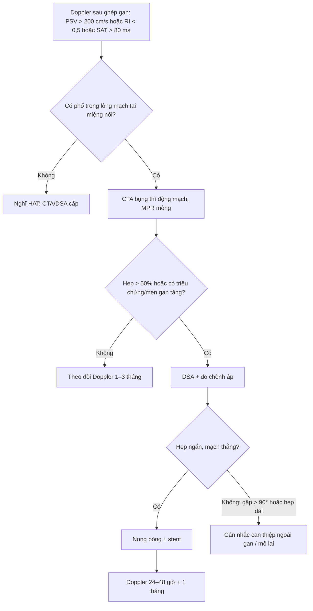
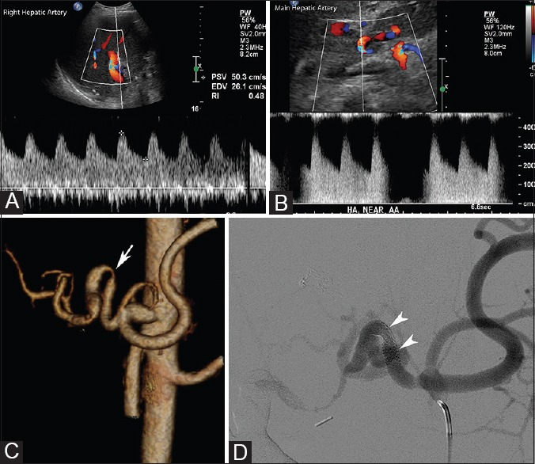
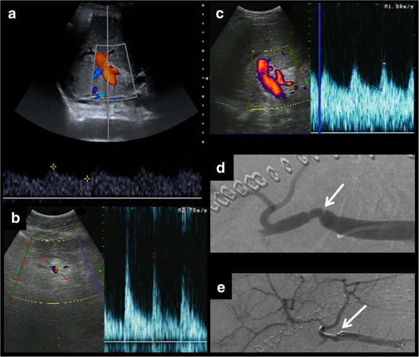
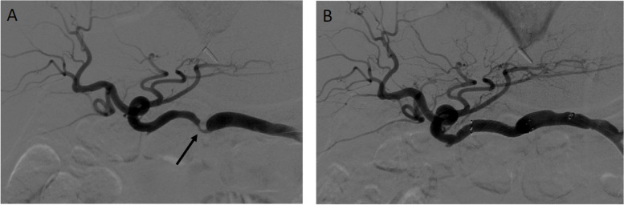
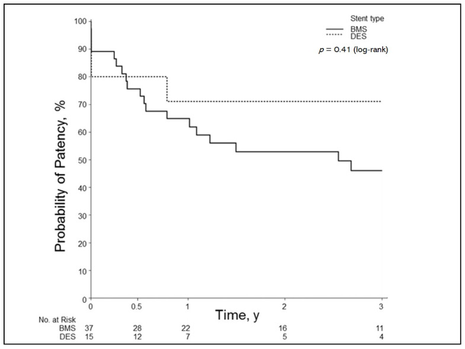

# 1861 — Hẹp động mạch gan sau ghép gan / Hepatic artery stenosis after liver transplantation

**Tags:** `pattern:hep` `pattern:tardus-parvus` `pattern:giam-tuoi-mau-gan` `vung:gan` `vung:o-bung` `score:PSV-200` `score:RI` `protocol:Doppler-sieu-am` `protocol:CTA-bung` `protocol:DSA` `incidentaloma:khong`

**Mức chắc chắn (certainty):** tổng hợp y văn (literature synthesis) — 1 bài tổng quan hình ảnh mạch sau ghép gan có đủ Doppler – CT – DSA (*Insights Imaging* 2019, **PMC6694376**, CC BY 4.0), 1 bài ôn Doppler hậu phẫu kinh điển của *Indian J Radiol Imaging* 2014 (**PMC4247505**, CC BY-NC-SA 3.0), 1 đoàn hệ can thiệp 43 thủ thuật ở 40 bệnh nhân (*CVIR Endovasc* 2024, **PMC11032299**, CC BY 4.0), 1 đoàn hệ 52 ca đặt stent so sánh stent phủ thuốc với stent kim loại trần (*J Clin Med* 2021, **PMC7863956**, CC BY 4.0) và dữ liệu nhi khoa của *Cardiovasc Intervent Radiol* 2023 (**PMC10616219**, CC BY 4.0). Nhóm **không có bệnh nhân của mình**; chỗ các nguồn lệch ngưỡng (RI < 0,5 hay < 0,55) được ghi rõ là **mâu thuẫn nguồn**, không chọn bừa.

> **Câu chốt:** sau ghép gan, **động mạch gan là mạch duy nhất nuôi đường mật** — hẹp (hepatic artery stenosis, HAS) không chỉ làm thiếu máu nhu mô mà còn gây **hẹp đường mật thiếu máu (ischemic cholangiopathy)**, thứ chỉ xuất hiện vài tuần–vài tháng sau đó. Ba số phải thuộc: **(1)** biến chứng mạch gặp **~7%** ở ghép gan người hiến chết và **~13%** ở ghép gan sống (PMC6694376); **(2)** hẹp tại miệng nối chiếm **2–13%**, và chẩn đoán Doppler dựa vào **PSV tại chỗ hẹp > 200 cm/s**, **RI hạ lưu < 0,5–0,55**, **thời gian tăng tốc (SAT) > 80 ms**; **(3)** **hình màu bình thường không loại trừ hẹp** — phải lấy **phổ Doppler**, vì phổ mới là thứ thay đổi (PMC6694376; PMC4247505).

## 1. Tổng quan bệnh học – cơ chế hình ảnh

### 1.1 Vì sao hẹp động mạch gan là "bệnh của đường mật"

- Gan có **hai nguồn máu**: tĩnh mạch cửa **~75% lưu lượng** nhưng chỉ **~50% oxy**; động mạch gan **~25% lưu lượng** nhưng **~50% oxy**. Đường mật trong gan **không có tuần hoàn bàng hệ từ tĩnh mạch cửa** — nó sống bằng **đám rối mao mạch quanh ống mật (peribiliary vascular plexus)** nuôi bởi **động mạch gan**. Vì vậy hẹp/tắc động mạch gan → **hoại tử biểu mô đường mật từng đoạn** → hẹp, giãn, ứ mật, sỏi, và về sau **xơ gan đường mật thứ phát** (PMC6694376).
- **Cơ chế hẹp tại miệng nối:** miệng nối động mạch là chỗ **khâu tận–tận với cỡ mạch 2–5 mm**, bị **kẹp mạch (clamp injury)**, **xoắn/gập (kinking)**, **lệch cỡ**, và đáp ứng **tăng sinh nội mạc (intimal hyperplasia)** — mô học của stent lấy ra cho thấy **dày nội mạc** đúng tại miệng nối (PMC7863956, Fig. 4). Đây là lý do hẹp thường **khu trú, ngắn, đúng chỗ khâu**, khác hẹp xơ vữa lan tỏa.
- **Vì sao hẹp ĐỘNG MẠCH lại biểu hiện bằng men gan và vàng da:** thiếu máu nhu mô gây **tăng transaminase** (thường **ALT/AST tăng nhẹ–trung bình**, không tăng vọt như tắc mạch cấp), còn thiếu máu đường mật gây **bilirubin/ALP tăng** và **hẹp đường mật** — nên bệnh nhân có thể được chẩn đoán nhầm là **thải ghép cấp** hoặc **hẹp đường mật đơn thuần**. Trong đoàn hệ can thiệp, chỉ định can thiệp là **HAS + tăng transaminase** (PMC11032299).

### 1.2 Vật lý Doppler: tại sao phổ mới là "chứng cứ"

| Vị trí đo | Hiện tượng vật lý | Ngưỡng thực hành |
|---|---|---|
| **Tại chỗ hẹp** | Tiết diện giảm → theo **phương trình liên tục**, vận tốc tăng; dòng rối gây **aliasing** trên màu | **PSV > 200 cm/s** (PMC6694376; PMC4247505) |
| **Trước chỗ hẹp** | Áp lực tăng để vượt qua hẹp → **trở kháng tăng** | **RI > 0,8** (PMC6694376) |
| **Sau chỗ hẹp** | Mất áp lực → giãn tiểu động mạch bù trừ → **trở kháng giảm**, dốc tâm thu chậm | **RI < 0,5–0,55**, **SAT > 80 ms**, dạng **parvus–tardus** (hai nguồn ghi 0,5 và 0,55) |
| **Độ nhạy/độ đặc hiệu của dấu hiệu gián tiếp** | Phụ thuộc huyết động, không đặc hiệu nguyên nhân | **Se 73–83%, Sp 60–73%** (PMC4247505) |

- **Vì sao dấu hiệu gián tiếp không đủ:** cùng một phổ **tardus–parvus** xuất hiện khi **hẹp ở gần** *hoặc* khi **tắc động mạch gan (HAT) có tuần hoàn bàng hệ** — bàng hệ nuôi ngược dòng vào động mạch trong gan tạo phổ chậm, giống hệt hẹp. Vì vậy **tardus–parvus không loại trừ HAT**, và ngược lại **màu bình thường không loại trừ hẹp** (PMC4247505).
- **Nhiễu sinh lý 3 ngày đầu:** ngay sau ghép, **RI > 0,8** gặp ở nhiều bệnh nhân do **phù mô ghép và tăng áp lực ổ bụng**, tự hết; đọc đơn độc ngày 1–3 dễ mổ lại oan (PMC6694376).

### 1.3 Dịch tễ và ngưỡng định lượng nằm lòng

| Đại lượng | Số liệu | Nguồn |
|---|---|---|
| Biến chứng mạch sau ghép gan | **~7%** (người hiến chết) · **~13%** (ghép sống) | PMC6694376 |
| Hẹp tại miệng nối động mạch gan | **2–13%** bệnh nhân | PMC6694376 |
| PSV tại chỗ hẹp | **> 200 cm/s** | PMC6694376; PMC4247505 |
| RI hạ lưu | **< 0,5** (một số nguồn **< 0,55**) | PMC6694376; PMC4247505 |
| Thời gian tăng tốc tâm thu (SAT) | **> 80 ms** | PMC4247505 |
| RI trước hẹp | **> 0,8** | PMC6694376 |
| Tỉ lệ hẹp lại sau can thiệp nội mạch | Xem mục 4 (stent BMS **46%** còn thông ở 3 năm) | PMC7863956 |

## 2. Mẫu hình + chẩn đoán phân biệt theo vị trí (gamut)

- **Hẹp đúng miệng nối (anastomotic HAS):** hẹp ngắn, đối xứng hoặc lệch, **PSV tăng tại chỗ**, hạ lưu **tardus–parvus**; gặp sớm (tuần–tháng) hoặc muộn (tăng sinh nội mạc). Là thể hay gặp nhất.
- **Hẹp do gập/xoắn mạch (kinking):** mạch quá dài, **góc gấp > 90°**, hẹp khi đổi tư thế; trên CTA thấy **quai mạch gấp**. Stent đặt tại chỗ gập dễ gãy và hẹp lại, nên CTA phải mô tả **đoạn cong**; trong đoàn hệ PMC11032299, **4 ca hẹp sát đoạn cong > 90°** được xếp vào nhóm **cân nhắc can thiệp ngoài gan** thay vì can thiệp trực tiếp.
- **Hẹp đa ổ (multifocal):** phải đo và xử lý **từng ổ**, không chỉ ổ gần nhất (PMC6694376, Fig. 5).
- **Tắc động mạch gan (HAT):** không có phổ trong lòng mạch, hoặc **tardus–parvus do bàng hệ**; CTA xác nhận khuyết thuốc; cấp cứu vì nguy cơ **hoại tử đường mật/gan**.
- **Cướp máu lách (splenic artery steal syndrome, SASS):** động mạch lách lớn, **lưu lượng động mạch gan thấp**, hẹp không rõ; xử trí **nút động mạch lách** — phân biệt với hẹp thật bằng CTA/DSA và đáp ứng sau nút (bài [1825](../1825-hoi-chung-gan-nho/lesson.md)).
- **Giả phình (pseudoaneurysm):** túi thuốc **giữ hình** ở thì muộn, có "yin–yang" trên Doppler; nguy cơ vỡ/rò mật–máu — **không phải hẹp**.
- **Hẹp tĩnh mạch cửa / tắc dòng ra:** khác hệ, nhưng cùng bệnh cảnh "men gan tăng sau ghép" (bài [1827](../1827-hep-tinh-mach-cua-sau-ghep-gan/lesson.md)).

## 3. Bảng so sánh phân biệt (ma trận đối chiếu)

| Thực thể (entity) | Hình ảnh điển hình (US/CT/DSA) | Chốt vào (rule-in) | Chốt loại (rule-out) | Gợi ý xác nhận |
|---|---|---|---|---|
| **Hẹp miệng nối ĐM gan (HAS)** | Hẹp ngắn đúng chỗ khâu; **PSV > 200 cm/s** tại chỗ; hạ lưu **RI < 0,5–0,55, SAT > 80 ms**; CTA thấy hẹp + tái tạo | **PSV > 200 cm/s + tardus–parvus hạ lưu** | Phổ hạ lưu bình thường **không loại trừ hẹp nhẹ**; màu bình thường không loại trừ | Doppler lặp + CTA; DSA đo chênh áp khi nghi ngờ |
| **Huyết khối ĐM gan (HAT)** | Không có phổ trong lòng mạch; **tardus–parvus có thể vẫn còn** nhờ bàng hệ; CTA khuyết thuốc | **Mất phổ trong lòng mạch + khuyết thuốc CTA** | Có phổ trong lòng mạch tại miệng nối → không phải tắc hoàn toàn | CTA/DSA cấp; can thiệp tái thông |
| **Cướp máu lách (SASS)** | ĐM lách giãn, **lưu lượng ĐM gan thấp**, RI thấp; hẹp không tương xứng | **ĐM lách > ĐM gan + RI thấp hồi phục sau nút lách** | Hẹp khu trú rõ tại miệng nối → HAS thật | DSA + nút lách thử; Doppler sau nút |
| **RI cao sinh lý 3 ngày đầu** | **RI > 0,8** nhưng phổ còn **dốc tâm thu nhanh**, hết sau vài ngày | **Hết trong 72 giờ, không có hẹp trên CTA** | RI cao **kéo dài + SAT dài** → nghĩ hẹp/tắc | Doppler lặp ngày 3–7 |
| **Giả phình ĐM gan** | Túi thuốc **giữ hình**, "yin–yang"; không hẹp lòng mạch | **Túi thuốc tồn tại thì muộn** | Không có túi → không phải giả phình | CTA/DSA; can thiệp (coil/stent) |

## 4. Protocol chụp + can thiệp

### 4.1 Lịch và kỹ thuật siêu âm Doppler

- **Thời điểm:** nhiều trung tâm chạy Doppler **24 giờ, 48 giờ, ngày 7** sau ghép rồi **1, 3, 6, 12 tháng** và khi men gan tăng (PMC6694376 mô tả lịch này ở đơn vị tác giả).
- **Kỹ thuật:** đầu dò convex 2–5 MHz; **góc Doppler ≤ 60°**; lấy **phổ tại miệng nối, 1–2 cm trước và sau**, cả **động mạch gan phải và trái**; ghi **PSV, EDV, RI, SAT**; cửa sổ mẫu nhỏ đặt đúng lòng mạch.
- **Bắt buộc lấy phổ kể cả khi màu bình thường** — đây là điểm bị bỏ sót nhiều nhất (PMC6694376, Fig. 4a–c).

### 4.2 Khi Doppler bất thường

- **CTA bụng thì động mạch** (lát **0,6–1 mm**, MPR/3D) để xác nhận vị trí, độ dài, độ cong và loại trừ giả phình/HAT. Không dùng CTA thay Doppler để sàng lọc vì liều và thuốc cản quang.
- **DSA** là tiêu chuẩn vàng: xác định hẹp, đo **chênh áp qua chỗ hẹp** và **điều trị ngay trong cùng thì**. Trong đoàn hệ 43 thủ thuật, tất cả bệnh nhân được can thiệp khi có **hẹp + tăng transaminase** (PMC11032299).

### 4.3 Kết quả can thiệp — số liệu để tư vấn

| Can thiệp | Kết quả | Nguồn |
|---|---|---|
| Nong bóng/stent trong gan (HAI): **21 thủ thuật/18 bệnh nhân** | **Tử vong liên quan gan 1 năm 10% (2/21)**; biến chứng **29% (6/21)** | PMC11032299 |
| Can thiệp ngoài gan (EHAI, nút mạch lách…): **27 thủ thuật/22 bệnh nhân** | **Tử vong liên quan gan 1 năm 0% (0/27)**; biến chứng **4% (1/27)**; khác biệt biến chứng **p = 0,015** | PMC11032299 |
| Stent phủ thuốc (DES), **52 ca** | Thông 6 tháng/1/2/3 năm: **80/71/71/71%** | PMC7863956 |
| Stent kim loại trần (BMS), **52 ca** | **76/65/53/46%** (p = 0,41 so với DES) | PMC7863956 |
| DES ở mạch nhỏ **3,5–4,5 mm** | **93/75/75/75%** | PMC7863956 |
| BMS ở mạch nhỏ **3,5–4,5 mm** | **60/60/50/38%** | PMC7863956 |

> **Đọc số cho đúng:** đây là **nghiên cứu hồi cứu, không ngẫu nhiên**; DES "trông tốt hơn" nhưng **p = 0,41** (toàn bộ) và **p = 0,19** (mạch nhỏ) — **không đủ bằng chứng** để nói DES hơn BMS. Điều chắc chắn: **stent ở mạch 3,5–4,5 mm mất thông dần theo thời gian**, nên phải theo dõi Doppler dài hạn (PMC7863956).

### 4.4 Can thiệp ở trẻ

- Ở trẻ, động mạch gan nhỏ hơn, **co thắt do can thiệp** mạnh hơn và **gập mạch** hay gặp sau ghép mảnh ghép chia; loạt nhi khoa cho thấy can thiệp nội mạch vẫn khả thi nhưng **phải chọn cỡ bóng/stent theo đường kính đo trên CTA**, và **hẹp tái phát** là vấn đề chính (PMC10616219). Chi tiết kỹ thuật nong/stent nhi khoa nằm ngoài phạm vi bài này — ghi là **chưa đủ nguồn để đưa ngưỡng riêng cho trẻ**.

## 5. Biến thể bình thường và cạm bẫy

- **RI > 0,8 trong 3 ngày đầu** là sinh lý (phù ghép, tăng áp ổ bụng) — **không chẩn đoán hẹp/tắc** nếu phổ còn dốc nhanh và CTA không có hẹp (PMC6694376).
- **Màu bình thường + phổ bất thường:** hẹp nhẹ–trung bình có thể **không gây aliasing rõ**, nên **bỏ qua phổ là bỏ chẩn đoán** (PMC6694376, Fig. 4).
- **Tardus–parvus không loại trừ HAT:** bàng hệ sau tắc có thể tạo phổ chậm trong gan; muốn loại HAT phải thấy **phổ trong lòng mạch tại miệng nối** hoặc CTA (PMC4247505).
- **Hẹp đa ổ:** nong một ổ còn ổ thứ hai → men gan không giảm; phải đo **toàn bộ trục động mạch gan** (PMC6694376, Fig. 5).
- **Hẹp đường mật có thể xuất hiện trước/sau hẹp động mạch:** hẹp đường mật **liên quan cả HAS sớm và muộn**; bệnh nhân được đặt stent đường mật mà không kiểm tra động mạch sẽ tái hẹp (PMC7738047).
- **Sai góc/đặt cửa sổ sai** làm PSV giả thấp — luôn ghi góc và đo lại bằng CTA khi lâm sàng không khớp.

## 6. Tự lượng giá — Blind Quiz

**Ca 1 — Nam 55 tuổi, ghép gan 2 tháng, men gan tăng. Hai phổ Doppler và hình mạch:**

- Gợi ý: bệnh nhân không sốt, không vàng da nhiều; siêu âm màu thấy dòng trong gan.
- Hỏi: (1) đoạn nào **hạ lưu** chỗ hẹp? (2) hai phổ khác nhau ở điểm nào? (3) hình C–D xác nhận gì?

<b>Bấm để hiện đáp án (findings + chẩn đoán)</b>

- **Phổ A (động mạch gan phải):** PSV **50,3 cm/s**, EDV **26,1 cm/s**, **RI 0,48** — trở kháng thấp, dòng tâm trương tăng = **hạ lưu chỗ hẹp**.
- **Phổ B (động mạch gan chính):** PSV **120 cm/s**, EDV **27,8 cm/s**, **RI 0,77** — trở kháng cao hơn, phù hợp đoạn **trước hẹp**.
- **C:** CTA 3D cho thấy **động mạch gan gấp/xoắn** (mũi tên) — nguyên nhân cơ học, không chỉ xơ nội mạc. **D:** DSA xác nhận **hẹp tại miệng nối** (đầu mũi tên) và đoạn sau hẹp.
- **Chẩn đoán:** hẹp động mạch gan tại miệng nối, có **tardus–parvus hạ lưu**; điều trị nong bóng/stent hoặc xử lý đoạn gập.
- **Nguồn ảnh:** *Indian J Radiol Imaging* 2014, **PMC4247505**, Fig. 5 — **CC BY-NC-SA 3.0**, nguyên bản (không crop).

**Ca 2 — Bệnh nhân ghép gan, màu bình thường nhưng nghi hẹp:**

- Hỏi: vì sao **không được dừng ở hình màu**? Phổ b và c khác nhau thế nào? Hình d–e là gì?

<b>Bấm để hiện đáp án</b>

- **a:** hình màu **không thấy hẹp rõ** — nếu chỉ nhìn màu sẽ bỏ sót. **b (trước hẹp):** đỉnh cao, **RI tăng**. **c (sau hẹp):** **parvus–tardus**, **RI thấp**, dốc tâm thu chậm.
- **d:** DSA thấy **hẹp khu trú** (mũi tên). **e:** sau **nong bóng + stent**, lòng mạch thông.
- **Bài học:** quyết định nằm ở **phổ**, không ở màu; và hẹp có thể **không có aliasing** nếu hẹp không đủ nặng để tăng vận tốc vượt ngưỡng hiển thị.
- **Nguồn ảnh:** *Insights Imaging* 2019, **PMC6694376**, Fig. 4 — **CC BY 4.0**.

**Ca 3 — Nam 61 tuổi, ghép gan 3 tháng, transaminase tăng, DSA trước và sau can thiệp:**

- Hỏi: (1) mũi tên chỉ gì? (2) vì sao can thiệp **ngay trong thì DSA**? (3) theo dõi sau can thiệp bằng gì?

<b>Bấm để hiện đáp án</b>

- **A:** hẹp khu trú tại **miệng nối động mạch gan** (mũi tên), đoạn sau hẹp nhỏ hơn. **B:** sau **nong bóng/stent**, lòng mạch mở rộng, dòng chảy cải thiện.
- **Vì sao can thiệp ngay:** cùng một thì đã có chẩn đoán giải phẫu + đo chênh áp; tránh thêm lần chọc mạch. Trong đoàn hệ, can thiệp trực tiếp vào động mạch gan có **biến chứng 29%** và **tử vong liên quan gan 1 năm 10%**, cao hơn can thiệp ngoài gan — nên **chỉ can thiệp khi thật sự có hẹp có ý nghĩa huyết động** (PMC11032299).
- **Theo dõi:** Doppler **24–48 giờ**, rồi **1 tháng**, sau đó theo lịch; **PSV/RI** trở về bình thường là dấu hiệu thành công; **RI < 0,5 tái xuất** gợi ý hẹp lại.
- **Nguồn ảnh:** *CVIR Endovasc* 2024, **PMC11032299**, Fig. 2 — **CC BY 4.0**.

*Hình dữ liệu — đường cong Kaplan–Meier thông stent: **DES 80/71/71/71%** và **BMS 76/65/53/46%** ở 6 tháng/1/2/3 năm (p = 0,41). Nguồn: J Clin Med 2021, PMC7863956, CC BY 4.0.*

## Bài liên quan chéo
- [1825 – Hội chứng gan nhỏ sau ghép/cắt gan (SFSS)](../1825-hoi-chung-gan-nho/lesson.md) — cướp máu lách, lưu lượng động mạch gan < 100 mL/phút
- [1827 – Hẹp tĩnh mạch cửa sau ghép gan](../1827-hep-tinh-mach-cua-sau-ghep-gan/lesson.md) — cùng bệnh cảnh "men gan tăng sau ghép"
- [133 – Hẹp miệng nối đường mật sau ghép](../133-hep-mieng-noi-duong-mat-sau-ghep/lesson.md) — hậu quả thiếu máu đường mật
- [1821 – Suy gan sau cắt gan (PHLF)](../1821-suy-gan-sau-cat-gan/lesson.md)
- [100 – Tổng quan hệ Bụng](../100-tong-quan-he-bung/lesson.md)

> Không dùng để chẩn đoán độc lập khi chưa có người hướng dẫn.
