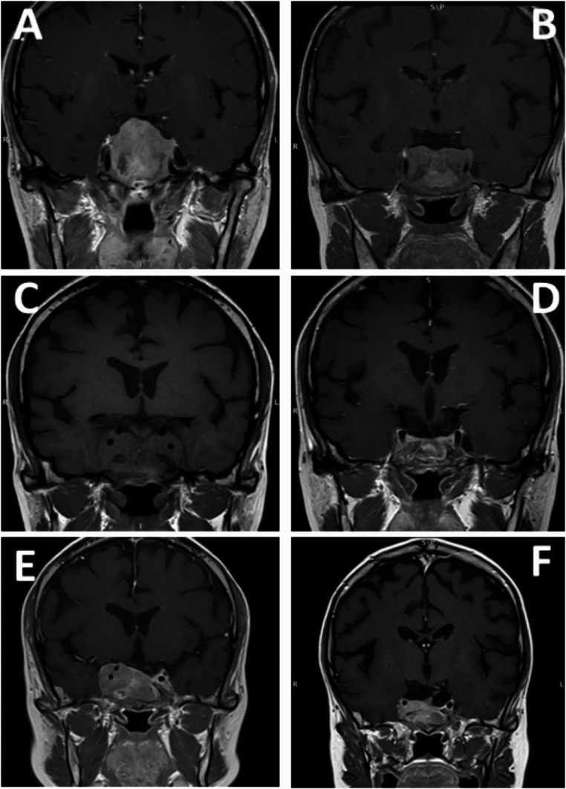
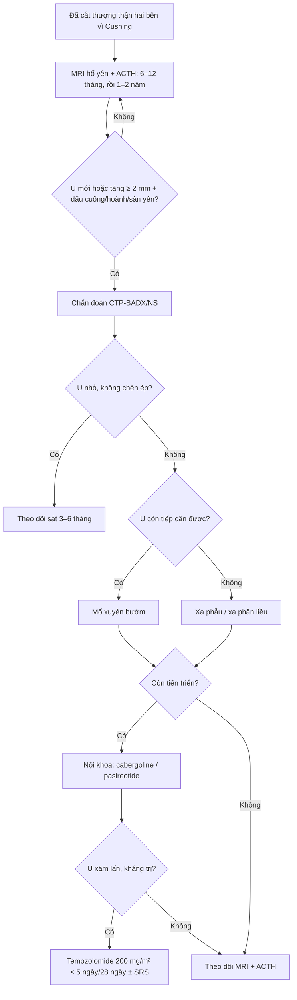
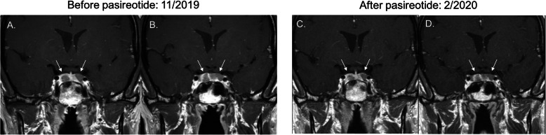
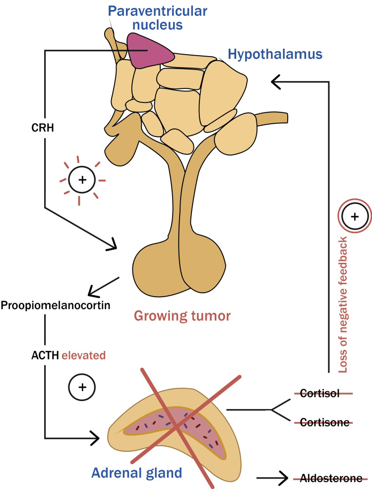

# 1862 — Hội chứng Nelson: cortisol xuống nhưng ACTH và u yên vẫn LỚN DẦN — đọc MRI thế nào và chặn tiến triển bằng gì

**Tags:** `pattern:cushing` `pattern:tai-phat` `pattern:macroadenoma-tuyen-yen` `pattern:xam-lan-xoang-hang` `vung:tuyen-yen` `vung:ho-yen` `anatomy:xoang-hang` `protocol:MRI-3T-dong-hoc` `score:ACTH` `score:Knosp`
**Mức chắc chắn (certainty):** tổng hợp y văn (literature synthesis) — ghép **phân tích gộp 37 nghiên cứu / 1.316 bệnh nhân** (Pituitary 2021, PMCID **PMC8416875**, CC BY 4.0), **đoàn hệ 30 bệnh nhân Cushing sau cắt thượng thận hai bên** (Pituitary 2025, PMCID **PMC12474698**, CC BY 4.0), **tổng quan cách xử trí Nelson** (Medicina 2022, PMCID **PMC9697743**, CC BY 4.0), **tổng quan tự sự** (Cureus 2023, PMCID **PMC10272858**, CC BY 4.0) và **ca Nelson đáp ứng pasireotide ở người chưa xạ** (Clin Diabetes Endocrinol 2020, PMCID **PMC7648374**, CC BY 4.0). Không có ca do nhóm tự chụp.

> **Kịch bản thực hành (ghép từ các đoàn hệ dưới đây, không phải ca nguyên văn):** nữ **34 tuổi**, **Cushing do u tuyến yên** đã **cắt thượng thận hai bên** cách đây **5 năm** vì mổ xuyên bướm không lui bệnh; nay da **sạm đen** rõ, ACTH **480 ng/L**, MRI hố yên thấy **nốt 9 mm** ở tuyến yên (trước mổ **không thấy u**). Câu hỏi: **có phải Nelson không, theo dõi bằng gì, và nên mổ, xạ hay uống thuốc?**
> Bài chốt **ba quyết định**: **(1) chẩn đoán Nelson hiện đại = BẰNG CHỨNG HÌNH ẢNH u tiến triển sau cắt thượng thận (tăng ≥ 2 mm kèm lệch cuống yên/vồng hoành yên/bất đối xứng sàn yên) — sạm da và ACTH tăng chỉ là tiêu chuẩn phụ; (2) tỉ lệ gộp 26% (95% CI 22–31%), trung vị 4 năm sau mổ, có ca 39 năm → theo dõi MRI + ACTH **không có điểm dừng**; (3) u tiến triển → **mổ xuyên bướm trước**, xạ phẫu khi không mổ được/hết đường mổ, hóa trị temozolomide cho u xâm lấn–kháng trị; xạ TRƯỚC khi cắt thượng thận KHÔNG chứng minh giảm Nelson (RR 0,9).** Nối [1696 – Bệnh Cushing do u tuyến yên](../1696-benh-cushing-u-tuyen-yen/lesson.md), [1748 – Cushing tái phát sau mổ xuyên bướm](../1748-cushing-tai-phat-sau-mo-xuyen-buom/lesson.md), [1709 – ACTH lạc chỗ](../1709-acth-lac-cho-an/lesson.md), [1752 – Suy tuyến yên sau xạ sọ](../1752-suy-tuyen-yen-sau-xa-tri-so-o-tre/lesson.md).

## 1. Tổng quan bệnh học – cơ chế hình ảnh: vì sao cắt nguồn cortisol lại làm u yên LỚN

- **Định nghĩa và lịch sử:** Nelson được mô tả năm **1958** ở một nữ **33 tuổi** sau cắt thượng thận hai bên, với **tam chứng**: u tuyến yên tiến triển, ACTH cao, sạm da (PMC10272858). Từ 2021, đồng thuận chuyên gia đổi tên thành **"tiến triển u corticotroph sau cắt thượng thận hai bên" (CTP-BADX/NS)** và đặt **hình ảnh học làm tiêu chuẩn chính** (PMC12474698, PMC9697743).
- **Sinh lý bệnh (pathophysiology):** cắt cả hai thượng thận **loại bỏ cortisol** — mất **phản hồi âm** lên vùng dưới đồi–tuyến yên → **CRH và ACTH tăng**, đồng thời **POMC** được cắt thành **ACTH** và **α-MSH**. **α-MSH** kích thích thụ thể **MC1R** ở tế bào hắc tố → **sạm da** (PMC10272858). ACTH cao kéo dài lại là **yếu tố nuôi dưỡng** tế bào corticotroph còn sót → **phì đại rồi tăng sinh**, cuối cùng thành **macroadenoma** xâm lấn.
- **Tần suất (prevalence) — con số phải nhớ:** gộp **37 nghiên cứu, 1.316 bệnh nhân**, tỉ lệ Nelson **26% (95% CI 22–31%)**; khi chỉ tính các nghiên cứu **có MRI lúc chẩn đoán và theo dõi**, tỉ lệ lên **38% (95% CI 27–50%; 7 nghiên cứu, 280 bệnh nhân)**; dao động giữa các nghiên cứu **4–60%** (PMC8416875). Đoàn hệ 30 bệnh nhân gần đây: **9/30 (30%)**, trung vị **60 tháng** sau cắt thượng thận (PMC12474698).
- **Thời điểm (timing):** trung vị **4 năm** sau cắt thượng thận, sớm nhất **2 tháng**, muộn nhất **39 năm** (PMC8416875) — nghĩa là **không được ngừng theo dõi sau 5 năm**.
- **Triệu chứng (symptoms):** sạm da **82% (155/188)**, chèn ép giao thoa thị giác **19% (24/129)** (PMC8416875); tổng quan khác ghi nhận **suy giảm thị lực 10–57%** ở u lớn (PMC10272858). Đau đầu, suy tuyến yên, liệt dây III–VI khi xâm lấn xoang hang.
- **TẠI SAO ACTH tăng trước khi thấy u:** tế bào corticotroph còn sót **tăng tiết** trước, **tăng sinh** sau; MRI chỉ thấy khi khối **≥ 2–3 mm**. Vì vậy **ACTH tăng đơn thuần** là tiêu chuẩn **phụ**, còn **u mới xuất hiện/tiến triển** mới là tiêu chuẩn **chính** (PMC9697743).
- **TẠI SAO u Nelson ngấm thuốc "chậm":** adenoma corticotroph thường **giảm tín hiệu trên T2** và **ngấm thuốc chậm hơn** nhu mô tuyến bình thường, nên trên **T1 động học** u hiện ra như **ổ ngấm thuốc MUỘN** ở đáy hố yên/cuống yên; đây là lý do phải dùng **MRI 3T động học** khi MRI thường quy âm tính (PMC13616001, trình bày chi tiết ở [1748](../1748-cushing-tai-phat-sau-mo-xuyen-buom/lesson.md)).
- **TẠI SAO có ca "ác tính":** một số u Nelson **xâm lấn xoang hang, clivus, xoang bướm**, **Ki-67 cao**, tiến triển dù đã mổ + xạ; hiếm nhưng có thể di căn xa (pituitary carcinoma). Ca trong PMC12474698 cho thấy u **45 × 28 × 21 mm**, sau temozolomide + pasireotide co còn **30 × 16 × 13 mm**, rồi **tái tiến triển xâm lấn clivus và xoang hang phải** sau khi ngừng thuốc 12 tháng.

## 2. Mẫu hình + chẩn đoán phân biệt theo vị trí (gamut)

- **Mẫu hình chính:** sau cắt thượng thận hai bên, trên MRI **nốt mới** hoặc **khối cũ lớn thêm ≥ 2 mm**, thường **ở đáy hố yên hoặc thành trong xoang hang**, **giảm tín hiệu T2**, **ngấm thuốc muộn**; u lớn gây **vồng hoành yên**, **lệch cuống yên**, **bất đối xứng sàn yên**, **chèn giao thoa**, **xâm lấn xoang hang** (Knosp 3–4).
- **Gamut theo vị trí:**
  - **Trong hố yên, < 10 mm:** microadenoma — dễ bỏ sót nếu không có MRI động học; thường chỉ ACTH tăng + sạm da.
  - **Trên yên (suprasellar):** chèn giao thoa → **bán manh hai bên**, giảm thị lực; u có thể chèn sàn não thất ba gây **não úng thủy**.
  - **Xoang hang (Knosp 3–4):** xâm lấn thành trong → **liệt III/IV/V1–V2**, bao quanh **động mạch cảnh trong** nhưng hiếm khi gây hẹp; là vị trí **hay sót** khi mổ.
  - **Dưới yên/clivus/xoang bướm:** u xâm lấn phá xương, chảy máu, rò dịch não tủy sau mổ; ca PMC12474698 có **hẹp nhẹ siphon cảnh** khi u tiến triển.
- **Gamut chẩn đoán phân biệt "khối hố yên ở người đã cắt thượng thận":**
  - **CTP-BADX/NS** — u corticotroph tiến triển, ACTH cao, sạm da.
  - **Mô tuyến yên còn lại phì đại (pituitary hyperplasia)** — đồng đều, không có nốt, không xâm lấn; ACTH có thể cao.
  - **U tuyến yên không chức năng còn sót** — không ACTH cao, không sạm da; nhưng có thể lớn lên.
  - **Thay đổi sau xạ/mô sẹo** — ngấm thuốc màng, teo tuyến, **không lớn dần**; phân biệt bằng chuỗi MRI.
  - **Craniopharyngioma** — nang + vôi hóa, ngấm thuốc viền, thường dưới yên/trên yên.
  - **U màng não/sarcoid/lymphoma/hypophysitis** — dày cuống, ngấm thuốc lan tỏa; bối cảnh viêm/hệ thống.
  - **Di căn hố yên** — tiền sử ung thư, phá xương nhanh, đái tháo nhạt sớm.

## 3. Bảng so sánh phân biệt (ma trận đối chiếu)

| Thực thể (entity) | Hình ảnh điển hình (MRI 3T) | Chốt vào (rule-in) | Chốt loại (rule-out) | Gợi ý xác nhận |
|---|---|---|---|---|
| **CTP-BADX/NS** | Nốt mới/lớn thêm **≥ 2 mm**, đáy hố yên/thành trong xoang hang, **T2 giảm**, **ngấm muộn** trên T1 động học | **Tiền sử cắt thượng thận hai bên + u tiến triển trên chuỗi MRI + ACTH tăng** | MRI ổn định ≥ 2 năm + ACTH không tăng → chưa chẩn đoán | MRI 3T động học, ACTH nền, so phim cũ |
| **Phì đại tuyến yên sau cắt thượng thận** | Tuyến **to đồng đều**, không nốt, không xâm lấn, cuống giữa | **Tuyến to lan tỏa + không có nốt + ACTH cao có hồi phục theo thời gian** | Có nốt khu trú/lệch cuống → nghĩ adenoma | MRI 3–6 tháng, theo dõi |
| **U không chức năng còn sót** | Khối cũ **không đổi**, không sạm da, ACTH bình thường | **ACTH bình thường + không sạm da** | ACTH tăng dần + da sạm → Nelson | ACTH, sắc tố da, chuỗi MRI |
| **Thay đổi sau xạ** | Ngấm thuốc **màng/xơ**, teo tuyến, **không lớn dần** | **Bất biến ≥ 12 tháng sau xạ** | Khối lớn thêm > 2 mm → tái phát/Nelson | So sánh cùng chuỗi, DWI, PET khi cần |
| **Craniopharyngioma** | Nang, **vôi hóa**, ngấm viền, thường trên yên | **Vôi hóa + nang + không có ACTH cao** | U đặc ngấm đồng nhất + ACTH cao → adenoma | CT xương, MRI T1/T2 |
| **Viêm tuyến yên/hypophysitis** | **Cuống dày**, ngấm thuốc lan tỏa, tuyến to đối xứng | **Cuống dày + bối cảnh viêm/thuốc miễn dịch** | Nốt khu trú + không viêm → u | IgG4, PRL, MRI theo dõi |
| **Di căn hố yên** | Phá xương, **đái tháo nhạt sớm**, lớn nhanh | **Tiền sử ung thư + phá xương + DI sớm** | U trong yên, không phá xương → adenoma | CT xương, PET-CT, sinh thiết |

*Sáu mốc của cùng một bệnh nhân: **A** u lớn sau cắt thượng thận trước mổ; **B** sau mổ lấy bớt; **C** tái phát 12 tháng sau mổ; **D** co nhỏ sau temozolomide + pasireotide; **E** tiến triển lại sau ngừng temozolomide 12 tháng, **xâm lấn clivus và xoang hang phải**, bắt đầu hẹp siphon cảnh; **F** co lại sau đợt temozolomide thứ hai + xạ phẫu. Nguồn: Pituitary 2025, PMC12474698, Fig. 3 — CC BY 4.0.*

## 4. Protocol chụp + tiêu chuẩn chẩn đoán + thuật toán điều trị

**Chẩn đoán (theo đồng thuận 2021 và Barber):**
- **Tiêu chuẩn chính:** **bằng chứng hình ảnh** u tiến triển sau cắt thượng thận, định nghĩa là **tăng ≥ 2 mm ở một chiều** **kèm ít nhất một** trong ba dấu: **lệch cuống yên**, **vồng lên của hoành yên**, **bất đối xứng sàn yên** (PMC12474698). Hoặc **u mới xuất hiện** ở người trước đó không thấy u.
- **Tiêu chuẩn phụ:** **ACTH > 500 ng/L** trong một mẫu 08:00 trước dùng corticoid, **hoặc ACTH tăng dần qua ≥ 3 lần**; **sạm da** (PMC10272858, PMC9697743). ACTH **không tương quan** với mức sạm da.
- **ACTH 2 năm sau cắt thượng thận** là yếu tố dự báo: **458 ng/L (IQR 245–723)** ở nhóm Nelson so với **146 ng/L (61–247)** ở nhóm không Nelson, **p = 0,020**; dùng **fludrocortisone thấp hơn** (0,05 vs 0,1 mg/ngày, p = 0,001) và **hydrocortisone thấp hơn** (20 vs 30 mg/ngày, p = 0,06) (PMC12474698).

**Protocol MRI:**
- **Máy 3T**, **T1 động học** sau tiêm **0,1 mmol/kg gadolinium**, **8–10 thì**, lát **2–3 mm**; **T2 coronal**; **T1 sau tiêm muộn fat-sat**; đánh giá **thành trong xoang hang**, **cuống yên**, **đáy hố yên** (PMC13616001). So **cùng chuỗi xung, cùng máy** với phim trước cắt thượng thận.
- **Lịch theo dõi:** MRI + ACTH **6–12 tháng/lần trong 5 năm đầu** (trung vị xuất hiện 4 năm), sau đó **1–2 năm/lần kéo dài** vì có ca **39 năm**; bất kỳ **sạm da mới/tăng** hoặc **triệu chứng thị giác** → chụp ngay.

**Điều trị (thuật toán):**
- **Theo dõi** u nhỏ, không chèn ép, ACTH tăng nhẹ — nhưng **theo dõi sát** vì có thể tiến triển nhanh.
- **Mổ xuyên bướm (TSS)** là **lựa chọn đầu tay** khi u còn tiếp cận được: trong đoàn hệ 30 ca, **5/9 (56%)** phải mổ lại; **78% (7/9)** cần xạ phẫu/xạ trị (PMC12474698).
- **Xạ phẫu (SRS)/xạ trị phân liều** khi u xâm lấn xoang hang, mổ không hết, hoặc bệnh nhân không mổ được. Loạt nhỏ: tiến triển sau SRS **16,7% (2/12)**; kiểm soát **5/5**, **0/5**, **0/3** ở các loạt khác — chọn lọc bệnh nhân làm kết quả khó so sánh (PMC9697743). Biến chứng cần tư vấn: **suy tuyến yên** (xem [1752](../1752-suy-tuyen-yen-sau-xa-tri-so-o-tre/lesson.md)).
- **Nội khoa:** **cabergoline**, **pasireotide** (đồng vận somatostatin, ưu thế SSTR5); ca **24 tuổi** sau 3 lần mổ + cắt thượng thận có ACTH **5.935 pg/mL**, hai u **14 mm và 7 mm**, giảm còn **609 pg/mL** sau **2 tháng** pasireotide (PMC7648374). **Chưa có thuốc nào chứng minh hiệu quả nhất quán** (PMC9697743).
- **Temozolomide** cho u xâm lấn/kháng trị: **200 mg/m²/ngày × 5 ngày, mỗi 28 ngày**; ca PMC12474698 co u từ **45 × 28 × 21 mm** xuống **30 × 16 × 13 mm**, nhưng độc tính tủy buộc giảm liều/ngừng, và u **tiến triển lại sau 12 tháng** — cần **đợt hai ± SRS**.
- **Phòng ngừa khi cắt thượng thận:** xạ tuyến yên trước cắt **KHÔNG chứng minh giảm Nelson** — **RR 0,9 (95% CI 0,5–1,6; 10 nghiên cứu, 564 bệnh nhân)**; xạ dự phòng gộp **RR 0,8 (0,5–1,5)**; mổ tuyến yên trước đó **RR 0,6 (0,4–1,0)** (PMC8416875). Trong đoàn hệ 30 ca, **SRS trước cắt thượng thận** gặp **52%** ở nhóm không Nelson so với **22%** ở nhóm Nelson (**p = 0,11**) — **giả thuyết**, chưa đủ để khuyến cáo thường quy (PMC12474698).

## 5. Biến thể bình thường và cạm bẫy

- **Biến thể bình thường:** sau cắt thượng thận, **tuyến yên có thể to lan tỏa do phì đại tế bào corticotroph** — **không phải u**; chỉ gọi Nelson khi có **nốt khu trú/lớn dần kèm dấu lệch cấu trúc**. **Mô sẹo sau mổ** ngấm thuốc ở màng và **không lớn dần**.
- **Cạm bẫy 1 — "trước mổ không thấy u, sao bây giờ lại có?":** **22%** bệnh nhân trong đoàn hệ có **MRI trước cắt thượng thận âm tính**, vẫn phát triển u Nelson (PMC12474698). Không thấy u trước mổ **không loại trừ** Nelson.
- **Cạm bẫy 2 — chỉ dựa vào ACTH:** ACTH tăng đơn thuần **không đủ chẩn đoán** theo đồng thuận 2021; ngược lại, **sạm da nặng** có thể xuất hiện khi ACTH rất cao mà **khối chưa lớn**. Chẩn đoán = **hình ảnh tiến triển**, không phải con số ACTH đơn lẻ.
- **Cạm bẫy 3 — gọi nhầm "tái phát Cushing":** sau cắt thượng thận, **không còn cortisol nội sinh**; nếu cortisol tăng trở lại phải tìm **mô thượng thận còn sót** hoặc **dùng corticoid ngoại sinh**, không quy cho u yên.
- **Cạm bẫy 4 — bỏ sót xâm lấn xoang hang:** u có thể **bao quanh động mạch cảnh** mà **không hẹp lòng mạch**; đánh giá **Knosp**, **thành trong xoang hang**, và **dây thần kinh sọ** trên T1 sau tiêm/T2. Ca PMC12474698 tiến triển tới **hẹp siphon cảnh** — dấu hiệu nặng.
- **Cạm bẫy 5 — thai kỳ:** ACTH có thể **tăng sinh lý** trong thai; ca PMC7648374 có ACTH bình thường suốt thai rồi **tăng vọt sau sinh** — **không quy mọi tăng ACTH khi mang thai cho Nelson**, nhưng **phải chụp MRI sau sinh** nếu ACTH tăng.
- **Cạm bẫy 6 — theo dõi quá ngắn:** trung vị 4 năm nhưng **đuôi dài tới 39 năm**; ngừng theo dõi sau 5 năm là **bỏ sót muộn**.

## 6. Tự lượng giá — Blind Quiz

**Ca 1 — nữ 38 tuổi, Cushing đã cắt thượng thận hai bên, sạm da và ACTH tăng dần**

- Gợi ý lâm sàng: **Cushing do u tuyến yên**, mổ xuyên bướm **không lui**, sau đó **cắt thượng thận hai bên**; 3 năm sau **sạm da**, ACTH tăng, MRI thấy khối lớn.
- Câu hỏi: Khối u nằm ở đâu, có xâm lấn gì? Vì sao **ACTH tăng sau khi đã cắt nguồn cortisol**? Bước tiếp theo là mổ, xạ hay thuốc?

<b>Bấm để hiện đáp án (findings + chẩn đoán)</b>

- Dấu hiệu (findings): **macroadenoma lớn trong hố yên**, vồng hoành yên, chèn cấu trúc trên yên; các panel sau đó cho thấy **tái phát sau mổ**, **co nhỏ khi dùng temozolomide + pasireotide**, rồi **tiến triển xâm lấn clivus và xoang hang phải** khi ngừng thuốc.
- Chẩn đoán (diagnosis): **CTP-BADX/NS (hội chứng Nelson)** — mất phản hồi âm cortisol → ACTH/POMC tăng → **α-MSH gây sạm da** và **nuôi dưỡng u corticotroph**.
- Xử trí: **mổ xuyên bướm** khi còn tiếp cận; **xạ phẫu** khi xâm lấn; **temozolomide** khi kháng trị — ca này cần **cả ba**.
- Nguồn ảnh: Pituitary 2025, PMCID **PMC12474698**, Fig. 3 — **CC BY 4.0**.

**Ca 2 — nữ 24 tuổi, sau cắt thượng thận 3 năm, hai u yên mới hai bên**

- Gợi ý lâm sàng: **Cushing**, mổ xuyên bướm **không lui**, **cắt thượng thận hai bên**; sau đó **sạm da**, ACTH tăng, **2 lần mổ xuyên bướm nữa**; mang thai bình thường; **1 tháng sau sinh ACTH tăng tới 5.935 pg/mL**.
- Câu hỏi: Hai u nằm ở đâu, kích thước bao nhiêu? Vì sao **thai kỳ làm chậm chẩn đoán**? Thuốc nào có thể làm giảm ACTH mà không cần mổ ngay?

<b>Bấm để hiện đáp án (findings + chẩn đoán)</b>

- Dấu hiệu (findings): **hai u tuyến yên hai bên**, **14 mm bên trái** và **7 mm bên phải**, trên T1 coronal; trước đó MRI sau mổ **không thấy u tồn dư**.
- Chẩn đoán (diagnosis): **Nelson tái phát với hai u mới** sau 3 lần mổ — đúng cạm bẫy "không thấy u không loại trừ"; ACTH **5.935 pg/mL** (≈ ng/L) và sạm da là tiêu chuẩn phụ.
- Xử trí: **pasireotide** (đồng vận SSTR5) — ACTH giảm còn **609 pg/mL sau 2 tháng**; đây là ca **chưa xạ**, cho thấy nội khoa có thể dùng trước/độc lập với xạ.
- Nguồn ảnh: Clin Diabetes Endocrinol 2020, PMCID **PMC7648374**, Fig. 3 — **CC BY 4.0**.

**Ca 3 — vì sao cắt thượng thận lại làm ACTH và sắc tố da tăng?**

- Gợi ý lâm sàng: bệnh nhân sau cắt thượng thận hai bên, không dùng thêm thuốc; giải thích cho bệnh nhân bằng sơ đồ.
- Câu hỏi: Mũi tên nào bị mất? Tại sao **cortisol thấp** lại đi kèm **ACTH cao** và **da sạm**? Điều này giải thích vì sao **phải theo dõi MRI** dù cortisol đã "hết cao".

<b>Bấm để hiện đáp án (findings + chẩn đoán)</b>

- Dấu hiệu (findings): sơ đồ cho thấy **mất vòng phản hồi âm cortisol → tuyến yên**; **CRH/ACTH tăng**, tế bào corticotroph **tăng sinh**, và **POMC** tăng tạo **ACTH + α-MSH**.
- Chẩn đoán (diagnosis): **cơ chế Nelson** — cortisol thấp không còn ức chế → ACTH cao → **u lớn dần** và **sạm da**; do đó theo dõi phải bằng **MRI**, không chỉ cortisol.
- Nguồn ảnh: Cureus 2023, PMCID **PMC10272858**, Fig. 4 — **CC BY 4.0**.

## Bài liên quan chéo
- [1696 – Bệnh Cushing do u tuyến yên: MRI 3T động học, BIPSS](../1696-benh-cushing-u-tuyen-yen/lesson.md)
- [1748 – Cushing tái phát sau mổ xuyên bướm](../1748-cushing-tai-phat-sau-mo-xuyen-buom/lesson.md)
- [1709 – ACTH lạc chỗ](../1709-acth-lac-cho-an/lesson.md)
- [1700 – Cushing chu kỳ](../1700-cushing-chu-ky/lesson.md)
- [1752 – Suy tuyến yên sau xạ sọ ở trẻ](../1752-suy-tuyen-yen-sau-xa-tri-so-o-tre/lesson.md)

## Ảnh
- `1862_nelson_MRI_PMC12474698-F3.jpg` — sáu mốc T1 sau tiêm của u Nelson: macroadenoma → mổ → tái phát → temozolomide → xâm lấn clivus/xoang hang → đợt hai (Pituitary 2025, PMC12474698, CC BY 4.0).
- `1862_nelson_MRI_PMC7648374-F3.jpg` — hai u 14 mm và 7 mm sau cắt thượng thận (Clin Diabetes Endocrinol 2020, PMC7648374, CC BY 4.0).
- `1862_nelson_SoDo_PMC10272858-F4.jpg` — sơ đồ trục HPA bị thay đổi trong Nelson (Cureus 2023, PMC10272858, CC BY 4.0).
- Nguồn + giấy phép từng ảnh: `images/CREDITS.md`; link gốc: `sources.md`.

> Không dùng để chẩn đoán độc lập khi chưa có người hướng dẫn.
