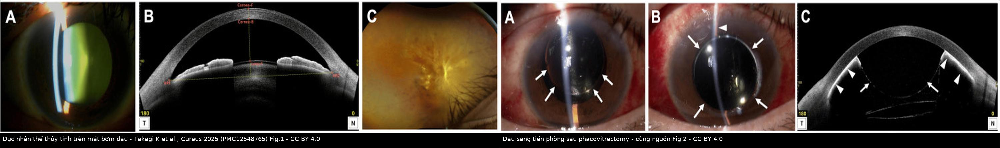
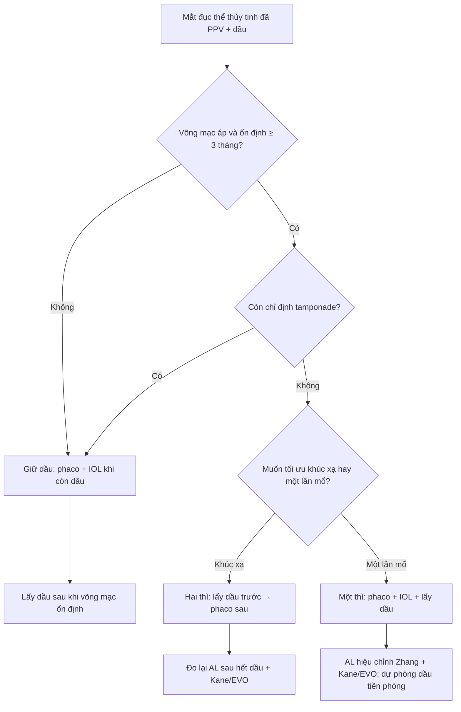
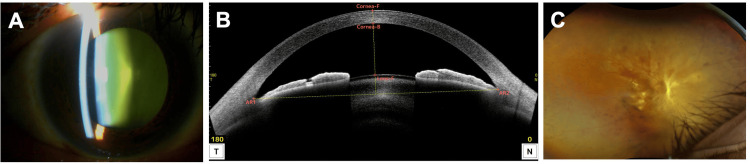
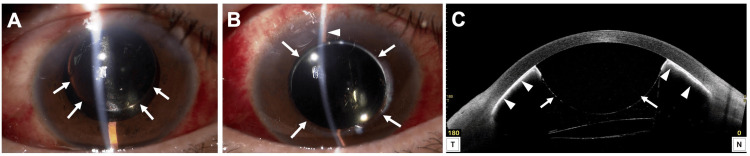
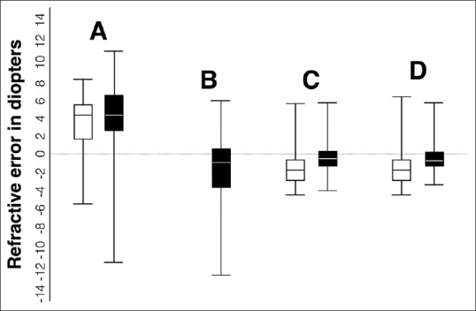

# 1863 — Đục thể thủy tinh ở mắt bơm dầu silicone: một thì hay hai thì / Cataract in the silicone oil-filled eye

**Tags:** `pattern:duc-the-thuy-tinh` `pattern:duc-nhan` `pattern:duc-duoi-bao-sau` `pattern:lech-khuc-xa` `pattern:duc-sau-cat-dich-kinh` `vung:the-thuy-tinh` `vung:mat` `vung:tien-phong` `vung:dich-kinh` `protocol:slit-lamp` `protocol:sinh-trac-giac-mac` `protocol:AS-OCT` `protocol:phaco` `protocol:PPV` `protocol:cong-thuc-IOL` `score:SRK-T` `score:Kane`
**Mức chắc chắn (certainty):** tổng hợp y văn (literature synthesis) — nhóm tự biên từ các nguồn mở, đã đối chiếu `authorString`/PMCID: tổng quan dầu silicone và khúc xạ (CC BY 4.0, PMC13635028), so sánh một thì–hai thì 272 mắt (CC BY-NC 4.0, PMC13221386), 135 mắt một thì–hai thì với siêu âm (CC BY-NC-SA 4.0, PMC6498926), phân tích gộp công thức IOL 1.060 mắt (CC BY-NC 4.0, PMC13155740), 64 mắt lấy dầu qua đồng tử vs 3 port (CC BY 4.0, PMC6094553), 42 mắt phaco + lấy dầu đồng thời (CC BY 4.0, PMC13338752), 561 mắt đục thể thủy tinh sau PPV (CC BY-NC-ND 4.0, PMC12980855), ca dầu tiền phòng sau phacovitrectomy (CC BY 4.0, PMC12548765), giọt dầu nhũ tương (CC BY-NC 4.0, PMC12271025), loạn thị sau mổ kết hợp 89 mắt (CC BY 4.0, PMC10322570). Chỗ nhóm suy luận được ghi rõ "suy luận".

> **Vì sao bài này quan trọng:** bài **1410** dạy *nhận diện dầu tồn lưu và khi nào lấy dầu*, bài **1837** dạy *dầu ở tiền phòng phá nội mô*, bài **1416** dạy *glôcôm do dầu*. Nhưng câu hỏi thường gặp nhất ở phòng khám là: **mắt đang bơm dầu bị đục thể thủy tinh — mổ phaco lúc nào, lấy dầu cùng lúc hay để sau, và tại sao khúc xạ lại "trật" dù công thức đúng?** Đục thể thủy tinh xuất hiện ở **tới 80% mắt còn thể thủy tinh trong vòng 2 năm sau cắt dịch kính**; bỏ qua giai đoạn này là mất luôn cửa sổ theo dõi đáy mắt, còn chọn sai thứ tự mổ là **mổ lại lần hai** hoặc **sai khúc xạ 1–4 D**.

## 1. Tổng quan bệnh học – cơ chế hình ảnh: vì sao mắt bơm dầu vừa đục nhanh vừa lệch khúc xạ

- **Bệnh học:** sau cắt dịch kính (PPV), **áp lực oxy trong khoang dịch kính tăng** (dịch thay bằng dịch nội nhãn có oxy cao hơn) → **đục nhân xơ (nuclear sclerosis)** tiến triển nhanh; dầu silicone tiếp xúc thể thủy tinh và tình trạng viêm sau mổ đẩy nhanh **đục dưới bao sau (PSC)**. Vì vậy **đục nhân là loại hay gặp nhất sau PPV**, còn **PSC tiến triển** gắn với **bơm dầu (63,6%)**, võng mạc đái tháo đường tăng sinh (67,6%) và PCV (64,3%) (PMC12980855).
- **Vật lý — TẠI SAO khúc xạ lệch (bắt buộc giải thích):** dầu silicone chuẩn (polydimethylsiloxane) có **chiết suất n = 1,404**, cao hơn **dịch kính/dịch tiền phòng n ≈ 1,336**, **tỷ trọng 0,97** và độ nhớt **1.000–5.000 cSt** (dầu nặng như Oxane 5700 có tỷ trọng **1,02**) (PMC13635028, Bảng 1). Ba hệ quả:
  1. **Khi còn dầu:** môi trường sau thể thủy tinh/IOL có chiết suất cao hơn → **công suất khúc xạ hiệu dụng đổi**, mắt thường lệch **về phía viễn thị** so với dự kiến (điển hình ở mắt dài).
  2. **Sau khi lấy dầu:** môi trường trở về nước → mắt lệch **về phía cận thị**; loạt 135 mắt ghi nhận **cận thị −4,18 ± 5,47 D ở 92% mắt tại tháng 3** sau lấy dầu + phaco (PMC6498926).
  3. **Sinh trắc học sai:** siêu âm có **vận tốc truyền trong dầu thấp hơn nhiều so với dịch kính** → **chiều dài trục (AL) bị đo dài hơn thực**; siêu âm quang học (SS-OCT, IOLMaster 700) cũng **đo dài hơn trung bình ≈ 0,12 mm** trong mắt đầy dầu, gây **viễn thị bất ngờ**, nhất là mắt > 25 mm. Hiệu chỉnh AL theo công thức Zhang đưa sai số về gần 0 và cải thiện dự đoán **≈ 0,3 D** ở mắt dài (PMC13635028).
- **TẠI SAO dầu làm mổ khó hơn:** dầu **nhẹ hơn nước nên nổi lên trên**, dễ **trào vào tiền phòng** khi mở nhãn cầu, che mặt sau IOL và **bám nội mô**; dầu **nhũ tương hóa** thành giọt nhỏ (< 1 µm tới vài chục µm) **nhìn như tế bào viêm trong tiền phòng** hoặc như "màng" trên vỏ bao sau.
- **Ngưỡng định lượng (theo `PROMPT_SYNTHESIZER.md`):**
  - **Đục thể thủy tinh sau PPV: tới 80% mắt còn thể thủy tinh trong 2 năm** (PMC13635028); **PSC tiến triển 63,6%** ở nhóm bơm dầu, tuổi cắt **54,5** là ngưỡng nguy cơ cao (PMC12980855).
  - **Một thì (phaco + IOL + lấy dầu) vs hai thì (lấy dầu trước, phaco sau), 272 mắt:** sai số dự đoán trung vị **−0,26 D (hai thì) vs +0,21 D (một thì)**, p = 0,008; **MAE tương đương**; **phù hoàng điểm 23% vs 3%**; **glôcôm/tăng nhãn áp 23% vs 7%** (p = 0,013); thị lực cuối **0,53 vs 0,71 logMAR** (p = 0,064) (PMC13221386).
  - **Công thức IOL trong mắt đầy dầu (7 nghiên cứu, 1.060 mắt):** **Kane** tốt nhất cho tỉ lệ trong **± 0,50 D** (SUCRA 90,9%), **EVO** tốt nhất cho **± 1,00 D** (82,8%) (PMC13155740).
  - **An toàn võng mạc khi mổ kết hợp:** bong võng mạc tái phát **2,4% (1/42)** trong 42 mắt phaco + lấy dầu đồng thời (PMC13338752); **15,8% (đường qua đồng tử) vs 4,4% (3 port)** trong 64 mắt, p = 0,14; dầu tồn lưu **7,4 ± 3,2% vs 7,1 ± 2,8%** (PMC6094553).
  - **Loạn thị giác mạc tăng ngắn hạn** sau mổ kết hợp rồi giảm dần tới tháng 1; AL giảm ở mọi mốc theo dõi (89 mắt, PMC10322570).
  - **Thời điểm lấy dầu:** nhiều trung tâm lên kế hoạch **3–6 tháng**, cá thể hóa theo độ ổn định võng mạc, nhãn áp và dầu di trú ra trước (PMC13635028).

## 2. Mẫu hình + chẩn đoán phân biệt theo thời điểm (Gamut)

- **Mẫu hình lõi:** mắt đã PPV ± bơm dầu, thị lực giảm dần **không đau**, đèn khe thấy **nhân vàng/đục nhân** hoặc **đục dưới bao sau**, **ánh đồng tử (red reflex) mờ**, có thể thấy **màng dầu/giọt dầu** phía sau thể thủy tinh.
- **Gamut theo thời điểm so với lần mổ dầu:**
  1. **Đục tiến triển trong khi còn dầu** (phổ biến nhất) → cân nhắc **một thì** hoặc **phaco khi còn dầu**.
  2. **Đục sau khi đã lấy dầu, mắt không còn tamponade** → phaco đơn thuần, sinh trắc học đáng tin hơn.
  3. **Đục ngay từ lần PPV đầu** (mắt > 50 tuổi, đục sẵn) → **phacovitrectomy đồng thời** để tránh mổ lần hai (PMC13635028).
  4. **Đục + bệnh võng mạc tiến triển** (PVR, bong dưới, tái phát) → **giữ dầu**, mổ thể thủy tinh trước, lấy dầu sau.
  5. **Đục giả do dầu** — giọt dầu nhũ tương hoặc màng dầu sau IOL làm mờ trục quang, **thể thủy tinh có thể còn trong**; đừng mổ oan.
- **Mẫu hình hình ảnh:**
  - **Đèn khe:** đục nhân (vàng, mất phản xạ đỏ), PSC (mảng trắng sau bao), dầu trong tiền phòng (mức dầu/váng dầu, giọt lấp lánh).
  - **AS-OCT:** độ sâu tiền phòng, dầu trong tiền phòng (dải phản xạ mặt sau giác mạc), IOL nghiêng/lệch.
  - **Siêu âm B:** đánh giá võng mạc khi mờ; **giọt dầu nhũ tương tăng phản xạ do tán xạ Rayleigh**, không phải máu/viêm (PMC12271025).

## 3. Bảng so sánh phân biệt (ma trận đối chiếu)

| Thực thể (entity) | Hình ảnh / đặc điểm điển hình | Chốt vào (rule-in) | Chốt loại (rule-out) | Gợi ý xác nhận |
|---|---|---|---|---|
| **Một thì: phaco + IOL + lấy dầu** | Đục nhân/PSC + võng mạc **áp, ổn định**, dầu không còn cần thiết | **Võng mạc áp ≥ 3 tháng, IOP kiểm soát, không PVR tiến triển + bệnh nhân muốn một lần mổ**; bong tái phát **2,4–15,8%** tùy đường lấy dầu | **Võng mạc chưa ổn định/bong dưới/PVR + cần tamponade tiếp** → không một thì | Siêu âm B/đáy mắt gián tiếp trước mổ; kế hoạch lấy dầu 3 port nếu nguy cơ cao |
| **Hai thì: lấy dầu trước, phaco sau** | Mắt **không còn dầu** khi tính IOL → sinh trắc học sạch | **Cần lấy dầu vì lý do khác (nhũ tương, IOP, keratopathy) trước khi thể thủy tinh đục nhiều**, hoặc **ưu tiên độ chính xác khúc xạ**: sai số trung vị **−0,26 D** so với **+0,21 D** ở một thì (p = 0,008) | **Bệnh nhân không chấp nhận 2 lần mổ/không theo dõi được** → cân nhắc một thì | Đo lại AL **sau khi hết dầu** bằng SS-OCT; công thức Kane/EVO |
| **Phaco khi CÒN dầu (giữ dầu), lấy dầu sau** | Đục thể thủy tinh nhưng **võng mạc còn cần dầu** (bong dưới, PVR, mắt đã nhiều lần mổ) | **Cần tamponade tiếp + trục quang bị đục cản theo dõi**; mổ thể thủy tinh để nhìn đáy mắt | **Võng mạc đã ổn định, không còn chỉ định dầu** → lấy dầu luôn sẽ tốt hơn | Siêu âm B, đáy mắt; dùng **AL hiệu chỉnh Zhang**, công thức Kane/EVO; dự phòng dầu vào tiền phòng |
| **Phacovitrectomy ngay từ đầu** | Mắt **> 50 tuổi**, đục sẵn hoặc nguy cơ đục cao, cần PPV | **Tuổi > 50 + kế hoạch PPV + thể thủy tinh còn** → mổ đồng thời để tránh lần hai | **Trẻ, thể thủy tinh trong, PPV đơn giản** → có thể để lại và theo dõi | Đèn khe trước mổ; tư vấn nguy cơ đục 80%/2 năm |
| **Đục thể thủy tinh sau PPV KHÔNG dầu** | Đục nhân tiến triển chậm hơn; **PSC ít hơn** so với nhóm dầu | **Tiền sử PPV + không dầu + đục nhân/PSC** | **Có dầu + mờ trục quang do giọt dầu** → không phải đục thật | Đèn khe + AS-OCT; siêu âm B |
| **Đục giả do dầu/nhũ tương dầu** | **Giọt lấp lánh** trong tiền phòng/dịch kính, "tế bào giả" không dính góc, màng dầu sau IOL | **Tiền sử bơm dầu + giọt tăng phản xạ trên siêu âm (Rayleigh) + không viêm thật** | **Tyndall thật + dính sau đồng tử + đau** → viêm nội nhãn/viêm màng bồ đào | Siêu âm B, AS-OCT, đáp ứng với rửa dầu/PFCL |

*Trái: (A) đèn khe — đục nhân vàng, mất phản xạ đỏ; (B) AS-OCT — tiền phòng và mặt trước thể thủy tinh; (C) đáy mắt. Phải: dầu silicone trong tiền phòng (mũi tên) sau phacovitrectomy — biến chứng cần nhận diện trước khi quyết định mổ thể thủy tinh. Nguồn: Takagi K et al., Cureus 2025 (PMC12548765), Fig. 1 + Fig. 2, CC BY 4.0. Ảnh ghép letterbox, không crop.*

## 4. Protocol chụp, tính IOL và quyết định một thì/hai thì

- **Trước mổ — bắt buộc:**
  1. **Đèn khe + giãn đồng tử:** xác định loại đục (nhân/PSC/hỗn hợp), **dầu trong tiền phòng**, tình trạng bao sau, IOL cũ.
  2. **Đáy mắt gián tiếp/siêu âm B:** võng mạc **áp hay không**, PVR, bong dưới — đây là biến số quyết định **một thì hay giữ dầu**.
  3. **Sinh trắc học:** ưu tiên **SS-OCT**; nếu còn dầu, ghi rõ **AL đo trong dầu** và **hiệu chỉnh Zhang** (giảm sai số về gần 0, cải thiện ≈ 0,3 D ở mắt > 25 mm) (PMC13635028).
  4. **Công thức IOL:** **Kane** cho mục tiêu ± 0,50 D; **EVO** cho ± 1,00 D; **RBF** cũng tốt (PMC13155740). Không dùng SRK/T đơn thuần ở mắt đầy dầu nếu có lựa chọn khác.
- **Trong mổ (một thì):** phaco qua đường rạch nhỏ, **duy trì tiền phòng bằng viscoelastic** để chặn dầu trào; **lấy dầu qua 3 port** thay vì qua đồng tử nếu nguy cơ bong cao (bong **4,4% vs 15,8%**, p = 0,14; PMC6094553); kiểm tra **dầu tồn lưu** (7,1–7,4%) và rửa sạch bằng PFCL nếu cần.
- **Phân tầng quyết định (flowchart):**

- **Theo dõi sau mổ:** ngày 1 kiểm **dầu tiền phòng, IOP, phù giác mạc**; tuần 1–4 đo lại khúc xạ (loạn thị tăng ngắn hạn rồi giảm — PMC10322570); tháng 1–3 đánh giá **võng mạc tái bong**, phù hoàng điểm (23% ở nhóm hai thì vs 3% ở một thì trong loạt Bascom Palmer — PMC13221386).

## 5. Biến thể bình thường và cạm bẫy

- **"Đục thể thủy tinh" có thể chỉ là dầu:** giọt dầu nhũ tương trong tiền phòng/dịch kính **lấp lánh, không dính góc, không Tyndall thật**; trên siêu âm B chúng **tăng phản xạ do tán xạ Rayleigh** (PMC12271025) — đừng chẩn đoán viêm nội nhãn hay mổ phaco oan.
- **Dầu trong tiền phòng sau phacovitrectomy:** dấu hiệu **mức dầu/váng dầu**, có thể gây **pupillary block** và bám nội mô; nhận diện trên đèn khe/AS-OCT ngay ngày 1 (PMC12548765). Đây là lý do phải **duy trì tiền phòng** và kiểm tra góc trong mổ.
- **Sai khúc xạ hai chiều:** **còn dầu → viễn thị** (nhất là khi AL bị đo dài), **sau lấy dầu → cận thị** (−4,18 ± 5,47 D ở 92% mắt tại tháng 3 — PMC6498926). Tư vấn trước mổ rằng **có thể phải đổi kính** dù mổ "thành công".
- **AL "bình thường" không có nghĩa là đúng:** SS-OCT vẫn **dài hơn 0,12 mm** trong mắt đầy dầu; nếu không hiệu chỉnh, IOL non → **viễn thị bất ngờ** (PMC13635028).
- **Đừng lấy dầu chỉ vì "đã đủ 3–6 tháng":** thời điểm lấy dầu **cá thể hóa** theo độ ổn định võng mạc, IOP và dầu di trú; lấy sớm ở mắt còn PVR → bong tái phát.
- **Phù hoàng điểm và tăng nhãn áp sau mổ kết hợp** không hiếm (23% mỗi loại trong nhóm hai thì của một loạt) — theo dõi OCT và IOP, đừng quy hết cho "dầu còn sót".

## 6. Tự lượng giá — Blind Quiz

**Ca 1 — Nam 60 tuổi, đã PPV + bơm dầu 8 tháng, thị lực giảm dần không đau. Đèn khe: ánh đồng tử mờ, nhân vàng.**

- Gợi ý: võng mạc áp trên siêu âm B, IOP 16 mmHg, không PVR.
- Câu hỏi: Loại đục nào? Có nên mổ một thì không? Cần đo gì trước khi tính IOL?

<b>Bấm để hiện đáp án (findings + chẩn đoán)</b>

- Dấu hiệu: (A) **đục nhân vàng**, mất phản xạ đỏ; (B) AS-OCT — tiền phòng bình thường, mặt trước thể thủy tinh; (C) đáy mắt — võng mạc áp.
- Chẩn đoán: **đục nhân trên mắt bơm dầu, võng mạc ổn định** → có thể **một thì (phaco + IOL + lấy dầu)**; trước mổ phải **đo AL có hiệu chỉnh Zhang** và chọn **Kane/EVO**, vì AL trong dầu bị đo dài ≈ 0,12 mm và dễ gây viễn thị.
- Nguồn: Takagi K et al., Cureus 2025 (PMC12548765), Fig. 1, CC BY 4.0.

**Ca 2 — Ngày 1 sau phacovitrectomy, bệnh nhân đau nhẹ, tiền phòng nông, thấy lớp dầu phía sau giác mạc.**

- Gợi ý: IOP 28 mmHg, giác mạc hơi mờ vùng trung tâm.
- Câu hỏi: Dấu hiệu chính? Hai biến chứng cần nghĩ? Xử trí đầu tay?

<b>Bấm để hiện đáp án (findings + chẩn đoán)</b>

- Dấu hiệu: dầu silicone trong tiền phòng (mũi tên) — lớp/váng dầu mặt sau giác mạc, AS-OCT thấy dải phản xạ; tiền phòng nông.
- Chẩn đoán: **dầu trào tiền phòng gây pupillary block + nguy cơ bám nội mô**. Xử trí: hạ nhãn áp, đẩy dầu ra sau bằng viscoelastic/khí, tạo **iridotomy** nếu tái diễn; theo dõi nội mô.
- Nguồn: Takagi K et al., Cureus 2025 (PMC12548765), Fig. 2, CC BY 4.0.

**Ca 3 — Cùng một nhóm mắt theo thời gian: A = trước lấy dầu + phaco; B = ngay sau lấy dầu (nhóm hai thì); C = ngày 45; D = tháng 3. Trắng = nhóm một thì, đen = nhóm hai thì.**

- Gợi ý: trục tung là sai số khúc xạ (D), dương = viễn thị; đường 0 = chính xác.
- Câu hỏi: Trước mổ (A) mắt lệch về phía nào? Sau khi lấy dầu + phaco (C, D) lệch về phía nào? Vì sao? Tư vấn trước mổ thay đổi thế nào?

<b>Bấm để hiện đáp án (findings + chẩn đoán)</b>

- Dấu hiệu: **trước mổ (A) cả hai nhóm lệch dương ~+4 D (viễn thị khi còn dầu)**; sau lấy dầu + phaco (C, D) **lệch âm (cận thị)**, rõ hơn ở nhóm một thì.
- Chẩn đoán: **đảo chiều khúc xạ khi thay dầu bằng dịch** — còn dầu thì viễn thị, lấy dầu thì cận thị; loạt này ghi **cận thị −4,18 ± 5,47 D ở 92% mắt tại tháng 3**, và hai thì cho khúc xạ dự đoán tốt hơn (**−1,73 ± 2,04 vs −0,64 ± 1,75 D**, p = 0,002). Tư vấn: **giải thích trước** khả năng phải đổi kính; nếu một thì, dùng **AL hiệu chỉnh Zhang + Kane/EVO**.
- Nguồn: Madanagopalan VG et al., Indian J Ophthalmol 2019 (PMC6498926), Fig. 1, CC BY-NC-SA 4.0.

## Bài liên quan chéo
- [1837 – Dầu silicone trong tiền phòng & tổn thương nội mô giác mạc](../1837-dau-silicone-tien-phong-ton-thuong-noi-mo/lesson.md)
- [1410 – Lấy dầu silicone & dầu tồn lưu](../1410-lay-dau-silicone-va-dau-ton-luu/lesson.md)
- [1416 – Glôcôm do dầu silicone](../1416-glaucom-do-dau-silicone/lesson.md)
- [1417 – Giữ dầu silicone vĩnh viễn: khi nào chấp nhận](../1417-giu-dau-silicone-vinh-vien/lesson.md)
- [1432 – Thay dầu silicone: thiếu thể tích & nhũ tương hóa](../1432-thay-dau-silicone/lesson.md)
- [1442 – Mảnh thể thủy tinh còn sót trong tiền phòng](../1442-manh-the-thuy-tinh-con-sot/lesson.md)
- [1452 – Glôcôm do thể thủy tinh chưa mổ](../1452-glaucom-do-the-thuy-tinh-chua-mo/lesson.md)

> Không dùng để chẩn đoán độc lập khi chưa có người hướng dẫn.
