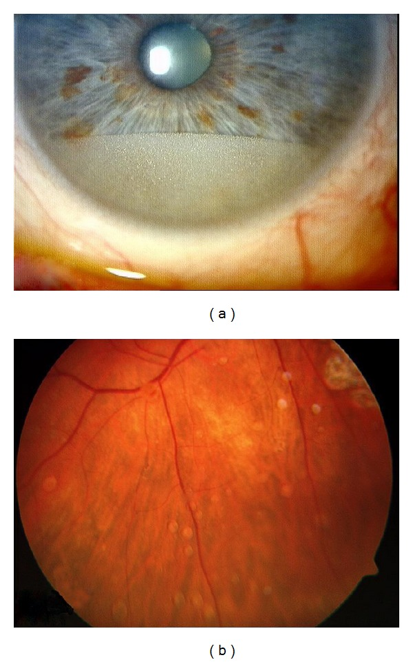
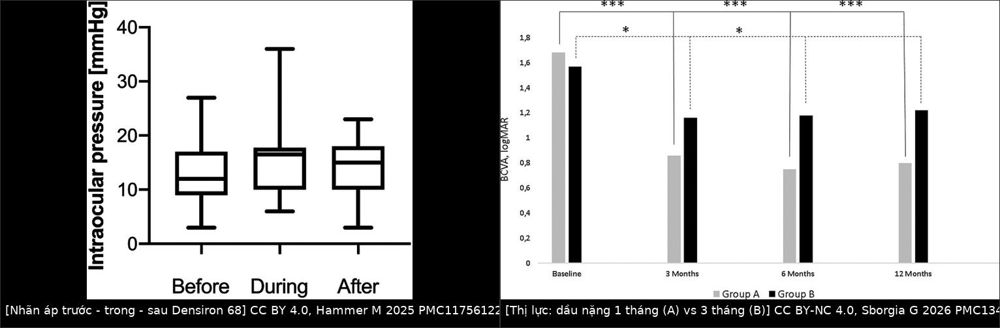
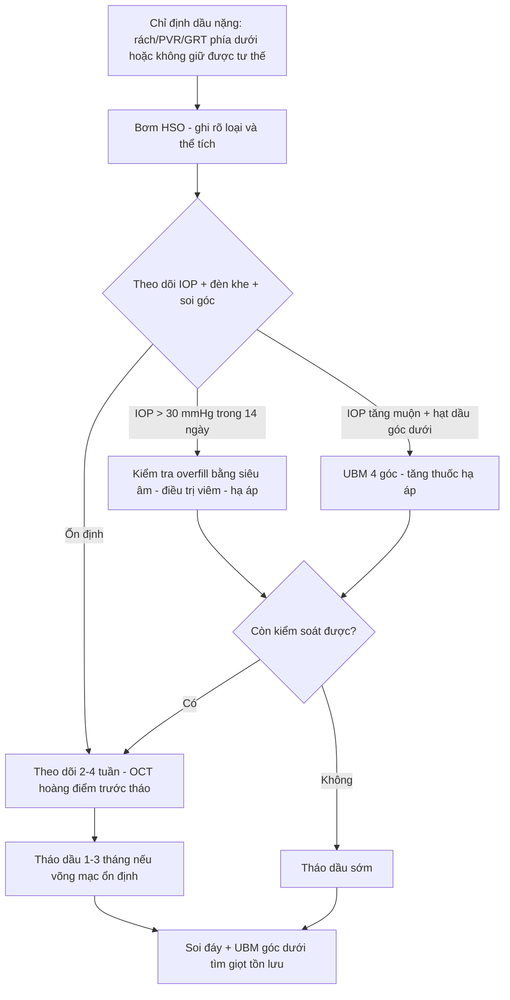
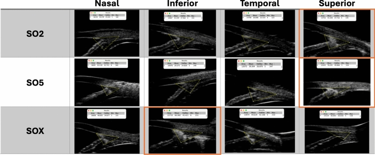

# 1864 — Dầu silicone nặng (heavy silicone oil): vì sao biến chứng nằm ở phía DƯỚI / Heavy silicone oil: why the complications sit inferiorly

**Tags:** `pattern:dau-silicone-nang` `pattern:nhu-tuong-hoa` `pattern:lang-dong-phia-duoi` `pattern:tang-nhan-ap` `pattern:viem-tien-phong` `pattern:duc-the-thuy-tinh` `vung:dich-kinh` `vung:vong-mac` `vung:tien-phong` `vung:goc-tien-phong` `protocol:slit-lamp` `protocol:UBM` `protocol:AS-OCT` `protocol:OCT` `protocol:PPV` `score:IOP`
**Mức chắc chắn (certainty):** tổng hợp y văn (literature synthesis) — nhóm tự biên từ các nguồn mở, đã đối chiếu `authorString`/PMCID: đoàn hệ đa trung tâm 134 mắt Densiron 68 (CC BY-NC 4.0, PMC9743375), 20 mắt PVR dưới (CC BY 4.0, PMC11756122), 121 mắt DensironXTRA so với khí (CC BY 4.0, PMC9988839), 46 mắt 1 tháng so với 3 tháng (CC BY-NC 4.0, PMC13427321), 100 mắt biến chứng HSO (CC BY 4.0, PMC4009140), 20 mắt Oxane HD dài hạn (CC BY 4.0, PMC9270317), UBM 33 bệnh nhân/66 mắt (CC BY 4.0, PMC11971159), tổng quan vật lý – chọn tamponade 2026 (CC BY 4.0, PMC13504771), kỹ thuật lấy Oxane HD (CC BY 4.0, PMC10591402), ca phân hủy giọt dầu nặng (CC BY 4.0, PMC3381110), và phân tích gộp tăng nhãn áp (CC BY-NC-SA 4.0, PMC4448235). Chỗ nào là suy luận của nhóm đều ghi rõ "suy luận"; không có guideline chính thức nào cho HSO.

> **Vì sao bài này quan trọng:** bài **1837** dạy đọc dầu trong tiền phòng theo nguyên lý **dầu nhẹ nổi lên trên** (0,97 g/cm³) — và toàn bộ bản đồ biến chứng của bài đó (dầu bám nội mô phía trên, bệnh dải ở khe mi, block đồng tử) được xây trên tỷ trọng < 1. **Dầu nặng đảo ngược đúng bản đồ đó**: cùng là dầu trong mắt, nhưng tỷ trọng **1,02–1,06 g/cm³** làm dầu **chìm xuống đáy**, nên chỗ tổn thương, chỗ bít bè, chỗ đọng giọt và cả chỗ khó lấy dầu đều ở **phía dưới**. Dùng sai nguyên lý này dẫn tới ba lỗi thực hành: **(1)** khám góc và đáy mắt phía trên rồi kết luận "sạch dầu"; **(2)** đọc tăng nhãn áp sớm sau bơm là "block đồng tử" và mở thông đồng tử vô ích; **(3)** hứa rằng lấy dầu sẽ hết giọt, trong khi giọt nặng **đọng lại ở đáy** và có thể **mất tỷ trọng nặng sau vài tuần** rồi nổi trở lại.

## 1. Tổng quan bệnh học – cơ chế hình ảnh: vì sao "nặng" là một bệnh cảnh khác

- **Vật lý quyết định tất cả:** dầu silicone nhẹ (light SO, 1.000–5.000 cSt) có **tỷ trọng 0,97 g/cm³** → **nổi**, đè lên vùng võng mạc **phía trên**. Dầu nặng (HSO: Densiron 68, Oxane HD, AlaHeavy 1.07) có **tỷ trọng 1,02–1,06 g/cm³** → **chìm**, đè lên vùng võng mạc **phía dưới** (tổng quan vật lý 2026, PMC13504771). Vì vậy HSO được chọn cho **rách/bong võng mạc phía dưới, PVR dưới, giant retinal tear (GRT) có thành phần dưới, cắt võng mạc rộng phía dưới**, hoặc bệnh nhân **không giữ được tư thế nằm sấp**.
- **Ba hệ quả trực tiếp của việc "chìm" (TẠI SAO):**
  1. **Bít bè phía dưới:** giọt nhũ tương dầu nặng **lắng xuống góc dưới** rồi vào **lưới bè (trabecular meshwork)**. Bằng chứng hình ảnh: UBM ở 15 mắt bơm **Densiron XTRA (SOX)** cho **echo dày bất thường ở góc DƯỚI** so với mắt bên (p < 0,01), trong khi dầu nhẹ 2.000 cSt và 5.000 cSt lại cho bất thường ở **góc TRÊN** (p = 0,04 và 0,02) — tức **cùng một hiện tượng "dầu thấm bè", vị trí đảo ngược theo tỷ trọng** (PMC11971159).
  2. **Đọng ở đáy tiền phòng:** trên đèn khe, HSO nhũ tương tạo **lớp/dải ngang ở nửa dưới tiền phòng**, bờ trên rõ và **phẳng theo trọng lực**, khác hẳn bọt dầu nhẹ nổi ở 12 giờ (ảnh 1a). Khi bệnh nhân nằm ngửa, lớp dầu dàn ra chạm **nội mô trung tâm** — thời gian tiếp xúc nội mô vì thế phụ thuộc **tư thế ngủ**, không chỉ lượng dầu.
  3. **Đọng dưới võng mạc và ở đáy mắt:** giọt HSO nhũ tương bám thành **đốm trắng ngà rải rác ở vùng dưới** (ảnh 1b), có thể **dưới võng mạc** hoặc **dưới mảnh ghép**; vị trí này khó thấy bằng soi đáy thường quy nếu không nghiêng đầu bệnh nhân và không chụp ảnh góc rộng.
- **Vì sao HSO nhũ tương hóa nhanh hơn dầu nhẹ:** pha **F6H8 (perfluorohexyloctane)** trộn với dầu silicone làm **sức căng bề mặt tại mặt phân cách thấp hơn**, và **độ nhớt thấp hơn** dầu 5.000 cSt → lực cắt của mắt dễ bẻ giọt. Tỷ lệ nhũ tương hóa trong các loạt: **10,7%** (134 mắt Densiron 68, PMC9743375), **15,8%** (19 mắt, PMC9069085), và trong loạt 100 mắt, **29 mắt tăng nhãn áp thứ phát do nhũ tương hóa sau 7,8 ± 4,5 tuần** (PMC4009140).
- **Vì sao tăng nhãn áp có HAI đỉnh thời gian (rất dễ đọc sai):**
  - **Đỉnh sớm ≤ 14 ngày:** do **bơm quá đầy (overfill)** và viêm tiền phòng — loạt 20 mắt PVR dưới ghi nhận **cơn vọt > 30 mmHg trong 14 ngày đầu rất thường gặp**, nhất là mắt đã dùng thuốc hạ nhãn áp trước đó; **45%** phải tăng số thuốc hạ áp trong thời gian giữ dầu, **20%** còn phải dùng dài hạn sau lấy dầu (PMC11756122). Đỉnh này **không** phải bằng chứng bít bè do nhũ tương.
  - **Đỉnh muộn:** do **nhũ tương hóa bít bè + viêm** — trong loạt 100 mắt, nhãn áp trung bình **13,3 ± 5,6 mmHg** trước mổ → **cao nhất 23,3 ± 8,5 mmHg** sau mổ → **13,7 ± 7,2 mmHg** sau lấy dầu; tăng thứ phát do nhũ tương ở **29 mắt** (PMC4009140).
  - Phân tích gộp 5 nghiên cứu so sánh dầu nhẹ và dầu nặng: **RR tăng nhãn áp 1,55 (95% CI 1,06–2,28; p = 0,02)** theo mô hình hiệu ứng cố định, nhưng **1,51 (0,98–2,33; p = 0,06)** theo mô hình hiệu ứng ngẫu nhiên — tức **xu hướng tăng, chưa đủ chắc** (PMC4448235). Đây là ví dụ điển hình của việc **không được biến một RR có ý nghĩa ở một mô hình thành "HSO gây glôcôm"**.
- **Vì sao viêm tiền phòng:** thành phần **F6H8** và tạp chất phân tử lượng thấp kích thích đại thực bào; loạt 134 mắt có **6,0%** cần **corticoid tại chỗ dài hạn** vì viêm màng bồ đào trước (PMC9743375); loạt 100 mắt có **29 mắt viêm tiền phòng kéo dài** và **3 mắt bong biểu mô giác mạc dai dẳng** (PMC4009140). Trong loạt 20 mắt PVR dưới, viêm **hiếm** và phù hoàng điểm **thoáng qua** — nghĩa là **viêm phụ thuộc thời gian giữ dầu và thể bệnh**, không phải hằng số của HSO (PMC11756122).
- **Vì sao đục thể thủy tinh gần như chắc chắn:** dầu chạm bao sau → thấm → đục; **100% mắt còn thể thủy tinh trong loạt 20 mắt PVR dưới tiến triển đục**; **25%** mắt giả thể thủy tinh có **đục bao sau (PCO)** (PMC11756122). Vì vậy **giảm thị lực sau bơm HSO không được quy cho dầu** khi chưa loại trừ đục thể thủy tinh/PCO/ERM.
- **Ngưỡng định lượng dùng trong bài:**
  - **Tỷ trọng:** dầu nhẹ **0,97**; HSO **1,02–1,06**; PFCL **1,7–1,9 g/cm³** (PMC13504771) — PFCL nặng gấp rưỡi HSO, nên **không được nhầm PFCL tồn lưu với HSO**.
  - **Kết quả giải phẫu:** Densiron 68 đa trung tâm: **thành công thì đầu 48,5%**, **dính cuối 73,4%**, thời gian giữ dầu trung bình **139,5 ngày**, thị lực cuối **1,01 logMAR** (PMC9743375). DensironXTRA ngắn hạn: **dính 98,8%** so với khí **97,5%** (p = 0,65), tháo dầu trung vị **70 ngày (IQR 48,5–105,5)** (PMC9988839). Oxane HD giữ dài: **dính thì đầu 90%**, **100% sau can thiệp thêm**, thời gian giữ **15,3 ± 11,0 tháng** (6–48) (PMC9270317).
  - **1 tháng so với 3 tháng:** 46 mắt bong tái phát dưới phức tạp — dính **91,6% vs 81,8%** (p = 0,4); nhóm 3 tháng có **nhãn áp tăng có ý nghĩa sau 3 tháng** (p < 0,001) và **mất lợi ích thị lực ở 12 tháng**, trong khi nhóm 1 tháng giữ được lợi ích (PMC13427321).
  - **Mất thị lực không giải thích được:** trong 1.012 ca bong võng mạc nguyên phát, **Densiron 0/33 (0,0%)** so với **dầu nhẹ 1.000 cSt 5/43 (11,6%)** và **5.000 cSt 3/18 (16,7%)** (PMC10148464). Đây là **điểm mạnh bị bỏ quên** của HSO và là lý do không được quy mọi giảm thị lực muộn cho "dầu nặng độc".

## 2. Mẫu hình + chẩn đoán phân biệt theo vị trí (gamut)

- **Ba câu hỏi với mọi mắt bơm HSO:** **(1) dầu đang ở đâu — tiền phòng, góc, dịch kính, dưới võng mạc? (2) dầu còn nguyên hay đã nhũ tương hóa? (3) nhãn áp tăng do đầy dầu, do bít bè, hay do viêm?**
- **Mẫu hình "đọng đáy" (pathognomonic của HSO):**
  - **Tiền phòng:** lớp dầu **ngang, bờ trên phẳng**, nằm ở **nửa dưới**; khi nghiêng đầu, **mặt phẳng bờ vẫn nằm ngang theo trọng lực** (khác mủ lắng đáy có bờ cong và dịch đục).
  - **Góc dưới:** dải dầu/echo dày ở **góc dưới** trên UBM; soi góc thấy **dải trắng ngà ở góc dưới** kèm hạt sắc tố nếu dầu đã phân hủy.
  - **Đáy mắt:** đốm **trắng ngà, bờ tròn, rải rác vùng dưới**, có thể thành **chuỗi theo bờ dưới**; đọng **dưới võng mạc** cho mảng trắng **che mạch máu** và **không di chuyển** khi bệnh nhân đổi tư thế (khác giọt trong dịch kính di động).
- **Gamut theo vị trí tổn thương:**
  - **Góc dưới → tăng nhãn áp:** bít bè do nhũ tương (muộn) vs **overfill** (sớm ≤ 14 ngày) vs **viêm** vs **dầu nặng đẩy mống mắt ra trước** ở mắt hở góc hẹp.
  - **Tiền phòng dưới → nội mô:** lớp dầu tiếp xúc nội mô khi nằm ngửa; **phù giác mạc cục bộ vùng dưới** rồi lan; bệnh dải **vẫn đúng khe mi** (không đảo theo trọng lực) vì cơ chế canxi hóa bề mặt, không phải lắng dầu.
  - **Dưới võng mạc vùng dưới:** giọt dầu dưới võng mạc vs **bong thanh dịch** vs **mảng xơ PVR**; OCT giúp phân biệt (giọt cho **bóng giảm tín hiệu dưới võng mạc**, không có dịch dưới võng mạc lan tỏa).
  - **Hoàng điểm:** **ERM** và **phù hoàng điểm** sau HSO — trong loạt Oxane HD dài hạn, **ERM** là biến chứng thường gặp; **EZ liên tục ở 13/20 mắt** và **cắt ERM không làm mất EZ** (PMC9270317).
  - **Thể thủy tinh:** đục **100%** mắt còn thể thủy tinh; PCO **25%** mắt giả thể thủy tinh (PMC11756122).
- **Gamut "dịch trắng đục ở tiền phòng" khi chưa rõ tiền sử:** mủ (viêm nội nhãn — bài 1433), **dầu nhẹ nổi trên**, **dầu nặng đọng dưới**, **vật liệu thể thủy tinh**, **canxi dải**, **tế bào u**. Chốt phân biệt rẻ nhất: **bờ trên của lớp đục có nằm ngang theo trọng lực không**, và **tiền sử bơm dầu loại nào**.

*Dầu nặng nhũ tương hóa — (a) tiền phòng: lớp dầu ở **nửa dưới**, bờ trên phẳng và ngang, khác mủ lắng đáy có bờ cong; (b) đáy mắt: **giọt trắng ngà** rải rác vùng dưới, bám võng mạc. Đây là hình mẫu của nguyên lý "nặng thì chìm". Nguồn: Schwarzer H và cs., BioMed Res Int 2014 (PMC4009140) Fig. 2, CC BY 4.0.*

## 3. Bảng so sánh phân biệt (ma trận đối chiếu)

| Thực thể (entity) | Hình ảnh điển hình | Chốt vào (rule-in) | Chốt loại (rule-out) | Gợi ý xác nhận |
|---|---|---|---|---|
| **HSO đọng đáy tiền phòng** | Lớp dầu **nửa dưới** tiền phòng, bờ trên **phẳng – ngang**, đổi theo trọng lực | **Tiền sử bơm dầu nặng + bờ ngang + không có mủ** | Bờ cong lắng đáy, đồng tử dính, tiền phòng có fibrin → viêm nội nhãn (bài 1433) | Đèn khe khe hẹp ×10–16; **nghiêng đầu 30°** xem bờ có ngang lại; AS-OCT |
| **Dầu nhẹ nổi trên** | Bọt/lớp dầu ở **12 giờ**, bờ dưới cong theo mặt sau giác mạc | **Tiền sử dầu 1.000–5.000 cSt + dầu ở phía TRÊN** | Dầu ở nửa dưới, bờ ngang → HSO | Đèn khe; so với lần khám trước; hỏi loại dầu đã bơm |
| **Tăng nhãn áp sớm do overfill** | Giác mạc phù nhẹ, tiền phòng **nông**, IOP vọt **> 30 mmHg trong 14 ngày** | **Bơm dầu gần đây + tiền phòng nông + siêu âm thấy dầu đầy** | Nhãn áp tăng **sau 3–6 tuần** kèm hạt dầu ở góc → bít bè do nhũ tương | Đo IOP, siêu âm B, soi góc; hỏi lượng dầu bơm |
| **Bít bè do nhũ tương dầu nặng** | Hạt dầu/góc dưới **dày echo** trên UBM; IOP tăng muộn, dai dẳng | **UBM góc dưới tăng echo + hạt dầu thấy ở góc dưới** | Góc trên tăng echo → dầu nhẹ; góc sạch + IOP cao → tìm nguyên nhân khác | **UBM 4 góc** (bắt buộc), gonioscopy, AS-OCT |
| **Giọt dầu dưới võng mạc** | Đốm trắng ngà **dưới võng mạc**, không di động, che mạch | **Bóng giảm tín hiệu dưới võng mạc trên OCT + tiền sử HSO** | Dịch dưới võng mạc lan tỏa, thay đổi theo tư thế → bong thanh dịch | OCT qua tổn thương; chụp ảnh góc rộng; B-scan |
| **PFCL tồn lưu** | Bóng nặng **đáy** dịch kính, bờ cong, **rất nặng** (1,7–1,9 g/cm³) | **Tiền sử dùng PFCL + bóng đáy không tan** | Bóng nhỏ lấm tấm bám võng mạc, nhẹ hơn → HSO | Hỏi phác đồ mổ; B-scan/UBM; PFCL **không** nhũ tương như dầu |
| **Đục thể thủy tinh/PCO sau HSO** | Đục **nâu/vàng** hoặc màng bao sau trắng đục | **Mắt còn thể thủy tinh + đục tiến triển 100%** | Giác mạc trong, đồng tử trong, nhưng thị lực giảm → tìm bệnh hoàng điểm/thần kinh | Sinh hiển vi; OCT hoàng điểm; so mắt bên |

*Trái: nhãn áp trước – trong – sau Densiron 68 (20 mắt PVR dưới) — dao động rộng trong thời gian giữ dầu nhưng **không khác có ý nghĩa** so với trước mổ khi nhìn trung bình; phải: thị lực của **1 tháng (A)** so với **3 tháng (B)** — nhóm 3 tháng mất lợi ích ở 12 tháng. Ảnh ghép letterbox bằng `tools/make_composite.py`, giữ nguyên tỷ lệ. Nguồn: Hammer M và cs. 2025 (PMC11756122) Fig. 2, CC BY 4.0; Sborgia G và cs. 2026 (PMC13427321) Fig. 1, CC BY-NC 4.0.*

## 4. Protocol chụp/đo + phân tầng xử trí

- **Trước mổ — chọn HSO khi nào (chỉ định, không phải "dầu nặng tốt hơn"):**
  - **Rách/bong võng mạc phía dưới** không giữ được tư thế, **PVR dưới**, **GRT có thành phần dưới**, **cắt võng mạc rộng phía dưới** (PMC13504771).
  - **Không phải chỉ định:** bong phía trên, mắt chỉ cần tamponade ngắn, mắt hở góc hẹp có nguy cơ block, mắt đã có glôcôm khó kiểm soát (suy luận từ cơ chế đọng góc dưới + RR 1,55).
- **Theo dõi sau bơm (lịch tối thiểu):**
  - **Ngày 1 và ngày 7:** đèn khe (lớp dầu tiền phòng), **IOP**, soi góc, siêu âm B nếu không thấy đáy.
  - **Mỗi 2–4 tuần trong thời gian giữ dầu:** IOP + số thuốc hạ áp + đèn khe tìm hạt dầu; **UBM 4 góc** khi IOP tăng mà soi góc không rõ, hoặc trước khi quyết định lấy dầu.
  - **Trước lấy dầu:** OCT hoàng điểm (EZ, ERM, CME), B-scan/đáy mắt, đếm **số giọt thấy được** và **vị trí** (đáy hay không) để so sau mổ.
- **Ngưỡng hành động (bằng chứng, không phải guideline):**
  - **IOP > 30 mmHg trong 14 ngày đầu:** kiểm tra **overfill** (siêu âm), giảm dịch/điều trị viêm, **không vội mở thông đồng tử** nếu tiền phòng sâu và không có dầu bít đồng tử.
  - **IOP tăng kèm hạt dầu ở góc dưới:** tăng thuốc hạ áp; **cân nhắc lấy dầu sớm** nếu IOP không kiểm soát — nhóm giữ **3 tháng** có IOP cao hơn có ý nghĩa so với **1 tháng** (p < 0,001) (PMC13427321).
  - **Nhũ tương hóa nhìn thấy + viêm tiền phòng kéo dài:** corticoid tại chỗ; lấy dầu khi viêm không kiểm soát hoặc khi hết chỉ định tamponade.
- **Thời gian giữ dầu — chọn ngắn nếu được:**
  - DensironXTRA tháo trung vị **70 ngày** vẫn đạt dính **98,8%** (PMC9988839).
  - **1 tháng** so với **3 tháng**: dính tương đương (91,6% vs 81,8%), nhưng **1 tháng tốt hơn về thị lực và IOP** (PMC13427321).
  - Các trung tâm thường lên kế hoạch tháo **3–6 tháng**, cá thể hóa theo độ ổn định võng mạc, IOP và dầu di chuyển ra trước (tổng quan 2026, PMC13635028).
  - Giữ **dài hạn** (15,3 ± 11,0 tháng) chỉ nên dành cho mắt có nguy cơ bong tái phát rất cao; đổi lại **ERM, tăng IOP, nhũ tương** (PMC9270317).
- **Kỹ thuật lấy dầu (điểm khác dầu nhẹ):** Oxane HD **tập trung dần ở cực sau trong lúc hút** vì nặng hơn nước → phải **hút ở vị trí thấp/đáy**, tránh để lại bọt sau; mô tả kỹ thuật tại PMC10591402. Sau lấy dầu, **soi lại đáy** và **UBM góc dưới** vì giọt nặng dễ tồn lưu ở nơi thấp nhất.
- **Không có hệ phân độ chính thức cho HSO.** Bậc thang dưới đây là **suy luận của nhóm** từ các ngưỡng trên:

## 5. Biến thể bình thường và cạm bẫy

- **Cạm bẫy số 1 — "dầu nặng cũng nổi":** đúng với dầu nhẹ, sai với HSO. Nếu bệnh nhân bơm HSO mà bạn khám **góc trên và đáy trên** rồi kết luận sạch, bạn đã bỏ qua đúng nơi dầu đọng. Luôn khám **góc dưới + đáy dưới** trước.
- **Cạm bẫy số 2 — nhầm lớp dầu đáy với mủ:** mủ có **bờ cong**, dịch đục, đồng tử dính, fibrin; dầu có **bờ ngang phẳng**, dịch trên trong, không fibrin. Nghiêng đầu bệnh nhân: bờ dầu **vẫn ngang**, mủ **không đổi theo trọng lực**.
- **Cạm bẫy số 3 — quy tăng IOP sớm cho bít bè:** đỉnh sớm ≤ 14 ngày chủ yếu do **overfill/viêm**; mở thông đồng tử ở mắt không có dầu bít đồng tử là can thiệp vô ích và có hại. Bít bè do nhũ tương là **đỉnh muộn**, đi kèm **hạt dầu ở góc dưới**.
- **Cạm bẫy số 4 — "lấy dầu là hết giọt":** giọt nặng **đọng ở nơi thấp nhất**; kỹ thuật hút không đúng để lại bọt ở cực sau. Ca phân hủy giọt dầu nặng cho thấy giọt tồn lưu có thể **mất tỷ trọng nặng trong vòng 2 tháng**, kèm **mất sắc tố mống mắt và phóng hạt sắc tố** vào tiền phòng/dịch kính — tức "dầu đổi tính" chứ không phải "dầu biến mất" (PMC3381110).
- **Cạm bẫy số 5 — đổ mọi giảm thị lực muộn cho dầu nặng:** bằng chứng ngược lại: **mất thị lực không giải thích được ở Densiron 0/33 (0,0%)**, thấp hơn hẳn dầu nhẹ 1.000 và 5.000 cSt (11,6% và 16,7%) (PMC10148464). Trước khi quy tội, loại trừ **đục thể thủy tinh (100% mắt còn thể thủy tinh tiến triển), PCO 25%, ERM, CME, bong tái phát**.
- **Cạm bẫy số 6 — nhầm PFCL với HSO:** PFCL nặng **1,7–1,9 g/cm³**, không nhũ tương hóa như dầu, và **không được để lại trong mắt**; bóng nặng ở đáy sau mổ có thể là PFCL tồn lưu — hỏi phác đồ mổ thay vì đoán theo hình ảnh.
- **Biến thể bình thường:** một **lớp dầu mỏng, bờ ngang ở đáy tiền phòng** ở mắt aphakia không nhất thiết là biến chứng; nếu **giác mạc trong, IOP bình thường, không hạt dầu ở góc**, theo dõi là đủ (suy luận từ ngưỡng ECD/IOP của bài 1837).
- **Thỏa mãn tìm kiếm (satisfaction of search):** thấy dầu ở đáy là dừng. Phải khám tiếp **góc dưới (bít bè)**, **hoàng điểm (ERM/CME)**, **thể thủy tinh (đục/PCO)**, **võng mạc (bong tái phát 13/100 mắt)**.

## 6. Tự lượng giá — Blind Quiz

**Ca 1 — Nam 62 tuổi, bơm dầu nặng sau bong võng mạc có PVR dưới; 5 tuần sau thấy mờ nhẹ, không đau.**

- Hỏi: mô tả (a) và (b). Vì sao tổn thương ở **nửa dưới**? Chẩn đoán phân biệt với mủ tiền phòng?

<b>Bấm để hiện đáp án</b>

- (a) **Lớp dầu nhũ tương ở nửa dưới tiền phòng**, bờ trên **phẳng – ngang theo trọng lực**; (b) **giọt trắng ngà bám võng mạc phía dưới**.
- Vì sao dưới: HSO có **tỷ trọng 1,02–1,06 g/cm³ > 1** nên **chìm**; đây là hệ quả vật lý, không phải vị trí đặt đầu kim.
- Phân biệt mủ: mủ **bờ cong**, dịch đục, fibrin/đồng tử dính; dầu **bờ ngang**, dịch trên trong. Nghiêng đầu: bờ dầu vẫn ngang.
- Nguồn ảnh: Schwarzer H và cs., BioMed Res Int 2014 (PMC4009140) Fig. 2, CC BY 4.0.

**Ca 2 — Nữ 58 tuổi, bơm Densiron XTRA 3 tháng, IOP 26 mmHg; soi góc khó vì giác mạc hơi mờ.**

- Hỏi: UBM cho thấy gì? Vì sao SOX khác SO2/SO5? Điều này đổi cách khám thế nào?

<b>Bấm để hiện đáp án</b>

- **SOX (Densiron XTRA) tăng echo ở góc DƯỚI** (p < 0,01); **SO2 (2.000 cSt) và SO5 (5.000 cSt) tăng echo ở góc TRÊN** (p = 0,04 và 0,02) — dầu thấm bè **cùng cơ chế, vị trí đảo theo tỷ trọng**.
- Ý nghĩa: UBM phát hiện **dầu thấm bè dưới lâm sàng** (không thấy hạt dầu trên đèn khe) → giải thích IOP tăng muộn.
- Đổi cách khám: với HSO, **luôn quét góc dưới**; với dầu nhẹ, quét góc trên. Không suy từ mắt dầu nhẹ sang mắt dầu nặng.
- Nguồn ảnh: Mora P và cs., Int Ophthalmol 2025 (PMC11971159) Fig. 2, CC BY 4.0.

**Ca 3 — Hai mắt bong tái phát dưới phức tạp: một mắt giữ dầu 1 tháng, một mắt 3 tháng. Cùng dính võng mạc.**

- Hỏi: thời gian giữ dầu ảnh hưởng gì? Nếu phải chọn, chọn nào và vì sao? Bằng chứng mạnh đến đâu?

<b>Bấm để hiện đáp án</b>

- Dính **91,6% (1 tháng) vs 81,8% (3 tháng)**, p = 0,4 — **không khác**; nhưng nhóm 3 tháng **tăng IOP có ý nghĩa sau 3 tháng** và **mất lợi ích thị lực ở 12 tháng**, nhóm 1 tháng giữ lợi ích (PMC13427321).
- Chọn **ngắn nhất đủ để võng mạc ổn định** (1 tháng khi được), vì lợi ích giải phẫu tương đương mà ít biến chứng hơn.
- Bằng chứng: hồi cứu, 46 mắt, một trung tâm — **không phải RCT**; không được biến thành "mọi ca chỉ cần 1 tháng".
- Nguồn ảnh: Hammer M và cs. 2025 (PMC11756122) Fig. 2, CC BY 4.0; Sborgia G và cs. 2026 (PMC13427321) Fig. 1, CC BY-NC 4.0.

## Bài liên quan chéo
- [400 – Tổng quan Mắt & thị giác](../400-tong-quan-mat-thi-giac/lesson.md)
- [1837 – Dầu silicone trong tiền phòng & nội mô giác mạc (dầu NHẸ nổi trên)](../1837-dau-silicone-tien-phong-ton-thuong-noi-mo/lesson.md)
- [1410 – Lấy dầu silicone & dầu tồn lưu: nhũ tương hóa, khi nào lấy](../1410-lay-dau-silicone-va-dau-ton-luu/lesson.md)
- [1416 – Glôcôm do dầu silicone: pupillary block & bít bè](../1416-glaucom-do-dau-silicone/lesson.md)
- [1432 – Thay dầu silicone: khi nào, kỹ thuật, biến chứng](../1432-thay-dau-silicone/lesson.md)
- [1433 – Viêm nội nhãn ở mắt bơm dầu: phân biệt với dầu tiền phòng](../1433-viem-noi-nhan-mat-bom-dau/lesson.md)
- [1863 – Đục thể thủy tinh ở mắt bơm dầu silicone](../1863-duc-the-thuy-tinh-mat-bom-dau-silicone/lesson.md)

## Ảnh
- Tên file: `1864_<slug>_<Modality>_<SourceID>.jpg`; nguồn + giấy phép từng ảnh ở `images/CREDITS.md`.
- Ảnh dùng trong bài **tải được** từ Europe PMC (CC BY / CC BY-NC); **không crop, không kéo giãn**; chỉ ảnh ghép có dải attribution.
- EyeWiki / Retina Image Bank / AuntMinnie / Radiopaedia: **chỉ dẫn link, không tải** (xem `sources.md`).

> Không dùng để chẩn đoán độc lập khi chưa có người hướng dẫn.
