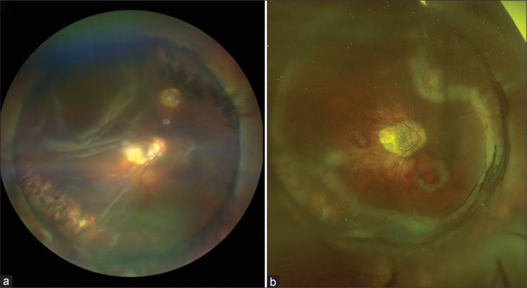
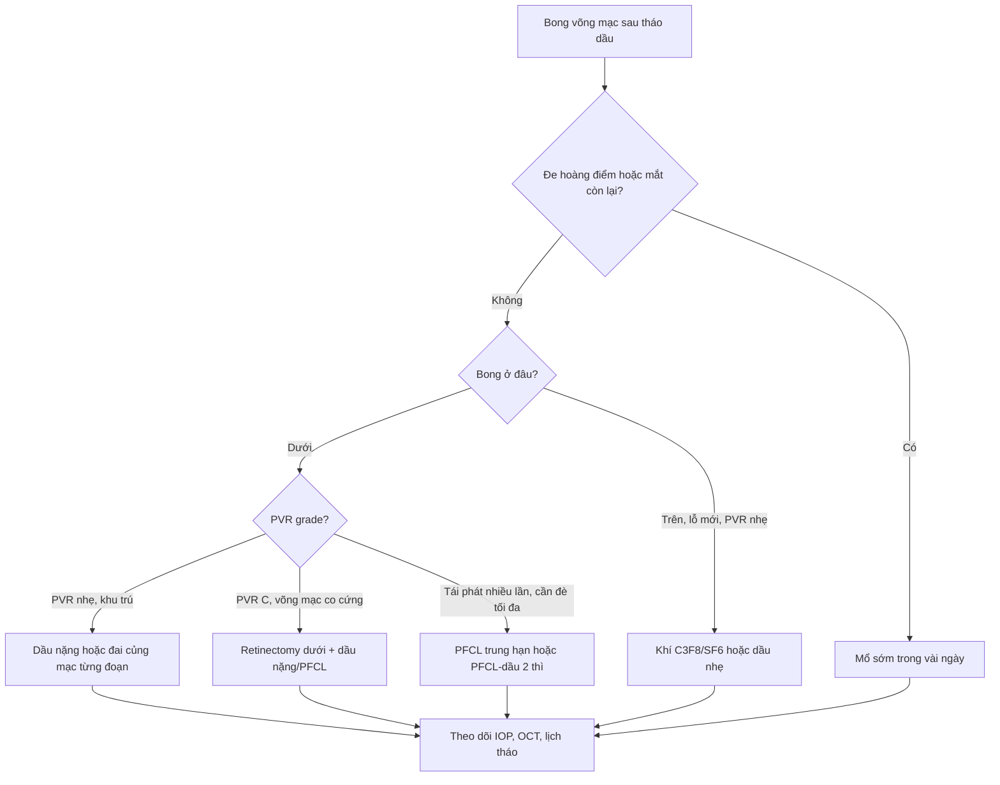
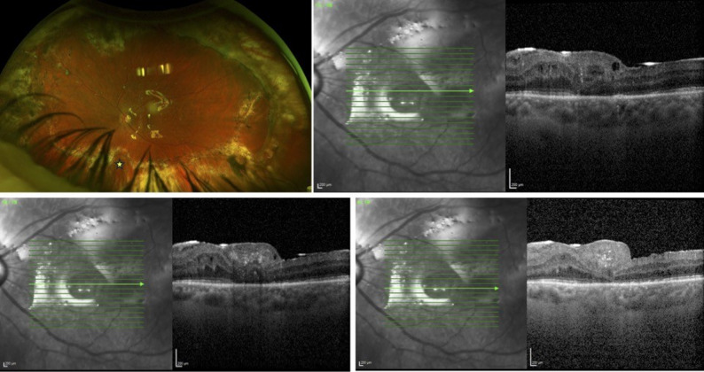
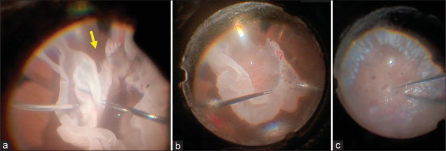

# 1865 — Bong võng mạc tái phát sau tháo dầu silicone: bơm lại dầu nhẹ, dầu nặng, PFCL hay khí? / Recurrent retinal detachment after silicone oil removal: choosing the next tamponade by geography

**Tags:** `pattern:bong-tai-phat` `pattern:co-keo-pvr` `pattern:bong-phia-duoi` `pattern:lang-dong` `vung:vong-mac` `vung:dich-kinh` `vung:hoang-diem` `protocol:PPV` `protocol:widefield` `protocol:OCT` `protocol:sieu-am-B-scan` `score:PVR` `score:IOP`
**Mức chắc chắn (certainty):** tổng hợp y văn (literature synthesis) — nhóm tự biên từ các nguồn mở, đã đối chiếu `authorString`/PMCID: đoàn hệ 161 mắt bong tái phát sau tháo dầu (CC BY-NC-ND 4.0, PMC11325823), tổng quan hệ thống 775 mắt tamponade PFCL (CC BY 4.0, PMC12914961), so sánh Densiron với dầu nhẹ 259 mắt (CC BY 4.0, PMC9440647), 46 mắt dầu nặng 1 tháng so với 3 tháng (CC BY-NC 4.0, PMC13427321), 8 mắt PFCL–dầu kết hợp (CC BY-NC-SA 4.0, PMC11451799), 22 mắt F6H8/dầu (CC BY 4.0, PMC3941958), 33 mắt retinotomy dưới + dầu (CC BY 4.0, PMC4673732), 4 mắt đai củng mạc từng đoạn trong mắt còn dầu (CC BY 4.0, PMC11943520). Chỗ nào là suy luận của nhóm đều ghi rõ "suy luận".

> **Vì sao bài này quan trọng:** bài **1410** dạy *khi nào lấy dầu* và *dầu tồn lưu trông thế nào*; bài này dạy **bước tiếp theo** — khi võng mạc đã bong lại sau khi lấy dầu, chọn tamponade nào. Đây không phải câu hỏi "bơm lại dầu" chung chung: **dầu nhẹ (0,97 g/cm³) nổi lên trên, nên nó không bao giờ đè được vùng võng mạc 6 giờ** — đúng vùng hay bong lại nhất. Vì vậy cùng một "bong tái phát" nhưng **chọn sai chất tamponade theo địa lý = bong lại lần nữa**, còn **chọn đúng = 74,9–95,5% dính** tùy kỹ thuật (PMC12914961, PMC4673732). Bỏ sót hoặc chờ đợi ở mắt còn lại một mắt là mất cửa sổ cứu thị lực.

## 1. Tổng quan bệnh học – cơ chế hình ảnh: vì sao bong lại, và vì sao ở DƯỚI

- **Con số nền:** sau tháo dầu silicone (removal of silicone oil, ROSO), bong tái phát **14,9% (24/161 mắt)**, trung vị **4,3 tuần (2,6–11,2)** sau tháo; **75,0% (18/24)** là bong do **PVR** (proliferative vitreoretinopathy), **25,0%** do **lỗ mới hoặc lỗ cũ mở lại** không PVR (PMC11325823). Các đoàn hệ khác trong repo ghi **15,6% (147 mắt)** và **22,4% (58 mắt)**; y văn **5–31,4%** (bài 1410).
- **Yếu tố nguy cơ đã kiểm bằng đa biến:** **tiền sử mổ bong võng mạc thất bại** là yếu tố **duy nhất** có ý nghĩa — **OR 4,8 (95% CI 1,5–19,0; p = 0,02)**; **PVR grade** (p = 0,03) và **thời gian giữ dầu** (p = 0,02) có ý nghĩa ở phân tích hai biến (PMC11325823). Thời gian giữ dầu **≤ 3 tháng**: bong **35,3%** so với **12,5%** khi giữ lâu hơn — **p = 0,06**, tức **xu hướng, chưa đủ chắc** (17 mắt trong nhóm ngắn).
- **Hai "biện pháp bảo vệ" tưởng đúng mà KHÔNG đúng (điểm quan trọng nhất của bài):** trong đoàn hệ 161 mắt, **laser 360°** (46% số mắt) và **bơm khí/không khí kèm lúc tháo dầu** (8,1%) **không làm giảm tỉ lệ bong tái phát** (PMC11325823). Giải thích: laser chỉ tạo dính **tại chỗ**, không ngăn được **màng PVR co kéo** ở vùng khác; bong khí **không phủ được vùng dưới** khi bệnh nhân ngồi/đứng, và tan trong **1–2 tuần** — ngắn hơn cửa sổ PVR (**trung vị ~2 tháng**).
- **Vì sao "dưới" là vùng thua cuộc — vật lý trước, mô bệnh sau:**
  1. **Tỷ trọng:** dầu silicone nhẹ **0,97 g/cm³** < nước (1,00) → **nổi**. Khi bệnh nhân ngồi, mặt phân cách dầu–dịch nằm **ngang**, nên **vùng võng mạc thấp nhất (6 giờ) chỉ tiếp xúc với dịch**, không có sức căng bề mặt của dầu đè lên. Dầu nặng (Densiron 68, Oxane HD) có **1,02–1,06 g/cm³** → **chìm**, đè được vùng dưới (bài 1864).
  2. **Sức căng bề mặt** của dầu **21,2–21,3 mN/m** chỉ có tác dụng **tại mặt phân cách**; vùng không tiếp xúc thì không có tamponade, dù bơm "đầy".
  3. **PVR không đối xứng:** tế bào RPE và đại thực bào **lắng theo trọng lực**, màng co kéo hình thành **dày hơn ở vùng dưới**; màng co lại làm **bờ bong ngang** (giống "mức nước"), đây là mẫu hình đọc trên ảnh góc rộng.
  4. **Sau tháo dầu, hàng rào cuối cùng mất hẳn:** dầu đang giữ võng mạc bằng lực cơ học; khi rút, **lực co kéo vẫn còn**, **bơm RPE vẫn hoạt động**, nên bong xuất hiện trong **2–6 tuần** — đúng cửa sổ PVR.
- **Vì sao phải phân biệt cơ chế trước khi chọn tamponade:** bong do **lỗ mới** cần **bịt lỗ + tamponade ngắn** (khí/dầu); bong do **PVR co kéo** cần **cắt màng + tamponade dài + chặn tái PVR** (dầu, thường dầu nặng nếu ở dưới); bong do **dầu tồn lưu/PFCL tồn lưu** cần **lấy chất lạ**, không phải bơm thêm (bài 1410). Chọn theo "thói quen bơm dầu" là bỏ qua bước này.
- **Ngưỡng định lượng dùng trong bài:**
  - Bong tái phát sau ROSO: **14,9%**, trung vị **4,3 tuần**; **75%** do PVR (PMC11325823).
  - Tamponade PFCL trung hạn: bong gộp **8,49%**, cải thiện thị lực **74,91%**, **17 nghiên cứu/775 mắt** (PMC12914961).
  - Dầu nặng so với dầu nhẹ ở bong nguyên phát: bong lại **10,1% vs 10,0%** (p = 1,000); tỉ lệ **retinectomy** sau đó **OR 15,3 (1,9–125,5; p = 0,011)** nghiêng về dầu nhẹ (PMC9440647).
  - Giữ dầu nặng **1 tháng vs 3 tháng**: dính **91,6% vs 81,8%** (p = 0,4) (PMC13427321).
  - Retinotomy dưới + dầu ở PVR grade C: dính **100% (nhóm đai củng mạc trước đó)** và **90% (nhóm đã cắt dịch kính)** (PMC4673732).
  - F6H8/dầu 1000 cSt: dính **21/22 (95,5%)** (PMC3941958); PFCL–dầu 2 thì: dính **8/8** khi vào thì hai (PMC11451799); đai củng mạc từng đoạn trong mắt còn dầu: **4/4** (PMC11943520).

## 2. Mẫu hình + chẩn đoán phân biệt theo vị trí (gamut)

- **Ba câu hỏi với mọi mắt bong lại sau tháo dầu:** **(1) bong ở đâu — dưới, trên, hoàng điểm? (2) cơ chế — lỗ mới, lỗ cũ mở, hay PVR co kéo? (3) mắt còn khả năng giữ tư thế và còn bao nhiêu thị lực để cứu?**
- **Theo vị trí (location):**
  - **Bong dưới (inferior, hay gặp nhất):** bờ bong ngang, co kéo dưới, thường PVR; dầu nhẹ **không tamponade được** → cần **dầu nặng, PFCL, retinotomy dưới hoặc đai củng mạc từng đoạn**.
  - **Bong trên (superior):** lỗ mới/GRT, dầu nhẹ phủ tốt khi bệnh nhân ngồi → **dầu nhẹ hoặc khí** là lựa chọn hợp lý.
  - **Bong toàn bộ/tái phát nhiều lần:** PVR nặng, thường phải **cắt võng mạc (retinectomy) + dầu**; tiên lượng thị lực kém.
  - **Bong hoàng điểm đơn độc/lỗ hoàng điểm:** cần **dầu hoặc khí + tư thế**, cân nhắc **màng ghép võng mạc** (PMC13159287).
- **Theo cơ chế (gamut thực hành):**
  - **PVR co kéo:** màng trước/sau võng mạc, "bờ bong ngang", lỗ không thấy rõ; **không** đáp ứng chỉ laser.
  - **Lỗ mới/lỗ cũ mở:** thấy lỗ, bong hình tháp, PVR nhẹ.
  - **Dầu/PFCL tồn lưu gây viêm và co kéo:** giọt tăng phản xạ trên OCT, dầu trong tiền phòng (bài 1410).
  - **Giả bong (pseudodetachment):** màng trước võng mạc dày, nếp gấp hắc võng mạc, bóng dầu — OCT phân biệt, **không mổ**.
  - **Hạ nhãn áp (hypotony) + bong:** mắt mềm, hắc mạc dày, tiên lượng xấu; cần xử lý nguyên nhân rò/dầu.
- **Mnemonic "DŨI"** cho bong lại sau tháo dầu: **D**own (vùng dưới — dầu nhẹ không với tới), **Ũ** (ứ dịch dưới võng mạc do bơm RPE), **I**nflammation/PVR (viêm–co kéo), **D**ầu/PFCL tồn lưu.

## 3. Bảng so sánh phân biệt (ma trận đối chiếu) — chọn tamponade theo địa lý và cơ chế

| Thực thể / lựa chọn | Hình ảnh & bối cảnh điển hình | Chốt vào (rule-in) | Chốt loại (rule-out) | Gợi ý xác nhận |
|---|---|---|---|---|
| **Bơm lại dầu nhẹ (1000–5000 cSt)** | Bong **trên** hoặc toàn bộ, lỗ ở nửa trên, bệnh nhân ngồi được | **Bong trên + lỗ thấy rõ + PVR nhẹ** | **Bong dưới đơn thuần** → dầu nhẹ nổi, không đè tới 6 giờ | Soi góc rộng tư thế ngồi, đánh dấu lỗ; OCT hoàng điểm |
| **Dầu nặng (Densiron 68, Oxane HD)** | Bong **dưới**, PVR dưới, không giữ được tư thế nằm sấp | **Bong dưới + PVR dưới + không tư thế** | **Bong trên** (dầu nặng chìm, bỏ trống phía trên); mắt có nguy cơ tăng nhãn áp do nhũ tương (bài 1864) | Siêu âm B-scan nếu không soi được; theo dõi IOP |
| **PFCL trung hạn (nặng 1,7–1,9 g/cm³)** | Bong dưới/GRT, cần đè cơ học mạnh, thời gian ngắn | **Bong dưới tái phát nhiều lần + cần đè tối đa** | **Không có kế hoạch lấy sau 1–4 tuần** → nguy cơ tồn lưu, độc giác mạc, tăng IOP | Lịch tháo PFCL; OCT tìm giọt dưới võng mạc |
| **PFCL–dầu kết hợp (2 thì)** | Bong mạn/PVR nặng, cần đè vùng dưới rồi chuyển dầu | **PVR dưới + retinectomy + cần đè dưới ngay sau mổ** | **Theo dõi kém, không thì hai** → PFCL tồn lưu | Thì hai sau **2 tuần** (PMC11451799) |
| **F6H8/dầu 1000 cSt** | Bong dưới + PVR dưới, tỉ lệ pha 50/50–30/70 | **Cần đè dưới + tránh PFCL nặng** | Tỉ lệ F6H8 cao (70/30, 60/40) → **đục tamponade** | Quan sát độ trong của tamponade |
| **Khí (SF6/C3F8) sau tháo dầu** | Lỗ mới nhỏ, bong khu trú trên, PVR nhẹ | **Lỗ mới + bong trên + bệnh nhân hợp tác tư thế** | **Bong dưới/PVR** → khí không phủ và tan sớm | Không có bằng chứng giảm bong khi bơm khí lúc ROSO (PMC11325823) |
| **Đai củng mạc từng đoạn (segmental buckle)** | Bong dưới sớm trong mắt **còn dầu**, lỗ/co kéo khu trú dưới | **Bong dưới khu trú + mắt còn dầu + PVR nhẹ** | **PVR lan rộng/toàn bộ** → cần cắt dịch kính | 4/4 dính sau 6 tháng (PMC11943520) — bằng chứng rất yếu |
| **Retinotomy/retinectomy dưới + dầu** | PVR grade C, võng mạc co cứng không trải được | **PVR C + võng mạc không trải + bong dưới** | **PVR nhẹ, võng mạc trải được** → không cắt võng mạc | Dính 90–100% (PMC4673732) |
| **Theo dõi (không mổ)** | Bong khu trú ngoại vi, không đe hoàng điểm, mắt đã mù | **Bong ngoại vi + không tiến triển + mắt không còn tiên lượng** | **Bong đe hoàng điểm/đe mắt còn lại** → phải mổ | So ảnh góc rộng 1–2 tuần |

*Hình (a): bong võng mạc tái phát mắt phải, thấy **vành đai củng mạc** và võng mạc co kéo phía dưới. Hình (b): ngày 1 sau mổ — võng mạc **áp** dưới dầu, các **điểm laser** quanh vùng rách. Nguồn: Shettigar MP và cs., *Indian J Ophthalmol* 2026 (PMC13056140) Fig. 1, **CC BY-NC-ND 4.0** — nguyên bản, không crop/ghép.*

### Dấu hiệu đọc ảnh quyết định chọn tamponade
- **Bờ bong ngang + màng co kéo dưới** = PVR dưới → **dầu nặng/PFCL/retinotomy**, không phải khí.
- **Lỗ đơn độc ở nửa trên, võng mạc dưới áp** = lỗ mới → **khí hoặc dầu nhẹ**, thời gian ngắn.
- **Giọt tăng phản xạ dưới võng mạc/trong khoang nang** = **PFCL hoặc dầu tồn lưu** → lấy chất lạ, không bơm thêm (bài 1410).
- **Hoàng điểm bong + lỗ hoàng điểm** = cần **tamponade + tư thế**, cân nhắc màng ghép (PMC13159287).

## 4. Protocol chụp – theo dõi + sơ đồ quyết định

- **Trước mổ (mắt bong lại sau ROSO):**
  - **Ảnh đáy mắt góc rộng (ultra-widefield, Optos)** ở **tư thế ngồi** — bờ bong thay đổi theo trọng lực; chụp thêm tư thế nằm để phân biệt dịch di động.
  - **OCT hoàng điểm** (SD-OCT): màng trước võng mạc, lỗ hoàng điểm, dịch dưới võng mạc, giọt dầu/PFCL.
  - **Siêu âm B-scan** khi không soi được (dầu nhũ tương, đục giác mạc, xuất huyết) — xác định bong, màng, chất lạ.
  - **Đo nhãn áp, đếm tế bào nội mô, đánh giá thể thủy tinh/IOL**, ghi **PVR grade (Machemer CP1–12)**, vị trí lỗ theo giờ, **trục nhãn cầu**, mắt còn lại.
  - **Không chụp CT/MRI** cho bong võng mạc — không có vai trò; MRI có thể thấy dầu nhưng không đổi xử trí (cạm bẫy "chụp thêm cho đủ").
- **Ngưỡng quyết định (dùng trong sơ đồ):** bong **đe hoàng điểm** hoặc **mắt còn lại duy nhất** → mổ **trong vài ngày**, không chờ; bong **dưới + PVR** → **không dùng dầu nhẹ đơn thuần**; **PVR C** → cân nhắc **retinectomy**; **IOP > 30 mmHg** kèm dầu → xử lý dầu/tiền phòng trước (bài 1416, 1864).
- **Sau mổ:** khám **ngày 1, tuần 1, tháng 1, tháng 3**; OCT hoàng điểm tháng 1 và 3; theo dõi **IOP** (dầu nặng), **nhũ tương hóa**, **đục thể thủy tinh**; lên lịch **tháo dầu** khi võng mạc ổn định **≥ 1–3 tháng** (bài 1410).

## 5. Biến thể bình thường và cạm bẫy

- **Cạm bẫy 1 — tin vào "laser 360° bảo vệ":** trong 161 mắt, laser 360° **không** giảm bong tái phát (PMC11325823). Laser tạo dính tại chỗ, không chặn PVR; đừng vì "đã laser 360" mà trì hoãn mổ khi có màng co kéo.
- **Cạm bẫy 2 — tin vào "bơm khí lúc tháo dầu":** **8,1%** mắt được bơm khí/không khí khi ROSO, **không** cải thiện tỉ lệ dính (PMC11325823). Khí tan **1–2 tuần**, ngắn hơn cửa sổ PVR.
- **Cạm bẫy 3 — dùng dầu nhẹ cho bong dưới:** dầu **0,97 g/cm³ nổi**; vùng 6 giờ không được đè → bong lại. Đây là lỗi hệ thống, không phải "ca khó".
- **Cạm bẫy 4 — bỏ sót PFCL tồn lưu:** giọt PFCL **1,7–1,9 g/cm³** lắng dưới võng mạc, gây viêm/co kéo; trên OCT là **giọt tăng phản xạ dưới võng mạc**, dễ bị đọc là "dầu tồn lưu" (bài 1410). Phải **lấy**, không bơm thêm dầu.
- **Cạm bẫy 5 — tưởng "dính dưới dầu" là khỏi:** võng mạc áp trong lúc còn dầu **không** đồng nghĩa áp sau tháo; bong xuất hiện **trung vị 4,3 tuần** sau tháo (PMC11325823) — cần hẹn khám đúng cửa sổ này.
- **Biến thể bình thường dễ nhầm:** **nếp gấp hắc võng mạc** sau đai củng mạc, **bóng dầu** ở mặt phân cách, **màng trước võng mạc mỏng** — đều giả bong trên ảnh đáy mắt, OCT phân biệt; **không mổ** chỉ vì "thấy đường trắng".
- **Bẫy mặt cắt/ảnh:** bờ bong **thay đổi theo tư thế** — ảnh chụp ngồi khác ảnh chụp nằm; luôn ghi tư thế khi chụp, nếu không sẽ đo sai diện bong và đánh giá sai tiến triển.

## 6. Tự lượng giá — Blind Quiz

**Ca 1 — Nam 60 tuổi, mắt phải đã bơm dầu 5 tháng, tháo dầu 3 tuần trước, nay mờ dần. Nhìn ảnh trước và sau mổ, mô tả trước khi mở đáp án.**

- Gợi ý: có vành đai củng mạc; bong ở vùng nào? Bờ bong có đặc điểm gì?
- Hỏi: 3 chẩn đoán phân biệt? Dấu hiệu nào quyết định chọn tamponade?

<b>Bấm để hiện đáp án</b>

- Dấu hiệu: **bong võng mạc tái phát phía dưới**, bờ bong ngang, co kéo quanh **vành đai củng mạc**; sau mổ võng mạc **áp** dưới dầu, **điểm laser** quanh vùng rách.
- Chẩn đoán: **bong tái phát do PVR/co kéo dưới** sau tháo dầu — cơ chế đúng của **75%** ca bong lại (PMC11325823).
- Vì sao chọn dầu nặng/PFCL: dầu nhẹ **nổi**, không đè được 6 giờ; bờ bong ngang là dấu hiệu "vùng dưới không được tamponade".
- Nguồn ảnh: Shettigar MP và cs., *Indian J Ophthalmol* 2026 (PMC13056140) Fig. 1, CC BY-NC-ND 4.0.

**Ca 2 — Bong dưới tái phát + PVR grade C + lỗ hoàng điểm; đã retinectomy 180°. Nhìn ảnh hậu phẫu, đọc cái gì còn và cái gì mất.**

- Gợi ý: võng mạc áp chưa? Hoàng điểm đóng chưa? Có màng ghép không?
- Hỏi: vì sao phải retinectomy? Nếu ảnh này chụp sau 1 tuần mà vẫn thấy dịch dưới võng mạc, xử trí?

<b>Bấm để hiện đáp án</b>

- Dấu hiệu: võng mạc **áp** dưới dầu sau **retinectomy 180°** + **màng ghép võng mạc tự thân**; OCT cho thấy **lỗ hoàng điểm đã đóng** ở một số lát cắt, còn thay đổi cấu trúc hoàng điểm.
- Chẩn đoán: bong dưới phức tạp có PVR + lỗ hoàng điểm — cần **retinectomy + tamponade dài**, không thể chỉ laser/khí.
- Nếu còn dịch dưới võng mạc ở tuần 1: **không vội mổ lại** nếu khu trú và không đe hoàng điểm; theo dõi OCT 1–2 tuần vì dịch có thể tự tiêu dưới dầu; mổ lại khi **tăng lên** hoặc **đe hoàng điểm**.
- Nguồn ảnh: Madani R và cs., *Int J Retina Vitreous* 2026 (PMC13159287) Fig. 1, CC BY 4.0.

**Ca 3 — Mắt bong dưới tái phát lần 3, PVR nặng, võng mạc co cứng không trải được. Nhìn ảnh trong mổ, mô tả thứ tự thao tác.**

- Gợi ý: (a) võng mạc co cứng; (b) chất lỏng nặng đè võng mạc; (c) trao đổi với dầu.
- Hỏi: vì sao phải cắt võng mạc thay vì bóc màng? PFCL dùng để làm gì và lấy khi nào?

<b>Bấm để hiện đáp án</b>

- Dấu hiệu: (a) **retinectomy 360° + retinotomy thư giãn** (mũi tên vàng) vì võng mạc co cứng; (b) **PFCL** đè làm trải võng mạc trong lúc bóc màng hai tay; (c) **trao đổi PFCL–dầu** khi võng mạc đã trải.
- Vì sao cắt võng mạc: khi màng PVR làm võng mạc **co cứng không thể trải** bằng bóc màng, cắt bỏ dải co là cách duy nhất để võng mạc áp lại; đánh đổi là **mất vùng võng mạc đó** (thị trường).
- PFCL: **nặng 1,7–1,9 g/cm³**, đè vùng dưới tốt; phải **lấy hết** trong thì sau (2 tuần) — tồn lưu gây viêm/co kéo (PMC11451799).
- Nguồn ảnh: Agarwal A và cs., *Indian J Ophthalmol* 2024 (PMC11727936) Fig. 1, CC BY-NC-SA 4.0.

## Bài liên quan chéo
- [445 – Bong võng mạc: tổng quan chẩn đoán và nguyên tắc mổ](../445-bong-vong-mac/lesson.md)
- [1410 – Lấy dầu silicone & dầu tồn lưu: khi nào lấy, nhũ tương hóa, bong tái phát](../1410-lay-dau-silicone-va-dau-ton-luu/lesson.md)
- [1864 – Dầu silicone NẶNG: vì sao biến chứng ở phía dưới](../1864-dau-silicone-nang-bien-chung-phia-duoi/lesson.md)
- [1863 – Đục thể thủy tinh ở mắt bơm dầu silicone](../1863-duc-the-thuy-tinh-mat-bom-dau-silicone/lesson.md)
- [1416 – Glôcôm do dầu silicone: pupillary block & bít bè](../1416-glaucom-do-dau-silicone/lesson.md)
- [1432 – Thay dầu silicone: khi nào, kỹ thuật, biến chứng](../1432-thay-dau-silicone/lesson.md)
- [1402 – Bong võng mạc sau viêm nội nhãn](../1402-bong-vong-mac-sau-viem-noi-nhan/lesson.md)
- [400 – Tổng quan Mắt & thị giác](../400-tong-quan-mat-thi-giac/lesson.md)

## Ảnh
- Tên file: `1865_bong-tai-phat_<Modality>_<SourceID>.jpg`; nguồn + giấy phép từng ảnh ở `images/CREDITS.md`.
- Ảnh tải từ Europe PMC (CC BY / CC BY-NC-ND / CC BY-NC-SA), **nguyên bản, không crop/kéo giãn**; ảnh **CC BY-NC-ND** không đưa vào ảnh ghép.
- EyeWiki / Retina Image Bank / AuntMinnie / Radiopaedia: **chỉ dẫn link, không tải** (xem `sources.md`).

> Không dùng để chẩn đoán độc lập khi chưa có người hướng dẫn.
