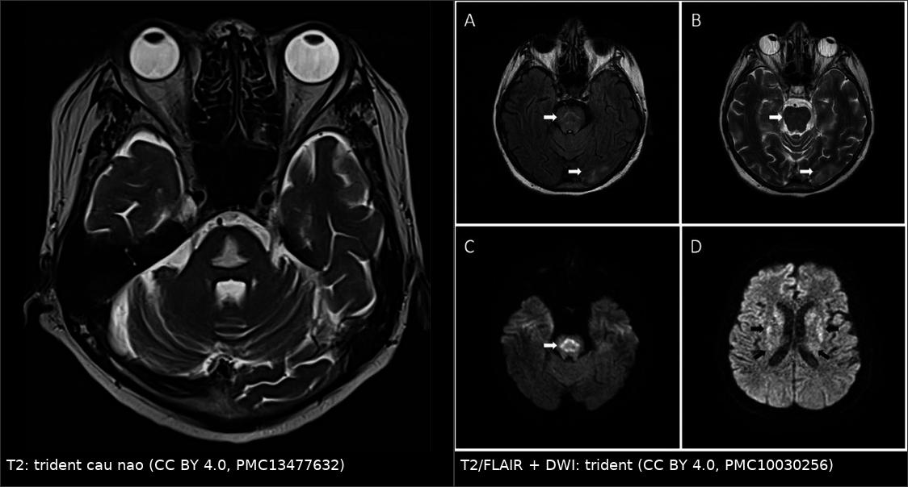
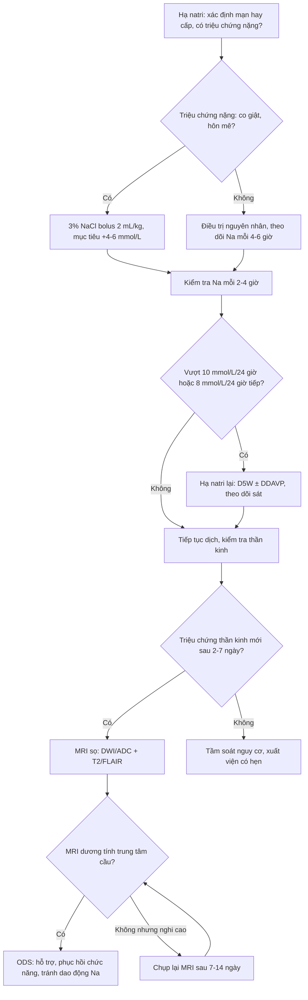
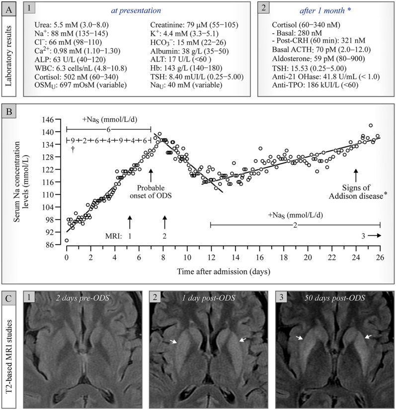
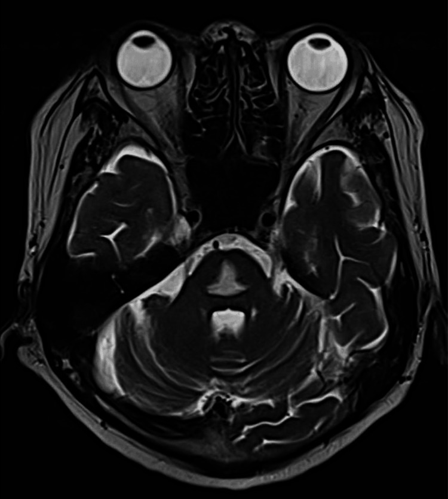
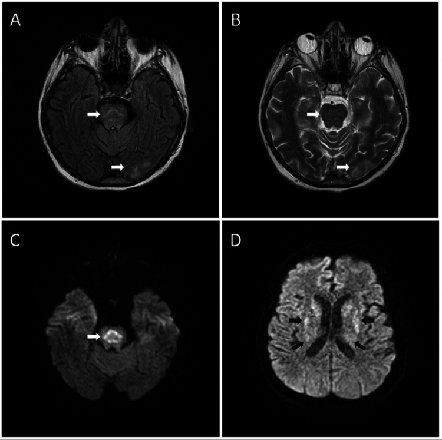
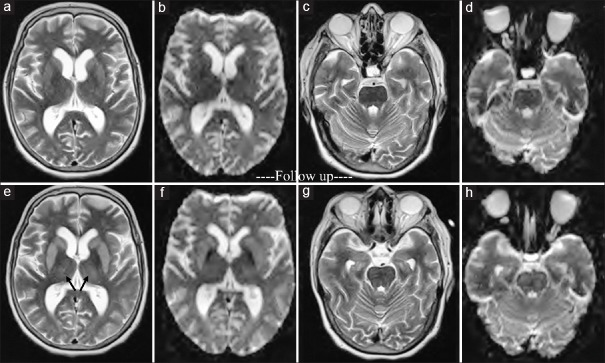

# 1866 — Hội chứng hủy myelin thẩm thấu (ODS) trên MRI sau sửa natri nhanh / Osmotic demyelination syndrome

**Tags:** `pattern:huy-myelin` `pattern:trident` `pattern:han-che-khuech-tan` `vung:nao` `vung:than-neu` `vung:cau-nao` `protocol:MRI` `protocol:DWI` `protocol:ADC`
**Mức chắc chắn (certainty):** tổng hợp y văn (literature synthesis) — số liệu lấy từ **phân tích gộp 11 đoàn hệ / 26.710 bệnh nhân** (PMC11833618), **tổng quan hệ thống** (PMC10962407), **khuyến cáo điều trị 2025** (PMC11893709, PMC12844543), **ca nguyên văn có ảnh** (PMC13477632, PMC10030256, PMC6771194, PMC9669670) và **bài tổng quan về plasmapheresis** (PMC7798224). Câu nào là suy luận được ghi **[suy luận]**.

> **Vì sao bài này quan trọng:** [1722](../1722-ha-natri-muon-sau-mo-tuyen-yen/lesson.md) đã đặt **ngưỡng sửa natri +10 mmol/L/24 giờ (+8 nếu nguy cơ cao)**. Nhưng ngưỡng chỉ có nghĩa nếu biết **hậu quả khi vượt**: ODS là biến chứng **do thầy thuốc gây ra**, xảy ra ở **0,23%** bệnh nhân hạ natri nằm viện, và **không phải cứ sửa nhanh là chắc chắn mắc** (OR 3,16) — nghĩa là vừa phải tôn trọng ngưỡng, vừa không được để bệnh nhân co giật vì sợ ODS. Hình ảnh là chốt chẩn đoán, nhưng **MRI sớm có thể hoàn toàn bình thường** — bỏ sót ở đúng cửa sổ điều trị.

## 1. Tổng quan bệnh học – cơ chế hình ảnh

- **Sinh lý bệnh (pathophysiology):** trong hạ natri **mạn**, não thích nghi bằng cách **đào thải chất tan hữu cơ (osmolyte: myo-inositol, glutamine, taurine)** ra khỏi tế bào trong 24–48 giờ để không bị phù. Khi natri máu **tăng nhanh**, dịch ngoại bào trở nên ưu trương trong khi tế bào **chưa kịp tái tổng hợp osmolyte** → **nước rời khỏi tế bào**, gây **teo và stress thẩm thấu tế bào hình sao (astrocyte)**, rồi **chết tế bào ít nhánh (oligodendrocyte)** và **tách lớp myelin**. Tổn thương nặng nhất ở **cầu não trung tâm** — nơi có mật độ sợi ngang cầu dày và là vùng chuyển tiếp mạch máu.
- **TẠI SAO T2/FLAIR tăng tín hiệu:** hủy myelin + phù gian bào làm **tăng nước tự do** trong mô → thời gian T2 dài → **tín hiệu sáng trên T2/FLAIR**; đồng thời **T1 giảm tín hiệu**. Vùng **bó vỏ–tủy và dải giữa** thường **được bảo tồn** → tổn thương trung tâm có hình **"trident" (đinh ba) / "piglet"**, không phải tổn thương lan toàn bộ cầu não.
- **TẠI SAO DWI là dấu sớm nhất:** phù độc tế bào làm **nước chuyển vào nội bào**, giảm khuếch tán → **DWI tăng, ADC giảm** trong **24 giờ đầu**, có khi **trước T2/FLAIR 1–2 tuần**. Ngược lại, T2 chỉ đổi sau khi phù/tổn thương myelin đủ lớn → **MRI ngày đầu có thể âm tính** (ca PMC6771194: MRI lúc khởi phát "unremarkable", chụp lại 2 tuần mới thấy tổn thương hạch nền/đồi thị/cầu não).
- **TẠI SAO CT kém nhạy:** CT chỉ thấy **giảm tỷ trọng trung tâm cầu** khi tổn thương đủ lớn; ca PMC13477632 có ổ giảm tỷ trọng rõ, nhưng CT bình thường **không loại trừ** ODS.
- **Số liệu định lượng cốt lõi:**
  - **Tần suất ODS:** **0,23%** ở bệnh nhân hạ natri nằm viện (11 đoàn hệ, **26.710** bệnh nhân); **0,73%** khi sửa nhanh vs **0,10%** khi sửa không nhanh; **OR 3,16 (95% CI 1,54–6,49; I² = 27%)** (PMC11833618).
  - **Tốc độ sửa ở ca ODS:** **66,6%** ca sửa **> 10 mEq/L trong 24 giờ đầu**; **10,4%** vẫn mắc ODS dù sửa **< 10 mEq/L/ngày**; natri trung vị lúc vào **105 mEq/L**; **hạ kali 18,8%**; đa số **nữ < 50 tuổi** (PMC10962407).
  - **Ngưỡng sửa:** **≤ 10 mmol/L trong 24 giờ đầu** và **≤ 8 mmol/L trong 24 giờ tiếp theo** (khuyến cáo châu Âu); nhóm **nguy cơ cao** dùng **4–6 mmol/L/ngày**; khuyến cáo mới nhấn **~6–8 mmol/L/24 giờ** (PMC10962407, PMC12844543).
  - **Tiên lượng:** tử vong **tới 31%**; thêm **31%** cần **hỗ trợ suốt đời** (tổng quan trong PMC7798224).
  - **Truyền 3% NaCl:** bolus **2 mL/kg** so với truyền **0,5–1 mL/kg/giờ** — bolus **ít phải hạ natri lại hơn** (41,4% vs 57,1%; p = 0,04) (PMC11893709).

## 2. Mẫu hình + chẩn đoán phân biệt theo vị trí và giai đoạn (gamut)

**Câu hỏi trung tâm: "tổn thương trung tâm cầu này là hủy myelin thẩm thấu, nhồi máu, hay u?"** Bối cảnh natri + thời điểm xuất hiện triệu chứng quan trọng ngang với hình ảnh.

- **A. Theo vị trí:**
  - **Chỉ cầu não (central pontine myelinolysis, CPM):** ổ trung tâm cầu, **trident/piglet**, giữ bờ; thể kinh điển.
  - **Ngoài cầu (extrapontine myelinolysis, EPM):** **hạch nền, đồi thị, tiểu não, chất trắng bán cầu**; có thể **đơn độc hoặc phối hợp**; EPM đơn độc dễ bị bỏ sót vì không có "trident".
  - **Lan tỏa:** tổn thương nhiều tầng + phù não → bệnh cảnh nặng, hôn mê.
- **B. Theo thời gian (quyết định chọn chuỗi xung):**
  - **< 24–48 giờ:** **DWI/ADC** là chìa khóa; T2/FLAIR có thể còn bình thường.
  - **3–14 ngày:** **T2/FLAIR sáng rõ**, T1 tối; có thể **ngấm thuốc viền** khi hàng rào máu–não tổn thương.
  - **> 1 tháng:** T1 tối/teo; tín hiệu có thể giảm dần nhưng **không phải lúc nào cũng hết**.
- **C. Gamut tổn thương trung tâm cầu:**
  - **Nhồi máu cầu não:** khởi phát **đột ngột**, theo **lãnh thổ mạch** (thường lệch bên), **DWI tăng/ADC giảm**, kèm yếu tố mạch máu; **không có bối cảnh sửa natri**.
  - **U thân não (glioma cầu não):** **phình cầu não**, xóa bờ, không hạn chế khuếch tán mạnh, tiến triển nhiều tuần, thường ở trẻ.
  - **MS/NMOSD:** ổ **bờ rõ, quanh mạch**, kèm tổn thương **dây thần kinh thị, tủy, quanh não thất**; tái phát theo thời gian.
  - **Wernicke:** tổn thương **đồi thị giữa, quanh cống não, thể vú**; bối cảnh rượu/suy dinh dưỡng; đáp ứng thiamine.
  - **Bệnh não gan:** **T1 tăng tín hiệu hạch nền** (mangan), không phải T2 sáng trung tâm cầu đơn thuần.
  - **ADEM/viêm lan tỏa:** nhiều ổ, sau nhiễm/tiêm, kèm sốt.

## 3. Bảng so sánh phân biệt (ma trận đối chiếu)

| Thực thể (entity) | Hình ảnh điển hình | Chốt vào (rule-in) | Chốt loại (rule-out) | Gợi ý xác nhận |
|---|---|---|---|---|
| **ODS (CPM)** | **T2/FLAIR sáng trung tâm cầu**, hình **trident/piglet**, T1 tối, **DWI tăng/ADC giảm sớm** | **Bối cảnh sửa natri + tổn thương trung tâm cầu đối xứng + DWI hạn chế** | Tổn thương lệch bên theo lãnh thổ + khởi phát đột ngột → nhồi máu | Na máu theo thời gian; MRI lặp lại 1–2 tuần nếu lần đầu âm |
| **ODS (EPM)** | T2 sáng **hạch nền/đồi thị/tiểu não**, có thể đối xứng; đôi khi kèm cầu não | **Đối xứng hai bên + bối cảnh natri** | Tổn thương một bên, bờ rõ, có tổn thương tủy/thị → MS/NMOSD | MRI toàn bộ não + tủy khi nghi MS |
| **Nhồi máu cầu não** | Vùng **lãnh thổ mạch**, bờ rõ, có thể xuất huyết; **DWI tăng/ADC giảm** | **Đột ngột + yếu tố mạch máu + phân bố mạch** | Đối xứng trung tâm + sửa natri → ODS | MRA/CTA; siêu âm tim; theo dõi |
| **Glioma cầu não** | **Phình cầu não**, xóa bờ, T2 sáng không đối xứng, **không hạn chế khuếch tán rõ** | **Phình thân não + tiến triển nhiều tuần + trẻ em** | Không phình, đối xứng, khởi phát sau natri → ODS | MRI có/không cản quang; sinh thiết chỉ khi cần |
| **MS/NMOSD** | Ổ **bờ rõ**, quanh não thất, **dây thị/tủy**, ngấm thuốc từng đợt | **Tổn thương đa ổ theo thời gian + tủy/thị** | Một ổ trung tâm cầu đơn độc, không ổ khác → ODS | MRI sọ + tủy; IgG oligoclonal, NMO-IgG |
| **Wernicke** | **Đồi thị giữa, quanh cống, thể vú** tăng T2/FLAIR | **Rượu/suy dinh dưỡng + tam chứng + đáp ứng thiamine** | Không tổn thương thể vú, có sửa natri → ODS | Thiamine thử; MRI lặp lại |
| **Bệnh não gan** | **T1 tăng hạch nền** đối xứng, T2 thường bình thường | **Xơ gan + amoniac cao + T1 tăng hạch nền** | T2 sáng trung tâm cầu là tổn thương thực thể → ODS | Ammoniac, MRI; điều trị gan |

*Trái: **T2 cầu não — ổ tăng tín hiệu trung tâm hình trident**, bờ cầu não và bó vỏ–tủy được bảo tồn. Phải: **T2/FLAIR + DWI** cùng tổn thương, DWI tăng tín hiệu mạnh — dấu sớm nhất, có trước T2. Nguồn: Itagaki 2026 (PMC13477632) và Ivanova 2023 (PMC10030256), đều **CC BY 4.0**; ảnh ghép letterbox, không crop.*

### Dấu hiệu chốt trên từng phương thức
- **DWI/ADC:** **hạn chế khuếch tán thật** (DWI sáng + ADC tối) ở trung tâm cầu, xuất hiện **trong 24 giờ**, có thể là **bất thường duy nhất** lúc đầu.
- **T2/FLAIR:** ổ sáng **đối xứng, trung tâm**, hình **trident/piglet**; **không phù lan tỏa** kiểu u.
- **T1 ± cản quang:** T1 tối; **ngấm thuốc viền** xuất hiện **1–2 tuần** sau khởi phát [suy luận từ cơ chế hàng rào máu–não; ca PMC11772055 mô tả ngấm thuốc viền ngoại biên].
- **CT:** giảm tỷ trọng trung tâm cầu — chỉ dùng để **loại trừ chảy máu**, không đủ để chẩn đoán.

## 4. Protocol xử trí + theo dõi điện giải và hình ảnh

- **Trước khi sửa natri — phân tầng nguy cơ ODS:** natri **< 120 mmol/L kéo dài**, **nghiện rượu**, **suy dinh dưỡng**, **bệnh gan**, **hạ kali**, **nữ < 50 tuổi**, dùng thuốc lợi tiểu. Nhóm này đặt mục tiêu **4–6 mmol/L/24 giờ** thay vì 10.
- **Khi có triệu chứng thần kinh nặng (co giật, hôn mê, nôn):** ưu tiên **tăng natri nhanh** bằng **3% NaCl bolus 2 mL/kg** (hoặc 150 mL/20 phút theo phác đồ), mục tiêu **+4–6 mmol/L** để cắt cơn; **không** để bệnh nhân co giật vì sợ ODS.
- **Giới hạn sửa:** **≤ 10 mmol/L/24 giờ đầu**, **≤ 8 mmol/L/24 giờ tiếp theo**; đo natri **mỗi 2–4 giờ** trong giai đoạn sửa, theo dõi nước tiểu (vì **đa niệu do ADH bị ức chế** có thể làm natri vọt nhanh ngoài dự kiến).
- **Nếu đã sửa quá nhanh:** **hạ natri lại** bằng **D5W ± desmopressin (DDAVP)** ở bệnh nhân chọn lọc, theo dõi natri sát; mục tiêu đưa về ngưỡng an toàn, không hạ sốc.
- **Chẩn đoán hình ảnh:** **MRI sọ có DWI/ADC + T2/FLAIR + T1 ± cản quang** khi có triệu chứng thần kinh sau sửa natri. Nếu **MRI lần đầu bình thường mà nghi ngờ cao** → **chụp lại sau 7–14 ngày** (ca PMC6771194 chỉ dương ở lần chụp lại). CT chỉ để loại trừ chảy máu.
- **Điều trị ODS đã hình thành:** chủ yếu **hỗ trợ** (đường thở, dinh dưỡng, phục hồi chức năng), **kiểm soát natri chậm và ổn định**, tránh dao động thêm. **Corticoid/IVIG/plasmapheresis: bằng chứng yếu**, chủ yếu ca lẻ; plasmapheresis có báo cáo **hồi phục hoàn toàn** ở ca muộn (PMC7798224) nhưng **không có thử nghiệm đối chứng**.
- **Tiên lượng và tư vấn:** tử vong **tới 31%**, **31%** cần hỗ trợ suốt đời; hồi phục thường **nhiều tuần–nhiều tháng** và **không đồng nhất**; hội chứng khóa trong (locked-in) có thể xảy ra.

## 5. Biến thể bình thường và cạm bẫy

- **MRI sớm âm tính không loại trừ ODS:** ca PMC6771194 có MRI lúc khởi phát **không đóng góp**, chỉ **chụp lại 2 tuần** mới thấy tổn thương; vì vậy **DWI âm ngày đầu** cũng không cho phép kết luận.
- **CT bình thường là chuyện thường:** đừng dừng lại ở CT; **MRI + DWI** mới là chuẩn.
- **"Sửa trong giới hạn 10 mmol/L/24 giờ" vẫn có thể gây ODS:** **10,4%** ca ODS sửa **< 10 mEq/L/ngày** (PMC10962407); ca Na **125 → 134 mmol/L trong 5 ngày** vẫn mắc ODS ở người nghiện rượu/hạ kali (PMC12529225) — **yếu tố nguy cơ quan trọng ngang tốc độ**.
- **Ngược lại, không phải cứ sửa nhanh là ODS:** OR chỉ **3,16**, và một số ca ODS xảy ra **không có sửa nhanh** (PMC11833618). Vì vậy **không trì hoãn điều trị** ở bệnh nhân có triệu chứng nặng.
- **Triệu chứng bị quy sai:** chậm nói, yếu chi, rối loạn nuốt xuất hiện **2–7 ngày** sau nhập viện dễ bị gán cho **cai rượu, an thần, nhiễm trùng, đột quỵ** — luôn hỏi **đường cong natri** và chỉ định MRI.
- **Tổn thương ngoài cầu dễ bị bỏ qua:** ảnh dưới đây cho thấy **hạch nền/đồi thị** cũng tăng tín hiệu trên T2 khi chụp chuỗi — chỉ đọc cầu não là thiếu.

*Hình đầy đủ gồm **(A)** bảng xét nghiệm lúc vào và sau 1 tháng, **(B)** **đường cong natri theo ngày** với mốc "probable onset of ODS" và các lần MRI, **(C)** 3 lát T2: **2 ngày trước ODS** (1), **1 ngày sau ODS** (2) và **50 ngày sau ODS** (3) — tổn thương **hạch nền/đồi thị** tăng tín hiệu hai bên (mũi tên trắng). Điểm cần đọc: triệu chứng xuất hiện **vài ngày sau khi bắt đầu sửa natri**, không tức thì — đúng kiểu **trễ 2–7 ngày** của ODS. Nguồn: Quigley 2022 (PMC9669670), **CC BY 4.0**; ảnh nguyên bản, không crop.*

- **"Trident" không phải độc quyền của ODS:** nhồi máu cầu não cũ và một số bệnh hủy myelin khác có thể giống; **bối cảnh natri + đối xứng + DWI** mới là chốt.
- **Hạ natri lại quá tay:** mục tiêu là **đưa về ngưỡng an toàn**, không phải gây hạ natri nặng trở lại — hạ natri lại gây **phù não**; thực hiện ở nơi theo dõi được natri **mỗi 2 giờ** [suy luận từ nguyên lý điều trị].

## 6. Tự lượng giá — Blind Quiz ngay trên trang tĩnh

**Ca 1 — Nam 51 tuổi, nghiện rượu, nôn 6 ngày, sau đó chậm nói và yếu tứ chi**

- Gợi ý lâm sàng: natri vào viện thấp, hạ kali; 3 ngày sau xuất hiện **rối loạn nuốt, nói khó, yếu tứ chi**; CT sọ không chảy máu.
- Câu hỏi: Mô tả tổn thương? Vì sao **bó vỏ–tủy được bảo tồn**? Chẩn đoán và yếu tố nguy cơ?

<b>Bấm để hiện đáp án (findings + chẩn đoán)</b>

- **Dấu hiệu:** **ổ tăng tín hiệu đối xứng trung tâm cầu** trên T2, hình **trident**, **bờ cầu não và bó vỏ–tủy còn tối**; CT trước đó có **giảm tỷ trọng trung tâm cầu** (Fig. 1 của bài).
- **Chẩn đoán:** **ODS thể trung tâm cầu (CPM)** — vì tổn thương **đối xứng, trung tâm, sau đợt hạ natri** ở người **nghiện rượu + hạ kali** (hai yếu tố nguy cơ mạnh).
- **Vì sao bảo tồn bó vỏ–tủy:** sợi ngang cầu và vùng chuyển tiếp mạch máu nhạy với stress thẩm thấu hơn bó vỏ–tủy đặc; vì vậy tổn thương trung tâm tạo hình "đinh ba" thay vì liệt mềm toàn bộ.
- **Nguồn ảnh:** Itagaki H, Endo T. Cureus 2026 (PMC13477632), **CC BY 4.0**.

**Ca 2 — Bệnh nhân sau COVID-19, rối loạn ý thức và liệt tứ chi sau sửa natri; MRI ngày 7**

- Gợi ý lâm sàng: hạ natri trong đợt COVID-19; vài ngày sau xuất hiện **rối loạn ý thức và liệt tứ chi**.
- Câu hỏi: Chuỗi xung nào **dương sớm nhất**? Tại sao DWI quan trọng hơn T2 ở ngày đầu?

<b>Bấm để hiện đáp án (findings + chẩn đoán)</b>

- **Dấu hiệu:** (A) T2 và (B) T2/FLAIR: **tăng tín hiệu trung tâm cầu**; (C, D) **DWI**: ổ tăng tín hiệu mạnh cùng vị trí, hình **trident/piglet**.
- **DWI dương sớm nhất:** phù độc tế bào làm **giảm khuếch tán** trong **24 giờ**, khi T2/FLAIR còn có thể bình thường; vì vậy **luôn kèm DWI/ADC** trong protocol.
- **Chẩn đoán:** **ODS** sau sửa natri; điều trị **hỗ trợ + phục hồi chức năng**, tránh dao động natri tiếp.
- **Nguồn ảnh:** Ivanova NI et al., Cureus 2023 (PMC10030256), **CC BY 4.0**.

**Ca 3 — Bệnh nhân có triệu chứng nhưng MRI đầu tiên "bình thường"**

- Gợi ý lâm sàng: rối loạn ý thức và vận động sau đợt hạ natri; MRI lúc khởi phát được báo "không đóng góp"; nghi ngờ ODS vẫn cao.
- Câu hỏi: Hàng trên và hàng dưới khác nhau ở đâu? Nếu MRI ngày 1 âm tính thì làm gì?

<b>Bấm để hiện đáp án (findings + chẩn đoán)</b>

- **Dấu hiệu:** hàng trên (a–d) **T2/DWI lúc khởi phát** gần như bình thường; hàng dưới (e–h) **sau 2 tuần** có **tăng tín hiệu nhẹ ở hạch nền, đồi thị và cầu não**, kèm **hạn chế khuếch tán**.
- **Chẩn đoán:** **ODS giai đoạn sớm với MRI đầu âm tính** — không loại trừ; **chụp lại sau 7–14 ngày** là bắt buộc khi nghi ngờ.
- **Bài học:** **DWI có thể dương trước T2**, nhưng nếu cả hai còn âm trong 48 giờ đầu thì **theo dõi lâm sàng + chụp lại**, không bỏ chẩn đoán.
- **Nguồn ảnh:** Seniaray N et al., Indian J Nucl Med 2019 (PMC6771194), **CC BY-NC-SA 4.0**; ảnh nguyên bản, không crop.

> **Phản biện nguồn:** ca 3 là ca được chẩn đoán ODS **trên lâm sàng** với MRI không đóng góp, sau đó xác nhận bằng **FDG PET/CT** (bài gốc). Trong thực hành, **PET không phải chuẩn** — dùng MRI lặp lại; trích ca này để minh họa **giới hạn của MRI sớm**, không để đề xuất PET thường quy.

## Bài liên quan chéo
- [200 – Tổng quan hệ Thần kinh](../200-tong-quan-he-than-kinh/lesson.md)
- [1722 – Hạ natri muộn sau mổ tuyến yên: ngưỡng sửa natri](../1722-ha-natri-muon-sau-mo-tuyen-yen/lesson.md)
- [1710 – Đái tháo nhạt trung ương sau mổ tuyến yên](../1710-dai-thao-nhat-trung-uong-sau-mo-tuyen-yen/lesson.md)
- [210 – Giải phẫu sọ não trên cắt lớp](../210-giai-phau-so-nao/lesson.md)
- [211 – Đột quỵ não: phân biệt nhồi máu cầu não](../211-dot-quy-nao/lesson.md)

## Ảnh
- Tên file: `1866_slug_Modality_SourceID.jpg`; nguồn + giấy phép từng ảnh ở `images/CREDITS.md`.
- Ảnh composite `composite_t2-vs-dwi.jpg` tạo bằng `tools/make_composite.py` (letterbox, không crop/kéo giãn) từ 2 ảnh **CC BY 4.0**.

> Không dùng để chẩn đoán độc lập khi chưa có người hướng dẫn.
