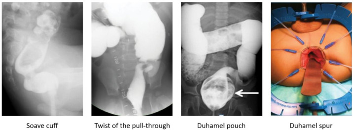
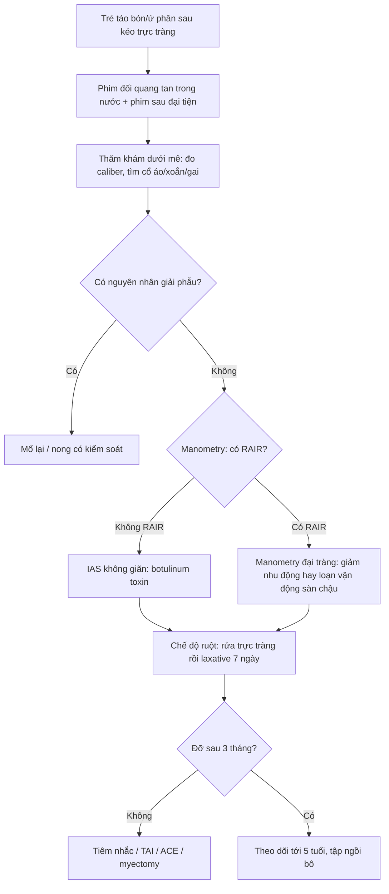
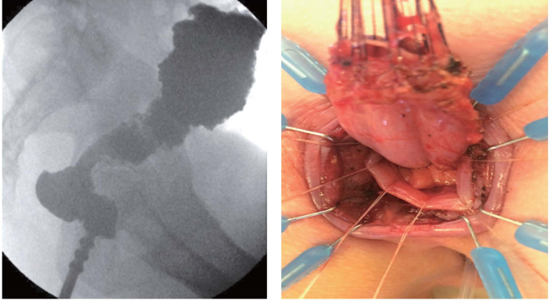
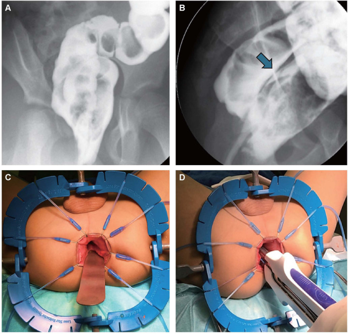
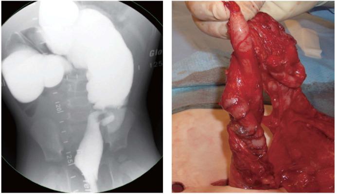

# 1867 — Táo bón & ứ phân sau kéo trực tràng ở trẻ: nước rửa, laxative, botulinum và khi nào mổ lại / Constipation and obstructive defecation after pull-through for Hirschsprung disease

**Tags:** `pattern:tao-bon` `pattern:hep-miem-noi` `pattern:roi-loan-nhu-dong-dai-trang` `vung:truc-trang` `vung:dai-trang` `vung:hau-mon` `score:HAEC` `protocol:contrast-enema` `protocol:manometry`

**Mức chắc chắn (certainty):** tổng hợp y văn (literature synthesis) — số liệu lấy từ toàn văn của **đoàn hệ 91 trẻ** mổ Hirschsprung tại Zürich–Frankfurt (*Pediatric Surgery International* 2026, **PMC13652869**, CC BY 4.0), **tổng quan điều trị ruột** của Bệnh viện Nhi Columbus (*Children* 2023, **PMC10453740**, CC BY 4.0), **tổng quan phẫu thuật Hirschsprung** (*World Journal of Pediatric Surgery* 2024, **PMC11429006**, CC BY-NC), **meta-analysis 34 nghiên cứu/2.207 bệnh nhân về transition-zone anastomosis** (*Children* 2023, **PMC10528601**, CC BY 4.0) và **36 trẻ** đối chiếu mô bệnh học của ống hậu môn trên phim đối quang (*Pediatric Surgery International* 2020, **PMC7043041**, CC BY 4.0). Nhóm **không có bệnh nhân của mình**.

> **Câu chốt:** sau kéo trực tràng (pull-through), **tới 53% trẻ có triệu chứng tắc nghẽn** và **tới 50% còn vấn đề ruột** (táo bón, HAEC, són phân) — nhưng **chỉ 9% (95% CI 5–14%) có mô học còn vùng chuyển tiếp ở miệng nối**. Vì vậy trình tự bắt buộc là: **(1) phim đối quang + thăm khám dưới mê để loại trừ nguyên nhân GIẢI PHẪU** (hẹp miệng nối, cổ áo Yancey–Soave, xoắn, túi/gai Duhamel, vùng chuyển tiếp), **(2) nếu giải phẫu bình thường → coi là cơ thắt trong không giãn (internal anal sphincter achalasia) và điều trị bằng botulinum + chế độ ruột**, **(3) chỉ mổ lại khi có bằng chứng giải phẫu**. Cho laxative/enema trước khi cơ thắt giãn được là **làm nặng thêm** (phân ứ ở đại tràng đoạn xa).

## 1. Tổng quan bệnh học – cơ chế hình ảnh (TẠI SAO)

### 1.1 Vì sao vẫn "tắc" sau một cuộc mổ đúng

- **Bệnh cơ bản vẫn còn ở lại:** phẫu thuật cắt đoạn **vô hạch** và kéo đại tràng **có hạch** xuống, nhưng **cơ thắt hậu môn trong (internal anal sphincter, IAS) luôn vô hạch** ở Hirschsprung — IAS không có **đám rối thần kinh ruột** nên **mất phản xạ giãn cơ thắt–trực tràng (rectoanal inhibitory reflex, RAIR)**. Kéo trực tràng không tạo lại RAIR; trẻ phải **học cách đẩy phân qua một van không mở** bằng áp lực ổ bụng và cơ thành bụng.
- **Hai nhóm nguyên nhân phải tách tuyệt đối:**
  - **Giải phẫu (anatomic):** hẹp miệng nối, **cổ áo Yancey–Soave còn lại** (cuff), **xoắn ống kéo xuống (twisted pull-through)**, **túi Duhamel quá lớn / gai Duhamel còn (retained spur)**, **kéo xuống trên vùng chuyển tiếp** (transition-zone anastomosis), hẹp do hở miệng nối.
  - **Chức năng (functional):** **IAS không giãn**, **rối loạn nhu động đại tràng** (đại tràng kéo xuống giảm nhu động dù có hạch), **loạn cảm giác–vận động sàn chậu (dyssynergic defecation)**.
- **TẠI SAO hình ảnh quyết định:** ba nguyên nhân giải phẫu đầu tiên **chỉ sửa được bằng mổ/phẫu thuật nội soi**, còn nhóm chức năng **sửa bằng thuốc/botulinum** — dùng sai hướng nghĩa là hoặc **mổ lại oan** hoặc **kéo dài ứ phân → HAEC, giãn đại tràng mất bù**.

### 1.2 Ngưỡng định lượng nằm lòng

| Chỉ số | Con số | Nguồn |
|---|---|---|
| Triệu chứng tắc nghẽn sau kéo trực tràng | **tới 53%** | PMC10453740 |
| HAEC sau mổ | **tới 37%** | PMC10453740 |
| Không tăng cân theo kỳ vọng | **7,5%** | PMC10453740 |
| Són phân/không kiểm soát | **tới 48%** | PMC10453740 |
| Vấn đề ruột kéo dài chung | **tới 50%** | PMC11429006 |
| **Vùng chuyển tiếp ở miệng nối (TZA)** | **9% (95% CI 5–14)**, 34 nghiên cứu, **2.207 bệnh nhân** | PMC10528601 |
| Hậu quả của TZA | tắc nghẽn khi đại tiện **62%**, viêm ruột **38%**, són **28%**, không kiểm soát **24%** | PMC10528601 |
| **Hẹp miệng nối: nong định kỳ vs calibration một lần** | **10,9% (5/46) vs 20% (9/45)**, p = 0,259 → **nong định kỳ không giảm hẹp** | PMC13652869 |
| HAEC: nong định kỳ vs calibration | **10,9% vs 13,3%**, p = 0,718 | PMC13652869 |
| Táo bón/không kiểm soát: nong vs calibration | **34,8% (16/46) vs 32,6% (14/45)** | PMC13652869 |
| Thời điểm phát hiện hẹp | nong: **ngày 22–356**; calibration: **ngày 13–1.623** sau mổ | PMC13652869 |
| Mổ trước **2,5 tháng** tuổi (so với muộn hơn) | táo bón/són **26% vs 11%**, hẹp **10% vs 2%**, rò **6% vs 1%** | PMC11429006 |
| Không thấy vùng chuyển tiếp trên phim đối quang | **10%** ca Hirschsprung (không loại trừ bệnh) | PMC11429006 |
| Phim đối quang đoán mức vô hạch (36 trẻ) | độ nhạy **100%**, độ đặc hiệu **35,7%**, PPV **30,8%**, NPV **100%**, độ chính xác **50%** | PMC7043041 |
| **Botulinum toxin** hiệu quả | **66–72%**, tác dụng trong **1 tháng**, kéo dài **~3 tháng**, còn lợi ích tới **6 tháng** | PMC10453740 |
| Botulinum: khỏi hẳn / cải thiện | **22%** không cần điều trị thêm; nghiên cứu khác **76% cải thiện**, **51%** tốt dài hạn | PMC10453740 |
| Tiêm nhắc lại | mỗi **3–12 tháng**; hiệu quả lần sau **44% vs 77%** lần đầu | PMC10453740 |
| Biến chứng botulinum | són phân tạm thời, tự hết **~9%** | PMC10453740 |
| Tuổi "hết" vấn đề cơ thắt | thường **trước 5 tuổi** | PMC10453740 |

### 1.3 Vì sao phim đối quang "thấy" được nguyên nhân — vật lý cột thuốc cản quang

- **Cột thuốc cản quang đi theo lòng ruột**: chỗ **hẹp thật** (miệng nối xơ) làm cột thuốc **thuôn dài, không đổi theo thì**; chỗ **cổ áo** tạo **vòng hẹp đối xứng ngay trên cơ thắt** kèm **khoang trước xương cùng rộng ra** (vì trực tràng thật đã bị bóc, ống kéo xuống không áp sát xương cùng); chỗ **xoắn** làm cột thuốc **vặn, lệch trục** và **không xẹp khi tháo bóng**; **túi Duhamel** là **ổ cặn lớn phía sau** đọng thuốc khi đã đại tiện; **gai Duhamel** là **vách ngăn dọc** giữa hai lòng.
- **Vì sao cần phim thì muộn/ sau đại tiện:** phân và thuốc **đọng lại** trong ổ cặn hoặc trong đại tràng giảm nhu động chỉ lộ ra khi **đã tháo bóng và cho trẻ rặn** — phim sớm chỉ thấy đoạn ruột đầy thuốc, dễ đọc "bình thường".
- **Vì sao manometry mới trả lời câu hỏi chức năng:** RAIR là **đáp ứng cơ trơn** (giãn IAS khi bóng trực tràng căng) — **không nhìn thấy trên hình ảnh**; đo áp lực mới phân biệt **IAS không giãn** với **đại tràng giảm nhu động** và **loạn vận động sàn chậu**.
- **Vì sao "nong định kỳ" không giúp:** hẹp sau kéo trực tràng phần lớn do **xơ hóa vòng miệng nối + thiếu máu đầu ống kéo**, kéo giãn cơ học không làm lành mô xơ — số liệu 91 trẻ cho thấy **hẹp còn nhiều hơn** ở nhóm nong định kỳ (20% vs 10,9%, không khác biệt có ý nghĩa).

## 2. Mẫu hình + chẩn đoán phân biệt theo vị trí (gamut)

**Mẫu hình:** trẻ **đã mổ Hirschsprung** (Soave/Boley, Swenson, Duhamel, TERPT), đến khám vì **đi cầu ít, phân dẹt/nhỏ giọt, đầy bụng, nôn, hoặc són phân liên tục trên nền ứ phân**.

**Gamut theo trục thời gian – vị trí:**

- **Ngay sau mổ (0–4 tuần):** **hẹp miệng nối** (hẹp thật do xơ/thiếu máu, hoặc do co thắt tạm thời), **xoắn ống kéo xuống** (triệu chứng sớm, nặng), **rò/hở miệng nối**.
- **1–12 tháng:** **vùng chuyển tiếp còn lại ở miệng nối** (kéo xuống quá thấp), **cổ áo Yancey–Soave** dày, **túi Duhamel quá lớn**, **IAS không giãn** bắt đầu lộ rõ khi trẻ ăn nhiều hơn và bắt đầu tập ngồi bô.
- **Sau 1 tuổi:** **rối loạn nhu động đại tràng**, **loạn vận động sàn chậu (dyssynergic defecation)**, **giãn đại tràng mất bù (megarectum/megacolon)** do ứ phân kéo dài, **HAEC tái diễn**.
- **Gamut theo hình thái trên phim đối quang:** (a) **hẹp đối xứng ngay trên cơ thắt** → cổ áo/co thắt; (b) **hẹp không đều, bờ xơ** → hẹp miệng nối; (c) **cột thuốc vặn, lệch trục** → xoắn; (d) **ổ cặn sau trực tràng** → túi Duhamel; (e) **vách dọc** → gai Duhamel; (f) **đoạn hẹp dài trên miệng nối + đoạn trên giãn** → vùng chuyển tiếp; (g) **trực tràng/đại tràng giãn đều, không hẹp** → chức năng.

## 3. Bảng so sánh phân biệt (ma trận đối chiếu)

| Thực thể (entity) | Hình ảnh điển hình (đối quang / nội soi / manometry) | Chốt vào (rule-in) | Chốt loại (rule-out) | Gợi ý xác nhận |
|---|---|---|---|---|
| **Hẹp miệng nối** (anastomotic stricture) | Cột thuốc hẹp **không đều, bờ xơ**, ngay tại miệng nối; trên giãn | **Không qua được đầu ngón tay/ống nong chuẩn khi thăm khám dưới mê** + hẹp cố định nhiều lần đo | Hẹp **mất đi khi cơ thắt giãn** (botulinum/mê sâu) → không phải hẹp thật | Thăm khám dưới mê (EUA), nong có kiểm soát; mổ lại nếu tái hẹp |
| **Cổ áo Yancey–Soave** (retained cuff) | **Vòng hẹp đối xứng** ngay trên cơ thắt + **khoang trước xương cùng rộng** | **Thấy vòng cổ áo dày khi EUA** và trên phim; tắc nghẽn tái diễn | Túi cùng lòng rộng đều, không vòng hẹp → giãn mất bù | EUA + siêu âm nội trực tràng; **mổ lại cắt cổ áo** |
| **Xoắn ống kéo xuống** (twisted pull-through) | Cột thuốc **vặn, lệch trục**, ứ phân trên chỗ vặn | Triệu chứng **sớm, nặng** + hình vặn trên phim + không qua được ống soi | Lòng ruột thẳng, không vặn → loại | Phẫu thuật sửa xoắn (mổ lại) |
| **Túi / gai Duhamel** | **Ổ cặn lớn sau** đọng thuốc (túi), **vách dọc** chia hai lòng (gai) | Đọng cặn **sau khi đã đại tiện**, són phân do trào từ túi | Miệng nối một lòng, không vách → loại | Cắt bớt vách/túi, khâu lại |
| **Kéo xuống trên vùng chuyển tiếp** (TZA) | Đoạn **hẹp dài trên miệng nối** rồi đoạn giãn; **không có đoạn chuyển tiếp rõ** | **Mô học miệng nối còn thiếu hạch** + tắc nghẽn kéo dài (62%) | Mô học có hạch đầy đủ ở miệng nối → loại | Đọc lại tiêu bản, mổ lại nếu xác nhận |
| **IAS không giãn** (internal sphincter achalasia) | Phim **không có hẹp cố định**; trực tràng không giãn quá mức; **RAIR mất** | **Không có nguyên nhân giải phẫu trên EUA** + **không RAIR** + đáp ứng botulinum | Có hẹp/cổ áo/xoắn → loại (phải sửa giải phẫu trước) | Manometry; **botulinum 66–72%** |
| **Rối loạn nhu động đại tràng / sàn chậu** | Đại tràng **giãn, ứ thuốc** (giảm nhu động) hoặc **caliber bình thường** (tăng nhu động); manometry bất thường | **Manometry đại tràng/sàn chậu bất thường** sau khi đã loại giải phẫu và IAS | Manometry bình thường + đáp ứng chế độ ruột → loại | Manometry, pelvic floor therapy, ACE |

*Trái sang phải: **cổ áo Soave** (vòng hẹp), **xoắn ống kéo xuống**, **túi Duhamel** (mũi tên: ổ cặn), **gai Duhamel** (vách dọc). Nguồn: *Children* 2023, **PMC10453740**, CC BY 4.0.*

### Ba câu hỏi phải trả lời trước khi kê đơn

1. **Có hẹp cố định không?** (đo bằng ống nong/ngón tay dưới mê, không chỉ nhìn phim)
2. **Có ổ cặn/vách/xoắn không?** (phim thì muộn + sau đại tiện)
3. **Có RAIR không?** (manometry) — nếu không có và giải phẫu sạch → **botulinum**.

## 4. Protocol chụp + hệ phân độ/điểm chuẩn hóa

### 4.1 Phim đối quang đại tràng sau kéo trực tràng (water-soluble, không dùng baryt)

- **Chỉ định:** mọi trẻ có triệu chứng tắc nghẽn/són phân **kéo dài > 2–4 tuần** sau mổ hoặc tái diễn.
- **Kỹ thuật:** thuốc cản quang **tan trong nước** (baryt cấm khi nghi hở miệng nối); **không bơm bóng ở trực tràng** (bóng che miệng nối và làm sai vị trí đo); bơm **chậm, áp lực thấp**; chụp **thẳng + nghiêng** (nghiêng mới đo được **khoảng trước xương cùng**); **phim sau khi tháo bóng + cho trẻ rặn/đại tiện** để lộ **ổ cặn và túi**.
- **Đo và ghi:** đường kính lòng tại miệng nối, chiều dài đoạn hẹp, khoảng trước xương cùng, sự hiện diện **vách dọc**, mức ứ phân (thang ước lượng theo khung đại tràng).
- **Giá trị và giới hạn:** phim đối quang **nhạy 100% nhưng đặc hiệu 35,7%** khi đoán mức vô hạch — dùng để **phát hiện bất thường**, **không dùng để quyết định mức cắt** (PMC7043041).

### 4.2 Thăm khám dưới mê (examination under anaesthesia, EUA) — bước không được bỏ

- Đo **caliber miệng nối bằng ống nong/ngón tay**, xác định **cổ áo**, **xoắn**, **gai**; sinh thiết nếu nghi **vùng chuyển tiếp**.

### 4.3 Manometry và nội soi

- **Manometry hậu môn–trực tràng:** xác nhận **mất RAIR**, đo **áp lực nghỉ** (IAS không giãn thường tăng), phát hiện **loạn vận động sàn chậu**.
- **Manometry đại tràng/sitz marker:** khi nghi **rối loạn nhu động** — lưu ý kết quả **sai lệch nếu còn tắc nghẽn đường ra**, phải giải quyết tắc trước.

### 4.4 Điều trị theo bậc (thang bậc thầy thuốc)

| Bậc | Can thiệp | Ngưỡng chuyển bậc |
|---|---|---|
| 0 | **Nước rửa trực tràng (rectal irrigation)** — dung dịch **NaCl 0,9%** ở trẻ **< 3 tuổi**; nước máy **chỉ dùng > 3 tuổi** (nguy cơ **hạ natri máu**) | Không sạch phân sau **2–4 tuần** |
| 1 | **Thử laxative 7 ngày**: **sennosid** (kích thích) ± **PEG 3350/lactulose** (thẩm thấu) ± **chất xơ hòa tan** | Không đáp ứng → bậc 2 |
| 2 | **Botulinum toxin vào cơ thắt trong** (chỉ khi **giải phẫu sạch**) — hiệu quả **66–72%**, tác dụng **~3 tháng**, tiêm nhắc **3–12 tháng** | Thất bại **2 lần** hoặc tái phát sớm → bậc 3 |
| 3 | **Nong định kỳ/thử calibration** chỉ khi có **hẹp thật**; **enema giữ (retention enema) thể tích lớn** để làm sạch cơ học | Vẫn ứ sau **6–12 tháng** giải áp tốt → bậc 4 |
| 4 | **Transanal irrigation / ACE (Malone)**; **myectomy sau** chỉ khi thất bại botulinum (nguy cơ **són phân vĩnh viễn**) | Có nguyên nhân giải phẫu → **mổ lại** |

> **Quy tắc vàng:** **không cho laxative/enema khi cơ thắt chưa giãn** — phân sẽ ứ ở đại tràng đoạn xa, làm **nặng tắc nghẽn và gây nôn**; phải **rửa trực tràng** trong lúc chờ botulinum.

### 4.5 HAEC — không được bỏ qua khi trẻ "chỉ táo bón"

- **HAEC** là nguyên nhân tử vong chính sau mổ: **sốt + bụng chướng + phân hôi + lơ mơ**; xử trí **rửa trực tràng, kháng sinh, giảm áp** theo phác đồ, không chờ cấy.
- HAEC tái diễn sau mổ: **10,9–37%** tùy đoàn hệ; **botulinum** có vai trò **dự phòng** ở trẻ có HAEC tái diễn kèm cơ thắt không giãn.

## 5. Biến thể bình thường và cạm bẫy

- **"Hẹp" giả do co thắt:** co thắt cơ thắt trong khi trẻ khóc/không hợp tác làm cột thuốc hẹp đối xứng — **đo lại dưới mê**; đừng mổ vì một phim.
- **Nong định kỳ không phải "cho chắc":** 91 trẻ cho thấy hẹp **20% vs 10,9%**, HAEC và táo bón **không khác** — nong chỉ khi **có hẹp thật**, và **một lần calibration** đủ để quyết định.
- **Nước máy ở trẻ nhỏ:** dùng nước máy để rửa trực tràng ở trẻ **< 3 tuổi** có thể gây **hạ natri máu, co giật** — dùng **NaCl 0,9%**.
- **Són phân ≠ "đã khỏi táo bón":** són trên nền **ứ phân (overflow soiling)** là dấu hiệu **mất bù**, không phải cải thiện; phim đối quang + thang ứ phân mới phân biệt với **són do cơ thắt tổn thương** (caliber bình thường, không ứ).
- **Đọc phim sớm:** ổ cặn Duhamel và đại tràng giảm nhu động **chỉ lộ khi đã đại tiện** — phim ngay sau bơm thuốc dễ kết luận "bình thường".
- **Bỏ sót vùng chuyển tiếp:** **10%** Hirschsprung không có vùng chuyển tiếp rõ trên phim; ở trẻ **đã mổ** thì chẩn đoán dựa vào **mô học miệng nối**, không dựa phim.
- **Nghĩ "táo bón chức năng" quá sớm** ở trẻ chưa được EUA — mất **cửa sổ sửa miệng nối** trước khi đại tràng giãn mất bù.

## 6. Tự lượng giá — Blind Quiz

**Ca 1 — Bé trai 3 tuổi, mổ Soave lúc 4 tháng. Đi cầu 3–4 ngày/lần, phân dẹt, đầy bụng. Nhìn phim trước, mô tả trước.**

- Gợi ý: không sốt, không nôn; thăm khám trực tràng thấy **vòng chắc ngay trên cơ thắt**.
- Câu hỏi: dấu hiệu chính trên phim? Ba chẩn đoán phân biệt? Dấu hiệu nào chốt?

<b>Bấm để hiện đáp án (findings + chẩn đoán)</b>

- **Findings:** cột thuốc bị **thắt đối xứng** ngay trên cơ thắt, đoạn trên **giãn**; **khoảng trước xương cùng rộng** (trực tràng thật đã bóc, ống kéo xuống không áp sát xương cùng). Panel phải: **vòng cổ áo** thấy khi mổ lại.
- **Chẩn đoán:** **cổ áo Yancey–Soave còn lại (retained cuff)** — nguyên nhân giải phẫu → **mổ lại cắt cổ áo**, không phải botulinum.
- **Vì sao:** cổ áo là **vòng cơ trơn vô hạch còn lại** quanh ống kéo xuống → vừa hẹp cơ học vừa không giãn theo RAIR.
- Nguồn ảnh: *World J Pediatr Surg* 2024, **PMC11429006**, Fig. 6, CC BY-NC.

**Ca 2 — Bé gái 7 tuổi, mổ Duhamel 2 tháng tuổi, són phân mỗi ngày nhưng vẫn "đầy bụng".**

- Câu hỏi: tại sao **vừa són vừa ứ**? Hai hình thái trên phim?

<b>Bấm để hiện đáp án</b>

- **Findings:** (A/B) **ổ cặn lớn phía sau** đọng thuốc dù đã đại tiện = **túi Duhamel quá lớn**; (B, mũi tên) **vách dọc** = **gai Duhamel còn** (đỉnh túi trực tràng không cắt sát miệng nối).
- **Cơ chế:** túi là **kho chứa không có nhu động phối hợp** → phân ứ, lên men, trào ra → **són kiểu tràn (overflow)**; gai tạo **hai lòng** cạnh tranh.
- **Xử trí:** **cắt vách/kéo dài đường đóng ghim qua đường hậu môn**, hoặc mổ lại thu nhỏ túi.
- Nguồn ảnh: *World J Pediatr Surg* 2024, **PMC11429006**, Fig. 7, CC BY-NC.

**Ca 3 — Bé trai 2 tuổi, mổ TERPT 6 tháng tuổi, bụng chướng tăng dần, nôn, không sốt. Phim đối quang dưới đây.**

- Câu hỏi: dấu hiệu trên phim? Vì sao **không** đặt botulinum?

<b>Bấm để hiện đáp án</b>

- **Findings:** cột thuốc **vặn, lệch trục** ở đoạn ống kéo xuống; ứ phân đoạn trên. Panel phải: **xoắn thật** thấy khi mổ lại.
- **Chẩn đoán:** **xoắn ống kéo xuống (twisted pull-through)** — biến chứng **sớm và nặng**, có thể dẫn tới **hoại tử/thiếu máu** đoạn kéo.
- **Vì sao không botulinum:** đây là **nguyên nhân giải phẫu**; làm giãn cơ thắt không sửa được xoắn, chỉ **làm chậm mổ**.
- Nguồn ảnh: *World J Pediatr Surg* 2024, **PMC11429006**, Fig. 8, CC BY-NC.

## Bài liên quan chéo

- [1779 – Hẹp miệng nối sau kéo trực tràng ở trẻ](../1779-hep-mieng-noi-sau-keo-truc-trang-o-tre/lesson.md)
- [546 – Loạn vận động tổng phận – anismus](../546-loan-van-dong-tong-phan-anismus/lesson.md)
- [555 – Táo bón chậm vận chuyển & loạn cảm trực tràng](../555-tao-bon-cham-van-chuyen-loan-cam-truc-trang/lesson.md)
- [3100 – Quản lý ruột sau mổ dị tật hậu môn trực tràng](../3100-quan-ly-ruot-va-kiem-soat-dai-tien-sau-mo-arm/lesson.md)
- [600 – Tổng quan Nhi khoa](../600-tong-quan-nhi-khoa/lesson.md)

## Ảnh

- `images/1867_taobon_PMC10453740-children-10-01418-g002.jpg` — 4 nguyên nhân giải phẫu (CC BY 4.0)
- `images/1867_taobon_PMC11429006-wjps-7-3-g006.jpg` — cổ áo Soave (CC BY-NC)
- `images/1867_taobon_PMC11429006-wjps-7-3-g007.jpg` — túi/gai Duhamel (CC BY-NC)
- `images/1867_taobon_PMC11429006-wjps-7-3-g008.jpg` — xoắn ống kéo xuống (CC BY-NC)
- Nguồn + giấy phép từng ảnh: `images/CREDITS.md`.

> Không dùng để chẩn đoán độc lập khi chưa có người hướng dẫn.
