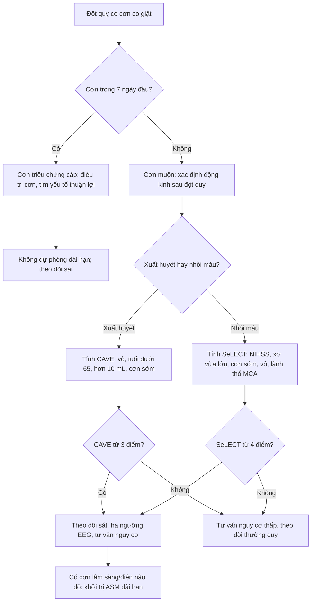
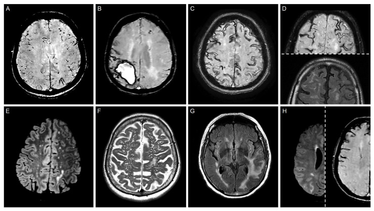
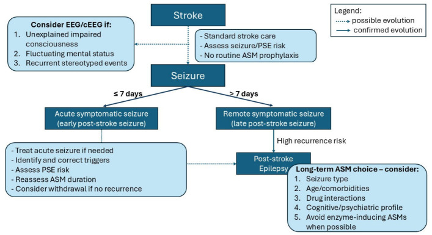

# 1868 — Động kinh sau xuất huyết não & sau nhồi máu não / Post-ICH and post-ischemic stroke epilepsy

**Tags:** `pattern:ton-thuong-vo-nao` `pattern:xuat-huyet-nao` `vung:nao` `vung:vo-nao` `anatomy:vo-nao` `protocol:MRI-dong-kinh` `score:CAVE` `score:SeLECT`

**Mức chắc chắn (certainty):** tổng hợp y văn (literature synthesis) — số liệu từ **đoàn hệ CAVE gốc** (Neurology 2014, PMID 24876089), **nghiên cứu kiểm định CAVE/CAVE2 408 ca** (BMC Neurol 2023, PMCID **PMC10729474**), **mô hình SeLECT 1.200 + 1.169 ca** (Lancet Neurol 2018, PMID 29413315), **đoàn hệ trẻ 1.388 ca ODYSSEY** (JAMA Neurol 2025, PMCID **PMC11997857**), **đoàn hệ 300 ca xuất huyết thùy não dùng thuốc chống động kinh dự phòng** (Neurocrit Care 2026, PMCID **PMC13249779**) và **tổng quan 2026** (J Clin Med, PMCID **PMC13410377**). Không có ca do nhóm tự chụp.

> **Câu chốt:** sau đột quỵ, câu hỏi hình ảnh không phải "có máu hay không" mà là **"tổn thương có chạm VỎ NÃO không"** — đó là biến số dự báo mạnh nhất và là **một trong bốn điểm của CAVE**. Ba con số quyết định: **(1)** khoảng **1/10** bệnh nhân xuất huyết não có cơn muộn; nguy cơ tích lũy **7,1%** (1 năm) → **11,8%** (5 năm), và **CAVE 4 điểm = 46,2%** so với **0,6%** ở 0 điểm (PMID 24876089); **(2)** **tổn thương vỏ não** tăng nguy cơ **OR 4,12** sau xuất huyết não và **HR 8,20** ở người trẻ, **HR 5,35** sau nhồi máu (PMC10729474, PMC11997857); **(3)** **không dự phòng thuốc chống động kinh (ASM) thường quy** cho mọi bệnh nhân — nhưng ở **xuất huyết THÙY não nguy cơ cao**, dự phòng gắn với **giảm cơn sớm 21,6% → 6,3% (aOR 0,25)** mà **không cải thiện mRS 3 tháng** (PMC13249779).

## 1. Tổng quan bệnh học – cơ chế hình ảnh (TẠI SAO)

### 1.1 Hai mốc thời gian, hai bệnh cảnh

- **Cơn triệu chứng cấp (acute symptomatic seizure, ASyS):** cơn xảy ra **≤ 7 ngày** sau đột quỵ, do **tổn thương cấp** gây co giật — **không phải động kinh**, nhưng là **yếu tố nguy cơ mạnh nhất** cho cơn muộn.
- **Động kinh sau đột quỵ (post-stroke epilepsy, PSE):** cơn **không kích thích (unprovoked)** xảy ra **> 7 ngày** sau đột quỵ; thực hành thường tính khi có **≥ 2 cơn cách > 24 giờ**, nhưng nhiều nghiên cứu dùng **1 cơn muộn** làm định nghĩa vận hành — vì vậy đọc số liệu phải xem định nghĩa.
- **Tần suất:** ASyS gặp **11,0%** (109/993) trong đoàn hệ Helsinki ICH; trong số sống qua 7 ngày, **9,2%** (70/764) có cơn muộn (PMID 24876089). Với **nhồi máu não**, nguy cơ cơn muộn là **4% sau 1 năm** và **8% sau 5 năm** (PMID 29413315).

### 1.2 TẠI SAO cơn sớm và cơn muộn có cơ chế khác nhau

- **Cơn sớm (giờ–ngày đầu):** **phá vỡ hàng rào máu–não**, **thrombin** và **hemoglobin/thoái giáng heme** gây **độc tính oxy hóa**, **rối loạn điện giải – chuyển hóa**, **mất ức chế GABA** và **dư thừa glutamate** → tế bào thần kinh **quá hưng phấn cấp**. Hình ảnh tương ứng là **máu tụ cấp/đông đặc cấp**, **phù quanh ổ** — tức là **tổn thương đang hoạt động**, không phải sẹo.
- **Cơn muộn (tuần–năm):** **hoại tử tế bào thần kinh, thay đổi mạng lưới sợi trục (axonal sprouting), tăng sinh mạch, viêm mạn, mất chọn lọc neuron ức chế** → **ổ động kinh (epileptogenesis)**. Hình ảnh tương ứng là **não mềm hóa (encephalomalacia) + viền hemosiderin trên SWI + gliosis trên FLAIR** — tức là **sẹo đã hình thành**.
- **Hệ quả thực hành:** **càng nhiều vỏ não bị tổn thương, càng nhiều mạng lưới vỏ bị tái tổ chức** → nguy cơ cơn muộn càng cao. Vì vậy **"cortical involvement"** trên CT/MRI là biến số hình ảnh quan trọng nhất, hơn cả **thể tích** ở một số mô hình.

### 1.3 Vì sao CT vẫn là cuộc thi đầu tiên (và đo gì)

- **Máu tụ cấp** tăng đậm độ (**khoảng 50–70 HU**, thay đổi theo hemoglobin), **không ngấm thuốc**, bờ rõ; **máu cũ** giảm đậm độ dần từ ngoại vi vào trong.
- **Thể tích khối máu tụ** tính bằng **ABC/2**: **V (mL) = A × B × C / 2**, với **A** = đường kính lớn nhất trên lát có khối lớn nhất, **B** = đường kính vuông góc, **C** = **số lát × độ dày lát** (cm). **Ngưỡng dùng trong CAVE là > 10 mL.**
- **"Tổn thương vỏ não" (cortical involvement)** = khối máu tụ/nồi máu **chạm tới chất xám vỏ** (không chỉ nằm ở chất trắng sâu). Đây là điểm **1 điểm** trong CAVE; biến thể **CAVE2** cho **2 điểm** vì vỏ não dự báo mạnh hơn (C-statistic **0,73 → 0,74**; PMC10729474).
- **Vị trí thùy vs sâu:** xuất huyết **thùy (lobar)** gắn với **CAA** ở người già, **nguy cơ cơn sớm** và **tái phát** cao hơn; xuất huyết **sâu (putamen, thalamus, cầu não)** ít cơn hơn nhưng không loại trừ.

### 1.4 Ngưỡng định lượng nằm lòng

| Đại lượng | Số liệu | Nguồn |
|---|---|---|
| ASyS trong xuất huyết não (≤ 7 ngày) | **11,0%** (109/993) | PMID 24876089 |
| Cơn muộn ở người sống qua 7 ngày | **9,2%** (70/764) | PMID 24876089 |
| Nguy cơ tích lũy cơn muộn sau xuất huyết não | **7,1% / 10,0% / 10,2% / 11,0% / 11,8%** (1–5 năm) | PMID 24876089 |
| Nguy cơ theo **CAVE 0–4 điểm** | **0,6% / 3,6% / 9,8% / 34,8% / 46,2%** | PMID 24876089 |
| C-statistic CAVE | **0,81** (phát triển), **0,69** (kiểm định) | PMID 24876089 |
| Cơn muộn sau xuất huyết não (đoàn hệ kiểm định 408 ca) | **12,7%** (52/408); **cortical OR 4,12**; **cơn sớm OR 3,78**; tuổi > 65 **OR 2,04**; nam **OR 2,09** | PMC10729474 |
| Nguy cơ theo CAVE **≥ 3** và **CAVE2 ≥ 3** | **47,4%** và **54,4%** | PMC10729474 |
| Cơn muộn sau nhồi máu não | **4%** (1 năm), **8%** (5 năm) | PMID 29413315 |
| SeLECT 0 điểm so với 9 điểm | **0,7%** so với **63%** (1 năm); **1,3%** so với **83%** (5 năm); C **0,77** | PMID 29413315 |
| Người trẻ 18–49 tuổi (ODYSSEY, 1.388 ca) | PSE **4,1%**; 5 năm: **3,7%** (nhồi máu) so với **7,6%** (xuất huyết); **vỏ não HR 5,35** (nhồi máu), **HR 8,20** (xuất huyết); **cơn sớm HR 10,83** | PMC11997857 |
| Xuất huyết thùy não nguy cơ cao (300 ca) | cơn sớm **14,3%**; **không dự phòng 21,6%** so với **có dự phòng 6,3%**; **aOR 0,25** (0,11–0,54); **không khác mRS 3 tháng** | PMC13249779 |
| Thể tích nhồi máu | mỗi **+10 mL** → nguy cơ PSE **+12%** | PMC13145306 |
| Huyết khối xoang tĩnh mạch não | khoảng **10%** PSE sau 2 năm (1.127 ca) | PMC13410377 |
| Thời gian dự phòng sau cơn | khởi đầu **levetiracetam** phổ biến nhất; **valproate** gắn tăng tử vong tim mạch/toàn bộ so với carbamazepine | PMC13410377 |

- **Chưa rõ — cần tra:** chưa có **ngưỡng thể tích tuyệt đối** dùng chung cho mọi mô hình (CAVE dùng **> 10 mL**, trong khi nghiên cứu thể tích nhồi máu dùng **mỗi 10 mL** là biến liên tục) → không được dùng một con số cho cả hai bệnh cảnh.

## 2. Mẫu hình + chẩn đoán phân biệt theo vị trí (Gamut)

- **Mẫu hình cần nhận diện:** **tổn thương vỏ não + di chứng** (máu tụ cấp hoặc não mềm hóa) ở bệnh nhân có cơn sau 7 ngày. Gamut chia theo **cơ chế**, không theo tên bệnh:
  - **Mạch máu – xuất huyết:** xuất huyết **thùy** (CAA, tăng huyết áp, u chảy máu), xuất huyết **sâu**, **xuất huyết chuyển dạng** trong nhồi máu, **huyết khối xoang** có xuất huyết, **máu tụ dưới màng cứng**.
  - **Mạch máu – thiếu máu:** nhồi máu **vỏ não / lãnh thổ động mạch não giữa**, nhồi máu **ổ khuyết** (ít cơn), **bệnh mạch nhỏ lan tỏa**.
  - **U:** **glioma thấp độ** (thường ở vỏ, gây cơn là triệu chứng đầu), di căn, **u mô thần kinh – thượng bì (DNET)/ganglioglioma** ở trẻ.
  - **Nhiễm – viêm:** áp-xe não, viêm não, lao, **neurocysticercosis** (vỏ, nhiều nang ở giai đoạn thoái triển).
  - **Chấn thương:** dập não vỏ, máu tụ dưới màng cứng mạn.
  - **Chuyển hóa (hình ảnh bình thường):** hạ đường huyết, hạ natri, urê huyết cao, cai rượu/benzodiazepine.
  - **Bệnh động kinh nguyên phát:** **xơ hóa hồi hải mã (hippocampal sclerosis)**, **loạn sản vỏ não khu trú (focal cortical dysplasia)** — không phải "sau đột quỵ".
- Gợi nhớ **VITAMIN**: **V**ascular, **I**nfection, **T**rauma, **A**utoimmune, **M**etabolic, **I**diopathic/genetic, **N**eoplasm.

## 3. Bảng so sánh phân biệt (ma trận đối chiếu)

| Thực thể (entity) | Hình ảnh điển hình | Chốt vào (rule-in) | Chốt loại (rule-out) | Gợi ý xác nhận |
|---|---|---|---|---|
| **Cơn triệu chứng cấp sau xuất huyết não** | Máu tụ **tăng đậm độ cấp**, phù quanh ổ, có thể **tràn máu não thất** | **Cơn trong ≤ 7 ngày + ổ máu tụ cấp tính** | **Ổ não mềm hóa/hemosiderin cũ** → là cơn muộn, không phải cấp | CT không cản quang; theo dõi 7 ngày |
| **Động kinh sau xuất huyết não (PSE)** | **Xuất huyết thùy chạm vỏ**, di chứng **gliosis + viền hemosiderin** trên SWI | **Cortical involvement + cơn sớm + thể tích > 10 mL + tuổi < 65** (CAVE) | **Xuất huyết sâu, không chạm vỏ** → CAVE thấp | CT/MRI + CAVE; EEG khi nghi |
| **Động kinh sau nhồi máu não** | **Nhồi máu vỏ não/lãnh thổ MCA**, não mềm hóa, **mất chất xám vỏ** | **Vỏ não + NIHSS cao + lớn động mạch + cơn sớm** (SeLECT); **thể tích +10 mL → +12%** | **Nhồi máu ổ khuyết sâu đơn thuần** → nguy cơ rất thấp | MRI DWI/FLAIR; SeLECT |
| **Xuất huyết chuyển dạng trong nhồi máu** | **Đốm tăng đậm độ trong vùng nhồi máu** (HI1/HI2/PH1/PH2), thường sau tái thông | **Máu trong lãnh thổ nhồi máu trên CT sau 24–48 giờ** | Máu **ngoài** lãnh thổ → nghĩ nguyên nhân khác (CAA, u) | CT/MRI; phân độ ECASS |
| **Bệnh mạch amyloid (CAA)** | **Xuất huyết thùy**, **vi xuất huyết vỏ dưới vỏ (CMB)**, **siderosis vỏ (cSS)**, **chảy máu dưới nhện lồi (cSAH)** trên SWI | **Xuất huyết thùy + cSS/CMB thùy theo tiêu chuẩn Boston v2.0** | **Xuất huyết sâu + CMB hạch nền** → bệnh mạch nhỏ tăng huyết áp | MRI SWI + T2/FLAIR |
| **Huyết khối xoang tĩnh mạch có xuất huyết** | **Nhồi máu xuất huyết hai bên/không theo lãnh thổ động mạch**, xoang tăng đậm độ trên CT, **rỗng tín hiệu trên MRV** | **Vị trí không khớp lãnh thổ + xoang tắc trên MRV** | **Tổn thương đúng một lãnh thổ động mạch** → loại | CT tĩnh mạch/MRV; D-dimer |
| **U não (glioma thấp độ, di căn)** | Khối **ngấm thuốc**, phù, có thể **chảy máu trong u**; glioma thấp độ **không ngấm thuốc**, T2 sáng, gây cơn | **Khối liên tục qua nhiều lát + ngấm thuốc/đặc tính u** | **Chỉ di chứng mạch máu đúng lãnh thổ, không khối** → loại | MRI 3T + sau tiêm; mô bệnh |
| **Trạng thái động kinh không co giật (NCSE)** | **Hình ảnh thường bình thường hoặc chỉ di chứng cũ** | **EEG liên tục: phóng điện động kinh liên tục/kịch phát** + rối loạn ý thức dao động | **EEG bình thường trong cơn nghi ngờ** → loại NCSE | cEEG 24–48 giờ |

## 4. Protocol chụp + hệ phân độ/điểm

### 4.1 Protocol hình ảnh theo thì

- **Cấp (0–7 ngày):** **CT không cản quang, lát ≤ 5 mm** — chẩn đoán xuất huyết, đo **ABC/2**, xác định **chạm vỏ**; **CTA** khi nghi phình/AVM/dò; **CTV/MRV** khi nghi huyết khối xoang. Không cần MRI thường quy chỉ để "tìm nguyên nhân cơn".
- **Bán cấp – mạn (sau 7 ngày, khi có cơn muộn):** **MRI 3T protocol động kinh** — **3D T1 1 mm** (định lượng thể tích, đánh giá teo hồi hải mã), **T2, FLAIR** (gliosis, não mềm hóa), **SWI** (hemosiderin, CMB, cSS), **DWI/ADC** (tổn thương mới), **T1 sau tiêm** khi nghi u/áp-xe.
- **Đo thể tích:** **ABC/2** với **A, B** đo trên lát lớn nhất, **C = số lát chứa máu × độ dày**; loại trừ não thất và phần máu dưới màng cứng. Với nhồi máu, dùng **thể tích DWI** (phần mềm bán tự động) — mỗi **10 mL** tăng **12%** nguy cơ PSE (PMC13145306).

### 4.2 Hai thang điểm dùng trong thực hành

**CAVE (xuất huyết não, 0–4 điểm)** — mỗi yếu tố **1 điểm**: **C**ortical involvement, **A**ge < 65, **V**olume > 10 mL, **E**arly seizure ≤ 7 ngày. Nguy cơ cơn muộn **0,6% / 3,6% / 9,8% / 34,8% / 46,2%** ứng với **0–4 điểm**.

**CAVE2** — vỏ não tính **2 điểm**; nguy cơ theo điểm **≤ 1 / 2 / ≥ 3** là **4,6% / 18,3% / 54,4%**; C-statistic **0,74** so với **0,73** của CAVE (PMC10729474).

**SeLECT (nhồi máu não, 0–9 điểm)** — **S**everity (NIHSS), **L**arge-artery atherosclerosis, **E**arly seizure, **C**ortical involvement, **T**erritory MCA. **0 điểm = 0,7%/1 năm**, **9 điểm = 63%/1 năm (83%/5 năm)**; C **0,77** (PMID 29413315). Biến thể **SeLECT 2.0** tách **cơn sớm ngắn** khỏi **trạng thái động kinh cấp** (tiên lượng nặng hơn).

### 4.3 Điều trị dự phòng: điều gì đã có bằng chứng

- **Không dự phòng ASM tiên phát cho mọi bệnh nhân đột quỵ** — dữ liệu hiện có **không chứng minh ASM ngăn được PSE** (PMC13410377).
- **Ngoại lệ đang được nghiên cứu:** ở **xuất huyết THÙY não nguy cơ cao** (thùy + tuổi < 65 + thể tích ≥ 10 mL), dự phòng gắn với **giảm cơn sớm 21,6% → 6,3%** (**aOR 0,25**; 0,11–0,54; p = 0,0005) nhưng **không cải thiện mRS 3 tháng** — đây là **dữ liệu quan sát**, chưa phải chỉ định chính thức (PMC13249779).
- **Khi đã có cơn muộn:** **khởi trị ASM dài hạn**, chọn theo **loại cơn, tuổi, bệnh nền, tương tác thuốc**; **levetiracetam** được dùng khởi đầu phổ biến nhất trong dữ liệu Thụy Điển; **tránh ASM cảm ứng enzym** khi bệnh nhân dùng **DOAC/statin**; **valproate** gắn tăng tử vong tim mạch (PMC13410377).
- **Theo dõi:** **EEG** khi ý thức dao động, cơn lặng lẽ, hoặc sau cơn sớm; **cEEG** khi nghi **NCSE** (bài 1987).

## 5. Biến thể bình thường và cạm bẫy

- **Đọc "chạm vỏ" quá tay:** khối máu tụ **sát vỏ nhưng còn lớp chất trắng** giữa u và vỏ **không** tính là cortical involvement; ngược lại, **máu tụ thùy nhỏ nhưng phá vỏ** vẫn tính — luôn đọc **nhiều mặt phẳng**, không chỉ lát lớn nhất.
- **Đo thể tích sai:** gộp **máu trong não thất** hoặc **dịch dưới màng cứng** vào khối; đo **A/B trên lát khác nhau**; quên nhân **độ dày lát** → CAVE bị đẩy lên ngưỡng **> 10 mL** oan.
- **Cơn do chuyển hóa:** **hạ đường huyết, hạ natri, urê cao, cai rượu** có thể gây cơn với **hình ảnh bình thường** hoặc chỉ di chứng cũ — đừng gán PSE trước khi sửa điện giải/đường huyết.
- **CAA: "siderosis giả" và nhiễu SWI:** **mạch máu nền sọ, vôi hóa, khí** tạo đốm tối trên SWI; **cSS thật** nằm **trên bề mặt hồi não** và đi kèm **CMB thùy**. Ở người già có xuất huyết thùy, **SWI là chuỗi bắt buộc** để phân biệt CAA với bệnh mạch nhỏ tăng huyết áp.
- **"Cơn lúc chụp CT":** bệnh nhân co giật trong lúc chụp → **giả ảnh do cử động** giả **xuất huyết/SAH**; chụp lại hoặc đối chiếu MRI trước khi kết luận.
- **Bẫy thỏa mãn tìm kiếm:** thấy **ổ xuất huyết cũ** rồi dừng, bỏ **u glioma thấp độ** hoặc **loạn sản vỏ** ở bệnh nhân trẻ có cơn — cần **MRI 3T có T1 1 mm + FLAIR** trước khi kết luận "di chứng mạch máu".
- **ASyS không phải động kinh nhưng không được xem nhẹ:** **HR 10,83** cho cơn muộn sau nhồi máu ở người trẻ (PMC11997857) — đây là lý do phải **hẹn theo dõi**, dù chưa dùng thuốc dài hạn.

## 6. Tự lượng giá — Blind Quiz

**Ca 1 — Nam 72 tuổi, cơn co giật cục bộ hóa toàn thể 1 năm sau "tai biến"; MRI sọ có SWI. Panel B là tổn thương đang được hỏi.**

- Gợi ý: không tăng huyết áp, không rối loạn đông máu; tổn thương **thùy đỉnh phải**, xung quanh có **đường tối mảnh trên bề mặt hồi não** và vài **đốm tối nhỏ** ở thùy trán trái.
- Câu hỏi: mô tả panel B? Ba chẩn đoán phân biệt? Dấu hiệu nào giúp phân tầng nguy cơ cơn tái phát?

<b>Bấm để hiện đáp án (findings + chẩn đoán)</b>

- Dấu hiệu: **(B)** **xuất huyết thùy đỉnh phải giai đoạn bán cấp muộn** trên SWI, kèm **siderosis vỏ (cSS)** quanh ổ và **vi xuất huyết (CMB) thùy trái**; **(C)** cSS lan tỏa dạng đường tối theo hồi não; **(A)** CMB thùy đơn thuần.
- Chẩn đoán: **xuất huyết thùy do bệnh mạch amyloid (CAA)** — tổn thương **chạm vỏ** nên nguy cơ cơn muộn cao (**cortical involvement HR 8,20** ở người trẻ; OR 4,12 ở người lớn), và **cSS/CMB thùy** làm tăng nguy cơ **tái phát xuất huyết**.
- Phân biệt: **bệnh mạch nhỏ tăng huyết áp** (xuất huyết sâu, CMB hạch nền), **u chảy máu** (khối ngấm thuốc), **huyết khối xoang** (vị trí không theo lãnh thổ, xoang tắc trên MRV).
- Phân tầng: tính **CAVE** (vỏ + tuổi + thể tích + cơn sớm) và **theo dõi EEG** nếu ý thức dao động.
- Nguồn ảnh: *Life* 2025 (PMC12565732), Hình 2, CC BY 4.0.

**Ca 2 — Cùng bệnh nhân, câu hỏi quyết định: có nên dùng thuốc chống động kinh dự phòng ngay khi chưa có cơn?**

- Câu hỏi: đọc sơ đồ; khi nào **không** dự phòng? Khi nào khởi trị dài hạn? Ba yếu tố cần cân nhắc khi chọn thuốc?

<b>Bấm để hiện đáp án</b>

- **Không dự phòng thường quy** cho mọi bệnh nhân đột quỵ, kể cả khi CAVE/SeLECT cao — điểm số dùng để **theo dõi sát, hạ ngưỡng EEG, tư vấn**, không phải chỉ định thuốc tự động.
- **Khởi trị dài hạn** khi có **cơn muộn (động kinh sau đột quỵ)** hoặc **cơn lâm sàng/điện não đồ rõ**; sau **cơn sớm đơn thuần**, cân nhắc ngắn hạn rồi đánh giá lại.
- Chọn thuốc: **loại cơn**, **tuổi/bệnh nền**, **tương tác thuốc** (tránh ASM cảm ứng enzym với DOAC/statin), **hồ sơ nhận thức – tâm thần**; **levetiracetam** hay dùng trong giai đoạn cấp, **lamotrigine** có dữ liệu tử vong thấp hơn carbamazepine, **valproate** gắn tăng tử vong tim mạch.
- Nguồn ảnh: *J Clin Med* 2026 (PMC13410377), Hình 2, CC BY 4.0.

> Không dùng để chẩn đoán độc lập khi chưa có người hướng dẫn.

## Bài liên quan chéo
- [211 – Đột quỵ não: nhồi máu và phân vùng lãnh thổ](../211-dot-quy-nao/lesson.md)
- [212 – Xuất huyết dưới nhện: phân độ và biến chứng](../212-xuat-huyet-so-nao/lesson.md)
- [1948 – Co giật & động kinh sau huyết khối xoang tĩnh mạch não](../1948-co-giat-dong-kinh-huyet-khoi-xoang/lesson.md)
- [1987 – Trạng thái động kinh không co giật sau đột quỵ ở trẻ](../1987-dong-kinh-khong-co-giat-sau-dot-quy-tre/lesson.md)

## Ảnh
- `1868_dong-kinh-sau-dot-quy_MRI_PMC12565732-fig2.jpg` — dấu hiệu MRI của CAA (CMB thùy, xuất huyết thùy, cSS, cSAH), PMC12565732, CC BY 4.0.
- `1868_dong-kinh-sau-dot-quy_SoDo_PMC13410377-fig2.jpg` — khung xử lý cơn sau đột quỵ, PMC13410377, CC BY 4.0.
