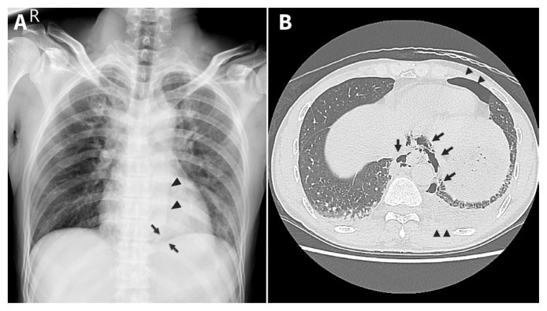
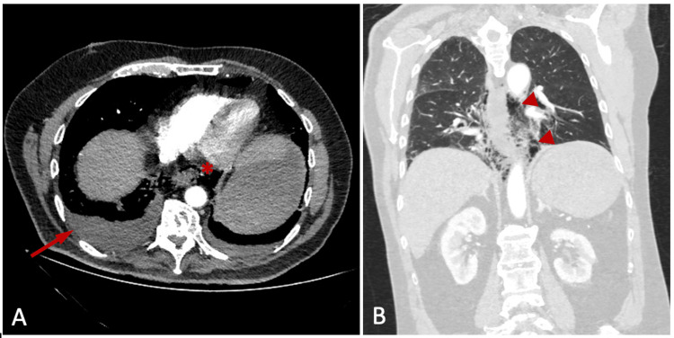
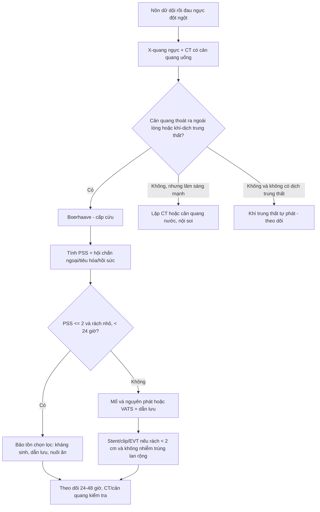
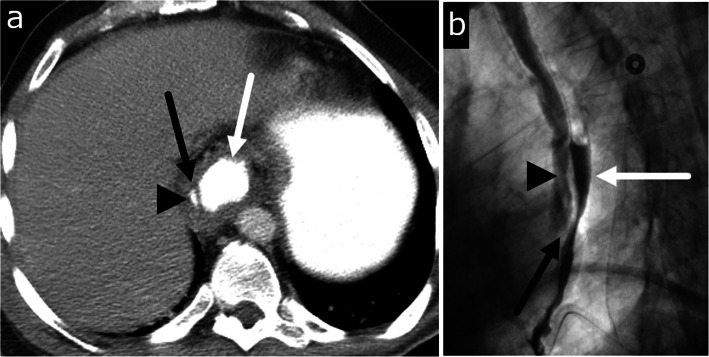
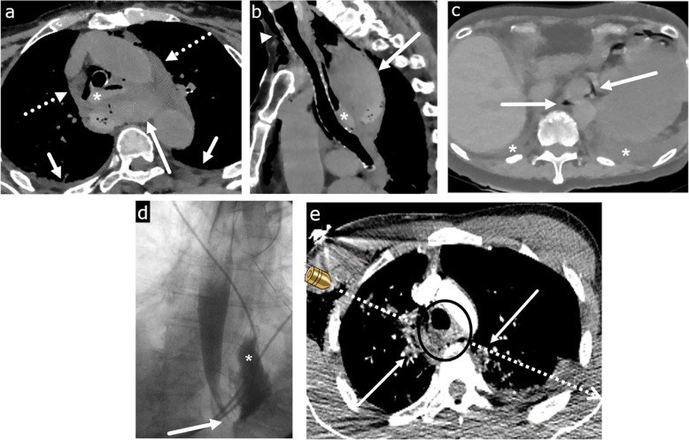
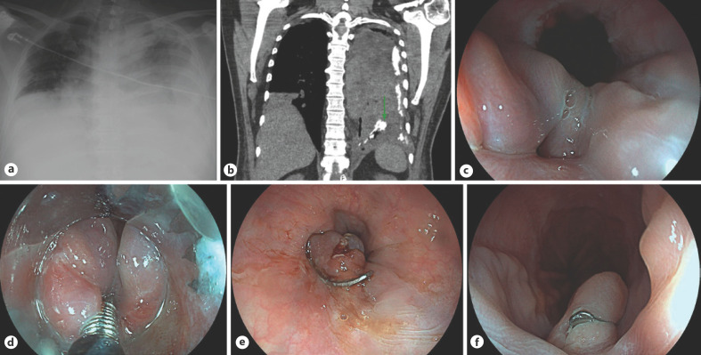

# 1869 — Vỡ thực quản tự phát (Boerhaave syndrome)

**Tags:** `pattern:khi-trung-that` `pattern:ro-thuc-quan` `pattern:tran-dich-mang-phoi` `vung:trung-that` `vung:thuc-quan` `vung:mang-phoi` `protocol:CT-nguc-cang-quang` `protocol:can-quang-thuc-quan` `protocol:noi-soi-thuc-quan` `score:Pittsburgh`

**Mức chắc chắn (certainty):** tổng hợp y văn (literature synthesis) — dựa trên **1 tổng quan tự sự 2025** (PMC12524210, CC BY), **1 loạt 21 ca trung tâm tuyến ba** (PMC11933238, CC BY), **1 tổng quan kỹ thuật xâm lấn tối thiểu 48 ca** (PMID 32944354), **1 tổng quan hệ thống 2024** (PMID 39092389), và **4 ca nguyên văn có ảnh** (PMC10928871, PMC8486476, PMC10666923, PMC7547061). Không có thử nghiệm ngẫu nhiên; mọi ngưỡng xử trí là dữ liệu hồi cứu/đồng thuận.

> **Câu chốt:** vỡ thực quản tự phát là **cấp cứu trung thất do áp lực**, không phải "đau ngực do nôn". Ba số phải thuộc: **3,1 ca/1 triệu người/năm**, chiếm tới **15%** cấp cứu thực quản; **90%** rách ở **thành trái đoạn dưới**, dài trung bình **2,2–3,3 cm**; tử vong **30–90%** khi muộn nhưng chỉ **6,2%** khi chẩn đoán trong **24 giờ đầu**. Chìa khóa hình ảnh: **CT ngực có cản quang uống, độ nhạy 92–100%** — không chờ "tam chứng Mackler" vì tam chứng đầy đủ gặp **< 15%**.

## 1. Tổng quan bệnh học – cơ chế hình ảnh (TẠI SAO)

### 1.1 Cơ chế "ống kín": áp lực trong lòng vượt sức chịu của thành sau–trái

- Nôn dữ dội tạo tình huống **ống kín**: cơ nhẫn hầu và cơ hoành cùng co, không mở kịp → áp lực trong lòng thực quản vọt lên **~200 mmHg** (thực nghiệm trên thực quản tươi; tương đương cơn co thắt "nutcracker") trong vài giây.
- Thành **sau–trái đoạn 1/3 dưới** là điểm yếu nhất vì: **(a)** lớp cơ dọc mỏng hơn, **(b)** có lỗ xuyên của mạch–thần kinh, **(c)** không có mô tạng đỡ phía sau, **(d)** thực quản gập góc khi qua trụ hoành trái. Vì vậy **~90%** vỡ ở **thành trái đoạn dưới**, sát tâm vị; vết rách toàn thành, dài trung bình **2,2–3,3 cm** (khoảng **1–8 cm**).
- Khác biệt cốt lõi với **hội chứng Mallory–Weiss**: Mallory–Weiss chỉ rách **niêm mạc** ở tâm vị, **không thủng thành**, nên **không có khí/dịch trung thất** và không gây viêm trung thất; Boerhaave là **rách toàn thành** → khoang trung thất tiếp xúc trực tiếp với vi khuẩn và dịch tiêu hóa.

### 1.2 TẠI SAO khí và dịch đi vào trung thất — rồi vào màng phổi

- Trong thì nôn, **áp lực trong lòng thực quản dương** trong khi **áp lực lồng ngực âm** → chênh áp **> 100 mmHg** đẩy khí + dịch tiêu hóa qua lỗ rách vào trung thất sau chỉ trong **vài giây**.
- Khí lan theo **hiệu ứng Macklin**: khí thoát từ đường thở/thực quản đi dọc **vỏ bọc mạch–phế quản (bronchovascular bundle)** vào trung thất, rồi lên cổ (khí dưới da) và xuống sau phúc mạc. Đây là lý do **khí trung thất đơn thuần không đặc hiệu** — cùng cơ chế gặp trong hen, ho mạnh, thở máy.
- Dịch tiêu hóa gây **viêm trung thất hóa học + nhiễm khuẩn đa loài** (liên cầu viridans, *Klebsiella*, *E. coli*, *S. aureus*): sốt, đau ngực, nhiễm khuẩn huyết thường trong **24–48 giờ**. Màng phổi trái bị nhiễm vì thực quản đoạn dưới áp sát màng phổi trái → **tràn dịch/tràn khí màng phổi trái** là dấu gián tiếp kinh điển; tràn phải cũng gặp (nhất là khi rách lan sang phải hoặc qua trung thất).
- **Vật lý hình ảnh:** khí **−1.000 HU** (đen tuyệt đối), dịch **0–20 HU**, cản quang uống **100–300 HU**. Vì vậy trên CT, **giọt cản quang ngoài lòng thực quản** là bằng chứng trực tiếp của lỗ thủng, còn **khí + dịch + đám thâm nhiễm mỡ trung thất** là bằng chứng gián tiếp. X-quang chỉ thấy khí khi đã đủ lớn để tạo **dải khí sau tim** hoặc **liềm khí dưới da** — đó là lý do X-quang **âm tính không loại trừ**.

### 1.3 Ngưỡng định lượng trụ cột

| Biến số | Số liệu | Nguồn |
|---|---|---|
| Tần suất | **3,1 ca/1 triệu người/năm**; tới **15%** cấp cứu thực quản | PMC12524210; PMC13221768 |
| Giới / tuổi | Nam:nữ **2:1–5:1**; đỉnh **thập niên 6–7** | PMC12524210 |
| Vị trí | **90%** thành trái đoạn dưới; **96%** tổn thương ở thực quản xa (loạt phẫu thuật nội soi) | PMC12524210; PMID 32944354 |
| Kích thước rách | trung bình **2,2–3,3 cm** (1–8 cm) | PMC12524210 |
| Tử vong chung | **30–90%** tùy nguồn; **> 50%** nếu chẩn đoán muộn **> 24 giờ** | PMC12524210; PMC13221768 |
| Tử vong khi chẩn đoán sớm | **6,2%** nếu can thiệp trong **24 giờ**; sống **~75%** | PMC12524210 |
| Khí dưới da | có ở **~60%** ca | PMC13221768 |
| Tam chứng Mackler đầy đủ | **< 15%** ca | PMC13221768 |
| Dấu Naclerio chữ V trên X-quang | **~20%** ca | PMC12524210 |
| CT ngực có cản quang uống | độ nhạy **92–100%** | PMC12524210 |
| Cản quang uống (X-quang) | bỏ sót **22–50%** với thuốc tan trong nước; **10–20%** với barium | PMC12524210 |
| Loạt 21 ca tuyến ba | **62%** chẩn đoán < 24 giờ; tử vong 90 ngày **14%** (muộn **38%** vs sớm **0%**, p = 0,042); nằm viện trung vị **32 ngày** | PMC11933238 |
| Loạt nội soi lồng ngực hỗ trợ | tử vong **8,3%**, biến chứng **64,5%** (viêm phổi 42%, mủ màng phổi 26%, rò 19%) | PMID 32944354 |
| Điểm Pittsburgh (PSS) | tử vong **3,2%** (PSS ≤ 2), **7%** (PSS 3–5), **37,5%** (PSS ≥ 5) | PMC12524210 |

*(A) X-quang ngực: dải khí viền bờ trung thất trái dưới, tạo hình chữ V (mũi tên), kèm các vệt khí cạnh động mạch chủ xuống trên cơ hoành trái (đầu mũi tên) — dấu Naclerio. (B) CT ngực: khí trung thất lan quanh thực quản và động mạch chủ (mũi tên), tràn khí màng phổi hai bên (đầu mũi tên). Nguồn: Chew FY, Yang ST; CMAJ 2021; Fig. 1 — PMC8486476, CC BY-NC-ND (nguyên bản, không crop).*

## 2. Mẫu hình + chẩn đoán phân biệt theo vị trí (Gamut)

- **Khí trung thất sau (posterior mediastinum):** Boerhaave · thủng thực quản do nội soi/đặt stent/dị vật · rò thực quản do xạ hoặc u · thủng khí quản–phế quản · khí trung thất tự phát (hen, ho, thở máy — hiệu ứng Macklin) · viêm trung thất sinh khí do vi khuẩn.
- **Tràn dịch/tràn khí màng phổi trái sau nôn:** Boerhaave (kinh điển) · áp-xe phổi vỡ · thủng dạ dày–thực quản · tràn khí do thở máy · hội chứng Mallory–Weiss (chỉ thiếu máu, **không** khí trung thất).
- **Đau ngực + sốc sau nôn:** Boerhaave · nhồi máu cơ tim · bóc tách động mạch chủ · thuyên tắc phổi · viêm tụy cấp · thủng ổ loét dạ dày–tá tràng.
- **Khí trong trung thất nhưng không có dịch/không nhiễm trùng:** khí trung thất tự phát lành tính — **không đau kiểu xé, không sốt, không tràn dịch**; điều trị hỗ trợ.
- Gợi nhớ **VOMIT**: **V**omiting (nôn) · **O**esophageal leak (rò thực quản) · **M**ediastinitis (viêm trung thất) · **I**ntubated/iatrogenic (can thiệp) · **T**horacic pain (đau ngực). Nhưng quan trọng hơn mnemonic: **bối cảnh nôn dữ dội + đau ngực đột ngột = phải loại trừ Boerhaave bằng CT có cản quang uống**, không dựa vào tam chứng.

## 3. Bảng so sánh phân biệt (ma trận đối chiếu)

| Thực thể (entity) | Hình ảnh điển hình | Chốt vào (rule-in) | Chốt loại (rule-out) | Gợi ý xác nhận |
|---|---|---|---|---|
| **Boerhaave (vỡ tự phát)** | Khí trung thất sau + **tràn dịch/tràn khí màng phổi trái**; CT có **cản quang thoát ra ngoài lòng** ở thực quản dưới; thành thực quản dày, ổ dịch cạnh thực quản | **Nôn dữ dội → đau ngực đột ngột + khí trung thất + cản quang thoát ra ở đoạn dưới** | Không có cản quang thoát ra, không dịch trung thất, khí khu trú trước trung thất → nghĩ khí tự phát | CT ngực có cản quang uống (độ nhạy 92–100%); nội soi khi cần |
| **Thủng do can thiệp (iatrogenic)** | Tổn thương **đúng vị trí dụng cụ** (nội soi, TEE, nong, stent); khí + máu tụ trung thất, có thể **không tràn dịch sớm** | **Tiền sử thủ tục trong 24 giờ + khí/dịch tại chỗ can thiệp** | Không can thiệp, rách thành trái đoạn dưới sau nôn → nghĩ Boerhaave | CT + nội soi; so kế hoạch thủ thuật |
| **Mallory–Weiss** | **Rách niêm mạc** ở tâm vị; **không khí trung thất, không dịch trung thất**; nội soi thấy vết rách dọc | **Nôn ra máu + không khí trung thất + nội soi thấy rách niêm mạc** | Có khí trung thất/dịch trung thất → **không** phải Mallory–Weiss đơn thuần | Nội soi tiêu hóa trên |
| **Bóc tách nội thành thực quản (intramural dissection)** | CT: **vạt nội thành (flap)** giữa lòng thật và lòng giả; cản quang barium cho **hai lòng song song**; **không có khí/dịch trung thất tự do** | **Vạt nội thành rõ + hai lòng + không thoát cản quang ra ngoài** | Cản quang thoát tự do ra trung thất → thủng toàn thành | CT lát mỏng + barium (nếu CT chưa rõ) |
| **Khí trung thất tự phát (Macklin)** | Khí **khu trú trước trung thất/dọc phế quản**, **không dịch màng phổi**, không ổ dịch trung thất; bệnh nhân tỉnh, không sốt | **Khí trung thất + không dịch + không nhiễm trùng + bối cảnh hen/ho/thở máy** | Có dịch/ổ khí–dịch cạnh thực quản, sốt → nghĩ thủng | CT không cản quang uống; theo dõi 24–48 giờ |
| **Thủng do u hoặc rò do xạ** | Khối u/hẹp lan tỏa trong trường xạ; rò ở **bờ u** hoặc vùng chiếu; hạch hoại tử | **Khối u rõ/hẹp + tiền sử xạ + rò tại chỗ** | Thành trái đoạn dưới, không khối, sau nôn → Boerhaave | CT + nội soi + sinh thiết |
| **Nhồi máu cơ tim / bóc tách ĐMC** | Không khí trung thất; ĐMC có **vạt nội mạc**, tràn dịch màng tim; ECG ST chênh | **Vạt nội mạc/ST chênh + không khí trung thất** | Khí trung thất + cản quang thoát ra → loại | ECG, troponin, CTA |

*(A) Lát trục cửa sổ trung thất: khí tự do trong trung thất (mũi tên đỏ nhỏ) và tràn dịch màng phổi hai bên, nhiều bên trái (mũi tên đỏ dài). (B) Lát trục: khí lan theo trục dọc quanh thực quản và động mạch chủ (đầu mũi tên). Nguồn: Totsi A, Fortounis K, Michailidou S, Balasas N, Papavasiliou C; Cureus 2023; Fig. 1 — PMC10666923, CC BY.*

## 4. Protocol chụp + hệ phân độ/ngưỡng xử trí

### 4.1 Thứ tự chẩn đoán (quan trọng hơn thông số)

1. **X-quang ngực thẳng + nghiêng tại giường** (không chờ): tìm **tràn dịch/tràn khí màng phổi**, **khí trung thất**, **dấu Naclerio chữ V**, khí dưới da cổ. X-quang **âm tính không loại trừ**.
2. **CT ngực có cản quang tĩnh mạch + uống cản quang tan trong nước**, lát **1–1,5 mm**, cửa sổ trung thất + phổi: đây là **chuẩn vàng** (độ nhạy **92–100%**). Đọc 4 điểm: **(a)** cản quang ngoài lòng thực quản; **(b)** khí/ổ khí–dịch trung thất sau; **(c)** dày thành thực quản, mất liên tục thành; **(d)** tràn dịch/tràn khí màng phổi, đông đặc phổi.
3. **Cản quang thực quản bằng thuốc tan trong nước** nếu CT chưa rõ và bệnh nhân ổn định: chứng minh đường rò, đánh giá chiều dài/lưu lượng. **Không dùng barium đầu tiên** (viêm trung thất hóa học); nếu vẫn nghi và cản quang nước âm tính, có thể lặp bằng barium vì **bỏ sót 22–50%** với thuốc nước.
4. **Nội soi thực quản** khi cần xác định vị trí/kích thước để đặt stent/clip hoặc loại trừ u — **bơm hơi tối thiểu, ưu tiên CO₂**, vì bơm mạnh làm rò to và tăng tràn khí trung thất.
5. **CTA ngực** nếu có **ho ra máu/herald bleed** hoặc tổn thương sát động mạch chủ (loại trừ rò thực quản–động mạch chủ).

### 4.2 Điểm Pittsburgh (Pittsburgh Perforation Severity Score, PSS) — 2009, tối đa 18 điểm

- **10 biến số**, mỗi biến **1–3 điểm**: tuổi, nhịp tim, số lượng bạch cầu, **tràn dịch màng phổi**, sốt, tụt huyết áp, **rò thực quản không kiểm soát**, **thời gian từ lúc thủng**, suy hô hấp, ung thư kèm theo.
- **Ngưỡng tiên lượng (Schweigert):** PSS **≤ 2 → tử vong 3,2%**; **3–5 → 7%**; **≥ 5 → 37,5%**. PSS dùng để chọn đường điều trị, không thay thế đánh giá lâm sàng.

### 4.3 Nguyên tắc xử trí theo thời gian và mức nhiễm trùng

- **< 24 giờ, ổn định, rách nhỏ, không nhiễm trùng trung thất nặng:** có thể **điều trị bảo tồn có chọn lọc** (nhịn ăn, kháng sinh phổ rộng, dẫn lưu màng phổi/trung thất, nuôi ăn qua sonde hoặc mở dạ dày) — nhưng **phải theo dõi sát 24–48 giờ**, và **không áp dụng** cho rách lớn, nhiễm trùng, rò không kiểm soát.
- **Rách lớn, nhiễm trùng trung thất, PSS cao:** **mổ** — vá nguyên phát có/không gia cố (mạc nối, màng phổi), **dẫn lưu trung thất + hai khoang màng phổi**, mở dạ dày/jejunostomy nuôi ăn; **VATS** là lựa chọn ở trung tâm có kinh nghiệm (75% ca trong tổng quan; tử vong **8,3%**, nhưng biến chứng **64,5%**).
- **Điều trị nội soi:** **stent toàn phần có màng (fully covered SEMS)**, **clip qua nội soi (OTSC)**, **liệu pháp hút chân không nội soi (EVT)** — thay băng **3–4 ngày/lần**; hợp nhất cho rách **< 2 cm**, không nhiễm trùng trung thất lan rộng. Stent có biến chứng **37%** (rò 16%, di trú 16%, chảy máu 5%) trong loạt 21 ca.
- **Luôn phối hợp:** kháng sinh phổ rộng (Gram âm + kỵ khí), kiểm soát đau, hồi sức, **nuôi ăn sớm bằng đường tiêu hóa nếu có thể** (giảm nhiễm trùng và thời gian nằm viện).

## 5. Biến thể bình thường và cạm bẫy

- **Khí trong thực quản là bình thường** khi bệnh nhân nuốt khí (aerophagia), sau nội soi, hoặc ở người thở máy; **chỉ có giá trị khi khí nằm ngoài lòng, trong trung thất, kèm dịch/ổ khí–dịch**.
- **X-quang ngực bình thường** không loại trừ: dấu Naclerio chỉ có **~20%**; khí dưới da xuất hiện muộn (cần thời gian lan lên cổ) và chỉ **~60%**.
- **Tam chứng Mackler đầy đủ < 15%** → chờ đủ tam chứng là chờ tử vong. Bệnh nhân lớn tuổi, đái tháo đường, nghiện rượu có thể **không sốt, không đau dữ dội** ("biểu hiện mờ").
- **Bẫy "satisfaction of search":** thấy tràn dịch màng phổi trái rồi dừng ở "viêm phổi/tràn dịch" — bỏ sót khí trung thất và lỗ rách. Luôn đọc **cửa sổ trung thất** và **truy vết thực quản** trên mọi CT ngực có tràn dịch không giải thích.
- **Bóc tách nội thành thực quản** (ảnh dưới) là bắt chước khó: bệnh nhân **đau ngực sau nôn**, CT thấy **vạt nội thành + hai lòng**, nhưng **không có cản quang thoát tự do** — điều trị khác (nhịn ăn, kháng sinh, theo dõi), **không mổ như thủng toàn thành**.
- **Thủng do can thiệp** (ảnh dưới): khí + **máu tụ trung thất** tại chỗ dụng cụ, có thể **không tràn dịch sớm**; tiền sử thủ thuật là chốt định hướng, nhưng **vẫn phải chứng minh bằng cản quang thoát ra**.
- **Đừng bỏ sót rò thực quản–động mạch chủ:** **herald bleed** (nôn ra máu nhỏ) rồi chảy máu ồ ạt; CTA là bắt buộc trước khi nội soi thường quy.
- **Barium đầu tiên** khi nghi thủng là sai lầm: gây viêm trung thất hóa học, khó rửa; **luôn bắt đầu bằng thuốc tan trong nước**.

*(a) CT trục: vạt nội thành (mũi tên) giữa lòng thật (đầu mũi tên) và lòng giả (mũi tên trắng) ở thực quản dưới. (b) Barium: hai lòng song song với khuyết vạt (mũi tên đen) — dấu "double barrel". Đây là bóc tách nội thành, không phải thủng toàn thành. Nguồn: Masarapu V, Xia E, Son H; Insights Imaging 2020; Fig. 9 — PMC7547061, CC BY.*

*(a) CT trục và (b) CT đứng dọc: thực quản trên giãn, chứa máu (dấu hoa thị), liền với **khối máu tụ sau** có nhiều ổ khí (mũi tên dài); tràn khí–máu trung thất lan rộng (mũi tên đứt). Bối cảnh: nữ 80 tuổi đau ngực sau siêu âm tim qua thực quản. Nguồn: Masarapu V, Xia E, Son H; Insights Imaging 2020; Fig. 2 — PMC7547061, CC BY.*

## 6. Tự lượng giá — Blind Quiz

**Ca 1 — Nam trung niên, nôn dữ dội rồi đau ngực–bụng trên, sốt, khó thở. X-quang và CT dưới đây.**

- Câu hỏi: (1) X-quang (a) cho thấy gì? (2) CT (b) chứng minh điều gì bằng cản quang uống? (3) Nội soi (c–f) cho thấy gì và xử trí ra sao?

<b>Bấm để hiện đáp án (findings + chẩn đoán)</b>

- **Findings:** (a) **tràn khí–dịch màng phổi trái** hoàn toàn, trung thất bị đẩy sang phải; (b) CT cổ–ngực: **cản quang uống thoát ra ngoài lòng thực quản dưới** (mũi tên), khí trung thất, tràn dịch hai bên; (c–f) nội soi: **lỗ thủng thành bên thực quản dưới**, bờ niêm mạc rách, sau đó **đặt clip qua nội soi (OTSC)** đóng kín.
- **Chẩn đoán:** **Boerhaave** — vỡ toàn thành thực quản dưới sau nôn; xử trí: hồi sức, kháng sinh, dẫn lưu màng phổi, đóng lỗ thủng bằng **OTSC** (hoặc stent có màng) khi rách nhỏ và không nhiễm trùng lan rộng.
- **Vì sao:** cản quang thoát ra ngoài lòng là bằng chứng trực tiếp; khí trung thất + tràn dịch trái là dấu gián tiếp. Nguồn ảnh: Estorninho J, Pimentel R, Gravito-Soares M, Gravito-Soares E, Amaro P, Figueiredo P; GE Port J Gastroenterol 2023; Fig. 1 — PMC10928871, CC BY-NC.

**Ca 2 — Nữ 80 tuổi, đau ngực sau siêu âm tim qua thực quản (TEE). CT ngực dưới đây.**

- Câu hỏi: (1) Bất thường chính ở trung thất sau? (2) Vì sao đây là thủng do can thiệp chứ không phải Boerhaave? (3) Cần làm gì tiếp?

<b>Bấm để hiện đáp án</b>

- **Findings:** thực quản trên giãn, **chứa máu**; **khối máu tụ sau thực quản có nhiều ổ khí**; **tràn khí–máu trung thất** lan rộng; tràn dịch màng phổi hai bên ít.
- **Chẩn đoán:** **thủng thực quản do can thiệp (iatrogenic)** sau TEE — vị trí đúng nơi đặt đầu dò, có **máu tụ** (do tổn thương mạch nhỏ) nhiều hơn dịch tiêu hóa.
- **Xử trí:** hội chẩn ngoại/tiêu hóa ngay, kháng sinh phổ rộng, dẫn lưu trung thất/màng phổi; nội soi đánh giá lỗ thủng, cân nhắc stent/clip hoặc mổ. **Không** chờ đủ tam chứng.
- **Nguồn ảnh:** Masarapu V, Xia E, Son H; Insights Imaging 2020; Fig. 2 — PMC7547061, CC BY.

**Ca 3 — Nam 51 tuổi, đau ngực lan ra lưng sau nôn mạnh. CT và barium dưới đây.**

- Câu hỏi: (1) Dấu hiệu trên CT (a)? (2) Barium (b) xác nhận gì? (3) Chẩn đoán và thái độ điều trị khác Boerhaave ở đâu?

<b>Bấm để hiện đáp án</b>

- **Findings:** (a) **vạt nội thành** giữa **lòng thật** và **lòng giả** ở thực quản dưới; (b) barium cho **hai lòng song song** với khuyết vạt — dấu "double barrel"; **không có cản quang thoát tự do** ra trung thất.
- **Chẩn đoán:** **bóc tách nội thành thực quản (esophageal intramural dissection)** — tổn thương nội thành, **không thủng toàn thành**. Điều trị: nhịn ăn, kháng sinh, giảm đau, theo dõi; can thiệp chỉ khi thủng/thắt hẹp — **không mổ như Boerhaave**.
- **Nguồn ảnh:** Masarapu V, Xia E, Son H; Insights Imaging 2020; Fig. 9 — PMC7547061, CC BY.

## Bài liên quan chéo
- [061 – Tràn khí trung thất](../061-tran-khi-trung-that/lesson.md) (khí trung thất đơn thuần và hiệu ứng Macklin)
- [1844 – Rò và hoại tử thực quản do xạ](../1844-ro-hoai-tu-thuc-quan-do-xa/lesson.md) (rò thực quản không do nôn; ngưỡng liều xạ)
- [040 – Tràn dịch màng phổi](../040-tran-dich-mang-phoi/lesson.md) (phân biệt dịch màng phổi – cổ trướng, dấu crus lệch)
- [649 – Khí trung thất hoại tử và sinh khí ở trẻ](../649-khi-trung-that-hoai-tu-va-sinh-khi-o-tre/lesson.md) (bối cảnh nhi khoa)

> Không dùng để chẩn đoán độc lập khi chưa có người hướng dẫn.
