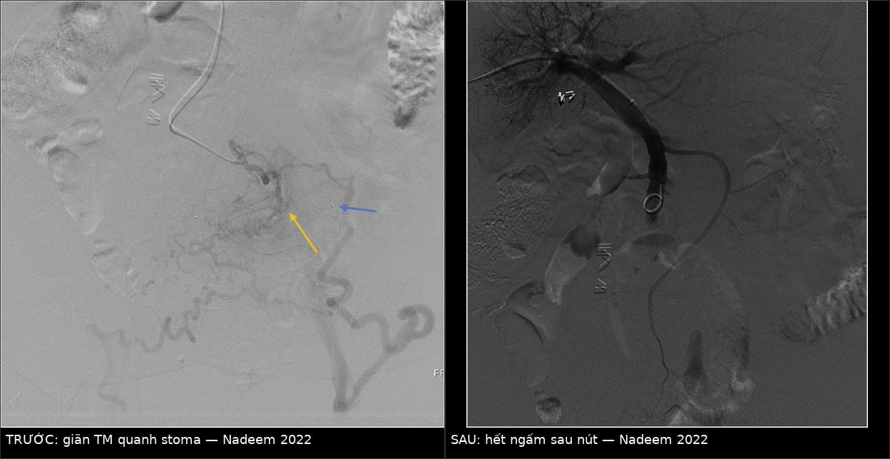
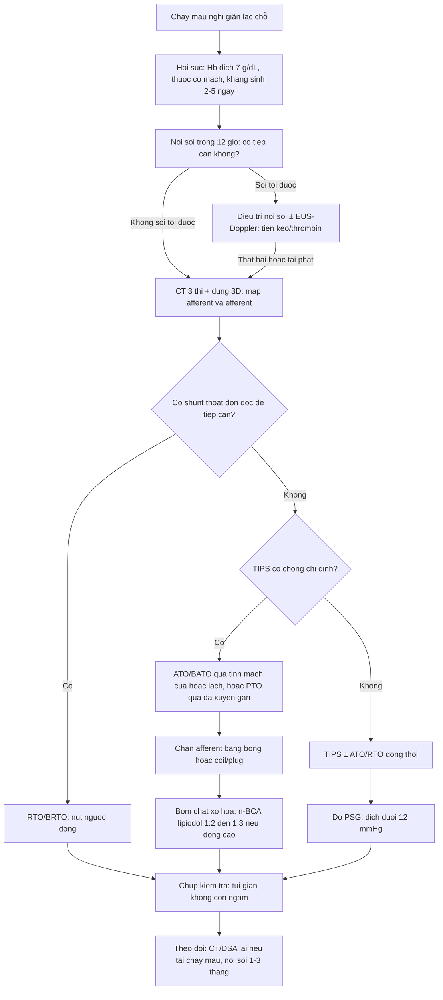
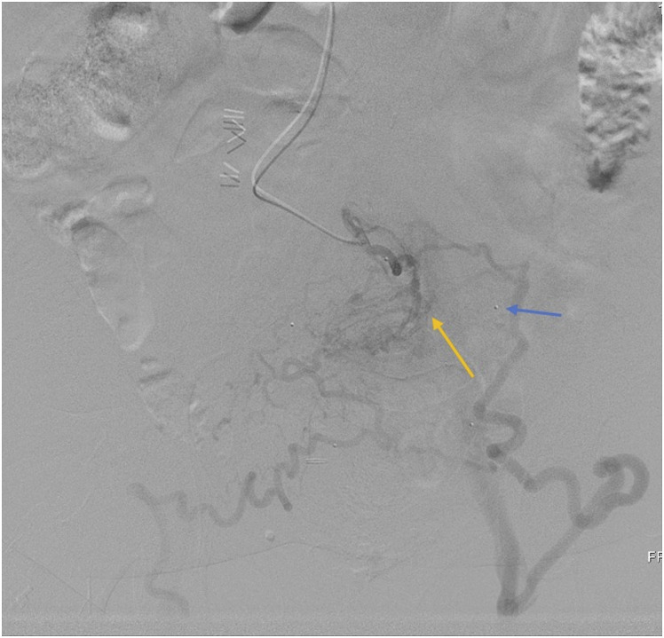
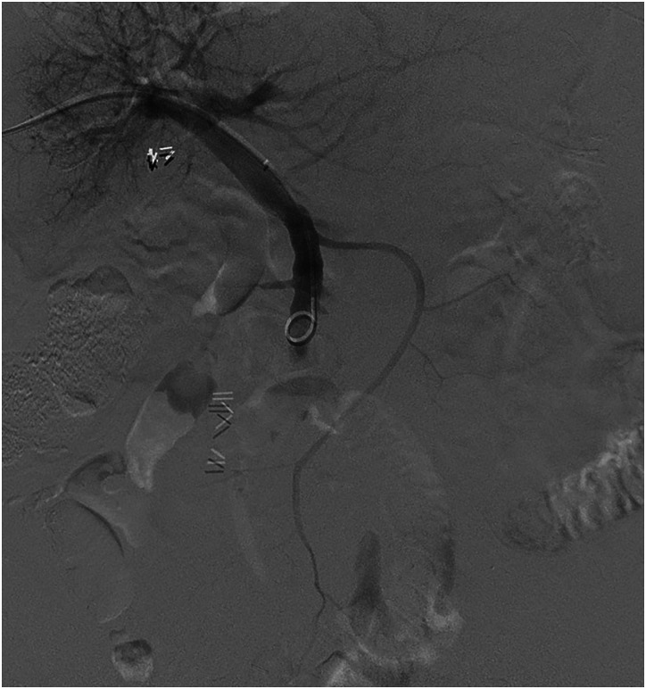
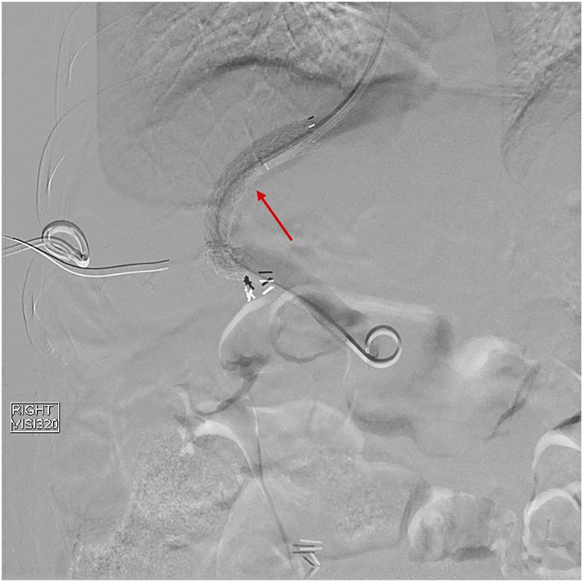
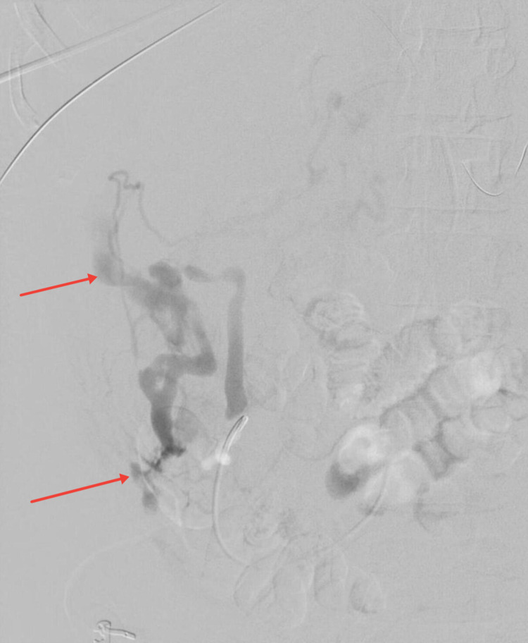

# 187 — Giãn tĩnh mạch lạc chỗ: chọn TIPS, BATO/ATO hay PTO / Bleeding ectopic varices — choosing TIPS, antegrade obliteration or percutaneous transhepatic obliteration

**Tags:** `pattern:gian-tinh-mach` `pattern:xuat-huyet-tieu-hoa` `vung:tieu-hoa` `vung:mach-cua` `vung:phuc-mac` `score:PSG` `protocol:CT-cua-thi` `protocol:DSA-venogram`
**Mức chắc chắn (certainty):** tổng hợp y văn (literature synthesis) — khung quyết định và số liệu dịch tễ lấy từ bài tổng quan 2026 (Kim DH et al., *Cardiovasc Diagn Ther*, PMC13554335, CC BY-NC-ND), số liệu kỹ thuật từ loạt ca đường vào qua da (Nadeem IM et al., *Acta Radiol Open* 2022, PMC9272059, CC BY), ca giãn tĩnh mạch phúc mạc vỡ (Ohs Z et al., *Cureus* 2021, PMC8460490, CC BY) và tổng quan TIPS cho giãn lạc chỗ (Shalaby S et al., *J Clin Med* 2024, PMC11476950, CC BY). Không có RCT so sánh trực tiếp TIPS với ATO/PTO — mọi khuyến cáo dưới đây là **ý kiến chuyên gia/loạt ca**, không phải bằng chứng mức cao.

> **Câu hỏi gốc của bài:** bệnh nhân xơ gan vào viện vì **đi ngoài máu đỏ sẫm / chảy máu hậu môn nhân tạo / nôn máu mà nội soi dạ dày–thực quản bình thường**. Nội soi ruột non thấy **tổn thương gồ lên, có mạch đập** ở tá tràng/hỗng tràng; hoặc bệnh nhân **không thể soi tới** (phúc mạc, quanh hậu môn nhân tạo). Vậy: **có làm TIPS không, hay chỉ nút tại chỗ? Chọn đường vào nào? Nút bao nhiêu "cuống" thì đủ? Và vì sao TIPS đơn thuần lại hay tái chảy máu ở nhóm này?**
> **Điểm tựa:** giãn tĩnh mạch lạc chỗ **có thể chảy máu ở gradient áp lực cửa–chủ (portosystemic pressure gradient — PSG) THẤP HƠN 12 mmHg** — ngưỡng kinh điển của giãn thực quản. Vì vậy **hạ áp cửa đơn thuần không đủ**: phải **bít đúng "ổ" tại chỗ** (ATO/BATO/PTO), và/hoặc phối hợp với TIPS khi cần hạ áp toàn thể.

## 1. Tổng quan — vì sao giãn lạc chỗ "khó" hơn giãn thực quản + ngưỡng định lượng

**A. Bệnh học (pathology) và cơ chế chảy máu:**
- **Định nghĩa:** giãn tĩnh mạch lạc chỗ = tuần hoàn bàng hệ cửa–chủ **(portosystemic collaterals)** nằm **ngoài** vùng dạ dày–thực quản. Về mặt giải phẫu, đây là các nhánh tĩnh mạch tạng nối với hệ chủ qua **đường sau phúc mạc, thành bụng, đám rối trực tràng, mô quanh hậu môn nhân tạo** hoặc **mô liên kết phúc mạc** — tức là những nơi **không có "ống tiêu hóa trong lòng"** để soi và tiêm keo (bài 181 chỉ phủ nhóm dạ dày qua shunt dạ dày–thận).
- **Vì sao vỡ:** thành mạch **mỏng, ít cơ trơn, không có van bảo vệ**; áp lực trong túi giãn gần bằng áp lực cửa, trong khi **thành chịu lực cơ học kém** hơn tĩnh mạch thực quản (được nâng đỡ bởi lớp dưới niêm và trung thất). Thêm **chấn thương cơ học tại chỗ**: ma sát của túi hậu môn nhân tạo (stoma appliance), nhu động ruột, **dải xơ dính sau mổ** kéo căng mạch (đây là lý do **phẫu thuật ổ bụng/khung chậu là yếu tố nguy cơ** — dính làm tắc dòng ra, đẩy máu vào collateral).
- **Vì sao chảy máu ở PSG thấp:** túi giãn lạc chỗ thường có **lưu lượng cao, đường kính lớn, ít "van trở kháng"** → theo Laplace, **sức căng thành (wall tension) ∝ áp lực × bán kính**; chia cho **bề dày thành mỏng** (ít cơ trơn) → **ứng suất thành (wall stress) cao hơn** hẳn giãn thực quản cùng mức áp lực. Do đó **PSG 8–10 mmHg vẫn có thể vỡ** trong khi giãn thực quản cùng mức áp lực thì chưa.

**B. Ngưỡng định lượng bắt buộc (cửa 1 Argon):**

| Đại lượng | Con số đã kiểm chứng | Ý nghĩa thực hành |
|---|---|---|
| Tỷ lệ trong toàn bộ chảy máu do giãn tĩnh mạch | **1–5%** (PMC11476950); **~5%** (PMC13554335) | Hiếm → mọi khuyến cáo đều mức thấp, phải cá thể hóa |
| Tử vong do chảy máu lạc chỗ | **tới 40%** (nghiên cứu UK, PMC13554335); tử vong giãn thực quản đã giảm **23,6% → 18,3%** | Nhóm lạc chỗ **không** được hưởng lợi từ tiến bộ điều trị như giãn thực quản |
| Tỷ lệ theo vị trí (173 ca, Nhật) | **trực tràng 77 ca, tá tràng 57 ca**, còn lại hỗng–hồi tràng/đại tràng | Trực tràng hay gặp nhất nhưng **ít chảy máu nhất** |
| Tỷ lệ **chảy máu** theo vị trí (169 ca) | **hậu môn nhân tạo 26%, tá tràng 17%, trực tràng 8%** | Chảy máu **không** tỷ lệ thuận với tần suất gặp |
| Vị trí trong 161 ca khác | **hậu môn nhân tạo 27%, hỗng–hồi tràng 18%, tá tràng 17%, đại tràng 15%** | Ba nhóm này chiếm **~60%** ca chảy máu |
| Tá tràng | **17–32,9%** tổng số giãn lạc chỗ; **tử vong tới 40%**; hay gặp trong **tăng áp cửa ngoài gan/huyết khối tĩnh mạch** | Chảy máu **ồ ạt**, khó cầm bằng nội soi |
| Trực tràng | Nguy cơ chảy máu **0,5–3,6%**; ~**8%** ca chảy máu | Thường tình cờ; phân biệt với trĩ (cách rìa hậu môn **> 4 cm**) |
| Hậu môn nhân tạo | Nguy cơ chảy máu **cao nhất (26–27%)** nhưng tử vong **thấp 3–4%** | **Ép tay cầm máu được** — khác biệt lớn về tiên lượng |
| Hỗng–hồi tràng | ~**18%** ca; **chảy máu hoạt động chỉ 5,5%** | Biểu hiện **chảy máu tiêu hóa ẩn (obscure GI bleeding)** → cần capsule/enteroscopy |
| Tái chảy máu sau nút ngược dòng (BRTO) | **17–31%** | Nút **không** hạ áp cửa → tái phát |
| Nút keo dưới **EUS** so với tiêm qua nội soi thường | Tái chảy máu **> 48 giờ: 18,5% vs 44,7%** | Doppler/EUS giúp **xác định mạch nuôi** trước khi tiêm |
| Tái phát tá tràng sau điều trị nội soi | **15,8%** (19 bệnh nhân) | Cần kiểm tra lại sau 1–3 tháng |

**C. TẠI SAO ảnh trông như vậy (vật lý hình ảnh):**
- **CT thì tĩnh mạch cửa (portal venous phase):** giãn lạc chỗ **ngấm thuốc BẰNG tĩnh mạch cửa cùng thì** (cùng nguồn máu, cùng nồng độ i-ốt) — đây là **tiêu chuẩn nội tại** để phân biệt với **hạch** (ngấm ít hơn, hình bầu dục, có rốn mỡ) và **mô u phúc mạc** (ngấm không đều, có thành phần mô mềm). Chúng **nối liền với một nhánh tĩnh mạch tạng** — luôn truy ngược trên MPR để tìm **nhánh nuôi (afferent)** và **nhánh thoát (efferent)**.
- **DSA/venogram:** đây là "xét nghiệm thật sự". Nguyên lý chọn thủ thuật nằm ở **hướng dòng**: bơm từ nhánh cửa → thấy **afferent → túi giãn → efferent**. **Có một efferent lớn, dễ bít (shunt dạ dày–thận, shunt quanh stoma)** → nút **ngược dòng (RTO/BRTO)**; **không có efferent đơn độc hoặc efferent nhiều** → phải nút **xuôi dòng (ATO/BATO)**, tức bít chính **afferent** rồi bơm chất xơ hóa vào túi.
- **Vì sao nút xuôi dòng cần bóng/coil chặn dòng:** chất lỏng (n-BCA, ethylene vinyl alcohol, natri tetradecyl sulfat, ethanolamine oleate) **trôi theo dòng**. Nếu không chặn, keo đi vào **tĩnh mạch hệ thống hoặc tạng lành** → tắc mạch phổi, nhồi máu ruột. Nguyên tắc: **chặn afferent bằng bóng/coil/plug → bơm chất xơ hóa vào túi → giữ bóng vài phút cho keo trùng hợp**.

## 2. Mẫu hình + chẩn đoán phân biệt theo vị trí (Gamut)

- **Nhóm A — Soi tới được (tá tràng, hỗng–hồi tràng, đại tràng, trực tràng):** nội soi ± EUS là **bước đầu**; thất bại/tái phát → can thiệp mạch.
- **Nhóm B — Không soi tới được (hậu môn nhân tạo, phúc mạc, sau phúc mạc, đường mật):** **bắt buộc CT có thì cửa + can thiệp mạch**, không có "phương án nội soi dự phòng".
- **Nhóm C — Có shunt thoát lớn (gastrorenal, parastomal, splenorenal):** nút **ngược dòng** khả thi, rủi ro thấp hơn nút xuôi dòng.
- **Nhóm D — Tăng áp cửa toàn thể nặng + còn giãn thực quản nguy cơ cao/báng khó trị:** **TIPS ± nút** — vì cần **hạ áp toàn thể**, không chỉ bít ổ.

**Mnemonic "C–O–D" — ba câu hỏi chọn thủ thuật:**
- **C**ó **shunt thoát** đơn độc, dễ tiếp cận? → **RTO/BRTO** (bài 181).
- **O**cclusion tại chỗ là đủ (không có shunt thoát, hoặc TIPS chống chỉ định)? → **ATO/BATO** (đường tĩnh mạch cửa hoặc lách) hay **PTO** (qua da xuyên gan).
- **D**ecompress toàn thể cần (giãn thực quản kèm, báng khó trị, nguy cơ tái phát cao)? → **TIPS ± ATO/RTO**.

**Viết tắt dùng trong bài:** **ATO** (antegrade transvenous obliteration) = nút **xuôi dòng** qua đường tĩnh mạch; **BATO** = ATO có **bóng chặn dòng** (balloon-occluded); **PTO** = nút **qua da xuyên gan** (percutaneous transhepatic obliteration); **PATVO** = nút xuôi dòng qua da (percutaneous antegrade transvenous obliteration) — cùng nhóm với BATO/PTO; **RTO/BRTO** = nút **ngược dòng** (bài 181); **PSG/HVPG** = gradient áp lực cửa–chủ.

**Vì sao TIPS đơn thuần hay thất bại ở giãn lạc chỗ (điểm cốt lõi):** TIPS làm giảm PSG xuống **< 12 mmHg**, nhưng túi giãn lạc chỗ có thể **vẫn còn dòng "xuôi dốc" (downhill flow)** từ nhánh tạng vào hệ chủ vì trở kháng đường thoát của nó rất thấp. Kết quả: **shunt thông tốt trên hình nhưng vẫn chảy máu**. Vì vậy y văn hiện tại nghiêng về **TIPS + nút đồng thời**, hoặc **nút đơn thuần khi TIPS chống chỉ định**.

## 3. Bảng so sánh phân biệt (ma trận đối chiếu)

| Thực thể (entity) | Hình ảnh điển hình | Chốt vào (rule-in) | Chốt loại (rule-out) | Gợi ý xác nhận |
|---|---|---|---|---|
| **Giãn tá tràng** | CT thì cửa: **túi mạch ngấm thuốc bằng tĩnh mạch cửa**, nằm giữa D2–D3, có nhánh nuôi từ **SMV/tĩnh mạch tá tụy**; thường kèm **huyết khối/tắc tĩnh mạch lách–cửa** | **Tăng áp cửa ngoài gan + huyết khối tĩnh mạch + nội soi thấy tổn thương gồ có mạch** | Niêm mạc tá tràng lành, không có nhánh nuôi rõ → loét/viêm | CT 3 thì + dựng 3D; EUS-Doppler; DSA |
| **Giãn hỗng–hồi tràng** | Nốt/mảng ngấm thuốc **trong thành ruột non**, thay đổi theo thì; thường sau mổ/dính | **Chảy máu tiêu hóa ẩn + capsule/enteroscopy thấy mạch giãn** | Nang ruột non/túi thừa (không ngấm mạnh thì cửa) | CT enterography thì cửa + DSA |
| **Giãn quanh hậu môn nhân tạo** | Đám mạch **quanh stoma**, ngấm thì cửa, **thấy rõ trên CT với marker trên da** | **Chảy máu nhỏ giọt tái diễn quanh stoma + ép tay cầm** | Viêm da quanh stoma/chảy máu niêm mạc stoma (không có mạch giãn) | CT thì cửa; DSA qua da đường cửa/qua TIPS |
| **Giãn trực tràng** | Đám mạch dưới niêm **cách rìa hậu môn > 4 cm**, nối tĩnh mạch trực tràng trên–giữa/dưới | **Tăng áp cửa + mạch giãn liên tục với tĩnh mạch trực tràng trên** | **Trĩ** (dưới 4 cm, không nối hệ cửa) | Nội soi trực tràng; CT thì cửa |
| **Giãn phúc mạc/sau phúc mạc** | **Máu tụ/dịch quanh gan–lách + ổ thoát thuốc cản quang**, không có tổn thương nhu mô | **Sốc giảm thể tích + máu bụng + xơ gan, không có khối u vỡ** | **HCC vỡ** (khối ngấm thuốc thì động mạch, AFP cao), vỡ lách, chửa ngoài tử cung | FAST → CT 3 thì → DSA nút mạch |
| **TIPS + nút phối hợp** | Shunt thông + **không còn túi giãn** trên venogram sau nút; PSG **giảm ≥ 20%** hoặc **< 12 mmHg** | **Giãn lạc chỗ + giãn thực quản nguy cơ cao/báng khó trị** | Chỉ có giãn lạc chỗ đơn độc, không tăng áp toàn thể nặng → cân nhắc nút đơn thuần | DSA + đo PSG trước/sau |
| **ATO/BATO/PTO đơn thuần** | Venogram: **afferent bị bít (bóng/coil)**, túi giãn **không còn ngấm**, efferent trống | **TIPS chống chỉ định** (suy tim, mPAP > 45, HE nặng, nhiễm trùng) hoặc **không có shunt thoát** | Nhiều afferent lớn không kiểm soát được → **nguy cơ sót nguồn**, cần TIPS | DSA; chụp kiểm tra sau 5–10 phút |
| **Phẫu thuật (cuối cùng)** | Không có hình ảnh đặc hiệu — dựa trên **thất bại của nội soi + can thiệp** | **Thất bại cả nội soi và can thiệp mạch** | Còn phương án can thiệp khả thi → **không mổ** | Hội chẩn đa chuyên khoa |

*Trái: **trước** — bơm thuốc qua nhánh SMV, đám giãn tĩnh mạch quanh stoma hiện rõ (mũi tên vàng), marker trên da đánh dấu vị trí stoma (mũi tên xanh). Phải: **sau** nút (keo + hạt + thrombin) — túi giãn **không còn ngấm**, chỉ thấy pigtail trong SMV. Đây là **ATO/BATO qua da xuyên gan** (trong y văn gọi PATVO). Nguồn: Nadeem IM et al., *Acta Radiol Open* 2022 (PMC9272059) Fig. 1 và Fig. 5, CC BY 4.0 — ảnh ghép letterbox, đã thay đổi (ghép + dải chú thích).*

### Ba đường vào và một nguyên tắc chặn dòng
1. **Xuyên gan (transhepatic):** ưu tiên khi **nhánh cửa trong gan còn thông**; thuận lợi cho giãn **đường mật, phúc mạc, khung chậu**. Đây là đường dùng trong loạt ca PATVO ở trên (**17/17 thủ thuật**).
2. **Xuyên lách (transsplenic):** khi **tĩnh mạch cửa tắc**, gan khó tiếp cận, hoặc **tĩnh mạch lách là nhánh nuôi chính** — hay dùng cho **quanh stoma, đại tràng, khung chậu**.
3. **Qua TIPS đã có (trans-TIPS):** đường vào **tốt nhất** khi bệnh nhân đã/đang có TIPS — vừa chụp được toàn bộ hệ cửa, vừa nút được tổn thương ở **bất kỳ vị trí**.
4. **Nguyên tắc chặn dòng:** **bóng (balloon) hoặc coil/plug ở afferent** trước khi bơm chất lỏng → giảm/ổn định dòng → **giảm nguy cơ tắc mạch không đích**. Với **dòng cao**, dùng **n-BCA : lipiodol = 1:2 hoặc 1:3** (ít lipiodol hơn = keo trùng hợp nhanh hơn, ít trôi xa).

## 4. Protocol can thiệp + theo dõi

**A. Hồi sức và chẩn đoán (làm song song, không chờ):**
1. **Hạn chế truyền máu: đích Hb 7 g/dL** ở người huy động ổn định (truyền nhiều làm tăng áp cửa, tăng tái chảy máu) — theo khuyến cáo chung cho chảy máu do tăng áp cửa (PMC11476950).
2. **Thuốc co mạch tạng + kháng sinh dự phòng ngay khi nghi chảy máu do tăng áp cửa**, kháng sinh duy trì **2–5 ngày**: meta-analysis cho **lợi ích sống còn 9,1%** (PMC13554335).
3. **Nội soi trong 12 giờ** nếu huy động ổn định — mục tiêu **tìm ổ chảy máu + loại trừ giãn thực quản/dạ dàng** (vì 2 nhóm có thể cùng tồn tại).
4. **CT 3 thì (động mạch – cửa – muộn), lát 1–2 mm + dựng 3D** cho **mọi** ca nghi giãn lạc chỗ: xác định **afferent/efferent, huyết khối tĩnh mạch, kích thước túi, đường vào khả thi**.

**B. Quyết định thủ thuật (mermaid):**

**C. Chi tiết kỹ thuật ATO/BATO/PTO:**
- **Tiếp cận afferent** bằng microcatheter; **chụp venogram chọn lọc** ghi lại **số lượng và kích thước efferent** (đây là dữ liệu quyết định).
- **Chặn:** bóng (occlusion balloon) hoặc **coil/plug** ở **afferent chính**. Nếu nhiều afferent → **bít lần lượt**, không bỏ sót (ca tái chảy máu ngày 12 trong loạt PATVO là do **một nhánh SMV không được nút** vì không thấy trên CT và angiogram ban đầu).
- **Chất xơ hóa:** keo sinh học **n-BCA** pha lipiodol, hoặc **ethylene vinyl alcohol copolymer**, **natri tetradecyl sulfat**, **ethanolamine oleate**; có thể phối hợp **hạt (700–1000 µm) + thrombin** (loạt PATVO dùng **cả ba**: keo, hạt, thrombin tùy ca).
- **Kết thúc:** chụp kiểm tra sau **5–10 phút** — mục tiêu **túi giãn không còn ngấm**, **afferent bít**, efferent trống. **Đo PSG**: nếu **PSG còn thấp (< 12 mmHg)** và **không còn nguy cơ tăng áp toàn thể** → **không cần TIPS** (ca trong bài tổng quan: PSG cuối **8 mmHg** → không đặt TIPS).

**D. Kết quả định lượng của nút xuôi dòng qua da (loạt 12 bệnh nhân / 17 thủ thuật):**

| Chỉ số | Kết quả |
|---|---|
| Thành công kỹ thuật | **100% (17/17)** |
| Thành công lâm sàng sớm (≤ 30 ngày, không tái chảy máu) | **82% (14/17)** |
| Biến chứng trong/thức thì | **0%** |
| Tái chảy máu 3 tháng | **0%** |
| Tái chảy máu 6 tháng | **20%** (2 ca, tính theo bệnh nhân); **14%** ở nhóm đạt thành công lâm sàng sớm (**n = 14 thủ thuật**) |
| Tái chảy máu 12 tháng | **20%** (theo bệnh nhân); **14%** ở nhóm đạt thành công lâm sàng sớm |
| Xử trí khi tái phát | **TIPS** (2 ca) hoặc **lặp PATVO** (4 ca) |

**E. Theo dõi sau thủ thuật:**

| Thời điểm | Việc cần làm | Ngưỡng cảnh báo |
|---|---|---|
| 0–24 giờ | Dấu hiệu sinh tồn, Hb, đau bụng, nước tiểu, X-quang ngực nếu dùng keo | **Đau ngực/khó thở** → nghi tắc mạch phổi do keo; **đau bụng + toan** → nghi nhồi máu ruột |
| 1 tuần | Nội soi lại nếu tổn thương soi được; xét **tăng áp cửa mới** (báng, giãn thực quản) | Báng mới/giãn thực quản mới = **hệ quả của việc bít shunt**, cần NSBB/nội soi |
| 1–3 tháng | Nội soi/CT kiểm tra; đánh giá tái chảy máu | **Tái chảy máu = còn afferent sót** → chụp lại, không nút mù |
| 6–12 tháng | CT thì cửa; kiểm tra thiếu máu; tầm soát HCC | Túi giãn còn ngấm = thất bại muộn → cân nhắc TIPS |

**F. Chống chỉ định TIPS cần nhớ (AASLD, theo PMC13554335):** suy tim **NYHA C/D hoặc EF < 50%**, **mPAP > 45 mmHg**, **bệnh não gan nặng không kiểm soát**, **nhiễm trùng không kiểm soát**. Khi có các yếu tố này → **đi thẳng vào ATO/BATO/PTO**.

## 5. Biến thể bình thường và cạm bẫy

- **"PSG bình thường" không loại trừ giãn lạc chỗ:** đây là cạm bẫy chết người — giãn lạc chỗ **có thể chảy máu ở PSG < 12 mmHg**; đừng từ chối can thiệp chỉ vì HVPG 10–11 mmHg.
- **TIPS thông tốt mà vẫn chảy máu:** do **dòng "xuôi dốc" còn lại** qua collateral có trở kháng thấp. Đừng nong lại stent — **chụp lại và nút ổ**.
- **Nhầm giãn trực tràng với trĩ:** mốc **> 4 cm từ rìa hậu môn** và **liên tục với tĩnh mạch trực tràng trên** mới là giãn do tăng áp cửa; trĩ không nối hệ cửa.
- **Nhầm giãn phúc mạc với HCC vỡ:** trên CT, HCC vỡ có **khối ngấm thuốc thì động mạch + washout**, còn giãn phúc mạc chỉ là **máu tụ + ổ thoát thuốc từ mạch giãn**, không có khối. FAST một mình **không phân biệt** — cần CT 3 thì.
- **Nút xong lại tăng áp cửa:** bít một shunt lớn làm **tăng PSG** → có thể xuất hiện **giãn thực quản mới/báng nặng hơn**. Phải khám lại và dự phòng NSBB; đây là lý do **không bít "càng nhiều càng tốt"**.
- **Tắc mạch phổi do keo (n-BCA):** biến chứng được nhắc nhiều nhất của tiêm keo; phòng bằng **chặn afferent + tỷ lệ lipiodol phù hợp + bơm chậm dưới fluoroscopy**.
- **Sót afferent thứ hai:** ca tái chảy máu ngày 12 trong loạt PATVO xảy ra vì **một nhánh SMV không thấy trên CT trước và angiogram ban đầu** — bài học: **luôn chụp lại sau nút và tìm nhánh phụ**, không tin một lần chụp.
- **Hậu môn nhân tạo: đừng mổ ngay.** Chảy máu quanh stoma **ép tay thường cầm được**, tử vong chỉ **3–4%** — ưu tiên ép + nút, mổ là phương án cuối.
- **Cạm bẫy mặt cắt:** trên CT, **giãn tĩnh mạch quanh stoma** dễ bị đọc thành **"dày thành ruột/viêm"** vì mạch nằm sát thành; dùng **thì cửa + MIP/3D** và đối chiếu **marker trên da**.

## 6. Tự lượng giá — Blind Quiz ngay trên trang tĩnh

**Ca 1 — Nữ 47 tuổi, xơ gan, có hậu môn nhân tạo sau cắt trực tràng. Chảy máu nhỏ giọt quanh stoma tái diễn nhiều lần, ép tay cầm được, Hb 8,2 g/dL. Nội soi không tiếp cận được ổ chảy máu.**

- Gợi ý: không sốt, không đau bụng, chảy máu tái diễn từng đợt.
- Câu hỏi: (1) Vì sao **không** chọn nội soi tiêm keo? (2) Trên venogram, đâu là **afferent** và đâu là **efferent**? (3) Nếu PSG cuối thủ thuật là **8 mmHg**, có cần TIPS không?

<b>Bấm để hiện đáp án (findings + chẩn đoán)</b>

- **Không soi được** vì tổn thương nằm **quanh hậu môn nhân tạo**, ngoài lòng ruột — đây là nhóm "không có ống tiêu hóa trong lòng" để tiêm.
- Venogram qua da đường tĩnh mạch cửa: **afferent** là nhánh SMV bơm thuốc (mũi tên vàng chỉ đám giãn), **marker tròn trên da** (mũi tên xanh) đánh dấu vị trí stoma.
- **PSG 8 mmHg** → **không đặt TIPS**: mục tiêu là **bít ổ**, không phải hạ áp toàn thể; ca tương tự trong bài tổng quan cũng dừng ở **PSG 8 mmHg**.
- Xem kết quả sau nút:

- Sau nút (keo Glubran + lipiodol 1:4, hạt 700 µm, thrombin 1000 UI): **túi giãn không còn ngấm**, chỉ thấy pigtail trong SMV.
- Nguồn: Nadeem IM et al., *Acta Radiol Open* 2022 (PMC9272059) Fig. 1 và Fig. 5, CC BY 4.0.

**Ca 2 — Nam 60 tuổi, xơ gan do thiếu alpha-1 antitrypsin, đã cắt đại tràng + đặt hậu môn nhân tạo. Tái chảy máu quanh stoma sau 178 ngày kể từ lần nút đầu.**

- Gợi ý: lần đầu nút tại chỗ đã thành công; nay tái phát muộn.
- Câu hỏi: (1) Nguyên nhân tái phát khả năng nhất? (2) Hai lựa chọn tiếp theo? (3) Khi nào chọn TIPS thay vì nút lặp?

<b>Bấm để hiện đáp án (findings + chẩn đoán)</b>

- Tái phát muộn sau nút tại chỗ thường do **còn afferent/nhánh phụ** hoặc **tăng dòng bù trừ** — không hạ áp cửa thì túi có thể tái lập.
- Hai lựa chọn: **lặp ATO/BATO (PATVO)** hoặc **TIPS** — trong loạt ca, **2 bệnh nhân chuyển sang TIPS** và **4 bệnh nhân lặp PATVO**; ca này được **đặt TIPS** và hết chảy máu.
- Chọn **TIPS** khi: tái phát nhiều lần, còn **giãn thực quản nguy cơ cao/báng khó trị** (cần hạ áp toàn thể), hoặc **không còn afferent đơn độc** để nút.
- Ảnh trên: **stent TIPS (mũi tên đỏ)** đặt sau lần tái chảy máu thứ hai; bệnh nhân hết chảy máu.
- Nguồn: Nadeem IM et al., *Acta Radiol Open* 2022 (PMC9272059) — ca 1 tái chảy máu ngày **178**, xử trí **TIPS** (Fig. 7), CC BY 4.0.

**Ca 3 — Nam 55 tuổi, xơ gan rượu, nhập viện **sốc giảm thể tích**, siêu âm cạnh giường có dịch hỗn hợp phức tạp trong ổ bụng, Hb 6,1 g/dL. Không nôn máu, không đi ngoài máu.**

- Gợi ý: huyết động không ổn định, không có khối u đã biết, AFP bình thường.
- Câu hỏi: (1) Chẩn đoán phân biệt chính? (2) Trên angiogram, dấu hiệu nào chứng minh đang chảy máu **hoạt động**? (3) Vì sao **không** chọn nội soi?

<b>Bấm để hiện đáp án (findings + chẩn đoán)</b>

- Phân biệt: **giãn tĩnh mạch phúc mạc vỡ**, **HCC vỡ**, vỡ lách, chửa ngoài tử cung (ở nữ), chảy máu sau thủ thuật.
- Angiogram: **thoát thuốc cản quang thành ổ đọng (pooling) ở góc phần tư trên phải** (mũi tên đỏ) — dấu hiệu **thoát mạch hoạt động (active extravasation)**, không phải giả phình (giả phình giữ hình, không lan theo thì).
- **Không nội soi** vì tổn thương **ngoài lòng tiêu hóa** (phúc mạc) — can thiệp là **nút mạch qua DSA** (ca gốc: coil → hết thoát thuốc).
- Nguồn: Ohs Z et al., *Cureus* 2021 (PMC8460490) Fig. 4, CC BY 3.0. Lưu ý ca gốc mô tả **máu tụ + thoát mạch từ giãn tĩnh mạch trong phúc mạc** — đây là biến thể hiếm nhưng là câu hỏi sống còn khi siêu âm thấy máu bụng ở bệnh nhân xơ gan.

## Bài liên quan chéo
- [100 – Tổng quan hệ Bụng](../100-tong-quan-he-bung/lesson.md)
- [181 – BRTO/RTO cho giãn tĩnh mạch dạ dày](../181-brto-thuyen-tac-nguoc-tm-than-trai-gian-tm-da-day/lesson.md) (nhánh thoát, Kiyosue/Hirota, PARTO/CARTO — nền tảng của "nút ngược dòng")
- [176 – TIPS/DIPS: chỉ định, kỹ thuật & theo dõi shunt](../176-tips-dips-theo-doi-shunt/lesson.md) (đặt TIPS, theo dõi thông/hẹp)
- [182 – Biến chứng SỚM sau TIPS](../182-bien-chung-som-sau-tips/lesson.md) (hemoperitoneum, hemobilia — phân biệt với giãn phúc mạc vỡ)
- [920 – Nút mạch cầm máu tiêu hóa](../920-vascular-embolization-gi-bleed/lesson.md) (kỹ thuật nút, chọn vật liệu)
- [929 – Xơ hóa nang qua da](../929-xo-hoa-nang-qua-da/lesson.md) (cùng nguyên lý chặn dòng + bơm chất xơ hóa)

> Không dùng để chẩn đoán độc lập khi chưa có người hướng dẫn.
