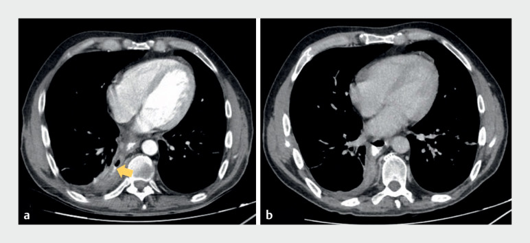
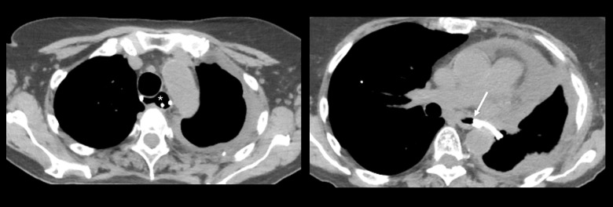
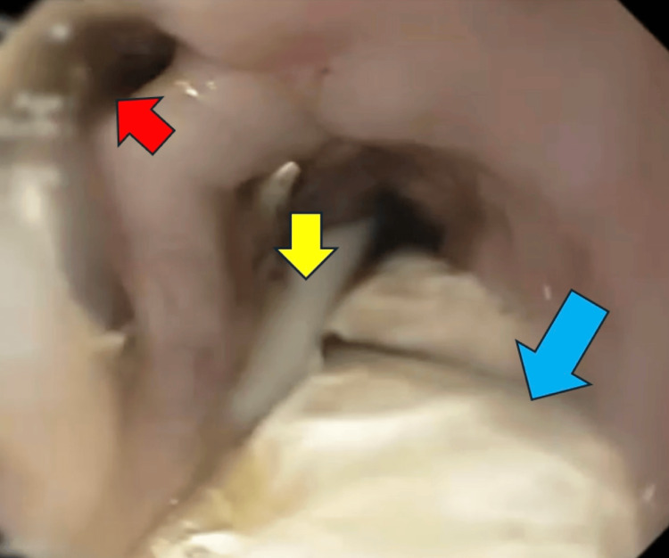
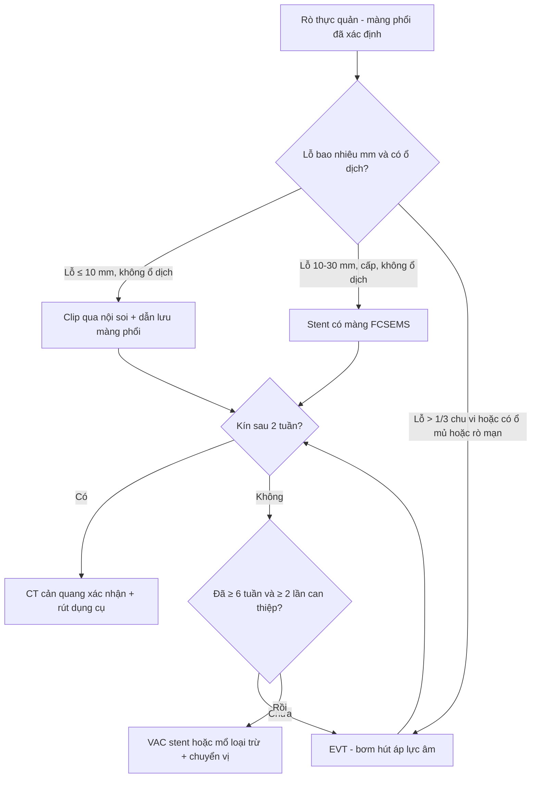
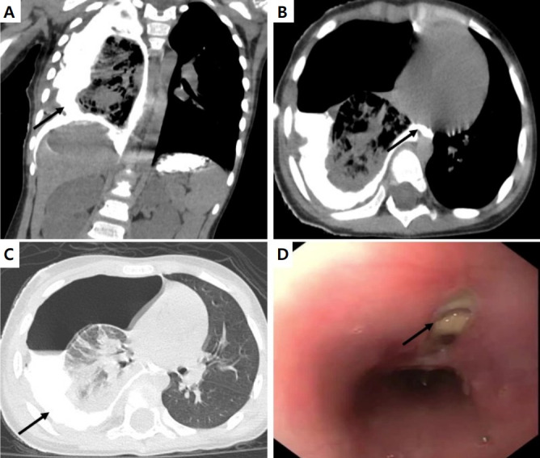

# 1870 — Rò thực quản–màng phổi mạn sau vỡ thực quản / Chronic esophagopleural fistula after Boerhaave syndrome

**Tags:** `pattern:ro-thuc-quan` `pattern:tran-dich-mang-phoi` `pattern:khi-trung-that` `vung:trung-that` `vung:mang-phoi` `vung:thuc-quan` `protocol:CT-nguc-cang-quang` `protocol:can-quang-thuc-quan` `protocol:noi-soi-thuc-quan` `protocol:EVT` `protocol:stent-thuc-quan`

**Mức chắc chắn (certainty):** tổng hợp y văn (literature synthesis) — dựa trên **1 tổng quan hệ thống 694 bệnh nhân Boerhaave** (PMC13607280, CC BY), **1 tổng quan kỹ thuật EVT 2026** (PMC13423335, CC BY-NC), và **4 ca nguyên văn có ảnh** (PMC11305858, PMC12698314, PMC12908414, PMC13244056). Không có thử nghiệm ngẫu nhiên; mọi ngưỡng xử trí là dữ liệu hồi cứu/đồng thuận.

> **Câu chốt:** rò thực quản–màng phổi (esophagopleural fistula, EPF) là **di chứng của một lỗ thủng đã được điều trị nhưng không kín** — không phải một bệnh mới. Ba số phải thuộc: rò là biến chứng sau điều trị ở **7,45% (35/470)** ca Boerhaave, sau dò/dỉ dịch **17,2%** và màng phổi mủ **11,3%**; **stent bít kín được 79% (75/95)** nhưng **di trú 18,1% (19/105)**; **EVT đóng rò 87,95% (KTC 95%: 84,46–91,05)** ở thực quản. Chìa khóa hình ảnh: **CT ngực có cản quang uống, đọc trên MPR vành/dọc** — ảnh trục đơn thuần bỏ sót đường rò chạy chếch.

## 1. Tổng quan bệnh học – cơ chế hình ảnh (TẠI SAO)

### 1.1 Từ lỗ thủng cấp đến đường rò mạn: ba điều kiện để rò không tự đóng

- **Boerhaave** tạo một lỗ **toàn thành** ở thực quản đoạn dưới (bài 1869): **3,1 ca/1 triệu người/năm**, **83,5%** ở đoạn dưới, **77%** ở thành trái, đường kính lỗ **trung vị 3 cm (IQR 2 cm)** (PMC13607280).
- Lỗ thủng *cấp* có thể tự bít hoặc bít bằng stent/clip. Nhưng rò **mạn** hình thành khi hội đủ ba điều kiện: **(a)** miệng lỗ **lớn hơn khả năng co của niêm mạc** (thường > 10 mm, hoặc > 1/3 chu vi lòng); **(b)** có **khoang mủ/ổ dịch trung thất hoặc màng phổi** làm “bể chứa” giữ đường rò mở; **(c)** **nhiễm khuẩn và suy dinh dưỡng** duy trì viêm — mô hạt không thể phủ kín (PMC13423335).
- Theo thời gian, bờ lỗ **biểu mô hóa và xơ hóa** thành **ống rò có thành** — đây là lý do **không còn khả năng tự đóng** dù đã hết nhiễm trùng cấp. Bài này dùng mốc thực hành: **còn thoát cản quang/dịch qua lỗ ≥ 2 tuần sau can thiệp đầu tiên** (đúng với 2 ca dưới đây), và **thất bại sau ≥ 6 tuần với 2 stent** là chỉ định chuyển chiến lược (PMC11305858). *Y văn chưa có ngưỡng thời gian đồng thuận — ghi rõ “chưa rõ”, không bịa.*

### 1.2 TẠI SAO hình ảnh nhìn thấy đường rò — và tại sao vẫn bỏ sót

- **Vật lý đậm độ:** cản quang uống **100–300 HU**, dịch màng phổi/trung thất **0–20 HU**, mỡ trung thất **−50 đến −100 HU**, khí **−1.000 HU**. Đường rò **chỉ hiện khi được làm đầy bằng cản quang**; nếu lỗ đóng tạm thời theo thì nuốt, hoặc cản quang không tới miệng lỗ (bệnh nhân nằm ngửa, thực quản xẹp), **CT âm không loại trừ rò**.
- **Vì sao cần MPR:** đường rò đi **chéch từ thực quản ra sau–bên vào khoang màng phổi**, không nằm trong một mặt phẳng trục. Lát **1–1,25 mm** + dựng **vành và dọc** cho thấy trọn ống rò; ảnh trục 5 mm chỉ thấy “vài bọt khí” cạnh thực quản.
- **Vì sao dịch màng phổi đổi tính chất:** nước bọt + dịch dạ dày đổ vào khoang màng phổi → **viêm màng phổi hóa học** (pH thấp) rồi **mủ hóa** do vi khuẩn miệng–họng. Dịch màng phổi có **amylase cao** (nguồn nước bọt) và **bilirubin/creatinine cao hơn huyết thanh**; các dấu hiệu này **định hướng** chứ **chưa có ngưỡng đồng thuận** để chốt một mình.
- **Vì sao không thấy khí không loại trừ:** khoang màng phổi đã dẫn lưu kín, hoặc ổ dịch đặc/vách hóa, hoặc rò nhỏ < 2 mm → **không có liềm khí** dù rò vẫn hoạt động.

### 1.3 Ngưỡng định lượng trụ cột

| Biến số | Số liệu | Nguồn |
|---|---|---|
| Boerhaave — tần suất | **3,1 ca/1 triệu người/năm** | PMC12524210 (bài 1869) |
| Boerhaave — vị trí / kích thước lỗ | **83,5%** đoạn dưới; **77%** thành trái; lỗ **trung vị 3 cm** (IQR 2) | PMC13607280 |
| Boerhaave — tử vong | viện **18,2%** (118/649); 30 ngày **15,4%** (99/644) | PMC13607280 |
| Rò sau điều trị Boerhaave | **7,45%** (35/470) — sau rò miệng nối **17,2%** và màng phổi mủ **11,3%** | PMC13607280 |
| Stent thực quản — kết quả | bít kín **79%** (75/95); **di trú 18,1%** (19/105) | PMC13607280 |
| EVT thực quản — đóng kín | **87,95%** (KTC 95%: 84,46–91,05); Boerhaave/do thủ công **89%** (77–100) | PMC13423335 |
| EVT — nhịp thay bơm/thay stent | mỗi **3–7 ngày**; ổ trong khoang thay dày hơn | PMC13423335 |
| EVT — áp lực | hút tối ưu **−125 mmHg**; ca VAC stent **−120 mmHg** 24 giờ đầu rồi **−80 mmHg** | PMC13423335; PMC11305858 |
| EVT — kích thước ổ xử lý được | ổ **> 7 cm**, tới **15 cm** | PMC13423335 |
| Stent — ngưỡng chỉ định | guideline châu Âu: lỗ **> 20 mm**; trung tâm chuyên sâu dùng cho lỗ **≤ 30 mm** cấp, **không có ổ dịch** | PMC13423335 |
| Rò sau cắt phổi toàn bộ | tới **1%**; tử vong **49–63%** | PMC12908414 |
| Thời gian điều trị | EVT **17,6 ngày** vs mổ **39,4 ngày** | PMC13423335 |

*(a) Trước điều trị: đường rò còn hoạt động (mũi tên) cạnh thực quản đoạn dưới, khí và dịch trong trung thất sau. (b) Sau 7 ngày VAC stent: đường rò đã kín, không còn khí/dịch ngoài lòng thực quản. Nguồn: Mendes I, Nunes G, Vara-Luiz F, Vaz J, Luz C, Fonseca J, Pinto-Marques P; *Endoscopy* 2024; Fig. 4 — PMC11305858, CC BY 4.0.*

## 2. Mẫu hình + chẩn đoán phân biệt theo vị trí (Gamut)

- **Rò vào khoang màng phổi (thường một bên):** EPF sau Boerhaave · rò miệng nối sau cắt thực quản · rò do xạ (bài 1844) · rò ác tính do u thực quản xâm lấn · rò sau đặt stent/dị vật · rò sau phẫu thuật phổi (đặc biệt **sau cắt phổi toàn bộ**, tới 1%) (PMC12908414).
- **Rò vào trung thất rồi mới ra màng phổi:** ổ áp-xe trung thất sau thông với thực quản (“rò qua ổ dịch”) — hình ảnh là **ổ dịch có khí + đường rò tới thực quản**, không phải đường rò trực tiếp; xử trí phải **dẫn lưu ổ + bít lỗ**, chỉ bít lỗ là thất bại.
- **Rò sang đường thở:** rò thực quản–phế quản (khí–dịch trong phế quản, viêm phổi **cùng một thùy tái diễn**, ho ra thức ăn) · rò thực quản–khí quản (sặc, khàn) — khác hướng điều trị (cần bảo vệ đường thở trước).
- **Rò sang mạch:** rò thực quản–động mạch chủ (bài 1852) — **tiền triệu chảy máu nhỏ (sentinel bleed)** rồi chảy máu ồ ạt; tuyệt đối không nội soi thực quản thường quy.
- **Không phải rò (bắt chước):** màng phổi mủ đơn thuần · tràn dịch cận viêm · xẹp phổi sau mổ · **dò dưỡng chấp** (triglyceride dịch **> 110 mg/dL**, bài 1857) · **dò dịch não tủy màng nhện–màng phổi** (β2-transferrin dương, đau đầu tư thế) · rò tụy–màng phổi (amylase rất cao, bài 1934).
- **Gợi nhớ DEEP:** **D**efect (lỗ > 10 mm hay > 1/3 chu vi) · **E**mpyema (ổ mủ giữ rò mở) · **E**xposure (xạ, hóa chất, u) · **P**ost-op (miệng nối, cắt phổi).

## 3. Bảng so sánh phân biệt (ma trận đối chiếu)

| Thực thể | Hình ảnh điển hình | Chốt vào (rule-in) | Chốt loại (rule-out) | Gợi ý xác nhận |
|---|---|---|---|---|
| **EPF mạn sau Boerhaave** | Tràn dịch/tràn khí màng phổi **dai dẳng một bên** + đường rò **được làm đầy cản quang** từ thực quản dưới ra khoang màng phổi; ổ dịch trung thất sau | **Cản quang uống thấy đường rò + khí/dịch dai dẳng > 2 tuần sau can thiệp** | Thực quản liền lạc hoàn toàn trên MPR vành/dọc + không thoát cản quang → không phải rò | CT có cản quang uống + MPR; nội soi thấy miệng lỗ; xanh methylene qua dẫn lưu ngực |
| **Rò miệng nối sau cắt thực quản** | Ổ dịch/khí quanh miệng nối, **ngày 5–7 sau mổ**, thành ống dẫn lưu có nước bọt/thức ăn | **Miệng nối + ổ dịch quanh + khí trong ổ trong tuần đầu** | Rò ống ngực (dịch trắng đục, TG > 110 mg/dL) hoặc xẹp phổi đơn thuần | CT cản quang uống; nội soi; xét nghiệm dịch |
| **Rò do xạ** | Thực quản **hẹp + thành dày đối xứng** trong trường chiếu, rò xuất hiện **tháng–năm** sau xạ; không có ổ mủ lớn | **Tiền sử xạ + hẹp/thành dày trong trường chiếu + rò muộn**; rò sau hóa–xạ **5,8–30,1%** | Không tiền sử xạ, lỗ cấp sau nôn → Boerhaave | CT + PET loại tái phát u; nội soi sinh thiết |
| **Rò ác tính do u** | **Khối u thực quản** tại miệng rò, hẹp lòng, hạch, di căn; rò thường vào đường thở hoặc màng phổi | **Khối + hẹp không đều + hạch/di căn tại miệng rò** | Thành thực quản mỏng, không khối → rò lành tính | Nội soi sinh thiết; PET-CT; stent có màng để bắc cầu |
| **Rò thực quản–phế quản** | Đông đặc/tree-in-bud **cùng một thùy tái diễn**, mức khí–dịch trong phế quản, ho ra thức ăn | **Viêm phổi tái diễn cùng thùy + ho ra thức ăn + rò thấy trên CT** | Viêm phổi hít đơn thuần (không thấy đường rò) | CT lát mỏng; nội soi phế quản thấy lỗ rò |
| **Không phải rò: màng phổi mủ / dò dưỡng chấp / dò dịch não tủy** | Dịch màng phổi **không có đường rò**; dưỡng chấp trong, TG cao; dò dịch não tủy lượng nhiều, trong | **Xét nghiệm dịch quyết định**: TG **> 110 mg/dL** = dưỡng chấp; **β2-transferrin (+)** = dịch não tủy | Có đường rò cản quang → loại các thể này | Chọc hút dịch + xét nghiệm sinh hóa; không chỉ dựa CT |

*Bên trái: ống thông dạ dày cuộn trong lòng thực quản. Bên phải: ống thông **chui vào khoang màng phổi rồi quay lại thực quản** qua đường rò (mũi tên) — bằng chứng trực tiếp của EPF, và cũng là cạm bẫy: ống nằm sai chỗ có thể **nuôi đường rò**. Nguồn: Vaz Sousa R, Bassi M, Poggi C, Amore D, Carillo C, Pecoraro Y; *Am J Case Rep* 2026; Fig. 1 — PMC12908414, CC BY-NC-ND (nguyên bản, không crop).*

### Ba dấu hiệu cần đọc đúng

- **Đường rò được làm đầy (contrast-filled tract):** chỉ dương khi cản quang còn trong lòng thực quản lúc chụp — cho uống **20–50 mL** cản quang nước hòa tan ngay trên bàn, chụp lại **2 lần** ở 30 và 60 giây (PMC13607280: cản quang uống là phương thức chẩn đoán ở 16,9% ca).
- **Khí/dịch dai dẳng sau dẫn lưu:** dẫn lưu ngực ra **dịch đục, có váng thức ăn**, lượng không giảm sau 48–72 giờ → nghi rò; xanh methylene uống thấy màu ra ống dẫn lưu (dùng trong ca PMC12908414).
- **Ống thông “đi lạc”:** đầu ống dạ dày nằm trong khoang màng phổi trên CT = rò lớn; phải rút và đặt lại dưới nội soi.

*Nội soi thực quản đoạn dưới: miệng rò (mũi tên đỏ), ống nuôi ăn và ống bơm hút áp lực âm trong lòng. Đây là “chuẩn vàng” để đo kích thước lỗ (mm) và đánh giá niêm mạc trước khi chọn clip/stent/EVT. Nguồn: Martinez LA, Graciolli Facanali CB, Borba MR, Gonçalves JLA, Malta FF, Sobrado CW, Facanali MR; *Cureus* 2025; Fig. 3 — PMC12698314, CC BY 4.0.*

## 4. Protocol chụp + hệ phân độ/điểm chuẩn hóa

### 4.1 Protocol

- **CT ngực có cản quang uống** (không cần cản quang tĩnh mạch trừ khi tìm ổ mủ/giả phình): lát **1–1,25 mm**, dựng **MPR vành + dọc**; cho uống **20–50 mL** iohexol/ioversol nước hòa tan, chụp **ngay** và **nhắc lại sau 30–60 giây**; tư thế **nghiêng 30° bên tổn thương** nếu nghi rò bên trái.
- **Chụp cản quang thực quản (esophagram):** nước hòa tan trước (an toàn nếu rò vào màng phổi/trung thất), **barium chỉ khi cần tìm lỗ rất nhỏ** và đã loại rò lớn — barium trong trung thất gây xơ hóa. Bỏ sót **22–50%** với nước hòa tan, **10–20%** với barium (PMC12524210).
- **Nội soi thực quản:** đo **kích thước lỗ (mm)**, vị trí so với cơ hoành, tình trạng niêm mạc (viêm, mô hạt, loét), **loại trừ ung thư**; bơm hơi tối thiểu.
- **Theo dõi:** lượng dịch dẫn lưu/24 giờ + bilirubin/amylase dịch; CT cản quang lặp **trước khi rút stent/bơm** và **4–8 tuần sau phiên EVT cuối** (PMC13423335).

### 4.2 Chọn can thiệp theo kích thước lỗ và ổ dịch

| Tình huống | Ưu tiên | Ngưỡng / số liệu |
|---|---|---|
| Lỗ **≤ 10 mm**, không ổ dịch, đến sớm | Clip qua nội soi / theo dõi + kháng sinh + dẫn lưu màng phổi | Đóng bằng clip thành công ở ca lỗ 2,5 cm có kèm rò (PMC13244056) |
| Lỗ **> 20 mm**, cấp, **không ổ dịch** | **Stent kim loại có màng (FCSEMS)** | Guideline châu Âu: lỗ **> 20 mm**; trung tâm chuyên sâu dùng tới **30 mm**; bít kín **79%**, di trú **18,1%** (PMC13423335; PMC13607280) |
| Lỗ **> 1/3 chu vi**, **có ổ dịch/ổ mủ**, hoặc **rò mạn** | **EVT (bơm hút áp lực âm)** — ưu tiên hơn stent | Đóng kín **87,95%**; ổ tới **15 cm**; thay bơm **3–7 ngày**; **17,6 ngày** vs mổ **39,4 ngày** (PMC13423335) |
| Stent thất bại **≥ 6 tuần** / rò tái phát sau stent | **VAC stent (stent + bơm)** hoặc **mổ** | Ca 45 tuổi: 2 stent thất bại 6 tuần → VAC stent **7 ngày** đóng kín (PMC11305858) |
| Rò **rất lớn**, màng phổi mủ dày, mổ trực tiếp không thể | **Loại trừ thực quản + chuyển vị dạ dày sau xương ức (3 thì)** | Ca 65 tuổi sau cắt phổi toàn bộ: nhiều stent thất bại → mổ 3 thì; phim cản quang **3 tháng** không rò (PMC12908414) |

## 5. Biến thể bình thường và cạm bẫy

- **Khí trong trung thất sau khi can thiệp:** sau nội soi/bơm hơi hoặc sau rút ống dẫn lưu, khí tồn tại **vài ngày** — không gọi là rò nếu không có dịch và không thấy đường rò.
- **Mức dịch–khí sau cắt phổi toàn bộ:** khoang cắt phổi **bình thường có mức dịch ngang**; mức khí–dịch **mới xuất hiện sau ngày 7** hoặc **mực dịch tăng lại** mới là dấu rò (bài 3108 về vỡ mỏm phế quản dùng cùng nguyên tắc).
- **Bơm hút che lỗ rò:** bơm EVT nằm trong lòng hoặc trong ổ có thể **bít tạm miệng rò** → chụp cản quang *khi đang đặt bơm* dễ âm tính giả; phải chụp lại **sau khi rút bơm 24 giờ** (PMC13423335).
- **Stent “đúng vị trí” nhưng không kín:** stent không di trú ≠ rò đã đóng. Ca 45 tuổi vẫn nhiễm khuẩn sau **2 tuần** dù stent nằm nguyên vị (PMC11305858) — phải kiểm tra **bằng cản quang uống**, không chỉ bằng vị trí stent.
- **Ống thông dạ dày trong khoang màng phổi:** nuôi đường rò và gây viêm phổi; luôn xác nhận vị trí đầu ống trên CT trước khi cho ăn (ảnh PMC12908414).
- **Barium trong trung thất:** gây xơ hóa và khó mổ về sau — chỉ dùng sau khi đã loại rò lớn, và **không dùng** khi bệnh nhân nhiễm khuẩn nặng.
- **Cạm bẫy “satisfaction of search”:** thấy màng phổi mủ là dừng, không tìm lỗ rò → dẫn lưu mãi không khỏi. Mọi tràn dịch/tràn khí **một bên dai dẳng sau nôn hoặc sau mổ thực quản/phổi** phải chụp cản quang uống.

## 6. Tự lượng giá — Blind Quiz

**Ca 1 — Nam 45 tuổi, Boerhaave, đã đặt stent 2 tuần vẫn sốt. Nhìn 2 ảnh CT (a: trước, b: sau can thiệp).**

- Gợi ý: lỗ ban đầu chỉ **6 mm**, stent 12 × 23 mm nằm đúng vị trí.
- Câu hỏi: (1) Ảnh (a) có gì bất thường cạnh thực quản? (2) Vì sao stent đúng vị trí mà bệnh vẫn không khỏi? (3) Hai chẩn đoán phân biệt và bước xác nhận?

<b>Bấm để hiện đáp án (findings + chẩn đoán)</b>

- **(a)** Đường rò còn hoạt động: khí + dịch trong trung thất sau sát thực quản dưới (mũi tên), màng phổi hai bên còn dịch.
- **(b)** Sau **7 ngày** VAC stent (áp lực **−120 mmHg** 24 giờ đầu, sau đó **−80 mmHg**), đường rò kín, không còn khí/dịch ngoài lòng.
- **Chẩn đoán:** rò thực quản–màng phổi mạn sau Boerhaave. Stent đúng vị trí **không bảo đảm bít kín** — lỗ 6 mm nhưng bờ viêm, không áp sát stent.
- **Phân biệt:** màng phổi mủ đơn thuần (không có đường rò) · rò dưỡng chấp (TG dịch > 110 mg/dL) · rò tái phát do stent di trú.
- **Xác nhận:** CT cản quang uống + nội soi thấy miệng lỗ.
- Nguồn: Mendes I, Nunes G, Vara-Luiz F, Vaz J, Luz C, Fonseca J, Pinto-Marques P; *Endoscopy* 2024 — PMC11305858, CC BY 4.0.

**Ca 2 — Nữ 65 tuổi sau cắt phổi toàn bộ trái, sốt và thấy mảnh thức ăn trong ống dẫn lưu ngực.**

- Câu hỏi: (1) Bên phải ảnh, ống thông đi đâu? (2) Đây là biến chứng gì và tần suất? (3) Vì sao stent thất bại ở ca này?

<b>Bấm để hiện đáp án (findings + chẩn đoán)</b>

- Ảnh phải: ống thông dạ dày **chui vào khoang màng phổi rồi quay lại thực quản** qua đường rò (mũi tên) — đường rò lớn, thành ống rõ.
- **Chẩn đoán:** rò thực quản–màng phổi sau **cắt phổi toàn bộ** — tới **1%**, tử vong **49–63%**.
- Stent thất bại vì **đường rò rộng + khoang màng phổi mủ dày**, không có mô lành để áp stent; xử trí là **loại trừ thực quản + chuyển vị dạ dày sau xương ức** (3 thì), phim cản quang **3 tháng** không rò.
- Nguồn: Vaz Sousa R, Bassi M, Poggi C, Amore D, Carillo C, Pecoraro Y; *Am J Case Rep* 2026 — PMC12908414, CC BY-NC-ND (nguyên bản).

**Ca 3 — Bé gái 2 tuổi, nuốt đồng xu, sau đó sốt và khó thở.**

- Câu hỏi: (1) Mũi tên ở ảnh A và C chỉ gì? (2) Lỗ thủng ở đâu, rộng bao nhiêu? (3) Vì sao cản quang uống là chìa khóa ở trẻ?

<b>Bấm để hiện đáp án (findings + chẩn đoán)</b>

- (A) MPR vành: **cản quang thoát ra ngoài lòng thực quản** vào trung thất sau và khoang màng phổi phải (mũi tên). (C) Trục: dịch màng phổi phải có cản quang lắng đọng.
- **Chẩn đoán:** thủng thực quản do dị vật, lỗ **2,5 cm** ở **thành bên phải**, đã thành rò thực quản–màng phổi; đóng bằng **clip qua nội soi**.
- Ở trẻ, X-quang và siêu âm không đủ; **cản quang uống + CT MPR** cho thấy đường thoát và kích thước lỗ, quyết định clip hay mổ.
- *Phản biện:* ca này do dị vật, không phải Boerhaave — nhưng **cùng nguyên lý hình ảnh**: không thấy khí không loại trừ rò, phải làm đầy lòng thực quản bằng cản quang.
- Nguồn: Chakrabarti S, Sonthalia N, Chaudhuri K, Mukherjee T, Ghoshal UC, Goenka MK; *Clin Exp Pediatr* 2026 — PMC13244056, CC BY-NC 4.0.

## Bài liên quan chéo
- [001 – Tổng quan hệ Ngực](../001-tong-quan-he-nguc/lesson.md)
- [1869 – Vỡ thực quản tự phát (Boerhaave)](../1869-vo-thuc-quan-tu-phat/lesson.md) (giai đoạn cấp của cùng bệnh)
- [1844 – Rò và hoại tử thực quản do xạ](../1844-ro-hoai-tu-thuc-quan-do-xa/lesson.md) (rò mạn do xạ)
- [1852 – Rò động mạch chủ–thực quản](../1852-ro-dong-mach-chu-thuc-quan/lesson.md) (rò sang mạch — cấp cứu)
- [1857 – Tràn dưỡng trấp màng phổi sau mổ cột sống](../1857-tran-duong-trap-mang-phoi-sau-mo-cot-song/lesson.md) (phân biệt dịch màng phổi)
- [3108 – Vỡ mỏm phế quản sau cắt phổi](../3108-vo-mom-phe-quan-sau-cat-phoi/lesson.md) (biến chứng sau cắt phổi toàn bộ)
- [040 – Tràn dịch màng phổi](../040-tran-dich-mang-phoi/lesson.md)

> Không dùng để chẩn đoán độc lập khi chưa có người hướng dẫn.
