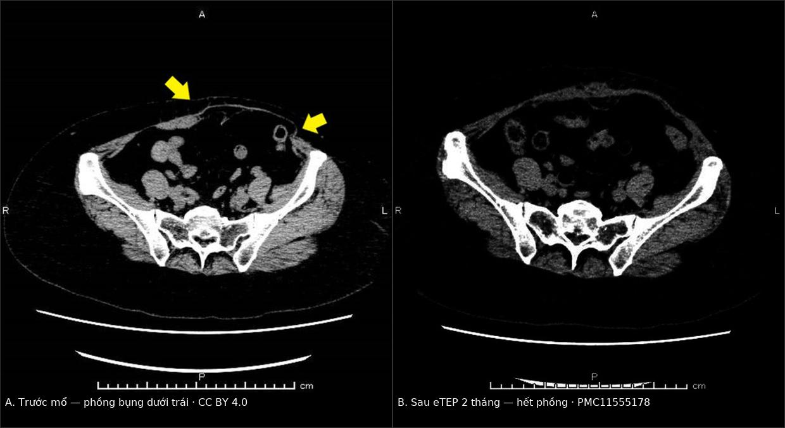
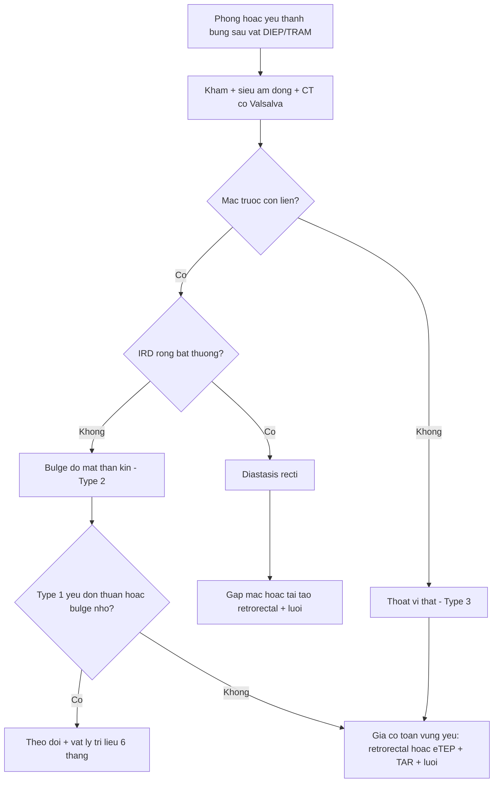
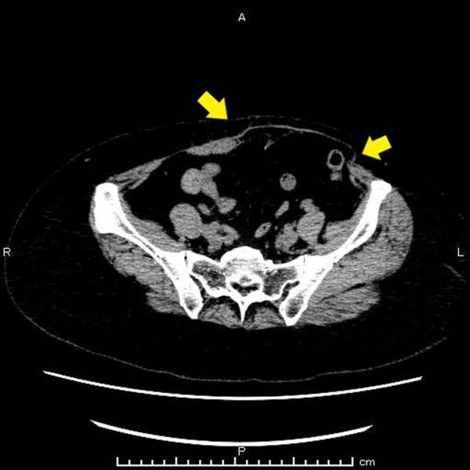
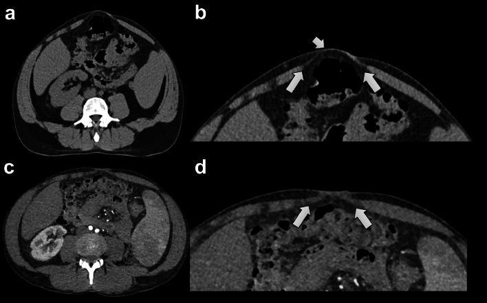

# 1871 — Phồng – yếu thành bụng sau lấy vạt DIEP/TRAM: bulge do mất thần kinh vs thoát vị thật, CT thì Valsalva và ngưỡng vá lưới

**Tags:** `pattern:phong-thanh-bung` `pattern:thoat-vi-thanh-bung` `vung:thanh-bung` `vung:vu` `anatomy:co-thang-bung` `score:Haddock` `protocol:CT-Valsalva` `protocol:sieu-am-dong`
**Mức chắc chắn (certainty):** tổng hợp y văn (literature synthesis) — ghép **tổng quan hệ thống 6 nghiên cứu về sửa bulge sau DIEP** (Gland Surg 2026, PMC13657785), **loạt 644 bệnh nhân có phân loại Haddock** (J Plast Reconstr Aesthet Surg 2021, PMID 33487570), **phân tích CT cơ thẳng bụng trước–sau lấy vạt** (Diagnostics 2022, PMC8947670), **ca eTEP sửa bulge 9,5 cm** (Surg Case Rep 2024, PMC11555178), **nghiên cứu CT Valsalva 95 bệnh nhân/205 thoát vị** (Hernia 2024, PMC11449955), **case–control về khâu gấp mạc** (J Clin Med 2025, PMC12653567) và **2 phân tích gộp** (Man 2009, PMID 19342994; Parmeshwar 2023, PMID 37697962). Không có ca do nhóm tự chụp.

> **Câu hỏi thực hành:** nữ **53 tuổi**, **3 năm** sau tái tạo vú bằng vạt DIEP trái, đến khám vì **bụng dưới trái phồng lệch**, không đau nhiều, không có khối sa khi ho. Khám: vùng chậu trái nhô ra khi gồng bụng, **không sờ thấy bờ lỗ khuyết**; chụp CT bụng vì lý do khác thấy **cơ thẳng bụng trái mỏng, mạc còn liên tục**. Câu hỏi: **đây là thoát vị, giãn cơ hay "bulge do mất thần kinh" — chụp thêm gì để phân biệt, và có cần mổ không?**
> Bài chốt **ba quyết định**: **(1) bulge = mạc liên tục + cơ mỏng/teo, không có túi — không phải thoát vị; (2) CT bụng–chậu có thì Valsalva là chuẩn để đo lỗ khuyết, đo khoảng cách hai cơ thẳng (IRD) và xác nhận mạc liền; (3) mạc liền thì vá lưới đơn thuần ít giá trị — điều trị theo kiểu hình Haddock: yếu/bulge nhỏ → theo dõi + vật lý trị liệu 6 tháng; bulge lớn/thoát vị/giãn cơ có triệu chứng → gia cố toàn vùng yếu (retrorectal/eTEP ± TAR), không chỉ vá ổ khuyết.** Nối [1689 – Nhiễm trùng và hoại tử vạt tự thân sau tái tạo vú](../1689-nhiem-trung-va-hoai-tu-vat-tu-than-sau-tai-tao-vu/lesson.md), [1687 – Hoại tử mỡ sau tái tạo vú](../1687-hoai-tu-mo-sau-tai-tao-vu-vat-ghep-mo/lesson.md), [516 – Hình ảnh vú sau điều trị](../516-hinh-anh-vu-sau-dieu-tri/lesson.md).

## 1. Tổng quan bệnh học – cơ chế hình ảnh: vì sao DIEP vẫn để lại "phồng" dù không cắt cơ

- **Tần suất – con số quyết định mức nghi ngờ:** bulge/thoát vị sau DIEP được báo cáo **1,6–33%** tuỳ định nghĩa (PMC11555178), nhưng trong các loạt có mẫu số rõ ràng thì **3,6–4,8%**: **23/644 (3,6%)** (PMID 33487570), **8/168 (4,8%)** phải mổ lại (PMID 17632336), **5/123 (4,1%)** bulge không có khuyết mạc (PMID 15655459); loạt vạt tự do hỗn hợp **9/62 (14,5%)** nhưng không tách được DIEP (PMC13657785). Vạt **TRAM có cuống** rõ ràng tệ hơn: **thoát vị thành bụng 16,0% vs 1,0%** ở DIEP trong 190 bệnh nhân (p < 0,001, PMID 16651940), và phân tích gộp cho **nguy cơ bulge/thoát vị giảm một nửa** với DIEP so với free TRAM (**RR 0,49; KTC 95% 0,28–0,86**) (PMID 19342994).
- **Vì sao DIEP vẫn "yếu" dù giữ cơ:** vạt DIEP giữ cơ thẳng và bao trước, nên **khuyết mạc thật là chuyện hiếm**; cái bị cắt là **nhánh vận động của thần kinh liên sườn T10–T12**, chạy giữa cơ chéo trong và cơ ngang bụng rồi **xuyên bao trước cơ thẳng ở phía ngoài hàng lỗ xuyên (lateral row)**. Bóc tách hàng xuyên bên ngoài hoặc lấy bỏ bao cơ để lấy vạt sẽ **cắt/đốt các nhánh này** (PMC8947670). Hậu quả là **teo và thoái hoá xơ–mỡ một phần thân cơ**, không phải rách mạc.
- **TẠI SAO cơ mỏng lại "phồng" dù áp lực ổ bụng không đổi:** thành bụng hành xử như **thành bình chịu áp** — lực căng tỉ lệ với **áp lực × bán kính** (Laplace), còn **độ cứng chống uốn tỉ lệ với luỹ thừa 3 của bề dày**. Giảm nửa bề dày cơ làm độ cứng còn khoảng **1/8**, nên chỉ cần áp lực ổ bụng như cũ (gồng bụng, đứng lâu, ho) là vùng đó **đẩy ra trước** — đó chính là bulge. Vì không có lỗ khuyết nên **không có túi phúc mạc**, và **không có nội tạng chui ra**.
- **Vì sao CT thấy được nguyên nhân:** cơ thẳng bình thường **dày và đậm (khoảng 40–60 HU)**, còn vùng thoái hoá xơ–mỡ **giảm đậm độ về phía mỡ (−50 đến −100 HU)** và **hẹp bề ngang**. Trong nghiên cứu CT trước–sau ở 12 bệnh nhân, bề ngang và bề dày cơ thẳng được đo ở **hai mặt phẳng ngang cách rốn 8 cm về trên và 8 cm về dưới**; nhiều bệnh nhân **giảm bề dày bên cho vạt**, một số **tăng bù bên đối diện**; **1 bệnh nhân phải mổ lại vì bulge bụng dưới** (PMC8947670). Chỉ **2 bệnh nhân giãn cơ > 30 mm** — ngưỡng nhóm nghiên cứu dùng để gọi là giãn đáng kể, **không phải ngưỡng đã được thẩm định**.
- **Vì sao vá lưới KHÔNG sửa được bulge:** phân tích gộp **2.791 bệnh nhân DIEP/11 nghiên cứu** (890 có lưới, 1.901 khâu mạc nguyên phát) cho thấy lưới **giảm rõ thoát vị đơn thuần** (**OR 0,28; p = 0,03** — giảm 72%) nhưng **không giảm bulge** (**OR 0,62; p = 0,43**) và **không giảm biến cố gộp bulge + thoát vị** (**OR 0,69; p = 0,20**) (PMID 37697962). Lý do: lưới **vá được lỗ khuyết**, nhưng **không hoàn nguyên được cơ đã mất thần kinh** — đúng như cơ chế ở trên.
- **Khâu gấp mạc (plication) có ích khi có giãn cơ:** trong 62 bệnh nhân (25 gấp mạc, 37 chứng), bulge gặp **16,2% ở nhóm chứng và 0% ở nhóm gấp mạc** (p = 0,095 — **chưa đủ lực thống kê**), điểm BREAST-Q "sức khoẻ thể chất – bụng" cao hơn ở nhóm gấp mạc (PMC12653567). Đây là bằng chứng **yếu, không ngẫu nhiên hoá**.
- **Yếu tố nguy cơ đã định lượng:** **có nhiễm trùng vết mổ** và **hy sinh thần kinh** tương quan với bulge/thoát vị (p < 0,05); **hàng xuyên bên ngoài, giữ rốn, BMI cao, lưới sinh học** chỉ **xu hướng**, không có ý nghĩa (PMID 33487570). Ở 198 bệnh nhân **đã có mổ bụng trước đó**, **10 (5,1%)** cần mổ vì bulge/thoát vị; nhóm bị biến chứng có **tỷ lệ dùng lưới vĩnh viễn 40,0% vs 13,3%** (p = 0,029) — **confounding do chỉ định**, không phải lưới gây biến chứng (PMC10775310).
- **Thời điểm xuất hiện – quan trọng cho lịch theo dõi:** khoảng cách từ tái tạo đến lúc mổ sửa rất rộng, **3 đến 66 tháng**; loạt robot trung bình **27,8 tháng (7–66)**; ca eTEP được mổ sau **3 năm** (PMC13657785, PMC11555178). Vì vậy **"mổ 6 tháng trước thấy bình thường" không loại trừ bulge**.

## 2. Mẫu hình + chẩn đoán phân biệt theo kiểu hình và vị trí (Gamut)

- **Kiểu hình (phenotype) — cách chia có ích cho điều trị** (Haddock 2021, PMID 33487570):
  - **Type 1 — yếu thành bụng (weakness):** chỉ có cảm giác yếu/chùng, **không có biến dạng nhìn thấy**, không có lỗ khuyết. Trong 644 bệnh nhân, **7% người trả lời BREAST-Q báo yếu bụng**, cao hơn ở nhóm **cắt rốn** (p < 0,05).
  - **Type 2 — bulge nhỏ, một bên:** nhô ra khi gồng, **mạc liền**, thường do **teo cơ sau mất thần kinh**, hay ở **bụng dưới cùng bên cho vạt**.
  - **Type 3 — thoát vị thật hoặc bulge lớn hai bên:** có **lỗ khuyết** hoặc biến dạng lan rộng hai bên đường giữa.
- **Gamut theo vị trí:**
  - **Bụng dưới cùng bên cho vạt:** bulge do teo cơ/đứt nhánh thần kinh — hay gặp nhất sau DIEP.
  - **Đường giữa trên/dưới rốn:** giãn cơ thẳng (**diastasis recti**) — có thể có từ trước, bị lộ ra sau khi thành bụng yếu đi.
  - **Quanh rốn:** thoát vị rốn, thoát vị tại **vết mổ cũ** (Pfannenstiel, mổ lấy vạt) — nhóm **mổ bụng hở** có nguy cơ cao hơn.
  - **Hông/dưới sườn:** thoát vị Spigelian, hoặc **giả thoát vị do zoster** (liệt cơ theo khoanh da) — không có lỗ khuyết.
- **Mnemonic 4 chữ "BULG":** **B**ulge do thần kinh (mạc liền), **U**mbilical/incisional hernia (có lỗ), **L**axity–diastasis (giãn đường giữa), **G**athering of fluid (seroma/tụ máu) — mỗi chữ một hướng xử trí khác nhau.

## 3. Bảng so sánh phân biệt (ma trận đối chiếu)

| Thực thể (entity) | Hình ảnh điển hình | Chốt vào (rule-in) | Chốt loại (rule-out) | Gợi ý xác nhận |
|---|---|---|---|---|
| **Bulge do mất thần kinh / teo cơ** | CT: cơ thẳng **mỏng, giảm đậm độ**, **mạc trước liên tục**, không túi; phồng rõ khi Valsalva; siêu âm: mạc liền + cơ mỏng | **Mạc liên tục trên mọi mặt phẳng + cơ mỏng so bên đối diện + tiền sử lấy vạt cùng bên** | Có **lỗ khuyết mạc** hoặc túi chứa mỡ/ruột → không phải bulge đơn thuần | CT có Valsalva + siêu âm động; đo bề dày cơ cách rốn 8 cm |
| **Thoát vị thật (ventral/incisional)** | Lỗ khuyết mạc rõ, **túi** chứa mỡ hoặc quai ruột, cổ túi hẹp; kích thước **tăng khi Valsalva** | **Thấy lỗ khuyết + nội dung thoát ra**, đau/tắc khi ho | Mạc liền, chỉ cơ mỏng → bulge | CT Valsalva đo **đường kính lỗ** (mm); so sánh 2 thì |
| **Giãn cơ thẳng (diastasis recti)** | Hai bờ cơ tách xa ở đường giữa, **IRD tăng**, không có lỗ khuyết riêng lẻ; hay kèm thoát vị rốn | **IRD đo được**, rộng hơn khi gồng; bờ cơ đều hai bên | Tổn thương lệch một bên ngoài đường giữa → nghĩ bulge/thoát vị | Đo IRD **tại rốn và 3 cm trên rốn** |
| **Seroma / tụ máu dưới da** | Khối **dịch** giữa da–cân và mạc, đậm độ dịch, không có nội dung ruột; không đổi theo Valsalva | **Đậm độ dịch + không thông với ổ phúc mạc**, thường vài tuần sau mổ | Có quai ruột/mỡ trong túi, Bormann rõ → thoát vị | Siêu âm; CT không cản quang; chọc hút chỉ khi nghi nhiễm |
| **Giả thoát vị do zoster (pseudohernia)** | Phồng một bên **theo khoanh da**, cơ thành bụng mỏng/liệt, **mạc liền**, không tiền sử mổ vùng đó | **Ban zoster cùng khoanh da** + liệt cơ khu trú | Không có ban, có lỗ khuyết → thoát vị thật | Khám da; CT xác nhận mạc liền |

*Trái: CT ngang trước mổ — thành bụng dưới trái mỏng, phồng ra, **mạc liên tục, không có túi** (mũi tên vàng của tác giả). Phải: sau eTEP + giải phóng cơ ngang bụng + lưới 20 × 20 cm, 2 tháng — đường viền thành bụng trở lại. Nguồn: Surg Case Rep 2024, PMC11555178, CC BY 4.0. Ảnh ghép letterbox, không crop.*

### Ba dấu hiệu quyết định trên CT
- **1. Mạc trước có liền không?** Rà **mặt phẳng ngang, dọc và coronal** — một lỗ khuyết nhỏ có thể chỉ thấy trên một mặt phẳng. Mạc liền trên cả ba = **không phải thoát vị**.
- **2. Cơ thẳng dày bao nhiêu so với bên đối diện?** Đo **bề dày và bề ngang** ở cùng mức; chênh lệch rõ cùng bên cho vạt = **teo sau mất thần kinh**. Đây là dấu **nguyên nhân**, không phải dấu của thoát vị.
- **3. Có "thay đổi theo áp lực" không?** Cho bệnh nhân **gồng bụng (Valsalva)** rồi chụp lại: bulge và thoát vị đều **tăng**, nhưng **thoát vị chỉ tăng khi có lỗ khuyết**, còn bulge tăng do **cơ mỏng đàn hồi kém**. Ở 95 bệnh nhân/205 thoát vị, **14–17% thoát vị chỉ thấy được khi Valsalva** (PMC11449955) — bỏ thì Valsalva là bỏ sót.

## 4. Protocol chụp + phân loại và ngưỡng xử trí

- **CT bụng–chậu (không cần cản quang đường uống):** lát **1–2 mm**, bệnh nhân nằm ngửa, tay đưa lên; chụp **2 thì: nghỉ và Valsalva tối đa**. Cần **che phủ toàn thành bụng từ mỏm ức tới khớp mu** — không cắt bớt "vì chỉ hỏi chuyện vú".
- **Đo gì – ghi gì (bộ tối thiểu):** **đường kính lỗ khuyết (mm)**, **kích thước túi (mm)**, **nội dung túi** (mỡ/ruột/bàng quang), **IRD tại rốn và 3 cm trên rốn**, **bề dày – bề ngang cơ thẳng ở 8 cm trên và 8 cm dưới rốn**, **vị trí lưới cũ** nếu có. Đây là bộ biến số mà tổng quan 2026 đề nghị để so sánh được giữa các lần chụp (PMC13657785).
- **Giá trị của thì Valsalva – số liệu cụ thể** (PMC11449955, 95 bệnh nhân, 205 thoát vị): kích thước túi **trung vị 31 mm khi Valsalva vs 24 mm khi nghỉ** (p < 0,001); **73–82%** thoát vị **rõ hơn** khi Valsalva; **14–17% chỉ thấy khi Valsalva**; **IRD tại rốn 23 vs 20 mm** (chênh 13%) và ở người giãn cơ thực sự **48 vs 39 mm** (chênh 19%); **phồng đường trắng 18% vs 10%**.
- **Siêu âm động là bạn đồng hành:** bulge = **mạc liền + cơ mỏng**; thoát vị = **mạc đứt + túi** (PMC12653567). Siêu âm rẻ, làm được khi gồng bụng, nhưng **không thay CT** khi cần đo lỗ khuyết để chọn lưới hay khi béo phì.
- **Phân loại Haddock + đường điều trị** (PMID 33487570; tổng quan 2026 bổ sung 6 kiểu hình mô tả, PMC13657785):

- **Ngưỡng và bằng chứng xử trí — nói rõ mức chắc chắn:**
  - **Type 1 và bulge nhỏ một bên không có lỗ khuyết:** theo dõi + **vật lý trị liệu cơ lõi 6 tháng** rồi đánh giá lại; không có dữ liệu so sánh cho thấy mổ sớm tốt hơn (PMC13657785 — **ý kiến chuyên gia, bằng chứng rất thấp**).
  - **Giãn cơ:** ngưỡng **IRD > 30 mm** chỉ là **tiêu chí của một loạt**, chưa thẩm định ở bệnh nhân sau DIEP (PMC8947670, PMC13657785).
  - **Thoát vị thật:** mổ theo nguyên tắc thoát vị — **đóng mạc khi làm được + lưới**; lưới giảm thoát vị **OR 0,28** nhưng **không giảm bulge** (PMID 37697962).
  - **Bulge lớn/hai bên/tái phát:** gia cố **toàn vùng yếu**, không chỉ ổ nhô. Ca eTEP: **lưới polypropylene 20 × 20 cm đặt retrorectal**, cố định vào dây chằng Cooper, sau **giải phóng cơ ngang bụng một bên**; không tái phát sau **2 tháng** (PMC11555178). Loạt robot **10 bệnh nhân**: **7/10** không tái phát, **2/10** tái phát **dưới vùng lưới**, **1/10** thoát vị **trên vùng vá**, theo dõi trung bình **16,9 tháng** (PMC13657785).
  - **Tái phát sau sửa do TRAM:** **20,9%**, lưới có vẻ bảo vệ so với chỉ khâu (Pinell-White 2014, dẫn qua PMC13657785) — **dữ liệu TRAM, không chuyển thẳng sang DIEP**.
  - **Không có thử nghiệm ngẫu nhiên nào**; toàn bộ bằng chứng sửa bulge là **hồi cứu, cỡ mẫu nhỏ, GRADE rất thấp** — mọi so sánh kỹ thuật chỉ mang tính giả thuyết.

## 5. Biến thể bình thường và cạm bẫy

- **Đường viền không đối xứng sau mổ là bình thường:** vạt lấy một bên, rốn có thể bị kéo lệch, mô mỡ hai bên khác nhau — **đừng gọi mọi chỗ lõm/nhô là bulge**. Chỉ gọi bulge khi **có triệu chứng hoặc biến dạng rõ khi gồng bụng**.
- **Chụp ở thì nghỉ:** bỏ mất **14–17%** thoát vị chỉ thấy khi Valsalva (PMC11449955). Nếu bệnh nhân **gồng không đủ** (đau, không hiểu lệnh), ghi rõ trong kết luận là **"Valsalva chưa đạt"** thay vì kết luận "không có thoát vị".
- **Nhầm seroma với thoát vị:** khối dịch sau mổ có **đậm độ dịch, không có quai ruột**, **không to hơn khi gồng**. Chọc hút chỉ khi nghi nhiễm — chọc vào túi thoát vị là tai biến.
- **Nhầm bulge với thoát vị → mổ sai:** nói "thoát vị" khiến bệnh nhân và phẫu thuật viên chấp nhận **vá ổ khuyết nhỏ**, trong khi vấn đề là **cả vùng cơ đã mất thần kinh** — đây là lý do phổ biến của **tái phát dưới/ngoài vùng lưới** (2/10 ca robot, PMC13657785).
- **Cạm bẫy "thoả mãn tìm kiếm":** CT ở bệnh nhân ung thư vú thường được đọc chỉ để tìm **di căn/tái phát**; thành bụng là vùng **dễ bị bỏ qua** — luôn rà thành bụng trên mọi CT bụng–chậu của bệnh nhân đã tái tạo bằng vạt bụng.
- **Giả thoát vị do zoster:** phồng một bên theo khoanh da, **mạc liền**, khởi phát sau đợt đau rát/ban — **không mổ**, điều trị zoster và theo dõi phục hồi.
- **Giữ rốn hay cắt rốn:** nhóm **cắt rốn** báo yếu bụng nhiều hơn (p < 0,05, PMID 33487570) — hỏi kỹ thuật mổ cũ trước khi quy kết "do vạt".

## 6. Tự lượng giá — Blind Quiz

**Ca 1 — Nữ 53 tuổi, 3 năm sau DIEP trái, bụng dưới trái phồng. Nhìn CT ngang, mô tả trước khi đọc đáp án.**

- Câu hỏi: Thành bụng dày hay mỏng? **Có lỗ khuyết mạc không?** Có nội tạng chui ra không? Chẩn đoán và bước tiếp theo?

<b>Bấm để hiện đáp án</b>

- **Findings:** thành bụng dưới **bên trái mỏng rõ** so với bên phải, da–mỡ đẩy ra trước (mũi tên vàng); **mạc trước liên tục**, **không có túi**, **không có quai ruột** ngoài ổ phúc mạc.
- **Chẩn đoán:** **bulge do teo cơ thẳng sau mất thần kinh** — không phải thoát vị. Bề ngang vùng phồng **9,5 cm** trên CT.
- **Bước tiếp theo:** đo bề dày cơ so bên đối diện + **IRD**, chụp thêm thì **Valsalva** nếu chưa có; điều trị theo kiểu hình (theo dõi/vật lý trị liệu nếu nhẹ, gia cố vùng yếu nếu có triệu chứng).
- Nguồn: Surg Case Rep 2024, PMC11555178, CC BY 4.0 (mũi tên của tác giả, giữ nguyên).

**Ca 2 — Cùng bệnh nhân sau mổ: so sánh hai thì CT.**

- Câu hỏi: Sau mổ thay đổi gì? Vì sao dùng **lưới 20 × 20 cm** thay vì vá đúng chỗ phồng?

<b>Bấm để hiện đáp án</b>

- **Findings:** sau **eTEP + giải phóng cơ ngang bụng (TAR) + lưới polypropylene 20 × 20 cm đặt retrorectal**, đường viền thành bụng cân đối lại, **không còn chỗ phồng**; không tái phát sau **2 tháng**.
- **Vì sao lưới rộng:** vấn đề là **cả vùng cơ mất thần kinh**, không phải một lỗ khuyết — gia cố **toàn vùng yếu** mới chịu được lực; vá đúng ổ nhô dễ tái phát **dưới/ngoài vùng lưới** (2/10 ca loạt robot).
- Nguồn: Surg Case Rep 2024, PMC11555178, CC BY 4.0. Ảnh ghép letterbox, không crop.

**Ca 3 — Nam 40 tuổi, bụng trên lồi khi gồng, không tiền sử mổ. Hai lần chụp CT cách nhau 2 tháng.**

- Câu hỏi: Ảnh nào có Valsalva? Dấu hiệu chính là gì? Đo gì để theo dõi?

<b>Bấm để hiện đáp án</b>

- **Findings:** hàng trên (a, b) là **CT có Valsalva**: đường trắng **giãn rộng**, phồng ra trước (mũi tên); hàng dưới (c, d) là CT **không Valsalva** chụp 2 tháng trước: **không thấy phồng**, khoảng cách hai cơ nhỏ hơn.
- **Số đo:** IRD **64 mm** khi Valsalva; ở nghiên cứu 95 bệnh nhân, IRD tại rốn **23 vs 20 mm**, ở người giãn cơ thực sự **48 vs 39 mm**; **phồng đường trắng 18% vs 10%**.
- **Chẩn đoán:** **diastasis recti** — không phải thoát vị (mạc liền, không túi). Theo dõi bằng **IRD tại rốn và 3 cm trên rốn**, cùng điều kiện gồng.
- Nguồn: Hernia 2024, PMC11449955, CC BY 4.0 (mũi tên và nhãn của tác giả, giữ nguyên).

## Bài liên quan chéo
- [1689 – Nhiễm trùng và hoại tử vạt tự thân sau tái tạo vú](../1689-nhiem-trung-va-hoai-tu-vat-tu-than-sau-tai-tao-vu/lesson.md)
- [1687 – Hoại tử mỡ sau tái tạo vú bằng vạt ghép mỡ](../1687-hoai-tu-mo-sau-tai-tao-vu-vat-ghep-mo/lesson.md)
- [516 – Hình ảnh vú sau điều trị](../516-hinh-anh-vu-sau-dieu-tri/lesson.md)
- [165 – Dày thành ruột](../165-day-thanh-ruot/lesson.md) (phân biệt thành bụng – thành ruột trên CT)

## Ảnh
- Năm ảnh, **tất cả CC BY 4.0**, tải từ Europe PMC; nguồn và giấy phép từng file ở `images/CREDITS.md`; ảnh ghép tạo bằng `tools/make_composite.py` (**letterbox, không crop, không kéo giãn**).

> Không dùng để chẩn đoán độc lập khi chưa có người hướng dẫn.
