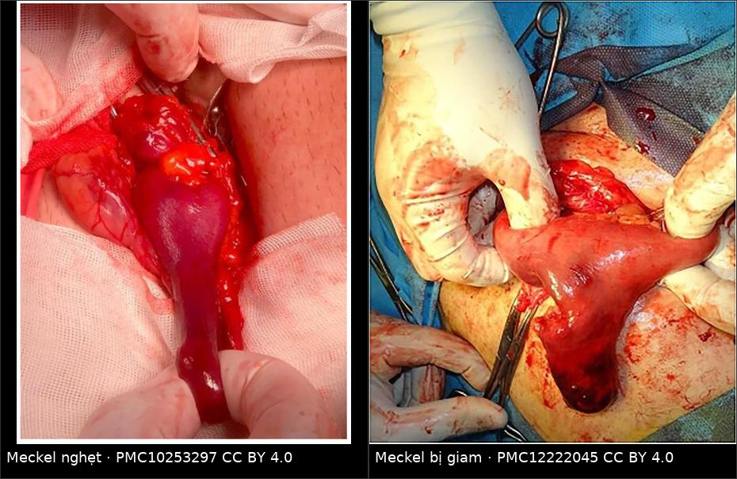
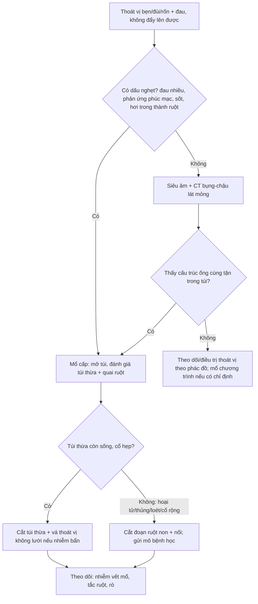
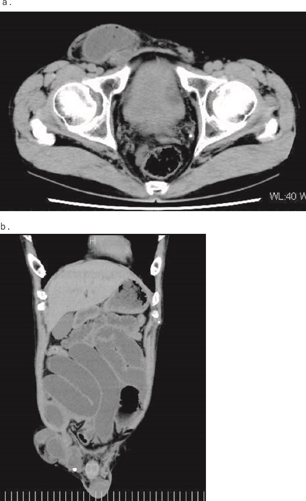
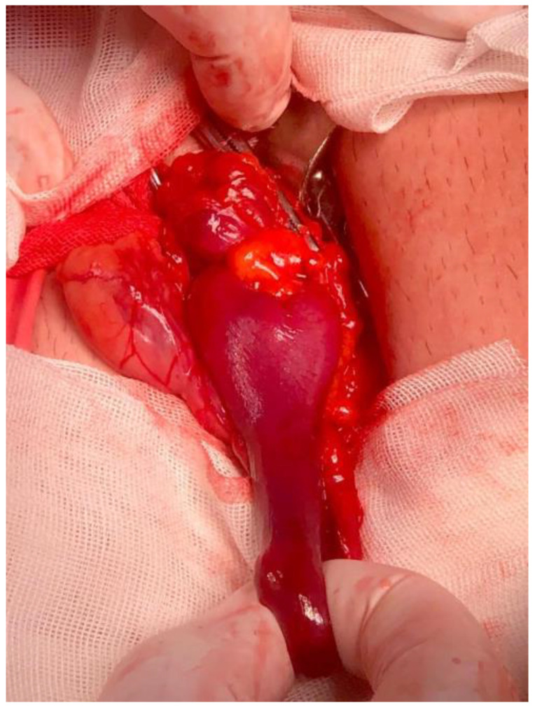
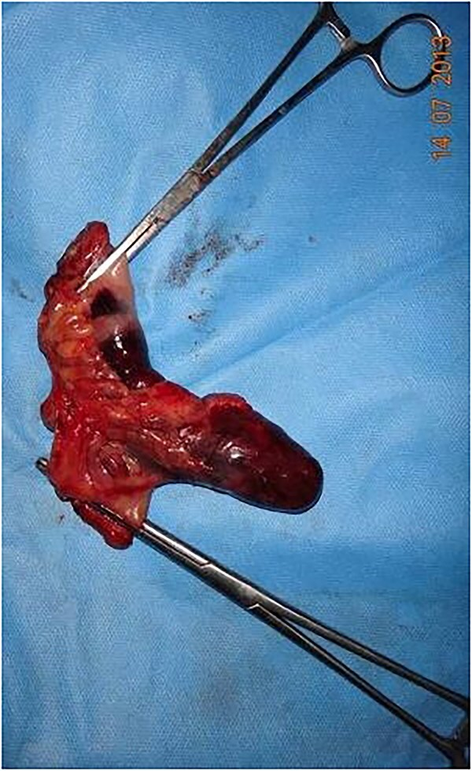

# 1872 — Thoát vị Littre: túi thừa Meckel trong túi thoát vị / Littre hernia

**Tags:** `pattern:thoat-vi` `pattern:khoi-thanh-bung` `pattern:tac-ruot` `vung:thanh-bung` `vung:ruot-non` `protocol:CT-bung-co-can-quang` `incidentaloma:khong`

**Mức chắc chắn (certainty):** tổng hợp y văn (literature synthesis) — số liệu chính từ **một tổng quan hệ thống 98 ca** (PMC10253297), **một scoping review 21 ca thoát vị rốn ở trẻ** (PMC11180487) và **ba báo cáo ca có ảnh** (PMC11948991; PMC12222045; PMC10253297). Chưa có thử nghiệm ngẫu nhiên; các ngưỡng xử trí là thực hành đồng thuận, chỗ suy luận được ghi rõ.

> **Câu chốt:** Littre là **"ruột thừa thứ hai" của túi thoát vị** — túi thừa Meckel (Meckel diverticulum) chui vào túi bẹn/đùi/rốn. Ba con số quyết định: **(1)** chỉ **0,09%** các thoát vị nghẹt là Littre (PMC12222045), nhưng trong 98 ca y văn **38,46% đã nghẹt** và **25,93% có hoại tử** (PMC10253297); **(2)** vị trí **hay gặp nhất là ống đùi (50%)**, rồi ống bẹn (27,55%), rốn (11,22%) — ngược với trực giác "bẹn là chính" (PMC10253297); **(3)** tử vong chung **11,22%**, nhưng **9/11 ca tử vong thuộc thế kỷ 18–đầu 20** → đừng dùng con số này để tiên lượng bệnh nhân hôm nay (PMC10253297).

## 1. Tổng quan bệnh học – cơ chế hình ảnh (TẠI SAO)

### 1.1 Túi thừa Meckel là gì và vì sao nó "đi lạc" vào túi thoát vị

- **Túi thừa Meckel** là di tích **ống noãn hoàng (omphalomesenteric / vitelline duct)**: một túi **thật** (đủ 3 lớp thành ruột) nằm ở **bờ đối mạc treo của hồi tràng**, cách **van hồi manh tràng khoảng 60 cm**. Quy tắc 2 cổ điển: **2% dân số**, **2 feet (≈ 60 cm)** từ van hồi manh tràng, **2 inch (≈ 5 cm)** dài.
- Trong tổng quan 98 ca Littre, **chiều dài túi thừa trung bình 5,43 ± 3,67 cm** (PMC10253297) — đúng với quy tắc 2. Túi **dài + cổ hẹp** là điều kiện để đầu tự do sa vào **cổ thoát vị hẹp** rồi bị kẹt.
- **TẠI SAO hay nghẹt:** túi thừa là **cấu trúc cùng tận (blind-ending)** nằm trên **bờ đối mạc treo** — không có mạc treo riêng đỡ, chỉ có **động mạch ống noãn hoàng (vitelline artery)** đi trong dây xơ. Khi cổ túi thoát vị chật (đặc biệt **ống đùi**), quai hồi tràng đi kèm bị kéo, xoay quanh túi thừa → **nghẹt cuống mạch** trước khi cả quai ruột kịp nghẹt.
- **Niêm mạc lạc chỗ (ectopic mucosa):** tổng quan ghi **21,21%** có mô lạc chỗ, **12,12% có loét**, **9,09% có u** (PMC10253297). Mô **dạ dày lạc chỗ** tiết acid → loét bờ túi thừa → **chảy máu hoặc thủng trong túi thoát vị**, làm bệnh cảnh nặng thêm dù ruột chưa nghẹt.

### 1.2 Vì sao ống đùi đứng đầu bảng (50%) — và vì sao phải đọc lại con số này một cách phản biện

- Trong 98 ca: **đùi 50% (49 ca)**, **bẹn 27,55% (27)**, **rốn 11,22% (11)**, bịt 3,06% (3), Spiegel 2,04% (2), **qua hoành (transthoracic) 2,04% (2)** (PMC10253297).
- Giải thích hợp lý: **cổ ống đùi hẹp và cứng** (dây chằng Cooper – dây chằng lược), nên chỉ một **cấu trúc mảnh, dài** như túi thừa mới dễ lọt và kẹt; quai ruột non to hơn khó lọt hơn. Đây cũng là lý do **thoát vị đùi nghẹt chủ yếu ở nữ cao tuổi** — trong review, đùi gặp ở nữ **34:14** (tỷ lệ 2,4:1), còn bẹn gặp ở nam **21:6** (3,5:1) (PMC10253297).
- **Phản biện (bắt buộc):** đây là **y văn ca bệnh (case-report literature)**, không phải đoàn hệ dân số. Ca **đùi nghẹt ở cụ bà** được đăng nhiều hơn ca bẹn ở nam trẻ; **thiên lệch công bố** có thể thổi phồng tỷ lệ đùi. Không được suy ra "50% Littre là đùi" cho mọi bệnh nhân.

### 1.3 Tại sao chẩn đoán trước mổ lại khó — vật lý của "quai ruột trong túi"

- Trên **X-quang bụng**, dấu hiệu chỉ là **mức khí – dịch / giãn ruột non** của tắc ruột, **không định danh được túi thừa**. Vì vậy X-quang được dùng **56,14%** nhưng gần như không bao giờ đặt được chẩn đoán Littre (PMC10253297).
- Trên **CT**, túi thừa hiện ra như **cấu trúc hình ống, cùng tận, thành có bắt thuốc, nằm trong túi thoát vị**, có thể chứa **khí/dịch** hoặc **sỏi phân (fecalith)**; dấu hiệu này **không khác** một quai ruột non bị giam thông thường trừ khi thấy rõ **đầu cụt (blind end)** tách khỏi quai chính. CT chỉ được dùng **29,82%**, và **8,77%** ca dùng CT đơn thuần (PMC10253297).
- Trên **siêu âm**, cấu trúc **hình ngón tay/ống cùng tận** với **dấu hiệu ruột (gut signature)** nằm trong túi, không nhu động hoặc nhu động kém; siêu âm được dùng **24,56%** (PMC10253297). Ở trẻ, siêu âm là bước đầu vì **không bức xạ**.
- Hệ quả thực hành: **chẩn đoán trước mổ rất hiếm**. Trong 21 ca thoát vị rốn Littre ở trẻ, chỉ **2/21 (9,5%)** được chẩn đoán trước mổ (PMC11180487). **Chẩn đoán xác định là trong mổ** — mở túi, nhìn thấy túi thừa.

### 1.4 Các con số dịch tễ và kết cục (đọc kèm cảnh báo)

- **Tuổi trung bình 56,69 ± 16,87**; nữ **53**/nam **45**, tỷ lệ nữ:nam **1,2:1**; bên **phải 78,3%** (PMC10253297).
- **Cấp cứu 90,2%** (55/61 ca có dữ liệu) (PMC10253297).
- **Nghẹt 38,46%** (35/91), **hoại tử túi thừa hoặc ruột 25,93%** (14/54); **tắc ruột 35,62%** (26/73), cao nhất ở thoát vị bẹn **45%** (PMC10253297).
- **Tử vong chung 11,22%** (11 ca), **8,7%** ở nhóm phải cắt ruột; **9/11 ca tử vong thuộc 1700–1933** → tử vong thực tế thời hiện đại thấp hơn nhiều (PMC10253297).
- **Cắt túi thừa** là phẫu thuật phổ biến nhất, sau đó **cắt đoạn ruột**; **5,48%** để lại túi thừa không cắt (PMC10253297).
- Theo dõi trung bình **19,5 ± 10,29 tháng**, **không ca nào tái phát** — nhưng thời gian theo dõi ngắn, không đủ để nói "không cắt là an toàn" (PMC10253297).

## 2. Mẫu hình + chẩn đoán phân biệt theo vị trí (gamut)

- **Theo vị trí cổ thoát vị:** bẹn (nam trưởng thành) → đùi (nữ cao tuổi) → rốn (trẻ nhỏ và người lớn) → bịt/Spiegel (hiếm, "little old lady hernia": tuổi trung bình **73,33 ± 2,36** trong review) (PMC10253297).
- **Theo nội dung túi — gamut "tạng lạ trong túi thoát vị":**
  - **Túi thừa Meckel = Littre** (bài này).
  - **Ruột thừa = Amyand** (bài 1740). Hai thể có thể **cùng tồn tại**: đã có ca bẹn khổng lồ chứa **manh tràng + ruột thừa + túi thừa Meckel + hồi tràng** (PMC13304216).
  - **Chỉ một phần chu vi ruột = Richter** (không tắc ruột hoàn toàn, dễ thủng).
  - **Hai quai ruột hình W = Maydl** (nguy cơ nghẹt quai giữa rất cao).
  - **Túi thừa bàng quang = hernia của bàng quang** (CT thấy cấu trúc dịch, không có thành ruột).
  - **Nang mạc treo / mỡ mạc treo / mạc nối** (khối đặc – dịch không có thành ruột).
- **Mnemonic:** **L**ittre = **L**oop có **L**ỗ cụt (blind-ending loop); **A**myand = **A**ppendix; **R**ichter = **R**ing (chỉ một vòng thành ruột); **M**aydl = **M**ột chữ **W** (hai quai).

## 3. Bảng so sánh phân biệt (ma trận đối chiếu)

| Thực thể (entity) | Hình ảnh điển hình (US/CT) | Chốt vào (rule-in) | Chốt loại (rule-out) | Gợi ý xác nhận |
|---|---|---|---|---|
| **Littre (túi thừa Meckel)** | Ống **cùng tận**, thành ruột, nằm trong túi; có thể có fecalith/khí; quai hồi tràng đi kèm | **Đầu cụt tách khỏi quai chính** + vị trí bờ đối mạc treo + túi dài | Cấu trúc có **đáy thông với lòng ruột ở cả hai phía** → không phải túi thừa | Mổ mở túi; **soi 60–100 cm hồi tràng**; mô bệnh học |
| **Amyand (ruột thừa)** | Ống cùng tận **ở cực manh tràng**, đường kính **6–10 mm**, có thể có sỏi phân | **Nối liền với manh tràng**, có **dấu hiệu viêm ruột thừa** | Ống nằm **xa manh tràng**, bờ đối mạc treo hồi tràng → nghĩ Littre | Mổ; không chọc/dẫn lưu qua da |
| **Richter** | Thành ruột **một phần chu vi** bị kẹp, lòng ruột vẫn lưu thông | **Không có tắc ruột hoàn toàn** nhưng **đau + hoại tử khu trú** | Tắc ruột hoàn toàn + giãn nhiều quai → không phải Richter đơn thuần | Mổ: kiểm tra thành ruột tại cổ túi |
| **Maydl (W-loop)** | **Hai quai** trong túi, quai giữa nằm trong ổ bụng | **Hai quai + quai nối trong ổ bụng** trên CT/mổ | Chỉ một quai trong túi → loại Maydl | Mổ: kéo kiểm tra toàn bộ quai |
| **Quai ruột non giam đơn thuần** | Quai giãn, thành dày, dịch trong túi, **không có đầu cụt** | **Quai ruột liên tục** đi qua cổ túi | Thấy **cấu trúc cùng tận riêng** → nghĩ Littre | Mổ; CT chỉ gợi ý |
| **Túi thừa bàng quang trong túi bẹn** | Cấu trúc **dịch đồng nhất**, thành mỏng, **không có hơi ruột**, liên tục với bàng quang | **Nối với bàng quang**, bờ nhẵn, không có hơi | Có **hơi + fecalith + thành ruột** → loại bàng quang | CT có cản quang niệu; VCUG nếu cần |
| **Nang mạc treo / mỡ mạc treo** | Khối **dịch/đặc thuần**, không có thành ruột, không có hơi | **Không có thành ruột**, không có hơi | Có **hơi trong lòng + thành ruột** → loại nang | Siêu âm/CT; mô bệnh học |

*Trái: túi thừa Meckel **nghẹt, tím đen** sau khi mở túi thoát vị (PMC10253297, CC BY 4.0). Phải: túi thừa **bị giam** trong túi bẹn (PMC12222045, CC BY 4.0). Ảnh ghép letterbox, không crop.*

### Đọc CT thế nào cho đúng (dấu hiệu định vị)

- **Đường đi của quai:** quai hồi tràng **chui qua cổ túi** rồi tới túi thừa. Nếu thấy **hai cấu trúc ống** trong túi — một quai đi qua và một túi cụt — thì Littre là chẩn đoán hàng đầu.
- **Dấu hiệu "target" và "whirl":** xoắn cuống mạch của túi thừa quanh trục → **dấu xoáy (whirl sign)** ở cuống; thành túi **không bắt thuốc** = hoại tử.
- **Hơi trong thành túi (pneumatosis)**: dấu hiệu **thủng/hoại tử**, nhưng **không có hơi không loại trừ** hoại tử (xem mục 5).
- **Cỡ và vị trí:** đo **chiều dài túi** và **đường kính cổ túi**; cổ càng hẹp so với thân túi thì nguy cơ nghẹt càng cao. Đây là số đo mô tả, không có ngưỡng mm được kiểm chứng để quyết định mổ.

## 4. Protocol chụp + chiến lược xử trí

- **Siêu âm bụng – bẹn – bìu** trước (trẻ em, phụ nữ có thai): tìm **cấu trúc ống cùng tận trong túi**, đánh giá nhu động, dịch, thành ruột.
- **CT bụng – chậu có cản quang tĩnh mạch, lát mỏng 1–2 mm**, **phủ tới bìu/ống đùi** (trường đọc thường quy hay cắt mất vùng bẹn – bìu). Không dùng cản quang uống thường quy; nếu cần phân biệt rò/thủng thì dùng cản quang tan trong nước.
- **Không nong/thẩm phân mạnh tay để "đẩy ruột lên"** khi có phản ứng phúc mạc, đau nhiều, hoặc dấu nghẹt: nguy cơ **giảm thể tích (reduction en masse)** — đẩy cả túi thoát vị vào ổ bụng, triệu chứng dịu nhưng ruột vẫn hoại tử.
- **Mổ là tiêu chuẩn vàng.** Mở túi, **hút dịch**, đánh giá túi thừa và quai ruột; **soi 60–100 cm hồi tràng** để không bỏ sót túi thừa thứ hai hoặc dây xơ.
- **Chọn phẫu thuật:** cắt túi thừa (diverticulectomy) nếu cổ hẹp, túi thừa còn sống, không loét; **cắt đoạn ruột** nếu cổ rộng, hoại tử, thủng, loét chảy máu, hoặc nghi u. **Không đặt lưới (mesh)** khi có nhiễm bẩn/hoại tử; lưới chỉ dùng khi vùng mổ sạch (trong review, lưới được dùng nhiều hơn ở nhóm cắt túi thừa, nhưng đây là dữ liệu quan sát, không phải khuyến cáo) (PMC10253297).
- **Túi thừa còn sống, tình cờ, ở người lớn:** dữ liệu y văn để lại **5,48%** không cắt, **không tái phát trong 19,5 tháng** (PMC10253297) — nhưng đây là **suy luận yếu**, không đủ để khuyên bỏ túi thừa ở người trẻ.

## 5. Biến thể bình thường và cạm bẫy

- **Giảm thể tích (reduction en masse):** "đẩy lên được" không đồng nghĩa "an toàn". Túi thoát vị + ruột nghẹt bị đẩy vào **khoang tiền phúc mạc**, bụng mềm giả tạo, ruột vẫn hoại tử. **Không thử đẩy khi có dấu nghẹt.**
- **Bỏ sót vì "thỏa mãn tìm kiếm":** thấy ruột trong túi là đủ để gọi "thoát vị nghẹt" rồi đóng. Phải **mở túi, nhìn đầu cụt** và **soi hồi tràng** — nếu không, Littre/Amyand/Maydl bị bỏ qua. Ca **Amyand + Littre + Hodgkin** (PMC13304216) là ví dụ hai bệnh cùng lúc.
- **Hơi trong túi ≠ thủng:** hơi có thể từ **thủ thuật/ống thông** hoặc từ ruột bình thường; ngược lại **hoại tử không có hơi** vẫn xảy ra. Quyết định dựa trên **lâm sàng + thành ruột không bắt thuốc**, không dựa riêng vào hơi.
- **Thoát vị đùi ở cụ bà:** đừng mặc định "chỉ là quai ruột"; tỷ lệ Littre cao nhất ở vị trí này (50%) và **tuổi trung bình của thể bịt là 73,33** (PMC10253297).
- **Thoát vị rốn ở trẻ:** trong 21 ca, **61,9% đã có biến chứng** và chỉ **9,5% chẩn đoán trước mổ** (PMC11180487) — không được xem là "rốn lồi lành tính" khi trẻ đau.
- **Mô lạc chỗ và u:** **9,09%** ca có u trong túi thừa (PMC10253297) — **luôn gửi mô bệnh học**, kể cả khi túi thừa trông lành.
- **Theo dõi ngắn:** "không tái phát" trong 19,5 tháng **không** trả lời được câu hỏi dài hạn, đặc biệt với túi thừa để lại.

## 6. Tự lượng giá — Blind Quiz

**Ca 1 — Nam 54 tuổi, đau bụng 2 ngày, nôn, bẹn phải căng đau, không đẩy lên được.**

- Hỏi: mô tả hai bất thường chính? Ba chẩn đoán phân biệt cho "nội dung túi"? Dấu hiệu nào trên CT **không** phân biệt được Littre với quai ruột giam?

<b>Bấm để hiện đáp án</b>

- **Findings:** (a) túi thoát vị bẹn phải chứa **quai ruột non**; (b) **nhiều quai ruột non giãn, mức khí – dịch** phía trên = **tắc ruột non** do thoát vị nghẹt.
- **Chẩn đoán:** thoát vị bẹn nghẹt; **không loại trừ được Littre** trên CT vì quai ruột bình thường và túi thừa Meckel đều là "ống ruột trong túi". Chẩn đoán xác định khi mổ: **túi thừa Meckel 70 cm từ van hồi manh tràng**, kèm **thay đổi khẩu kính ruột** trước – sau túi thừa.
- **Phân biệt:** Littre, Amyand, quai ruột giam đơn thuần, Richter, Maydl.
- **Nguồn ảnh:** Nakayama Y et al., J Surg Case Rep 2025 — **PMC11948991** — Fig. 1, **CC BY-NC 4.0**.

**Ca 2 — Nam 66 tuổi, bẹn nghẹt 72 giờ; mổ mở túi thấy cấu trúc tím đen.**

- Hỏi: cấu trúc này là gì? Vì sao nó nghẹt dù quai ruột chính còn sống? Xử trí?

<b>Bấm để hiện đáp án</b>

- **Findings:** túi thừa **hình ống, cùng tận, thành tím đen**, xuất phát từ **bờ đối mạc treo hồi tràng** — túi thừa Meckel bị nghẹt tại cổ túi.
- **Vì sao:** cổ túi thừa hẹp + túi dài 5,43 cm trung bình → cuống mạch bị chèn trước khi cả quai ruột nghẹt; đây là lý do **"một phần" ruột hoại tử dù bệnh nhân chỉ đau vừa**.
- **Xử trí:** cắt túi thừa/túi thừa + đoạn ruột hoại tử; **không đặt lưới** trong vùng nhiễm; gửi mô bệnh học.
- **Nguồn ảnh:** Răcăreanu M et al., J Clin Med 2023 — **PMC10253297** — Fig. 2, **CC BY 4.0**.

**Ca 3 — Bệnh phẩm sau mổ của ca bẹn nghẹt.**

- Hỏi: vì sao phải cắt **đoạn ruột** thay vì chỉ cắt túi thừa? Điều gì phải làm với bệnh phẩm?

<b>Bấm để hiện đáp án</b>

- **Findings:** đoạn hồi tràng được cắt **kèm túi thừa** — chọn cắt đoạn khi cổ túi rộng, thành túi hoại tử, hoặc không đảm bảo được miệng nối an toàn sau khi cắt túi thừa.
- **Bắt buộc:** **mô bệnh học** tìm **mô lạc chỗ (21,21%), loét (12,12%), u (9,09%)** — những tổn thương này quyết định theo dõi tiếp.
- **Nguồn ảnh:** Khamas A, Salih S, J Surg Case Rep 2025 — **PMC12222045** — Fig. 2, **CC BY 4.0**.

## Bài liên quan chéo
- [160 – Bụng cấp: tiếp cận chẩn đoán](../160-bung-cap-GI/lesson.md)
- [161 – Viêm ruột thừa cấp](../161-viem-ruot-thua-cap/lesson.md)
- [162 – Tắc ruột](../162-tac-ruot/lesson.md)
- [1740 – Thoát vị Amyand ở trẻ](../1740-thoat-vi-amyand-o-tre/lesson.md)
- [3103 – Rò trực tràng – niệu đạo sau xạ trị tiền liệt tuyến](../3103-ro-truc-trang-nieu-dao-sau-xa-tri-tien-liet-tuyen/lesson.md)

## Ảnh
- `images/1872_hoat-vi-littre_CT_PMC11948991.jpg` — CT ngang + trục dọc, **PMC11948991**, CC BY-NC 4.0.
- `images/1872_hoat-vi-littre_Mo_PMC10253297.jpg` — túi thừa nghẹt trong mổ, **PMC10253297**, CC BY 4.0.
- `images/1872_hoat-vi-littre_Mo_PMC12222045.jpg` — túi thừa bị giam, **PMC12222045**, CC BY 4.0.
- `images/1872_hoat-vi-littre_BenhPham_PMC12222045.jpg` — bệnh phẩm cắt đoạn ruột, **PMC12222045**, CC BY 4.0.
- `images/composite_littre.jpg` — ảnh ghép 2 thể trong mổ, letterbox, **PMC10253297 + PMC12222045**, CC BY 4.0.
- Chi tiết giấy phép từng file: `images/CREDITS.md`.

> Không dùng để chẩn đoán độc lập khi chưa có người hướng dẫn.
