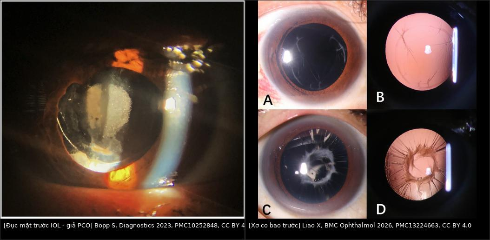
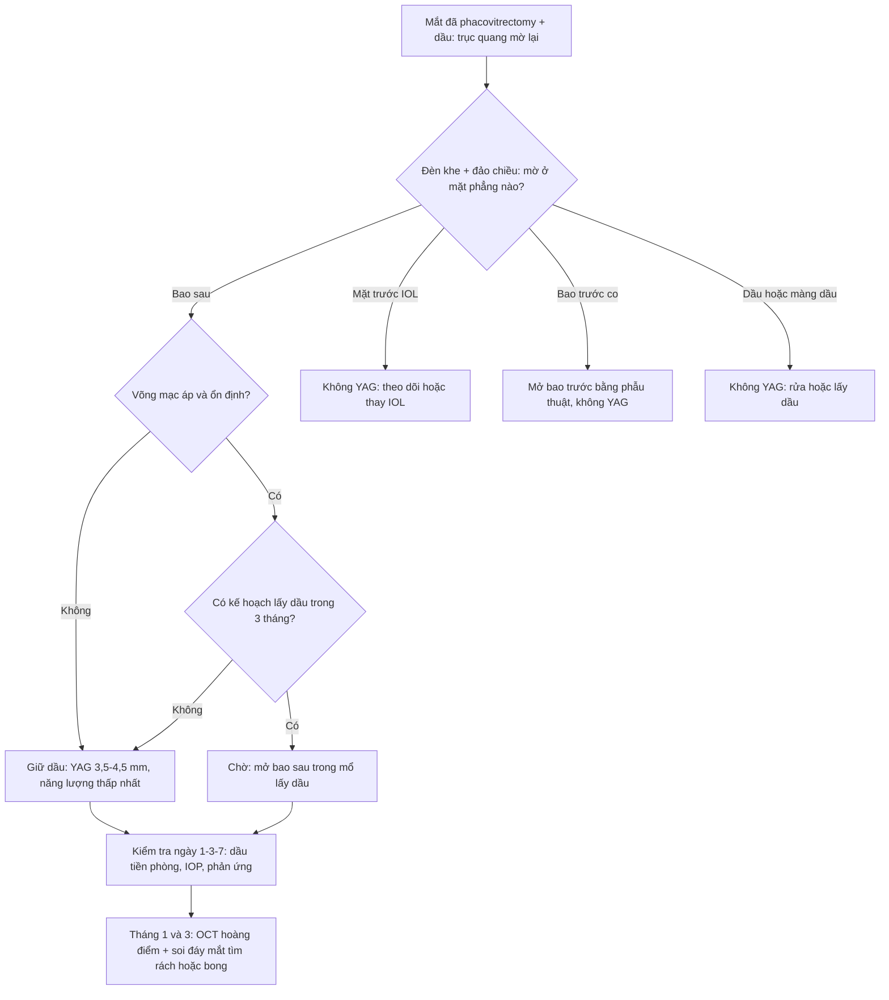
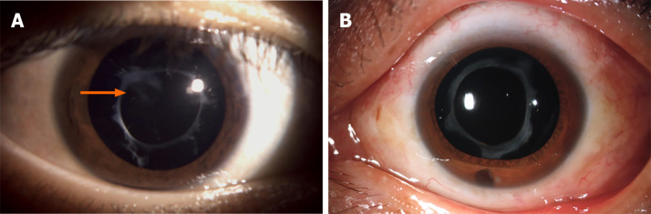
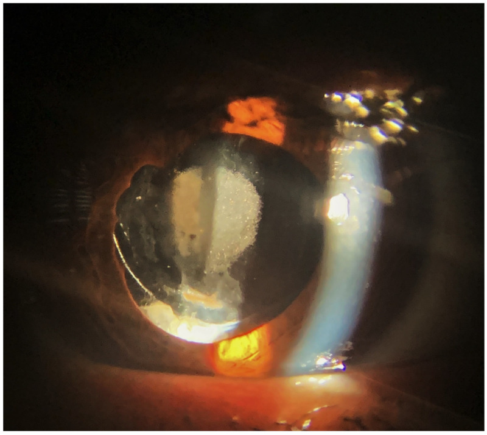
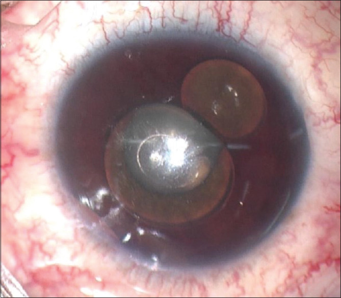
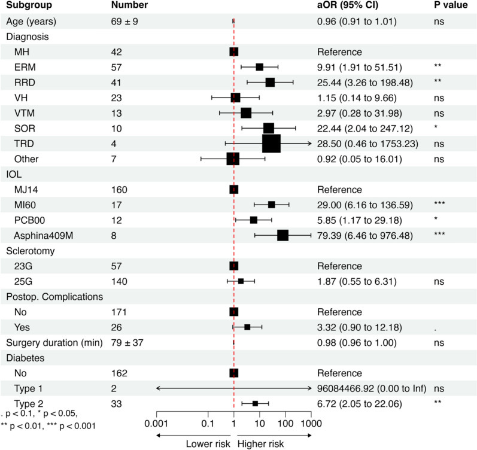

# 1873 — Bao sau đục (PCO) sau phaco trên mắt bơm dầu: Nd:YAG khi còn dầu hay chờ lấy dầu / PCO in the silicone oil-filled eye

**Tags:** `pattern:duc-bao-sau` `pattern:ngoc-trai-elschnig` `pattern:duc-truc-quang` `pattern:co-bao-truoc` `pattern:dau-tien-phong` `pattern:duc-iol` `vung:the-thuy-tinh` `vung:tien-phong` `vung:mat` `vung:dich-kinh` `protocol:den-khe` `protocol:retro-illumination` `protocol:AS-OCT` `protocol:YAG` `protocol:phacovitrectomy` `score:YAG-capsulotomy`
**Mức chắc chắn (certainty):** tổng hợp y văn (literature synthesis) — nhóm tự biên, đã đối chiếu `authorString`/PMCID: nguy cơ PCO sau phacovitrectomy 197 mắt (CC BY 4.0, PMC12979282), quản lý bao ở mắt bơm dầu 73 mắt (CC BY-NC 4.0, PMC8462261), xơ bao trước sau phacovitrectomy 70 mắt (CC BY 4.0, PMC13224663), cập nhật Nd:YAG (CC BY-NC 4.0, PMC13676808), PCO tái phát (CC BY-NC, PMC11283270), đục/calcification IOL sau PPV (CC BY 4.0, PMC10252848), dầu tiền phòng gây pupillary block (CC BY-NC-SA 4.0, PMC10062094). Chỗ nhóm suy luận cơ học được ghi rõ "suy luận".

> **Vì sao bài này quan trọng:** bài **1863** quyết định *mổ phaco khi còn dầu hay lấy dầu trước*; bài **1837** dạy *dầu ở tiền phòng phá nội mô*; bài **1410** dạy *khi nào lấy dầu*. Nhưng sau khi đã đặt IOL, câu hỏi tiếp theo ở mọi buổi tái khám là: **"trục quang mờ lại — YAG bây giờ khi còn dầu, hay chờ lấy dầu?"** Sau phacovitrectomy **27,41% mắt phải YAG trong 6 năm**, và nhóm có lấy dầu sau phacovitrectomy có **aOR 22,44** so với nhóm mổ lỗ hoàng điểm (PMC12979282) — tức mắt bơm dầu là nhóm PCO nặng nhất. Mở bao sau khi còn dầu có thể đẩy dầu ra tiền phòng (dầu **tỷ trọng 0,97**, nổi lên trên) và làm IOL nghiêng — trong khi **3,5–4,5 mm** lỗ mở là đủ để dầu đi qua nếu không còn hàng rào bao sau.

## 1. Tổng quan bệnh học – cơ chế hình ảnh: vì sao mắt bơm dầu đục bao sau sớm và dày

- **Bệnh học:** PCO là quá trình **tế bào biểu mô thể thủy tinh (lens epithelial cell — LEC)** còn lại ở xích đạo bao trước **tăng sinh → chuyển dạng nguyên bào sợi cơ (myofibroblast) → di chuyển ra bao sau**. Hai kiểu hình ảnh: **ngọc trai Elschnig** (đám tế bào cầu, trong, xếp "chùm nho") và **màng xơ trắng đục** (fibrous plaque, thường trung tâm, dày, khó mở bằng YAG). Ở mắt bơm dầu, màng xơ chiếm ưu thế vì có thêm **viêm mạn mức thấp** tại mặt phân cách dầu–bao.
- **TẠI SAO mắt bơm dầu đục nhanh hơn (bắt buộc giải thích):**
  1. **Viêm → xơ hóa qua TGF-β/IL-6.** Bong võng mạc và thao tác lấy dầu tạo **đáp ứng viêm mạnh**, hoạt hóa con đường **TGF-β qua IL-6** — đúng cơ chế được nêu cho nhóm có **aOR cao nhất** trong nghiên cứu 197 mắt (PMC12979282).
  2. **Dầu là "vật thể lạ" thường trực.** Dầu silicone **n = 1,404**, **tỷ trọng 0,97**, độ nhớt **1.000–5.000 cSt** (bài 1863, PMC13635028) → dầu **áp sát mặt sau IOL/bao sau**, duy trì phản ứng mô và **cản trở thanh thải protein** trong khoang bao.
  3. **Mất hàng rào dịch kính + oxy hóa.** Sau cắt dịch kính, oxy và cytokine khuếch tán tự do vào khoang sau — điều kiện thuận cho LEC tăng sinh; đục thể thủy tinh nói chung xuất hiện ở **tới 80% mắt còn thể thủy tinh trong 2 năm** sau PPV, và **đục dưới bao sau (PSC) 63,6%** ở nhóm bơm dầu (bài 1863, PMC12980855).
  4. **Bao trước cũng xơ.** Ở phacovitrectomy không đặt IOL, **điểm xơ bao trước 6/36 khi đánh bóng bao vs 24/36 khi không** (p < 0,001); **bơm dầu là yếu tố nguy cơ độc lập (b = 8,734)** cùng đái tháo đường (b = 14,634) và không đánh bóng (b = 13,731) (PMC13224663). Bao trước co (phimosis) làm **trục quang hẹp dần** và **IOL bị ép nghiêng** — không phải PCO, và **YAG không chữa được**.
- **Ngưỡng định lượng (theo `PROMPT_SYNTHESIZER.md`):**
  - **YAG capsulotomy sau phacovitrectomy: 54/197 mắt = 27,41%** trong **6 năm**; so với mổ lỗ hoàng điểm (tham chiếu): **ERM aOR 9,91** (1,91–51,51), **bong võng mạc aOR 25,44** (3,26–198,48), **lấy dầu silicone aOR 22,44** (2,04–247,12), **ĐTĐ type 2 aOR 6,72** (2,05–22,06) (PMC12979282).
  - **Loại IOL quan trọng hơn cả bệnh nền:** so với IOL MJ14, **MI60 aOR 29,0**, **Asphina 409M aOR 79,39**, **PCB00 (acrylic ưa nước phủ kỵ nước) aOR 5,85** — chênh tới **13 lần** giữa các IOL cùng dùng (PMC12979282).
  - **Bao trước:** điểm xơ **6 vs 24/36** (đánh bóng vs không); **dầu silicone b = 8,734** (PMC13224663).
  - **Hậu quả khi mở bao sau bằng YAG:** rách võng mạc **0,21%** và bong võng mạc **0,60%** trong **90 ngày**, **cộng dồn 1,39% ở 12 tháng**, tập trung trong **5 tháng đầu**; phân tích gộp cho **~1,5 lần** nguy cơ bong (PMC13676808). **CME sau YAG 1,23%** (Steinert) và **~5%** trong **3 tháng đầu** (nghiên cứu dân số YAG2) (PMC13676808).
  - **Đục IOL (không phải PCO):** 14 mắt phải thay IOL sau PPV, **khoảng cách trung bình 20,5 ± 18,6 tháng**, **3/14 mắt có bơm dầu**; thị lực **0,43 → 0,67 logMAR** trước thay và **0,48 sau thay** (PMC10252848).
- **Vật lý của Nd:YAG trong mắt bơm dầu:** YAG (1064 nm) tạo **plasma → sóng xung kích + bọng khí**, cắt bao bằng **quang đập vỡ (photodisruption)** nên **cần môi trường trong**; dầu trong, nên tia vẫn tới bao — nhưng **năng lượng và số pulse cao làm tổn thương màng hyaloid trước**, được xem là cơ chế tăng co kéo võng mạc (PMC13676808). Ngoài ra mỗi pulse để lại **vết khía trên IOL** nếu mặt phẳng hội tụ quá gần IOL (IOL pitting) — vì vậy **khởi đầu năng lượng thấp nhất hiệu quả và tăng từng bước**, không "bắn tổng lực một lần".
- **TẠI SAO mở bao sau lại đẩy dầu ra trước (suy luận cơ học, ghi rõ):** bao sau là **hàng rào cuối** giữa khoang dầu và tiền phòng. Khi YAG mở lỗ **3,5–4,5 mm** giữa khi **đường kính quang học IOL chỉ 6 mm** và **túi bao 10–11 mm**, phần **chu vi quanh IOL** vẫn thông với khoang sau; dầu **nhẹ hơn nước (0,97)** nổi lên trên nên dầu ở **12 giờ** dễ đi qua lỗ mở và **vòng ra trước IOL** — đúng bệnh cảnh dầu tiền phòng sau phacovitrectomy (bài 1863, PMC12548765) và ca **dầu tiền phòng gây pupillary block IOP 67 mmHg** (PMC10062094). Bằng chứng gián tiếp: khi **không còn bao** (aphakia), người ta **chủ động dùng khoang tiền phòng chứa dầu** để tamponade đủ — nghĩa là **không có bao/IOL hàng rào thì dầu đi ra trước** (PMC8673844, chỉ dùng số liệu).

## 2. Mẫu hình + chẩn đoán phân biệt theo vị trí mờ (Gamut)

- **Mẫu hình lõi:** mắt đã phacovitrectomy ± dầu, thị lực **giảm dần không đau**; **retroillumination** thấy màng trắng/xám sau IOL (PCO) hoặc **vòng bao trước co** (phimosis); **ánh đồng tử mờ** nhưng **đáy mắt vẫn nhìn được một phần**; đồng tử có thể **dính sau** nếu viêm.
- **Gamut theo "mờ ở đâu" (5 tầng):**
  1. **Mờ ở bao sau** → PCO màng xơ (trung tâm, dày), ngọc trai Elschnig (chu vi lỗ mở cũ), **PCO tái phát sau YAG** (hiếm ở người lớn, nhưng **mắt đã cắt dịch kính là yếu tố nguy cơ**) (PMC11283270).
  2. **Mờ ở bao trước** → **co xơ bao trước/phimosis** (vòng xơ dày, có nếp), đục bao trước; **YAG không phải điều trị**.
  3. **Mờ ở IOL** → **đục/calcification mặt trước IOL** (mảng trắng trong diện đồng tử, **bờ haptic sạch**), thường **20,5 tháng** sau PPV, ưu thế IOL acrylic ưa nước (PMC10252848).
  4. **Mờ ở tiền phòng** → **dầu nhũ tương/dầu tự do** (giọt lấp lánh, **váng dầu**), **màng fibrin**, **dính mống mắt–IOL**; nếu **tiền phòng nông + IOP cao** → pupillary block do dầu.
  5. **Mờ ở dịch kính/giác mạc** → **dầu tồn lưu**, **phù giác mạc do dầu bám nội mô** (bài 1837), **xuất huyết dịch kính**.
- **Dấu hiệu hình ảnh giúp chốt:** retroillumination (PCO vs màng dầu), **AS-OCT** (độ dày màng bao sau, khoảng cách bao–IOL, dầu tiền phòng), **sinh hiệu chỉnh độ phản xạ trên mặt phẳng IOL** (pitting cũ), **B-scan** khi không nhìn đáy mắt.
- **Mnemonic "BAO–IOL–DẦU":** **B**ao sau (PCO), **A**nh mờ do bao trước co, **O**ptic IOL đục, **I**OL nghiêng, **D**ầu tiền phòng, **ẦU**... dùng để nhắc **6 tầng** khi đứng đèn khe: bao sau → bao trước → IOL → tiền phòng → dịch kính → giác mạc.

## 3. Bảng so sánh phân biệt (ma trận đối chiếu)

| Thực thể (entity) | Hình ảnh / đặc điểm điển hình | Chốt vào (rule-in) | Chốt loại (rule-out) | Gợi ý xác nhận |
|---|---|---|---|---|
| **PCO màng xơ (fibrous PCO)** | Màng trắng **trung tâm, dày, bờ đứt nét**, sau IOL; retroillumination chặn sáng | **Tiền sử phacovitrectomy ± dầu + màng trung tâm dày + thị lực giảm dần** | Màng **mỏng đều, không trung tâm** + giọt lấp lánh → nghĩ màng dầu/nhũ tương | Đèn khe + retroillumination; AS-OCT đo độ dày màng |
| **Ngọc trai Elschnig** | Đám **cầu trong, vàng-xám** xếp chuỗi ở **chu vi lỗ bao sau** | **Hạt cầu dọc bờ lỗ mở cũ**, tăng dần theo tháng | Mảng đặc trung tâm → màng xơ, không phải ngọc trai | So ảnh cũ; chụp retroillumination |
| **Xơ co bao trước (anterior capsule phimosis)** | **Vòng xơ dày, nếp co**, đường kính mở bao nhỏ dần; có thể **ép IOL nghiêng** | **Đánh bóng bao không làm / bơm dầu (b = 8,734) + vòng xơ co + trục quang hẹp** | Bao trước **mở rộng, bờ mỏng** → không phải phimosis | AS-OCT tiền phòng; đo đường kính mở bao |
| **Đục/calcification IOL** | Mảng trắng **trong diện đồng tử, dừng ở bờ haptic**, IOL acrylic ưa nước, **20,5 ± 18,6 tháng** sau PPV | **Bờ quang học đục, haptic sạch + tiền sử PPV/bơm dầu (3/14)** | Đục **sau IOL** (thấy rõ khi retroillumination, màng ở mặt phẳng sau) → PCO | Đèn khe đảo chiều; chụp mặt phẳng IOL; **YAG không có lợi** |
| **Dầu nhũ tương/màng dầu** | **Giọt lấp lánh**, "váng" mặt sau IOL, có thể **tế bào giả** ở tiền phòng | **Tiền sử bơm dầu + giọt di động theo tư thế + không Tyndall thật** | **Tyndall thật + đau + dính sau đồng tử** → viêm nội nhãn/viêm màng bồ đào | Đèn khe, AS-OCT, B-scan (tăng phản xạ do tán xạ) |
| **Dầu tiền phòng (sau YAG/mở bao)** | **Bọt dầu lớn không nhũ tương** ở bờ đồng tử, **tiền phòng nông**, IOP tăng | **Ngay–vài tuần sau YAG/thủ thuật + bọt dầu + IOP > 30 mmHg** (ca điển hình **67 mmHg**) | **Giọt nhỏ < 1 µm, không tăng IOP** → chỉ dầu nhũ tương, theo dõi | Đèn khe + AS-OCT; đo IOP 2 mắt; soi góc |
| **PCO tái phát sau YAG** | **Màng mỏng phủ lại lỗ mở** + ngọc trai ở bờ | **Lỗ mở từng thông rồi mờ lại; mắt đã PPV, cận thị cao, ĐTĐ, IOL nước cao** | **Mờ do dầu/IOL** (không phải bao) → không YAG lần 2 | So ảnh ngay sau YAG; AS-OCT |

*Trái: đục mặt trước IOL — mảng trắng trong diện đồng tử nhưng **bờ haptic sạch**, đục dừng ở mặt phẳng IOL (Bopp S et al., Diagnostics 2023, PMC10252848, Fig. 4, CC BY 4.0). Phải: xơ co bao trước sau phacovitrectomy — (A, B) xơ nhẹ–trung bình, (C, D) xơ nặng có nếp co (Liao X et al., BMC Ophthalmol 2026, PMC13224663, Fig. 1, CC BY 4.0). Ảnh ghép letterbox, không crop.*

### Ba dấu hiệu định vị màng mờ (đọc chuẩn xác)
- **Mặt phẳng mờ so với IOL:** màng **sau IOL** (PCO) di chuyển **ngược chiều** với IOL khi đảo chiều đèn; màng **trên IOL** (đục IOL/fibrin) di chuyển **cùng** mặt phẳng quang học.
- **Bờ tổn thương:** đục IOL **dừng ở bờ haptic**; PCO **lan tới xích đạo bao** (không có bờ haptic).
- **Đáp ứng YAG:** PCO mở **ngay tại chỗ bắn** (thấy mảnh bao trôi); đục IOL **chỉ bị khía/pitting** — nếu "YAG không ăn", nghĩ lại chẩn đoán trước khi bắn thêm.

## 4. Protocol: chuẩn bị trước YAG, thông số và quyết định thời điểm

- **Trước YAG — bắt buộc ghi đủ 5 mục:**
  1. **Thị lực + khúc xạ + IOP hai mắt** (theo dõi cả mắt lành).
  2. **Đèn khe + retroillumination + đảo chiều:** chốt **mặt phẳng** mờ (bao sau / IOL / tiền phòng) và **đo đường kính vùng mờ** (mm).
  3. **AS-OCT tiền phòng:** độ dày màng bao sau, khoảng cách màng–IOL, **dầu tiền phòng**, độ nghiêng IOL.
  4. **Đáy mắt gián tiếp/siêu âm B:** võng mạc **áp**, PVR, dầu còn bao nhiêu, **vị trí dầu so với trục quang** — quyết định có mở bao ngay hay không.
  5. **Kế hoạch lấy dầu:** nếu dự kiến lấy dầu trong **≤ 3 tháng**, **chờ** và **mở bao sau ngay trong mổ lấy dầu** (một lần vào mắt) thay vì YAG trước.
- **Kỹ thuật YAG khi vẫn còn dầu:**
  - **Đường kính lỗ mở 3,5–4,5 mm** (đủ trục quang, không mở rộng quá vì **lỗ lớn → IOP tăng nhiều hơn và lệch khúc xạ viễn thị kéo dài tới 4 tuần**) (PMC13676808).
  - **Năng lượng khởi đầu thấp nhất hiệu quả, tăng từng bước**; tổng năng lượng và số pulse **càng thấp càng tốt** (liên quan **IOP tăng kéo dài, CME, pitting và tổn thương màng hyaloid**) (PMC13676808).
  - **Bắn vòng chu vi trước, trung tâm sau** để tránh mảnh bao lớn rơi vào tiền phòng khi còn dầu; **không bắn vào vị trí có dầu tiền phòng**.
  - **Dự phòng:** hạ IOP bằng **apraclonidine** trước/sau; **NSAID tại chỗ ± corticoid** quanh thủ thuật (CME sau YAG **1,23–5%**) (PMC13676808).
- **Theo dõi sau YAG (quan trọng hơn thủ thuật):** **ngày 1, 3, 7** đo **IOP + tiền phòng** (tìm **dầu ra trước**, phản ứng viêm); **tháng 1, 3** OCT hoàng điểm (CME) và **soi đáy mắt tìm rách/bong** (nguy cơ tập trung **5 tháng đầu**) (PMC13676808).
- **Phân tầng quyết định (flowchart):**

- **Phòng PCO ngay từ thì đầu (bằng chứng mới):** **cắt bao sau bằng phẫu thuật trong phacovitrectomy (PPSC)** không làm tăng phù hoàng điểm (**5,7% vs 3,2%**, p = 0,37) và **không có ca IOL lệch/lệch trung tâm**, đồng thời **bỏ được nhu cầu YAG sau này** (249 mắt; **126 mắt có PPSC**) (PMC13630084). Ở mắt bơm dầu, **cắt bao sau trong mổ** cũng được dùng để tránh PCO (PMC8462261).

## 5. Biến thể bình thường và cạm bẫy

- **"Mờ trục quang" không đồng nghĩa PCO:** **đục mặt trước IOL** (bờ haptic sạch, **20,5 tháng** sau PPV) và **xơ co bao trước** đều giả PCO — **YAG không có lợi**, thậm chí làm **pitting IOL** và **tăng nguy cơ bong** (PMC10252848, PMC13224663).
- **Bao trước co là bệnh của "vòng", không phải "màng":** đường kính mở bao nhỏ dần theo tuần–tháng, **kèm IOL nghiêng**; điều trị là **mở bao bằng phẫu thuật** hoặc **đánh bóng bao từ thì đầu** (điểm xơ **6 vs 24/36**) (PMC13224663).
- **Dầu tiền phòng sau YAG có thể không đau ngay:** bệnh nhân về nhà "ổn", rồi **IOP tăng dữ dội** (ca **67 mmHg**, thị lực **đếm ngón tay**); phải **hẹn khám ngày 1** và **dặn quay lại ngay nếu đau/nhìn mờ** (PMC10062094).
- **Đừng bắn YAG "thử" khi chưa loại trừ dầu tiền phòng:** dầu ở tiền phòng làm **tiền phòng nông**, tia hội tụ sai mặt phẳng → **pitting IOL + tổn thương nội mô**; xử trí là **đẩy dầu ra sau/rửa tiền phòng**, không phải YAG.
- **Ngọc trai Elschnig nhỏ, ngoài trục quang:** có thể **chỉ theo dõi** nếu thị lực/độ chói không ảnh hưởng; YAG chỉ để **chỉnh thị lực**, không phải để "làm sạch hình".
- **PCO tái phát sau YAG hiếm ở người lớn nhưng mắt đã PPV là nhóm nguy cơ:** nếu lỗ mở mờ lại **trong vài tuần**, kiểm tra lại **IOL và dầu** trước khi bắn lần hai (PMC11283270).
- **Lấy dầu "đúng lịch 3–6 tháng" không phải lý do để hoãn YAG:** ngược lại, **nếu sắp lấy dầu** thì **mở bao sau trong mổ lấy dầu** an toàn hơn YAG khi còn dầu; còn nếu **võng mạc chưa ổn định**, YAG khi còn dầu là lựa chọn để **nhìn được đáy mắt** (bài 1863).

## 6. Tự lượng giá — Blind Quiz

**Ca 1 — Nam 62 tuổi, phacovitrectomy + dầu 8 tháng. Thị lực 20/80, không đau. Đèn khe: màng trắng sau IOL, retroillumination chặn sáng trung tâm. Võng mạc áp, dầu còn, kế hoạch lấy dầu sau 4 tháng.**

- Gợi ý: IOP 15 mmHg, không dầu tiền phòng, AS-OCT thấy màng dày 120 µm sau IOL.
- Câu hỏi: Chẩn đoán? YAG ngay hay chờ? Nếu YAG, đường kính và mức năng lượng?

<b>Bấm để hiện đáp án (findings + chẩn đoán)</b>

- Dấu hiệu: (A) **màng bao sau dày trung tâm** (mũi tên) sau IOL — PCO màng xơ trên mắt bơm dầu; (B) cùng mắt sau khi **cắt bao sau** — trục quang trong.
- Chẩn đoán: **PCO màng xơ** trên mắt bơm dầu. Vì **kế hoạch lấy dầu trong 4 tháng** và võng mạc ổn định → **chờ và mở bao sau trong mổ lấy dầu** là lựa chọn ít nguy cơ nhất; nếu cần nhìn đáy mắt trước đó thì YAG **3,5–4,5 mm, năng lượng khởi đầu thấp nhất**, theo dõi **dầu tiền phòng ngày 1–3–7**.
- Nguồn: Jiang B et al., World J Clin Cases 2021 (PMC8462261), Fig. 2, CC BY-NC 4.0; số liệu nguy cơ: Lachota M et al., Int Ophthalmol 2026 (PMC12979282), CC BY 4.0.

**Ca 2 — Nữ 58 tuổi, phacovitrectomy + dầu 2 năm (dầu còn). Thị lực 20/30, chói nhẹ. Đèn khe: mảng trắng giữa đồng tử, "không ăn" sau 2 lần YAG ở tuyến trước.**

- Gợi ý: mảng trắng dừng đúng bờ haptic; AS-OCT: bao sau mỏng, không dầu tiền phòng; IOL acrylic ưa nước.
- Câu hỏi: Vì sao YAG thất bại? Chẩn đoán thay thế? Xử trí?

<b>Bấm để hiện đáp án (findings + chẩn đoán)</b>

- Dấu hiệu: **đục mặt trước IOL** — mảng trắng trong diện đồng tử, **dừng ở bờ haptic**, không có màng ở mặt phẳng bao sau.
- Chẩn đoán: **đục/calcification IOL** (không phải PCO) — đã gặp ở **3/14 mắt bơm dầu** trong loạt thay IOL sau PPV, trung bình **20,5 ± 18,6 tháng**; YAG chỉ gây **pitting**, không cải thiện thị lực. Thị lực **20/30** → **theo dõi**; nếu giảm nhiều mới **thay IOL** (thị lực **0,67 → 0,48 logMAR** sau thay).
- Nguồn: Bopp S et al., Diagnostics 2023 (PMC10252848), Fig. 4, CC BY 4.0.

**Ca 3 — Nam 45 tuổi, phacovitrectomy + dầu 3 tuần, vừa YAG bao sau 2 ngày. Đau dữ dội, nhìn mờ, tiền phòng nông, thấy 2 bọt lớn ở bờ đồng tử. IOP 52 mmHg.**

- Gợi ý: giác mạc phù nhẹ, không mủ, không dính sau đồng tử; mắt còn dầu.
- Câu hỏi: Cơ chế? Chẩn đoán? Xử trí thứ tự?

<b>Bấm để hiện đáp án (findings + chẩn đoán)</b>

- Dấu hiệu: **bọt dầu silicone lớn, chưa nhũ tương** trong tiền phòng ở bờ đồng tử (ảnh gốc ở bệnh nhân còn thể thủy tinh) + **tiền phòng nông + IOP 52 mmHg**.
- Chẩn đoán: **dầu tiền phòng gây pupillary block** sau khi mất hàng rào bao sau (YAG). Xử trí: **hạ IOP nội–ngoại khoa (acetazolamide, mannitol, thuốc nhỏ)**, **đẩy dầu ra sau bằng viscoelastic/khí**, **rửa tiền phòng**, và **lấy dầu** nếu tái diễn; ca tương tự trong y văn đạt **IOP 67 mmHg** và phải **PPV + lấy dầu + rửa tiền phòng**. Phòng ngừa: hẹn khám **ngày 1–3–7** sau YAG, dặn quay lại ngay khi đau.
- Nguồn: Al-Habsi SH, Al-Abri MS, Oman J Ophthalmol 2023 (PMC10062094), Fig. 1, CC BY-NC-SA 4.0.

**Ca 4 — Bảng nguy cơ: đọc forest plot của 197 mắt phacovitrectomy.**

- Gợi ý: tham chiếu = mổ lỗ hoàng điểm; trục ngang log, phải = nguy cơ cao hơn.
- Câu hỏi: Nhóm bệnh nền nào nguy cơ cao nhất? Loại IOL nào cao nhất? Điều này đổi cách chọn IOL thế nào?

<b>Bấm để hiện đáp án (findings + chẩn đoán)</b>

- Dấu hiệu: **lấy dầu silicone aOR 22,44** và **bong võng mạc aOR 25,44** cao hơn hẳn ERM (9,91) và lỗ hoàng điểm (1,00); **Asphina 409M aOR 79,39**, **MI60 29,0**, **PCB00 5,85**; **ĐTĐ type 2 aOR 6,72**.
- Chẩn đoán/ứng dụng: ở mắt **sắp phacovitrectomy + dầu**, chọn **IOL ít gây PCO** ngay từ thì đầu và **cân nhắc cắt bao sau trong mổ** (PPSC không tăng CME — **5,7% vs 3,2%**) để tránh YAG trên mắt còn dầu.
- Nguồn: Lachota M et al., Int Ophthalmol 2026 (PMC12979282), Fig. 2, CC BY 4.0.

## Bài liên quan chéo
- [1863 – Đục thể thủy tinh ở mắt bơm dầu: một thì hay hai thì](../1863-duc-the-thuy-tinh-mat-bom-dau-silicone/lesson.md)
- [1837 – Dầu silicone trong tiền phòng & tổn thương nội mô giác mạc](../1837-dau-silicone-tien-phong-ton-thuong-noi-mo/lesson.md)
- [1410 – Lấy dầu silicone & dầu tồn lưu](../1410-lay-dau-silicone-va-dau-ton-luu/lesson.md)
- [1416 – Glôcôm do dầu silicone](../1416-glaucom-do-dau-silicone/lesson.md)
- [1432 – Thay dầu silicone: thiếu thể tích & nhũ tương hóa](../1432-thay-dau-silicone/lesson.md)
- [1442 – Mảnh thể thủy tinh còn sót trong tiền phòng](../1442-manh-the-thuy-tinh-con-sot/lesson.md)
- [1452 – Glôcôm do thể thủy tinh chưa mổ](../1452-glaucom-do-the-thuy-tinh-chua-mo/lesson.md)
- [1454 – Đặt IOL ở mắt phacolytic: chọn vị trí](../1454-dat-iol-mat-phacolytic/lesson.md)
- [1411 – Tăng nhãn áp do corticoid nội nhãn](../1411-tang-nhan-ap-do-corticoid-noi-nhan/lesson.md)
- [1875 – Phù hoàng điểm dạng nang sau phacovitrectomy trên mắt bơm dầu](../1875-phu-hoang-diem-dang-nang-mat-bom-dau/lesson.md)

> Không dùng để chẩn đoán độc lập khi chưa có người hướng dẫn.
