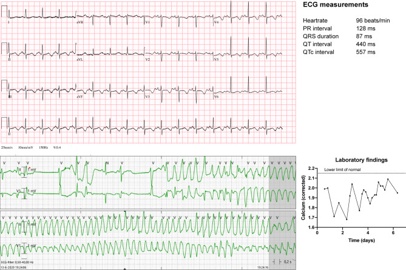
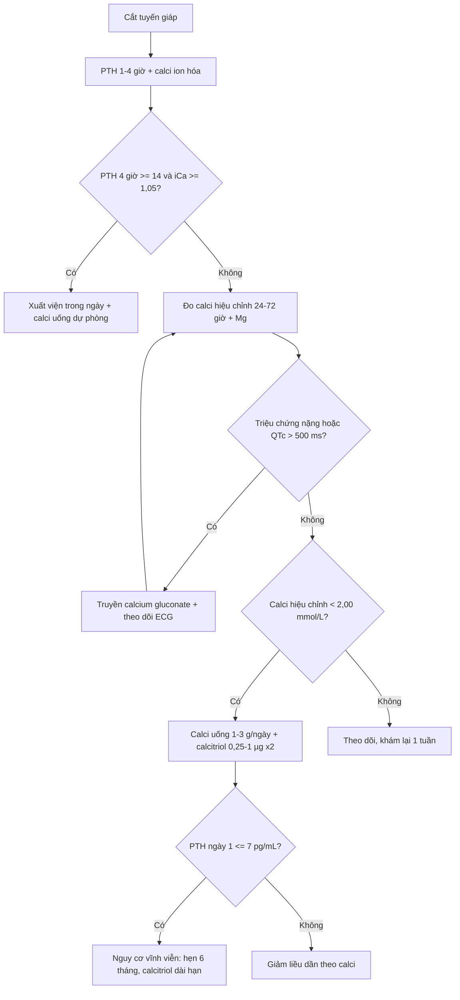
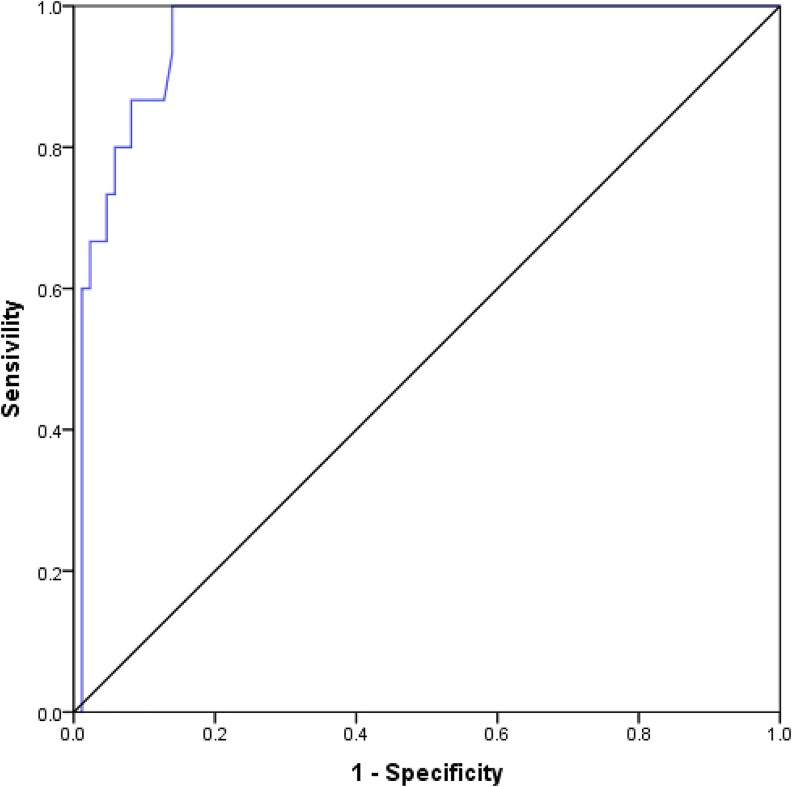
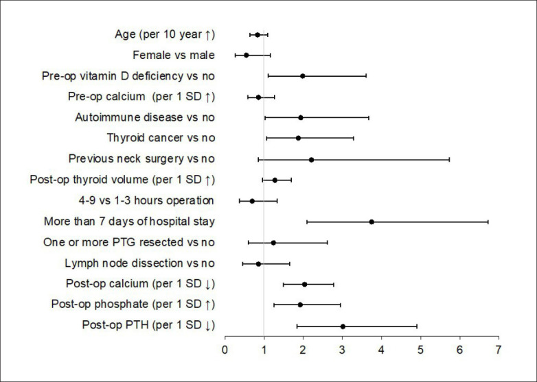

# 1874 — Hạ calci máu sau cắt tuyến giáp: ngưỡng calci hiệu chỉnh, PTH 1–6 giờ và tiêu chuẩn xuất viện / Post-thyroidectomy hypocalcemia

**Tags:** `pattern:ha-calci` `pattern:QT-dai` `pattern:co-giat` `vung:tuyen-giap` `vung:co` `protocol:xet-nghiem` `protocol:ECG` `score:PTH` `score:calci-hieu-chinh`
**Mức chắc chắn (certainty):** tổng hợp y văn (literature synthesis) — nhóm tự biên từ các nguồn mở, đã đối chiếu `authorString`/PMCID: 742 bệnh nhân cắt toàn bộ tuyến giáp với ngưỡng ioPTH (CC BY 4.0, PMC11785684), 498 bệnh nhân với PTH ngày 1 (CC BY 4.0, PMC13563876), 105 bệnh nhân với PTH 6 giờ (CC BY 4.0, PMC12819874), 60 bệnh nhân + phân tích gộp 5 nghiên cứu về PTH 1 giờ (CC BY 4.0, PMC13533580), 20 RCT/3.669 bệnh nhân về dự phòng calci–vitamin D (CC BY 4.0, PMC13330921), 204 bệnh nhân về vitamin D3 trước mổ (CC BY-NC-ND 4.0, PMC13326965), 153 bệnh nhân Ả-rập Xê-út (CC BY-NC 4.0, PMC13227346), 1 ca hội chứng xương đói (CC BY 4.0, PMC8271050), tổng quan điều trị (CC BY 4.0, PMC12990180; CC BY 4.0, PMC11383864). Chỗ nào là suy luận của nhóm đều ghi rõ "suy luận".

> **Vì sao bài này quan trọng:** cắt tuyến giáp là phẫu thuật nội tiết phổ biến nhất, và **hạ calci máu là biến chứng thường gặp nhất**: **51,6%** bệnh nhân có hạ calci máu sau mổ, **39,9% thoáng qua** và **11,7% vĩnh viễn** trong một đoàn hệ 742 người (PMC11785684); một trung tâm khác ghi **70,6%** (PMC13227346). Vấn đề không phải "có hay không có hạ calci" mà là **ai cần ở lại, ai về được trong ngày, ai phải truyền calci** — và **đo bằng calci toàn phần, calci hiệu chỉnh hay ion hóa**. Bài này đưa các **ngưỡng số** để trả lời, kèm **ba cạm bẫy chết người**: hạ calci **che giấu bởi albumin**, **kiềm hô hấp do thở nhanh** làm calci ion hóa tụt mà calci toàn phần bình thường, và **hội chứng xương đói** gây xoắn đỉnh dù đã truyền calci.

## 1. Tổng quan bệnh học – cơ chế hình ảnh: vì sao calci tụt sau mổ, và vì sao QT dài

- **Sinh lý bình thường:** PTH (parathyroid hormone) làm **tăng calci máu** theo ba đường — **tăng hủy xương**, **tăng tái hấp thu calci ở ống lượn xa**, và **tăng hoạt 1α-hydroxylase ở thận** để tạo **calcitriol (1,25-(OH)₂-D)** → tăng hấp thu calci ở ruột. PTH có **nửa đời 2–4 phút**, nên khi tuyến cận giáp bị **cắt, đụng dập hoặc mất mạch nuôi**, PTH tụt **trong vòng 1–6 giờ** — đây là cơ sở của mọi xét nghiệm sớm.
- **Bốn cơ chế hạ calci sau cắt giáp (TẠI SAO):**
  1. **Suy cận giáp do mổ (surgical hypoparathyroidism):** giảm khối tuyến → PTH thấp → giảm hủy xương, giảm tái hấp thu calci, giảm calcitriol. Chiếm phần lớn ca **sớm < 24 giờ**.
  2. **Hội chứng xương đói (hungry bone syndrome):** xương đang "khát" calci sau khi hết trạng thái cường giáp/nhiễm độc giáp → **tăng lấy calci vào xương** ngay sau khi PTH tụt; calci tụt **sâu và kéo dài**, đáp ứng kém với truyền calci (PMC8271050).
  3. **Hạ magnesi máu:** Mg thấp làm **giảm tiết và giảm tác dụng PTH** → hạ calci **không đáp ứng** với calci/calcitriol cho tới khi bù Mg.
  4. **Kiềm hô hấp / thay đổi gắn protein:** kiềm làm **calci gắn albumin nhiều hơn** → **calci ion hóa giảm** dù calci toàn phần bình thường; đây là cạm bẫy của bệnh nhân **thở nhanh vì đau hoặc lo lắng** sau mổ (PMC13123684).
- **Vì sao QT dài — vật lý điện học:** calci ngoại bào thấp làm **kéo dài pha 2 (plateau) của điện thế hoạt động cơ tim** vì dòng calci vào qua kênh L-type giảm và bất hoạt chậm; trên ECG, **khoảng QT dài, ST dài, T dẹt**; khi QTc đủ dài → **xoắn đỉnh (torsades de pointes)**. Ca minh họa: bệnh nhân nữ 49 tuổi sau cắt giáp, **QT 440 ms, QTc 557 ms**, nhiều cơn xoắn đỉnh **không có cung lượng**, phải **isoprenaline, tạo nhịp tạm, chẹn beta liều cao** (PMC8271050). Điểm cần nhớ: **ECG là "hình ảnh" của hạ calci** — không cần CT/MRI.
- **Vì sao phải dùng calci hiệu chỉnh:** calci toàn phần gồm **calci gắn albumin (~40%)** và calci tự do; albumin thấp (suy dinh dưỡng, mất máu, bệnh gan) làm **calci toàn phần thấp giả tạo**. Công thức hiệu chỉnh cổ điển: **Ca hiệu chỉnh (mg/dL) = Ca đo được + 0,8 × (4,0 − albumin g/dL)**; đổi sang mmol/L chia 4,0. **Calci ion hóa** (tham chiếu **1,05–1,30 mmol/L**) không phụ thuộc albumin nhưng **phụ thuộc pH** — vì vậy phải ghi kèm tình trạng thở nhanh.
- **Ngưỡng định lượng dùng trong bài:**
  - **Hạ calci sinh hóa:** calci toàn phần **< 8,5 mg/dL** (PMC13666056); calci hiệu chỉnh **< 2,00 mmol/L** (PMC13326965).
  - **Triệu chứng:** tê quanh miệng, tê đầu chi, chuột rút, co cứng cơ, co giật, co thắt thanh quản — xuất hiện **trong 72 giờ đầu** trong định nghĩa của PMC13666056.
  - **Tần suất:** **51,6%** hạ calci máu (39,9% thoáng qua, 11,7% vĩnh viễn) (PMC11785684); **3,6%** suy cận giáp vĩnh viễn ở đoàn hệ 498 người (PMC13563876); **70,6%** ở đoàn hệ 153 người Ả-rập Xê-út (PMC13227346).
  - **Yếu tố nguy cơ (đa biến):** cắt **toàn bộ + nạo hạch cổ trung tâm** **OR 6,63 (1,68–26,11)**; **calci trước mổ tăng 1 mg/dL** giảm nguy cơ **OR 0,46 (0,22–0,94)** (PMC13666056); nữ **ORA 2,9**, đái tháo đường **ORA 4,9**, **không thấy tuyến cận giáp trong biên bản mổ ORA 2,9**; **mổ lại** là yếu tố của suy cận giáp **vĩnh viễn** (PMC13227346).
  - **PTH dự báo:** PTH **1 giờ > 12 pg/mL** → **sens 100%, spec 89,1%, PPV 73,7%, NPV 100%**; **4 giờ ≥ 14 pg/mL + calci ion hóa ≥ 1,05 mmol/L** → xuất viện trong ngày (PMC13533580); PTH **6 giờ < 10,10 pg/mL** → hạ calci thoáng qua, **AUC 0,991 (0,978–1,000)** (PMC12819874); PTH **ngày 1 ≤ 7 pg/mL** → suy cận giáp vĩnh viễn **OR 16,60**, **NPV 99,4%** (PMC13563876); **ioPTH giảm ≤ 39%** → hạ calci "cực kỳ khó xảy ra"; **≥ 79,9%** → nên bổ sung calci; **> 93,7%** → nguy cơ **vĩnh viễn** (PMC11785684).
  - **Dự phòng:** calci + vitamin D so với không bổ sung: **OR 0,31 (0,17–0,51)** cho hạ calci **lâm sàng**, **OR 0,27 (0,17–0,42)** sinh hóa, **OR 0,15 (0,05–0,32)** cho nhu cầu **truyền calci**, giảm **0,44 ngày** nằm viện; **calci đơn thuần không có lợi ích rõ** (20 RCT/3.669 bệnh nhân, PMC13330921). Vitamin D3 **100.000 IU** uống **1 tuần trước mổ**: **OR 0,28 (0,11–0,68)**, **NNT 5** (PMC13326965).

## 2. Mẫu hình + chẩn đoán phân biệt theo thời điểm (gamut)

- **Ba câu hỏi với mọi bệnh nhân sau cắt giáp:** **(1) calci hiệu chỉnh/ion hóa bao nhiêu? (2) PTH ở mốc nào và bao nhiêu? (3) có yếu tố làm sai lệch — albumin, pH, Mg, xương đói?**
- **Theo thời điểm (location = trục thời gian):**
  - **< 24 giờ:** suy cận giáp do mổ (hay gặp nhất); **hội chứng xương đói** nếu Basedow/nhiễm độc giáp; **kiềm hô hấp** do đau.
  - **24–72 giờ:** đỉnh triệu chứng; **hạ calci nặng** (co giật, co thắt thanh quản); đây là cửa sổ **phải đo lại calci**.
  - **> 6 tháng:** **suy cận giáp vĩnh viễn** — định nghĩa theo thời gian, không theo một lần xét nghiệm.
- **Theo cơ chế (gamut thực hành):**
  - **Suy cận giáp thoáng qua:** PTH thấp, calci thấp, phosphate cao, Mg bình thường; hồi phục trong **vài tuần–vài tháng**.
  - **Suy cận giáp vĩnh viễn:** kéo dài **> 6 tháng**, cần calci + calcitriol **suốt đời** (PMC11383864).
  - **Hội chứng xương đói:** calci tụt **sâu**, phosphate thấp, **đáp ứng kém với calci truyền**, kèm **QT dài/xoắn đỉnh** (PMC8271050).
  - **Hạ Mg máu:** Mg thấp, PTH "không hợp lý" (thấp hoặc bình thường), **không đáp ứng** với calci cho tới khi bù Mg.
  - **Kiềm hô hấp:** calci ion hóa thấp, **calci toàn phần bình thường**, pH cao, bệnh nhân thở nhanh.
  - **Giả hạ calci (pseudo):** albumin thấp, calci ion hóa bình thường, **không triệu chứng** — không truyền calci.
  - **Nguyên nhân khác cần loại:** suy thận cấp, truyền máu khối lượng lớn (citrate), bisphosphonate/denosumab, viêm tụy cấp, nhiễm khuẩn nặng.
- **Mnemonic "PTH–Ca–Mg–pH"** cho bốn biến phải đọc cùng lúc: **P**TH (có bị cắt/đụng dập?), **Ca** hiệu chỉnh/ion hóa, **Mg** (đủ để PTH tác dụng?), **pH** (kiềm làm ion hóa tụt).

## 3. Bảng so sánh phân biệt (ma trận đối chiếu)

| Thực thể | Hình ảnh / xét nghiệm điển hình | Chốt vào (rule-in) | Chốt loại (rule-out) | Gợi ý xác nhận |
|---|---|---|---|---|
| **Suy cận giáp thoáng qua sau mổ** | PTH thấp sớm (1–6 giờ), calci hiệu chỉnh **< 2,00 mmol/L**, phosphate cao, ECG **QT dài** | **PTH tụt ngay sau mổ + calci thấp + hồi phục trong vài tuần** | PTH bình thường/cao → không phải suy cận giáp | PTH 1–6 giờ; calci hiệu chỉnh mỗi 12–24 giờ |
| **Suy cận giáp vĩnh viễn** | Calci thấp **> 6 tháng**, cần calcitriol liên tục; PTH ngày 1 **≤ 7 pg/mL** | **Kéo dài > 6 tháng + phụ thuộc calci/calcitriol** | Hồi phục trong 6 tháng → thoáng qua | PTH ngày 1; theo dõi 6 tháng |
| **Hội chứng xương đói** | Calci tụt sâu, phosphate **thấp**, **QT dài/xoắn đỉnh**, đáp ứng kém với truyền calci | **Basedow/nhiễm độc giáp trước mổ + calci tụt sâu sau mổ + phosphate thấp** | Phosphate cao + PTH thấp đơn thuần → suy cận giáp thường | Theo dõi calci–phosphate–Mg; ECG |
| **Hạ Mg máu** | Mg thấp, PTH thấp/bình thường "không hợp lý", calci không lên dù bù calci | **Mg thấp + calci không đáp ứng bù calci** | Mg bình thường → loại | Đo Mg; bù Mg rồi đo lại PTH/calci |
| **Kiềm hô hấp** | pH cao, calci **ion hóa** thấp, calci **toàn phần bình thường**, thở nhanh | **pH cao + ion hóa thấp + toàn phần bình thường** | Toàn phần và ion hóa cùng thấp → hạ calci thật | Khí máu; cho thở chậm/giảm đau rồi đo lại |
| **Giả hạ calci do albumin thấp** | Albumin thấp, calci toàn phần thấp, **ion hóa bình thường**, không triệu chứng | **Albumin thấp + ion hóa bình thường** | Ion hóa thấp → hạ calci thật | Calci hiệu chỉnh + ion hóa |
| **Nguyên nhân khác (suy thận, citrate, bisphosphonate)** | Creatinine tăng, truyền máu lớn, thuốc ức chế hủy xương | **Bối cảnh thuốc/truyền máu/suy thận** | Bối cảnh cắt giáp đơn thuần → nghĩ suy cận giáp | Creatinine, tiền sử thuốc, lượng máu truyền |

*Trên: ECG **QT 440 ms, QTc 557 ms**, ST dài/T dẹt do hạ calci. Dưới trái: nhịp ghi lại **cơn xoắn đỉnh (torsades de pointes)**. Dưới phải: đường calci theo ngày (khoảng **1,6–2,2 mmol/L**). Nguồn: Hagdorn QAJ và cs., *Neth Heart J* 2021 (PMC8271050) Fig. 1, **CC BY 4.0**.*

### Đọc ECG và xét nghiệm theo thứ tự
- **ECG trước, khi có triệu chứng:** QT/QTc dài + T dẹt = hạ calci cho tới khi chứng minh ngược; **QTc > 500 ms** là ngưỡng nguy cơ xoắn đỉnh (ca minh họa **557 ms**).
- **Calci hiệu chỉnh + ion hóa + albumin cùng lúc:** nếu chỉ có calci toàn phần, **luôn hỏi albumin**.
- **PTH theo mốc giờ** — không dùng "PTH bất kỳ": giá trị **1 giờ**, **4 giờ**, **6 giờ**, **ngày 1** có ngưỡng khác nhau.

## 4. Protocol xét nghiệm – điều trị + sơ đồ quyết định

- **Trước mổ:** calci toàn phần + albumin (hoặc ion hóa), **25-OH-vitamin D**, Mg, creatinine; xem xét **vitamin D3 100.000 IU uống 1 tuần trước mổ** (OR 0,28; NNT 5) (PMC13326965).
- **Sau mổ — lịch xét nghiệm:**
  - **1 giờ:** PTH (ngưỡng **> 12 pg/mL** → NPV 100%).
  - **4 giờ:** PTH + calci ion hóa; **PTH ≥ 14 pg/mL + iCa ≥ 1,05 mmol/L → xuất viện trong ngày** (PMC13533580).
  - **6 giờ:** PTH (**< 10,10 pg/mL** → nguy cơ cao) (PMC12819874).
  - **Ngày 1:** PTH (**≤ 7 pg/mL** → nguy cơ vĩnh viễn, NPV 99,4%) + calci hiệu chỉnh (PMC13563876).
  - **24–72 giờ:** calci hiệu chỉnh lặp lại **bất kể triệu chứng** — đỉnh hạ calci muộn; đo **Mg** nếu calci không đáp ứng.
- **Điều trị:**
  - **Không triệu chứng, calci hiệu chỉnh 1,90–2,00 mmol/L:** calci uống **1–3 g calci nguyên tố/ngày** chia 2–4 lần + **calcitriol 0,25–1 µg × 2 lần/ngày** (PMC11383864); chỉnh theo calci.
  - **Triệu chứng nhẹ–vừa:** tăng calci uống + calcitriol; **calci carbonate chứa 40% calci nguyên tố**, **citrate 21%** (gấp đôi liều nếu dùng citrate) (PMC12990180).
  - **Nặng (co giật, co thắt thanh quản, QTc > 500 ms):** **10% calcium gluconate pha trong 150 mL NaCl 0,9%** truyền, theo dõi ECG; **tiêm trực tiếp chỉ dành cho co thắt thanh quản cấp** (PMC12990180).
  - **Mục tiêu:** giữ calci ở **nửa dưới bình thường (8,0–8,5 mg/dL)** để tránh tăng calci và sỏi thận (PMC12990180).
  - **Levothyroxine:** uống **1 giờ trước hoặc 3 giờ sau** calci — calci làm giảm hấp thu levothyroxine (PMC12990180).
  - **Hội chứng xương đói:** calci + calcitriol liều cao, bù Mg, theo dõi ECG; có thể cần **tạo nhịp tạm** nếu xoắn đỉnh (PMC8271050).
- **Tiêu chuẩn xuất viện (dùng trong sơ đồ):** không triệu chứng + **PTH 4 giờ ≥ 14 pg/mL** + **iCa ≥ 1,05 mmol/L** + hiểu dấu hiệu và có số liên lạc; nếu không đạt → ở lại theo dõi 24–72 giờ.

## 5. Biến thể bình thường và cạm bẫy

- **Cạm bẫy 1 — albumin thấp làm "hạ calci" giả:** calci toàn phần thấp nhưng **ion hóa bình thường** ở người suy dinh dưỡng/mất máu; truyền calci trong trường hợp này là **điều trị số xét nghiệm**, có thể gây tăng calci. Luôn tính **calci hiệu chỉnh** hoặc đo ion hóa.
- **Cạm bẫy 2 — thở nhanh sau mổ:** kiềm hô hấp làm **ion hóa tụt** trong khi calci toàn phần bình thường; bệnh nhân có thể **co cứng bàn tay** mà xét nghiệm "bình thường". Đọc **pH** và **tần số thở**, không chỉ calci toàn phần (PMC13123684).
- **Cạm bẫy 3 — hội chứng xương đói:** calci tụt **sâu, kéo dài**, **đáp ứng kém với truyền calci**, và có thể gây **xoắn đỉnh tái phát** dù đã bù calci (PMC8271050). Nghĩ tới khi có **Basedow/nhiễm độc giáp** trước mổ, **phosphate thấp**, và cần **calcitriol liều cao**.
- **Cạm bẫy 4 — quên Mg:** hạ Mg làm PTH không tác dụng; bù calci mà không bù Mg → calci **không lên**. Đo Mg ở mọi ca không đáp ứng.
- **Cạm bẫy 5 — dùng một ngưỡng PTH cho mọi thời điểm:** **1 giờ (> 12)**, **4 giờ (≥ 14)**, **6 giờ (< 10,10)**, **ngày 1 (≤ 7)** là các ngưỡng khác nhau từ các nghiên cứu khác nhau — **không trộn** (PMC13533580, PMC12819874, PMC13563876). Đây là lỗi hay gặp khi trích dẫn "PTH thấp".
- **Cạm bẫy 6 — coi "hạ calci sinh hóa" là phải truyền:** **51,6%** bệnh nhân có hạ calci sinh hóa nhưng phần lớn **không triệu chứng**; truyền calci tràn lan làm tăng canxi niệu, sỏi thận, và kéo dài nằm viện. Điều trị theo **triệu chứng + mức calci**, không theo một con số.
- **Biến thể bình thường:** **QT hơi dài ở người trẻ/nữ** và **calci toàn phần thấp nhẹ do albumin** là hai biến thể hay bị đọc thành bệnh; so với **ECG cũ** và **ion hóa** để tránh overcall.

## 6. Tự lượng giá — Blind Quiz

**Ca 1 — Nữ 49 tuổi, Basedow, cắt toàn bộ tuyến giáp. Ngày 2: tê quanh miệng, co cứng bàn tay, rồi ngất. Nhìn ECG, mô tả trước khi mở đáp án.**

- Gợi ý: đo QT/QTc; tìm cơn nhịp nhanh thất; nhìn đường calci.
- Hỏi: 3 chẩn đoán phân biệt? Vì sao truyền calci vẫn còn cơn?

<b>Bấm để hiện đáp án</b>

- Dấu hiệu: **QT 440 ms, QTc 557 ms**, ST dài/T dẹt; cơn **xoắn đỉnh**; calci dao động **1,6–2,2 mmol/L**.
- Chẩn đoán: **hạ calci máu nặng do hội chứng xương đói** sau cắt giáp ở bệnh nhân Basedow — xương lấy calci mạnh, đáp ứng kém với truyền.
- Vì sao vẫn còn cơn: hạ calci **sâu và kéo dài** + **QT dài**; cần **calcitriol liều cao**, bù Mg, và kiểm soát nhịp (isoprenaline/tạo nhịp tạm/chẹn beta) (PMC8271050).
- Nguồn ảnh: Hagdorn QAJ và cs., *Neth Heart J* 2021 (PMC8271050) Fig. 1, CC BY 4.0.

**Ca 2 — Bệnh nhân cắt toàn bộ giáp + nạo hạch cổ trung tâm. PTH 6 giờ = 8 pg/mL. Nhìn đường ROC, quyết định xuất viện hay không.**

- Gợi ý: trục tung/nghang là gì? Điểm cắt nằm ở đâu? Giá trị 8 pg/mL nằm phía nào?
- Hỏi: ngưỡng PTH 6 giờ là bao nhiêu? Nếu bệnh nhân không triệu chứng, có được về?

<b>Bấm để hiện đáp án</b>

- Dấu hiệu: ROC của **PTH 6 giờ** cho **suy cận giáp vĩnh viễn**; điểm cắt tối ưu **10,10 pg/mL** (với hạ calci thoáng qua **AUC 0,991**).
- Diễn giải: PTH **8 pg/mL < 10,10** → **nguy cơ cao**, không xuất viện ngay; đo calci hiệu chỉnh 24–72 giờ, bắt đầu calci + calcitriol, hẹn khám sớm.
- Không triệu chứng **không** đủ để về nếu PTH dưới ngưỡng — hạ calci có thể xuất hiện muộn 48–72 giờ.
- Nguồn ảnh: Segarra-Balao A và cs., *J Clin Endocrinol Metab* 2026 (PMC12819874) Fig. 3, CC BY 4.0.

**Ca 3 — Bạn phải giải thích cho đồng nghiệp: "cho calci dự phòng có làm giảm hạ calci thật không?". Nhìn forest plot, trả lời bằng số.**

- Gợi ý: trục X là odds ratio; đường 1,0 là không khác biệt.
- Hỏi: yếu tố nào **tăng** nguy cơ vĩnh viễn rõ nhất? PTH sau mổ giảm 1 SD thì sao?

<b>Bấm để hiện đáp án</b>

- Dấu hiệu: **PTH sau mổ giảm 1 SD** và **calci sau mổ giảm 1 SD**, **phosphate sau mổ tăng 1 SD** đều nằm **bên phải 1,0** — tăng nguy cơ; **calci trước mổ tăng 1 SD** nằm **bên trái** — giảm nguy cơ; **mổ cổ trước đó** có khoảng tin cậy rất rộng (nguy cơ cao nhưng không chắc).
- Trả lời: dự phòng **calci + vitamin D** giảm hạ calci lâm sàng **OR 0,31 (0,17–0,51)**, sinh hóa **OR 0,27**, truyền calci **OR 0,15**, giảm **0,44 ngày** nằm viện; **calci đơn thuần không đủ** (PMC13330921).
- Nguồn ảnh: Samargandy S và cs., *Ann Saudi Med* 2025 (PMC12640529) Fig. 1, CC BY-NC-ND 4.0.

## Bài liên quan chéo
- [941 – Đốt nhiệt tuyến cận giáp: PTH washout, 4D-CT](../941-dot-tuyen-can-giap/lesson.md)
- [972 – Bướu giáp thòng trung thất: CT chèn ép khí quản, khi nào mở xương ức](../972-buou-giap-thong-trung-that/lesson.md)
- [940 – Đột nhiệt nhân giáp độc (AFTN): RFA so với I-131](../940-dot-nhiet-nhan-giap-doc-aftn-rfa-vs-i131/lesson.md)
- [700 – Tổng quan Đầu cổ](../700-head-neck-overview/lesson.md)

## Ảnh
- Tên file: `1874_ha-calci_<Modality>_<SourceID>.jpg`; nguồn + giấy phép từng ảnh ở `images/CREDITS.md`.
- Ảnh tải từ Europe PMC (CC BY / CC BY-NC-ND), **nguyên bản, không crop/kéo giãn**; ảnh **ND** không đưa vào ảnh ghép.
- Không dùng CT/MRI cho hạ calci; **ECG là "hình ảnh" chính** — chỉ dẫn link các atlas ECG nếu cần.

> Không dùng để chẩn đoán độc lập khi chưa có người hướng dẫn.
