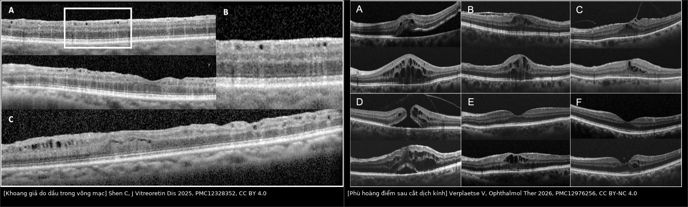
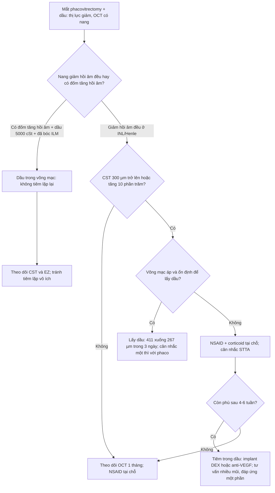
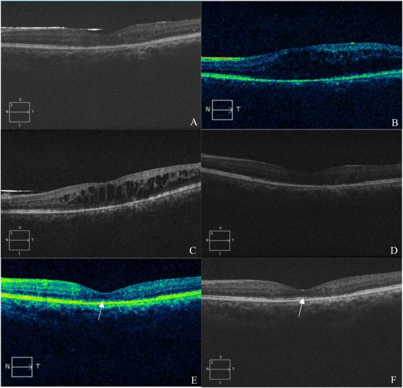
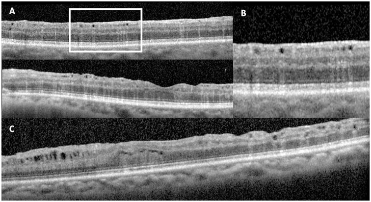
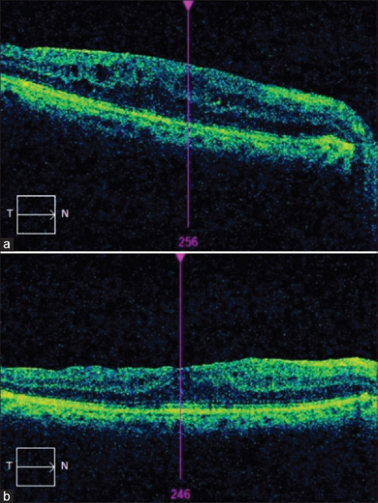
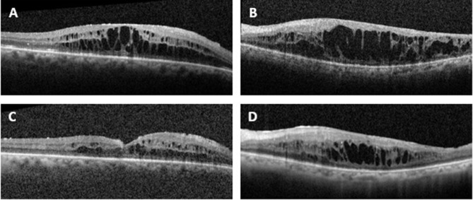

# 1875 — Phù hoàng điểm dạng nang (CME) sau phacovitrectomy trên mắt bơm dầu: CST, phân biệt với dầu trong võng mạc, khi nào tiêm trong dầu / Cystoid macular edema in the oil-filled eye

**Tags:** `pattern:phu-hoang-diem` `pattern:nang-hoang-diem` `pattern:phu-hoang-diem-sau-mo` `pattern:dau-trong-vong-mac` `pattern:co-keo-hoang-diem` `vung:hoang-diem` `vung:vong-mac` `vung:mat` `vung:dich-kinh` `protocol:OCT` `protocol:OCTA` `protocol:phacovitrectomy` `protocol:tiem-noi-nhan` `score:CST` `score:CMT`
**Mức chắc chắn (certainty):** tổng hợp y văn (literature synthesis) — nhóm tự biên, đã đối chiếu `authorString`/PMCID: CME mới xuất hiện sau bơm dầu 6 mắt (CC BY-NC-ND 4.0, PMC11951619), phù hoàng điểm sau cắt dịch kính — tổng quan (CC BY-NC 4.0, PMC12976256), phù hoàng điểm ở 45 mắt bơm dầu sau bong võng mạc (CC BY-NC-SA 4.0, PMC12604728), tiêm trong dầu 8 mắt (CC BY-NC 3.0, PMC11590676), bromfenac sau phacovitrectomy 282 mắt (CC BY 4.0, PMC13483430), dầu trong võng mạc 28 ca (CC BY 4.0, PMC12328352), Irvine–Gass (CC BY 4.0, PMC8509495). Chỗ suy luận được ghi rõ.

> **Vì sao bài này quan trọng:** bài **1863** nêu **phù hoàng điểm 3% (một thì) vs 23% (hai thì)** khi lấy dầu + phaco và dừng ở con số; bài **1865** dạy *bong võng mạc tái phát sau tháo dầu*. Nhưng câu hỏi hằng ngày là: **mắt còn dầu, OCT thấy nang ở hoàng điểm — đó là CME thật hay dầu trong võng mạc, có nên tiêm trong dầu, và có nên lấy dầu sớm hơn kế hoạch?** CME sau bơm dầu xuất hiện **28,83 ± 9,22 ngày** sau mổ, làm hoàng điểm dày **411 ± 41 µm**, và **giảm còn 267 ± 69 µm chỉ 3 ngày sau lấy dầu** (PMC11951619) — nghĩa là **quyết định đúng về thời điểm lấy dầu có thể chữa CME nhanh hơn mọi mũi tiêm**, trong khi tiêm nhầm vào "khoang giả do dầu" thì vô ích.

## 1. Tổng quan bệnh học – cơ chế hình ảnh: vì sao nang hình thành ở INL và vì sao dầu làm nó kéo dài

- **Bệnh học:** sau phẫu thuật, **hàng rào máu–võng mạc (blood–retinal barrier)** bị phá vỡ → **prostaglandin (COX-2), VEGF, IL-6** tăng → tế bào nội mô mao mạch hoàng điểm rò huyết tương. Dịch tích **trong tế bào Müller và Henle's fiber layer (lớp nhân trong, INL)** trước, sau đó mới lan **lớp nhân ngoài (ONL)** — đúng trình tự OCT ghi nhận: **3/6 mắt nang khởi đầu ở INL, 3/6 ở cả INL và ONL** (PMC11951619).
- **TẠI SAO ở mắt đã cắt dịch kính lại nặng hơn (bắt buộc giải thích):**
  1. **Mất "kho dự trữ" dịch kính.** Không còn gel hyaluronan giữ thuốc và cytokine tại chỗ → **nồng độ thuốc trong mắt giảm nhanh hơn**, đồng thời **oxy khuếch tán tự do** vào hoàng điểm; loạt tiêm trong dầu cần tới **8,25 ± 7,24 mũi** cho một mắt (PMC11590676).
  2. **Dầu là vật thể lạ thường trực.** Màng dầu áp sát hoàng điểm tạo **viêm mạn mức thấp** và **kích thích cơ học**; tổng quan phù hoàng điểm sau cắt dịch kính liệt kê **"nang dầu silicone"** là yếu tố thúc đẩy cùng **bong tái phát, PVR, đốt laser diện rộng, tổn thương hoàng điểm** (PMC12976256).
  3. **Phẫu thuật hai thì nhân đôi nguy cơ.** Ở 272 mắt, **CME 23% (hai thì) vs 3% (một thì)** và **tăng nhãn áp 23% vs 7%** (p = 0,013) — mỗi lần vào mắt là một lần phá hàng rào máu–võng mạc (PMC13221386, dùng lại từ bài 1863).
  4. **Tổn thương ngoài võng mạc sẵn có.** **PVR nặng** là yếu tố nguy cơ độc lập (p = 0,007) trong 45 mắt bơm dầu sau bong võng mạc, với **phù hoàng điểm 26,66% tại 3 tháng** (PMC12604728).
- **Vật lý OCT — TẠI SAO nang "trống" lại tối:** dịch trong nang **không tán xạ ánh sáng hồng ngoại** → **giảm hồi âm (hyporeflective)**, bờ nang là **tế bào Müller căng** (tăng hồi âm nhẹ). Ngược lại, **giọt dầu nhũ tương** trong võng mạc **tán xạ mạnh** (kích thước gần bước sóng) → **đốm tăng hồi âm trên ảnh en-face hồng ngoại** và **tăng hồi âm ở lớp sâu**, trong khi khoang dầu vẫn **giảm hồi âm** — đây là **dấu hiệu phân biệt cốt lõi** với CME (PMC12328352).
- **Ngưỡng định lượng (theo `PROMPT_SYNTHESIZER.md`):**
  - **Khởi phát CME sau bơm dầu: 28,83 ± 9,22 ngày** (6 mắt); độ dày hoàng điểm **411 ± 41 µm trước lấy dầu → 267 ± 69 µm sau 3 ngày** (p = 0,028); **4/6 (66,7%) nang biến mất trong 3 ngày**, 2/6 còn nang INL; thị lực **0,82 ± 0,40 → 0,75 ± 0,45 logMAR** (p = 0,285) (PMC11951619).
  - **Tỷ lệ phù hoàng điểm sau cắt dịch kính cần điều trị: 2,0–27,3%**; cao hơn ở bong võng mạc, mảnh thể thủy tinh sót, màng trước võng mạc; tăng sau khi lấy thể thủy tinh (một thì hoặc hai thì) (PMC12976256).
  - **26,66% (12/45)** phù hoàng điểm tại 3 tháng ở mắt bơm dầu sau bong võng mạc nguyên phát; **PVR nặng p = 0,007**; **5/45 mắt** được tiêm triamcinolone dưới Tenon sau (PMC12604728).
  - **Tiêm trong dầu:** 8 mắt, **CSMT 488 ± 104 → 396 ± 184 µm** (p = 0,11), thị lực **1,7 ± 0,8 → 1,4 ± 0,7 logMAR** (p = 0,45) — **cải thiện một phần, không có biến chứng** (PMC11590676).
  - **NSAID tại chỗ sớm (< 4 tuần) sau phacovitrectomy màng trước võng mạc:** 282 mắt, CSMT giảm **93,9 ± 56,2 µm vs 76,6 ± 52,8 µm** ở 6 tháng, chênh **~14–15 µm**, thị lực hồi phục nhanh hơn ở tháng 1 (p = 0,016) (PMC13483430).
  - **Dầu trong võng mạc (giả CME):** 28 ca, toàn bộ dùng dầu **5.000 cSt**, **đã bóc màng giới hạn trong (ILM)** trước khi bơm lần cuối, dầu lưu **220 ± 198 ngày** (PMC12328352).
  - **Ngưỡng điều trị:** **không có đồng thuận** — thử nghiệm dùng **CMT ≤ 300 µm** làm tiêu chí thành công; thực hành repo dùng **CST ≥ 300 µm** (bài 441) kèm **giảm thị lực ≥ 1 dòng hoặc CST tăng ≥ 10%** so với nền. Số nào chưa kiểm chứng được ghi **"chưa rõ — cần tra"**, không bịa.

## 2. Mẫu hình + chẩn đoán phân biệt theo cơ chế (Gamut)

- **Mẫu hình lõi:** mắt đã phacovitrectomy ± dầu, **giảm thị lực trung tâm vài tuần sau mổ**, đáy mắt có thể **bình thường hoặc phù nhẹ**, **OCT là chốt** — nang giảm hồi âm ở INL/Henle, CST tăng, **EZ/ELM còn hay mất** quyết định tiên lượng.
- **Gamut theo 4 cơ chế (nhóm theo "tại sao hoàng điểm dày/dịch"):**
  1. **Tăng tính thấm (rò):** CME sau phẫu thuật (Irvine–Gass), CME do dầu, CME do thuốc (prostaglandin, epinephrine), bệnh võng mạc ĐTĐ, tắc tĩnh mạch.
  2. **Dịch "không phải nước":** **dầu trong võng mạc** (khoang giả), dầu dưới võng mạc, mảnh silicon.
  3. **Co kéo:** màng trước võng mạc/PVR (nang do traction), lỗ hoàng điểm, dịch kính–võng mạc dính.
  4. **Ngoài hoàng điểm:** đục IOL/bao sau, dầu tiền phòng, phù giác mạc, bệnh thần kinh thị sau mổ, **viêm nội nhãn** (cấp, đau — luôn loại trừ trước).
- **Câu hỏi ba bước khi đứng trước OCT có nang:** (1) nang **giảm hồi âm đều** hay có **đốm tăng hồi âm bên trong**? (2) **EZ/ELM** còn nguyên? (3) có **co kéo** (màng, traction) hay **dịch dưới võng mạc** kèm theo?

## 3. Bảng so sánh phân biệt (ma trận đối chiếu)

| Thực thể (entity) | Hình ảnh / đặc điểm điển hình | Chốt vào (rule-in) | Chốt loại (rule-out) | Gợi ý xác nhận |
|---|---|---|---|---|
| **CME sau phẫu thuật (Irvine–Gass) trên mắt bơm dầu** | Nang **giảm hồi âm** ở **INL/Henle** rồi ONL, **CST 411 ± 41 µm**; khởi phát **28,83 ± 9,22 ngày** | **Tiền sử phaco/PPV + nang ở INL + CST tăng + không đốm tăng hồi âm** | **Đốm tăng hồi âm trong nang + bờ tăng hồi âm sâu** → dầu trong võng mạc | OCT macula (cube), so OCT nền; đáp ứng NSAID/steroid |
| **Dầu trong võng mạc (giả CME)** | **Khoang tròn giảm hồi âm ưu thế INL** + **tăng hồi âm lớp sâu**, **đốm tăng hồi âm trên en-face hồng ngoại**; đáy mắt có **hạt vàng có lòng trong** | **Dầu 5.000 cSt + đã bóc ILM + dầu lưu 220 ± 198 ngày + không đáp ứng điều trị** | **Nang thật + đáp ứng sau lấy dầu/tiêm** | OCT + NIR en-face; **không tiêm lặp lại** |
| **Co kéo màng trước võng mạc/PVR** | **Nang dưới màng co kéo**, màng tăng hồi âm trên bề mặt, **võng mạc nhăn**, có thể kèm TRD | **Màng + nếp co + nang khu trú dưới màng** | **Nang đối xứng trung tâm, không màng** → CME thật | OCT B-scan nhiều lát; cân nhắc bóc màng |
| **Dịch dưới võng mạc/tái bong** | **Khoang giảm hồi âm DƯỚI võng mạc cảm thụ**, không phải trong võng mạc | **Dịch dưới võng mạc + bờ võng mạc tách khỏi RPE** | **Nang nằm trong võng mạc** → CME | OCT + B-scan; so ảnh cũ |
| **Lỗ hoàng điểm** | **Đứt toàn bộ võng mạc trung tâm**, bờ nang, **ILM mất** | **Lỗ + bờ nang + đường kính lỗ (µm)** | **Không đứt lớp** → CME | OCT; đo đường kính lỗ |
| **Thiếu máu hoàng điểm** | **Mất/giảm tưới mao mạch** trên OCTA, võng mạc **mỏng** chứ không dày | **OCTA giảm mật độ mao mạch + CST không tăng** | **CST tăng + nang** → CME | OCTA 3×3/6×6 mm |
| **Đục IOL/bao sau (giảm thị lực, không phù)** | Màng trắng sau IOL hoặc đục mặt trước IOL; **OCT hoàng điểm bình thường** | **OCT bình thường + màng trên trục quang** | **CST tăng + nang** → CME | Đèn khe; xem bài 1873 |

*Trái: khoang giả do dầu trong võng mạc — khoang giảm hồi âm ưu thế lớp trong + tăng hồi âm lớp sâu (Shen C et al., J Vitreoretin Dis 2025, PMC12328352, Fig. 3, CC BY 4.0). Phải: phù hoàng điểm sau cắt dịch kính — nang giảm hồi âm trong võng mạc, bờ Müller căng (Verplaetse V et al., Ophthalmol Ther 2026, PMC12976256, Fig. 1, CC BY-NC 4.0). Ảnh ghép letterbox, không crop.*

### Ba dấu hiệu phân biệt CME thật – khoang giả do dầu (đọc chuẩn xác)
- **Vị trí khoang:** CME tập trung **quanh hố trung tâm**, đối xứng; dầu **ưu thế lớp trong (INL)** và có thể **dọc theo mạch** hoặc **dưới màng ILM đã bóc**.
- **Nội dung khoang:** CME **trống hoàn toàn**; dầu có **đốm tăng hồi âm nhỏ** trong khoang và **tăng hồi âm lớp sâu bên dưới** (tán xạ).
- **Đáp ứng điều trị:** CME **giảm sau NSAID/steroid hoặc sau lấy dầu** (411 → 267 µm trong **3 ngày**); dầu **không đổi** dù tiêm nhiều mũi.

## 4. Protocol: OCT, ngưỡng điều trị và bậc thang xử trí

- **OCT (bắt buộc trước và sau mổ):**
  - **Macular cube 512 × 128** (hoặc 6 × 6 mm), **đo CST** theo ETDRS; chụp **trước phacovitrectomy** làm nền, **1 tuần – 1 tháng – 3 tháng** sau mổ.
  - Ghi rõ: **vị trí nang (INL/Henle/ONL)**, **EZ và ELM còn/mất**, **màng trước võng mạc**, **dịch dưới võng mạc**, **dấu hiệu dầu** (đốm tăng hồi âm).
  - Mắt còn dầu: OCT vẫn đọc được (dầu trong, n = 1,404) nhưng **giọt nhũ tương gây bóng/tán xạ** — luôn đối chiếu **en-face hồng ngoại** để phân biệt.
- **Ngưỡng điều trị (thực hành, chưa có đồng thuận):** điều trị khi **CST ≥ 300 µm** hoặc **tăng ≥ 10% so với nền**, kèm **giảm ≥ 1 dòng thị lực** hoặc **ám điểm trung tâm**; thử nghiệm Irvine–Gass dùng **CMT ≤ 300 µm** làm tiêu chí thành công (PMC8509495). **EZ mất → tiên lượng kém hơn** dù CST giảm.
- **Bậc thang xử trí (từ ít xâm lấn đến triệt để):**
  1. **NSAID tại chỗ** (bromfenac/nepafenac) ± **corticoid tại chỗ**: khởi đầu **trong 4 tuần** sau phacovitrectomy giúp CSMT giảm thêm **~14–15 µm** ở 6 tháng và hồi phục thị lực nhanh hơn (PMC13483430); NSAID là **first-line** cho Irvine–Gass (PMC8509495).
  2. **Triamcinolone dưới Tenon sau:** dùng ở **5/45 mắt** trong loạt bơm dầu (PMC12604728); đáp ứng nhanh, theo dõi **IOP** (bài 1411).
  3. **Tiêm trong dầu (dexamethasone implant/anti-VEGF):** khi **chưa thể lấy dầu**; kỳ vọng **CSMT 488 → 396 µm**, thị lực cải thiện không đáng kể (p = 0,45), **cần nhiều mũi (8,25 ± 7,24)** — tư vấn trước để bệnh nhân không kỳ vọng quá (PMC11590676).
  4. **Lấy dầu** khi võng mạc đã ổn định: hiệu quả **nhanh nhất** — **411 ± 41 → 267 ± 69 µm sau 3 ngày**, **66,7%** hết nang trong 3 ngày (PMC11951619); cân nhắc **phẫu thuật một thì** (lấy dầu + phaco) vì **CME 3% vs 23%** ở hai thì (PMC13221386).
  5. **Cắt dịch kính/bóc màng** khi có **co kéo** hoặc màng trước võng mạc tiến triển.
- **Phân tầng quyết định (flowchart):**

- **Theo dõi sau điều trị:** OCT **tháng 1, 3, 6**; đo **IOP** sau mỗi mũi corticoid (bài 1411); kiểm tra **EZ/ELM** — nếu EZ mất, giải thích **thị lực có thể không hồi phục dù hết phù**.

## 5. Biến thể bình thường và cạm bẫy

- **"Nang" không phải lúc nào cũng là phù:** **dầu trong võng mạc** tạo **khoang giảm hồi âm** nhưng **có đốm tăng hồi âm** và **tăng hồi âm lớp sâu**; tiêm steroid/anti-VEGF **không có lợi** và làm tăng nguy cơ (PMC12328352).
- **Nang sau bóc màng trước võng mạc có thể là "di chứng co kéo", không phải CME:** tổng quan nêu rõ **biến đổi nang trong võng mạc sau bóc ERM thường là di chứng của bệnh co kéo và rối loạn chức năng Müller**, không phải phù thật — đừng leo thang điều trị chỉ vì CST còn cao (PMC12976256).
- **Đừng chờ "hết dầu" mới điều trị nếu võng mạc chưa ổn định:** tiêm trong dầu an toàn nhưng **đáp ứng một phần**; ngược lại nếu **có thể lấy dầu**, đó là điều trị hiệu quả nhất (411 → 267 µm trong 3 ngày) (PMC11590676, PMC11951619).
- **CST bình thường không loại trừ CME sớm:** CME khởi phát **28,83 ± 9,22 ngày**; OCT ngày 3 sau bơm dầu có thể **hoàn toàn bình thường** (ca 1: OCT ngày 3 sạch, nang xuất hiện ngày 24) — **không được "chụp một lần rồi kết luận"** (PMC11951619).
- **Đừng quy mọi giảm thị lực sau mổ cho CME:** phải loại trừ **đục IOL/bao sau** (bài 1873), **dầu tiền phòng**, **phù giác mạc**, **bệnh thần kinh thị**, và **viêm nội nhãn** (bài 1425) — mỗi thực thể có xử trí khác hẳn.
- **EZ/ELM là "đồng hồ tiên lượng":** EZ còn nguyên → thị lực có thể hồi phục; **EZ mất** → dù CST về bình thường, thị lực có thể **không cải thiện** (PMC11951619).
- **Hai thì = hai lần phá hàng rào:** nếu bắt buộc mổ thể thủy tinh, cân nhắc **một thì** (CME **3% vs 23%**) và **NSAID dự phòng sớm** (PMC13221386, PMC13483430).

## 6. Tự lượng giá — Blind Quiz

**Ca 1 — Nam 55 tuổi, bong võng mạc + dầu 5.000 cSt. Ngày 24 sau mổ: nhìn mờ trung tâm, OCT thấy nang INL/Henle. Võng mạc áp.**

- Gợi ý: (A) OCT ngày 3 sau bơm dầu; (B) ngày 24; (C) sau 3 tháng còn dầu; (D) 3 ngày sau lấy dầu; (E, F) chi tiết EZ/ELM.
- Câu hỏi: Chẩn đoán? Vì sao nang xuất hiện muộn? Sau lấy dầu điều gì xảy ra và vì sao?

<b>Bấm để hiện đáp án (findings + chẩn đoán)</b>

- Dấu hiệu: (A) **không phù** ngày 3; (B) **nang ở INL, Henle và ONL** ngày 24; (C) còn nang sau 3 tháng dầu; (D) **nang biến mất 3 ngày sau lấy dầu** nhưng **EZ/ELM gián đoạn** (mũi tên E, F).
- Chẩn đoán: **CME mới xuất hiện sau bơm dầu**, khởi phát **28,83 ± 9,22 ngày**; độ dày hoàng điểm **411 ± 41 → 267 ± 69 µm sau 3 ngày** (p = 0,028), **4/6 hết nang trong 3 ngày**; thị lực cải thiện **không có ý nghĩa** (0,82 → 0,75 logMAR) vì **EZ đã tổn thương**.
- Nguồn: Bai JX et al., BMC Ophthalmol 2025 (PMC11951619), Fig. 1, CC BY-NC-ND 4.0.

**Ca 2 — Nữ 60 tuổi, bong võng mạc + dầu 5.000 cSt, đã bóc ILM 6 tháng. Thị lực 20/200, OCT: nhiều khoang tròn giảm hồi âm ưu thế lớp trong, có đốm tăng hồi âm, lớp sâu tăng hồi âm.**

- Gợi ý: đã tiêm 3 mũi anti-VEGF, CST không đổi; en-face hồng ngoại có đốm tăng hồi âm hình tròn.
- Câu hỏi: Chẩn đoán? Vì sao tiêm không hiệu quả? Làm gì tiếp?

<b>Bấm để hiện đáp án (findings + chẩn đoán)</b>

- Dấu hiệu: **khoang giảm hồi âm ưu thế lớp trong** + **tăng hồi âm lớp sâu** + **đốm tăng hồi âm trên en-face hồng ngoại**.
- Chẩn đoán: **dầu silicone trong võng mạc** (giả CME) — 28 ca trong y văn, toàn bộ **dầu 5.000 cSt**, **đã bóc ILM**, dầu lưu **220 ± 198 ngày**. Đây **không phải phù do rò** → **anti-VEGF/steroid không có lợi**; xử trí: **ngừng tiêm lặp**, theo dõi CST/EZ, cân nhắc lấy dầu theo kế hoạch.
- Nguồn: Shen C et al., J Vitreoretin Dis 2025 (PMC12328352), Fig. 3, CC BY 4.0.

**Ca 3 — Nam 68 tuổi, bong võng mạc + dầu, PVR nặng. Tháng 3 sau mổ: CST tăng, OCT dạng "spongiform". Võng mạc áp nhưng chưa thể lấy dầu.**

- Gợi ý: (a) trước tiêm — CRT 256 µm; (b) sau tiêm — 246 µm, phù giảm.
- Câu hỏi: Tần suất phù hoàng điểm trong nhóm này? Yếu tố nguy cơ? Bậc thang xử trí khi chưa lấy dầu được?

<b>Bấm để hiện đáp án (findings + chẩn đoán)</b>

- Dấu hiệu: dày hoàng điểm dạng **spongiform**; sau tiêm dưới Tenon **giảm phù**.
- Chẩn đoán: **phù hoàng điểm sau cắt dịch kính có dầu** — **26,66% (12/45)** tại 3 tháng; **PVR nặng p = 0,007**; **5/45** được tiêm triamcinolone dưới Tenon. Khi **chưa thể lấy dầu**: **NSAID + corticoid tại chỗ → STTA → tiêm trong dầu (đáp ứng một phần, 488 → 396 µm)**.
- Nguồn: Hamsa DS et al., Oman J Ophthalmol 2025 (PMC12604728), Fig. 1, CC BY-NC-SA 4.0.

**Ca 4 — Cùng bệnh nhân còn dầu 12 tháng, CST 520 µm, võng mạc áp nhưng chờ 6 tháng nữa mới lấy dầu. Đã tiêm implant dexamethasone trong dầu.**

- Gợi ý: (A) trước Ozurdex; (B) trước aflibercept; (C) 4 tháng sau Ozurdex; (D) 3 tháng sau mũi lặp.
- Câu hỏi: Kỳ vọng kết quả? Bao nhiêu mũi thường cần? Tư vấn gì?

<b>Bấm để hiện đáp án (findings + chẩn đoán)</b>

- Dấu hiệu: (A, B) **CME nặng**; (C) **giảm phù rõ** sau Ozurdex; (D) **còn nang** sau mũi lặp.
- Chẩn đoán: **CME trên mắt bơm dầu điều trị bằng tiêm trong dầu** — 8 mắt, **CSMT 488 ± 104 → 396 ± 184 µm** (p = 0,11), thị lực **1,7 → 1,4 logMAR** (p = 0,45), **8,25 ± 7,24 mũi**, không biến chứng. Tư vấn: **đáp ứng một phần, cần nhiều mũi, không thay thế việc lấy dầu**; theo dõi **IOP** sau mỗi mũi corticoid.
- Nguồn: Safadi K et al., Clin Ophthalmol 2024 (PMC11590676), Fig. 3, CC BY-NC 3.0.

## Bài liên quan chéo
- [1863 – Đục thể thủy tinh ở mắt bơm dầu: một thì hay hai thì](../1863-duc-the-thuy-tinh-mat-bom-dau-silicone/lesson.md)
- [1873 – Bao sau đục sau phaco trên mắt bơm dầu & thời điểm Nd:YAG](../1873-bao-sau-duc-thu-phat-mat-bom-dau-yag/lesson.md)
- [1865 – Bong võng mạc tái phát sau tháo dầu](../1865-bong-vong-mac-tai-phat-sau-thao-dau/lesson.md)
- [1410 – Lấy dầu silicone & dầu tồn lưu](../1410-lay-dau-silicone-va-dau-ton-luu/lesson.md)
- [1418 – Phù hoàng điểm do xạ kháng anti-VEGF](../1418-phu-hoang-diem-xa-khang-anti-vegf/lesson.md)
- [441 – OCT hoàng điểm](../441-OCT-hoang-diem/lesson.md)
- [446 – Phù hoàng điểm viêm](../446-phu-hoang-diem-viem/lesson.md)
- [1411 – Tăng nhãn áp do corticoid nội nhãn](../1411-tang-nhan-ap-do-corticoid-noi-nhan/lesson.md)
- [1425 – Viêm nội nhãn sau tiêm nội nhãn](../1425-viem-noi-nhan-sau-tiem-noi-nhan/lesson.md)
- [1402 – Bong võng mạc sau viêm nội nhãn](../1402-bong-vong-mac-sau-viem-noi-nhan/lesson.md)

> Không dùng để chẩn đoán độc lập khi chưa có người hướng dẫn.
