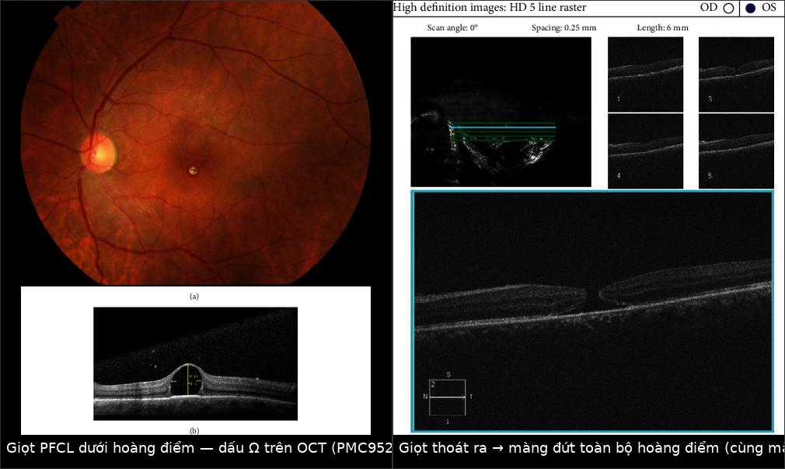
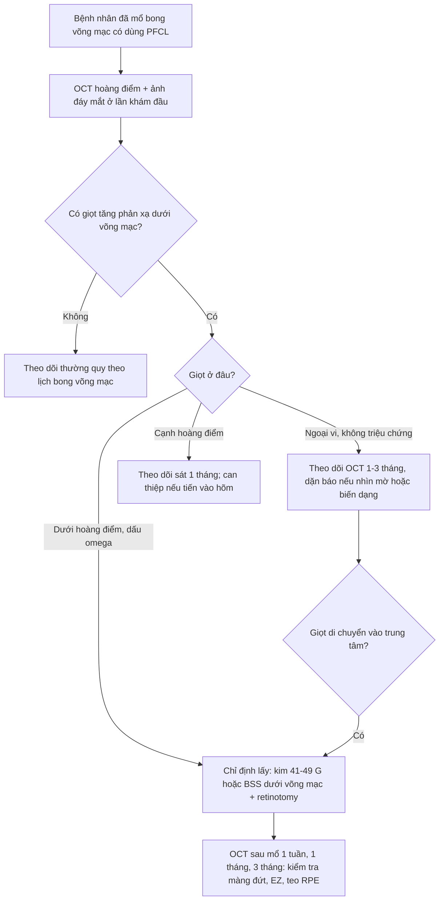
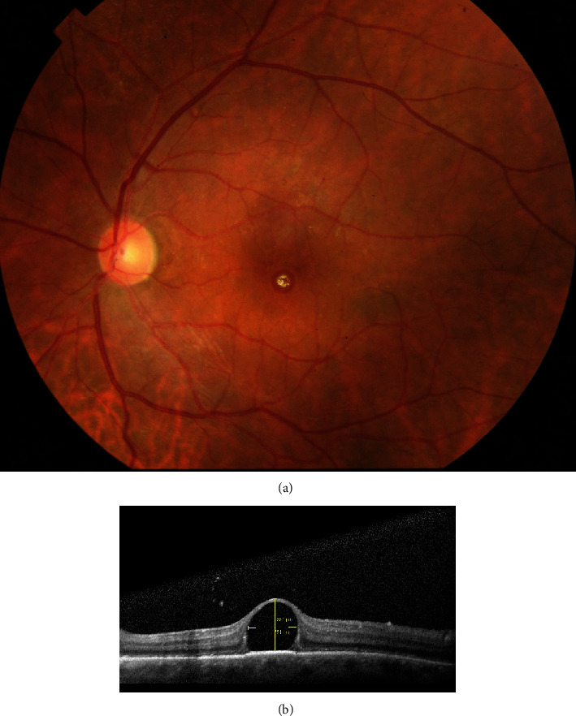
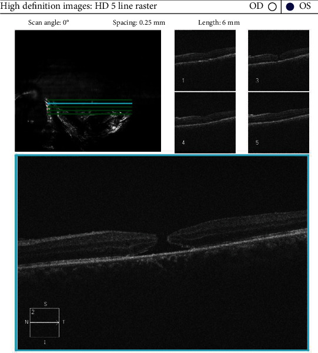
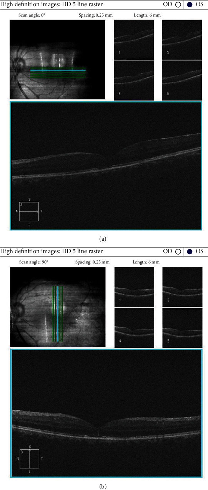
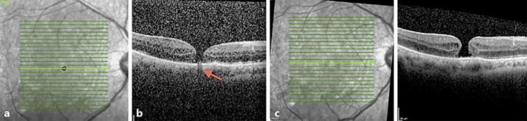

# 1877 — PFCL tồn lưu dưới võng mạc: dấu Ω trên OCT, giọt “đi về hoàng điểm”, và khi nào phải lấy bằng kim 41 G

**Tags:** `pattern:giot-hyperreflective` `pattern:dau-ton-luu` `pattern:bang-che-quang` `pattern:hoang-diem-hinh-omega` `pattern:macula-hole` `vung:hac-vong-mac` `vung:hoang-diem` `protocol:OCT-hoang-diem` `protocol:PPV`
**Mức chắc chắn (certainty):** tổng hợp y văn (literature synthesis) — ghép **ca nguyên văn có ảnh** giọt PFCL dưới hoàng điểm (dấu **Ω**) rồi tự thoát và tạo **màng đứt toàn bộ hoàng điểm** (**PMC9529480**, CC BY), ca **bọt khí C₃F₈ giả PFCL** (**PMC6760353**, CC BY-NC), kỹ thuật **hút bằng kim vi mô 41–49 G** trên **10 mắt** (**PMC12707325**, CC BY-NC-ND), kỹ thuật **BSS dưới võng mạc + rung + trọng lực** (**PMC7585314**, CC BY), tổng quan hệ thống **17 nghiên cứu / 775 mắt** về tamponade PFCL trung hạn (**PMC12914961**, CC BY), và bài mô tả **PFCL tiền phòng gây viêm màng bồ đào** (**PMC11960470**, CC BY-NC).

> **Câu chốt:** PFCL **nặng hơn nước (tỷ trọng 1,7–2,3 g/cm³)** nên khi lọt vào khoang dưới võng mạc, nó **lắng xuống thấp nhất** — ở đáy ổ dịch dưới hoàng điểm. Trên OCT, giọt PFCL là **vật tăng phản xạ, bờ cong, che sáng hoàn toàn phía sau (shadowing)**, và khi nằm ngay dưới hõm hoàng điểm thì tạo **dấu Ω** (vòm tăng phản xạ nâng võng mạc lên). Đây là **biến chứng âm thầm**: bệnh nhân **không đau**, chỉ thấy **nhìn mờ – ám điểm trung tâm – biến dạng**, và hậu quả muộn là **teo biểu mô sắc tố (RPE) + màng đứt hoàng điểm**.

> **Phân vai với bài khác:** [1410](../1410-lay-dau-silicone-va-dau-ton-luu/lesson.md) phủ **dầu silicone tồn lưu** (tỷ trọng 0,97 → **nổi**, giọt ở tiền phòng/góc); [1865](../1865-bong-vong-mac-tai-phat-sau-thao-dau/lesson.md) phủ **bong võng mạc tái phát sau tháo dầu**; [1873](../1873-bao-sau-duc-thu-phat-mat-bom-dau-yag/lesson.md) phủ **đục bao sau trên mắt bơm dầu**. Bài này chỉ nói **PFCL**: chất **nặng**, dùng **trong mổ** để ép võng mạc, và **không bao giờ được để lại dưới võng mạc**.

## 1. Tổng quan bệnh học – cơ chế hình ảnh (TẠI SAO giọt PFCL lại “rơi” xuống dưới võng mạc và sáng trên OCT)

### 1.1 Vật lý của PFCL — mọi thứ suy ra từ 3 con số

| Tính chất | Giá trị | Hệ quả lâm sàng / hình ảnh |
|---|---|---|
| **Tỷ trọng (specific gravity)** | **1,7–2,3 g/cm³** (cao hơn nước 1,0) (PMC11960470) | **Chìm và lắng ở điểm thấp nhất** → ép võng mạc xuống, đẩy dịch dưới võng mạc ra trước; nếu lọt vào khoang dưới võng mạc thì **nằm ở đáy**, thường **ngay dưới hoàng điểm** khi bệnh nhân nằm ngửa |
| **Sức căng bề mặt** | thấp (đặc trưng của nhóm perfluorocarbon; **giá trị mN/m khác nhau theo từng loại** — chưa đối chiếu được số trong nguồn đã đọc) | Giọt **tròn, khó trộn** với nước → tạo **giọt rời (droplet)** thay vì hòa tan; giọt lớn **không tự hấp thu** |
| **Độ nhớt** | **thấp** (nguồn chỉ ghi “low viscosity”, không nêu số cSt — xem ghi chú giới hạn) | Dễ **vỡ thành nhiều giọt nhỏ** khi qua lỗ rách võng mạc (retinotomy) hoặc khi bơm mạnh → “vệ tinh” giọt (satellite bubbles) |
| **Chiết suất / cản quang** | khác biệt lớn so với dịch — **không cản tia X**, nhưng **phản xạ mạnh trên OCT** | Trên OCT: **tăng phản xạ (hyperreflective)** + **che hoàn toàn** tín hiệu phía sau → **bóng che (shadowing)** là dấu chốt |

- **Retinal toxicity — bằng chứng KHÔNG đồng nhất (cần nói rõ):** một phía, ca báo cáo dẫn y văn cho rằng PFCL **tinh khiết vẫn gây độc võng mạc sau vài ngày** khi ở buồng dịch kính và **thời gian ngắn hơn** khi ở **dưới võng mạc** — vì vậy tiêu chuẩn vẫn là **lấy hết PFCL trước khi kết thúc mổ** (PMC9529480). Phía khác, trên **mô hình động vật**, PFCL trong buồng dịch kính **48 giờ không gây tác dụng phụ**, và **lượng nhỏ PFCL tồn lưu sau 6 tháng không thấy thay đổi mô học**; PFCL ở **tiền phòng** dung nạp tốt trong thời gian ngắn (PMC11960470). **Kết luận thực hành:** ngưỡng độc **phụ thuộc vị trí và thời gian** — **dưới võng mạc ≠ tiền phòng**, và **không có ngưỡng “an toàn” nào cho giọt dưới hoàng điểm**.
- **Tần suất tồn lưu:** PFCL **sót lại sau mổ ở khoảng 1–7% mắt** (PMC9529480). Đa số ở **buồng dịch kính/tiền phòng**, nhưng **dưới võng mạc là thể nặng nhất**.

### 1.2 Bốn đường giọt PFCL vào được khoang dưới võng mạc

1. **Qua lỗ rách võng mạc (break/retinotomy)**: bơm PFCL **quá mạnh** hoặc **đầu cannula chui vào dưới võng mạc** → PFCL đi thẳng vào khoang dưới võng mạc.
2. **Qua retinotomy dẫn lưu**: khi PFCL còn trong mắt mà **dẫn lưu dịch dưới võng mạc** bằng lỗ chọc, PFCL (nặng hơn) **chui qua lỗ** thay cho dịch.
3. **Qua vết rách lớn/vùng võng mạc mỏng**: rách khổng lồ (giant retinal tear), võng mạc **đã bong lâu, mỏng**.
4. **Từ “vệ tinh” giọt nhỏ**: giọt nhỏ < 1 mm dễ **chui qua lỗ nhỏ**; sau mổ **di chuyển dần về hoàng điểm** (cơ chế chưa rõ, được cho là do **dòng dịch dưới võng mạc + trọng lực + chuyển động mắt**) (PMC9529480).

### 1.3 TẠI SAO dấu Ω xuất hiện — hình học, không phải “phù”

- Giọt PFCL nằm **giữa lớp cảm thụ (photoreceptor) và RPE** → **đẩy võng mạc cảm thụ lên** thành **vòm**.
- Trên OCT, giọt **tăng phản xạ** ở **đỉnh vòm**, hai bên vòm là **võng mạc mỏng đi rõ rệt** (do bị giãn) → mặt cắt có dạng **chữ Ω (omega)** hay “vòm cuốn”.
- **Vì sao võng mạc mỏng:** tế bào cảm thụ và lớp hạch bị **kéo giãn trên một cấu trúc cứng, không co giãn**; đồng thời PFCL **chặn trao đổi chất** giữa RPE và võng mạc → **teo RPE** khu trú, **mất đoạn ellipsoid zone (EZ)**.
- **Hệ quả muộn:** vòm căng + võng mạc mỏng + (thường) **đã bóc màng giới hạn trong (ILM) trong mổ** → **màng đứt toàn bộ hoàng điểm (full-thickness macular hole, FTMH)**; đây chính là diễn tiến trong ca minh họa (PMC9529480).

## 2. Mẫu hình + chẩn đoán phân biệt theo vị trí giọt (gamut)

### 2.1 Gamut theo vị trí — “giọt nằm ở đâu” quyết định mức nguy hiểm

- **Dưới hoàng điểm (subfoveal):** nguy hiểm nhất — **teo RPE + FTMH + mất thị lực trung tâm**; chỉ định **lấy/chuyển dịch giọt**.
- **Cạnh hoàng điểm (parafoveal) / vùng hoàng điểm:** có thể **di chuyển vào trung tâm** — theo dõi sát bằng OCT, ngưỡng can thiệp thấp hơn.
- **Ngoại vi (peripheral):** thường **theo dõi**; nhưng **vẫn có thể di chuyển về hoàng điểm** nhiều tháng sau → không được “quên”.
- **Trong buồng dịch kính (intravitreal):** thường **lắng đọng ở góc tiền phòng/buồng dịch kính thấp**; gây **viêm màng bồ đào, tăng nhãn áp, giọt ở tiền phòng** (PMC11960470) — điều trị khác (rửa tiền phòng, lấy giọt).

### 2.2 Gamut theo hình ảnh — “vật tăng phản xạ dưới võng mạc” không chỉ có PFCL

| Thực thể | Vị trí & hình thái | Chốt vào | Chốt loại |
|---|---|---|---|
| **PFCL tồn lưu** | **Dưới võng mạc**, giọt **tròn/bờ cong đều**, **tăng phản xạ mạnh**, **bóng che hoàn toàn**; **dấu Ω** khi dưới hõm | **Tiền sử mổ có dùng PFCL** + giọt tròn đều + shadowing | Giọt **không có bờ cong đều**, tăng phản xạ **yếu** → nghĩ vật liệu khác |
| **Bọt khí C₃F₈ kẹt dưới màng/chùm hoàng điểm** | **Trước võng mạc (pre-retinal/pré-fovéal)**, bờ **cầu vồng sáng**, **không nằm trong khoang dưới võng mạc** | **Bờ cầu vồng (rainbow) + nằm TRƯỚC võng mạc + tự tiêu** | Nằm **dưới** võng mạc, không đổi theo tư thế → PFCL |
| **Dầu silicone tồn lưu** | **Nổi** (nhẹ hơn nước), giọt **tăng phản xạ + tán xạ**, thường **tiền phòng/góc**, hoặc **dưới võng mạc** ở mắt đã bơm dầu | **Tiền sử bơm dầu** + giọt ở **vị trí cao** | Giọt **lắng ở đáy** → PFCL (xem bài 1410) |
| **Xuất huyết dưới võng mạc** | **Tăng phản xạ ở lớp ngoài**, bờ **không đều**, **không che hoàn toàn**; theo thời gian **đổi cấu trúc** | Theo dõi: **thay đổi theo thời gian** | Giọt **giữ nguyên hình dạng nhiều tháng, che hoàn toàn** → PFCL |
| **Drusen / cặn vôi** | **Dưới RPE**, nhiều ổ, **không có shadowing mạnh**, đối xứng hai mắt | **Nhiều ổ + đối xứng + không tiền sử PFCL** | Một giọt đơn độc, rất tăng phản xạ → PFCL |

## 3. Bảng so sánh phân biệt (ma trận đối chiếu)

| Thực thể (entity) | Hình ảnh điển hình (OCT / đáy mắt) | Chốt vào (rule-in) | Chốt loại (rule-out) | Gợi ý xác nhận |
|---|---|---|---|---|
| **PFCL dưới hoàng điểm** | Đáy mắt: **chấm vàng–trắng sáng** ở hõm; OCT: **vòm tăng phản xạ + bóng che + dấu Ω**, võng mạc phủ **mỏng** | **Tiền sử PPV có PFCL** + giọt **tròn đều, che hoàn toàn** + **dấu Ω** | Không có tiền sử PFCL; tổn thương **thay đổi theo thời gian** → xuất huyết/máu | OCT hoàng điểm **HD line** + chụp đáy mắt màu; hỏi kỹ **phẫu thuật viên đã dùng PFCL** |
| **FTMH do PFCL** | **Màng đứt toàn bộ** ở hõm, bờ **dày, gồ**, có **nang nội võng mạc**; giọt có thể **đã biến mất** | **Giọt cũ + màng đứt xuất hiện sau** | Màng đứt **do co kéo màng trước võng mạc** (có màng, không có giọt) | OCT + đáy mắt + so ảnh cũ |
| **Bọt C₃F₈ kẹt trước hoàng điểm** | **Bờ cầu vồng**, nằm **trước** võng mạc, **không xuyên qua** võng mạc; **tự tiêu** khi khí hấp thu | **Bờ cầu vồng + vị trí trước võng mạc + tự hết** | Nằm dưới võng mạc, giữ nguyên hình → PFCL | Chụp lại sau **1–2 tuần**; OCT nhiều mặt cắt |
| **Dầu silicone dưới võng mạc** | Giọt tăng phản xạ **kèm tán xạ mạnh**, thường ở **vùng cao** (dầu nổi), có **nhũ tương hóa** | **Tiền sử bơm dầu 5.000 cSt** + giọt ở vị trí **cao** | Giọt **ở đáy, che hoàn toàn** → PFCL | B-scan (**hồi âm mạnh**), AS-OCT tiền phòng (bài 1410) |
| **Dịch dưới võng mạc đơn thuần** | **Giảm phản xạ (hyporeflective)**, bờ **mềm**, **không che** phía sau | **Giảm phản xạ + không shadowing** | Tăng phản xạ + che → vật liệu | OCT theo dõi; đáp ứng với điều trị bong |

*Trái: ảnh đáy mắt + OCT — giọt PFCL dưới hõm hoàng điểm, **vòm tăng phản xạ, dấu Ω**, võng mạc phủ mỏng. Phải: OCT sau đó — giọt **đã biến mất**, xuất hiện **màng đứt toàn bộ hoàng điểm**. Nguồn: Case Reports in Ophthalmological Medicine 2022, **PMC9529480**, CC BY 4.0. Ảnh ghép letterbox, giữ nguyên tỷ lệ.*

### 3.1 Ba dấu hiệu đọc thành lời

- **Dấu Ω (omega sign):** vòm tăng phản xạ **nâng võng mạc** tại hõm; hai “chân” vòm là võng mạc **mỏng, mất EZ** — đây là **dấu đặc hiệu vị trí dưới hoàng điểm**.
- **Bóng che (posterior shadowing):** phía sau giọt **mất toàn bộ tín hiệu** (RPE, choroid không thấy) — dấu phân biệt với **dịch** (giảm phản xạ, không che) và với **xuất huyết** (tăng phản xạ nhưng **không che hoàn toàn**).
- **Bờ cong đều + giữ nguyên hình dạng theo thời gian:** giọt PFCL **không tự biến mất** (trừ ca hiếm tự thoát); tổn thương **máu/dịch thay đổi** sau vài tuần.

## 4. Protocol chụp + theo dõi + kỹ thuật lấy giọt

### 4.1 Chụp và ghi nhận (tối thiểu)

1. **OCT hoàng điểm SD-OCT, HD line raster** (khoảng cách lát **0,25 mm**, chiều dài **6 mm**) — đủ để phát hiện giọt **≥ 50 µm**; ghi **vị trí (dưới hõm/cạnh hõm/ngoại vi)**, **kích thước giọt (µm)**, **độ dày võng mạc phủ**, **có/không FTMH**.
2. **Ảnh đáy mắt màu + chụp hồng ngoại (infrared)**: giọt PFCL cho **chấm sáng** trên ảnh màu; **hồng ngoại** giúp thấy giọt nhỏ.
3. **B-scan siêu âm** khi không thấy được đáy mắt (đục thể thủy tinh, bơm dầu) — PFCL **hồi âm rất mạnh**.
4. **Ghi vào hồ sơ**: *dùng PFCL loại nào, số lần, có hút hết bằng đầu cannula thẳng không* — vì chẩn đoán tồn lưu phụ thuộc **tiền sử mổ**, bác sĩ CĐHA không tự suy ra được.

### 4.2 Ai cần lấy — ngưỡng thực hành

| Tình huống | Hướng xử trí | Căn cứ |
|---|---|---|
| Giọt **ngoại vi**, không triệu chứng | **Theo dõi OCT mỗi 1–3 tháng** (vì có thể di chuyển về hoàng điểm) | PMC9529480 |
| Giọt **cạnh hoàng điểm** | Theo dõi sát; **lấy khi có dấu hiệu tiến sát hõm** hoặc võng mạc phủ mỏng | PMC9529480, PMC12707325 |
| Giọt **dưới hoàng điểm (dấu Ω)** | **Lấy/chuyển dịch giọt**: hút trực tiếp bằng **kim 41 G** hoặc **41–49 G**; hoặc **bơm BSS dưới võng mạc** tạo “bóng” hoàng điểm rồi để giọt trôi ra **retinotomy** | PMC12707325, PMC7585314 |
| **FTMH đã hình thành** | Cân nhắc **theo dõi** nếu nhỏ và không triệu chứng; **mổ** (bóc ILM/bơm khí) nếu lớn; đã có ca **tự đóng** sau khi giọt thoát | PMC9529480 |

### 4.3 Kỹ thuật hút — số liệu để chọn kim

- **Thể tích chuẩn 250 µL** PFCL, áp lực **200 mmHg**: **30 G = 0,22 phút**, **41 G = 0,33 phút**, **43 G = 0,78 phút** (PMC12707325).
- **Kim 49 G** cần **chân không tối đa 650 mmHg**, trung bình **3,34 phút** cho 250 µL — **chậm hơn nhiều** nhưng **xuyên qua võng mạc ít chấn thương nhất**.
- **10 mắt** được hút PFCL dưới võng mạc bằng kim vi mô: **100% thành công**, **thị lực trung bình cải thiện −0,08 logMAR (± 0,12)** — tức **không kỳ vọng hồi phục lớn**, mục tiêu là **ngăn teo RPE và màng đứt tiến triển** (PMC12707325).
- Kỹ thuật **BSS dưới võng mạc**: bóc **ILM** trên điểm chọc, bơm **BSS áp lực thấp 8 psi** bằng **41 G** để **bong hoàng điểm có kiểm soát**, tạo **retinotomy nhỏ hơn giọt một chút**, cho giọt trôi ra bằng **rung + trọng lực**, rồi hút trên bề mặt võng mạc (PMC7585314).

### 4.4 Sơ đồ theo dõi (dùng cho phòng khám)

## 5. Biến thể bình thường và cạm bẫy

- **Giọt PFCL KHÔNG tự tan.** Khác với bọt khí (tự tiêu trong **2–8 tuần** tùy loại khí), PFCL là **chất lỏng không hấp thu** — nếu thấy giọt “biến mất”, hoặc **đã thoát ra qua màng đứt** (như ca minh họa), hoặc **đã di chuyển ra ngoại vi**, hoặc **chẩn đoán ban đầu sai** (thực ra là bọt khí).
- **Cạm bẫy “bọt khí giả PFCL”:** bọt **C₃F₈** kẹt **trước hoàng điểm** có thể trông như giọt dưới võng mạc; điểm khác: **bờ cầu vồng nhiều màu**, nằm **trước** võng mạc, và **tự tiêu** (PMC6760353) → **chụp lại 1–2 tuần** thay vì can thiệp ngay.
- **Cạm bẫy “một lát OCT”:** giọt nhỏ có thể **nằm giữa hai lát** của raster dày → luôn dùng **HD line 0,25 mm** hoặc **volume scan** khi có tiền sử PFCL.
- **Cạm bẫy “cho rằng mắt đã ổn định”:** giọt ngoại vi **di chuyển về hoàng điểm muộn**, kể cả **sau nhiều tháng** → theo dõi dài, không chỉ lần khám đầu.
- **Cạm bẫy “OCT đẹp sau mổ = không còn PFCL”:** PFCL có thể **còn ở tiền phòng/góc** gây **viêm màng bồ đào, tăng nhãn áp** dù hoàng điểm sạch (PMC11960470) → soi góc (gonioscopy) và **AS-OCT tiền phòng** khi có triệu chứng.
- **Biến thể dễ nhầm:** **drusen tăng phản xạ mạnh** ở người trẻ có thể trông giống giọt nhỏ; khác ở chỗ **nhiều ổ, dưới RPE, không shadowing mạnh, đối xứng**.
- **Sai sót hệ thống:** PFCL tồn lưu là **biến chứng “người ta không thấy vì không tìm”** — khi báo cáo OCT sau mổ bong võng mạc, phải **chủ động** mô tả “có/không có vật tăng phản xạ dưới võng mạc” thay vì chỉ “võng mạc áp”.

## 6. Tự lượng giá — Blind Quiz

**Ca 1 — Nam 52 tuổi, mổ bong võng mạc + bơm dầu silicone 1 tuần trước, nay nhìn mờ và biến dạng. Hình dưới có gì bất thường ở hõm hoàng điểm?**

- Gợi ý: **không đau**; thị lực đếm ngón tay; tiền sử **bong võng mạc toàn bộ, có dùng PFCL trong mổ**.
- Câu hỏi: (1) Mô tả tổn thương trên OCT. (2) Vì sao võng mạc phía trên giọt **mỏng**? (3) Ba chẩn đoán phân biệt và dấu chốt?

<b>Bấm để hiện đáp án (findings + chẩn đoán)</b>

- **Findings:** đáy mắt có **chấm vàng–trắng sáng** đúng hõm; OCT (b) cho **vòm tăng phản xạ dưới hõm** với **bóng che hoàn toàn** phía sau → **dấu Ω**; võng mạc phủ **mỏng rõ rệt** (thước đo trong ảnh gốc đặt ở đỉnh vòm).
- **Vì sao mỏng:** giọt cứng **đẩy võng mạc lên** + **chặn trao đổi chất với RPE** → teo và mất EZ.
- **Phân biệt:** (a) **bọt khí C₃F₈** — bờ cầu vồng, trước võng mạc, tự tiêu; (b) **dầu silicone dưới võng mạc** — giọt ở vị trí cao, có tán xạ; (c) **xuất huyết dưới võng mạc** — thay đổi theo thời gian, không che hoàn toàn. **Dấu chốt:** giọt **tròn đều + che hoàn toàn + tiền sử PFCL**.
- **Nguồn:** Case Reports in Ophthalmological Medicine 2022, **PMC9529480**, CC BY 4.0.

**Ca 2 — Cùng mắt sau 3 tuần: bệnh nhân đột ngột mất thị lực trung tâm, ám điểm tuyệt đối. Giọt đã đi đâu?**

- Câu hỏi: (1) Chẩn đoán trên OCT. (2) Vì sao giọt “biến mất” mà bệnh **nặng hơn**? (3) Thái độ xử trí?

<b>Bấm để hiện đáp án</b>

- **Findings:** **màng đứt toàn bộ hoàng điểm (FTMH)**; **không còn giọt** dưới võng mạc.
- **Cơ chế:** sức căng bề mặt của giọt tạo lực **kéo ngang** trên võng mạc đã mỏng (và **đã bóc ILM** trong mổ) → **rách hõm**; giọt **thoát qua lỗ** vào buồng dịch kính rồi bị loại bỏ khi tháo dầu.
- **Xử trí trong ca gốc:** **theo dõi** (không bóc ILM thêm, không ghép); sau **4 tháng** tháo dầu → màng đứt **tự đóng**, thị lực **0,4 → 0,7** sau 3 tháng.
- **Bài học:** **FTMH do PFCL có thể tự đóng**, nhưng **không được chờ** nếu giọt còn dưới hõm — lấy giọt **trước khi** màng đứt hình thành.
- **Theo dõi tiếp (Hình 3 của ca gốc):** sau khi tháo dầu, màng đứt **tự đóng**, hõm hoàng điểm phục hồi:

*OCT raster ngang và dọc: hõm hoàng điểm phục hồi, không cần bóc ILM thêm.*

- **Nguồn:** **PMC9529480**, CC BY 4.0.

**Ca 3 — Bệnh nhân mổ bong võng mạc 6 tuần trước, OCT có “chấm tối + bóng che” ở hõm, không rõ đã dùng PFCL hay khí. Làm sao phân biệt?**

- Câu hỏi: (1) Dấu hiệu nào giúp phân biệt **bọt khí** với **giọt PFCL**? (2) Vì sao **không can thiệp ngay**? (3) Theo dõi thế nào?

<b>Bấm để hiện đáp án</b>

- **Findings:** ảnh hồng ngoại có **chấm giảm phản xạ** ở hõm; OCT qua hõm cho **màng đứt toàn bộ + bóng che** do **mảnh bọt khí C₃F₈ kẹt trước võng mạc** (mũi tên đỏ) — **không phải giọt PFCL dưới võng mạc**.
- **Dấu phân biệt:** bọt khí nằm **TRƯỚC võng mạc**, **bờ cầu vồng**, **tự tiêu**; PFCL nằm **DƯỚI võng mạc**, **bờ cong đều**, **không biến mất**.
- **Xử trí:** **chụp lại sau 1–2 tuần** — bọt khí hấp thu, hình ảnh thay đổi; can thiệp “lấy giọt” trong trường hợp này là **mổ oan**.
- **Nguồn:** Case Reports in Ophthalmology 2019, **PMC6760353**, CC BY-NC 4.0 (nguyên bản, không chỉnh sửa).

## Bài liên quan chéo
- [400 – Tổng quan Mắt & thị giác](../400-tong-quan-mat-thi-giac/lesson.md)
- [1410 – Lấy dầu silicone & biến chứng dầu tồn lưu](../1410-lay-dau-silicone-va-dau-ton-luu/lesson.md) (chất **nổi**, giọt ở tiền phòng; so sánh trực tiếp)
- [1865 – Bong võng mạc tái phát sau tháo dầu](../1865-bong-vong-mac-tai-phat-sau-thao-dau/lesson.md) (bối cảnh mổ bong phức tạp)
- [1875 – Phù hoàng điểm sau phacovitrectomy trên mắt bơm dầu](../1875-phu-hoang-diem-dang-nang-mat-bom-dau/lesson.md) (OCT hoàng điểm sau mổ)
- [1873 – Đục bao sau trên mắt bơm dầu & YAG](../1873-bao-sau-duc-thu-phat-mat-bom-dau-yag/lesson.md)
- [1449 – Tiêm nội nhãn ở bệnh nhân dùng thuốc chống đông](../1449-tiem-noi-nhan-o-benh-nhan-dung-thuoc-chong-dong/lesson.md) (thủ thuật trong mắt, biến chứng)

## Ảnh
- `1877_pfcl_OCT-PMC9529480-Fig1.jpg` — (a) ảnh đáy mắt: chấm PFCL dưới hõm; (b) OCT: **dấu Ω**, võng mạc phủ **32 µm**. CC BY 4.0.
- `1877_pfcl_OCT-PMC9529480-Fig2.jpg` — OCT: **màng đứt toàn bộ hoàng điểm** sau khi giọt thoát. CC BY 4.0.
- `1877_pfcl_OCT-PMC9529480-Fig3.jpg` — OCT: màng đứt **tự đóng**, hõm phục hồi. CC BY 4.0.
- `1877_pfcl_OCT-PMC6760353-Fig2.jpg` — bọt **C₃F₈** giả PFCL: hồng ngoại + OCT có **bóng che**. CC BY-NC 4.0.
- `composite_pfcl-omega-vs-macula-hole.jpg` — ghép đối chiếu hai thì (letterbox, không crop). CC BY 4.0.
- Nguồn + giấy phép từng file: `images/CREDITS.md`.

> Không dùng để chẩn đoán độc lập khi chưa có người hướng dẫn.
