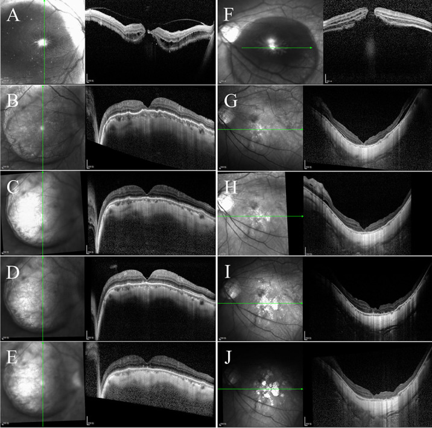
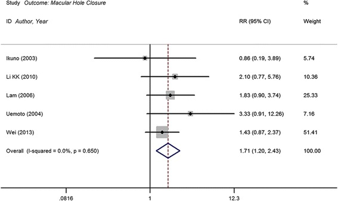
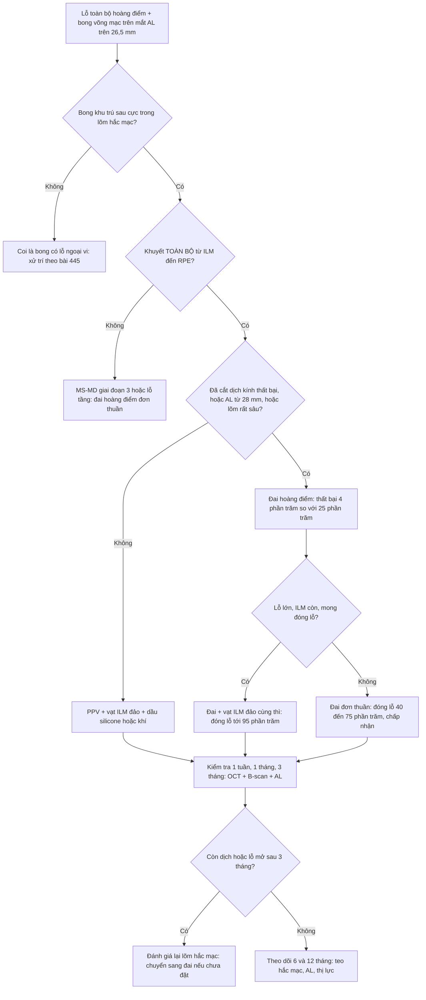
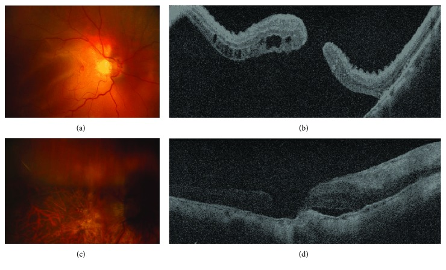
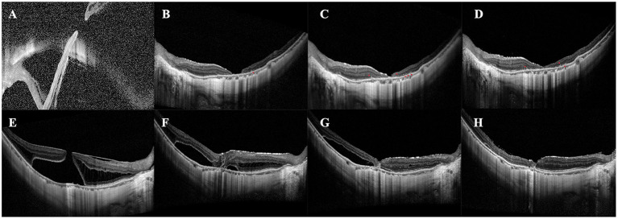
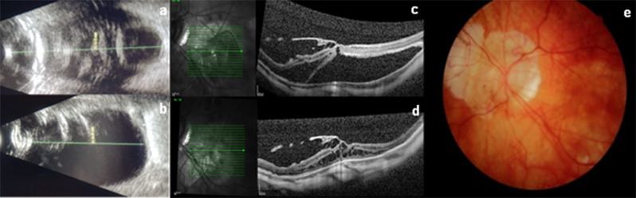

# 1878 — Bong võng mạc do lỗ hoàng điểm trên mắt cận thị nặng: đai hoàng điểm (macular buckle) hay cắt dịch kính? AL **26,5 mm** và thất bại **4% so với 25%**

**Tags:** `pattern:lo-hoang-diem` `pattern:bong-vong-mac` `pattern:bong-hoang-diem` `pattern:lom-hac-mac` `pattern:retinoschisis` `pattern:co-keo-truoc-sau` `vung:hoang-diem` `vung:vong-mac` `vung:hac-mac` `vung:cung-mac` `protocol:OCT` `protocol:B-scan` `protocol:PPV` `protocol:ILM-flap` `protocol:macular-buckle` `score:MSS`

**Mức chắc chắn (certainty):** tổng hợp y văn (literature synthesis) — ghép **ca nguyên văn có ảnh** (võng mạc áp sau **3 ngày** với đai không khâu, **PMC5376471**, CC BY 4.0; **B-scan thấy lõm hắc mạc phẳng lại** sau đai, **PMC11350928**, CC BY 4.0; **hai kiểu hồi phục** sau vạt ILM đảo, **PMC8733330**, CC BY 4.0), **RCT 49 mắt** đai so với cắt dịch kính (**PMC8961764**, CC BY-NC), **phân tích gộp 373 bệnh nhân** (**PMC4906693**, CC BY 4.0), **so sánh 29 mắt** vạt ILM so với bóc ILM (**PMC12218004**, CC BY 4.0), và **hệ phân giai đoạn MSS** tổng hợp **281 mắt** + theo dõi **126 mắt trong 11 năm** (tóm tắt trong **PMC7646438**, CC BY-NC). Phần “chọn đai hay cắt dịch kính” là **tổng hợp có suy luận** từ các nguồn trên, đã ghi rõ chỗ **chưa có bằng chứng**.

> **Câu chốt:** ở mắt cận thị nặng, cái kéo võng mạc **ra khỏi hõm** không phải màng trước võng mạc mà là **lõm hắc mạc sau cực (posterior staphyloma)** — tức **lực trước–sau** (anteroposterior traction) không sửa được bằng cách mổ **từ bên trong** (ab interno). Vì thế trong RCT 49 mắt, **thất bại sau mổ đầu tiên của cắt dịch kính là 25,00%** còn của **đai hoàng điểm (macular buckle, MB) là 4,00%** (p = 0,04), dù **tỷ lệ đóng lỗ lại tương đương** (58,33% so với 64,00%, p = 0,45) (PMC8961764). Nghĩa là: **đai chữa bong**, **vạt ILM đảo chữa lỗ** — hai việc khác nhau, và mắt khó thường cần **cả hai**.

> **Phân vai với bài khác:** [1879](../1879-mang-dut-hoang-diem-sau-mo-bong-vong-mac/lesson.md) phủ lỗ **xuất hiện SAU khi võng mạc đã áp** (chờ hay mổ, mốc MLD 250 µm); [445](../445-bong-vong-mac/lesson.md) phủ bong võng mạc **có lỗ ngoại vi**; [1429](../1429-lo-hoang-diem-thu-phat-manh-oi/lesson.md) phủ lỗ **thất bại điều trị** (màng ối, ART); [1467](../1467-mang-truoc-vong-mac-erm/lesson.md) phủ **màng trước võng mạc**; [1877](../1877-pfcl-ton-luu-duoi-vong-mac/lesson.md) phủ **PFCL tồn lưu**; [1490](../1490-sinh-trac-iol-mat-bom-khi/lesson.md) phủ **sinh trắc sai khi có khí**. Bài này trả lời **một câu duy nhất**: *lỗ hoàng điểm + bong võng mạc cùng lúc trên mắt cận thị nặng — chọn đường vào nào, và vì sao kỹ thuật trong mắt không đủ.*

## 1. Tổng quan bệnh học – cơ chế hình ảnh (TẠI SAO lỗ ở hõm lại kéo cả vùng hoàng điểm bong, và TẠI SAO mổ từ bên trong lại thất bại)

### 1.1 Ba con số định nghĩa và ba con số dịch tễ

| Đại lượng | Ngưỡng / giá trị | Nguồn |
|---|---|---|
| Cận thị nặng (high myopia) | **SE ≤ −6,00 D** *hoặc* **AL > 26,5 mm** | PMC7646438 |
| Tiêu chuẩn vào RCT đai so với cắt dịch kính | **AL > 26,5 mm** hoặc **SE < −8,00 D** + lỗ toàn bộ + bong hoàng điểm + **lõm hắc mạc lan tới hoàng điểm** | PMC8961764 |
| Nguy cơ bong võng mạc ở cận thị nặng | **OR 12,62** (95% CI 6,65–23,94) so với không cận | PMC7401976 |
| Tổn thương võng mạc trên OCT ở **125 mắt** cận thị nặng | **34,4%** (co kéo màng trước võng mạc **46,4%**) | PMC7646438 |
| Diễn tiến tự nhiên **207 mắt** theo dõi ≥ 24 tháng | **11,6%** tiến triển MTM; **3,9%** maculoschisis giảm hoặc hết | PMC7646438 |
| Thất bại mổ đầu tiên của cắt dịch kính ở mắt có lõm hắc mạc | **26,7–50%** | PMC11350928 |

Điểm cần nhớ: **bong võng mạc ở mắt cận thị nặng gấp ~12 lần** mắt không cận, nhưng **không phải mọi bong đều do lỗ ngoại vi**. Khi bong **khu trú sau cực**, nằm gọn trong lõm hắc mạc, và có **lỗ toàn bộ ở hõm** → đây là **MHRD**, một thực thể có chiến lược riêng.

### 1.2 Bốn lực — và vì sao “ab interno” không giải quyết được lực quan trọng nhất

1. **Lực trước–sau do lõm hắc mạc (anteroposterior traction from staphyloma).** Củng mạc sau cực mỏng, giãn, lồi ra sau thành **túi lõm**. Khi mắt vận nhãn hoặc khi có chênh áp, **đáy túi di chuyển theo trục trước–sau** → võng mạc bị **nhấc lên khỏi RPE** đúng ở đỉnh lõm. Đây là lực **vuông góc với mặt phẳng võng mạc**, nên **bóc màng trong mắt không chạm tới được**. Chính vì vậy y văn ghi cắt dịch kính ở mắt có lõm hắc mạc **thất bại 26,7–50%** (PMC11350928), và RCT cho **25,00% so với 4,00%** (PMC8961764).
2. **Lực tiếp tuyến (tangential traction) của màng trước võng mạc/bề mặt ILM.** Ở mắt cận thị nặng, **ILM dày và cứng** hơn (thay đổi collagen), màng trước võng mạc hình thành sớm. Lực này **kéo hai bờ lỗ xa nhau** — nó là lý do **bóc ILM** (cắt lực tiếp tuyến) làm tăng tỷ lệ đóng lỗ: **RR 1,71** (95% CI 1,20–2,43; p = 0,003) cho đóng lỗ và **RR 1,19** (1,04–1,36; p = 0,012) cho áp võng mạc, trên **7 nghiên cứu / 373 bệnh nhân** (PMC4906693).
3. **Võng mạc mỏng + RPE–hắc mạc thoái hóa.** Võng mạc ở hõm bình thường chỉ dày **~0,25 mm**; ở mắt cận thị nặng còn mỏng hơn, **mật độ tế bào Müller và tế bào cảm thụ giảm**, dòng bơm dịch của RPE yếu → **cùng một lỗ, mắt cận thị nặng bong nhiều hơn và lâu áp hơn**.
4. **Maculoschisis (retinoschisis) quanh hoàng điểm.** Lớp võng mạc tách dọc **trong chính võng mạc** (inner/outer schisis) làm võng mạc **mất tính liên tục cơ học**; khi schisis vỡ vào hõm → **lỗ**; khi dịch schisis thoát xuống dưới → **bong**. Đây là lý do **MHRD gần như luôn đi kèm schisis** trong các loạt lớn (PMC11350928, PMC8917523).

### 1.3 Hệ phân giai đoạn MSS — “đồng hồ” của bệnh, không phải nhãn mô tả

Parolini và cs. dựng **hệ phân giai đoạn myopic traction maculopathy (MTM staging system, MSS)** từ OCT của **281 mắt**, rồi theo dõi **126 mắt trong 11 năm** (tóm tắt trong PMC7646438). Hai trục:

- **Trục võng mạc (retinal pattern), giai đoạn 1 → 4:** **1** schisis lớp trong (I-MS) hoặc trong + ngoài (IO-MS) → **2** schisis chủ yếu lớp ngoài (O-MS) → **3** schisis **kèm bong hoàng điểm** (MS-MD) → **4** **bong hoàng điểm** thuần (MD).
- **Trục hõm (foveal pattern), a → c:** **a** đường viền hõm bình thường → **b** lỗ tầng trong (I-LMH) → **c** **lỗ toàn bộ (FTMH)**. Kèm **“O”** nếu có lỗ tầng ngoài và **“+”** nếu có bất thường màng trước võng mạc.

**MHRD = giai đoạn 4c** (bong hoàng điểm + lỗ toàn bộ) — hoặc **3c** khi còn schisis quanh.

Ba con số biến hệ này thành công cụ lâm sàng (PMC7646438):

| Bước chuyển | Thời gian trung bình |
|---|---|
| Giai đoạn **1 → 2** | **20 tháng** |
| Giai đoạn **2 → 3** | **12 tháng** |
| Giai đoạn **3 → 4** | **3 tháng** |

→ Bệnh **tăng tốc**: từ lúc **bong hoàng điểm có schisis** tới **bong hoàng điểm thuần** chỉ **3 tháng**. Đây là căn cứ định lượng cho câu “**thấy bong là mổ, đừng chờ**” — khác hẳn lỗ hoàng điểm nguyên phát không bong (bài [1879](../1879-mang-dut-hoang-diem-sau-mo-bong-vong-mac/lesson.md) có thể theo dõi 2–3 tháng).

### 1.4 Vật lý OCT/B-scan: vì sao phải có **EDI/SS-OCT** và vì sao vẫn cần **B-scan**

- **OCT hoàng điểm thường (SD-OCT ~840 nm) không xuống đủ sâu** ở mắt có lõm hắc mạc lớn: đáy hốc nằm ngoài **độ sâu hiển thị (imaging depth)** → ảnh “cụt đáy”. Đây chính là lý do ca PMC5376471 ghi **“hốc củng mạc sau quá sâu để chụp được”** và phải dùng B-scan để thấy toàn bộ lõm. Hai cách khắc phục: **EDI (enhanced depth imaging)** — đẩy mặt phẳng lấy nét ra sau, và **SS-OCT (~1.050 nm)** — bước sóng dài xuyên sâu hơn, tốc độ quét nhanh hơn.
- **Lỗ toàn bộ** = **mất liên tục từ ILM đến RPE** → khoang **trống/đen**, bờ là **vách mô dày**. Đây là chốt hình ảnh; “khuyết một phần” không phải lỗ toàn bộ.
- **Dịch dưới võng mạc (SRF)** = nước, **không tán xạ** → khoang **giảm phản xạ**, bờ dưới là **RPE tăng phản xạ** — khác **schisis** (khoang giảm phản xạ **nằm trong** võng mạc, **còn vách** và **còn dải lớp** hai bờ).
- **Gliosis/mô đệm** (sau khi lỗ đóng) = tế bào Müller + collagen → **tăng phản xạ trung bình**, **lấp đầy khuyết**. Vì vậy “lỗ đóng” trên OCT ở mắt cận thị nặng thường là **lỗ đóng bằng mô đệm**, **không phải hõm phục hồi** — và **EZ/ELM vẫn đứt**.
- **Hyperreflective foci ở lớp võng mạc ngoài** (mũi tên đỏ trong PMC8733330 Fig 3) = **tế bào viêm/sắc tố hoặc mảnh tế bào cảm thụ** — dấu **tổn thương đang hoạt động** ở lớp ngoài; gặp trong cả hai kiểu hồi phục.
- **B-scan 10 MHz:** đo **độ sâu lõm hắc mạc**, **AL**, và **xác nhận áp võng mạc khi OCT bị chặn** (đục thể thủy tinh, dầu, lõm quá sâu). Sau đai, B-scan thấy **lõm phẳng lại** — đây là **bằng chứng cơ học** rằng đai đã tác động đúng chỗ (PMC11350928 Fig 3).

### 1.5 Vì sao đai hoàng điểm hạ được AL — và vì sao điều đó chữa bong

Đai là **vật liệu độn ép củng mạc từ ngoài vào** (ab externo) tại cực sau, thường luồn dưới **cơ chéo dưới** và **cơ chéo trên**, đầu đai nằm dưới hoàng điểm. Ba hiệu ứng đo được:

- **Làm phẳng lõm hắc mạc** → lực trước–sau mất chỗ bám (B-scan: lõm phẳng, PMC11350928).
- **Rút ngắn AL:** loạt **25 mắt** đai hình T: AL **28,5 mm → 26,2 mm** (PMC8917523); loạt **8 mắt** đai đầu ốc: **28,44 → 27,60 mm** (p = 0,016) (PMC6874173).
- **Tạo “dome-shaped macula” nhân tạo** — chính dạng vồi lồi này được xem là **yếu tố bảo vệ** tự nhiên ở mắt cận thị nặng, nên đai “bắt chước” cơ chế bảo vệ có sẵn (PMC7646438).

## 2. Mẫu hình + chẩn đoán phân biệt theo vị trí và bối cảnh (gamut)

### 2.1 Mẫu hình chốt — “lỗ trung tâm + bong khu trú trong lõm + schisis quanh”

Bộ ba của MHRD:

1. **Lỗ toàn bộ ở hõm**, thường **bờ cứng, ít dịch quanh bờ** (khác lỗ thứ phát sau mổ bong võng mạc có **cuff** rõ — bài [1879](../1879-mang-dut-hoang-diem-sau-mo-bong-vong-mac/lesson.md));
2. **Bong hoàng điểm khu trú**, **không vượt quá cung mạch** ở đa số ca (tiêu chuẩn loại của RCT: bong **lan ra ngoài cung mạch ở > 1 góc phần tư** là **không** phải MHRD điển hình — PMC8961764);
3. **Lõm hắc mạc sau cực** + **schisis quanh hoàng điểm** (thường **lớp ngoài** ở giai đoạn muộn).

### 2.2 Gamut theo bối cảnh — “lỗ hoàng điểm + bong trên mắt cận thị” gồm 7 thực thể

- **A. MHRD thật (bài này):** lỗ toàn bộ + bong trong lõm + schisis; **AL > 26,5 mm**; điều trị **đai ± vạt ILM**.
- **B. Bong võng mạc có lỗ ngoại vi + lỗ hoàng điểm tình cờ:** bong **lan tới ngoại vi**, có **lỗ rách/đứt ora**; bịt lỗ hoàng điểm là **sai thứ tự** — phải xử lý lỗ ngoại vi (bài [445](../445-bong-vong-mac/lesson.md)).
- **C. Bong co kéo (tractional RD) do tăng sinh:** có **màng tăng sinh co kéo** (đái tháo đường, ROP), bong **căng, không di động**, không có lỗ đơn độc.
- **D. Bong hoàng điểm KHÔNG có lỗ (MS-MD, giai đoạn 3 / 4-a):** dịch dưới võng mạc nhưng **ILM–RPE còn liên tục**. Điều trị: **đai đơn thuần** (không cần bịt lỗ) — đây là ca thứ ba của PMC11350928 (lỗ tầng trong + bong, đai đơn thuần, phẳng lõm sau mổ).
- **E. Lỗ hoàng điểm cận thị KHÔNG bong:** theo dõi/bóc màng hoặc vạt ILM theo kích thước; **không** đặt đai khi chưa có bong.
- **F. Lỗ tầng (lamellar hole) + bong:** lỗ tầng **có thể** kèm bong hoàng điểm ở mắt cận thị nặng (PMC11350928 Fig 3) — **không** điều trị như lỗ toàn bộ.
- **G. Bong thanh dịch do CNV cận thị (myopic CNV/PCV):** **dịch dưới võng mạc không lỗ**, kèm **mảng xuất huyết/tăng phản xạ dưới RPE**; điều trị **anti-VEGF**, đặt đai là sai.

### 2.3 Gamut theo hình thái OCT — “khoang dịch ở hoàng điểm mắt cận thị”

| Hình thái | Nghĩ khoanh vùng | Bẫy hay gặp |
|---|---|---|
| Khuyết **toàn bộ** ILM→RPE + SRF | MHRD | Bỏ lỗ vì **mải nhìn schisis** |
| Khuyết toàn bộ **nhưng không SRF** | Lỗ hoàng điểm cận thị khô | Đặt đai oan khi chưa có bong |
| Khoang giảm phản xạ **trong** võng mạc, còn vách | Schisis (MS) | Gọi là “bong” → mổ sớm không cần thiết |
| Khoang dưới võng mạc, **ILM–RPE liên tục** | MS-MD / MD không lỗ | **Không** bịt lỗ; đai đơn thuần |
| Dịch + **mảng tăng phản xạ dưới RPE** | CNV cận thị | Đặt đai thay vì anti-VEGF |
| Võng mạc **vồi lên** giữa lõm | **Dome-shaped macula (DSM)** | Đọc là “bong” hoặc “u” — DSM là **bảo vệ** |
| Lỗ đã đóng bằng **mô tăng phản xạ** | Gliosis sau vạt ILM | Gọi là “lỗ tái mở” → mổ lại oan |

## 3. Bảng so sánh phân biệt (ma trận đối chiếu)

| Thực thể | Hình ảnh điển hình (OCT / B-scan / fundus) | Chốt vào (rule-in) | Chốt loại (rule-out) | Gợi ý xác nhận |
|---|---|---|---|---|
| **MHRD** (bài này) | **Lỗ toàn bộ ILM→RPE** ở hõm; **SRF khu trú** trong lõm; schisis quanh; lõm hắc mạc sau cực; AL **> 26,5 mm** | **Lỗ toàn bộ + SRF + lõm hắc mạc lan tới hoàng điểm**; bong **không vượt cung mạch** | **Không có lỗ** (ILM–RPE liên tục) → MS-MD; bong **lan ngoại vi** → RRD | EDI/SS-OCT + **B-scan đo độ sâu lõm** + AL; so ảnh cũ |
| **MS-MD / MD không lỗ** (MSS 3–4a) | SRF dưới hõm, **không khuyết toàn bộ**; schisis ngoài rõ | **SRF + bờ hõm còn liên tục** | Khuyết **toàn bộ** = đã có lỗ | Theo dõi MSS: **3 tháng** từ giai đoạn 3 lên 4 |
| **Bong có lỗ ngoại vi (RRD)** | Bong **lan ra ngoại vi**, lỗ rách/đứt ora, thường **di động**, có **demarcation line** | **Tìm thấy lỗ ngoại vi** trong 360° ấn củng mạc | Lỗ **chỉ ở hõm** + bong khu trú = MHRD | Soi đáy mắt 360°, vẽ lỗ lên sơ đồ |
| **Bong co kéo (TRD)** | Màng tăng sinh **co kéo**, bong **căng không di động**, không lỗ đơn độc | **Màng co kéo + bong căng** | Có **lỗ toàn bộ + SRF di động** → MHRD | Siêu âm B-scan động: bong **không di chuyển** |
| **Lỗ hoàng điểm cận thị không bong** | Khuyết toàn bộ, **không SRF**, schisis nhẹ | Lỗ **+ OCT không có dịch dưới võng mạc** | Có SRF → đã là MHRD | Theo dõi **4 tuần/lần**; báo bệnh nhân mốc **3 tháng** |
| **Lỗ tầng + bong** | Khuyết **nội bộ**, đáy còn lớp cảm thụ; SRF có thể có | **Đáy lỗ còn mô** | **Khuyết ILM→RPE** = lỗ toàn bộ | Raster toàn bộ: một lát “giống lỗ toàn bộ” có thể do cắt xiên |
| **CNV cận thị** | Dịch + **mảng tăng phản xạ dưới RPE**, xuất huyết; OCTA có **mạng mạch** | **Mảng dưới RPE + xuất huyết** | **Lỗ toàn bộ trống** = không phải CNV | OCTA; điều trị **anti-VEGF**, không đai |

*Hai nhánh của RCT 49 mắt. (A) trước mổ nhóm **đai (MB)**: lỗ toàn bộ + bong hoàng điểm; (B) 6 tháng sau đai: võng mạc áp, lỗ đóng; (C–E) 1, 1,5 và 2 năm: **hõm ổn định, không teo lan**. (F) trước mổ nhóm **cắt dịch kính (PPV)**; (G) 6 tháng: áp, lỗ đóng; (H–J) 1, 1,5 và 2 năm: **ảnh hồng ngoại cho thấy mảng teo xuất hiện và lan rộng**. Đây là hình ảnh của kết cục khác nhau: **đóng lỗ tương đương, nhưng thoái hóa hắc mạc tiến triển nặng hơn sau PPV**. Ảnh: *Br J Ophthalmol* 2022 (**PMC8961764**), CC BY-NC, nguyên bản.*

> **Không tạo ảnh ghép trong bài này:** cả bốn hình là **hình nhiều ô có nhãn nội bộ (a–e / A–J)** do tạp chí đặt; cắt và ghép lại sẽ **làm mất nhãn và sai ngữ cảnh** (mỗi ô là một mốc thời gian khác nhau). Chi tiết giấy phép từng file: `images/CREDITS.md`.

## 4. Protocol chụp + hệ phân độ/điểm chuẩn hóa

### 4.1 Protocol hình ảnh — 6 việc phải làm trước khi quyết định

1. **OCT hoàng điểm EDI hoặc SS-OCT, raster 6 × 6 mm** (rộng hơn: **12 mm** nếu cần thấy hết schisis). Ghi rõ **có/không**: lỗ toàn bộ, SRF, schisis (lớp trong/ngoài), màng trước võng mặc, **dome-shaped macula**.
2. Đo **MLD (đường kính nhỏ nhất)** tại **mặt phẳng RPE**, **BD (đường kính đáy)**, **chiều cao lỗ** → chọn kỹ thuật (bài [1879](../1879-mang-dut-hoang-diem-sau-mo-bong-vong-mac/lesson.md) mục 4).
3. **B-scan 10 MHz**: đo **độ sâu lõm hắc mạc**, xác nhận **áp võng mạc** khi OCT không tới đáy, và **đo AL** nếu sinh trắc không làm được (bài [1490](../1490-sinh-trac-iol-mat-bom-khi/lesson.md)).
4. **Sinh trắc AL** (IOLMaster/Lenstar hoặc A-scan tiếp xúc): **AL > 26,5 mm** là ngưỡng định nghĩa; trong RCT, **AL > 26,5 mm hoặc SE < −8 D** là tiêu chuẩn vào (PMC8961764). AL cũng là biến theo dõi sau đai (**28,5 → 26,2 mm**).
5. **Fundus màu góc rộng**: tìm **lỗ ngoại vi**, **đứt ora**, **mảng teo hắc mạc**, **vết nứt (lacquer crack)**, **xuất huyết** (loại CNV).
6. **Đánh giá lõm hắc mạc**: theo **Curtin** — **10 kiểu**, **I–V là nguyên phát**, **VI–X là phối hợp**, **kiểu I (cực sau, gồm hoàng điểm + gai) là phổ biến nhất** (PMC7646438). Ghi rõ lõm **có lan tới hoàng điểm hay không** — đây là tiêu chuẩn vào của RCT.

### 4.2 Hệ phân giai đoạn MSS (Parolini) — dùng để chọn đường vào

| Giai đoạn (trục võng mạc) | OCT | Phối hợp trục hõm | Thái độ |
|---|---|---|---|
| **1** | Schisis lớp trong (I-MS) hoặc trong + ngoài (IO-MS) | a (hõm bình thường) | **Theo dõi**; can thiệp khi thị lực giảm hoặc tiến triển |
| **2** | Schisis chủ yếu lớp ngoài (O-MS) | a/b | Cân nhắc **PPV** hoặc **đai** theo độ sâu lõm và AL |
| **3** | **Schisis + bong hoàng điểm (MS-MD)** | a/b/c | **Mổ**: đai nếu lõm sâu; PPV ± vạt ILM nếu lõm nông |
| **4** | **Bong hoàng điểm thuần (MD)** | a → **c** (lỗ toàn bộ = **MHRD**) | **Mổ sớm**: cửa sổ từ 3 lên 4 chỉ **3 tháng** |

### 4.3 So sánh ba chiến lược — số liệu gộp

| Chiến lược | Áp võng mạc | Đóng lỗ | Thị lực | Nguồn |
|---|---|---|---|---|
| **PPV + bóc ILM** | Thất bại mổ đầu **25,00%** (RCT); **26,7–50%** ở mắt có lõm hắc mạc | **58,33%** (RCT); **41,67%** (loạt 45 mắt) | Cải thiện (p = 0,04 trong RCT) | PMC8961764, PMC8733330, PMC11350928 |
| **PPV + vạt ILM đảo** | **82,4%** (ban đầu) → **100%** (cuối) | **95,24%** (loạt 45 mắt); **50%** (loạt 29 mắt, so với 35,3% khi bóc ILM, p = 0,024) | Không khác bóc ILM (p = 0,98) | PMC8733330, PMC12218004 |
| **Đai hoàng điểm (MB)** | Thất bại mổ đầu **4,00%** (RCT); **24/25 mắt** giảm SRF > 90% + đảo đường viền lõm | **64,00%** (RCT); **40%** (đai không khâu, 20 mắt); **75%** (đai + PPV, 8 mắt) | **1,16 → 1,096 logMAR** (p = 0,165); 40% tốt lên, 44% giữ nguyên, 16% giảm | PMC8961764, PMC8917523, PMC5376471, PMC6874173 |
| **Phân tích gộp 7 nghiên cứu / 373 BN**: bóc ILM so với không bóc | **RR 1,19** (1,04–1,36; p = 0,012) | **RR 1,71** (1,20–2,43; p = 0,003) | Không khác (p = 0,738) | PMC4906693 |

*Forest plot tỷ lệ **đóng lỗ** của nhóm **bóc ILM** so với **không bóc** trên 7 nghiên cứu so sánh (373 bệnh nhân): **RR 1,71** (95% CI 1,20–2,43; p = 0,003) nghiêng về bóc ILM; tỷ lệ áp võng mạc **RR 1,19** (1,04–1,36; p = 0,012), nhưng **thị lực không khác** (p = 0,738). Đây là mức sàn của “ab interno”: bóc ILM **tăng đóng lỗ** mà **không cải thiện thị lực** — vì lực trước–sau vẫn còn. Ảnh: *BMC Ophthalmol* 2016 (**PMC4906693**), CC BY 4.0, nguyên bản.*

**Ba kết luận thực hành rút ra từ bảng:**

1. **Đai thắng ở áp võng mạc** (thất bại 4% so với 25%) — vì nó sửa **lực trước–sau**.
2. **Vạt ILM đảo thắng ở đóng lỗ** (95% so với 42–58%) — vì nó **bịt khuyết** bằng giá đỡ mô.
3. **Không có kỹ thuật nào thắng ở thị lực** — vì thị lực phụ thuộc **EZ/ELM hồi phục**, mà ở mắt cận thị nặng lớp ngoài đã thoái hóa từ trước. Nói trước với bệnh nhân: **mục tiêu là cứu mắt, không phải “nhìn như cũ”**.

### 4.4 Quyết định: đường vào nào — flowchart

### 4.5 Ngưỡng và mốc theo dõi (bảng tra nhanh)

| Mốc | Ngưỡng / hành động |
|---|---|
| Định nghĩa cận thị nặng | **AL > 26,5 mm** hoặc **SE ≤ −6 D** (RCT dùng **SE < −8 D**) |
| Chỉ định mổ | **Có SRF dưới hõm** — không chờ, vì **giai đoạn 3 → 4 chỉ 3 tháng** |
| Chọn đai | **Lõm sâu/lan tới hoàng điểm**, **AL ≥ 28 mm**, **đã thất bại PPV**, hoặc **không có ILM để làm vạt** |
| Chọn vạt ILM đảo | **Lỗ lớn, ILM còn**, ưu tiên khi mục tiêu là **đóng lỗ** (95% so với 42%) |
| Theo dõi sau mổ | OCT + B-scan **1 tuần, 1 tháng, 3 tháng**, rồi **6 và 12 tháng**; đo **AL** mỗi lần |
| Dấu hiệu thất bại | **SRF còn/tăng**, **lỗ mở**, **AL không giảm** sau đai, **mảng teo mới** |
| Tamponade | Các loạt dùng **cả khí và dầu silicone**; **ngưỡng chọn giữa hai loại ở MHRD chưa thống nhất trong y văn đã đọc — ghi “chưa rõ”**, không chọn hộ |

## 5. Biến thể bình thường và cạm bẫy

### 5.1 Biến thể bình thường dễ gọi nhầm

- **Dome-shaped macula (DSM):** võng mạc **vồi lên** ở giữa lõm hắc mạc — **biến thể có lợi**, gắn với **ít bong võng mạc hơn**. Trên OCT: vồi **đối xứng**, **không có SRF**, **không có lỗ**. Đừng đọc là “bong” hay “u”; **đai hoàng điểm tạo ra DSM nhân tạo** — cùng nguyên lý.
- **Đường viền hõm dốc một bên** (do võng mạc co): **không phải lỗ** nếu **ILM–RPE còn liên tục** trên mọi lát cắt.
- **Bờ lõm hắc mạc dốc đứng** trên B-scan: có thể **giả “vách”** giữa hai khoang dịch — xoay đầu dò và so với OCT trước khi gọi màng ngăn.

### 5.2 Cạm bẫy (pitfall)

| Cạm bẫy | Hậu quả | Cách tránh |
|---|---|---|
| **Chỉ chụp OCT 6 mm ở hõm** | Bỏ **schisis/bong lan rộng**, đánh giá thấp giai đoạn MSS | Luôn có **raster rộng + B-scan**; đo **độ sâu lõm** |
| **OCT “cụt đáy” vì lõm quá sâu** | Không thấy lõm → chọn sai đường vào | Dùng **EDI/SS-OCT**; **B-scan** khi vẫn không tới đáy |
| **Chẩn đoán “bong võng mạc” mà bỏ lỗ hoàng điểm** | Mổ như RRD, **không bịt lỗ**, tái bong | Soi **360°**, đọc OCT hoàng điểm **trước** khi quyết định |
| **Bịt lỗ hoàng điểm khi bong do lỗ ngoại vi** | Bỏ sót lỗ ngoại vi → **bong tái phát** | Tìm lỗ ngoại vi **trước**, đánh dấu trên sơ đồ |
| **Bóc ILM đơn thuần ở lõm sâu** | Đóng lỗ **42–58%**, thất bại **25%** | Thêm **đai** khi lõm sâu/AL ≥ 28 mm |
| **Vạt ILM khi đã bóc hết ILM** | Không còn vật liệu → lỗ không đóng | Đọc **biên bản mổ cũ**; nếu hết ILM → **màng ối/ART** ([1429](../1429-lo-hoang-diem-thu-phat-manh-oi/lesson.md)) |
| **Gọi mô đệm tăng phản xạ là “lỗ tái mở”** | Mổ lại oan | **Lỗ đóng bằng gliosis là đóng thật**; theo dõi EZ/ELM |
| **Hứa “mổ xong nhìn rõ”** | Thất vọng dù áp tốt | Nói rõ: **mục tiêu là cứu mắt**; EZ/ELM ở mắt cận thị nặng đã tổn thương từ trước |
| **Bỏ qua teo hắc mạc tiến triển sau PPV** | Thị lực mất dần dù lỗ đóng | Chụp **fundus/ảnh hồng ngoại** mỗi lần; RCT cho thấy **teo nặng hơn sau PPV** |
| **Sinh trắc AL khi mắt còn khí/dầu** | Sai số → chọn sai công suất IOL | Đo lại sau khi hết tamponade ([1490](../1490-sinh-trac-iol-mat-bom-khi/lesson.md)) |

## 6. Tự lượng giá — Blind Quiz ngay trên trang tĩnh

**Ca 1 — mắt cận thị nặng, nhìn mờ trung tâm, mổ đai không khâu**

- Gợi ý lâm sàng: mắt cận thị nặng có **lõm hắc mạc sau cực**, thị lực giảm, **ám điểm trung tâm**; được đặt **đai hoàng điểm không khâu** (cố định bằng keo sinh học).
- Câu hỏi: (1) Panel (b) cho thấy gì, và **vì sao OCT không lấy được toàn bộ đáy hốc**? (2) Ba chẩn đoán phân biệt? (3) Vì sao võng mạc **áp chỉ sau 3 ngày** — điều gì đã thay đổi về mặt cơ học?

<b>Bấm để hiện đáp án (findings + chẩn đoán)</b>

- **Findings:** (a) fundus cận thị nặng, **lõm hắc mạc** vùng cực sau; (b) OCT trước mổ: **lỗ toàn bộ ở hõm** + **bong võng mạc** + **màng trước võng mạc**, **hốc củng mạc sau quá sâu để chụp hết**; (c) fundus sau mổ: **gờ độn của đai** ở cực sau; (d) OCT sau mổ 3 ngày: **võng mạc áp hoàn toàn**, hõm được **độn lên**, lỗ đóng.
- **Chẩn đoán:** **MHRD** (lỗ toàn bộ hoàng điểm + bong hoàng điểm trên mắt cận thị nặng có lõm hắc mạc).
- **Phân biệt:** (a) **MS-MD không lỗ** — loại vì có **khuyết toàn bộ ILM→RPE**; (b) **bong có lỗ ngoại vi** — loại vì bong **khu trú trong lõm**, không thấy lỗ ngoại vi; (c) **bong co kéo** — loại vì bong **di động**, không có màng tăng sinh co kéo.
- **Vì sao áp sau 3 ngày:** đai **ép củng mạc từ ngoài vào**, **làm phẳng lõm** → **lực trước–sau mất chỗ bám**; đây là việc mà **bóc màng từ bên trong không làm được**. Đây cũng là lý do **thất bại 4% so với 25%** trong RCT.
- **Phản biện:** đóng lỗ trong loạt này chỉ **40%** (20 mắt, theo dõi **6 tháng**) — **áp võng mạc tốt hơn đóng lỗ**; muốn đóng lỗ phải **thêm vạt ILM**.
- Nguồn ảnh: *J Ophthalmol* 2017 (**PMC5376471**), CC BY 4.0, nguyên bản (Figure 4), không chỉnh sửa.

**Ca 2 — sau vạt ILM đảo, hai kiểu hồi phục rất khác nhau**

- Gợi ý lâm sàng: hai nữ bệnh nhân **56 và 49 tuổi**, MHRD, cùng được **vạt ILM đảo** — một ca hỗ trợ bằng **PFCL**, một ca bằng **máu tự thân**.
- Câu hỏi: (1) Kiểu 1 (A–D) và kiểu 2 (E–H) khác nhau ở điểm nào? (2) Mũi tên đỏ chỉ gì? (3) Kiểu nào cho thấy **áp võng mạc chậm hơn**, và vì sao phải nói trước với bệnh nhân?

<b>Bấm để hiện đáp án (findings + chẩn đoán)</b>

- **Findings:** **Kiểu 1** (A–D, PFCL): ngày 7 võng mạc **áp**, còn khuyết hõm; tháng 2 khuyết **được lấp một phần bằng mô đệm**; tháng 3 **khuyết mất hoàn toàn, thay bằng mô đệm**. **Kiểu 2** (E–H, máu tự thân): tháng 1 lỗ **được dán bằng mô đệm nhưng bong vẫn còn**; tháng 6 **dịch hấp thu một phần, áp chưa hoàn toàn**, mô đệm teo đi; tháng 8 **lỗ đóng + áp hoàn toàn**, nhưng **INL, ONL, ELM và EZ đều gián đoạn**.
- **Mũi tên đỏ:** **hyperreflective foci ở lớp võng mạc ngoài** — dấu tổn thương đang hoạt động ở lớp ngoài (mảnh tế bào cảm thụ/sắc tố).
- **Chẩn đoán:** hai **kiểu hồi phục của MHRD sau vạt ILM đảo**; kiểu 2 áp **chậm hơn nhiều (8 tháng)**.
- **Ý nghĩa thực hành:** vạt ILM đóng lỗ **95,24%** nhưng **thị lực không khác bóc ILM** (p = 0,98), và **mô đệm quá mức gặp 42,9%** (9/21 mắt) — chỉ ở nhóm vạt. Giải thích trước: **lỗ đóng không đồng nghĩa lớp ngoài hồi phục**.
- Nguồn ảnh: *Front Med* 2021 (**PMC8733330**), CC BY 4.0, nguyên bản (Figure 3), không chỉnh sửa.

**Ca 3 — vì sao OCT không đủ, phải làm B-scan**

- Gợi ý lâm sàng: mắt cận thị nặng, **bong hoàng điểm**, OCT chỉ thấy **lỗ tầng trong** chứ không thấy lỗ toàn bộ; được **đặt đai hoàng điểm đơn thuần** (không cắt dịch kính).
- Câu hỏi: (1) B-scan (a) đo được gì mà OCT không đo được? (2) Vì sao **không cần bịt lỗ** trong ca này? (3) Sau mổ, dấu hiệu nào trên B-scan chứng minh đai **đã tác động đúng chỗ**?

<b>Bấm để hiện đáp án (findings + chẩn đoán)</b>

- **Findings:** (a) B-scan trước mổ: **lõm hắc mạc lớn** + **bong hoàng điểm** (mũi tên); (b) sau mổ: **lõm phẳng lại** do đai; (c) OCT trước mổ: **lỗ tầng trong + bong hoàng điểm + schisis hoàng điểm phía mũi**, còn **dính dịch kính–hoàng điểm**; (d) sau mổ: lõm phẳng, **lỗ tầng và bong hết**, schisis giảm, dính dịch kính–hoàng điểm vẫn ổn định; (e) fundus: võng mạc áp.
- **Chẩn đoán:** **bong hoàng điểm trên mắt cận thị nặng có lõm hắc mạc, lỗ tầng trong (không phải lỗ toàn bộ)** — tức **MSS giai đoạn 3b** chứ không phải **4c**.
- **Vì sao không bịt lỗ:** **không có khuyết toàn bộ** → không có “lỗ” để bịt; việc cần làm là **giải phóng lực trước–sau**, và **đai đơn thuần đã làm được**.
- **Chứng minh cơ học:** **đường viền lõm hắc mạc đảo/phẳng lại** trên B-scan sau mổ — tương ứng tiêu chuẩn “thành công giải phẫu” trong loạt 25 mắt (giảm SRF > 90% **+ đảo đường viền lõm**).
- **Phản biện:** đây là **loạt 3 ca**, theo dõi trung bình **18 tháng** — đủ để minh họa, **không** đủ để kết luận tỷ lệ.
- Nguồn ảnh: *Int J Retina Vitreous* 2024 (**PMC11350928**), CC BY 4.0, nguyên bản (Fig. 3), không chỉnh sửa.

**Ca 4 — cùng đóng lỗ, hai kết cục dài hạn**

- Gợi ý lâm sàng: hai mắt cận thị nặng, cùng **lỗ toàn bộ + bong hoàng điểm**, một mắt **đai**, một mắt **cắt dịch kính**; cả hai **đóng lỗ, áp võng mạc**.
- Câu hỏi: (1) Khác biệt chính giữa hai chuỗi ảnh 2 năm là gì? (2) Điều đó có nghĩa “đai tốt hơn” ở mọi mặt không? (3) Số liệu RCT nói gì về **thị lực** và **đóng lỗ**?

<b>Bấm để hiện đáp án (findings + chẩn đoán)</b>

- **Findings:** nhánh **MB** (A–E): hõm **ổn định** qua 2 năm, **không thấy mảng teo mới**. Nhánh **PPV** (F–J): **ảnh hồng ngoại cho thấy mảng teo xuất hiện và lan rộng** theo thời gian.
- **Số liệu RCT (49 mắt, 24 tháng):** **thất bại mổ đầu 4,00% (MB) so với 25,00% (PPV)**, p = 0,04 → **đai thắng về áp võng mạc**. **Đóng lỗ 64,00% so với 58,33%**, p = 0,45 → **không khác**. **Thị lực cải thiện ở cả hai**, khác biệt **không có ý nghĩa** (p = 0,653). **Thoái hóa hắc mạc tiến triển nặng hơn sau PPV**.
- **Trả lời câu (2):** **không**. Đai **không** đóng lỗ tốt hơn (64% so với 58%), **không** cải thiện thị lực nhiều hơn, và là **mổ ngoài nhãn cầu** có nguy cơ riêng (song thị, lệch trục, chèn ép). Chọn đai khi **cơ chế chính là lõm hắc mạc**; chọn vạt ILM khi **cơ chế chính là lỗ**.
- **Kết luận:** **MHRD cần hai câu trả lời, không phải một** — *cái gì đang kéo?* (lõm → đai) và *cái gì đang mở?* (lỗ → vạt ILM).
- Nguồn ảnh: *Br J Ophthalmol* 2022 (**PMC8961764**), CC BY-NC, nguyên bản (Figure 3), không chỉnh sửa.

## Bài liên quan chéo

- [1879 — Màng đứt hoàng điểm sau mổ bong võng mạc: theo dõi hay mổ](../1879-mang-dut-hoang-diem-sau-mo-bong-vong-mac/lesson.md)
- [445 — Bong võng mạc (rhegmatogenous retinal detachment)](../445-bong-vong-mac/lesson.md)
- [1429 — Lỗ hoàng điểm thứ phát: màng ối và vật liệu sinh học](../1429-lo-hoang-diem-thu-phat-manh-oi/lesson.md)
- [1877 — PFCL tồn lưu dưới võng mạc: dấu Ω](../1877-pfcl-ton-luu-duoi-vong-mac/lesson.md)
- [1875 — Phù hoàng điểm dạng nang trên mắt bơm dầu](../1875-phu-hoang-diem-dang-nang-mat-bom-dau/lesson.md)
- [1865 — Bong võng mạc tái phát sau tháo dầu](../1865-bong-vong-mac-tai-phat-sau-thao-dau/lesson.md)
- [1467 — Màng trước võng mạc (ERM)](../1467-mang-truoc-vong-mac-erm/lesson.md)
- [1490 — Sinh trắc IOL trên mắt bơm khí](../1490-sinh-trac-iol-mat-bom-khi/lesson.md)

## Ảnh

- `1878_mhrd-truoc-sau_FundusOCT-PMC5376471-Fig4.jpg` — fundus + OCT trước mổ (MHRD, màng trước võng mạc) và **3 ngày sau đai không khâu** (áp hoàn toàn, hõm được độn); *J Ophthalmol* 2017 (**PMC5376471**), **CC BY 4.0**, nguyên bản.
- `1878_staphyloma_USG-PMC11350928-Fig3.jpg` — B-scan **lõm hắc mạc phẳng lại** sau đai + OCT **lỗ tầng trong kèm bong** trước và sau mổ; *Int J Retina Vitreous* 2024 (**PMC11350928**), **CC BY 4.0**, nguyên bản.
- `1878_ilm-flap_OCT-PMC8733330-Fig3.jpg` — **hai kiểu hồi phục** MHRD sau vạt ILM đảo (PFCL so với máu tự thân) với **hyperreflective foci** lớp ngoài; *Front Med* 2021 (**PMC8733330**), **CC BY 4.0**, nguyên bản.
- `1878_buckle-vs-ppv_OCT-PMC8961764-Fig3.jpg` — OCT 2 năm sau **đai** so với sau **cắt dịch kính**, kèm **teo hắc mạc lan rộng** ở nhánh PPV; *Br J Ophthalmol* 2022 (**PMC8961764**), **CC BY-NC**, nguyên bản.
- `1878_meta-ilm_Forest-PMC4906693-Fig3.jpg` — forest plot **đóng lỗ** khi bóc ILM so với không bóc (**RR 1,71**); *BMC Ophthalmol* 2016 (**PMC4906693**), **CC BY 4.0**, nguyên bản.
- **Không tạo ảnh ghép:** cả 5 hình là **hình nhiều ô có nhãn nội bộ do tạp chí đặt**, mỗi ô là một **mốc thời gian/kỹ thuật khác nhau** — cắt và ghép lại sẽ **làm mất nhãn và sai ngữ cảnh**. Chi tiết giấy phép từng file: `images/CREDITS.md`.

> Không dùng để chẩn đoán độc lập khi chưa có người hướng dẫn.
