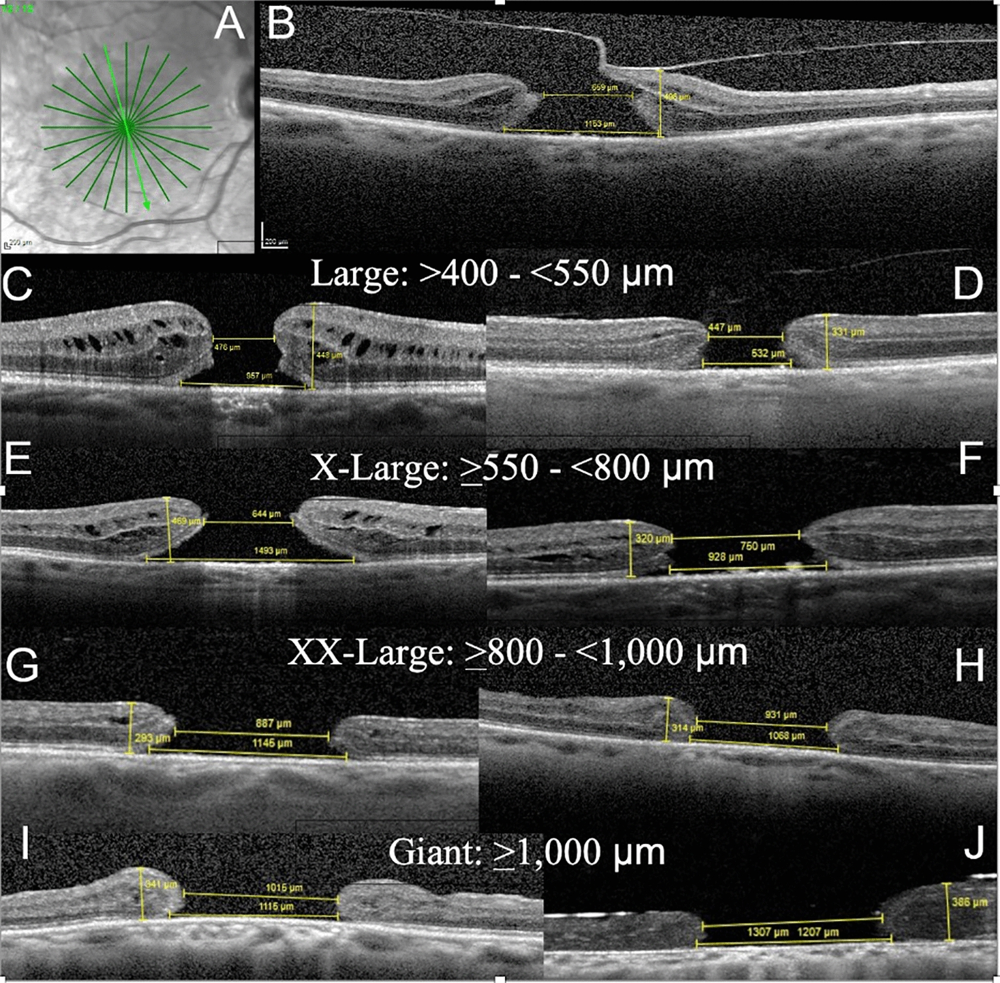
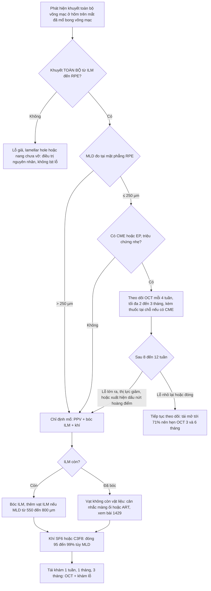
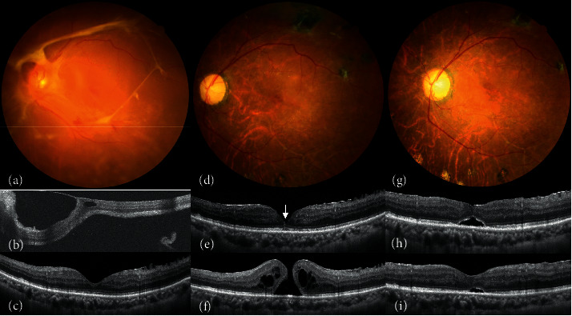
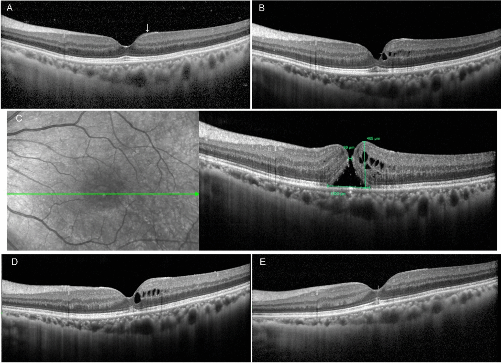

# 1879 — Màng đứt hoàng điểm sau mổ bong võng mạc: theo dõi 2–3 tháng hay mổ ngay? Mốc MLD **128–162 µm** so với **387–589 µm**

**Tags:** `pattern:lo-hoang-diem` `pattern:lo-toan-bo-hoang-diem` `pattern:co-keo-tiep-tuyen` `pattern:vanh-dich-duoi-vong-mac` `pattern:phu-hoang-diem-dang-nang` `pattern:tang-sinh-truoc-vong-mac` `vung:hoang-diem` `vung:vong-mac` `vung:dich-kinh` `protocol:OCT` `protocol:PPV` `protocol:ILM-peel` `protocol:khi-tamponade` `score:IVTS` `score:CLOSE`

**Mức chắc chắn (certainty):** tổng hợp y văn (literature synthesis) — ghép **ca nguyên văn có ảnh** màng đứt hoàng điểm thứ phát (secondary FTMH, sFTMH) sau cắt dịch kính vì bong võng mạc, **tự đóng trong 3 tháng** (OCT 5 thì A–E, **PMC13464826**, CC BY-NC-ND), **ca nguyên văn** dấu **nứt hoàng điểm (foveal crack sign)** đi trước màng đứt (OCT, **PMC9173914**, CC BY 4.0), **phân loại CLOSE** trên **31 bài / 1.135 mắt** (OCT 4 nhóm kích thước, **PMC9885593**, CC BY 4.0), **nghiên cứu bệnh–chứng 44 vs 44 mắt** về yếu tố nguy cơ (**PMC12336166**, CC BY-NC), và **60 mắt** so sánh khí SF₆ với C₃F₈ (**PMC12580656**, CC BY). Phần “chọn theo dõi hay mổ” là **tổng hợp có suy luận**, đã ghi rõ chỗ chưa có RCT.

> **Câu chốt:** sau khi võng mạc đã áp tốt, một **khuyết toàn bộ võng mạc ở hõm hoàng điểm** vẫn có thể **tự đóng** — nhưng chỉ ở nhóm **nhỏ**: lỗ tự đóng có **MLD 128–162 µm**, lỗ không đóng **387–589 µm**. Nghĩa là **không phải mọi màng đứt sau mổ bong võng mạc đều mổ ngay**, và cũng **không được chờ vô hạn**: tự đóng muộn nhất khoảng **4 tháng**, **tái mở tới 71%**, còn mổ thì đóng sớm hơn nhiều (**trung vị 18,5 ngày vs 56 ngày**). Khung thực hành: **theo dõi OCT mỗi 4 tuần trong 2–3 tháng** nếu lỗ **≤ 250 µm**, có **phù hoàng điểm dạng nang (CME)** hoặc **tăng sinh trước võng mạc (epiretinal proliferation, EP)** và triệu chứng nhẹ; **mổ** khi lỗ **lớn ra**, thị lực **giảm**, hoặc xuất hiện **dấu nứt hoàng điểm**.

> **Phân vai với bài khác:** [1429](../1429-lo-hoang-diem-thu-phat-manh-oi/lesson.md) phủ **lỗ thứ phát ĐÃ thất bại điều trị** trên mắt **mất ILM/bơm dầu** → màng ối, ghép võng mạc tự thân (ART); [1877](../1877-pfcl-ton-luu-duoi-vong-mac/lesson.md) phủ **giọt PFCL** dưới võng mạc (nguyên nhân **cơ học** của chính lỗ này); [1865](../1865-bong-vong-mac-tai-phat-sau-thao-dau/lesson.md) phủ **bong tái phát sau tháo dầu**; [1467](../1467-mang-truoc-vong-mac-erm/lesson.md) phủ **màng trước võng mạc**; [1875](../1875-phu-hoang-diem-dang-nang-mat-bom-dau/lesson.md) phủ **CME trên mắt bơm dầu**. Bài này chỉ trả lời **một câu**: *lỗ vừa mới xuất hiện — chờ hay mổ, chờ bao lâu, và chờ đến mốc nào thì dừng.*

## 1. Tổng quan bệnh học – cơ chế hình ảnh (TẠI SAO lỗ lại hình thành SAU khi võng mạc đã áp, và TẠI SAO nó có thể tự đóng)

### 1.1 Dịch tễ — ba con số phải nhớ

| Đại lượng | Giá trị | Nguồn |
|---|---|---|
| sFTMH sau **mọi** ca cắt dịch kính (PPV) | **0,24–0,4%** | PMC13464826 (tổng quan) |
| sFTMH sau PPV **vì bong võng mạc có lỗ (RRD)** | **0,28–1,93%** | PMC13464826 |
| Tỷ lệ sFTMH mà **chỉ định mổ ban đầu là RRD** | **76,7%** (46 mắt trong một loạt) | PMC13464826 |
| Thời điểm hình thành (nghiên cứu bệnh–chứng 44 ca) | **trung vị 6,3 tháng** sau mổ | PMC12336166 |
| Thời điểm hình thành (loạt lớn) | **trung bình 42,4 tháng**; khoảng **1 ngày → > 11 năm** | PMC13464826 |
| **Tự đóng** sau khi lỗ xuất hiện | **5–18%** | PMC13464826 |

- **Hai đỉnh thời gian, hai cơ chế khác nhau.** Nhóm **sớm (< 3 tháng)**: sang chấn mổ, lực co kéo dịch kính còn sót, viêm cấp, **thay đổi do tamponade** — đây là nhóm chiếm phần lớn ca báo cáo. Nhóm **muộn (nhiều tháng → nhiều năm)**: **màng trước võng mạc (ERM) tiến triển co dần**, **EP**, phù nang mạn.
- **Yếu tố nguy cơ có số (bệnh–chứng 44 vs 44 mắt):**

| Yếu tố (trước/sau mổ bong võng mạc) | Có lỗ (case) | Không lỗ (control) | p |
|---|---|---|---|
| **Dùng PFCL trong mổ ban đầu** | **16%** | **0%** | **0,012** |
| **CME xuất hiện sau mổ, trước khi có lỗ** | **75,9%** | **9,1%** | **< 0,001** |
| ERM xuất hiện sau mổ | **61%** | **43%** | 0,057 |

→ **CME sau mổ là yếu tố nguy cơ mạnh nhất**, và **PFCL là yếu tố mổ-trong-mổ duy nhất có ý nghĩa**. Điều này nối trực tiếp [1877](../1877-pfcl-ton-luu-duoi-vong-mac/lesson.md): giọt PFCL dưới võng mạc tạo **vòm căng + võng mạc phủ mỏng 32 µm** rồi để lại **màng đứt** khi giọt thoát.

### 1.2 Bốn cơ chế — và vì sao cùng một “lỗ” lại có 4 kiểu hình ảnh

1. **Co kéo tiếp tuyến (tangential traction) do ERM/EP.** ERM co **song song mặt võng mạc** → kéo hai bờ lỗ **xích lại** nhưng đồng thời **bóc tách** võng mạc trong; đó là lý do sFTMH có **vành dịch dưới võng mạc quanh bờ (cuff)** — khác với lỗ nguyên phát vốn không có cuff rõ. Trên OCT, cuff là **khoang giảm phản xạ hình nêm** nâng mép lỗ lên, và chính lực nâng này làm **mép nằm ngoài mặt phẳng RPE** → đo MLD sai nếu không đo đúng mặt phẳng RPE.
2. **Thoái hóa nang trung tâm CME → vỡ nang.** Hoàng điểm đã bong chịu **thiếu máu–thiếu oxy** trong lúc bong; khi áp lại, hàng rào máu–võng mạc còn yếu → **dịch nội bào tích trong lớp hạch/INL**. Các nang **hợp nhất** rồi **vỡ vào hõm** → khuyết toàn bộ. Y văn ghi **phù hoàng điểm sau mổ làm tăng nguy cơ mở lại lỗ với OR ~7**. Đây là lý do **điều trị CME là điều trị dự phòng lỗ**.
3. **Sang chấn mổ trực tiếp.** Dòng tưới **tốc độ cao** đập vào hoàng điểm, dụng cụ **chạm hoàng điểm**, lực kéo quá mức khi **bóc màng giới hạn sau (posterior hyaloid)**, **độc tính ánh sáng của laser**, **viêm do dầu silicone**. Nhóm này cho lỗ **ngay 1 ngày–vài tuần**.
4. **Nền võng mạc đã “yếu cơ học”.** Võng mạc từng bong bị **phù rồi teo**, mất ILM (nếu đã bóc), mỏng ở hõm (~**0,25 mm** là độ dày hõm bình thường) → **cùng một lực co kéo, võng mạc đã bong sẽ thủng trước võng mạc lành**. Đây là lý do **cùng MLD, lỗ sau bong võng mạc có tiên lượng khác lỗ nguyên phát**.

### 1.3 Vật lý OCT: vì sao “lỗ” là khoang TRỐNG, còn “nang” là khoang GIẢM phản xạ, và “hạt” lại TĂNG phản xạ

- OCT hoàng điểm dùng ánh sáng **~840 nm** (SD-OCT). Tín hiệu đến từ **tán xạ ngược** của các mặt phân cách **chiết suất** khác nhau.
- **Khuyết toàn bộ võng mạc** = **không có mô** → gần như **không có tín hiệu tán xạ** → khoang **trống/đen**, và **bờ lỗ là vách mô dày** — “hai cột” hai bên. Đây là **chốt hình ảnh của lỗ thật**: mất liên tục **từ ILM đến RPE**.
- **Dịch trong nang** (CME) = nước, **không tán xạ** → khoang **giảm phản xạ**, nhưng **có vách tế bào bao quanh** → vẫn thấy **vách ngăn** khác với khoang trống hoàn toàn của lỗ.
- **Hạt tăng phản xạ trên RPE ở đáy lỗ** = **đoạn ngoài tế bào cảm thụ bị đứt, thoái hóa** (outer segment debris) — vật liệu **có màng lipid + sắc tố** nên tán xạ mạnh. Dấu này gặp **50% ở sFTMH vs 33% ở lỗ nguyên phát**: nó vừa là **bằng chứng tổn thương tế bào cảm thụ**, vừa là **dấu hiệu quá trình sửa chữa đang chạy**.
- **EP/ERM** = mô **tăng sinh tế bào Müller + collagen** trên mặt võng mạc, **phản xạ trung bình**, dày **vài chục µm** — dày hơn và “đặc” hơn dịch kính còn sót (vốn **rất mỏng, phản xạ thấp**). Phân biệt hai thứ này quyết định **có mổ hay không**.
- **Vì sao lỗ nhỏ tự đóng được:** tế bào Müller và **glial** bắc cầu qua khuyết; **khoảng cách cần bắc cầu** tỉ lệ với MLD. MLD **~130 µm** = cầu ngắn, xác suất cao; MLD **~500 µm** = cầu dài, tế bào không với tới → **dải MLD 128–162 µm vs 387–589 µm** chính là biểu hiện lâm sàng của giới hạn hình học này.

### 1.4 Vì sao “đóng” không đồng nghĩa “nhìn thấy”

Sau khi lỗ đóng, các lớp ngoài hồi phục **không đồng đều**:

- **ONL (nhân ngoài): 100%** phục hồi; **ELM (màng giới hạn ngoài): ~90%**; **EZ (ellipsoid zone): 60%** (Morawski) và **33%** (Zhang).
- Nghĩa là: **đóng lỗ là điều kiện cần, không phải điều kiện đủ**. Nói trước với bệnh nhân: lỗ đóng **nhưng EZ khuyết** → thị lực có thể **không cải thiện tương xứng**, và ám điểm trung tâm có thể còn.

## 2. Mẫu hình + chẩn đoán phân biệt theo vị trí và bối cảnh (gamut)

### 2.1 Mẫu hình chốt — “khuyết trung tâm + vành dịch + co kéo”

Bộ ba hình ảnh của sFTMH sau mổ bong võng mạc:
1. **Khuyết toàn bộ** võng mạc ở hõm, **bờ dày–dựng đứng** (không teo mỏng như lỗ mạn);
2. **Vành dịch dưới võng mạc quanh bờ** (cuff) — nâng mép lỗ;
3. **ERM/EP** trên mặt võng mạc, thường **kèm nang quanh hoàng điểm**.

### 2.2 Gamut theo bối cảnh — “lỗ ở mắt đã mổ” gồm 6 thực thể

- **A. sFTMH sau RRD (bài này):** có cuff, EP, CME; **ILM có thể đã bóc hoặc chưa** — câu hỏi đầu tiên là *“còn ILM để bóc không?”*.
- **B. sFTMH sau cắt dịch kính vì bệnh võng mạc đái tháo đường (PDR):** 3 mắt xuất hiện **trong 6 tuần** (võng mạc hoàng điểm mỏng + tăng sinh xơ mạch còn sót + PVR trước); 6 mắt hình thành **từ ERM + lamellar hole**, trung vị **16,5 tháng**, **3/6 kèm bong võng mạc** (PMC9173914).
- **C. sFTMH sau chấn thương:** lỗ **thường tự đóng tỷ lệ cao ở người trẻ**, hay kèm **xuất huyết/vỡ hắc mạc**; bờ không đều, có thể có **nắp (operculum)**.
- **D. lỗ trên mắt cận thị nặng:** **võng mạc mỏng + lõm hắc mạc (staphyloma)**, dễ **bong võng mạc kèm**, nguy cơ tái phát cao.
- **E. lỗ do PFCL:** có **giọt tăng phản xạ + bóng che** dưới hõm (dấu **Ω**) hoặc **tiền sử có giọt** — xem [1877](../1877-pfcl-ton-luu-duoi-vong-mac/lesson.md).
- **F. “lỗ giả” và lỗ chưa thủng:** **pseudohole** (không có khuyết, bờ dựng đứng do ERM), **lamellar hole** (khuyết nội bộ, không toàn bộ), **nang sắp vỡ** (chưa có thông thương). Ba thực thể này **không được mổ như FTMH**.

### 2.3 Gamut theo hình thái OCT — “khoang trung tâm ở hoàng điểm”

| Hình thái | Nghĩ khoanh vùng | Bẫy hay gặp |
|---|---|---|
| Khuyết toàn bộ + cuff | FTMH (nguyên phát/thứ phát) | Bỏ sót khi chỉ chụp vùng rìa sau mổ bong võng mạc |
| Khuyết nội bộ, đáy còn võng mạc | **Lamellar hole** | Gọi là “lỗ nhỏ” rồi mổ oan |
| Bờ dựng đứng, **không khuyết**, không cuff | **Pseudohole** do ERM | Mổ ERM là đủ, không cần bịt lỗ |
| Nhiều nang, chưa thông | **CME** | Chờ → vỡ thành lỗ; phải điều trị CME |
| Khoang tăng phản xạ + **bóng che** | **PFCL/dầu/dị vật** | Đo MLD trên “lỗ” thật ra là giọt |
| Đường tăng phản xạ **thẳng đứng** xuyên hõm | **Dấu nứt hoàng điểm (foveal crack sign)** | Bỏ qua = bỏ **tiền triệu** của lỗ |

## 3. Bảng so sánh phân biệt (ma trận đối chiếu)

| Thực thể | Hình ảnh điển hình (OCT hoàng điểm) | Chốt vào (rule-in) | Chốt loại (rule-out) | Gợi ý xác nhận |
|---|---|---|---|---|
| **sFTMH sau mổ bong võng mạc** | Khuyết **toàn bộ** ILM→RPE; **cuff dịch dưới võng mạc** nâng mép; ERM/EP; nang quanh hoàng điểm; **hạt tăng phản xạ trên RPE (50%)** | **Khuyết toàn bộ + cuff + tiền sử PPV cho RRD**; MLD thường **77–872 µm**, BD **74–2.087 µm** | **Không có cuff, bờ teo mỏng, không co kéo** → nghĩ lỗ nguyên phát mạn | Đo **MLD tại mặt phẳng RPE**, cùng scan mỗi lần; so **ảnh cũ** để biết lỗ mới hay cũ |
| **FTMH nguyên phát (idiopathic)** | Khuyết toàn bộ, **không cuff rõ**, không ERM dày, **nắp (operculum)** có thể thấy | Đo **MLD** theo IVTS; mắt **chưa mổ** | Có **ERM/EP dày + cuff + tiền sử mổ** → thứ phát | Phân biệt chủ yếu bằng **bối cảnh**; điều trị khác nhau ở **chỉ định theo dõi** |
| **Lamellar hole (lỗ tầng)** | **Khuyết nội bộ không toàn bộ**, đường viền hõm **không đều**, **EP** dày | **Đáy lỗ còn lớp cảm thụ/RPE liên tục** | **Khuyết ILM→RPE** = không phải lamellar | Rà **toàn bộ raster**: một lát cắt “giống lỗ toàn bộ” có thể do cắt xiên |
| **Pseudohole** | **Không khuyết**, bờ **dựng đứng**, **không cuff**, ERM quanh | **ILM còn liên tục** trên mọi lát cắt | Mất liên tục toàn bộ = lỗ thật | Mổ **ERM** là đủ; bịt lỗ là can thiệp sai |
| **CME chưa thủng** | Nang **giảm phản xạ có vách**, CST tăng, **chưa có khuyết** | **Vách nang còn**, không thấy thông thương | **Khuyết toàn bộ** = đã thành lỗ | Điều trị CME (thuốc tại chỗ/tiêm) để **chặn đường vào lỗ** |
| **Lỗ do PFCL** | **Giọt tăng phản xạ mạnh + bóng che**, có thể **dấu Ω**; võng mạc phủ mỏng | **Tiền sử dùng PFCL**; giọt **tròn, bờ cong đều** | Lỗ **trống hoàn toàn**, không có bóng che | Nếu có giọt: **lấy giọt** (kim 41–49 G) — xem [1877](../1877-pfcl-ton-luu-duoi-vong-mac/lesson.md) |
| **Lỗ do chấn thương** | Bờ **không đều**, có **xuất huyết/vỡ hắc mạc**, **nắp** | **Tiền sử chấn thương đụng dập**, tuổi trẻ | Bờ tròn đều + ERM = không do chấn thương | Tỷ lệ **tự đóng cao hơn** ở người trẻ → ưu tiên theo dõi |

*Bốn nhóm CLOSE đo trên OCT: **Large > 400–< 550 µm**, **X-Large ≥ 550–< 800 µm**, **XX-Large ≥ 800–< 1.000 µm**, **Giant ≥ 1.000 µm**. Mỗi ô ghi **MLD (đường ngang giữa)**, **BD (đường đáy)** và **chiều cao** — ba số này quyết định kỹ thuật (bóc ILM vs vạt ILM vs màng ối/ART). Ảnh: *J Ophthalmol* 2023 (**PMC9885593**), CC BY 4.0, nguyên bản.*

## 4. Protocol chụp + hệ phân độ/điểm chuẩn hóa

### 4.1 Protocol OCT — 6 việc phải làm trong một lần chụp

1. **SD-OCT hoàng điểm, raster 6 × 6 mm** (hoặc 30°), **≥ 19 lát**, **mỗi 4 tuần** trong giai đoạn theo dõi.
2. Đo **MLD (minimum linear diameter)** = chiều ngang hẹp nhất **song song mặt phẳng RPE** — **không đo ở mép cuff**. Đây là số dùng cho IVTS/CLOSE và cho chỉ định kỹ thuật.
3. Đo **BD (base diameter)** ở mặt RPE và **chiều cao lỗ** → tính **chỉ số lỗ hoàng điểm (macular hole index, MHI) = chiều cao / BD**. Lỗ lớn có **MHI ~0,31–0,36**; **MHI thấp = nguy cơ không đóng** (PMC12580656, PMC9885593).
4. Ghi rõ **có/không**: **ERM**, **EP**, **cuff**, **nang**, **hạt trên RPE**, **dấu nứt hoàng điểm**.
5. Ghi **ILM còn hay đã bóc** (từ biên bản mổ / quan sát bờ) — **quyết định kỹ thuật**: đã bóc ILM thì **không thể làm vạt ILM** (xem [1429](../1429-lo-hoang-diem-thu-phat-manh-oi/lesson.md)).
6. **Siêu âm B-scan** nếu không thấy đáy OCT (đục dịch kính/dầu) hoặc nghi bong võng mạc kèm.

### 4.2 Phân độ IVTS 2013 — ba nhóm

| Nhóm | MLD | Ý nghĩa thực hành |
|---|---|---|
| **Nhỏ (small)** | **≤ 250 µm** | Nhóm **có khả năng tự đóng**; cân nhắc **theo dõi** (nhất là khi có CME/EP) hoặc điều trị tại chỗ |
| **Trung bình (medium)** | **> 250 – ≤ 400 µm** | Đa số **mổ**; bóc ILM + khí đóng **~97–98%** |
| **Lớn (large)** | **> 400 µm** | Cần **kỹ thuật bổ trợ**; xem CLOSE bên dưới |

### 4.3 Phân loại CLOSE (dựa trên **31 bài / 1.135 mắt**) — chọn kỹ thuật theo MLD

| Nhóm CLOSE | MLD | Kỹ thuật cho kết quả tốt nhất (đóng lỗ) | Số |
|---|---|---|---|
| **Large** | **> 400 – 550 µm** (phân tích theo mốc **≤ 535 µm**) | **Bóc ILM (ILM peel)** — đóng **96,8%** | 683 mắt |
| **X-Large** | **≥ 550 – 800 µm** (mốc **535–799 µm**) | **Vạt ILM (ILM flap)** — đóng **99,0%** | 233 mắt |
| **XX-Large** | **≥ 800 – 1.000 µm** | Kỹ thuật **xâm lấn hơn**: màng ối (hAM) **100%**, ghép võng mạc tự thân (ART) **90,5%**, tách nước dưới hoàng điểm (macular hydrodissection) **83,3%** | hAM 59, ART 96, hydro 64 |
| **Giant** | **≥ 1.000 µm** | Như XX-Large; bằng chứng **ít**, chưa có so sánh trực tiếp | — |

- **Mốc suy giảm của bóc ILM đơn thuần:** đóng **97–98%** khi MLD **< 500 µm** → **~90%** quanh **500 µm** → **~75%** khi **≥ 630 µm**. Nghĩa là **giữa 500 và 630 µm là vùng “tùy nghi”** dùng thêm kỹ thuật.
- **Tamponade:** **SF₆ so với C₃F₈** trên **60 mắt lỗ lớn** (vạt ILM): đóng **29/30 vs 30/30**, thị lực 6 tháng tương đương, **SF₆ không thua** dù nhóm SF₆ có lỗ **lớn hơn** (708 ± 155 vs 623 ± 114 µm) và **MHI xấu hơn** (0,36 ± 0,06 vs 0,31 ± 0,04) (PMC12580656). → **Chọn khí theo thời gian mong muốn tác dụng**, không theo “khí mạnh hơn thì tốt hơn”.
- **Không có RCT** so sánh **theo dõi** với **mổ sớm** cho sFTMH nhỏ — đây là **khoảng trống bằng chứng** đã ghi trong PMC13464826.

### 4.4 Quyết định: theo dõi hay mổ — flowchart

### 4.5 Ngưỡng “dừng theo dõi” — 4 tiêu chí mổ

Mổ khi **bất kỳ** tiêu chí sau xuất hiện trong giai đoạn theo dõi:
1. **MLD tăng** trên 2 lần chụp liên tiếp (lỗ lớn ra);
2. **Thị lực giảm ≥ 2 dòng Snellen** hoặc **ám điểm trung tâm mới**;
3. **Dấu nứt hoàng điểm (foveal crack sign)** xuất hiện — chỉ dấu **lực co kéo đã tới hạn**;
4. **Quá 2–3 tháng** không đóng (tự đóng hiếm khi xảy ra sau **4 tháng**; muộn nhất ghi nhận **10 tháng** nhưng cá biệt).

## 5. Biến thể bình thường và cạm bẫy

### 5.1 Dấu nứt hoàng điểm (foveal crack sign, FCS) — “tiền triệu” phải nhận ra

- Hình ảnh: **đường tăng phản xạ thẳng đứng** xuyên qua hõm hoàng điểm, kèm **biến dạng đường viền hõm**, trên mắt có **ERM cạnh hoàng điểm**.
- Ý nghĩa: **lực co kéo tiếp tuyến đã đạt ngưỡng tới hạn**; xuất hiện ở **nhiều ca phát triển thành FTMH sau mổ bong võng mạc**.
- Thực hành: thấy FCS ở mắt sau mổ bong võng mạc → **theo dõi sát và dài hạn**, không “cho ra” vì võng mạc đã áp.

*Mắt đã cắt dịch kính vì bệnh võng mạc đái tháo đường: ERM tiến triển, **dấu nứt hoàng điểm** (mũi tên trắng, lát cắt giữa) rồi **màng đứt toàn bộ** hình thành sau đó. Ảnh: *J Ophthalmol* 2022 (**PMC9173914**), CC BY 4.0, nguyên bản.*

### 5.2 Biến thể bình thường dễ gọi nhầm

- **Đường viền hõm không đối xứng** sau khi võng mạc áp: hõm có thể **dốc một bên** do võng mạc co lại — **không phải lỗ** nếu **ILM–RPE còn liên tục**.
- **Mép dịch kính còn sót (vitreous cortex)** trên OCT: **dải mảnh phản xạ thấp** trên võng mạc — dễ gọi là **ERM**. ERM thật **dày hơn, phản xạ trung bình–cao, có “bờ” co kéo**.
- **Bóng mờ của dầu silicone:** trên mắt còn dầu, tín hiệu có **dịch chuyển trục** và **giảm cường độ** ở lớp sâu → có thể **giả khuyết RPE**. Đọc **cửa sổ khác + so lát cắt lân cận**.

### 5.3 Cạm bẫy (pitfall)

| Cạm bẫy | Hậu quả | Cách tránh |
|---|---|---|
| **Satisfaction of search**: võng mạc đã áp, chỉ nhìn ngoại vi | Bỏ sót lỗ hoàng điểm mới | Luôn chụp **OCT hoàng điểm** ở mọi lần tái khám sau mổ bong võng mạc, kể cả khi bệnh nhân “thấy ổn” |
| **Đo MLD trên lát cắt không qua tâm** | MLD **nhỏ giả** → theo dõi oan một lỗ lớn | Dùng **raster**, chọn lát **qua tâm**, đo **song song mặt RPE** |
| **Đo MLD ở mép cuff** | MLD **lớn giả** → mổ oan lỗ nhỏ | Đo tại **mặt phẳng RPE**, không đo ở chỗ võng mạc bị nâng |
| **Gọi “lỗ” khi chỉ là nang sắp vỡ** | Mổ sớm, mất cơ hội tự đóng | Kiểm tra **tính liên tục ILM→RPE** trên **mọi** lát cắt |
| **Chờ quá lâu một lỗ lớn** | Mất EZ vĩnh viễn, thị lực không hồi | Theo dõi **chỉ** khi **MLD ≤ 250 µm**; ghi mốc **8–12 tuần** |
| **Quên mốc PFCL** | Không nhận ra nguyên nhân cơ học, lỗ tái diễn | Hỏi **có dùng PFCL không**, tìm **giọt + bóng che** ([1877](../1877-pfcl-ton-luu-duoi-vong-mac/lesson.md)) |
| **Nói trước “đóng là thấy”** | Bệnh nhân thất vọng dù mổ thành công | Giải thích **EZ chỉ hồi 33–60%**, ONL **100%**, ELM **90%** |

## 6. Tự lượng giá — Blind Quiz ngay trên trang tĩnh

**Ca 1 — mắt đã mổ bong võng mạc, nay nhìn mờ và biến dạng**

- Gợi ý lâm sàng: nam **33 tuổi**, cận thị −2,5 D, đã **cắt dịch kính + dầu silicone** cho bong võng mạc, **tháo dầu 6 tháng sau**; 1 tuần sau tháo dầu thị lực **20/30**; **2 tháng** sau tháo dầu **giảm còn 20/50 + biến dạng**.
- Câu hỏi: (1) Panel C cho thấy gì, và **MLD/BD** đo được là bao nhiêu? (2) Ba chẩn đoán phân biệt? (3) Dấu hiệu nào trên panel A–B là **tiền triệu**?

<b>Bấm để hiện đáp án (findings + chẩn đoán)</b>

- **Findings:** (A) 1 tuần sau tháo dầu: đường viền hõm bình thường nhưng có **mảng tăng sinh trước võng mạc (EP) phản xạ trung bình** (mũi tên trắng). (B) 5 tuần: **nang quanh hoàng điểm**, đứt **ONL** và **interdigitation zone**. (C) 2 tháng: **màng đứt toàn bộ** với **vành dịch dưới võng mạc (cuff)**, **phù nang quanh hoàng điểm**, **ERM nhẹ**, **EP**, và **hạt tăng phản xạ trên RPE ở đáy**. Trên ảnh, số đo ghi **89 µm** (chiều ngang hẹp nhất) và **503 µm** (đường đáy); **chú thích bài gốc ghi MLD 99 µm và BD 1.303 µm** — chênh lệch do vị trí đặt thước, đã ghi đúng cả hai. (D) 3 tháng: **tự đóng**, **ELM liên tục**, **EZ/IZ còn khuyết một phần**. (E) 5–6 tháng: hõm phục hồi, chỉ còn **IZ không đều**.
- **Chẩn đoán:** **sFTMH sau mổ bong võng mạc, tự đóng trong 3 tháng** — vì lỗ **rất nhỏ (MLD ~90–99 µm)** nằm trong dải **128–162 µm** của nhóm tự đóng, và có **EP làm giá đỡ** cho cầu glial.
- **Phân biệt:** (a) **lamellar hole** — loại vì khuyết **toàn bộ**; (b) **pseudohole** — loại vì có **cuff + khuyết ILM→RPE**; (c) **lỗ do PFCL** — loại vì **không có giọt tăng phản xạ + bóng che** dưới hõm.
- **Tiền triệu:** **EP/ERM** ở panel A và **nang + đứt ONL/IZ** ở panel B; nếu thấy **đường tăng phản xạ thẳng đứng** xuyên hõm thì đó là **dấu nứt hoàng điểm**.
- Nguồn ảnh: *J Med Case Rep* 2026 (**PMC13464826**), CC BY-NC-ND 4.0, nguyên bản (Figure 1), không chỉnh sửa.

**Ca 2 — mắt đã cắt dịch kính, OCT có “vạch trắng” xuyên hõm**

- Gợi ý lâm sàng: bệnh nhân **đái tháo đường tăng sinh**, đã **cắt dịch kính + bóc tăng sinh** nhiều tháng trước; nay **nhìn mờ tăng dần**, không đau, không đỏ mắt.
- Câu hỏi: (1) “Vạch trắng” ở lát cắt giữa là gì? (2) Nó có phải là lỗ đã thủng? (3) Thái độ xử trí?

<b>Bấm để hiện đáp án (findings + chẩn đoán)</b>

- **Findings:** **ERM** ngày càng dày ở phía thái dương hoàng điểm; OCT cho thấy **đường tăng phản xạ thẳng đứng xuyên hõm** (mũi tên trắng) = **dấu nứt hoàng điểm**; sau đó hình thành **màng đứt toàn bộ**.
- **Chẩn đoán:** **dấu nứt hoàng điểm (foveal crack sign)** — **tiền triệu** của FTMH do **co kéo tiếp tuyến**, **chưa phải lỗ thủng**.
- **Xử trí:** **theo dõi OCT sát** (mỗi 4 tuần); nếu lỗ hình thành → mổ theo MLD; nếu chỉ ERM → **bóc ERM** khi có triệu chứng.
- **Phản biện:** FCS là **dấu hiệu mô tả**, chưa có ngưỡng định lượng được kiểm chứng tiền cứu — dùng để **tăng tần suất theo dõi**, không dùng một mình để chỉ định mổ.
- Nguồn ảnh: *J Ophthalmol* 2022 (**PMC9173914**), CC BY 4.0, nguyên bản (Figure 4), không chỉnh sửa.

**Ca 3 — đo kích thước để chọn kỹ thuật**

- Gợi ý lâm sàng: 4 mắt có lỗ hoàng điểm lớn, đều **chưa mổ**, còn ILM.
- Câu hỏi: (1) Đọc **MLD** của từng nhóm và xếp vào **Large / X-Large / XX-Large / Giant**. (2) Nhóm nào **bóc ILM đơn thuần** là đủ? (3) Nhóm nào cần **vạt ILM**?

<b>Bấm để hiện đáp án (findings + chẩn đoán)</b>

- **Findings & phân nhóm:** **Large > 400–< 550 µm** (ví dụ MLD **478 / 447 µm**, BD 657 / 532 µm); **X-Large ≥ 550–< 800 µm** (MLD **644 / 750 µm**); **XX-Large ≥ 800–< 1.000 µm** (MLD **887 / 931 µm**); **Giant ≥ 1.000 µm** (MLD **1.015 / 1.307 µm**).
- **Chọn kỹ thuật:** **Large → bóc ILM** (đóng **96,8%** ở nhóm **≤ 535 µm**); **X-Large → vạt ILM** (đóng **99,0%** ở **535–799 µm**); **XX-Large/Giant → kỹ thuật xâm lấn hơn** (màng ối **100%**, ART **90,5%**), vì bóc ILM đơn thuần rơi còn **~75%** khi **≥ 630 µm**.
- **Chốt:** **MLD đo tại mặt phẳng RPE** là biến số quyết định kỹ thuật; **BD và chiều cao** dùng để tính **MHI** và tiên lượng.
- Nguồn ảnh: *J Ophthalmol* 2023 (**PMC9885593**), CC BY 4.0, nguyên bản (Fig. 5), không chỉnh sửa.

## Bài liên quan chéo

- [1429 — Lỗ hoàng điểm thứ phát sau mổ ROP/bong võng mạc: màng ối & vật liệu sinh học](../1429-lo-hoang-diem-thu-phat-manh-oi/lesson.md)
- [1877 — PFCL tồn lưu dưới võng mạc: dấu Ω và màng đứt hoàng điểm](../1877-pfcl-ton-luu-duoi-vong-mac/lesson.md)
- [1865 — Bong võng mạc tái phát sau tháo dầu](../1865-bong-vong-mac-tai-phat-sau-thao-dau/lesson.md)
- [1467 — Màng trước võng mạc (ERM) và co kéo hoàng điểm](../1467-mang-truoc-vong-mac-erm/lesson.md)
- [1875 — Phù hoàng điểm dạng nang trên mắt bơm dầu](../1875-phu-hoang-diem-dang-nang-mat-bom-dau/lesson.md)
- [1882 — Phù hoàng điểm do prostaglandin sau phaco](../1882-phu-hoang-diem-prostaglandin-sau-phaco/lesson.md)
- [445 — Bong võng mạc](../445-bong-vong-mac/lesson.md)

## Ảnh

- `1879_sftmh_OCT-PMC13464826-Fig1.jpg` — OCT 5 thì: EP → nang → **FTMH** → tự đóng; *J Med Case Rep* 2026 (**PMC13464826**), **CC BY-NC-ND 4.0**, nguyên bản.
- `1879_foveal-crack_OCT-PMC9173914-Fig4.jpg` — ERM + **dấu nứt hoàng điểm** → FTMH; *J Ophthalmol* 2022 (**PMC9173914**), **CC BY 4.0**, nguyên bản.
- `1879_large-mh_OCT-PMC9885593-Fig5.jpg` — 4 nhóm kích thước CLOSE với số đo MLD/BD/chiều cao; *J Ophthalmol* 2023 (**PMC9885593**), **CC BY 4.0**, nguyên bản.
- **Không tạo ảnh ghép:** ảnh ca chính là **CC BY-NC-ND** (cấm tác phẩm phái sinh), hai ảnh còn lại là **hình nhiều ô có nhãn nội bộ** — ghép sẽ làm sai ngữ cảnh hình. Chi tiết giấy phép từng file: `images/CREDITS.md`.

> Không dùng để chẩn đoán độc lập khi chưa có người hướng dẫn.
