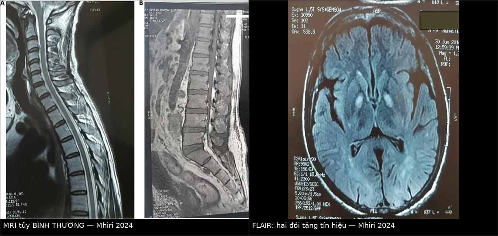
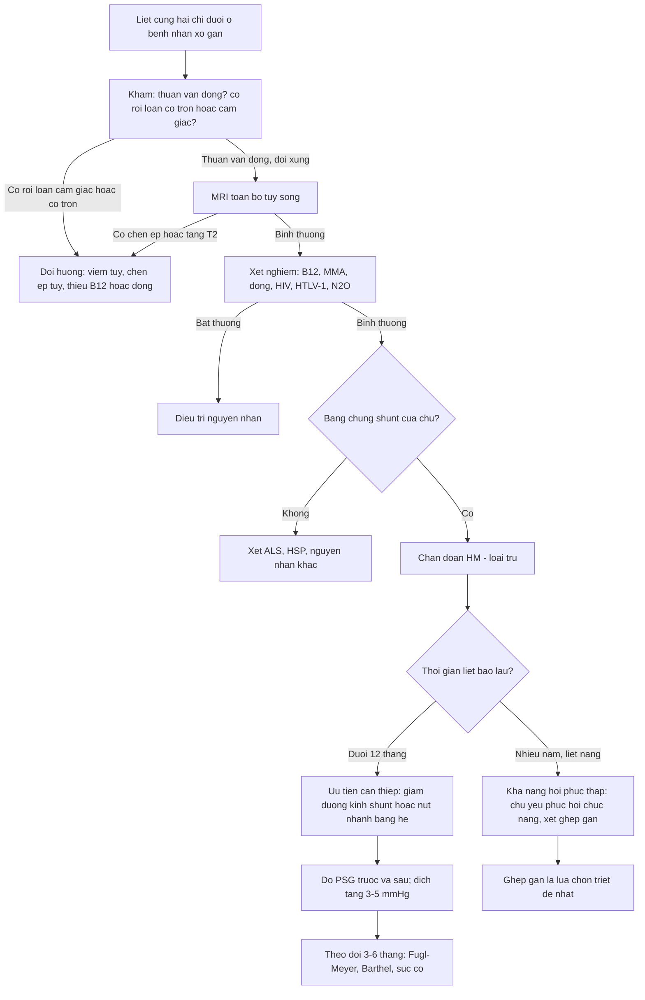
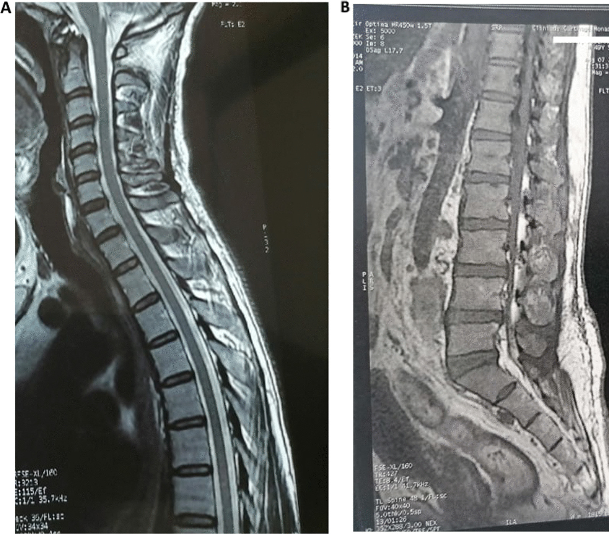
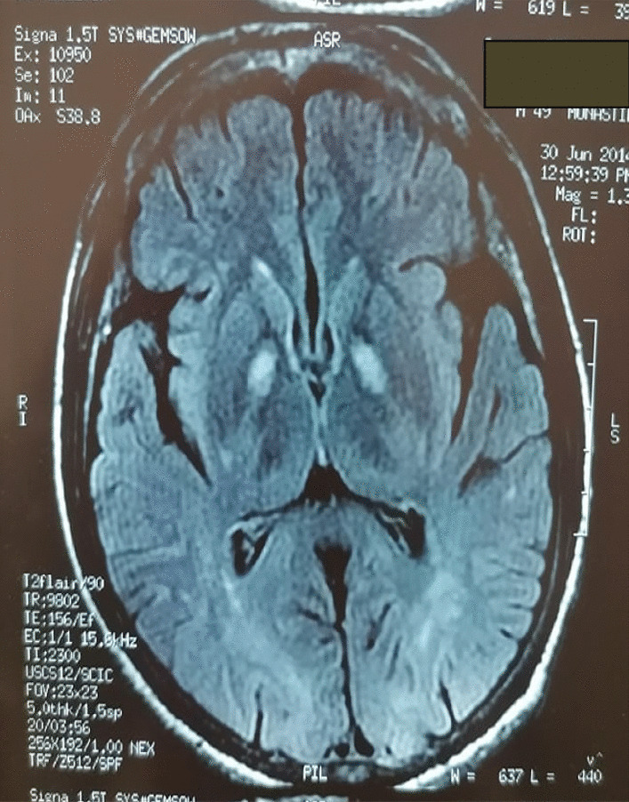
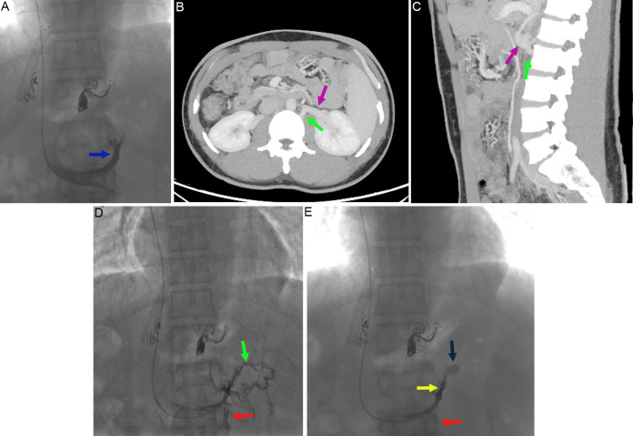
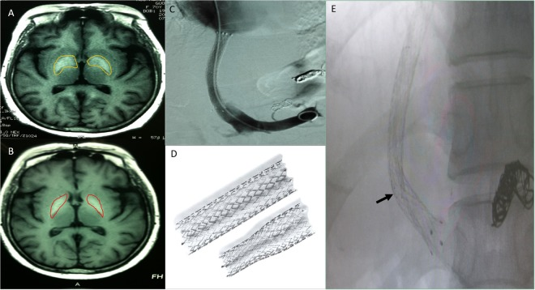

# 188 — Bệnh tủy do gan sau shunt cửa–chủ / TIPS: chẩn đoán loại trừ & khi nào can thiệp shunt / Hepatic myelopathy after portosystemic shunt

**Tags:** `pattern:liet-cung` `pattern:bien-nao-gan` `vung:tuy-song` `vung:gan` `vung:mach-cua` `score:Child-Pugh` `score:MELD` `protocol:MRI-tuy-va-nao` `protocol:MEP`
**Mức chắc chắn (certainty):** tổng hợp y văn (literature synthesis) — số liệu dịch tễ, thời gian tiềm tàng và kết cục lấy từ nghiên cứu hồi cứu 29 bệnh nhân sau TIPS (Zhao H et al., *Sci Rep* 2018, PMC6185955, CC BY); ca lâm sàng có hình ảnh từ Mhiri M et al., *J Med Case Rep* 2024 (PMC11181619, CC BY), Suo Y et al., *J Clin Transl Hepatol* 2026 (PMC13247707, CC BY-NC) và ca hồi phục sau ghép gan (PMC11588450, CC BY). **Không có tiêu chuẩn chẩn đoán đồng thuận chính thức** — bài ghi rõ chỗ nào là "tiêu chuẩn dùng trong y văn", chỗ nào là suy luận.

> **Câu hỏi gốc của bài:** bệnh nhân xơ gan, **đã đặt TIPS** (hoặc có shunt cửa–chủ tự phát), vài tháng đến vài năm sau **đi lại nặng dần, chân cứng, dáng đi "kéo lê"**; khám thấy **tăng phản xạ, Babinski hai bên**, nhưng **không rối loạn cảm giác, không rối loạn cơ tròn, không lú lẫn**. Chụp **MRI tủy sống… bình thường**. Vậy: **đây là bệnh gì? có phải bệnh não gan không? MRI bình thường thì loại trừ được gì? và có cách nào cứu không?**
> **Điểm tựa:** bệnh tủy do gan (hepatic myelopathy — HM) là **biến chứng của shunt cửa–chủ**, không phải của tăng amoniac đơn thuần và **không phải bệnh não gan**. Chẩn đoán là **loại trừ**, hình ảnh tủy **thường bình thường**, và **thời gian từ lúc khởi phát đến lúc can thiệp quyết định khả năng hồi phục**.

## 1. Tổng quan — vì sao tủy bị tổn thương mà MRI tủy lại bình thường

**A. Bệnh học (pathology) và sinh lý bệnh:**
- **Tổn thương giải phẫu:** **hủy myelin đối xứng của bó tháp bên (lateral corticospinal tract)** ở tủy ngực–thắt lưng, dẫn đến **liệt cứng (spastic paraparesis)** thuần vận động. Đây là lý do khám **thuần vận động**: cảm giác và cơ tròn **thường nguyên vẹn** vì các bó cảm giác (sau/tủy trước bên) và bó vỏ–tủy cho cơ tròn ít bị ảnh hưởng.
- **Vì sao có shunt mới bị:** chất độc chuyển hóa nitơ (**amoniac và các sản phẩm thoái hóa nitơ khác**) bình thường được gan khử; khi có **shunt cửa–chủ lớn (TIPS, shunt phẫu thuật, shunt tự phát)** → thuốc độc **đi thẳng vào tuần hoàn hệ thống**, vượt hàng rào máu–tủy. Cơ chế được đề xuất gồm **nhiễm độc, thiếu dinh dưỡng (B12/đồng), thay đổi huyết động tủy, và tổn thương miễn dịch** — chưa có mô hình động vật chuẩn.
- **Vì sao MRI tủy thường BÌNH THƯỜNG:** tổn thương là **mất myelin vi thể lan tỏa dọc bó tháp**, không tạo ổ phù/hoại tử đủ lớn để đổi tín hiệu trên T2. Vì vậy **MRI tủy bình thường KHÔNG loại trừ HM** — đây là điểm khác biệt căn bản với **chèn ép tủy, u tủy, myelitis, nhồi máu tủy** (những bệnh **phải** thấy bất thường trên MRI).
- **Vì sao MRI não lại có bất thường:** **tăng tín hiệu T1 đối xứng ở globus pallidus/hai đồi** là dấu hiệu của **tuần hoàn bàng hệ cửa–chủ** (được cho là do lắng đọng **mangan** — kim loại thuận từ làm ngắn T1). Dấu hiệu này gặp trong **bệnh não gan** và **bệnh não–não mắc phải (acquired hepatocerebral degeneration)**, **không đặc hiệu cho HM** và **không phải tổn thương tủy**. Giá trị thực dụng: nó **xác nhận "có shunt đáng kể"** khi bạn đang phân vân.

**B. Ngưỡng định lượng bắt buộc (cửa 1 Argon):**

| Đại lượng | Con số đã kiểm chứng | Ý nghĩa thực hành |
|---|---|---|
| Tần suất HM sau TIPS | **1,04% (36/3467)** bệnh nhân TIPS trong 22 năm (PMC6185955) | Hiếm nhưng **đủ gặp** ở trung tâm lớn → phải nghĩ tới |
| Tuổi trung bình khi mắc | **39,5 ± 6,3** và **40,2 ± 3,3** tuổi (2 nhóm) | **Người trẻ** — đừng quy cho "thoái hóa cột sống tuổi" |
| Giới | **22/29 (75,9%) là nam** | Gợi ý dịch tễ, không dùng để chẩn đoán |
| Thời gian từ TIPS → triệu chứng | **9,81 ± 7,09 tháng** (nhóm can thiệp) và **8,31 ± 6,82 tháng** (nhóm nội khoa); ca khác **5 tháng**; ca khác **4 năm** | **Cửa sổ 6–12 tháng** là điển hình, nhưng **4 năm vẫn xảy ra** |
| PSG trước / sau TIPS | **19,38 ± 2,80 → 8,63 ± 0,89 mmHg** | Sau TIPS PSG **~8–9 mmHg** = "quá tải shunt" — cùng cơ chế với bài 183 |
| Đường kính stent ban đầu | **8 mm (56%)**, **10 mm (44%)** | Stent lớn hơn → shunt lớn hơn |
| Amoniac máu | **76,88 ± 5,03 → 70,69 ± 3,95** (đơn vị như bài gốc báo cáo) | Amoniac **giảm** sau điều trị nhưng **không** phải tiêu chuẩn chẩn đoán |
| Child–Pugh / MELD lúc chẩn đoán | **7,5 ± 1,41** / **9,88 ± 1,54** | Đa số **Child–Pugh B** — tức **không** phải chỉ bệnh nhân suy gan nặng |
| EMG chi dưới | **Bình thường ở 26/29 ca** | EMG bình thường **không loại trừ**; tổn thương là **bó tháp trung ương** |
| Sống trung bình: can thiệp shunt vs nội khoa | **30 tháng vs 16,5 tháng** (log-rank p = 0,017; HR 0,322; KTC 95% 0,109–0,948) | Can thiệp shunt **đúng lúc** có lợi về sống còn |
| Tử vong trong nhóm theo dõi | **12,5% (2/16)** vs **30,77% (4/13)** | Nhóm chỉ điều trị nội khoa tử vong **cao hơn** |
| Cải thiện vận động | **Fugl–Meyer cải thiện ở nhóm can thiệp** (t = 4,818; p = 0,0002) nhưng **không** ở nhóm nội khoa (p = 0,7711); **Barthel** tương tự | Chỉ **giảm shunt** mới cải thiện được chức năng, không phải thuốc |

**C. TẠI SAO ảnh trông như vậy (vật lý hình ảnh):**
- **MRI tủy T1/T2/STIR:** tủy bình thường vì **không có phù** (phù làm T2 sáng) và **không có thay thế mô** (làm T1 tối). Mất myelin vi thể **không đủ** tạo tương phản không gian ở 1,5–3T.
- **MRI não T1 (không cản quang):** **tăng tín hiệu ở globus pallidus** do **mangan** (thuận từ, **rút ngắn T1** → sáng trên T1, **không** sáng trên T2/FLAIR) — nguyên lý: mangan tích tụ ở hệ ngoại tháp khi **mất khả năng thải qua đường mật** do shunt.
- **FLAIR:** tăng tín hiệu **hai đồi** có thể thấy như trong ca minh họa — nhưng đây là dấu hiệu **của bệnh não gan/bàng hệ**, **không** phải của tủy. **Đừng "chụp não để tìm HM"** — chụp não để **loại trừ bệnh khác và xác nhận shunt**.

## 2. Mẫu hình + chẩn đoán phân biệt theo cơ chế (Gamut)

- **Nhóm 1 — HM (shunt cửa–chủ):** liệt cứng **đối xứng, tiến triển, thuần vận động**, **không rối loạn cơ tròn/cảm giác**, **không fasciculation**, **MRI tủy bình thường**, có **bằng chứng shunt** (TIPS, shunt phẫu thuật, bàng hệ lớn trên CT).
- **Nhóm 2 — Bệnh não gan (HE):** **lú lẫn, ngủ gà, asterixis, run vỗ cánh**, có thể kèm **yếu chi do phù/tri giác** nhưng **không phải liệt cứng đối xứng**; **dao động theo thời gian**.
- **Nhóm 3 — Bệnh não–não mắc phải (acquired hepatocerebral degeneration):** **parkinsonism, ataxia, múa giật, rối loạn vận động**, **T1 sáng hai đồi**; **không** phải liệt cứng thuần.
- **Nhóm 4 — Thiếu B12/đồng, ngộ độc N₂O (khí cười):** **tổn thương cột sau** → **mất cảm giác sâu, mất thăng bằng, dáng đi thất điều**, không phải liệt cứng thuần; MRI tủy **T2 sáng cột sau** (dấu "inverted V").
- **Nhóm 5 — Chèn ép tủy (thoái hóa cột sống, u, áp-xe, máu tụ):** **MRI tủy PHẢI thấy chèn ép/tín hiệu bất thường**; có **đau cột sống**, **rối loạn cơ tròn** thường có.
- **Nhóm 6 — Viêm tủy/NMO/MS/HTLV-1/HIV:** **rối loạn cảm giác rõ, rối loạn cơ tròn, tổn thương dài > 3 đốt**, **MRI có tăng tín hiệu**, **dịch não tủy bất thường**.
- **Nhóm 7 — ALS và liệt cứng di truyền (HSP):** **thuần vận động** giống HM — nhưng **không có bệnh gan/shunt**, có **teo cơ, fasciculation, tổn thương cả bó trên và dưới**, tiến triển không liên quan men gan.
- **Nhóm 8 — Nguyên nhân khác:** **xạ trị tủy**, **nhồi máu tủy** (khởi phát đột ngột), **myelopathy do thuốc**, **paraneoplastic**.

**Mnemonic "SHUNT" cho liệt cứng ở bệnh nhân xơ gan:**
**S**hunt (TIPS/phẫu thuật/tự phát — nghĩ HM) · **H**epatic encephalopathy (lú lẫn + asterixis) · **U**ncorrected deficiency (B12, đồng, N₂O) · **N**euro khác (MS/NMO/HTLV/ALS/HSP) · **T**ủy bị chèn ép (thoái hóa, u, áp-xe).

## 3. Bảng so sánh phân biệt (ma trận đối chiếu)

| Thực thể (entity) | Hình ảnh điển hình | Chốt vào (rule-in) | Chốt loại (rule-out) | Gợi ý xác nhận |
|---|---|---|---|---|
| **Bệnh tủy do gan (HM)** | **MRI tủy bình thường**; não: **T1 sáng globus pallidus**; không có tổn thương tủy | **Shunt cửa–chủ + liệt cứng đối xứng thuần vận động + không rối loạn cơ tròn/cảm giác + MRI tủy âm** | **MRI tủy có ổ tăng T2/chèn ép** → không phải HM | Loại trừ B12/đồng/N₂O/MS/HTLV; MEP–CMCT kéo dài |
| **Bệnh não gan** | Não: có thể T1 sáng hai đồi; **không có tổn thương khu trú** | **Lú lẫn + asterixis + run vỗ cánh, dao động** | **Tri giác tỉnh, không asterixis, liệt cứng cố định** → không phải HE | Amoniac, test nối số; đáp ứng lactulose |
| **Bệnh não–não mắc phải (AHD)** | **T1 sáng hai đồi rõ**, có thể teo não | **Parkinsonism/múa giật/ataxia + bệnh gan + shunt** | **Liệt cứng hai chi dưới thuần** → nghĩ HM hơn | Khám thần kinh; MRI T1 |
| **Thiếu B12/đồng, N₂O** | **T2 sáng cột sau** ("inverted V"), có thể teo tủy | **Mất cảm giác sâu + thất điều + dáng đi rộng** | **Cảm giác bình thường** → loại trừ | B12, MMA, homocysteine, đồng/ceruloplasmin; hỏi N₂O |
| **Chèn ép tủy do thoái hóa/u** | **Hẹp ống sống, chèn ép tủy, tăng T2 trong tủy** | **Đau cột sống + MRI có chèn ép** | **MRI tủy hoàn toàn bình thường** → loại trừ | MRI toàn bộ tủy; CT nếu cần xương |
| **Viêm tủy/NMO/MS/HTLV-1** | **Tăng T2 dài ≥ 3 đốt**, có thể ngấm thuốc | **Rối loạn cảm giác + cơ tròn + tổn thương dài** | **Tổn thương ngắn, không rối loạn cảm giác** → ít nghĩ | MRI + dịch não tủy (OCB, IgG index), HTLV-1, HIV |
| **ALS** | MRI tủy bình thường hoặc teo nhẹ | **Teo cơ + fasciculation + tổn thương bó trên và dưới** | **Không teo cơ, không fasciculation, có bệnh gan/shunt** → nghĩ HM | EMG (đơn vị vận động), khám lan rộng |
| **Can thiệp shunt (điều trị HM)** | DSA: **stent hẹp hơn đặt trong stent cũ** hoặc **nút nhánh bàng hệ**; PSG **tăng lên** | **PSG tăng ≥ 3–5 mmHg + cải thiện Fugl–Meyer/Barthel** | **PSG không tăng** hoặc bệnh đã quá muộn (liệt nhiều năm) | DSA + đo PSG trước/sau; theo dõi 3–6 tháng |

*Trái: **MRI tủy sống T1 + T2 bình thường** — không có ổ tăng tín hiệu, không chèn ép. Phải: **MRI não FLAIR — tăng tín hiệu đối xứng hai đồi**, dấu hiệu của tuần hoàn bàng hệ cửa–chủ (không phải tổn thương tủy). Bài học: **chụp tủy để loại trừ, chụp não để xác nhận shunt**. Nguồn: Mhiri M et al., *J Med Case Rep* 2024 (PMC11181619) Fig. 1 và Fig. 2, CC BY 4.0 — ảnh ghép letterbox, đã thay đổi (ghép + dải chú thích).*

## 4. Protocol chẩn đoán + can thiệp + theo dõi

**A. Chẩn đoán (làm đủ, đừng dừng ở "MRI tủy bình thường"):**
1. **Khám thần kinh có cấu trúc:** sức cơ (thang MRC 0–5), **phản xạ gân xương**, **Babinski**, **cảm giác nông/sâu**, **cơ tròn (bí tiểu, tiểu không tự chủ, táo bón)**, **fasciculation/teo cơ**, **khám chi trên** (HM thường **chỉ hai chi dưới**, đối xứng).
2. **MRI toàn bộ tủy sống** (T1, T2, STIR; ± gadolinium) — mục tiêu **loại trừ chèn ép/viêm/nhồi máu**, không phải "tìm HM".
3. **MRI não** (T1 không cản quang + FLAIR): tìm **T1 sáng hai đồi**, loại trừ **đột quỵ, tổn thương thân não**.
4. **Xét nghiệm loại trừ (bắt buộc):** **B12, MMA/homocysteine**, **đồng huyết thanh + ceruloplasmin**, **HIV**, **HTLV-1**, **TSH**, **vitamin E**; hỏi kỹ **N₂O (khí cười)** và **rượu**; **điện giải** (loạn natri).
5. **Điện sinh lý:** **MEP (motor evoked potentials) — thời gian dẫn truyền vận động trung ương (CMCT) kéo dài**; **EMG** để loại trừ bệnh thần kinh ngoại biên/đơn vị vận động.
6. **Đánh giá shunt:** CT 3 thì bụng (TIPS, shunt tự phát, **shunt cạnh sống — paraspinal vein shunt**), **DSA + đo PSG** khi cân nhắc can thiệp.

**B. Quyết định can thiệp (mermaid):**

**C. Điều trị — thứ tự ưu tiên:**
1. **Điều trị nền:** kiểm soát yếu tố thúc đẩy HE (táo bón, nhiễm trùng, xuất huyết, thuốc an thần, điện giải), **lactulose ± rifaximin**, đủ đạm **1,2–1,5 g/kg/ngày** (không hạn chế đạm quá mức — gây teo cơ, làm yếu thêm).
2. **Giảm đường kính shunt (stent-limiting):** đặt **stent 7–10 mm** (loại tapered, ví dụ 7–10 × 40 mm) **bên trong stent TIPS 10 mm cũ** → tăng PSG. Trong nghiên cứu: **17/17 ca thành công, không biến chứng nặng**; biến chứng gặp: **giảm tiểu cầu nặng 1 ca**, **xuất huyết tiêu hóa do loét dạ dày 1 ca**, **báng khó trị tái phát 3 ca** (kiểm soát bằng lợi tiểu).
3. **Nút nhánh bàng hệ đặc biệt:** nếu có **shunt tĩnh mạch cạnh sống (paraspinal vein shunt — PVS)** — nút bằng coil/plug; ca báo cáo **hồi phục vận động sau nút** (PMC13247707).
4. **Ghép gan:** phương án **triệt để nhất**, đặc biệt khi chức năng gan xấu hoặc can thiệp shunt không khả thi; có ca **hồi phục rõ sau ghép + phục hồi chức năng** (PMC11588450, PMC9243758). **Nguyên tắc thời gian:** **càng sớm càng tốt** — tổn thương myelin **còn hồi phục** ở giai đoạn đầu, **không hồi phục** khi đã lâu.

**D. Theo dõi sau can thiệp:**

| Thời điểm | Việc cần làm | Ngưỡng cảnh báo |
|---|---|---|
| 24–48 giờ | Doppler shunt, tri giác, amoniac, điện giải, Hb | **Tái xuất huyết** hoặc **báng cấp** = PSG tăng quá tay |
| 1 tháng | Sức cơ MRC, phản xạ, dáng đi; Fugl–Meyer | **Không cải thiện 1 bậc MRC** → xem lại thời điểm can thiệp |
| 3–6 tháng | **Fugl–Meyer, Barthel**, MRI tủy lặp nếu xấu đi; Doppler | Cải thiện chậm nhưng **có** = tiếp tục phục hồi chức năng |
| 6–12 tháng | Đánh giá khả năng đi lại, chất lượng sống; xét ghép gan nếu suy gan tiến triển | **Liệt không đổi sau 12 tháng** = tiên lượng hồi phục kém |

## 5. Biến thể bình thường và cạm bẫy

- **"MRI tủy bình thường nên không có bệnh tủy":** sai — HM **là bệnh của myelin vi thể**, MRI thường âm. Chẩn đoán dựa trên **lâm sàng + shunt + loại trừ**, không dựa trên hình ảnh dương tính.
- **Gọi là "bệnh não gan" rồi cho lactulose rồi dừng:** HE và HM **cùng tồn tại** nhưng **khác bệnh cảnh**. Bệnh nhân HM **tỉnh táo**, **không asterixis**, **liệt cứng cố định** — điều trị HE **không** cải thiện liệt.
- **Quy cho "thoái hóa cột sống" ở người 40 tuổi:** tuổi trung bình trong nghiên cứu là **~40** — **không** phù hợp thoái hóa; và **MRI phải thấy chèn ép** mới gọi là do thoái hóa.
- **Bỏ sót thiếu đồng/B12 và N₂O:** đây là các nguyên nhân **điều trị được**, hình ảnh **giống HM** (liệt cứng) nhưng **khác** ở **mất cảm giác sâu** và **T2 sáng cột sau**. **Phải xét nghiệm trước khi kết luận HM.**
- **Chờ đợi "ổn định rồi tính":** HM **tiến triển**; can thiệp muộn → **mất khả năng hồi phục**. Trong nghiên cứu, nhóm **can thiệp sớm** có **Fugl–Meyer và Barthel cải thiện**, nhóm nội khoa **không**.
- **Giảm shunt quá tay:** PSG tăng có thể gây **tái xuất huyết giãn tĩnh mạch** hoặc **báng khó trị** — đã gặp trong nghiên cứu (3 ca báng, 1 ca xuất huyết do loét). Luôn **đo PSG** và theo dõi nội soi.
- **T1 sáng hai đồi ≠ HM:** dấu hiệu này gặp cả ở **bệnh não gan** và **AHD**; nó **xác nhận shunt**, không xác nhận tủy bị tổn thương.
- **Cạm bẫy mặt cắt:** trên CT bụng, **shunt cạnh sống** dễ bị bỏ qua vì nằm sát cột sống và **ngấm thuốc bằng tĩnh mạch cùng thì**; đọc **MIP thì cửa** và truy ngược về tĩnh mạch thận/cửa.

## 6. Tự lượng giá — Blind Quiz ngay trên trang tĩnh

**Ca 1 — Nam 57 tuổi, xơ gan do hội chứng Budd–Chiari, đi lại khó và cứng hai chân tăng dần 6 tháng. Không rối loạn cảm giác, không rối loạn cơ tròn, tỉnh táo, không asterixis. Phản xạ tăng, Babinski hai bên, dáng đi "kéo kéo".**

- Gợi ý: tổn thương thuần vận động, đối xứng, tiến triển chậm.
- Câu hỏi: (1) MRI tủy bình thường loại trừ được gì và **không** loại trừ được gì? (2) Cần chụp thêm gì? (3) Ba xét nghiệm bắt buộc để loại trừ nguyên nhân điều trị được?

<b>Bấm để hiện đáp án (findings + chẩn đoán)</b>

- **MRI tủy T1 + T2 bình thường** (ảnh trên): loại trừ **chèn ép tủy, u, nhồi máu, viêm tủy có tổn thương khu trú** — nhưng **KHÔNG** loại trừ **bệnh tủy do gan** (tổn thương myelin vi thể).
- Chụp thêm **MRI não T1 + FLAIR**:

- **Tăng tín hiệu đối xứng hai đồi** — dấu hiệu của tuần hoàn bàng hệ cửa–chủ, xác nhận "có shunt đáng kể"; **không** phải tổn thương tủy.
- Ba xét nghiệm bắt buộc: **B12 (+ MMA/homocysteine)**, **đồng/ceruloplasmin**, **HIV/HTLV-1** — cộng hỏi **N₂O**. Ca gốc đã loại trừ được các nguyên nhân này và chẩn đoán **HM**.
- Nguồn: Mhiri M et al., *J Med Case Rep* 2024 (PMC11181619) Fig. 1 và Fig. 2, CC BY 4.0. Ca gốc: **Budd–Chiari + tăng áp cửa**, liệt cứng 6 tháng, **giác điệu hai chân, Babinski hai bên**, cảm giác và cơ tròn bình thường.

**Ca 2 — Nam 42 tuổi, xơ gan rượu + viêm gan B, TIPS **4 năm trước** vì xuất huyết giãn thực quản (PPG 25 → 9 mmHg). Nay liệt cứng hai chân tiến triển, không đi lại được, cảm giác và cơ tròn **bình thường**; amoniac **122 µg/dL**; B12, ceruloplasmin, đồng niệu **bình thường**.**

- Gợi ý: liệt cứng xuất hiện **muộn** sau TIPS, đã loại trừ nguyên nhân chuyển hóa.
- Câu hỏi: (1) Cấu trúc nào trên hình là "đường thoát" bất thường? (2) Vì sao PPG 9 mmHg lại quan trọng? (3) Can thiệp nào có thể cải thiện mà **không** cần ghép gan?

<b>Bấm để hiện đáp án (findings + chẩn đoán)</b>

- Hình cho thấy **shunt tĩnh mạch cạnh sống (paraspinal vein shunt)** — nhánh tĩnh mạch cạnh cột sống giãn, nối hệ cửa với hệ chủ, đi sát tủy; trên CT trục (B) và đối quang dọc (C) thấy rõ các mũi tên chỉ **GRS/PVS/tĩnh mạch thận trái**; (D–E) venogram trước và sau nút.
- **PPG 25 → 9 mmHg** = **quá tải shunt** — cùng cơ chế bài 183; đây là điều kiện để chất độc đi thẳng vào hệ thống.
- Can thiệp: **nút shunt cạnh sống** bằng coil/plug (ảnh E: vị trí nút) → ca gốc **cải thiện dáng đi và vận động** sau thủ thuật. Đây là lựa chọn cho người **không đủ điều kiện ghép gan**.
- Nguồn: Suo Y et al., *J Clin Transl Hepatol* 2026 (PMC13247707) Fig. 1, CC BY-NC 4.0 (ảnh **nguyên bản**, không chỉnh sửa).

**Ca 3 — Bệnh nhân xơ gan, TIPS 10 mm vì xuất huyết, 8 tháng sau liệt cứng hai chân. Shunt thông tốt, PSG **8,6 mmHg**, amoniac cao. Hội chẩn quyết định **giảm đường kính shunt** thay vì ghép gan.**

- Gợi ý: bệnh nhân còn Child–Pugh B, chưa có chỉ định ghép cấp.
- Câu hỏi: (1) Hình (A) và (B) khác nhau ở đâu? (2) (D)–(E) mô tả kỹ thuật gì? (3) Đo gì để biết kỹ thuật "có hiệu lực"?

<b>Bấm để hiện đáp án (findings + chẩn đoán)</b>

- (A) **trước**: tăng tín hiệu T1 ở **globus pallidus** hai bên (vùng vàng); (B) **sau ~3 tháng giảm đường kính shunt**: tín hiệu **không nặng thêm**, có xu hướng **giảm nhẹ** (vùng đỏ) — tức **không tiến triển** về mặt hình ảnh não.
- (C) shuntogram: stent TIPS **thông, không hẹp** (đường kính gốc **10 mm**); (D) so sánh stent thẳng và **stent tapered 7–10 × 40 mm**; (E) đặt **stent 7–10 mm bên trong stent 10 mm** → tạo **eo giữa**, tăng PSG.
- Đo **PSG trước/sau** (mục tiêu **tăng 3–5 mmHg**), kèm **cải thiện sức cơ/Fugl–Meyer/Barthel**; trong nghiên cứu **17/17 thủ thuật thành công**, **không biến chứng nặng**.
- Nguồn: Zhao H et al., *Sci Rep* 2018 (PMC6185955) Fig. 2, CC BY 4.0.

## Bài liên quan chéo
- [100 – Tổng quan hệ Bụng](../100-tong-quan-he-bung/lesson.md)
- [183 – Giảm đường kính shunt & bệnh não gan kháng trị sau TIPS](../183-giam-duong-kinh-shunt-va-HE-khang-tri-sau-tips/lesson.md) (cùng cơ chế "quá tải shunt", cùng kỹ thuật tạo eo)
- [176 – TIPS/DIPS: chỉ định, kỹ thuật & theo dõi shunt](../176-tips-dips-theo-doi-shunt/lesson.md) (đặt shunt, theo dõi PSG)
- [181 – BRTO/RTO cho giãn tĩnh mạch dạ dày](../181-brto-thuyen-tac-nguoc-tm-than-trai-gian-tm-da-day/lesson.md) (nút nhánh bàng hệ lớn)
- [186 – Hội chứng gan–phổi & tăng áp phổi do tăng áp cửa](../186-hoi-chung-gan-phoi-hps-va-poph/lesson.md) (biến chứng ngoài gan khác của tăng áp cửa)
- [226 – Tủy mềm không chấn thương: nhồi máu tủy, SDAVF, viêm tủy/NMO & tủy mềm do xạ](../226-tuy-mem-khong-chan-thuong-nhoi-mau-sdavf-nmo-xa/lesson.md) (nhóm phải có MRI tủy bất thường — đối chiếu với HM)

> Không dùng để chẩn đoán độc lập khi chưa có người hướng dẫn.
