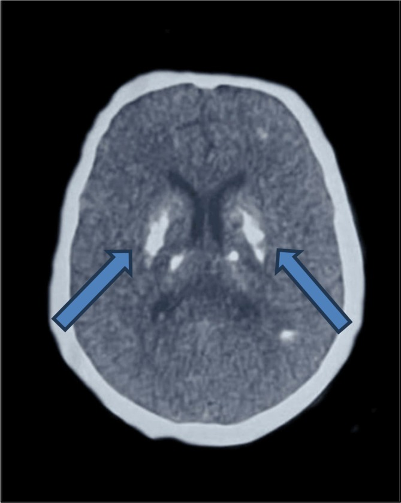
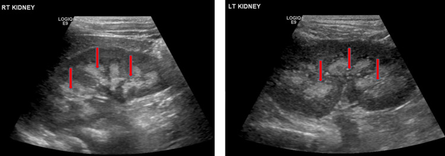
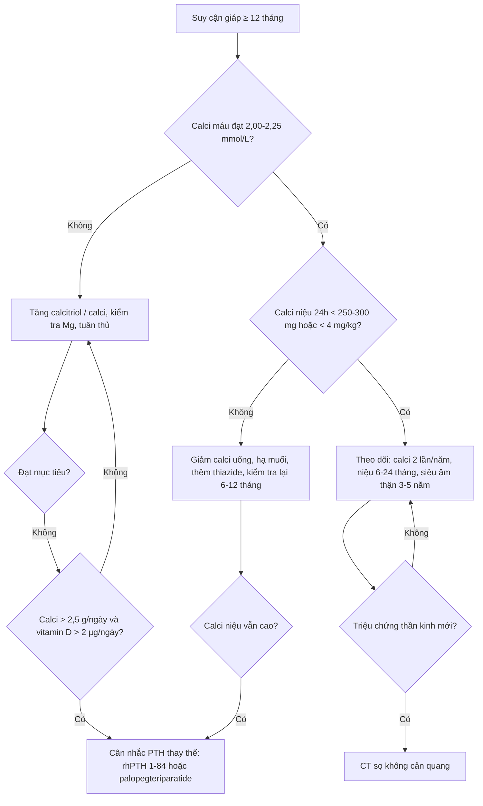
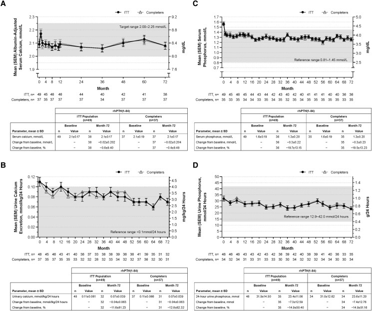

# 1880 — Suy cận giáp vĩnh viễn sau cắt tuyến giáp: quản lý suốt đời, calci niệu và PTH thay thế / Permanent post-thyroidectomy hypoparathyroidism

**Tags:** `pattern:voi-hoa-nao` `pattern:voi-hoa-thuy-than` `pattern:ha-calci` `vung:tuyen-giap` `vung:nao` `vung:than` `protocol:CT-so-nao` `protocol:sieut-am-than` `protocol:calci-nieu-24h` `score:calci-hieu-chinh` `score:PTH`
**Mức chắc chắn (certainty):** tổng hợp y văn (literature synthesis) — ghép **đoàn hệ 518 bệnh nhân ung thư giáp biệt hóa** (PMC13706862, CC BY 4.0), **sổ bộ 544 bệnh nhân** (PMC8889095, CC BY 4.0), **đoàn hệ bảo hiểm 8.097 bệnh nhân** (PMC8004511, CC BY-NC 4.0), **so sánh siêu âm–CT 22 bệnh nhân** (PMC3590469), **2 nghiên cứu mở rộng rhPTH(1-84) 49 bệnh nhân** (PMC10119703, PMC6760337), **thử nghiệm pha 3 palopegteriparatide 104 tuần** (PMC13525197, CC BY), **đoàn hệ 65 bệnh nhân vùng Vịnh** (PMC13184618), và **2 tổng quan điều trị** (PMC13666082; PMC7707836). Không có thử nghiệm ngẫu nhiên nào so **ngưỡng calci niệu** với **kết cục thận**.

> **Câu chốt:** suy cận giáp vĩnh viễn không phải "uống calci cho khỏi tê tay" mà là **bệnh mô phỏng PTH sai** — uống calci + calcitriol đẩy **calci huyết thanh về bình thường** nhưng **không tái lập được tái hấp thu calci ở ống thận**, nên **calci niệu tăng** và thận trả giá. Trong sổ bộ 544 người: **sỏi thận 32,5%**, **vôi hóa tủy thận 12,3%** (74% hai bên), **CKD 3a–5 15,8%**, **đục thủy tinh thể 9,4%**, **vôi hóa não 4%** — và chỉ **56%** đạt mục tiêu calci máu (PMC8889095). Vì vậy câu hỏi hình ảnh học đúng là: **"thận và não đã bị vôi hóa chưa?"**, không phải "tuyến cận giáp còn bao nhiêu".

## 1. Tổng quan bệnh học – cơ chế hình ảnh: vì sao "calci máu bình thường" vẫn làm hỏng thận

### 1.1 Thiếu PTH làm gì (và tại sao hình ảnh lại ở thận, não, mắt)

- **PTH bình thường** làm ba việc: **hủy xương** (giải phóng calci), **tăng tái hấp thu calci ở ống lượn xa**, và **tăng 1α-hydroxylase ở thận** để sinh **calcitriol** → tăng hấp thu calci ruột. PTH còn **gây phosphaturia** (thải phosphat qua nước tiểu).
- **Khi PTH mất:** (1) xương **giảm luân chuyển** (low bone turnover) — vì vậy mật độ xương có thể **bình thường hoặc cao**, không phải "loãng xương"; (2) thận **không được lệnh giữ calci** → mỗi mg calci ăn/uống vào đều bị **lọc và thải**; (3) **phosphat tích lại** → **phosphat máu cao**; (4) **calcitriol thấp** → giảm hấp thu ruột.
- **Hệ quả kép — đây là gốc của toàn bộ hình ảnh:**
  1. **Điều trị thay thế** (calci + calcitriol) chỉ **đẩy calci huyết thanh lên** bằng cách **tăng tải lọc**; không có PTH, **ống thận không tăng tái hấp thu** → **calci niệu cao** dù calci máu "vừa đủ". Calci + phosphat trong nước tiểu **kết tủa ở đỉnh nhú thận** → **vôi hóa tủy thận (medullary nephrocalcinosis)** và **sỏi calci**.
  2. **Tích phosphat + calci** → **tích calci × phosphat (Ca × P) tăng** → kết tủa calci-phosphat ở **mô đệm giàu kiềm/ít chuyển hóa**: **hạch nền**, **đồi thị**, **nhân răng**, **thủy tinh thể**, **thành mạch**. Đây là **vôi hóa chuyển hóa (metastatic calcification)**, khác vôi hóa loạn dưỡng (dystrophic) của mô hoại tử.
- **Vì sao CT thấy được:** calci hấp thụ tia X mạnh (**đậm độ cao, thường > 100 HU; tổn thương điển hình 200–800 HU**), nên **CT không cản quang** là khảo sát chuẩn cho vôi hóa hạch nền. Trên MRI, calci **mất tín hiệu ở mọi chuỗi xung** (không có proton tự do) và **nhòe tín hiệu (blooming) trên SWI** — MRI **không dùng để phát hiện** vôi hóa nhỏ.
- **Vì sao siêu âm thấy vôi hóa tủy thận:** tinh thể calci ở **đỉnh nhú** tạo **mặt phân cách âm mạnh** → **trụ thận tăng hồi âm (echogenic pyramids)**, có thể **không có bóng lưng** khi lắng đọng nhẹ; khi nặng mới có **bóng lưng (shadowing)**. Đây là lý do **siêu âm nhạy hơn CT ở mức nhẹ–trung bình**: trong 22 bệnh nhân suy cận giáp chụp cả hai, **hợp đồng liên phương thức chỉ κ 0,47 (đồng thuận 60%)**, **81% ca lệch có điểm siêu âm cao hơn**, **OR 5,97 (2,60–13,75)** cho việc siêu âm cho điểm cao hơn (PMC3590469).
- **Vì sao ECG là "hình ảnh" của hạ calci:** calci ngoại bào thấp **kéo dài pha 2 điện thế hoạt động cơ tim** → **QT dài**, dễ **xoắn đỉnh**. Sổ bộ 544 người ghi **loạn nhịp 7,2%** (PMC8889095).

### 1.2 Ngưỡng định lượng của "suy cận giáp vĩnh viễn" và gánh nặng thận–não

- **Định nghĩa thực hành:** còn phải dùng calci và/hoặc vitamin D hoạt hóa **≥ 12 tháng sau mổ** = **vĩnh viễn** (PMC13706862); **11,6%** (60/518) bệnh nhân ung thư giáp biệt hóa, theo dõi trung vị **10,8 năm**; **nạo hạch cổ trung tâm** là yếu tố độc lập **aOR 2,94 (1,55–5,57)**. Đoàn hệ 742 người khác ghi **11,7%** (PMC11785684, đã dẫn ở bài 1874).
- **Thận:** so với người không suy cận giáp, **sỏi thận HR 1,81 (1,60–2,04)** và **vôi hóa tủy thận HR 6,94 (4,41–10,92)** (PMC8004511, 8.097 vs 40.485 người, 5 năm).
- **Sổ bộ 544 người (PMC8889095):** sỏi **32,5%**, vôi hóa tủy thận **12,3%** (74% hai bên), **CKD 3a–5 15,8%** (eGFR < 60), đục thủy tinh thể **9,4%** (mốc **9,5 năm**, **OR 6,96**), vôi hóa não **4%** toàn sổ bộ nhưng **54,5%** trong 44 người được chụp CT sọ; **34,5%** người có vôi hóa hạch nền có bệnh tâm thần–thần kinh.
- **Kiểm soát kém là quy luật, không phải ngoại lệ:** chỉ **56%** đạt mục tiêu calci và **52%** đạt mục tiêu phosphat (PMC8889095); một đoàn hệ 65 người vùng Vịnh dùng **calci trung vị 2.400 mg/ngày**, chỉ **55,4%** được chụp thận và **27,7%** được chụp não (PMC13184618).

## 2. Mẫu hình + chẩn đoán phân biệt theo vị trí (gamut)

Ba câu hỏi với mọi phim của bệnh nhân suy cận giáp: **(1) có vôi hóa hạch nền đối xứng không? (2) có vôi hóa tủy thận/sỏi không? (3) calci niệu 24 giờ bao nhiêu?**

- **Não — vôi hóa hạch nền đối xứng (bilateral basal ganglia calcification):** gamut **"PTH–PSEUDO–FAMILY–AGE–TOXIN–INFECTION"**:
  - **PTH:** suy cận giáp sau mổ, suy cận giáp vô căn, **giả suy cận giáp (pseudohypoparathyroidism)**, cường cận giáp.
  - **PSEUDO/FAMILY:** **bệnh Fahr (primary familial brain calcification)** — di truyền, calci–PTH bình thường.
  - **AGE:** vôi hóa **nhỏ, điểm, ở globus pallidus** của người già — lành tính.
  - **TOXIN/INFECTION:** CO, chì, rượu; CMV, toxoplasma, HIV.
  - **Hình thái gợi ý chuyển hóa:** **đối xứng, đều, không phù, không hiệu ứng khối**, ở **globus pallidus + putamen + nhân đuôi**, có thể lan **đồi thị, nhân răng, chất trắng dưới vỏ** — như ca minh họa (Hình 1).
- **Thận — vôi hóa tủy thận (medullary nephrocalcinosis):** gamut theo cơ chế **tăng calci niệu / tăng phosphat niệu**: **suy cận giáp đang điều trị**, **cường cận giáp**, **nhiễm toan ống thận type 1**, **bệnh xốp tủy (medullary sponge kidney)**, **sarcoidosis**, **ngộ độc vitamin D**, **dùng furosemide kéo dài ở trẻ sơ sinh**. Phân bố **đối xứng ở đỉnh nhú**, khác **vôi hóa vỏ thận** (viêm cầu thận mạn, hoại tử vỏ) và khác **sỏi** (cục tự do trong đài–bể thận).
- **Xương:** không có tổn xương khu trú; BMD **bình thường hoặc cao** — **không** dùng BMD để chẩn đoán/loại trừ.
- **Mắt:** **đục thủy tinh thể** (9,4%, sau ~9,5 năm) — khám đèn khe, không cần CT.
- **Tuyến cận giáp:** **không thấy tuyến** trên siêu âm/CT là **bình thường sau mổ** — không phải "teo tuyến" cần chẩn đoán; hình ảnh **không** định lượng được chức năng.

*Ca 2 trong loạt 3 ca Fahr do suy cận giáp: vôi hóa **dày, đối xứng** ở **nhân đuôi–putamen**, kèm **ổ điểm đồi thị/periventricular**; vỏ não và chất trắng dưới vỏ **tương đối không bị**. Nguồn: Gohar A et al., *Clin Case Rep* 2026 (PMC13381713), CC BY 4.0 — nguyên bản, không crop.*

## 3. Bảng so sánh phân biệt (ma trận đối chiếu)

| Thực thể (entity) | Hình ảnh điển hình | Chốt vào (rule-in) | Chốt loại (rule-out) | Gợi ý xác nhận |
|---|---|---|---|---|
| **Suy cận giáp sau mổ (bài này)** | CT sọ: vôi hóa **đối xứng hạch nền**; US thận: **trụ thận tăng hồi âm**; BMD bình thường/cao | **PTH thấp + calci thấp + phosphat cao**, tiền sử cắt giáp ≥ 12 tháng | PTH **bình thường/cao** → không phải suy cận giáp; vôi hóa **một bên/lệch** → nghĩ nguyên nhân khác | PTH + calci/phosphat/albumin; 24h calci niệu; US thận |
| **Giả suy cận giáp (PHP 1a)** | Vôi hóa hạch nền **nhiều hơn**, **xương bàn tay ngắn ngón 4–5**, **cốt hóa dưới da**, béo phì, lùn | **PTH cao** kèm **calci thấp**, bất thường xương bàn tay | PTH thấp → không phải PHP | PTH, GNAS, X-quang bàn tay |
| **Thiếu vitamin D** | Xương **loãng/osteomalacia**, **giả gãy (Looser zone)**, không vôi hóa hạch nền điển hình | **25(OH)D thấp**, PTH **cao**, calci thấp, phosphat **thấp/bình thường** | Vôi hóa hạch nền rõ + PTH thấp → không phải thiếu vitamin D đơn thuần | 25(OH)D, ALP |
| **Hội chứng xương đói (hungry bone)** | Không có vôi hóa đặc hiệu; X-quang **loãng xương quanh khớp**, giảm mật độ nhanh sau mổ | Hạ calci **sâu, kéo dài** sau mổ Basedow/cường giáp; **phosphat thấp**, **ALP cao**, PTH thấp | Hạ calci nhẹ, phosphat cao → nghi suy cận giáp thường | Calci, phosphat, ALP, Mg |
| **Bệnh Fahr (nguyên phát)** | Vôi hóa **lan rộng hơn**: chất trắng, đồi thị, nhân răng, tiểu não; **đối xứng** | **Calci, phosphat, PTH bình thường**; **tiền sử gia đình**; khởi phát triệu chứng sớm | Rối loạn calci–PTH rõ → là vôi hóa **thứ phát**, không phải Fahr nguyên phát | Calci/PTH; gen nếu gia đình |
| **Hạ magnesi máu** | Không có dấu hình ảnh đặc hiệu | **Mg thấp**, PTH **thấp/không tăng tương xứng**, hạ calci **không đáp ứng** calci | Mg bình thường → loại | Mg máu |
| **Suy thận mạn** | **Thận teo, vỏ mỏng, nang**, vôi hóa mô mềm; **PTH cao**, phosphat cao | **eGFR < 60**, thận nhỏ hai bên | Thận kích thước bình thường + PTH thấp → loại | Creatinin/eGFR, US thận |

*Vôi hóa tủy thận nhẹ–trung bình: **không có bóng lưng rõ** nên rất dễ bỏ sót; đây là mức mà siêu âm **vượt CT** (κ liên phương thức 0,47; OR 5,97). Nguồn: *Cureus* 2026 (PMC13385140), CC BY 4.0 — nguyên bản.*

## 4. Protocol chụp + hệ phân độ/theo dõi

### 4.1 Chụp gì, khi nào

- **CT sọ không cản quang, lát ≤ 5 mm** (dựng lại ≤ 1 mm nếu cần): **chỉ khi có triệu chứng thần kinh** (co giật, rối loạn vận động, sa sút trí tuệ) hoặc **trước khi kết luận "động kinh vô căn"** ở người có tiền sử cắt giáp. Đo **HU** tại hạch nền, ghi **đối xứng/hai bên**, tìm **lan chất trắng/tiểu não** (gợi ý Fahr nguyên phát).
- **Siêu âm thận (đầu dò convex, có/không Doppler):** khảo sát **kích thước thận, độ dày vỏ, trụ thận tăng hồi âm, sỏi, ứ nước**; phân độ **0–3** theo mức lan tỏa/bóng lưng. **Lặp mỗi 3–5 năm** nếu có tiền sử sỏi/vôi hóa; **ngay** nếu đau quặn thận/đái máu (PMC13666082).
- **CT KUB liều thấp** khi siêu âm nghi sỏi nhưng không chắc, hoặc cần đo **kích thước/đậm độ sỏi** trước can thiệp — **không** dùng CT thay siêu âm để theo dõi vôi hóa tủy thận nhẹ.
- **Không chụp** tuyến cận giáp để "xem còn tuyến": sau mổ, tuyến không thấy là bình thường; hình ảnh không phân biệt được **tuyến còn nhưng suy chức năng**.
- **ECG 12 chuyển đạo** khi hạ calci nặng/kiểm soát kém: **QTc dài** là dấu hiệu nguy cơ loạn nhịp, không phải tiêu chuẩn chẩn đoán.

### 4.2 Mục tiêu điều trị — các con số phải thuộc

| Thông số | Mục tiêu | Nguồn |
|---|---|---|
| Calci huyết thanh hiệu chỉnh | **thấp–bình thường, 2,00–2,25 mmol/L (8,0–9,0 mg/dL)**, **không vượt giới hạn trên** | PMC10119703 (khung thử nghiệm 6 năm) |
| Phosphat máu | **trong giới hạn bình thường** | PMC13666082 |
| **Ca × P** | **< 55 mg²/dL²** | PMC7707836 |
| **Calci niệu 24 giờ** | **< 300 mg/24h (nam), < 250 mg/24h (nữ), hoặc < 4 mg/kg/24h** | PMC7707836 |
| 25(OH)D | **30–50 ng/mL** (tối thiểu > 20) | PMC13666082; PMC7707836 |
| Calcitriol | **0,25–2,0 µg/ngày** (alfacalcidol **0,5–4,0 µg/ngày**) | PMC13666082 |
| Calci nguyên tố | **1,0–3,0 g/ngày**, liều thấp nhất đạt mục tiêu | PMC13666082 |
| Ngưỡng cân nhắc **PTH thay thế** | Calci **> 2,5 g/ngày** và vitamin D hoạt hóa **> 2 µg/ngày** vẫn không đạt mục tiêu, hoặc **tăng calci niệu/tổn thương thận**, hoặc **chất lượng sống kém** | PMC13666082 |

- **Lịch theo dõi (PMC13666082):** calci huyết thanh **2 lần/năm** (mỗi **1–2 tuần** khi chỉnh liều); **calci + creatinin niệu 24 giờ mỗi 6–24 tháng**; **siêu âm/CT thận mỗi 3–5 năm** nếu có sỏi/vôi hóa; **25(OH)D** định kỳ; **huyết áp, ion đồ, Mg** khi dùng thiazide.
- **Thiazide** làm giảm calci niệu nhưng **không thay thế** theo dõi calci niệu và có thể gây **hạ kali, hạ Mg, hạ natri** — dùng khi calci niệu cao **dai dẳng** dù đã giảm liều calci (PMC13666082).

### 4.3 PTH thay thế: bằng chứng định lượng

- **rhPTH(1-84) 6 năm (49 người):** calci hiệu chỉnh giữ **2,00–2,25 mmol/L**; **65%** tăng calci niệu lúc nền → **54%** trong số đó **về bình thường ở tháng 72**; **calci uống giảm 45%**, **calcitriol giảm 74%**; **eGFR ổn định** (PMC10119703).
- **rhPTH(1-84) 5 năm:** calci niệu **giảm 101,2 ± 236,2 mg/24h**, phosphat **giảm 1,0 mg/dL**, **Ca × P giảm 8,5 mg²/dL²**; **70%** đạt kết cục phối hợp (PMC6760337).
- **Palopegteriparatide (PTH prodrug tiêm 1 lần/ngày), 104 tuần:** **eGFR tăng 8,9 mL/min/1,73 m²** ở tuần 52 và **giữ đến tuần 104**; **97%** không còn phụ thuộc calci/vitamin D hoạt hóa; **82%** calci bình thường; **Ca × P 30,7** (PMC13525197).
- **Cảnh báo:** PTH thay thế **không** được dùng như "liều cao hơn là tốt hơn"; nguy cơ **tăng calci máu**, và với rhPTH(1-84) có **cảnh báo hộp đen về osteosarcoma ở chuột** + chương trình phân phối hạn chế — chỉ định do bác sĩ chuyên khoa.

## 5. Biến thể bình thường và cạm bẫy

- **Vôi hóa globus pallidus ở người già:** **điểm nhỏ, đối xứng, không triệu chứng**, thường gặp sau 60 tuổi — **không** gọi Fahr và **không** đi tìm suy cận giáp nếu calci–PTH bình thường.
- **"CT thận âm tính" không loại trừ vôi hóa tủy thận:** siêu âm cho điểm cao hơn ở **81%** ca lệch (OR 5,97) — nếu nghi, **làm siêu âm**, đừng dừng ở CT.
- **Calci máu bình thường ≠ điều trị tốt:** mục tiêu thật là **calci niệu thấp** và **Ca × P < 55**; bệnh nhân có thể "đẹp" trên xét nghiệm máu mà vẫn đang **mất thận dần**.
- **BMD cao không phải dấu hiệu tốt:** xương giảm luân chuyển trong suy cận giáp; **BMD bình thường/cao** kèm **gãy xương** vẫn có thể xảy ra — không dùng BMD để chỉnh liều.
- **Vôi hóa hạch nền một bên/lệch:** gợi ý **nguyên nhân mạch máu, nhiễm trùng, u** — không phải mẫu hình chuyển hóa; phải tìm nguyên nhân khác.
- **Hạ calci "che" bởi albumin thấp** và **kiềm hô hấp** làm calci ion hóa tụt — đã bàn ở bài 1874; ở bài này, lưu ý **phosphat cao** là dấu hiệu định hướng **thiếu PTH** (khác thiếu vitamin D, nơi phosphat thường thấp).

## 6. Tự lượng giá — Blind Quiz

**Ca 1 — Nữ 52 tuổi, cắt toàn bộ tuyến giáp + nạo hạch cổ trung tâm 8 năm trước, nay co giật.**

- Gợi ý: đang dùng calci carbonat 3 g/ngày + calcitriol 1 µg/ngày, "calci máu vẫn bình thường".
- Hỏi: (1) mô tả tổn thương và vị trí; (2) ba chẩn đoán phân biệt; (3) xét nghiệm nào chốt nguyên nhân?

<b>Bấm để hiện đáp án (findings + chẩn đoán)</b>

- **Dấu hiệu:** **vôi hóa đậm, đối xứng hai bên** ở **nhân đuôi–putamen** (mũi tên), thêm **ổ điểm đồi thị/periventricular**; **không phù, không hiệu ứng khối**, vỏ não tương đối không bị.
- **Chẩn đoán:** **vôi hóa hạch nền do suy cận giáp** (Fahr thứ phát) — cơ chế **Ca × P cao** làm kết tủa calci-phosphat ở mô đệm hạch nền.
- **Chốt nguyên nhân:** **PTH thấp + calci thấp + phosphat cao**; loại **PHP** (PTH sẽ cao), **Fahr nguyên phát** (calci/PTH bình thường), **thiếu vitamin D** (PTH cao, phosphat thấp).
- **Xử trí:** kiểm tra **calci niệu 24h** và **siêu âm thận** trước khi tăng liều; mục tiêu calci **2,00–2,25 mmol/L** và **Ca × P < 55**.
- Nguồn ảnh: Gohar A et al., *Clin Case Rep* 2026 (PMC13381713), CC BY 4.0.

**Ca 2 — Nam 60 tuổi, suy cận giáp sau mổ 12 năm, đau quặn thận trái.**

- Hỏi: (1) dấu hiệu chính? (2) vì sao siêu âm chứ không phải CT? (3) hai xét nghiệm cần làm ngay?

<b>Bấm để hiện đáp án (findings + chẩn đoán)</b>

- **Dấu hiệu:** **trụ thận tăng hồi âm đối xứng** hai bên (mũi tên), **không bóng lưng rõ** → **vôi hóa tủy thận nhẹ–trung bình**; cần tìm thêm **sỏi** ở đài–bể thận.
- **Vì sao siêu âm:** ở mức nhẹ–trung bình, **siêu âm cho điểm cao hơn CT** (81% ca lệch; OR 5,97; κ 0,47) — CT có thể **âm tính giả**.
- **Xét nghiệm:** **calci niệu 24 giờ** (mục tiêu < 250–300 mg hoặc < 4 mg/kg) và **creatinin/eGFR**; kèm **Ca × P**.
- **Xử trí:** giảm calci uống/liều calcitriol nếu calci niệu cao, hạ muối, cân nhắc **thiazide**; **không** tăng liều vì "sợ hạ calci" mà bỏ qua thận.
- Nguồn ảnh: *Cureus* 2026 (PMC13385140), CC BY 4.0.

**Ca 3 — Bệnh nhân 49 tuổi, suy cận giáp 6 năm, đang cân nhắc PTH thay thế.**

- Hỏi: (1) khung mục tiêu calci trong hình là bao nhiêu? (2) PTH thay thế làm gì với calci niệu và liều thuốc? (3) điều gì **không** chứng minh được từ hình này?

<b>Bấm để hiện đáp án (findings + chẩn đoán)</b>

- **Khung mục tiêu:** **2,00–2,25 mmol/L (8,0–9,0 mg/dL)** — thấp–bình thường, **không vượt giới hạn trên**.
- **Tác dụng:** **calci niệu giảm** và **calcitriol giảm 74%**, **calci uống giảm 45%**; eGFR **ổn định** — tức PTH tái lập phần **tái hấp thu calci ở ống thận** mà calci uống không làm được.
- **Không chứng minh được:** đây là **nghiên cứu mở rộng, không đối chứng** (49 người) — **không** chứng minh giảm sỏi thận/gãy xương/tử vong; muốn vậy cần thử nghiệm có nhóm chứng.
- Nguồn ảnh: Watts NB et al., *J Endocr Soc* 2023 (PMC10119703), CC BY-NC-ND 4.0 — **nguyên bản, không crop/ghép**.

## Bài liên quan chéo
- [1874 – Hạ calci máu sau cắt tuyến giáp: ngưỡng calci hiệu chỉnh, PTH 1–6 giờ](../1874-ha-calci-mau-sau-cat-tuyen-giap/lesson.md) (phần **cấp** của cùng bệnh; bài này là phần **mạn**)
- [941 – Đốt nhiệt tuyến cận giáp](../941-dot-tuyen-can-giap/lesson.md) (can thiệp vào tuyến cận giáp — một đường dẫn tới suy cận giáp)
- [190 – Sỏi đường niệu trên: CT liều thấp, URS/PCNL](../190-soi-nieu-quan-than-ghep-bang-quang-than-kinh/lesson.md) (xử trí sỏi khi đã hình thành)
- [200 – Tổng quan Thần kinh](../200-tong-quan-he-than-kinh/lesson.md) (gamut vôi hóa hạch nền)

> Không dùng để chẩn đoán độc lập khi chưa có người hướng dẫn.
