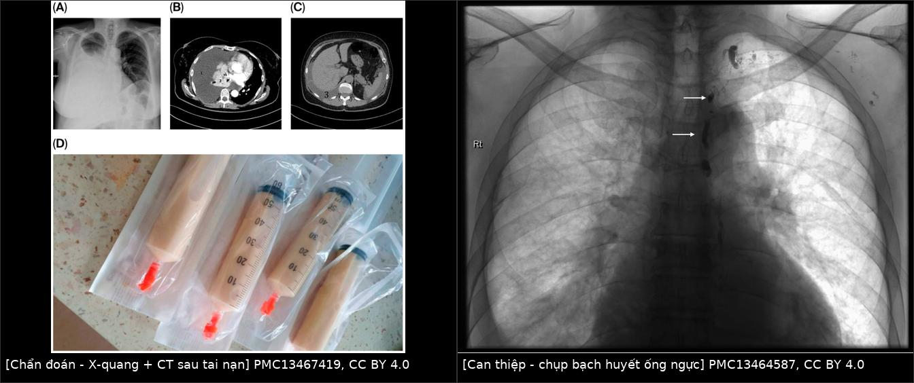
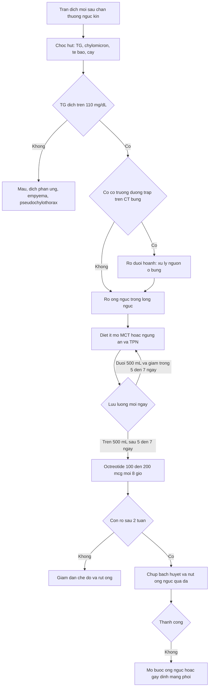
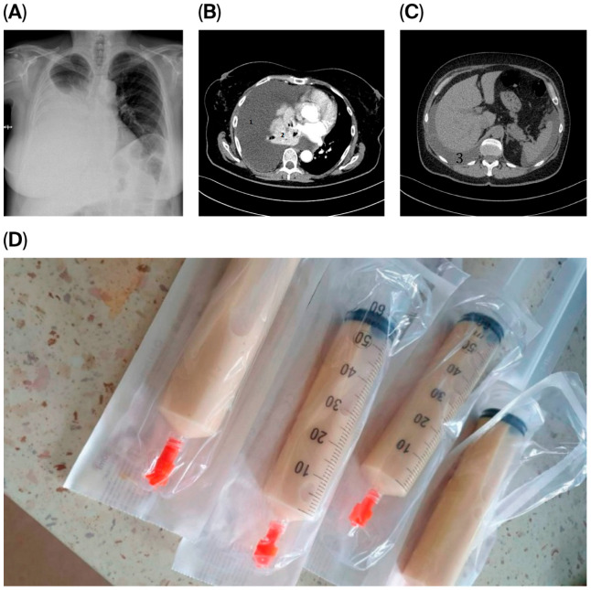
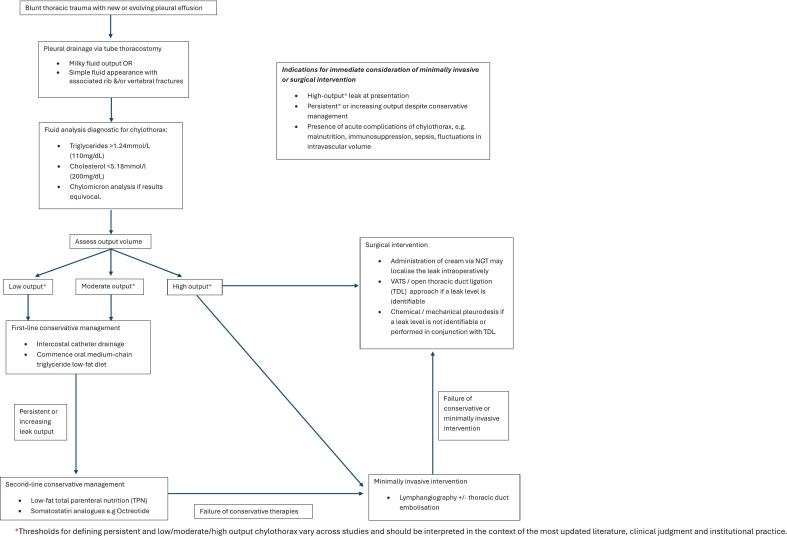
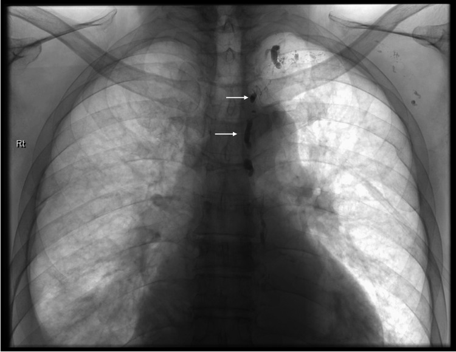

# 1881 — Tràn dưỡng trấp màng phổi sau chấn thương ngực kín / Blunt traumatic chylothorax

**Tags:** `pattern:chylothorax` `pattern:tran-dich-mang-phoi` `pattern:ro-bach-mach` `vung:mong-phoi` `vung:trung-that` `vung:ong-nguc` `protocol:X-quang-nguc` `protocol:CT-nguc` `protocol:chup-bach-huyet` `score:TG-dich` `score:luu-luong-mL-ngay`

**Mức chắc chắn (certainty):** tổng hợp y văn (literature synthesis) — biên từ loạt **4 ca chấn thương ngực kín tại 1 trung tâm chấn thương cấp 1 trong 22 năm** (*Trauma Case Rep* 2026, **PMC13217832**), thuật toán **EAST 2026** cho tràn dịch màng phổi/empyema/chylothorax (*J Trauma Acute Care Surg*, **PMC13619141**), ca tràn dưỡng trấp phải sau tai nạn ô tô (*J Clin Med* 2026, **PMC13467419**) và kỹ thuật chụp bạch huyết qua hạch bẹn (**PMC13464587**). Nhóm **không có bệnh nhân của mình**.

> **Câu chốt:** sau chấn thương ngực kín, **tràn dưỡng trấp không xuất hiện lúc nhập viện mà xuất hiện muộn 2–10 ngày**, khi bệnh nhân đã qua giai đoạn cấp — nên nó bị đọc là "tràn dịch tồn dư do gãy sườn". **Chốt chẩn đoán không phải hình ảnh mà là triglyceride dịch màng phổi > 110 mg/dL (1,24 mmol/L)**, và chốt điều trị không phải "chọc dẫn lưu" mà là **theo dõi lưu lượng theo ngày** để quyết định dinh dưỡng ít mỡ, octreotide, hay can thiệp bạch huyết.

## 1. Tổng quan bệnh học – cơ chế hình ảnh (TẠI SAO)

### 1.1 Giải phẫu quyết định bên và độ trễ

- **Ống ngực (thoracic duct)** đi từ **bể dưỡng trấp (cisterna chyli)** ngang **L1–L2**, lên **bên phải** cột sống, **bắt chéo sang trái ở mặt phẳng T4–T6**, rồi đổ vào **góc tĩnh mạch cảnh trong – dưới đòn trái**. Vì vậy **vị trí tổn thương quyết định bên tràn dịch**: tổn thương **dưới T6 → tràn dưỡng trấp bên PHẢI**; **trên T4 → bên TRÁI**; **ngang T4–T6 → hai bên** (**PMC13217832**).
- Cơ chế chấn thương kín: **lực cắt do tăng–giảm tốc (shear force)** làm rách thành ống ngực, chứ không phải do xương đâm trực tiếp. **Gãy sườn và gãy đốt sống là tổn thương đi kèm làm tăng nguy cơ** (**PMC13217832**) — nên bài học lâm sàng là: *bệnh nhân gãy sườn/gãy sống ngực có tràn dịch mới là đối tượng phải nghĩ tới*, nhưng cơ chế năng lượng thấp (ngã từ 2 m) cũng đủ gây rò.
- **TẠI SAO xuất hiện muộn 2–10 ngày:** lưu lượng dưỡng trấp thấp hơn nhiều so với máu, dịch tích dần trong khoang màng phổi; đồng thời rò ban đầu thường bị **chèn ép bởi máu tụ trung thất/khoang màng phổi** sau chấn thương. Khi máu tụ tan và dẫn lưu được rút, **dịch dưỡng trấp mới "lộ ra"** — biểu hiện là **dịch mới tái lập nhanh sau khi rút ống** hoặc **dịch đổi màu từ máu sang trắng đục**. Trong loạt 4 ca, **chẩn đoán trễ 2–10 ngày**; y văn ghi nhận trễ tới **7 ngày** là điển hình (**PMC13217832**).

### 1.2 Vật lý hình ảnh: vì sao CT không phân biệt được dưỡng trấp với dịch thấm

- Dịch dưỡng trấp là **dịch có protein thấp–trung bình, không có mỡ tự do dạng giọt lớn**, nên **đậm độ CT gần nước (khoảng 0–10 HU)** — trùng hoàn toàn với **dịch thấm** và **dịch màng phổi do chấn thương**. **Máu màng phổi cấp 35–70 HU** và **mủ (empyema) 15–45 HU** mới tách được trên CT (**PMC13619141**).
- Vì vậy **không tồn tại "dấu hiệu CT của dưỡng trấp"**: CT/X-quang chỉ trả lời *có bao nhiêu dịch, có khu trú/vách, có chèn ép, có tổn thương đi kèm (gãy sườn, gãy sống, máu tụ trung thất, vỡ cơ hoành)*. **Mọi chẩn đoán dưỡng trấp đều phải qua chọc hút + xét nghiệm dịch.**
- **Màu sữa không phải tiêu chuẩn:** dịch đục chỉ gặp ở **22–44%** bệnh nhân, vì độ đục do **tán xạ ánh sáng của chylomicron**; bệnh nhân **đói hoặc nuôi tĩnh mạch** không có chylomicron → **dịch vàng trong** dù vẫn là dưỡng trấp (**PMC13217832**).
- **Ngưỡng chốt:** **triglyceride dịch > 110 mg/dL (1,24 mmol/L)** là chẩn đoán xác định; **50–110 mg/dL là vùng xám**, phải làm **điện di lipoprotein/tìm chylomicron**; hiện diện **chylomicron** khẳng định chẩn đoán (**PMC13619141**).

### 1.3 Dịch tễ và ngưỡng định lượng (số phải nhớ)

- **Tần suất:** **~80% tràn dưỡng trấp là do y khoa (iatrogenic)**; thể không do y khoa gặp **0,9–1,3% ở vết thương xuyên thấu** và **0,2–3% ở chấn thương kín** (**PMC13217832**). Đây là lý do bài này **hiếm nhưng không được bỏ**: chỉ vài ca/năm ở một trung tâm lớn.
- **Loạt 4 ca (22 năm, 1 trung tâm cấp 1):** dịch dẫn lưu **903–3.680 mL**, thời gian rò **4–22 ngày**, trễ chẩn đoán **2–10 ngày**; **1/4 ca** bị **suy dinh dưỡng + nhiễm trùng** do mất dưỡng trấp kéo dài (giảm **22 kg**) (**PMC13217832**).
- **Ngưỡng lưu lượng để quyết định (EAST 2026):** nếu lưu lượng **< 500 mL/ngày trong 5–7 ngày** → khả năng cao tự lành, tiếp tục nội khoa; nếu **> 500 mL/ngày sau 5–7 ngày**, hoặc **dịch đáng kể kéo dài quá 2 tuần** → **phải can thiệp bít rò** (**PMC13619141**). Một số tác giả dùng ngưỡng **> 1.000 mL/ngày × 5 ngày liên tiếp** là chỉ định mổ (**PMC13217832** — ngưỡng **không thống nhất giữa các nghiên cứu**, phải ghi rõ mâu thuẫn này).
- **Tiên lượng:** **tới 50% tràn dưỡng trấp không do ung thư khỏi bằng dẫn lưu + dinh dưỡng**; rò lưu lượng cao kéo dài có **tử vong dài hạn 25–50%** vì mất dịch, protein, lympho bào và immunoglobulin (**PMC13217832**).

## 2. Mẫu hình + chẩn đoán phân biệt theo vị trí và cơ chế (Gamut)

- **Nhóm A — rò ống ngực trong lồng ngực:** dịch **một bên**, bên **cùng phía với tổn thương so với mốc T4–T6**; xuất hiện **2–10 ngày** sau chấn thương; thường kèm **gãy sườn/gãy đốt sống**. Đáp ứng tốt với dinh dưỡng ít mỡ ± octreotide.
- **Nhóm B — rò dưới hoành (ống ngực/bể dưỡng trấp bị rách trong ổ bụng):** biểu hiện **hai tầng**: **cổ trướng dưỡng trấp (chylous ascites)** + **tràn dưỡng trấp màng phổi phải** (dưỡng trấp bụng qua lỗ cơ hoành, hoặc qua vết rách cơ hoành). Trong loạt ca, một bệnh nhân có **cổ trướng dưỡng trấp lan rộng** trên CT bụng mà **không có vỡ cơ hoành** (**PMC13217832**) — nếu chỉ nhìn phim ngực sẽ bỏ sót nguồn rò.
- **Nhóm C — rò nhánh bạch huyết nhỏ trong trung thất:** lưu lượng **thấp**, tự lành nhanh (4–5 ngày), đáp ứng hoàn toàn với dinh dưỡng ít mỡ.
- **Nhóm D — KHÔNG phải dưỡng trấp (bắt buộc loại trừ):**
  - **Máu màng phổi (hemothorax):** sau chấn thương, **Hct dịch ≈ Hct máu**, đông thành cục, **35–70 HU**, tụt huyết sắc tố.
  - **Tràn dịch phản ứng/do xẹp phổi:** dịch lượng ít, **một bên, tự hết trong 48–72 giờ**, không tăng lại sau khi rút ống.
  - **Empyema:** sốt, dịch đục/mủ, **15–45 HU**, **pH < 7,2**, glucose thấp, cấy dương (bài 040).
  - **Pseudochylothorax:** dịch đục do **tinh thể cholesterol** (thường sau tràn dịch mạn nhiều năm, lao cũ), **không có chylomicron**, TG thấp, cholesterol cao.
  - **Tràn dưỡng trấp do tắc tĩnh mạch (CVP cao):** bệnh nhân có ống thông tĩnh mạch trung tâm lâu ngày, huyết khối chủ trên/dưới đòn — **nút ống ngực vô ích nếu không giải ép tĩnh mạch** (bài 6161).
- **4 câu hỏi định vị khi đứng trước "tràn dịch mới sau chấn thương":** (1) **xuất hiện ngày thứ mấy?** (2) **bên nào so với mốc T4–T6?** (3) **TG dịch > 110 mg/dL?** (4) **có cổ trướng dưỡng trấp trên CT bụng không?**

## 3. Bảng so sánh phân biệt (ma trận đối chiếu)

| Thực thể (entity) | Hình ảnh điển hình | Chốt vào (rule-in) | Chốt loại (rule-out) | Gợi ý xác nhận |
|---|---|---|---|---|
| Rò ống ngực do chấn thương kín (nhóm A) | Tràn dịch **một bên mới**, **0–10 HU**, xuất hiện **2–10 ngày** sau va đập; gãy sườn/sống ngực | **TG dịch > 110 mg/dL + chylomicron + dịch tái lập nhanh sau rút ống** | TG < 50 mg/dL, Hct dịch ≈ Hct máu, dịch tự hết sau 48–72 giờ → không phải dưỡng trấp | Chọc hút: TG, chylomicron, tế bào, protein, LDH; đếm mL/ngày |
| Rò dưới hoành (nhóm B) | **Cổ trướng dưỡng trấp** + tràn dịch phải; CT bụng thấy dịch quanh tụy/động mạch chủ bụng | **TG dịch bụng > 110 mg/dL kèm tràn dịch phải** | Chỉ tràn dịch ngực, bụng không dịch → nhóm A | CT bụng có cản quang, xét nghiệm dịch bụng |
| Máu màng phổi (hemothorax) | Mờ đáy phổi, có thể mức ngang, thiếu máu, **35–70 HU** | **Hct dịch gần Hct máu, đông cục** | Dịch không đông, Hct thấp, TG cao → là dưỡng trấp | Hct dịch, Hb/Hct máu |
| Tràn dịch phản ứng sau chấn thương | Lượng ít, một bên, đáy phổi | **Ổn định/tự hết 48–72 giờ, không tái lập** | Tăng thể tích sau khi rút ống, TG cao → rò dưỡng trấp | So phim cũ, siêu âm đầu giường |
| Empyema | Dịch khu trú, vách, dày màng phổi, sốt | **pH < 7,2, glucose thấp, LDH cao, cấy dương, 15–45 HU** | Dịch vô khuẩn, pH > 7,3, không vách | Cấy + sinh hóa dịch |
| Pseudochylothorax | Dịch đục mạn, dày màng phổi, có thể vôi hóa | **Tinh thể cholesterol, cholesterol cao, KHÔNG có chylomicron, TG thấp** | Chylomicron dương, TG > 110 → dưỡng trấp thật | Điện di lipoprotein |
| Dưỡng trấp do tắc tĩnh mạch trung tâm | Tràn dịch **hai bên/tái phát**, phù mặt, bàng hệ; có catheter | **Huyết khối tĩnh mạch chủ trên/dưới đòn trên Doppler/CTV** | Tĩnh mạch thông, một bên, đáp ứng nhanh với MCT → rò trực tiếp | Doppler tĩnh mạch trung tâm, đo CVP |

*Trái: **X-quang ngực (A) + CT ngực (B) + CT bụng (C)** của ca tràn dưỡng trấp phải sau tai nạn ô tô, và **dịch dưỡng trấp** hút ra (D) — *J Clin Med* 2026 (**PMC13467419**, CC BY 4.0). Phải: **chụp bạch huyết qua hạch bẹn**, mũi tên chỉ phần trên ống ngực đã ngấm thuốc — **PMC13464587**, CC BY 4.0. Ảnh ghép letterbox, không crop/kéo giãn.*

### Dấu hiệu cần đọc đúng trên từng phương thức

- **X-quang ngực:** chỉ là **mờ đáy phổi/xóa góc sườn hoành**; **không phân biệt được** dưỡng trấp với máu/dịch thấm. Giá trị thật là **so phim trước–sau**: dịch **mới xuất hiện hoặc tái lập nhanh** sau khi đã rút ống dẫn lưu.
- **Siêu âm phổi đầu giường:** khoảng **không hồi âm**, phổi xẹp **đập theo nhịp tim** trong dịch; hướng dẫn chọc khi lượng dịch ít hoặc khu trú. Không có dấu hiệu đặc hiệu của dưỡng trấp.
- **CT ngực có cản quang:** trả lời 3 câu — **dịch ở đâu (khoang tự do/khu trú), đậm độ bao nhiêu HU, có tổn thương đi kèm không** (gãy sườn, gãy sống, máu tụ trung thất, vỡ cơ hoành, dưỡng trấp bụng). Lưu ý cạm bẫy **dịch màng phổi vs cổ trướng** (mục 5).
- **Chụp bạch huyết (lymphangiography) qua hạch bẹn:** bơm thuốc cản quang vào hạch bẹn → thấy **bể dưỡng trấp và ống ngực**, xác định **điểm rò** và cho phép **nút ống ngực qua da (TDE)** ngay sau đó. Đây là phương thức **duy nhất "nhìn thấy" dưỡng trấp**; X-quang/CT thì không.

## 4. Protocol chụp + phân tầng điều trị theo lưu lượng

### 4.1 Chẩn đoán theo bước

- **Bước 1 — X-quang ngực** mỗi khi bệnh nhân chấn thương ngực có **khó thở mới, giảm thông khí một bên, hoặc tăng nhu cầu oxy** sau khi đã ổn định.
- **Bước 2 — siêu âm phổi đầu giường** để định lượng và hướng dẫn chọc/dẫn lưu; **đặt catheter nhỏ (< 14 Fr)** dưới hướng dẫn siêu âm để giảm nguy cơ tràn khí (**PMC13619141**).
- **Bước 3 — chọc hút/dẫn lưu + xét nghiệm dịch:** **triglyceride** (bắt buộc), **điện di lipoprotein/tìm chylomicron** nếu TG 50–110 mg/dL, kèm **tế bào, protein, albumin, LDH, glucose, pH, cấy, AFB** nếu nghi lao.
- **Bước 4 — CT ngực (và CT bụng nếu nghi nhóm B)** khi: dịch khu trú/vách, nghi empyema, nghi tổn thương mạch máu, hoặc **dịch tái lập nhanh mà chưa rõ nguồn**.
- **Bước 5 — chụp bạch huyết ± TDE** khi đã quyết định can thiệp và có đội can thiệp mạch/bạch huyết.

### 4.2 Phân tầng theo lưu lượng (biến số quyết định, không phải số mL tuyệt đối của một lần đo)

- **Ghi lưu lượng mL/24 giờ** mỗi ngày, theo **xu hướng 3–5 ngày**; đồng thời **cân nặng, albumin, điện giải, lympho bào, IgG**.
- **Bậc 1 — dinh dưỡng:** **ngừng mỡ chuỗi dài**, dùng **MCT** (hấp thu trực tiếp qua tĩnh mạch cửa, **không đi qua dưỡng trấp**), tăng protein; nếu lưu lượng cao → **ngừng ăn hoàn toàn + nuôi tĩnh mạch toàn phần (TPN)** (**PMC13619141**).
- **Bậc 2 — octreotide:** khởi đầu **100–200 µg mỗi 8 giờ**; phối hợp TPN cho **thành công gần 80–90%**, thời gian liền rò **5–10 ngày**; dạng tác dụng kéo dài dùng khi cần điều trị lâu (**PMC13619141**).
- **Bậc 3 — chụp bạch huyết ± nút ống ngực (TDE):** tổng quan hệ thống cho thấy **chụp bạch huyết đơn thuần làm ngừng rò ở 63,7%**, **TDE ở 92,4%** ca tràn dưỡng trấp do chấn thương (**PMC13217832** dẫn Kim và cs.).
- **Bậc 4 — mổ:** **buộc ống ngực (TDL)** thành công **~90%**; **gây dính màng phổi** thành công **80–100%**; trước mổ cho **bữa ăn nhiều mỡ** hoặc tiêm **indocyanine green** để **nhìn thấy ống ngực** — nếu không thấy điểm rò thì **buộc khối mô quanh lỗ hoành** (**PMC13619141**). Trong loạt ca, 2/4 ca **không tìm thấy điểm rò khi mổ** và được **gây dính hóa học/cơ học** thay vì buộc ống ngực (**PMC13217832**).

### 4.3 Theo dõi và biến chứng phải chủ động tìm

- **Suy dinh dưỡng và giảm miễn dịch:** mất **protein, immunoglobulin, lympho bào** → **phù, giảm IgG, nhiễm trùng tái diễn**. Đây là lý do **không được "chọc dẫn lưu rồi theo dõi thụ động"** (**PMC13217832**).
- **Nhiễm trùng:** dưỡng trấp là môi trường nuôi cấy tốt; sốt + dịch đục lên **không được mặc định là "dưỡng trấp nhiễm"** — phải cấy và loại trừ empyema thực sự.
- **Rối loạn thể tích:** mất dịch lớn gây **tụt huyết áp, hạ natri**, đặc biệt ở bệnh nhân đa chấn thương.

## 5. Biến thể bình thường và cạm bẫy

- **Cạm bẫy 1 — "phim lúc ra viện bình thường nên đã ổn":** thể chấn thương kín xuất hiện **muộn 2–10 ngày**; bệnh nhân đã ra viện rồi **tái nhập vì khó thở và tăng cân** (ca 1 trong loạt: **tăng 5 kg**, ứ dịch phải sau 10 ngày) (**PMC13217832**). Luôn dặn bệnh nhân **tái khám nếu khó thở tăng**.
- **Cạm bẫy 2 — "dịch trong nên không phải dưỡng trấp":** bệnh nhân **đói/TPN** có dịch vàng trong; **màu sữa chỉ gặp 22–44%**. Luôn gửi **TG** bất kể màu dịch.
- **Cạm bẫy 3 — nhầm với máu màng phổi:** sau chấn thương, dưỡng trấp thường **pha máu** ở ngày đầu; nếu chỉ nhìn màu hồng và gọi là hemothorax thì bỏ sót. **Hct dịch ≈ Hct máu** mới là máu; **TG > 110 mg/dL** mới là dưỡng trấp.
- **Cạm bẫy 4 — bỏ sót nguồn rò dưới hoành:** tràn dịch **phải** + **cổ trướng** trên CT bụng là **nhóm B**; can thiệp vào ống ngực mà không xử lý nguồn dưới hoành sẽ thất bại.
- **Cạm bẫy 5 — hút áp lực cao "cho phổi nở":** làm **tăng lưu lượng rò**, mất protein và lympho nhanh hơn; dùng **dẫn lưu kín, áp lực thấp** (**PMC13217832** dẫn y văn; bài 6161).
- **Cạm bẫy hình học — dịch màng phổi vs cổ trướng trên CT ngang:** dùng **dấu crus lệch (displaced crus sign)** và **dấu bare area**; dịch màng phổi **đẩy crus ra sau**, cổ trướng **nằm trước crus** và ôm mặt sau gan. Cùng đậm độ dịch, **vị trí tương đối với cơ hoành/crus mới quyết định tên gọi** — đây là lỗi hay gặp khi đọc "dịch quanh gan" ở bệnh nhân đa chấn thương.
- **Biến thể bình thường:** **dịch màng phổi ít sau gãy sườn (vài mm, mất trong 48–72 giờ)** là phản ứng lành tính — **không chọc** nếu bệnh nhân ổn định, không tăng nhu cầu oxy, không lệch trung thất.

## 6. Tự lượng giá — Blind Quiz

**Ca 1 — Nữ 57 tuổi, tai nạn ô tô, khó thở tăng dần ngày thứ 6; phổi phải mờ đáy, đã rút ống dẫn lưu ngực ngày 4.**

- Hỏi: mô tả (A) và (B). Dịch nằm ở đâu, đậm độ bao nhiêu? (C) cho thêm thông tin gì? Ba chẩn đoán phân biệt và xét nghiệm nào chốt?

<b>Bấm để hiện đáp án</b>

- **(A) X-quang:** **mờ toàn bộ khoang màng phổi phải**, xóa góc sườn hoành, không thấy rõ mức ngang. **(B) CT ngực:** **tràn dịch phải lượng lớn** gây **xẹp thùy dưới phổi phải**, dịch **đồng nhất, đậm độ gần nước**; **không có dấu hiệu đặc hiệu của dưỡng trấp**. **(C) CT bụng:** dịch tự do quanh gan/lách — buộc phải loại trừ **nguồn rò dưới hoành**.
- Phân biệt: **tràn dưỡng trấp do chấn thương**, **máu màng phổi tồn dư**, **tràn dịch phản ứng**, **empyema**.
- Chốt: **chọc hút → triglyceride dịch > 110 mg/dL (1,24 mmol/L)** và/hoặc **có chylomicron**; nếu TG 50–110 mg/dL → **điện di lipoprotein**. Dịch hút ra trong ca gốc có **màu sữa** (ảnh D của figure gốc).
- Nguồn ảnh: *J Clin Med* 2026 (**PMC13467419**, CC BY 4.0) — ca tràn dưỡng trấp phải sau tai nạn ô tô.

**Ca 2 — Nam 23 tuổi, đa chấn thương, ngày 26 xuất hiện khó thở và đau ngực kiểu màng phổi; dẫn lưu trái ra 330 mL dịch sữa, TG 9,9 mmol/L. Ngày 39 vẫn > 200 mL/ngày.**

- Hỏi: bệnh nhân đang ở bậc nào của thuật toán? Vì sao **octreotide không thay thế được can thiệp** ở ca này? Mốc nào buộc phải chuyển bậc?

<b>Bấm để hiện đáp án</b>

- Đã qua **bậc 1** (dẫn lưu + ăn ít mỡ) và **bậc 2** (octreotide tĩnh mạch): lưu lượng **giảm 4 ngày rồi bật lại 430 mL/24 giờ sau một bữa ăn có mỡ** — đúng như cơ chế "lưu lượng phụ thuộc chylomicron".
- **Octreotide chỉ là bậc 2**, thành công cao khi **phối hợp TPN** nhưng **không sửa được lỗ rò cơ học**; khi lưu lượng **> 500 mL/ngày sau 5–7 ngày** hoặc **kéo dài > 2 tuần** → phải **chụp bạch huyết ± TDE**, rồi **buộc ống ngực/gây dính** (**PMC13619141**).
- Ca gốc: **VATS ngày 48**, không thấy điểm rò → **gây dính mạn phổi**; tổng dịch dưỡng trấp **3.680 mL**, **rò 22 ngày**, sụt **22 kg** — bài học: **chờ quá lâu = suy dinh dưỡng + nhiễm trùng**, dù cuối cùng vẫn khỏi.
- Nguồn ảnh: *Trauma Case Rep* 2026 (**PMC13217832**, CC BY-NC-ND) — hình nguyên bản, không chỉnh sửa.

**Ca 3 — Bệnh nhân tràn dưỡng trấp lượng lớn, đã quyết định can thiệp; hình dưới là phim huỳnh quang sau khi bơm thuốc cản quang qua hạch bẹn hai bên.**

- Hỏi: cấu trúc mũi tên chỉ là gì? Vì sao phải chụp bạch huyết **trước** khi nút ống ngực? Tỉ lệ thành công của hai bước này khác nhau thế nào?

<b>Bấm để hiện đáp án</b>

- Mũi tên chỉ **phần trên của ống ngực đã ngấm thuốc cản quang** (sau chụp bạch huyết qua hạch bẹn); hình cho biết **đường đi và vị trí rò** — điều kiện để đưa kim/coil vào đúng chỗ.
- Chỉ **nhìn thấy đường rò** mới nút được; chụp bạch huyết **bản thân có thể làm ngừng rò** (tác dụng xơ hóa của Lipiodol).
- Tỉ lệ ngừng rò: **chụp bạch huyết đơn thuần 63,7%**, **TDE 92,4%** (tổng quan hệ thống, dẫn qua **PMC13217832**). Nếu TDE thất bại → **buộc ống ngực (~90%)** hoặc **gây dính (80–100%)**.
- Nguồn ảnh: **PMC13464587**, CC BY 4.0 — kỹ thuật chụp bạch huyết ngược dòng qua hạch bẹn.

## Bài liên quan chéo
- [6161 – Tràn dưỡng trấp màng phổi sau mổ tim bẩm sinh](../6161-chylothorax-sau-mo-tim-o-tre/lesson.md) — cùng ngưỡng TG, thể do CVP cao
- [1839 – Chylothorax sau cắt gan/ghép gan](../1839-chylothorax-sau-cat-gan/lesson.md) — thể sau mổ ổ bụng
- [1887 – Rò dưỡng trấp sau cắt thực quản](../1887-ro-duong-trap-sau-cat-thuc-quan/lesson.md) — ngưỡng can thiệp sớm sau mổ
- [040 – Tràn dịch màng phổi](../040-tran-dich-mang-phoi/lesson.md) — tiếp cận tràn dịch nói chung (dịch màng phổi vs cổ trướng)
- [3107 – Đứt động mạch dưới đòn sau chấn thương ngực kín](../3107-dut-dong-mach-duoi-don/lesson.md) — cùng bối cảnh "chấn thương ngực kín, mạch máu/tổn thương kín"
- [001 – Tổng quan hệ Ngực](../001-tong-quan-he-nguc/lesson.md)

## Ảnh
- Tên file, nguồn, giấy phép từng ảnh: `images/CREDITS.md`. Ảnh nguyên bản, không crop; ảnh ghép dùng `tools/make_composite.py` (letterbox, giữ tỉ lệ). Ảnh **CC BY-NC-ND** (thuật toán) dùng **nguyên bản, không chỉnh sửa**.

> Không dùng để chẩn đoán độc lập khi chưa có người hướng dẫn.
