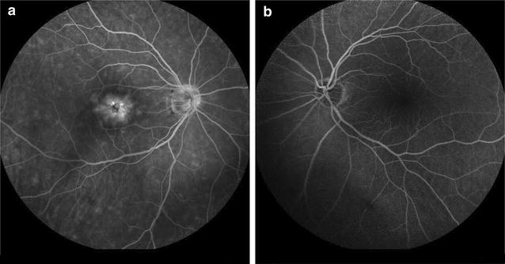
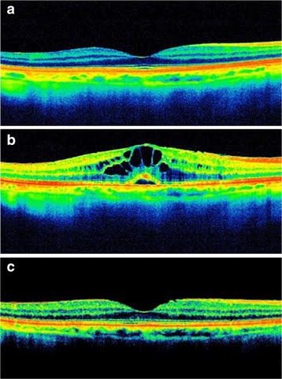
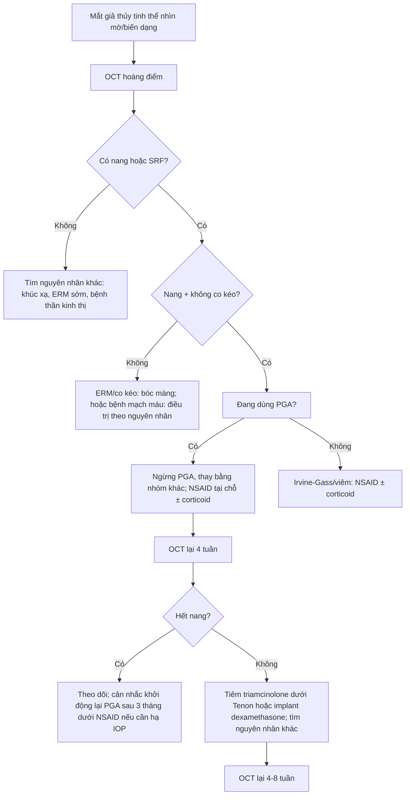
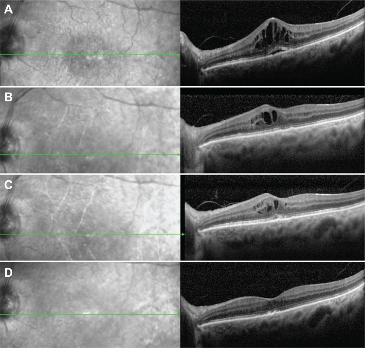

# 1882 — Phù hoàng điểm do thuốc nhỏ prostaglandin sau phaco: cơ chế, ngưỡng ngừng thuốc và bằng chứng ngược chiều / Prostaglandin-associated pseudophakic cystoid macular edema

**Tags:** `pattern:phu-hoang-diem` `pattern:nang-hoang-diem` `pattern:dich-duoi-vong-mac` `vung:hoang-diem` `vung:the-thuy-tinh` `vung:tien-phong` `protocol:OCT` `protocol:FA` `protocol:phaco` `score:CST`
**Mức chắc chắn (certainty):** tổng hợp y văn (literature synthesis) — ghép **4 ca nguyên văn** (PMC5360021 CC BY 4.0; PMC4086850 CC BY-NC 3.0; PMC2975071 CC BY 3.0; PMC3529656 CC BY-NC 3.0), **1 tổng quan hệ thống 4 RCT** (PMC11614555, CC BY 4.0), **1 đoàn hệ cơ sở dữ liệu 39.948 người** (PMC11757063), **1 đoàn hệ 1.325 ca phaco** (PMC13588649, CC BY 4.0) và **1 nghiên cứu 836 mắt phakic dùng EP2 agonist** (PMC12332760). **Không có RCT nào đủ lớn** để trả lời "ngừng PGA trước phaco có lợi hay không" — đây là điểm phản biện trung tâm của bài.

> **Câu chốt:** **phù hoàng điểm do prostaglandin (PGA-CME) có thật, nhưng hiếm và không phải hệ quả tất yếu của việc dùng PGA.** Bốn RCT gộp lại **không thấy** PGA làm tăng phù hoàng điểm sau phaco (PMC11614555), và trong **39.948 người** mới dùng thuốc glôcôm, tỉ lệ phù hoàng điểm của nhóm **PGA là 0,13%** — **thấp hơn** chẹn beta **0,65%**, alpha-agonist **0,55%** và ức chế carbonic anhydrase **1,76%** (PMC11757063). Vì vậy bài này **không** dạy "ngừng PGA cho mọi bệnh nhân trước phaco"; nó dạy **nhận ra ca thật** (OCT có nang + đáp ứng khi ngừng thuốc) và **không bỏ sót** các nguyên nhân khác của phù hoàng điểm giả thủy tinh thể.

## 1. Tổng quan bệnh học – cơ chế hình ảnh: vì sao PGA làm rò huyết tương vào hoàng điểm

### 1.1 Từ "hạ nhãn áp" đến "rò hàng rào máu–võng mạc"

- **PGA hạ nhãn áp bằng cách nào:** prostaglandin F2α (PGF2α) gắn **thụ thể FP** ở **cơ thể mi** → hoạt hóa **matrix metalloproteinase (MMP)** phá **chất nền ngoại bào** giữa các bó cơ → **tăng thoát dịch qua đường màng bồ đào–củng mạc (uveoscleral outflow)**. Đây là con đường **không phụ thuộc trabecular meshwork**, nên PGA hạ áp rất mạnh.
- **Vì sao cùng cơ chế ấy gây phù:** **MMP và tăng tính thấm nội mô** không chỉ có ở cơ thể mi; thụ thể **FP** còn có trên **nội mô mạch võng mạc** và **tế bào Müller**. Kích hoạt FP → **tăng calci nội bào, co–mở junction, tăng tính thấm** → **vỡ hàng rào máu–võng mạc trong (inner blood–retinal barrier, BRB)**. Dịch huyết tương thoát vào **lớp plexiform trong (INL/OPL)** — nơi mô lỏng nhất — tạo **nang (cysts)**; khi dịch vượt qua biểu mô sắc tố → **dịch dưới võng mạc (subretinal fluid, SRF)**.
- **Bằng chứng "không chỉ FP":** **omidenepag** — agonist **thụ thể EP2** (nhóm thuốc khác hẳn PGA) — cũng gây phù hoàng điểm: **8 mắt/836 mắt phakic**, tập trung ở **86 mắt có tiền sử trabeculectomy** (tức **9,3%** nhóm này), khởi phát **6–11 tháng**, hồi phục **28–91 ngày** sau ngừng thuốc (PMC12332760). Vậy **tính thấm qua con đường prostaglandin là hiệu ứng nhóm**, không phải "độc tính riêng của latanoprost".
- **Vì sao mắt giả thủy tinh thể dễ hơn:** sau phaco, **màng hyaloid trước mất** và **hàng rào máu–thủy dịch bị phá vỡ tạm thời**; chất trung gian viêm từ tiền phòng **khuếch tán tự do** vào dịch kính–võng mạc. PGA vì thế đóng vai trò **"đòn thứ hai" (second hit)** trên một võng mạc **đang nhạy cảm** — giải thích vì sao CME xuất hiện **vài tuần đến vài tháng sau phaco**, không phải ngay.
- **Vì sao OCT thấy nang:** dịch **giảm hồi âm (hyporeflective)** vì là nước; nang nằm ở **INL/OPL**, giữa các cột Müller; khi nang lớn tạo **vách mỏng (septae)**. **SRF** là dải giảm hồi âm **giữa võng mạc cảm thụ và RPE**. Đo **độ dày trung tâm hoàng điểm (central subfield thickness, CST)** để theo dõi — không dùng "độ dày võng mạc" chung chung.
- **Vì sao FA thấy hình cánh hoa:** huỳnh quang thoát từ **mao mạch quanh hố trung tâm** vào các nang → **tăng huỳnh quang dạng cánh hoa (petaloid leakage)** ở thì muộn, **không nhuộm đĩa thị** trong ca điển hình (Hình 2). Đây là dấu hiệu **rò hoạt động**, dùng khi OCT không rõ hoặc cần loại trừ nguyên nhân mạch máu.

### 1.2 Các con số phải nhớ

- **Tỉ lệ phù hoàng điểm giả thủy tinh thể (Irvine–Gass) sau phaco không biến chứng:** **2,0%** (27/1.325 mắt), khởi phát **1 tuần–8 tháng**, **trung vị 2 tuần** ở nhóm chỉ dùng NSAID và **2 tháng** ở nhóm có yếu tố nguy cơ viêm; **26/27 mắt** hết nang trong **2 tuần–7 tháng** (PMC13588649).
- **Tỉ lệ CME ở người mới dùng thuốc glôcôm (39.948 người):** **0,35%** chung; **PGA 0,13%**, **chẹn beta 0,65%**, **alpha-agonist 0,55%**, **CAI 1,76%** (PMC11757063).
- **Tổng quan 4 RCT** về PGA chu phẫu: **không** thấy ảnh hưởng đo được lên tỉ lệ phù hoàng điểm; tác giả kết luận **không bắt buộc ngừng** PGA ở người **không có yếu tố nguy cơ** (PMC11614555).
- **Thời điểm khởi phát trong ca thật:** **10 tuần** sau phaco (travoprost bắt đầu tuần 10 → CME tuần 13; PMC3529656); **2 tháng** sau phaco (tafluprost; PMC4086850); **4 tháng** sau phaco (latanoprost; PMC2975071); **7 tháng** dùng latanoprost ở mắt đã phaco **19 tháng** (PMC5360021). Khoảng **1 tuần–8 tháng** sau phaco là cửa sổ cần cảnh giác.
- **Tiền sử then chốt:** **phaco không biến chứng, bao sau nguyên vẹn, không viêm tiền phòng** — nếu có viêm/bao rách, CME có thể do phẫu thuật, không phải PGA.

## 2. Mẫu hình + chẩn đoán phân biệt theo thời điểm (gamut)

**Ba câu hỏi với mọi mắt giả thủy tinh thể nhìn mờ:** **(1) OCT có nang/sRF không? (2) thuốc nhỏ nào đang dùng và bắt đầu từ khi nào? (3) có nguyên nhân khác — viêm, co kéo, mạch máu — không?**

- **Theo thời điểm sau phaco:**
  - **< 4 tuần:** Irvine–Gass sớm, bong thanh dịch do thuốc/viêm, **hội chứng lỗ hoàng điểm** (hiếm).
  - **4 tuần–6 tháng:** **PGA-CME** kinh điển; Irvine–Gass muộn; **viêm màng bồ đào sau mổ**; **màng trước võng mạc (ERM)** hình thành.
  - **> 6 tháng:** **PGA-CME khởi phát muộn** (đã có ca 19 tháng sau phaco), **ERM co kéo**, **bong võng mạc**, **phù do đái tháo đường**, **CSCR**.
- **Theo hình thái OCT:**
  - **Nang + SRF + CST tăng, không co kéo:** PGA-CME, Irvine–Gass, viêm.
  - **SRF đơn thuần, không nang, dấu "mỏ chim" ở RPE:** **CSCR** — không phải CME.
  - **Màng tăng phản xạ trên bề mặt + mất đường viền hố trung tâm + co kéo:** **ERM** — CME do co kéo, **không đáp ứng thuốc**.
  - **Nang + xuất tiết cứng + bóng mạch:** phù do đái tháo đường/CNV.
- **Mnemonic "PGA" cho nguyên nhân CME giả thủy tinh thể:** **P**rostaglandin/ thuốc, **G**laucoma surgery/viêm, **A**fter-cataract inflammation (Irvine–Gass) — cộng thêm **E**RM, **D**iabetes, **R**etinal vein occlusion.

*Rò huỳnh quang **dạng cánh hoa** từ mao mạch quanh hố trung tâm ở thì muộn, **không nhuộm đĩa thị** — dấu hiệu rò hoạt động của hàng rào máu–võng mạc trong. Nguồn: Makri OE et al., *BMC Res Notes* 2017 (PMC5360021), CC BY 4.0 — nguyên bản.*

## 3. Bảng so sánh phân biệt (ma trận đối chiếu)

| Thực thể (entity) | Hình ảnh điển hình | Chốt vào (rule-in) | Chốt loại (rule-out) | Gợi ý xác nhận |
|---|---|---|---|---|
| **PGA-CME (bài này)** | OCT: **nang INL/OPL ± SRF**, CST tăng, **không co kéo**; FA: **rò cánh hoa** | **Bắt đầu/đổi PGA vài tuần–vài tháng trước**; mắt phaco **không biến chứng**; **hết sau ngừng PGA** (2 tuần–3 tháng) | Có **co kéo/ERM**, có viêm tiền phòng, có bệnh mạch máu → không quy cho PGA | Ngừng PGA + NSAID, OCT lại 4 tuần |
| **Irvine–Gass (không PGA)** | Cùng hình thái nang + SRF; có thể **nhuộm đĩa thị** trên FA | Khởi phát **2–12 tuần** sau phaco, **không dùng PGA** | Ngừng PGA **không** cải thiện → nghĩ Irvine–Gass/viêm | OCT + FA; đáp ứng NSAID/steroid |
| **CME do viêm màng bồ đào** | Nang + **tế bào tiền phòng**, dính mống mắt sau, **phản ứng Koeppe/Flare** | **Viêm tiền phòng rõ**, tiền sử viêm | Không có tế bào tiền phòng → loại | Khám đèn khe, OCT |
| **Phù do đái tháo đường** | **Xuất tiết cứng, vi phình mạch, bóng mạch**, nang lan tỏa | **Đái tháo đường**, bệnh võng mạc nền | Không có dấu mạch máu → loại | FA, OCT |
| **ERM / co kéo hoàng điểm** | **Màng tăng phản xạ mặt trên**, mất **đường viền hố trung tâm**, **co kéo**, giả lỗ | **Màng rõ trên OCT**, co kéo | Không màng, không co kéo → loại | OCT; **bóc màng** là điều trị, không phải thuốc |
| **CSCR** | **SRF đơn thuần**, **không nang**, RPE gồ ghề, "mỏ chim"; FA **dò điểm (smokestack)** | **SRF không nang**, thường nam trung niên, stress/corticoid | Có nang + rò cánh hoa → CME | OCT + FA; **ngừng corticoid** nếu đang dùng |
| **Nang do mảnh nhân/viêm nội nhãn** | Nang + **mảnh nhân**, mủ tiền phòng, dính | **Mảnh nhân thấy được**, khởi phát **3–7 ngày** | Không mảnh nhân, không mủ → loại | Khám kỹ, siêu âm khi cần |

*Ba thì của cùng một mắt: **bình thường → nang rõ + SRF → hết nang**. Đây là "phép thử điều trị" tự nhiên: **ngừng PGA là chẩn đoán và điều trị cùng lúc**. Nguồn: PMC5360021, CC BY 4.0 — nguyên bản.*

## 4. Protocol khám/chụp + thuật toán xử trí

### 4.1 Chụp gì

- **OCT hoàng điểm (SD-OCT, khối 6 × 6 mm, có bản đồ độ dày):** khảo sát **bắt buộc** khi nhìn mờ/biến dạng sau phaco hoặc sau khi bắt đầu/đổi PGA. Ghi **CST (µm)**, **có/không SRF**, **vị trí nang**, **màng co kéo**, **đường viền hố trung tâm**.
- **FA:** khi OCT không rõ, nghi **CNV/bệnh mạch máu**, hoặc cần phân biệt **CSCR**; tìm **rò cánh hoa** (CME) vs **dò điểm** (CSCR) vs **tăng huỳnh quang mảng** (CNV).
- **Khám đèn khe bắt buộc:** **tế bào tiền phòng**, **màng sau IOL/bao sau**, **mảnh nhân**, IOP.
- **Theo dõi:** OCT nền **trước khi bắt đầu PGA ở mắt giả thủy tinh thể có nguy cơ cao** (đái tháo đường, viêm màng bồ đào, ERM, tiền sử CME); **OCT lại 4–6 tuần** sau phaco ở người đang dùng PGA **nếu có triệu chứng**; **không chụp OCT định kỳ** cho mọi người dùng PGA (chi phí, không đổi xử trí).

### 4.2 Thuật toán

- **Bước 1 — ngừng PGA:** đây là **can thiệp có bằng chứng mạnh nhất từ ca nguyên văn**; hồi phục **2 tháng** (PMC5360021), **28–91 ngày** với EP2 agonist (PMC12332760), **hết sau 1 tháng** với implant dexamethasone ở ca kháng trị (PMC4086850).
- **Bước 2 — thay thuốc hạ IOP:** brinzolamide (PMC5360021), timolol/dorzolamide, brimonidine. **Lưu ý:** trong đoàn hệ 39.948 người, nhóm **CAI có tỉ lệ CME cao nhất (1,76%)** — đây **không** phải bằng chứng nhân quả, nhưng **không được coi CAI là "an toàn tuyệt đối"** (PMC11757063).
- **Bước 3 — NSAID ± corticoid:** nepafenac/diclofenac tại chỗ; corticoid tại chỗ khi có viêm. **Ca kháng trị:** **triamcinolone dưới Tenon** (PMC3529656) hoặc **implant dexamethasone nội nhãn** (PMC4086850).
- **Bước 4 — khởi động lại PGA:** có thể, **sau khi hết phù ít nhất 3 tháng và dưới che phủ NSAID**; 2 ca trong PMC3529656 dùng lại PGA **không tái phát trong 2 năm**. Nhưng nếu **tái phát sau 2–3 loại PGA khác nhau** (như ca PMC2975071: latanoprost → bimatoprost → travoprost đều gây CME), coi là **hiệu ứng nhóm** và **tránh cả nhóm**.
- **Về "ngừng PGA trước phaco bao lâu":** **không có RCT** chứng minh 2–4 tuần là cần thiết; tổng quan 4 RCT khuyên **không ngừng** ở người không có yếu tố nguy cơ (PMC11614555). Nếu quyết định ngừng (tiền sử CME, viêm, ERM, đái tháo đường), phải **có phương án hạ IOP** — ngừng thuốc mà để IOP 30 mmHg là đánh đổi sai.

## 5. Biến thể bình thường và cạm bẫy

- **"Không có prostaglandin thì không thể là PGA-CME":** ngược lại — **Irvine–Gass** sau phaco không biến chứng gặp ở **2,0%** (PMC13588649); hình thái OCT **giống hệt**. Chẩn đoán PGA-CME cần **diễn tiến theo thuốc**, không chỉ hình ảnh.
- **"Thuốc không chất bảo quản thì an toàn":** ca PMC5360021 xảy ra với **latanoprost không chất bảo quản** — chất bảo quản **không phải** yếu tố quyết định.
- **Bỏ sót ERM:** CME có thể hết nhưng **ERM vẫn còn** (PMC5360021, 8 tháng sau), gây **biến dạng kéo dài**; đọc kỹ bề mặt võng mạc trước khi kết luận "hết bệnh".
- **Nhầm CSCR với CME:** **SRF không nang** + **dò điểm** = CSCR; điều trị **ngừng corticoid**, không phải NSAID.
- **Đổ lỗi cho PGA khi có nguyên nhân khác:** viêm tiền phòng, bao sau rách, mảnh nhân, đái tháo đường — khám đèn khe **trước** khi ngừng thuốc.
- **Bẫy thống kê:** đoàn hệ 39.948 người cho thấy PGA **không** tăng CME so với nhóm khác; **không** suy ra "PGA bảo vệ" — đây là **nghiên cứu quan sát, có chỉ định thuốc khác nhau** (người bệnh nặng hơn có thể được kê CAI/chẹn beta).

## 6. Tự lượng giá — Blind Quiz

**Ca 1 — Nữ 65 tuổi, phaco không biến chứng 19 tháng trước, dùng latanoprost 7 tháng, nhìn mờ + biến dạng.**

- Hỏi: (1) mô tả (a), (b), (c); (2) chẩn đoán và vì sao **không** phải Irvine–Gass; (3) xử trí đầu tay?

<b>Bấm để hiện đáp án (findings + chẩn đoán)</b>

- **(a)** hoàng điểm bình thường trước khi dùng latanoprost; **(b)** **nang giảm hồi âm ở INL/OPL** + **dịch dưới võng mạc**; **(c)** **hết nang** sau ngừng thuốc.
- **Chẩn đoán:** **PGA-CME**. Không phải Irvine–Gass vì **19 tháng sau phaco** (quá muộn cho Irvine–Gass điển hình) và **xuất hiện sau khi bắt đầu latanoprost**, không có viêm/bao rách.
- **Xử trí:** **ngừng latanoprost**, thay bằng **brinzolamide**, thêm **nepafenac**; **OCT lại 4 tuần**. Trong ca gốc: hết phù sau **2 tháng**, thị lực về **20/20**, và **ERM nhẹ** xuất hiện sau 8 tháng.
- Nguồn ảnh: Makri OE et al., *BMC Res Notes* 2017 (PMC5360021), CC BY 4.0.

**Ca 2 — Nam 59 tuổi, phaco 4 tháng trước, dùng latanoprost rồi bimatoprost, mỗi lần đổi thuốc đều nhìn mờ lại.**

- Hỏi: (1) dấu hiệu FA? (2) vì sao đổi sang PGA khác vẫn tái phát? (3) kế hoạch hạ IOP?

<b>Bấm để hiện đáp án (findings + chẩn đoán)</b>

- **FA:** **rò cánh hoa quanh hố trung tâm** ở thì muộn, **không nhuộm đĩa thị**; mắt đối diện bình thường.
- **Tái phát khi đổi PGA:** hiệu ứng **theo nhóm** (FP receptor), không phải dị ứng một phân tử — ca PMC2975071 tái phát với **latanoprost, bimatoprost và travoprost**.
- **Kế hoạch:** **tránh cả nhóm PGA**; dùng **chẹn beta, brimonidine, CAI** (theo dõi CME), hoặc **laser/filter** nếu cần; điều trị đợt cấp bằng **NSAID ± corticoid**.
- Nguồn ảnh: PMC5360021, CC BY 4.0.

**Ca 3 — Nữ 64 tuổi, tafluprost 2 tháng sau phaco, thị lực 20/60, OCT có nang + SRF; sau 1 tháng NSAID vẫn còn phù.**

- Hỏi: (1) đọc chuỗi A–D; (2) vì sao NSAID đơn thuần không đủ? (3) bước tiếp theo?

<b>Bấm để hiện đáp án (findings + chẩn đoán)</b>

- **Chuỗi A–D:** (A) **nang lớn + SRF**; (B) sau NSAID uống/tại chỗ — **SRF hết nhưng nang còn**; (C) sau **2 mũi betamethasone dưới Tenon** — còn nang; (D) sau **implant dexamethasone nội nhãn** — **hết phù**, thị lực **20/30** và giữ 6 tháng.
- **Vì sao NSAID không đủ:** ca này **kháng trị**; prostaglandin gây rò qua con đường **không phụ thuộc COX**, nên ức chế COX không chặn hết.
- **Bước tiếp:** **corticoid dưới Tenon** hoặc **implant dexamethasone**; đồng thời **phải ngừng tafluprost** — nếu vẫn dùng PGA, corticoid chỉ che lấp.
- Nguồn ảnh: Sacchi M et al., *Clin Ophthalmol* 2014 (PMC4086850), CC BY-NC 3.0 — nguyên bản.

## Bài liên quan chéo
- [1875 – Phù hoàng điểm dai dẳng ở mắt bơm dầu](../1875-phu-hoang-diem-dang-nang-mat-bom-dau/lesson.md) (cùng hình thái OCT, khác cơ chế)
- [1873 – Bao sau đục thứ phát: YAG trên mắt bơm dầu](../1873-bao-sau-duc-thu-phat-mat-bom-dau-yag/lesson.md) (biến chứng muộn sau phaco)
- [1935 – Đục thể thủy tinh sau MIGS](../1935-duc-the-thuy-tinh-sau-migs/lesson.md) (phaco trên mắt glôcôm đã can thiệp)
- [1411 – Tăng nhãn áp do corticoid nội nhãn](../1411-tang-nhan-ap-do-corticoid-noi-nhan/lesson.md) (phân biệt tăng IOP do thuốc với CME do thuốc)
- [442 – Glaucoma: OCT và đánh giá thần kinh thị](../442-glaucoma-OCT/lesson.md) (chọn thuốc hạ IOP khi phải ngừng PGA)
- [1447 – Rách thể mi sau MIGS/Yamane](../1447-rach-the-mi-sau-migs-va-yamane/lesson.md) (biến chứng tiền phòng liên quan thủ thuật)

> Không dùng để chẩn đoán độc lập khi chưa có người hướng dẫn.
