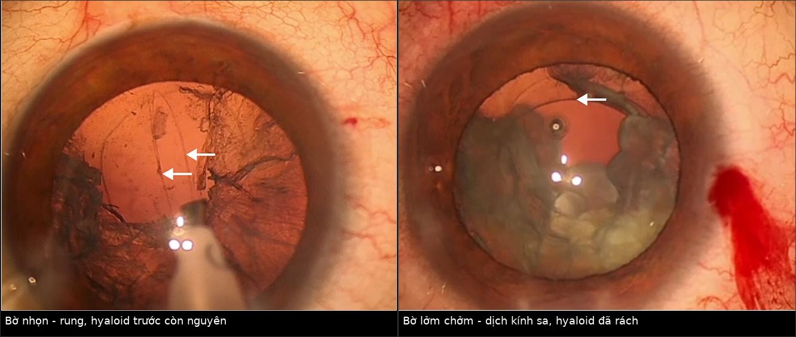
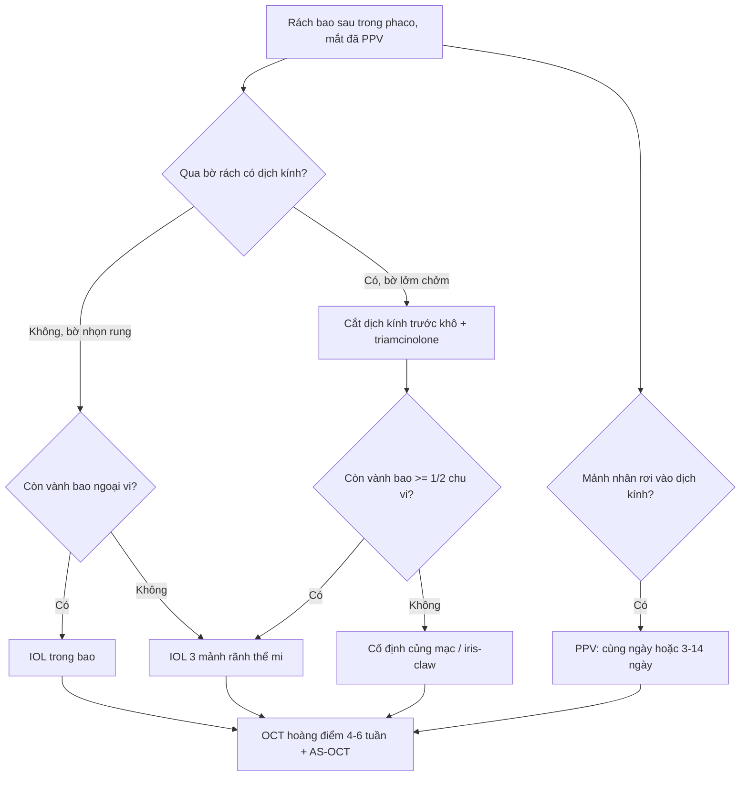
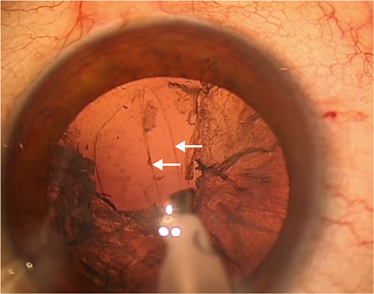
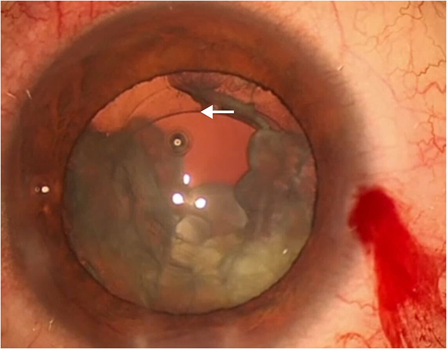
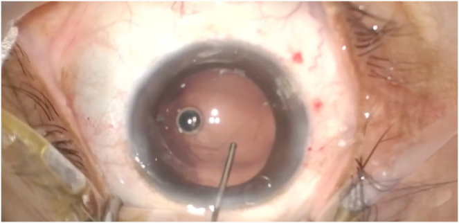

# 1883 — Rách bao sau trong phaco trên mắt ĐÃ cắt dịch kính: "flutter sign", sa dịch kính và chọn vị trí IOL / Posterior capsule rupture in the vitrectomized eye

**Tags:** `pattern:rach-bao-sau` `pattern:sa-dich-kinh` `pattern:mat-nhan-roi` `vung:the-thuy-tinh` `vung:tien-phong` `protocol:phaco` `protocol:PPV` `protocol:AS-OCT` `score:TCS`
**Mức chắc chắn (certainty):** tổng hợp y văn (literature synthesis) — ghép **1 đoàn hệ 2.719 mắt về PCR/sa dịch kính** (*Clin Ophthalmol* 2026, PMC13055850), **1 nghiên cứu 20 mắt về flutter sign** (*Clin Ophthalmol* 2025, PMC12665237, CC BY-NC 4.0), **1 ca IOL 1 mảnh đặt trong bao sau khi rách** (*Int J Surg Case Rep* 2026, PMC13166750, CC BY 4.0), **1 đoàn hệ 87 mắt phaco sau PPV** (*Clin Ophthalmol* 2018, PMC5973444), **1 phân tích gộp 23 nghiên cứu về thời điểm PPV khi rơi mảnh nhân** (*J Cataract Refract Surg* 2014, PMC4242692) và **1 đoàn hệ 246 mắt** (*Am J Ophthalmol* 2023, PMC9899933).

> **Câu chốt:** ở mắt **đã cắt dịch kính**, bao sau **không còn "đệm" dịch kính phía sau** và **màng hyaloid trước có thể đã mất** → rách lan nhanh, dịch kính **sa ra sớm hơn** và **mảnh nhân rơi tự do vào buồng dịch kính**. Vì vậy **kỹ thuật mổ thay đổi** (giảm lưu lượng, giữ tiền phòng ổn định, nhận diện bờ rách **nhọn–rung (flutter)** hay **lởm chởm–tĩnh (scalloped)**) và **vị trí IOL là quyết định trung tâm**: trong bao → rãnh thể mi (IOL 3 mảnh) → cố định củng mạc.

## 1. Tổng quan bệnh học – cơ chế hình ảnh

### 1.1 Vì sao mắt đã cắt dịch kính là "mắt khó"

- **Mất hỗ trợ cơ học phía sau:** bao sau thể thủy tinh là **màng đáy không có tế bào**, mỏng nhất ở **cực sau**; bình thường nó tựa trên **màng hyaloid trước + thể thủy tinh**. Sau **PPV (pars plana vitrectomy)** — đặc biệt khi **bóc màng giới hạn + lấy dịch kính trung tâm** — **màng hyaloid trước có thể không còn**, nên áp lực tưới (infusion) **tác động trực tiếp** lên mặt sau bao và **không có mô đỡ** khi đầu tip tạo áp lực.
- **Tiền phòng dao động mạnh (LIDRS):** ở mắt đã PPV hoặc cận thị cao, **lens–iris diaphragm retropulsion syndrome** hay gặp: tiền phòng **sâu bất thường** khi bơm dịch, rồi **sụp đột ngột** khi ngừng → đầu tip **hút vào bao sau/zonule**. Đây là cơ chế **rách bao sau và đứt zonule "không báo trước"** (PMC10058855).
- **Zonule yếu sẵn:** mắt đã mổ **bong võng mạc**, **cận thị cao**, **chấn thương**, dùng **dầu/gas** → dây chằng Zinn mỏng, bao sau **xơ–dày không đều**.
- **Không có "hàng rào" dịch kính:** khi bao rách, mảnh nhân/vỏ **rơi ngay vào buồng dịch kính** thay vì bị màng hyaloid giữ lại → **retained lens fragments (RLF)** và viêm – tăng nhãn áp – phù hoàng điểm về sau.

### 1.2 Vì sao "flutter" phân biệt được rách đơn thuần với sa dịch kính

- **Màng hyaloid trước còn nguyên** → bờ rách **nhọn, căng, "rung" (flutter)** theo dòng tưới, **dịch kính không thoát ra**. Nghiên cứu 20 mắt: **11 mắt** có bờ nhọn rung, **không cần cắt dịch kính trước**, **5 mắt đặt IOL trong bao**, **6 mắt đặt rãnh**, **100% đạt thị lực 20/20** (PMC12665237).
- **Màng hyaloid trước đã rách** → bờ **lởm chởm, mất căng, tĩnh (scalloped)**, kèm **dịch kính sa** dạng **"keo trong"** bắt triamcinolone. Cả **9 mắt** nhóm này **phải cắt dịch kính trước + IOL rãnh thể mi**; **3 mắt có mảnh vỏ/nhân di chuyển ra sau**, **1 mắt phải mổ lại**, **2 mắt thị lực 20/30** (PMC12665237).
- **Vì sao nhìn thấy "rung":** bờ bao là **màng đàn hồi**; khi còn màng hyaloid phía sau, **sức căng mặt phân cách** giữ bờ rách căng và **dao động theo xung dòng chảy**. Khi hyaloid mất, **dịch kính thoát** làm bờ **mất căng, cuộn lại** → mất hiện tượng rung. Đây là **dấu hiệu động học tại mổ**, không phải dấu hiệu trên ảnh.

### 1.3 Ngưỡng định lượng – dịch tễ và kết cục

| Đại lượng | Số liệu | Nguồn |
|---|---|---|
| Rách bao sau (PCR) ± sa dịch kính | **52/2.719 mắt = 1,9%** (45 PCR, trong đó 5 kèm sa dịch kính; 7 sa dịch kính đơn thuần do zonule) | PMC13055850 |
| Yếu tố nguy cơ độc lập | **PEX: OR 2,38** (p = 0,013; thô 2,72; p = 0,003) | PMC13055850 |
| Điểm nguy cơ trước mổ | **TCS ≥ 3**: OR 2,38 (p = 0,002) khi đơn biến; **1,79 (p = 0,057)** khi đa biến — **chưa đủ mạnh để một mình quyết định** | PMC13055850 |
| Gây tê tại chỗ vs toàn thân | **OR 0,51** (p = 0,019) — giảm nguy cơ | PMC13055850 |
| Tỉ lệ mảnh nhân/vỏ tồn lưu (RLF) | **1,47%** trong 10 năm tại một trung tâm châu Á (282 mắt bệnh / 289 mắt chứng); nguy cơ cao hơn ở **đái tháo đường, đục nhân dày, đục bao trước** | PMC9535911 |
| Phaco sau PPV (87 mắt) | Phù hoàng điểm **17,2%** (trung bình **42 ngày**), **PCO 13,8%** (14 tháng), **tăng nhãn áp 11,5%**, viêm màng bồ đào 1,1%; thị lực **20/50 → 20/25**, **91%** tăng ≥ 2 dòng, **95%** đạt ≥ 20/40 | PMC5973444 |
| Phù hoàng điểm sau phaco ở mắt đã PPV | Cao hơn khi PPV vì **màng biểu mô (ERM)**: phù sau PPV **12,8% (ERM) vs 1% (bong võng mạc)** | PMC11753465 |
| Thời điểm PPV khi rơi mảnh nhân | 246 mắt: **57% cùng ngày**, **13% trong tuần**, **30% sau 1 tuần** — **không khác biệt thị lực cuối** và **không khác tỉ lệ bong võng mạc** | PMC9899933 |
| PPV cùng ngày vs muộn (gộp 23 nghiên cứu) | Cùng ngày **tốt hơn "tất cả nhóm muộn"** (chênh nguy cơ thị lực không tốt **16,2%**; 95% CI 0,8–31,5), nhưng **không khác** so với **PPV sớm 3–14 ngày** | PMC4242692 |

## 2. Mẫu hình + chẩn đoán phân biệt theo mức hỗ trợ bao sau (gamut)

Sau khi bao sau rách, câu hỏi không còn là "rách hay không" mà là **còn bao nhiêu hỗ trợ cho IOL**:

1. **Bao sau nguyên vẹn** — đặt IOL trong bao (kể cả IOL 1 mảnh cao cấp; ca EDOF đặt trong bao sau rách vẫn đạt logMAR **0,0** tháng 6, nhãn áp **10–15 mmHg**, PMC13166750).
2. **Rách khu trú + hyaloid trước nguyên vẹn (flutter)** — có thể **vẫn trong bao** nếu rách nhỏ, ngoại vi, không dịch kính (**5/11 mắt** trong nghiên cứu), hoặc **rãnh thể mi**.
3. **Rách + sa dịch kính (scalloped)** — **cắt dịch kính trước bắt buộc** + **IOL 3 mảnh rãnh thể mi**.
4. **Mất hỗ trợ bao sau** (rách lan ra zonule, mất > 1/2 chu vi bao) → **cố định củng mạc / iris-claw**.
5. **Mảnh nhân rơi (dropped nucleus)** — **PPV** (cùng ngày nếu có ekip võng mạc; nếu không, **trong 3–14 ngày**).
6. **Rách bao sau phát hiện MUỘN sau mổ** — tiền phòng nông, IOL lệch, **phù hoàng điểm**, hoặc **mảnh nhân trong buồng dịch kính** trên **siêu âm B** (dấu hiệu tăng âm di động) / **AS-OCT** (IOL–bao).

**Mnemonic "3 chữ S" khi đối diện rách bao sau:** **S**upport (còn bao/zonule?), **S**oftern (dịch kính sa?), **S**ite (đặt IOL ở đâu?).

## 3. Bảng so sánh phân biệt (ma trận đối chiếu)

| Thực thể (mức hỗ trợ) | Hình ảnh / dấu hiệu tại mổ và trên ảnh | Chốt vào (rule-in) | Chốt loại (rule-out) | Gợi ý xác nhận |
|---|---|---|---|---|
| **Rách khu trú, hyaloid trước nguyên vẹn** | Bờ rách **nhọn, rung (flutter)** theo dòng tưới; **không có "keo" dịch kính** khi bôi triamcinolone | **Bờ rung + không dịch kính** → có thể **không cần cắt dịch kính trước** và **đặt IOL trong bao** | Bờ **lởm chởm, tĩnh** + dịch kính sa → **không** được đặt trong bao | Video mổ; quan sát bờ rách ở **lưu lượng thấp** (flutter chỉ thấy khi dòng ổn định) |
| **Rách + sa dịch kính (hyaloid trước đã rách)** | Bờ **scalloped**, dịch kính **dạng keo** bắt triamcinolone, đồng tử **hẹp lại** khi hút | **Dịch kính sa qua bờ rách** = phải **cắt dịch kính trước** | Dịch kính chỉ ở **vết mổ** (không qua bao) → xử trí tại chỗ, không mở rộng | Triamcinolone **không pha** bôi mặt sau; **"dry vitrectomy"** |
| **Mất hỗ trợ bao sau** | Không còn vành bao ≥ **1/2 chu vi**; AS-OCT: IOL **lệch trục**, mép quang học trong tiền phòng | **Không đủ vành bao** → **cố định củng mạc/iris-claw** | Còn **vành bao 3–4 mm** liên tục → rãnh thể mi | AS-OCT tiền phòng, đo **góc lệch IOL**, **khoảng cách IOL–bao** |
| **Mảnh nhân rơi (RLF)** | **Siêu âm B:** đám tăng âm **di động** trong dịch kính; **AS-OCT** không thấy bao sau; tiền phòng viêm | **Mảnh nhân/vỏ trong buồng dịch kính** = **PPV** | Tăng âm **cố định, bám võng mạc** → có thể là sẹo/màng, không phải mảnh nhân | B-scan **động** (đổi tư thế), **không** dùng CT/MRI |
| **Rách bao sau + phù hoàng điểm sau mổ** | OCT: **nang trong võng mạc**, dày **trung tâm hoàng điểm**; mặt cắt qua IOL thấy **mép bao** | **Phù hoàng điểm có nang + tiền sử PCR** | Phù nhẹ **không nang** sau mổ 1–2 tuần = sinh lý | OCT hoàng điểm **4–6 tuần** (đỉnh ~42 ngày) |

*Trái: bờ rách nhọn, mũi tên chỉ mép bao — màng hyaloid trước còn. Phải: bờ lởm chởm + dịch kính sa, mũi tên chỉ màng hyaloid đã rách. Nguồn: Clin Ophthalmol 2025 (PMC12665237), CC BY-NC 4.0; ảnh ghép letterbox, không crop.*

### 3.1 Ba câu hỏi chốt ngay khi thấy bao sau rách ở mắt đã PPV

1. **Bờ rách rung hay tĩnh?** Rung → hyaloid trước còn → có thể **giữ trong bao**; tĩnh + lởm chởm → **phải cắt dịch kính trước**.
2. **Có mảnh nhân/vỏ nào đã ra sau chưa?** Ở mắt đã PPV **không có dịch kính đỡ**, mảnh rơi **nhanh và xa** hơn → **ngừng hút ngay**, đánh giá bằng **B-scan** nếu không nhìn thấy.
3. **Còn vành bao để đặt rãnh không?** Không → **cố định củng mạc**; **không đặt IOL 1 mảnh vào rãnh** (xem mục 5).

## 4. Protocol — trước, trong và sau mổ + thuật toán

### 4.1 Trước mổ

- **Đánh giá nguy cơ:** PEX (**OR 2,38**), TCS ≥ 3, **mắt đã PPV**, cận thị cao, đục nhân dày, đục bao trước, đái tháo đường (**RLF 1,47%** toàn bộ, cao hơn ở nhóm này).
- **Sinh trắc lại:** ở mắt đã PPV, **chiều dài trục và độ sâu tiền phòng thay đổi**; dùng **cùng công thức/thiết bị** với mắt còn lại để so sánh, ghi rõ **công thức + hằng số A** vào hồ sơ (yếu tố quyết định khi phải đổi từ trong bao sang rãnh/cố định).
- **Tư vấn trước mổ:** nêu **nguy cơ PCR ~2%**, **phù hoàng điểm 17,2%** sau phaco ở mắt đã PPV, khả năng **mổ 2 thì** nếu rơi nhân.

### 4.2 Trong mổ — thứ tự kiểm soát

1. **Giữ tiền phòng ổn định**: **cohesive OVD** đủ, **giảm lưu lượng tưới–hút**, **tránh bơm mạnh** (LIDRS).
2. **Nhuộm bao bằng trypan blue** để thấy bờ rách.
3. **Nhận diện flutter sign** (xem mục 1.2) — quyết định **có/không cắt dịch kính trước**.
4. **Nếu có dịch kính:** cắt dịch kính trước **"khô"** (không bơm BSS liên tục), bôi **triamcinolone** để lộ dịch kính còn sót, cắt sạch **tới bờ bao** và **vết mổ**.
5. **Quyết định vị trí IOL** theo vành bao (mục 2); **IOL 3 mảnh** cho rãnh, **không** dùng IOL 1 mảnh cho rãnh.
6. **Nếu mảnh nhân rơi:** ngừng thao tác, **không cố gắng lấy bằng đầu tip trong tiền phòng**; chuyển **PPV** (cùng ngày nếu có ekip; nếu không, **3–14 ngày** — không khác biệt kết cục so với cùng ngày).

### 4.3 Sau mổ

- **Ngày 1:** nhãn áp, tiền phòng, vị trí IOL (đèn khe), soi **mép bao**.
- **4–6 tuần:** **OCT hoàng điểm** (đỉnh phù hoàng điểm sau phaco ở mắt đã PPV là **~42 ngày**) + **AS-OCT tiền phòng** đánh giá **IOL trong bao/rãnh**, độ nghiêng, khoảng cách tới bao.
- **Theo dõi dài hạn:** **PCO 13,8%** (trung vị 14 tháng), **tăng nhãn áp 11,5%**.

### 4.4 Bẫy "giá trị của chờ đợi" khi rơi mảnh nhân

- **246 mắt** (Bascom Palmer): PPV **cùng ngày 57%**, **trong tuần 13%**, **sau 1 tuần 30%** — **không khác thị lực cuối**, **không khác tỉ lệ bong võng mạc** (PMC9899933).
- **Phân tích gộp 23 nghiên cứu:** PPV **cùng ngày** tốt hơn **"mọi nhóm muộn"** (chênh **16,2%** nguy cơ thị lực không tốt) nhưng **không khác** **PPV 3–14 ngày** → **"sớm" quan trọng hơn "ngay lập tức"** (PMC4242692).
- Hệ quả thực hành: **không cần mổ cấp cứu ban đêm** nếu không có dấu hiệu viêm/tăng nhãn áp nặng; **đặt lịch trong 3–14 ngày** với ekip võng mạc là hợp lý.

## 5. Biến thể bình thường và cạm bẫy

- **"Không thấy dịch kính" ở mắt đã PPV ≠ an toàn:** màng hyaloid trước có thể đã mất cùng dịch kính, nên **không có "keo" để thấy** — mảnh nhân vẫn có thể **rơi tự do**. Đánh giá bằng **B-scan**, không dựa vào cảm giác "sạch".
- **Bỏ qua bờ scalloped:** nếu không cắt dịch kính trước, dịch kính **dính vào vết mổ** → **phù hoàng điểm, bong võng mạc, viêm nội nhãn**; bờ **tĩnh** là dấu hiệu **phải hành động**, không phải "đẹp".
- **IOL 1 mảnh đặt rãnh thể mi:** quang học 1 mảnh có **haptic cứng, góc nghiêng** → **chafing thể mi, pigment dispersion, UGH, nghiêng IOL**; chỉ dùng **IOL 3 mảnh** cho rãnh.
- **LIDRS giả "tiền phòng tốt":** tiền phòng **sâu bất thường** rồi **sụp** khi ngừng bơm — đừng tăng lưu lượng để "mở" tiền phòng, mà **giảm lưu lượng + thêm OVD**.
- **AS-OCT ngay sau mổ:** phù giác mạc làm **mờ mặt cắt**, dễ đọc sai vị trí IOL → hẹn **AS-OCT khi giác mạc trong** (thường 2–4 tuần).
- **Rách bao sau muộn** (sau mổ) hay bị gọi là "phù hoàng điểm vô căn": luôn **soi mép bao + AS-OCT** trước khi kết luận.

## 6. Tự lượng giá — Blind Quiz

**Ca 1 — mắt đã PPV vì bong võng mạc, phaco, thấy bờ rách ở trung tâm ảnh. Quan sát trước khi mở đáp án.**

- Câu hỏi: Bờ rách **rung hay tĩnh**? Màng hyaloid trước còn hay mất? Có bắt buộc cắt dịch kính trước không?

<b>Bấm để hiện đáp án (findings + chẩn đoán)</b>

- Findings: hai mũi tên chỉ **mép bao sau nhọn**, căng, **rung** theo xung dòng tưới — **không có dịch kính sa**.
- Chẩn đoán: **rách bao sau đơn thuần, màng hyaloid trước nguyên vẹn** → **không cần cắt dịch kính trước**; trong nghiên cứu nguồn **11 mắt** như vậy, **5 mắt đặt IOL trong bao**, **6 mắt rãnh**, **tất cả đạt 20/20**.
- Nguồn ảnh: *Clin Ophthalmol* 2025;19:4313–4321 (PMC12665237), CC BY-NC 4.0.

**Ca 2 — cùng bối cảnh, bờ rách khác hẳn.**

- Câu hỏi: Dấu hiệu nào nói **màng hyaloid trước đã rách**? Bước tiếp theo bắt buộc là gì, và đặt IOL ở đâu?

<b>Bấm để hiện đáp án</b>

- Findings: bờ **lởm chởm, tĩnh**, mũi tên chỉ **màng hyaloid** đã rách, dịch kính sa vào tiền phòng.
- Xử trí: **cắt dịch kính trước** (khô, có triamcinolone) + **IOL 3 mảnh rãnh thể mi**; nhóm này **9/9 mắt** phải làm vậy, **1 mắt** cần mổ lại vì mảnh nhân lớn.
- Nguồn ảnh: PMC12665237, CC BY-NC 4.0.

**Ca 3 — rách bao sau phát hiện sau khi đã lấy nhân, trước khi đặt IOL.**

- Câu hỏi: Với vị trí rách này, đặt IOL **trong bao** có được không? Điều kiện nào khiến câu trả lời là "có"?

<b>Bấm để hiện đáp án</b>

- Findings: rách bao sau **khu trú**, vành bao ngoại vi còn liên tục; không thấy dịch kính.
- Chẩn đoán/xử trí: ca nguồn đặt **IOL 1 mảnh EDOF trong bao**; tháng 6 **logMAR 0,0**, nhãn áp **15 mmHg**. Điều kiện: **rách nhỏ, ngoại vi, không dịch kính, vành bao còn** — nếu không đủ thì chuyển **rãnh (IOL 3 mảnh)** hoặc **cố định củng mạc**.
- Nguồn ảnh: *Int J Surg Case Rep* 2026;138(5):1679–1682 (PMC13166750), CC BY 4.0.

## Bài liên quan chéo

- [1882 – Phù hoàng điểm do prostaglandin sau phaco](../1882-phu-hoang-diem-prostaglandin-sau-phaco/lesson.md)
- [1877 – PFCL tồn lưu dưới võng mạc](../1877-pfcl-ton-luu-duoi-vong-mac/lesson.md)
- [1425 – Viêm nội nhãn sau tiêm nội nhãn](../1425-viem-noi-nhan-sau-tiem-noi-nhan/lesson.md)
- [1455 – Anti-VEGF trên mắt đã cắt dịch kính](../1455-anti-vegf-mat-da-cat-dich-kinh/lesson.md)
- [1873 – Bao sau đục thứ phát trên mắt bơm dầu (YAG)](../1873-bao-sau-duc-thu-phat-mat-bom-dau-yag/lesson.md)

> Không dùng để chẩn đoán độc lập khi chưa có người hướng dẫn.
