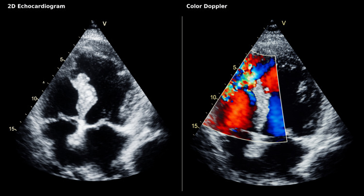
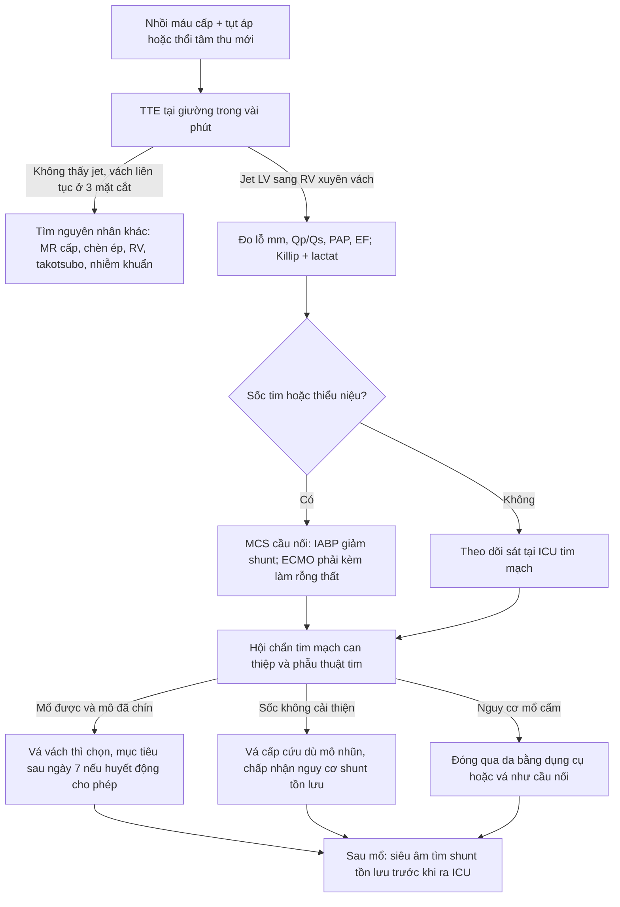
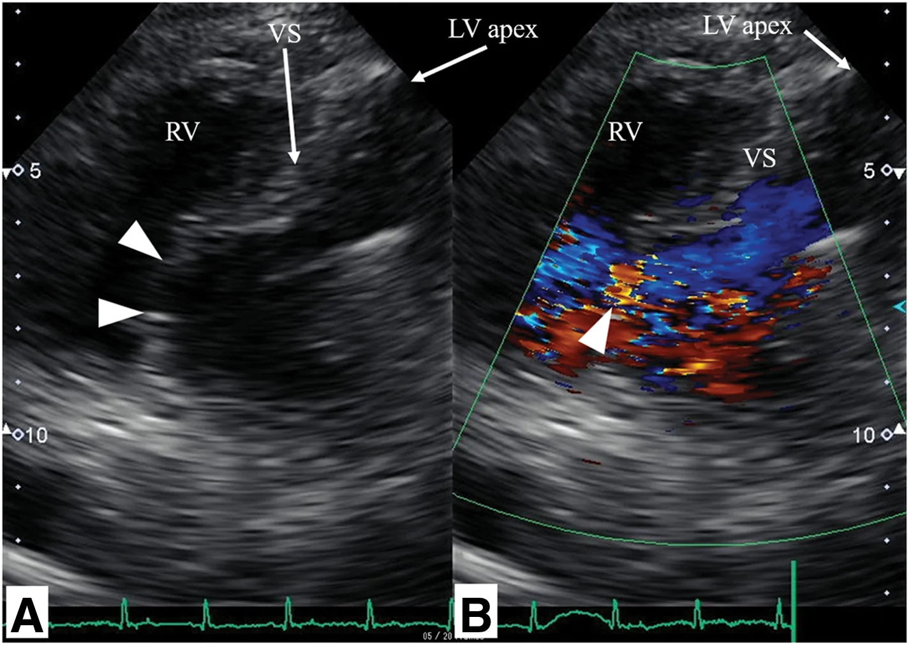

# 1884 — Thủng vách liên thất sau nhồi máu cơ tim cấp / Post-infarction ventricular septal rupture (VSR)

**Tags:** `pattern:shunt-trai-phai` `pattern:thoi-tam-thu-moi` `pattern:tut-ap` `vung:tim` `vung:cotim` `protocol:sieutham-khan` `protocol:Doppler-mau` `protocol:TEE` `protocol:CTA-tim` `score:Killip` `score:Qp-Qs`

**Mức chắc chắn (certainty):** tổng hợp y văn (literature synthesis) — ghép 4 chuỗi dữ liệu: (a) 214 ca VSR một trung tâm, tử vong 30 ngày **51,9%** (***J Thorac Dis* 2026, PMC13655813, CC BY-NC-ND 4.0**); (b) 138 ca mổ VSR, tử vong chu phẫu **17,3%**, mổ **≥ 8 ngày** có lợi (**Wu L et al., *Cardiovasc Diagn Ther* 2026, PMC13554388, CC BY-NC-ND 4.0**); (c) đoàn hệ 59 ca biến chứng cơ học, tử vong 30 ngày **59,3%** (**Alén A et al., *J Clin Med* 2026, PMC13706350, CC BY 4.0**); (d) 2 ca nguyên văn có ảnh siêu âm (**Cota-Arce JM et al., *Cureus* 2026, PMC13220294, CC BY 4.0**; **Yoshikai M et al., *Surg Case Rep* 2026, PMC13719268, CC BY 4.0**). Số nào nguồn không đưa thì ghi "chưa rõ".

> **Bài này trả lời 4 câu hỏi của ca "tụt áp + thổi tâm thu mới" sau nhồi máu:**
> (1) **Siêu âm tại giường phải làm trong bao lâu và ở mặt cắt nào?** (2) **Doppler màu đọc thế nào để không bỏ sót lỗ nhỏ?** (3) **Qp/Qs bao nhiêu là shunt đáng kể, và vì sao phải đo?** (4) **Mổ ngay hay chờ mô hoại tử "chín" — và vì sao ECMO không làm rỗng thất có thể làm nặng thêm shunt?**
> Đây là mặt **cấu trúc – cơ học** của nhồi máu cấp; khác [1842 – Takotsubo](../1842-takotsubo-hau-phau-icu/lesson.md) (rối loạn vận động không do tắc mạch) và [075 – Tràn dịch màng tim](../075-tran-dich-mang-tim/lesson.md) (vỡ thành tự do gây chèn ép).

## 1. Tổng quan bệnh học – cơ chế hình ảnh

### 1.1 Vì sao vách rách đúng vào ngày 3–7

- Nhồi máu **xuyên thành** → hoại tử đông (coagulative necrosis) → **bạch cầu trung tính** vào ồ ạt ngày 1–3, tiêu mô hoại tử → **mô mềm nhũn nhất vào ngày 3–7**; đây là cửa sổ vách rách. Mô hoại tử **mất khả năng chịu lực** trong khi áp lực trong thất trái vẫn **100–140 mmHg**.
- **Phân bố vỡ tim:** vỡ thành tự do (free-wall rupture, FWR) **~70%**, **VSR ~20%**, đứt cơ nhú (papillary muscle rupture, PMR) **~10%**; VSR **đỉnh vào ngày 3–7**, FWR **hai đỉnh < 24 giờ và 3–5 ngày**, PMR **2–7 ngày** (PMC13631418 — tổng quan về vỡ tim sau NMCT).
- **Tần suất hiện đại:** **0,21–0,27%** STEMI (0,27% trong phân tích ~9 triệu ca nhập viện, tử vong nội viện **42,4%**; NSTEMI 0,06%, **18,0%**) — dẫn qua PMC13706350; ca nguyên văn PMC13220294 dẫn **0,21%**.
- **Tiên lượng:** tử vong 30 ngày **51,9%** trên 214 ca (nhóm điều trị nội khoa đơn thuần **90,1%**; mổ kinh điển **25,0%**; can thiệp qua da **25,7%**) — PMC13655813. Tử vong **chu phẫu 17,3%** ở nhóm **mổ được** (138 ca) — PMC13554388, tức là "chọn được bệnh nhân để mổ" đã là một nửa tiên lượng.

### 1.2 TẠI SAO thấy được trên siêu âm (vật lý, không phải "vì nó thủng")

- **2D:** lỗ là **mất liên tục cơ tim vách** — bờ **"bite-like"** (bị gặm) vì mô hoại tử rời rạc, khác bờ nhẵn của thông liên thất bẩm sinh. Kích thước đo được: **11 mm** (ca PMC13220294, vách đỉnh) và **18 mm** (ca PMC13719268, vách nền).
- **Doppler màu:** chênh áp thất trái–thất phải cuối tâm thu **~100 mmHg** (HA 120 so với RV 25) → vận tốc jet **> 4 m/s**, vượt ngưỡng Nyquist thường đặt **50–70 cm/s** → **alias**: chuỗi đỏ–vàng–xanh "mosaic" **bắt đầu từ bờ trái của vách, phụt sang thất phải**, rộng nhất thì tâm thu. Jet **vận tốc cao** là lý do Doppler màu thấy rõ hơn 2D.
- **Doppler liên tục (CW):** đo vận tốc đỉnh, gradient **ΔP = 4v²** (Bernoulli giản lược); ví dụ v = 4 m/s → ΔP ≈ **64 mmHg**, phù hợp sinh lý chênh áp.
- **Qp/Qs (tỉ lệ dòng phổi/dòng hệ thống):** shunt trái–phải làm **dòng phổi lớn hơn dòng hệ thống**; bình thường **1,0**; ngưỡng quy ước shunt đáng kể **≥ 1,5**. Ca thật trong y văn: **2,3** (PMC13220294), **2,5** và **5,6** (PMC13044581), **2,75** (PMC13531077), **6,2** (PMC13719268), **8,17** (PMC13485405) — tức là VSR sau nhồi máu thường **shunt rất lớn**, lớn hơn nhiều thông liên thất bẩm sinh cùng kích thước.
- **Hệ quả sinh lý:** thất phải **quá tải thể tích** + phổi ứ → **giảm cung lượng hệ thống**; tụt áp, thận giảm tưới máu (creatinin và lactat tăng là yếu tố tiên lượng độc lập, OR **1,010** mỗi µmol/L và **1,337** mỗi mmol/L — PMC13655813).

## 2. Mẫu hình + chẩn đoán phân biệt theo vị trí và thời điểm (Gamut)

- **Theo vị trí lỗ:** **đỉnh/giữa vách** (nhồi máu trước, LAD — **89,8%** ca mổ có LAD là động mạch thủ phạm, PMC13554388); **vách nền/basal** (nhồi máu dưới, RCA — sát van nhĩ–thất, mổ khó, dễ sót shunt, ca PMC13719268); **sau–dưới**. Vị trí quyết định **đường mổ** (vách nền: đường vào nhĩ phải, tránh rạch thất).
- **Theo thời điểm so với nhồi máu:** **< 24 giờ** (hiếm, thường kèm vỡ thành), **1–7 ngày** (đa số, mô nhũn nhất), **> 7 ngày** ("VSR muộn" — mô xơ hơn, mổ thuận lợi hơn nhưng phải sống được đến lúc đó).
- **Gamut của "tụt áp + thổi tâm thu mới" sau NMCT** — gợi nhớ **RAMP**:
  - **R**upture septum (VSR) — thổi tâm thu **thô, lan rộng**, kèm **rung miu**, tăng khi giảm hậu tải.
  - **A**cute mitral regurgitation (đứt cơ nhú) — thổi **phụt tâm thu** ra nách, phù phổi nặng nhanh.
  - **M**echanical tamponade (vỡ thành tự do) — **không có thổi**, tĩnh mạch cổ nổi, điện tim giảm biên độ.
  - **P**ump failure (nhồi máu thất phải, takotsubo, choáng nhiễm khuẩn) — không thổi mới, không shunt.
  - Ngoài ra: tràn khí màng phổi áp lực sau đặt catheter trung tâm/máy tạo nhịp — **không thổi**, phổi một bên mất dấu.

## 3. Bảng so sánh phân biệt (ma trận đối chiếu)

| Thực thể (entity) | Hình ảnh điển hình | Chốt vào (rule-in) | Chốt loại (rule-out) | Gợi ý xác nhận |
|---|---|---|---|---|
| **VSR sau NMCT** | Mất liên tục vách, bờ "bite-like"; Doppler màu **jet mosaic LV→RV** thì tâm thu; Qp/Qs ≥ 1,5 | **Jet xuyên vách có hướng LV→RV trên Doppler màu + ổ hoại tử cơ tim cùng vùng** | Vách **liên tục** ở mọi mặt cắt + không jet dù Nyquist thấp → không phải VSR | TTE + Doppler màu/CW; TEE nếu vách nền; thông tim đo Qp/Qs; CTA trước can thiệp qua da |
| **Đứt cơ nhú / hở hai lá cấp** | Dây van/lá van **lật vào nhĩ trái** thì tâm thu; jet hở hai lá **hướng ra nách**, phổ CW dày đặc | **Jet hở hai lá mới + lá van/dây bị đứt thấy được** | Jet xuyên vách LV→RV → không phải MR đơn thuần | TTE + TEE; đo diện tích lỗ hở (ERO), tĩnh mạch phổi ứ |
| **Vỡ thành tự do / chèn ép tim** | **Dịch màng tim** ± cục máu, thất phải **xẹp thì tâm trương**, đảo ngược vận động vách | **Dịch màng tim + xẹp buồng + tụt áp** | Không dịch, không xẹp buồng → không chèn ép | TTE dưới sườn; chọc dẫn lưu cấp cứu |
| **Nhồi máu thất phải** | RV **giãn**, vách **đẩy về thất trái**, TAPSE giảm, phổi **sạch** | **RV giãn + phổi sạch + tụt áp** | Phổi ứ nặng + RV không giãn → nghĩ VSR/MR | TTE; ECG V4R; áp lực nhĩ phải |
| **Takotsubo hậu phẫu/ICU** | Bóng cơ tim đỉnh–giữa, **vượt quá một lãnh thổ vành**, không có lỗ vách | **Rối loạn vận động vượt lãnh thổ + không jet xuyên vách** | Có jet xuyên vách → loại takotsubo đơn thuần | [1842](../1842-takotsubo-hau-phau-icu/lesson.md): T2 map, troponin thấp so với mức rối loạn vận động |
| **Sốc nhiễm khuẩn / VAP sau mổ** | Tim **không có tổn thương cơ học mới**; ổ nhiễm ngoài tim | **Có ổ nhiễm + tim không jet, không dịch** | Có jet xuyên vách hoặc dịch chèn ép → loại nguyên nhân ngoài tim | Cấy máu/đờm; siêu âm phổi; không trì hoãn TTE |

*Trái: 2D — vách liên thất đỉnh **mỏng, mất liên tục, bờ "bite-like"**. Phải: Doppler màu — **jet mosaic LV→RV** xuyên lỗ vách, xác nhận shunt trái–phải. Nguồn: Cureus 2026, PMC13220294, CC BY 4.0.*

### 3.1 Ba câu hỏi hình ảnh quyết định

1. **Có lỗ thật hay chỉ là "drop-out" do mặt cắt?** Xoay đầu dò ±15°, đổi mặt cắt (4 buồng → trục ngắn → dưới sườn), hạ Nyquist; lỗ thật phải thấy **ở ≥ 2 mặt cắt trực giao** và **có jet**.
2. **Jet đi chiều nào?** LV→RV (shunt trái–phải) = VSR; RV→LV = hiếm, gặp khi áp lực thất phải vượt thất trái (shunt đảo chiều, tiên lượng nặng).
3. **Shunt lớn đến đâu?** Đo **Qp/Qs** (siêu âm: đường kính đường ra thất trái/phải × VTI; hoặc thông tim). **Qp/Qs ≥ 1,5** = đáng kể; đồng thời tìm **dấu hiệu thất phải quá tải** (RV giãn, vách đẩy sang trái, tĩnh mạch chủ dưới giãn).

## 4. Protocol chụp + phân độ + thời điểm can thiệp

### 4.1 Trình tự tại giường (không chờ "giờ hành chính")

1. **TTE trong vài phút** khi có thổi tâm thu mới, tụt áp, phù phổi, hoặc khi nghi biến chứng cơ học: mặt cắt **4 buồng từ mỏm**, **trục ngắn cạnh ức**, **dưới sườn**; quét **toàn bộ vách** từ nền đến đỉnh (lỗ vách nền rất dễ sót).
2. **Doppler màu Nyquist 50–70 cm/s** phủ toàn vách; thấy jet lạ → **CW** đo vận tốc, tính **ΔP = 4v²**.
3. **Đo:** kích thước lỗ (mm), Qp/Qs, PAP, EF, có/không hở hai lá, có/không dịch màng tim.
4. **TEE** khi cửa sổ kém, nghi **VSR vách nền** hoặc trước can thiệp qua da; **CTA tim** khi cần bản đồ giải phẫu cho dụng cụ đóng qua da (**không** trì hoãn mổ cấp vì CT).
5. **Phân độ Killip** (I–IV) + lactat/creatinin: đây là các biến tiên lượng độc lập trong mô hình 30 ngày (OR lactat **1,337**; creatinin **1,010**) — PMC13655813.

### 4.2 "Mổ ngay hay chờ" — hai nguồn, một hướng

- **STS database (dẫn trong PMC13220294):** tử vong mổ **42,9%** chung; **54,1%** nếu mổ **< 7 ngày** so với **18,4%** nếu **> 7 ngày**.
- **Nhóm Bắc Kinh (PMC13554388, 138 ca):** tử vong chu phẫu **39,4%** khi mổ **< 7 ngày** so với **9,0%** khi **> 7 ngày**; **VSR→mổ ≥ 8 ngày OR 0,156** (KTC 95% 0,055–0,444); **mở lại động mạch thủ phạm (opened IRA) OR 0,214** — vì mở IRA giúp bệnh nhân **sống đến cửa sổ mổ** (72,5% so với 86,5% sống qua ngày 8).
- **Nhưng "chờ" chỉ dành cho người chờ được:** nhóm **sốc tim/thiểu niệu** phải mổ hoặc can thiệp ngay; nhóm 214 ca cho thấy điều trị nội đơn thuần tử vong **90,1%**.
- **Cầu nối:** **IABP** giảm hậu tải → **giảm shunt** (37,6% ca mổ được dùng IABP — PMC13554388). **VA-ECMO** khôi phục tưới máu nhưng **tăng hậu tải thất trái** và **có thể làm tăng shunt** nếu không **làm rỗng thất (LV unloading)** — PMC13706350; đây là lý do ECMO đơn thuần không được coi là "điều trị VSR".
- **ESC 2023 (ACS):** nghi biến chứng cơ học → **siêu âm tim ngay**, chuyển **trung tâm có phẫu thuật tim**, cân nhắc **MCS ngắn hạn** để cầu nối.

### 4.3 Ngưỡng hành động (ghi vào phiếu)

- **Thổi tâm thu mới + tụt áp** → TTE **< 30 phút**, không chờ siêu âm tim chính quy.
- **Qp/Qs ≥ 1,5** hoặc **thất phải giãn + phổi ứ** → chỉ định **đóng lỗ**, không theo dõi nội khoa đơn thuần.
- **VSR→mổ ≥ 8 ngày** là mục tiêu **nếu huyết động cho phép**; sốc không đáp ứng MCS → mổ sớm, chấp nhận tử vong chu phẫu cao (**39,4–54,1%**).

## 5. Biến thể bình thường và cạm bẫy

- **Biến thể bình thường dễ nhầm:** **drop-out vách đỉnh** ở mặt cắt 4 buồng (do mặt phẳng cắt song song vách) — bờ nhẵn, **không jet**, mất khi xoay đầu dò; **dây van/phần phụ** tạo tín hiệu Doppler giả trong buồng thất; **thông liên thất bẩm sinh** ở người trẻ (bờ nhẵn, không ổ hoại tử, có bệnh sử).
- **Cạm bẫy 1 — "bệnh nhân im lặng":** tiếng thổi **bị máy thở, tiếng ồn ICU, vận mạch** che mất; nhóm 214 ca có **68,5%** ca tử vong vào với sốc tim mà nhiều ca không ghi nhận thổi rõ. *Nghi ngờ huyết động là đủ để chụp.*
- **Cạm bẫy 2 — chỉ đọc 2D:** lỗ **11 mm** có thể kín trên một mặt cắt; **luôn bật Doppler màu** và quét toàn vách.
- **Cạm bẫy 3 — bỏ sót vách nền:** VSR **basal** sát van nhĩ–thất, dễ bị che bởi van ba lá; cần **TEE** và mặt cắt dưới sườn.
- **Cạm bẫy 4 — "đã tái thông thì không vỡ":** ca **76 tuổi** (PMC13220294) vỡ **36–48 giờ sau** chiến lược dược–can thiệp đúng giờ, và ca **88 tuổi** (PMC13719268) vỡ **sau PCI thành công**. Tái thông **giảm** nhưng **không xóa** nguy cơ.
- **Cạm bẫy 5 — shunt tồn lưu sau vá:** **2/24** ca tử vong chu phẫu do **shunt tồn lưu gây suy tim** (PMC13554388) → bắt buộc **siêu âm kiểm tra ngay sau mổ**.
- **Cạm bẫy 6 — bỏ sót tổn thương phối hợp:** **~5%** ca VSR mổ có **biến chứng cơ học thứ hai** (vỡ thành/phình giả) trong đoàn hệ CAUTION; đoàn hệ 59 ca có **16,9%** VSR + vỡ thành kín (PMC13706350) → luôn khảo sát **toàn bộ thành tự do và van hai lá**.
- **Cạm bẫy 7 — ECMO không làm rỗng thất:** tăng hậu tải → **shunt tăng**, phổi ứ nặng hơn dù huyết áp "đẹp" (PMC13706350).

## 6. Tự lượng giá — Blind Quiz

**Ca 1 — Nam 76 tuổi, nhồi máu trước, đã tiêu sợi huyết đúng giờ; 36 giờ sau nghe thổi tâm thu thô. Nhìn 2D trước, rồi bật màu.**

- Gợi ý lâm sàng: huyết động **còn ổn**; không đau ngực; không sốt.
- Câu hỏi: (1) Bất thường ở vách là gì? (2) Vì sao Doppler màu thấy rõ hơn 2D? (3) Qp/Qs ước lượng được từ đâu và bao nhiêu thì đáng kể?

<b>Bấm để hiện đáp án (findings + chẩn đoán)</b>

- **Findings:** vách liên thất **đỉnh–dưới mỏng, mất liên tục kiểu "bị gặm"**, lỗ **11 mm**; Doppler màu: **jet mosaic LV→RV** thì tâm thu, Qp/Qs **2,3** (số của ca gốc).
- **Chẩn đoán:** **VSR sau nhồi máu** (thể đơn giản — simple VSR), phát hiện **36–48 giờ sau tái thông**.
- **Vì sao màu thấy rõ:** chênh áp ~100 mmHg → vận tốc > 4 m/s, vượt Nyquist → alias; jet vận tốc cao "vẽ" đường đi của shunt trong khi lỗ 11 mm trên 2D chỉ là một khoảng trống nhỏ.
- **Nguồn:** Cureus 2026, PMC13220294, CC BY 4.0 (ảnh nguyên bản, không chỉnh sửa).

**Ca 2 — Nữ 88 tuổi, nhồi máu dưới, PCI thành công; tụt áp, phải IABP. Mặt cắt từ mỏm.**

- Gợi ý lâm sàng: suy tim cấp, IABP; lỗ **18 mm** vùng **vách nền**.
- Câu hỏi: (1) Vị trí lỗ khác ca 1 ở điểm nào và vì sao khó mổ hơn? (2) Qp/Qs đo được **6,2** nói lên điều gì? (3) Vì sao IABP có lợi về mặt shunt?

<b>Bấm để hiện đáp án (findings + chẩn đoán)</b>

- **Findings:** (A) vách **nền** mất liên tục (arrowheads), (B) **jet trái–phải** qua lỗ; thông tim: **Qp/Qs 6,2**, PAP **60/28 mmHg** (trung bình 43), PCWP **28 mmHg**.
- **Chẩn đoán:** **VSR vách nền sau nhồi máu dưới**, shunt rất lớn; mổ **ngày 11** bằng đường **nhĩ phải + hai miếng vá (sandwich)**, không rạch thất; sống **5,5 năm** không shunt tồn lưu.
- **Vì sao khó:** vách nền **sát van ba lá và van hai lá**; dây van và cơ nhú bám vách nằm ngay đường khâu → dễ sót shunt và hở van; đường nhĩ phải cho phép nhìn thẳng lỗ mà **không cắt cơ tim lành**.
- **Qp/Qs 6,2:** dòng phổi gấp **> 6 lần** dòng hệ thống — mức shunt "khổng lồ", giải thích phù phổi và tụt áp; đây là chỉ định đóng.
- **IABP:** giảm hậu tải thất trái → **giảm chênh áp LV–RV** → **giảm lượng shunt**, đồng thời tăng tưới máu vành; không thay thế được đóng lỗ.
- **Nguồn:** Surg Case Rep 2026, PMC13719268, CC BY 4.0.

## Bài liên quan chéo
- [800 – Tổng quan Tim mạch](../800-cardiovascular-overview/lesson.md)
- [810 – CTA vành CAD-RADS](../810-coronary-cta-cadrads/lesson.md) (đánh giá động mạch thủ phạm trước can thiệp)
- [820 – MRI tim LGE](../820-cardiac-mri-lge-mapping/lesson.md) (đánh giá hoại tử và sống cơ sau mổ)
- [1842 – Takotsubo ở ICU và hậu phẫu](../1842-takotsubo-hau-phau-icu/lesson.md) (hàng DDx của tụt áp không có thổi)
- [1885 – Viêm màng ngoài tim co thắt](../1885-viem-mang-ngoai-tim-co-that/lesson.md) (suy tim sau mổ tim)
- [075 – Tràn dịch màng tim](../075-tran-dich-mang-tim/lesson.md) (vỡ thành tự do, chèn ép tim)

## Ảnh
- `images/1884_thung-vach_TTE-4buong_PMC13220294.jpg` — TTE 4 buồng: 2D + Doppler màu — *Cureus* 2026, PMC13220294, **CC BY 4.0**.
- `images/1884_thung-vach_TTE-Doppler_PMC13719268.jpg` — TTE: (A) lỗ vách nền, (B) jet trái–phải — *Surg Case Rep* 2026, PMC13719268, **CC BY 4.0**.
- Chi tiết nguồn + giấy phép: `images/CREDITS.md`.

> Không dùng để chẩn đoán độc lập khi chưa có người hướng dẫn.
